# 页面标注、同文处理与审查操作

> 2026-10-15 本轮操作指南。新增方案恢复、外部部分还原、PDF工程重开、OCR原因与AI还原操作；图示流程已用隔离账号和合成材料实际操作。整体门禁结果见当前完成状态。实际服务器版本与发布时间见发布记录。首次使用建议先完成第 1 节的小样例，再操作业务材料。

## 先走完一次完整流程

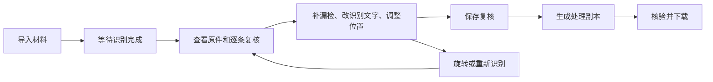

先用一份不含真实敏感数据的短文件练习。完成逐条处理、保存、生成和下载后，打开下载文件核对。页面预览和“识别完成”均不能代替最终文件检查。

### 图片、PDF 和带嵌图 Word：先选择副本方式

在**原件页面的画布下方**找到对应复选框。**先勾选，再点击“保存复核”**；如果保存以后才勾选，需要再保存一次。尚未选择副本方式时，导出按钮保持禁用。

| 材料 | 勾选界面的确切选项 | 输出变化 |
|---|---|---|
| PNG／其他图片 | **生成清除选区像素的 PNG 副本** | 下载实际清除敏感像素的 PNG。 |
| PDF | **转换为不可选字的图片型 PDF 副本** | 输出为图片型 PDF，正文不再可选字。 |
| Word 内嵌图片 | **清除内嵌图片选区像素，生成 DOCX 副本** | 对所选嵌图像素应用处理，生成 DOCX。 |

勾选只选择输出方式，不替代逐项复核。保存后生成处理副本，任务完成再核验下载；原件保持用于对照。

## 1. 找到正确页面或 Word 图片

| 材料 | 切换入口 | 编号含义 |
|---|---|---|
| PDF、图片 | **原件页面** 下拉框，或上一页／下一页 | 当前原件页码 |
| Word 内嵌图片 | **内嵌图片资源** 下拉框，或上一张／下一张 | 图片资源顺序，不是 Word 页码 |

下拉框同时列出尺寸，可直接跳到任意页或资源。Word 的同一图片资源若被多处引用，处理该资源会同时影响这些引用位置，需回到 Word 预览核对。

## 2. 选取图片或 PDF 上已经识别的文字

1. 打开材料，点击 **逐条复核**。
2. 在页面审查区勾选 **选取页面文字**。
3. 在原图上的透明文字层拖选一段连续文字。
4. 检查“选中”内容，填写 **标注信息类型**，点击 **将页面选中文字加入标记**。
5. 在逐条列表检查新项并作处理决定，再点击 **保存复核**。

有些坐标只能定位整词，界面会提示按完整字符块覆盖。未识别到文字、缺少可靠坐标的位置，请使用区域标注；不要把看到图片文字误当作已建立文字标记。

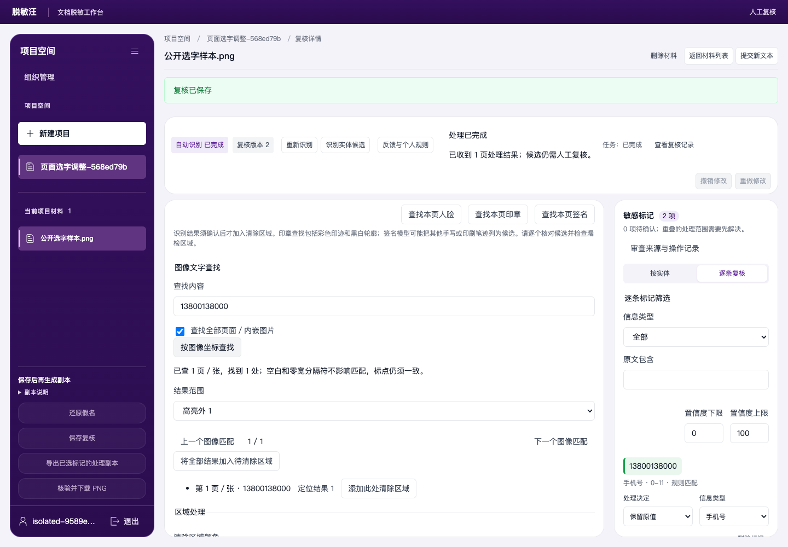

此图手机号被设为“保留原值”，因此可出现在“高亮外”结果中；它是功能操作示例，不是已经完成脱敏的文件。

## 3. 手动标注区域与调整识别实体的位置

这两种操作作用不同：区域标注直接清除所选像素；实体位置调整修改某个已有文字实体的处理位置。

### 新建清除区域

1. 在画布拖出范围，或填写 **左侧坐标／顶部坐标／区域宽度／区域高度**。
2. 选择 **区域用途**、**区域形状** 和 **标注信息类型**；需要时填写 **标注文字**。
3. 点击 **添加本页区域**。
4. 点击 **调整区域**，拖动框移动位置，拖动四角或四边控制点改变大小。
5. 检查覆盖范围，保存复核。

矩形和圆形／椭圆均可使用。椭圆只清除椭圆内部，外角仍保留；敏感内容在外角时应扩大范围或另加矩形。

### 调整已有识别实体

1. 点击 **调整识别实体位置**。
2. 在 **当前识别实体** 中选中目标。
3. 在 **调整范围** 选择全部文字框或单个文字框。
4. 拖动实体框移动，拖动八个手柄缩放；按住 Shift 拖动也可缩放。
5. 保存复核后查看本页处理预览。要撤销时使用 **恢复此实体的自动位置** 或 **清除全部实体位置调整**。

位置移开后原敏感文字仍可辨认，导出会拒绝该结果。类型、文字范围、旋转或重新识别改变后，旧位置可能失效；清除旧调整并重新选取。

> 拖动、八手柄缩放、保存和清除已完成真实 Edge 验证。蓝色框是实体的实际编辑范围，拖动后仍需保存复核。

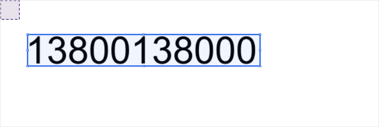

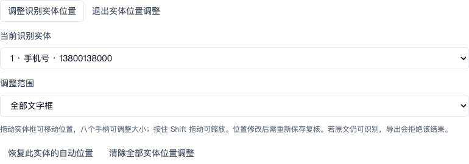

## 4. 一次找到并标记全部同文位置

适用于 Word 正文、表格、图片 OCR、PDF、Markdown 等已识别对象。

1. 展开 **人工选取与同文位置**。
2. 在 **选取文字** 输入需要补充处理的原文。
3. 选择 **实体类型**；列表外类型可直接填写 **原始实体类型**。
4. 点击 **查找全部同文位置**，检查找到的处数、对象类型和跨对象提示。
5. 通过 **定位同文位置** 查看原件。定位不会替你加入标记。
6. 勾选需要的结果，点击 **将所选位置加入标记**；只加一处可用 **添加此处标记**。
7. 在逐条列表复核并保存。

跨对象结果会按实际对象边界分别建立标记。无法确认连续行或坐标的结果会列出提示，不会凭相同文字猜坐标加入。新增标记不表示已经批准导出。

> Word 两处同文、原始类型、定位、保存、两张内嵌图片跳转和自动反馈断言已通过真实 Edge。下图是实际勾选两处结果的界面。

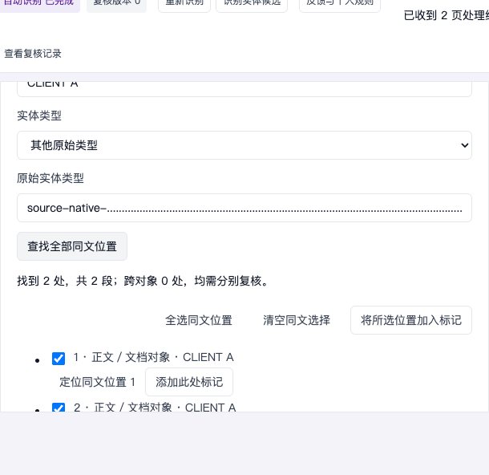

## 5. 按处理范围查找图像文字

1. 在 **图像文字查找** 输入文字。
2. 按需要查找全部页面或内嵌图片，点击 **按图像坐标查找**。
3. 使用全部、处理区域内或处理区域外的结果范围。
4. 使用上一处、下一处或 **定位结果** 检查位置。
5. 选择结果加入清除区域，再保存复核。

“区域外”可用于查漏；它不能证明没有漏检。查找和定位本身不修改材料，因此没有其他改动时，保存按钮可能不可点击。

人脸、印章和签名候选需要回到原件逐页确认。候选框应检查是否真正覆盖敏感内容；没有候选的页面也要人工查看。确认后再选择处理决定、保存复核，并检查下载副本中的实际像素。

## 6. 将同一清除位置应用到多页

1. 在本页画出并检查区域。
2. 填写 **起始页／结束页**，点击 **应用到指定页**。
3. 检查批次结果：新增、已有覆盖、不兼容、已移除、读取失败分别列出。
4. 有误可用 **撤销本批标注**；中途可用 **停止本批标注**。
5. 逐页核对，保存复核。

批次结果会保留失败与不兼容页面；不要只看新增数量。不同尺寸或方向的页面需要单独核对。

## 7. 区域 OCR、Word 图片重识别与改字

| 目的 | 操作 | 是否直接覆盖已保存原文 |
|---|---|---|
| 查看选区内已有文字 | **提取区域文字** | 否 |
| 对选区重新运行 OCR | **重新识别区域** | 否，先显示结果 |
| 将结果用于人工纠错 | **复制区域文字**，在纠错区选择连续原文后粘贴 | 必须明确保存纠正 |
| 重读全部 Word 图片 | **Word 内嵌图片文字识别 → 重新识别 Word 图片文字** | 先展示候选 |
| 使用新的 Word 图片结果 | **应用新图片识别版本并重新复核** | 产生新复核版本 |
| 清理临时查询结果 | **清理 OCR 查询缓存** | 不清除已保存的纠正和复核 |

改字时核对“原识别文字”和“纠正为”，不要把空间上分散的多处文字盲目粘贴覆盖为一个连续范围。Word 新图片候选可逐张展开查看文字和识别项；应用后所有标记需重新确认。

在材料详情的页面审查区，可点击 **纠正识别文字**，选中一段连续原识别文字，填写 **纠正为** 并保存。已有未保存的复核修改时，先保存复核。纠错后重看本页原件、标记与处理预览。若同一 OCR 错字出现在项目其他材料，可展开 **项目 OCR 实体纠错**：填写原识别文字、纠正后文字和类型，选择“已有 OCR 实体或文字”或当前材料的已保存手绘区域，点击 **检查项目纠错范围**。先核对相同实体、补充位置、冲突位置及未处理材料，再明确点击 **应用…处纠错并重新复核**。旧记录失效时使用 **清除旧纠错（需重新识别）**，随后重新识别并逐项复核。

打开密码保护的自有文档时，输入已知的正确密码进行解锁。系统保存独立可处理副本，原件保留；错误密码不会通过。

## 8. 旋转 PDF 页面

1. 打开 PDF，在页面区域选择页面和角度。
2. 只调整方向时使用手动旋转；需要按新方向读取文字时使用旋转并重新识别。
3. 重新检查标记、人工纠正、区域与预览。
4. 再次保存复核，然后生成和下载 PDF。

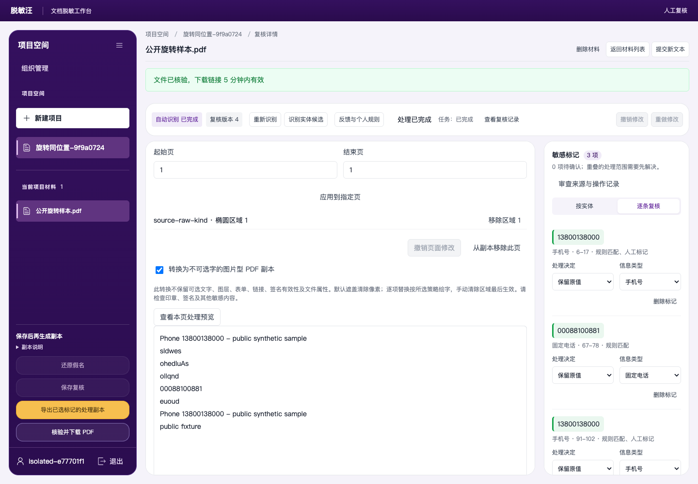

旋转会产生新版本。未旋转页和可验证的人工记录会保留，但不沿用旧审批。操作失败时按提示重试并核对待审核状态；原件保持不变。

## 9. 隐藏一类实体并恢复

> 持久化、创建来源和反馈计数已通过实际接口、跨工程恢复及最终完整浏览器操作验证。

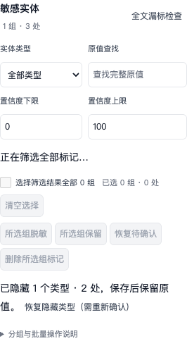

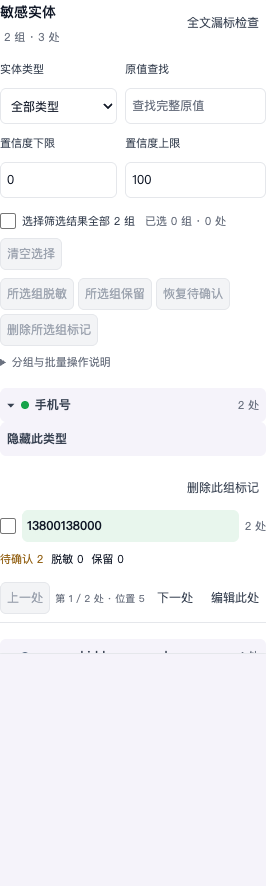

1. 在 **实体分组** 找到该类型标题，点击 **隐藏此类型**。
2. 点击 **保存复核**。隐藏后不再出现在正常分组，刷新后仍保持。
3. 需要恢复时点击 **恢复隐藏类型（需重新确认）**。
4. 恢复项回到待审核，逐项重新决定并保存。

**隐藏的内容会保留在输出中。** 这不是折叠列表，也不是已完成脱敏；只应在确定该类型无需处理时使用。隐藏与恢复不应产生新的误报／漏报反馈。人工新增来源会保留，自动实体不会因为曾经改过决定或拖过框就变成人工新增。

恢复前先核对隐藏列表中的类型和数量；恢复后的待确认项会阻止直接导出，必须逐项决定并保存。隐藏和恢复只是本材料的复核决定，不会自动加入个人识别或跳过名单。

## 10. Word 版式与兼容预览

默认使用分页版式预览；原文对象视图仍可用于定位段落、表格和其他对象。

- 复杂文件预览异常时，点击 **使用兼容文字预览**。
- 兼容模式显示当前原文窗口，并提示窗口位置和全文长度；长文通过原文分页继续查看，不能把当前窗口当作全文。
- 需要返回时点击 **恢复高保真预览**。
- 兼容模式不展示完整图片和复杂版式，图片应到 **内嵌图片资源** 审查区核对。

本工具使用浏览器分页渲染，字体、自动换页和部分复杂排版可能与桌面 Word 有差别。处理后请打开下载 DOCX 检查。多帧 GIF／TIFF 图片会转换为包含全部帧的图，版式可能改变。

兼容文字预览供核对文字与位置；要检查图片、表格及换页，切回高保真预览，并在导出后打开实际文件。

## 11. 批量还原与找回副本

1. 展开 **批量还原 Word／Markdown 文件**，选择多个文件。
2. 选择映射表；不选时使用当前项目映射。受保护映射表需填写密码。
3. 点击 **检查还原映射**，遇到同假名多原文时先明确选择。
4. 点击 **开始批量还原**，查看总文件进度与每份成功、失败结果。
5. 下载单份副本，或勾选成功项后 **下载已成功的副本 ZIP**。
6. 页面重开后，可使用 **查找已保存副本** 继续下载。

某份文件失败不代表其他文件失败；失败项不会伪装成成功输出。未知假名、歧义、损坏 XML 或无法验证的源文件会报错，原件不被覆写。旧版 DOC／WPS 转换以页面提示和可用服务为准，必要时勾选另存为 DOCX。具体输出上，旧版 DOC 可保留 DOC 原格式；该结果需严格回读核验，也可勾选另存为 DOCX。WPS 的还原输出仅支持 DOCX，不能选择 WPS 原格式。打开密码保护文件需输入自己知道的正确密码；原件不会被覆写。

批量还原的实际结果：

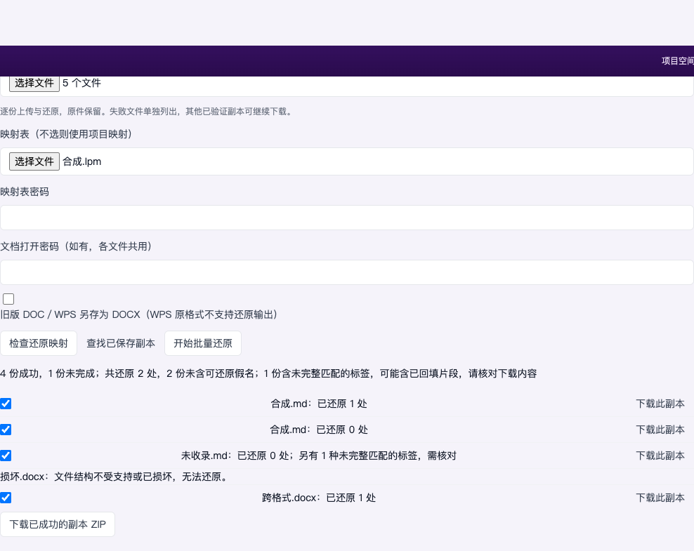

## 12. 来源记录、标注下载与最终检查

### 查看操作历史

在 **审查来源与操作记录** 展开实体，可查看来源、决定、操作事件和已记录账号。导入工程可切换 **导入工程的继承记录** 和历史版本。

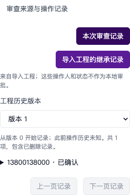

未记录的更早操作人或时间不会补造。继承记录不替代当前本地审批。

### 保存标注与诊断

- **导出训练标注**：下载当前文字与区域对应的标注数据。
- **保存图像标注**：下载图像标注记录，包含类型、坐标、形状与相关元数据。
- OCR 不可用时，使用帮助区 **检查 OCR 可用性／导出 OCR 诊断**。

### 下载前逐项核对

| 操作 | 应看到的结果 |
|---|---|
| 保存位置调整后重读 | 区域位置和大小保持，来源记录保留 |
| 选字或同文补录 | 新项对应真实文字范围，仍须复核 |
| 保留原值或隐藏类型 | 该处内容会留在输出中 |
| 旋转、重识别或应用新版本 | 版本更新，需要重新复核保存 |
| 生成副本并核验下载 | 实际文件可打开，敏感内容和版式符合预期 |

## 13. 项目实体查漏：逐份查看，再逐处决定

同一项目有多份材料时，在项目材料列表展开 **项目实体查漏**，点击 **核对整个项目**。先看已检查的材料、原值数量和跳过的未就绪材料，再展开每份材料。结果表的“待补录、异类覆盖、人工保留、其他冲突”是数量；逐处列表会给出原值、类型、位置和下列状态。

| 看到的状态 | 建议操作 |
|---|---|
| **同类已标** | 已有相同类型标记。点击 **打开并定位**，核对范围及该标记的处理决定；无需重复补录。 |
| **尚未标记** | 打开原件确认确实需要处理，再点 **仅补录此处**。只有全部待补录位置都核对过，才考虑 **补录全部未标记位置**。 |
| **异类覆盖** | 现有标记是其他类型。先检查原件；确实标错时使用 **移除异类并补录**，在确认窗口核对后提交。 |
| **人工保留** | 此处此前选择了保留原值。若要改为脱敏处理，打开材料在逐条复核中修改并保存。 |
| **位置冲突** | 找到的位置与已有标记交叠。用 **打开并定位** 核对文字和范围，在材料中手动处理。 |
| **未就绪材料** | 项目结果会单列这些材料。等识别或处理完成后重新点击 **核对整个项目**。 |
| **部分页面尚未检查** | 打开对应材料，检查提示的页面；“位置数据缺失”等原因表示本次无法可靠查到该页的全部位置。 |

**仅补录此处** 和 **移除异类并补录** 都会先显示确认窗口。新项保存为 **待确认**；返回材料后选择处理决定，检查 PDF／图片实际覆盖位置，点击 **保存复核**。需要副本时再点击 **导出已选标记的处理副本**、**核验并下载**，打开下载文件核对。完成任何补录或改动后，回到项目列表重新运行核对；旧结果不代表最新材料状态。

项目查漏三项实际 Edge 已完成：跨文件补录、异类替换、PDF 跳页、原件不变、另一页几何保留、重新复核和实际下载均有断言。

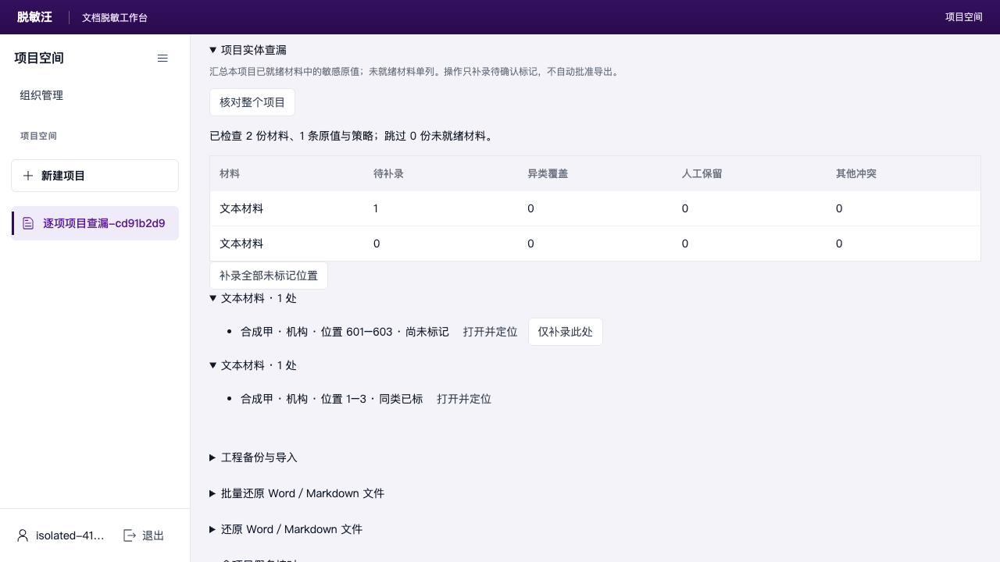

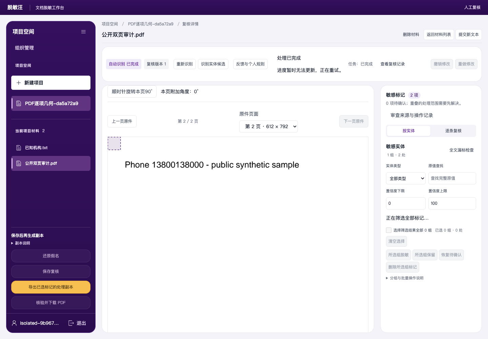

## 14. 反馈和个人规则的生效范围

展开 **反馈与个人规则** 可以查看或添加误报、漏报与确认记录，也可保存“识别名单”或“跳过名单”的个人词条。保存反馈不会自动训练模型；保存个人词条也不会立即改变识别。若希望词条参与以后识别，先将词条迁入规则库，再在项目方案中明确启用，并重新识别相关材料。自动记录的人工增删反馈与临时规则只用于相应操作和进行中的识别；待确认、保留原值、按类型隐藏或恢复，不应被理解为已经自动批准、自动学习或自动更新全部历史材料。

## 与对标产品的入口差异和识别质量

| 项目 | 本工具当前做法 | 使用时的影响 |
|---|---|---|
| Word 图中操作 | 进入内嵌图片资源审查区 | 可选字、纠错、查找、调整框；不是在 Word 图片 DOM 上直接做相同手势 |
| PDF 浏览 | 按页切换、任意页跳转 | 已有业务操作可达，呈现不是竞品连续滚动视图 |
| 原版式 | 浏览器分页渲染及兼容文字模式 | 不保证桌面字体与换页逐像素一致 |
| 黑白章、签名候选 | 含本工具补充方法和离线模型 | 不宣称与竞品未获许可运行链完全等价 |

公开集实测只说明对应数据范围，不是中文合同的完整准确率：

| 候选类别 | 数据范围 | IoU≥0.5 的结果 | 边界 |
|---|---|---|---|
| 人脸 | OpenImages 5,749 图全部尝试 | 精确率 75.85%，召回率 76.25%，F1 76.05% | 原尺寸 1 图超限被拒；统一长边1024版本全部成功；摄影域并非合同扫描域 |
| 签名 | 官方完整 validation 35 图，默认模型与 NMS | 精确率 50.9%，召回率 80.0%，F1 62.2% | validation 非独立 test；存在误报和漏报 |
| 印章 | 混合公开 test 786 图、1,315 个标注框 | 精确率 17.44%，召回率 24.03%，F1 20.21% | 上游逐图授权、训练重合与商业黑白章分层未核，不是独立商业金标 |

印章质量仍不足以宣称实用自动识别完成。后续研究模型的结果不等于已安装到生产；请以页面实际候选能力为准，并逐页检查印章、人脸、签名以及其他漏检内容。没有候选也不表示该页没有敏感图像。

评估详情：[人脸全量验证](../逆向台账/contracts/public-face-validation-20261014.md)、[签名模型评估](../逆向台账/contracts/signature-model-porting-20261014.md)、[印章全量验证](../逆向台账/contracts/public-stamp-validation-20261015.md)。竞品未经授权的处理链尚未运行验证，不能将上述功能步骤称为全部等价。

## 常见提示怎么处理

| 提示 | 操作 |
|---|---|
| 系统正在处理另一个文件 | 等当前任务结束后重试该操作；原材料和复核决定仍保留。 |
| 请求过于频繁 | 等待提示的窗口后重试；实体筛选会有界自动恢复，仍失败可点“重试筛选”。 |
| 记录不存在，或你已无权访问 | 确认当前登录账号，返回项目列表重选；组织管理员不自动获得各项目的材料权限。 |
| 项目词表已更新，请重新识别后复核 | 点击重新识别，逐项重新决定；清除旧纠错本身不是重新识别。 |

下图是明确清除旧 OCR 纠错后的实际状态：旧审批不继续有效，需点击重新识别。

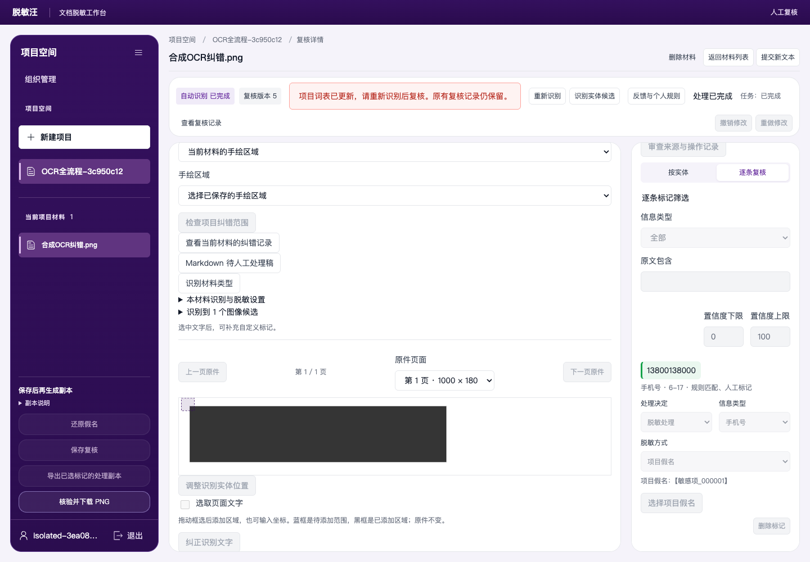

## 15. 部分个人方案损坏时继续使用

1. 打开“方案管理”，先查看方案列表上方的提示。
2. 少数方案无法读取时，其余有效方案仍可选择；损坏方案不会自动删除。
3. 默认方案已无法使用时，系统回退默认设置。新建项目后检查当前方案；旧项目保留此前自己的配置副本。
4. 选择可用方案并确认项目设置，再导入材料。MCP 按名称或ID使用相同有效方案目录。

全局加密密钥错误不能通过回退掩盖；此时联系管理员修复配置，不重复建立业务项目。

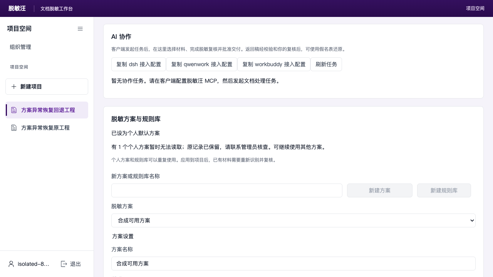

## 16. 外部文件零次或部分还原

1. 在文件还原入口选择外部MD、TXT或DOCX及正确映射表。
2. 检查歧义并明确原值，再执行还原。
3. 文件没有当前映射中的假名时，会提示未发生替换，仍可保存原样副本；不要把该提示理解为已经找回其它未知假名。
4. 出现“未完整匹配的标签”提示时，说明映射不能完整覆盖这些标签。纯文本映射仍可能回填标签内部片段；不要仅凭成功数量判断全文已还原。
5. 下载结果，核对替换次数及内容。BOM、换行与无匹配DOCX原字节保留。
6. 批量入口逐份显示成功、失败和未完整匹配提示。检查每份结果后下载所选副本ZIP；一个文件失败不影响其余已验证结果。旧DOC默认保留DOC；WPS或希望另存格式时选择“旧版 DOC／WPS 另存为 DOCX”。

使用本工具签发文件的受管还原，仍需要有效权限、版本和映射；未知或歧义标签不会被伪造还原。

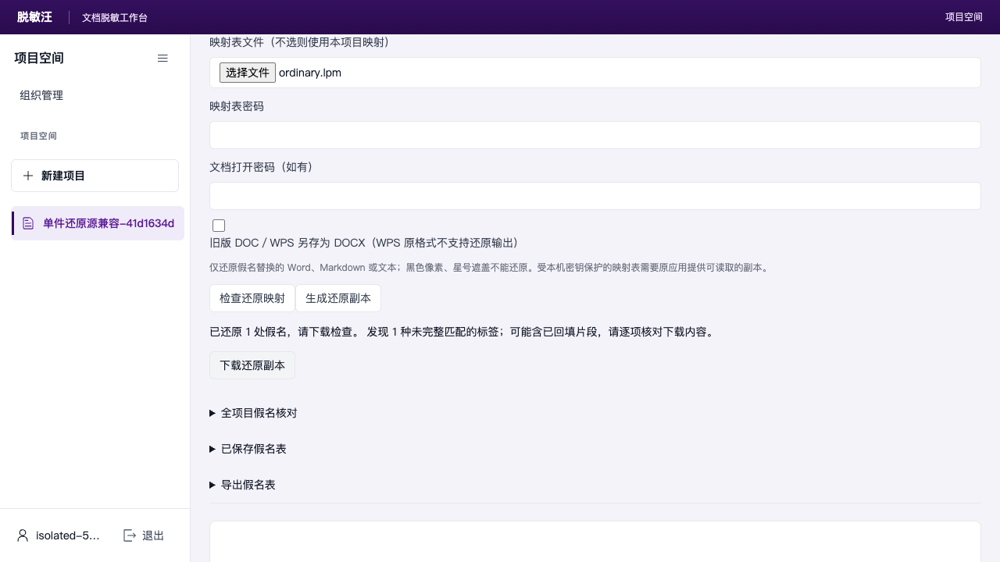

## 17. 工程重开后的PDF双实体复核

1. 旋转PDF并重新识别后，使用逐条列表或实体组内的上一条/下一条，检查是否定位到正确原件页。
2. 调整各实体遮盖框并保存；下载加密工程备份。
3. 导入为新项目，重新识别后恢复工程草稿。分别检查并确认每个恢复区域，旧审批不继承。
4. 对全部待确认实体重新选择脱敏或保留。
5. 重新勾选“转换为不可选字的图片型 PDF 副本”，保存复核、检查处理预览，再生成、核验并下载。
6. 打开实际下载文件，逐页检查。没有重新勾选输出方式、没有完成实体和区域复核时，生成按钮保持禁用。

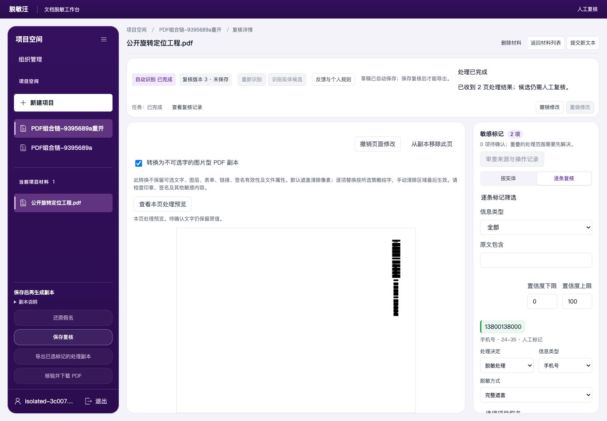

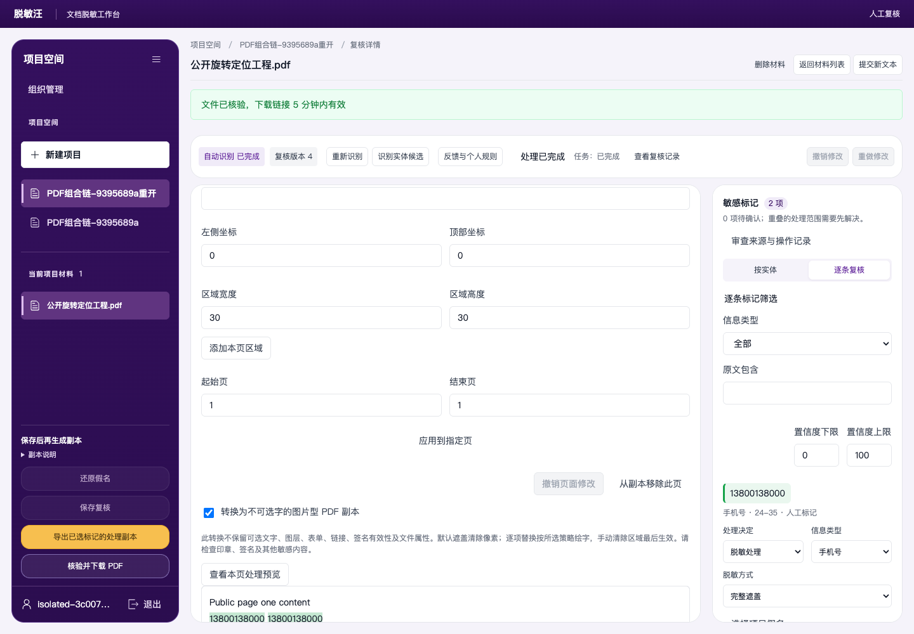

## 18. 查看项目OCR纠错中未处理的原因

1. 打开“项目范围OCR实体改字”，填写原识别文字、纠正文字和类型，先点击预览。
2. 查看影响文件数以及“未处理范围原因”。按每个文件列出的原因分别处理。
3. Markdown纠正后文字的新增位置暂不支持自动补录，进入该材料手工标注；识别未完成的文件先等待完成；缺少可靠页面坐标的文件先检查原件及OCR状态。
4. 影响数为零时不能应用；有受影响内容时，检查预览并应用，随后重新复核。

原件、原始识别文本与字框保留。项目级语义纠错不会自动学习为长期规则，也不能代替每份材料最终复核。

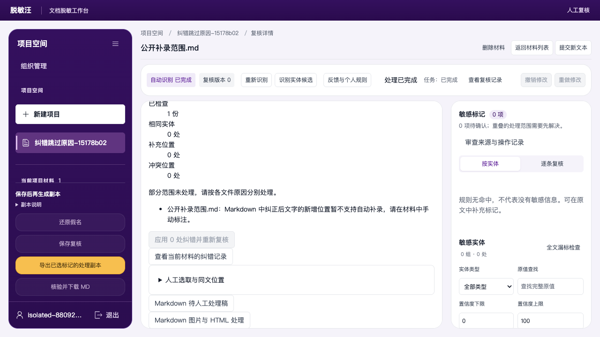

## 19. AI返回稿复核后再允许还原

|阶段|操作|应看到的结果|
|---|---|---|
|交付|在AI协作任务中按提示授权识别及脱敏交付，复核材料并生成副本|外部AI取得的是脱敏稿|
|返回|外部工具提交当前轮的返回稿|页面等待复核返回稿，未经人工确认不能还原|
|复核|检查返回稿，点击“我已复核返回稿，确认内容”|仅AI处理的任务显示“本轮已完成”|
|授权|需要还原且具备项目权限时，点击“允许使用本项目假名表还原此次返回稿”|按钮消失；只对当前任务明确授权|
|执行|由已连接的MCP客户端调用打开还原或开始还原工具|同一轮生成真正的还原副本；重复请求返回既有产物|
|检查|刷新任务，点击“下载还原稿”|打开文件核对内容和替换情况|

若还原长时间无结果，可点“检查并接续还原”；仍在处理时显示当前状态，中断后可接续。

浏览器中也可在人工复核和本次还原授权后点击“还原并保存”。若返回稿停在“待继续校验”，在原已授权客户端重提本轮同一稿件；原客户端已断开时，在要接续的客户端发起接续，回浏览器核对待授权客户端名称，再明确授权和重提。历史任务若缺少接续信息，应重新发起，不猜测补写原阶段。

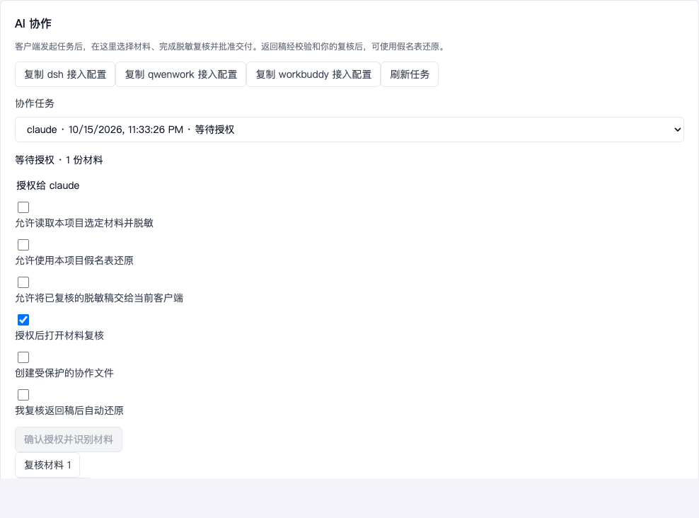

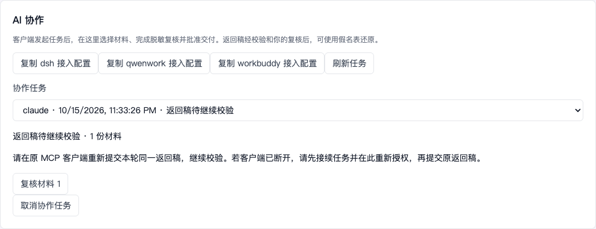

续审会产生新一轮，旧轮编号或旧上传槽不能替代当前轮。没有还原权限、映射不匹配或返回稿未复核时，按错误提示修正后再试，不切换账号绕过。

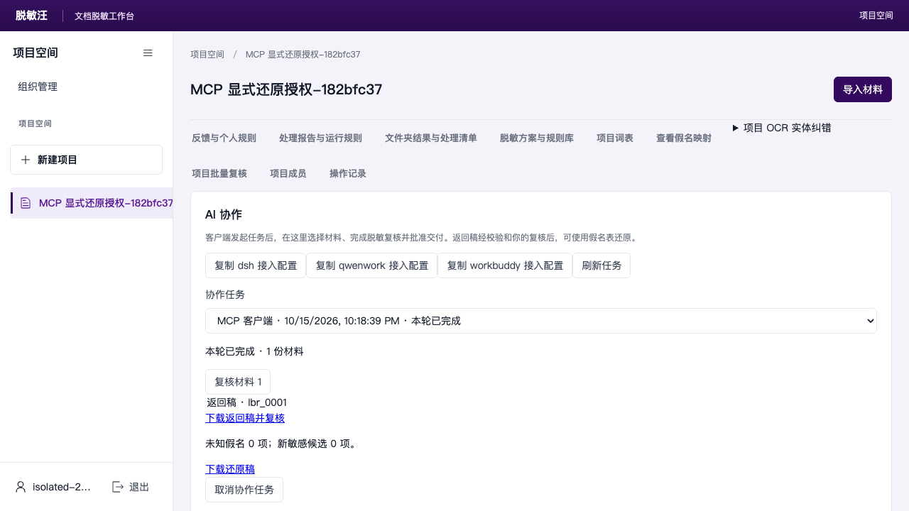

## 20. 截图或聊天材料选择识别方式

1. 打开材料的“本材料识别与脱敏设置”。
2. “材料类型”可先用“自动判断”；PNG、PDF等扩展名本身不能说明一定是聊天截图。
3. 确认是聊天或表单截图时，可明确选“截图材料”，点击“保存设置并重新识别”，在确认框确认。
4. 等待识别后逐项核对联系人、账号、地址、金额等候选。聊天短句、客服名称和转账说明仍可能误识别；对误检选择保留，对漏检手工补录。
5. 类型或识别文字变化后重新复核，保存并生成副本，最终打开下载文件检查。

## 21. 表格拆格姓名：整组复核

本节处理表格里分成数格的文字姓名。页面会显示“签名姓名 张三 · 第 1/2 格 · 整组决定”。

1. 导入 CSV 或 Office 表格，等待识别完成，打开“逐条复核”。
2. 为其中一格选择“脱敏处理”或“保留原值”，同一位置的姓名其余格同步决定。同名出现在另一位置时，仍需单独复核。
3. 拆格姓名不能单独删除或改成其他信息类型。误识别时可将完整姓名设为跳过规则，再重新识别；只跳过其中一个字不会自动放行整个人名。
4. 点击“保存复核”，再点击“导出已选标记的处理副本”，完成后“核验并下载 CSV”。在表格软件中逐格核对。

本次合成 CSV 的实际结果（系统默认星号方式）：

| 状态 | 第1格 | 第2格 | 第3格 | 第4格 | 第5格 | 第6格 |
|---|---|---|---|---|---|---|
| 原文 | 张 | 三 | 李 | 四 | 张 | 三 |
| 决定 | 脱敏 | 脱敏 | 保留 | 保留 | 保留 | 保留 |
| 实际下载 | * | * | 李 | 四 | 张 | 三 |

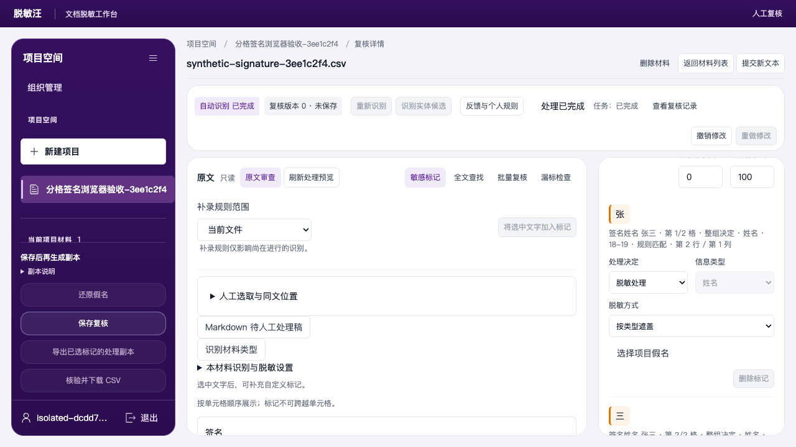

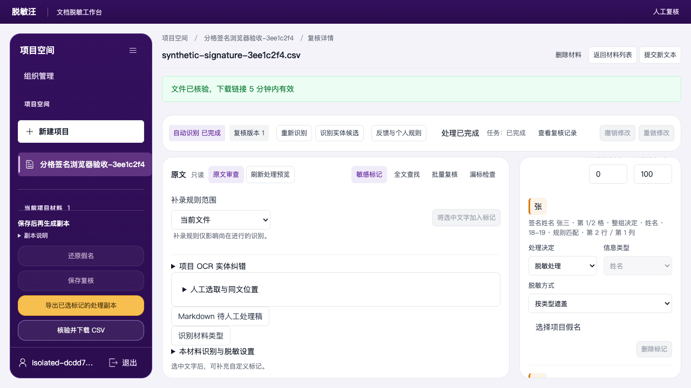

实际执行了页面上传、逐条决定、保存、生成及下载；CSV六格与上表完全一致，原件哈希和字节不变。截图来自本地051隔离验收，线上版本以发布记录为准。

旧材料若提示“分格姓名需要重新识别”，请先重新识别，再逐项决定和保存。原有复核记录与已经签发的下载链接保留；重新识别不会自动沿用旧批准。

## 22. 取消识别后继续处理

1. 点击任务旁的“取消”，等待页面读取材料最新状态。
2. 正常取消后材料显示“需重新识别”，点击“重新识别”，等待完成后再复核；旧任务的“重试”不用于处理新版本。
3. 网络中断时若显示“取消结果尚未确认”，点击“重新加载材料状态”；未确认前暂停提交，避免使用旧版本。
4. 重载后按实际状态继续。取消导出时，本地未保存的复核草稿会保留。

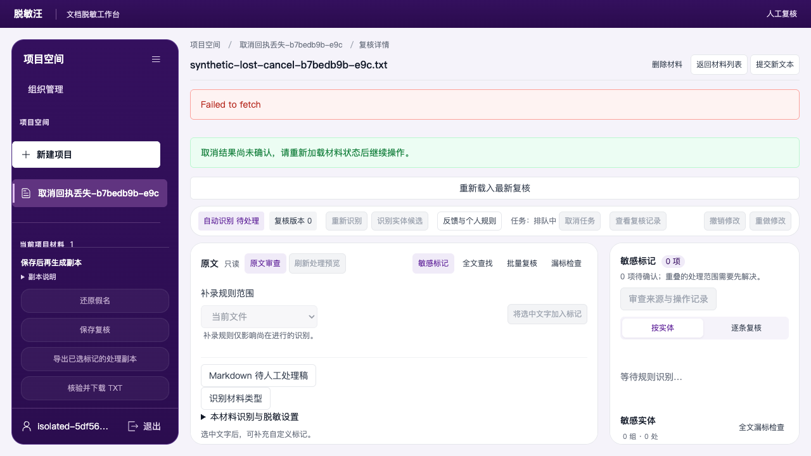

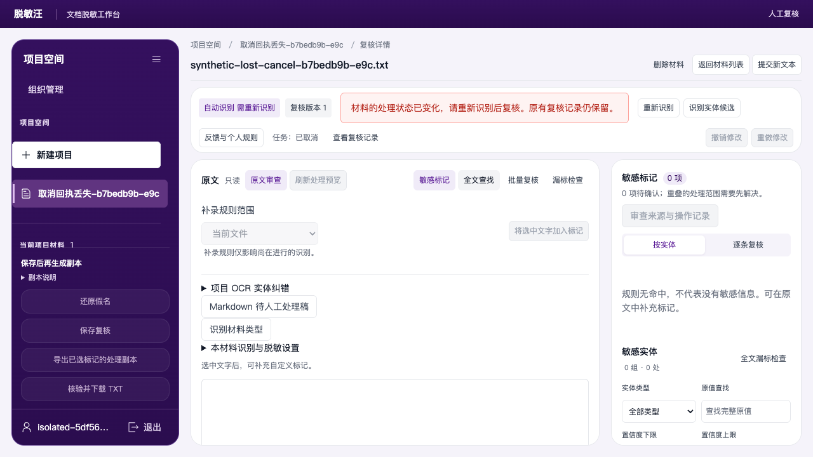

真实Edge已验证正常取消后重新识别，以及取消已生效但响应和第一次读回丢失后的手动重载。取消只发送一次；超过原重试周期观察6.2秒，旧进度请求未增长，原件不变。

## 23. 自动保存、恢复和撤销复核草稿

| 情况 | 操作 | 结果 |
|---|---|---|
| 首次修改 | 在“逐条复核”选择处理决定，等待“草稿已自动保存” | 当前编辑保存为恢复草稿；仍需点击“保存复核”才能导出 |
| 重开材料 | 有旧草稿时点击“恢复复核草稿” | 恢复当时的决定；重新检查后保存复核 |
| 已有旧草稿，但正在另作修改 | 明确点击“以当前编辑覆盖旧草稿并开始自动保存” | 当前编辑成为新恢复草稿 |
| 撤销 | 点击“撤销修改”，等待自动保存回执 | 即使回到原决定，恢复草稿也更新为撤销后的状态 |
| 结束编辑 | 等待保存完成，再点击“结束自动保存会话” | 显示已确认结束；草稿仍可手动打开 |
| 丢弃恢复草稿 | 没有未保存修改时，点击“丢弃自动恢复记录”，再点“确定丢弃” | 移除恢复草稿，保留原件和已保存复核 |

另一个窗口接管后，本窗口会停止自动写入并提示重新打开最新记录。保存或结束未获确认时，按提示重新打开，不把关闭窗口当作已保存。

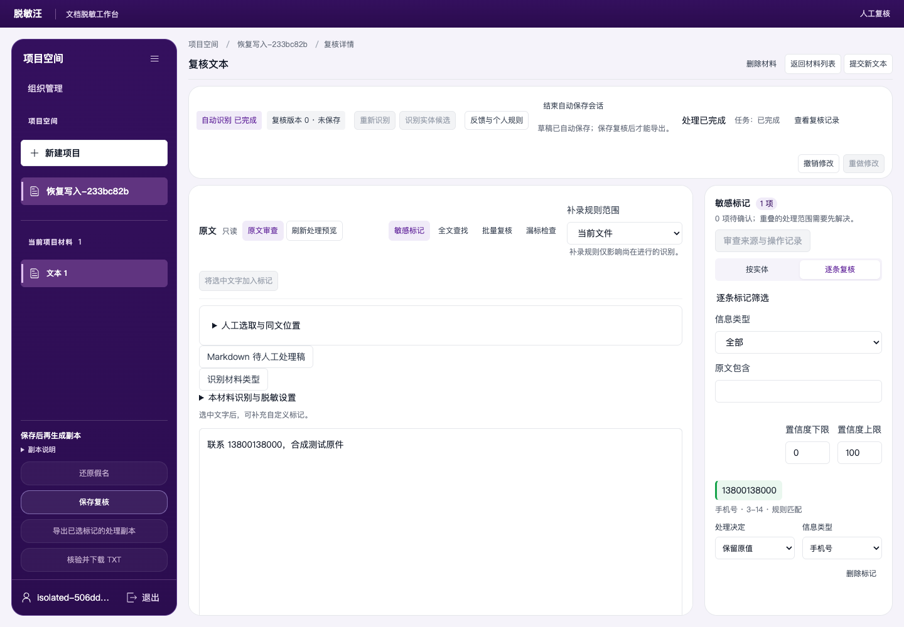

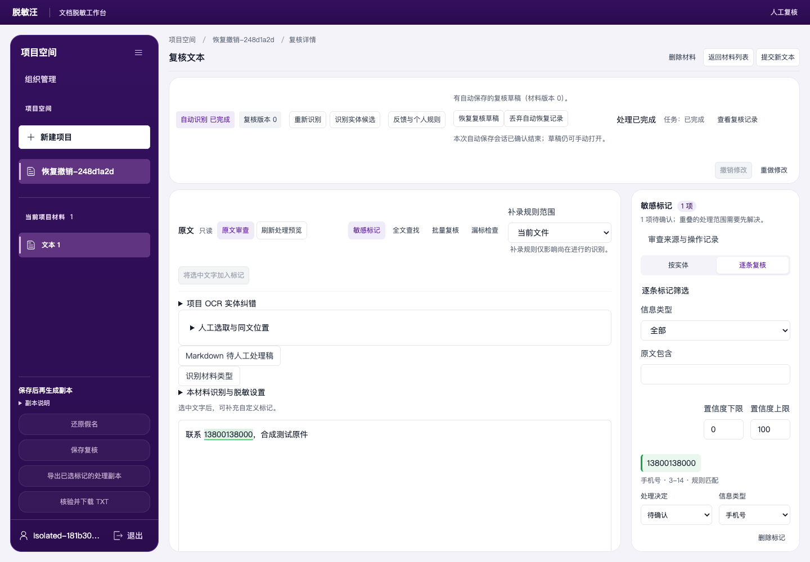

以上两图来自本地051正式合并代码的真实Edge隔离流程。实际核验了保存、心跳、重开恢复、覆盖选择、撤销后的第二次写入及结束回执；原件内容和已保存复核未被草稿覆盖。

识别异常中断时，首页若显示“可恢复的中断点”，可点击“继续识别”。PDF仅复用仍与当前材料、页面方向及识别引擎相符的已完成页；主动取消后按第22节重新识别。

## 24. AI返回稿归档与历史下载

1. 按第19节授权任务、复核材料并交付脱敏稿，通过已授权的MCP客户端提交本轮返回稿。
2. 校验通过后，在“AI协作”打开对应任务，查看“已校验返回稿归档”。每轮单独保留文件名、轮次、时间、来源与返回稿的SHA-256。
3. 点击实际下载链接，打开核对。归档不代表人工复核通过，仍需明确确认后才能还原。
4. 读取失败时点击“重试读取归档”。加载中显示“正在读取归档…”，失败不会冒称没有记录；切换任务后旧请求不会覆盖新任务。

| 情况 | 处理 |
|---|---|
| 同轮同内容同名称重提交 | 取回既有回执，不重复生成 |
| 同轮改名或改内容 | 核对本轮原稿，不覆盖已归档文件 |
| 失去项目复核权限 | 联系项目负责人恢复相应权限后操作 |
| 没有记录 | 旧任务可能没有归档；新返回稿通过校验后才归档 |

归档保存在私有云项目中，不能直接写入你电脑的某个目录。浏览器下载后自行选择保存位置。

本图由本地051正式代码、隔离账号和合成材料生成；实际打开列表并下载，字节哈希与提交稿一致。“归档时尚未人工复核”记录归档时点，后续确认不会改写原回执。

## 25. AI 协作坏记录：确认隔离与同版本恢复

AI 协作页若出现“任务存储需要处理”，说明列出的任务记录暂时无法读取。页面会显示任务编号、版本和坏密文的 SHA-256；这不是任务内容，也不表示原件或其他任务已损坏。仍可在“协作任务”中查看正常任务。

1. 先核对项目和登录账号，点击“刷新任务”。问题仍在时，找到相应任务，点击“查看隔离确认”。阅读提示；如果暂不处理，点击“保留现状”。
2. 确认确需处理这条记录，再点击“确认隔离此记录”。页面会将它移到“已隔离的任务记录”，保留故障密文的独立回执。隔离只标记这一条任务，不会修复任务内容，也不会删除原件和已生成的成果。
3. 在隔离记录上点击“检查恢复条件”。只有系统找到**与当前任务版本一致**且通过校验的快照，才会出现“查看恢复确认”。点击后再次核对说明，再点“确认从有效快照恢复”。成功后任务回到正常列表，任务版本更新；继续操作前核对任务阶段及已有交付。
4. 如果显示“未找到可验证的恢复快照”，保留隔离记录及故障密文，联系项目负责人处理。不要将旧版本快照、空任务或重新提交当作原任务已经恢复。

| 页面状态 | 能继续做什么 | 需要注意 |
|---|---|---|
| 发现坏记录，尚未确认 | 查看正常任务；按权限读取已存在且可校验的归档和结果 | 无独立归档的旧结果不会被补造；坏任务内容暂不可读 |
| 已确认隔离 | 检查恢复条件；继续使用正常任务 | 原故障密文留在隔离回执中；隔离本身不恢复内容 |
| 同版本快照恢复成功 | 重新打开任务，核对阶段、原件与已有成果 | 恢复创建新任务版本，不自动批准返回稿或重新签发成果 |
| 无可验证快照 | 保留隔离及回执，联系负责人 | 页面不提供不可靠的强制恢复 |

原件和已经校验的返回稿归档仍按各自权限读取；已有原件下载链接须在有效期内，凭原签名及文件哈希核验使用。恢复不会改写这些文件；仍应实际打开下载件核对。归档详情及人工复核区别见第 24 节。

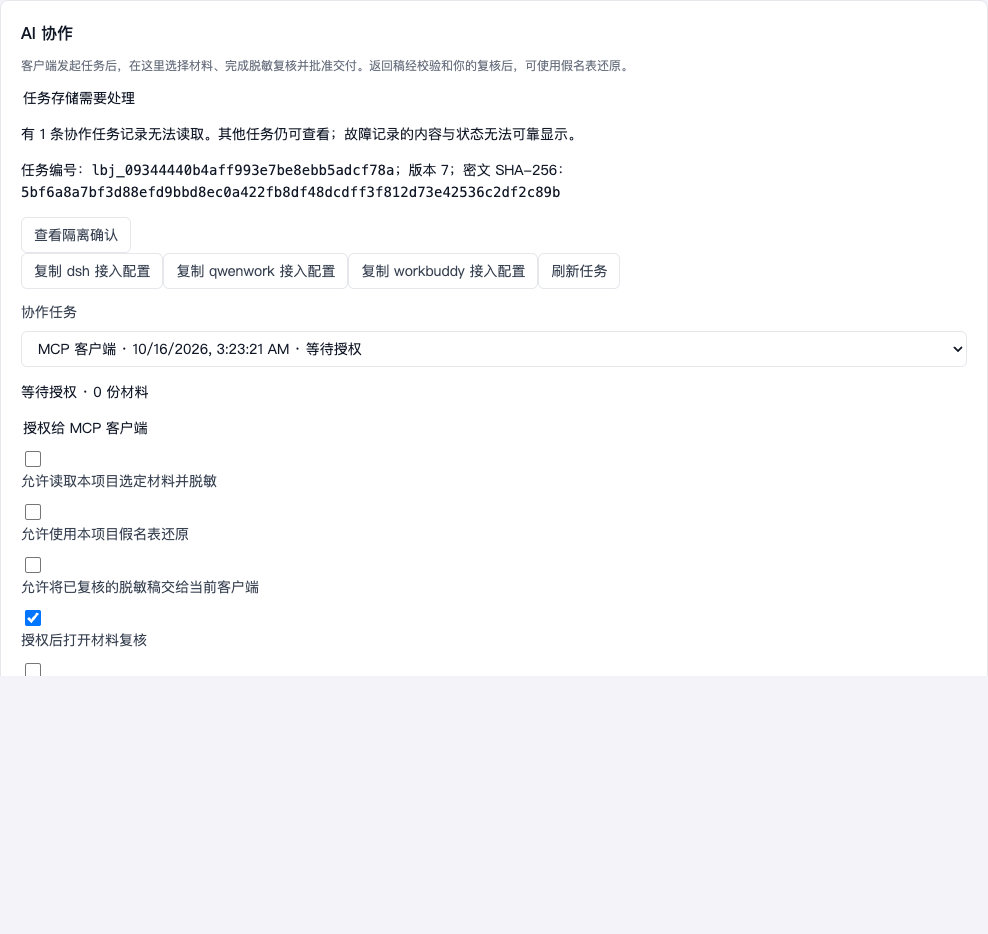

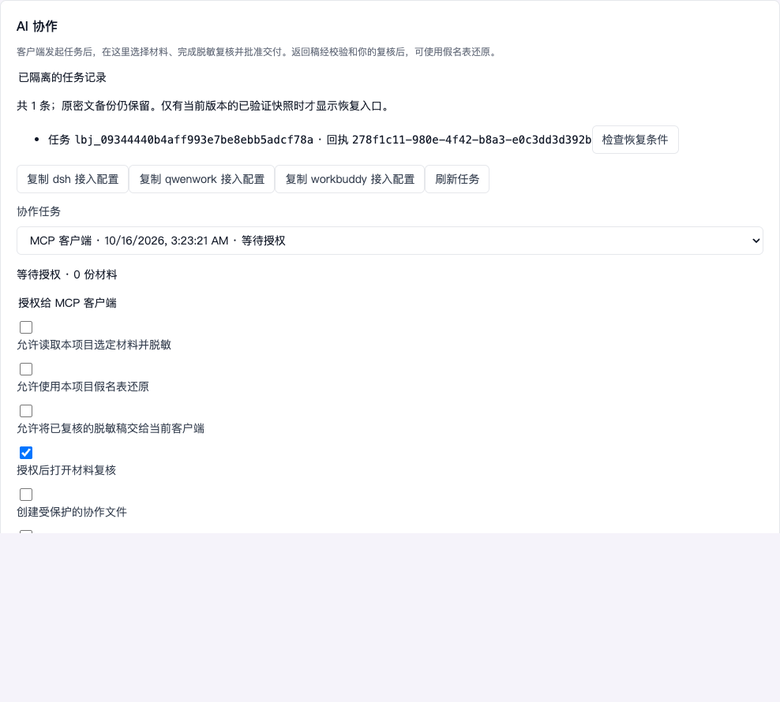

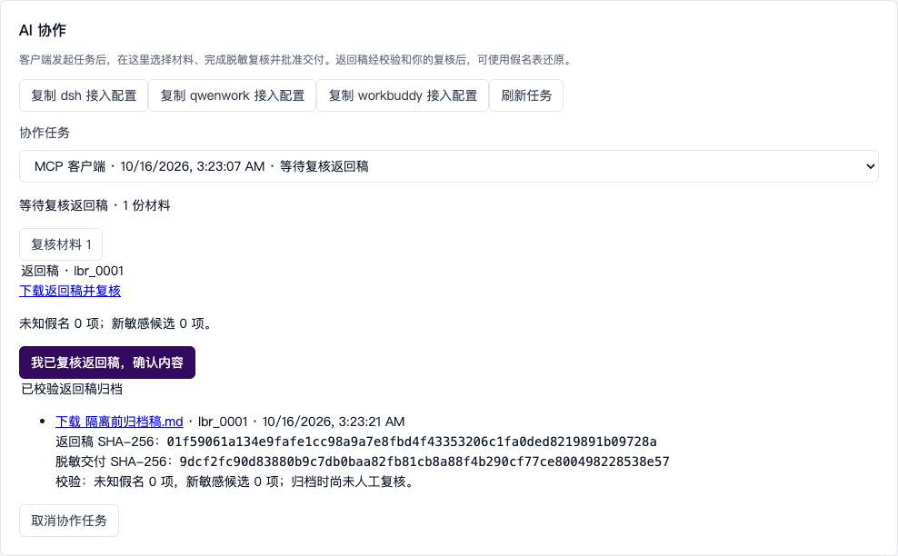

三图来自本地051正式代码的真实Edge隔离验收：合成任务中仅在隔离测试库注入一条坏密文，页面完成两次明确确认，1项用例通过；正常任务、原件、已有归档和结果下载按数据库行及字节哈希核对。三图记录2026-10-16本地隔离验收时的051实现，不代表当前线上版本；实际部署版本以使用时对应的发布验收记录为准。
