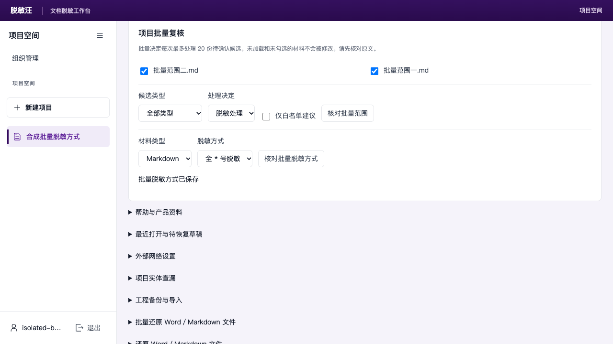

# 批量修改脱敏方式

适用于已提供“核对批量脱敏方式”入口的版本。示例材料均为合成材料。

## 完整操作流程

1. **导入后先打开材料。** 上传文件，返回材料列表，逐份打开，等待状态显示“自动识别 已完成”，再返回列表。列表仍显示“处理中”时，可点击“刷新材料”；尚未完成识别的材料不能勾选。
2. **勾选范围。** 打开“项目批量复核”，勾选本次材料，在“材料类型”选择 Word、Markdown 或 PDF／图片。不同类型的材料会在核对结果中标为跳过。
3. **选择方式并核对。** 选择下表中的方式，点击“核对批量脱敏方式”，检查每份材料的变化。未设置混合脱敏的材料会跳过，不能仅靠批量按钮替代逐份设置。
4. **确认保存。** 点击“确认批量修改”。覆盖原设置时还需在确认框点击“确认执行”；点击“取消”不会保存。成功后显示“批量脱敏方式已保存”。再次应用同一方式会同步设置并产生新的复核版本。
5. **完成复核并导出。** 打开材料，核对原文和处理决定；存在待确认项时先完成逐条复核。按[完整使用指南](公开功能补齐操作-20261015.md)中的对应格式流程保存复核、生成并领取新的脱敏文件，下载后打开核验。旧下载链接仍对应原先签发的文件，不会因这次修改自动变成新文件。

## 方式与适用材料

| 页面选项 | Word／Markdown | PDF／图片 |
|---|---|---|
| 半 * 号脱敏 | 按对应内容规则部分遮蔽 | 页面显示为“仅遮盖脱敏” |
| 全 * 号脱敏 | 使用全星号方式 | 不提供此独立选项 |
| 假名脱敏 | 使用假名处理 | 使用假名处理 |
| 混合脱敏 | 按已保存的混合设置处理 | 按已保存的混合设置处理 |

已明确保存的人工替换值和“保留原值”决定继续生效，导出后仍需逐份核对。

批量修改脱敏方式与“候选类型／处理决定”批量复核是两个操作。后者仍沿用页面注明的每次20份范围。

## 实际操作结果

下图为 Edge 中两份 Markdown 材料应用“全 * 号脱敏”并再次同步后的保存结果：

> 本补充说明对应本地候选版本的实际操作截图；完整接口与浏览器回归、服务器更新仍独立验收。它未替代既有使用指南发布包的版本记录。
