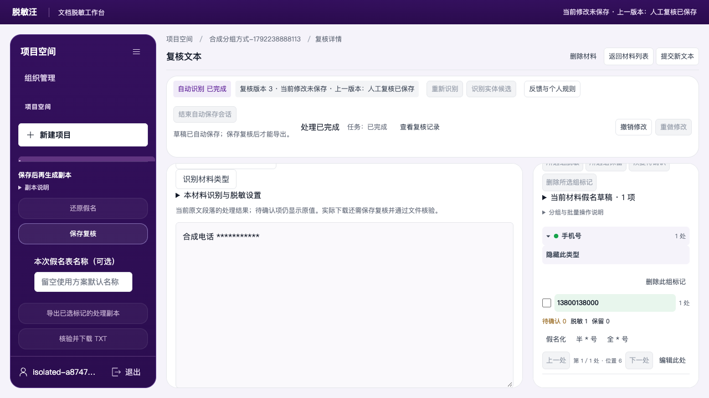
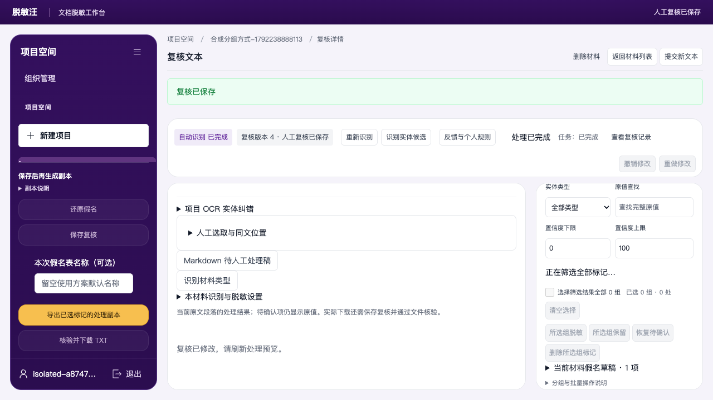
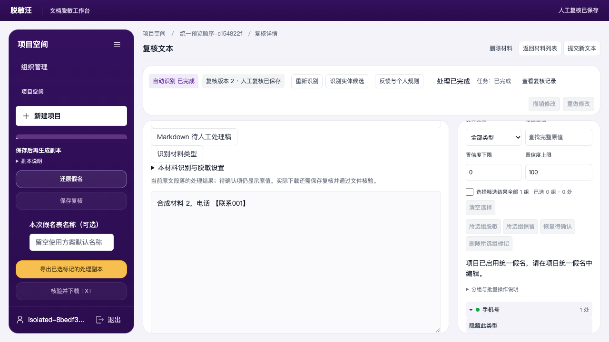
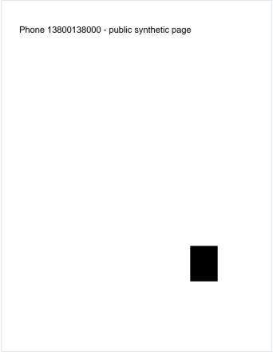
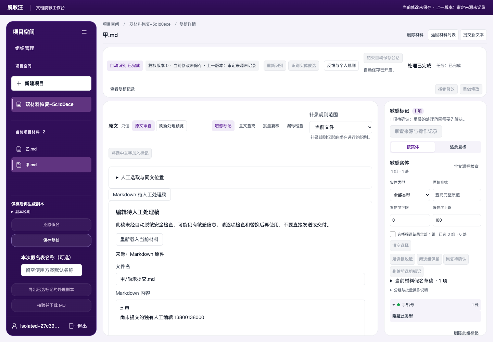

# 脱敏方式、处理预览与草稿恢复

适用于已提供“核对批量脱敏方式”入口的版本。示例材料均为合成材料。

## 完整操作流程

1. **导入后先打开材料。** 上传文件，返回材料列表，逐份打开，等待状态显示“自动识别 已完成”，再返回列表。列表仍显示“处理中”时，可点击“刷新材料”；尚未完成识别的材料不能勾选。
2. **勾选范围。** 打开“项目批量复核”，勾选本次材料，在“材料类型”选择 Word、Markdown 或 PDF／图片。不同类型的材料会在核对结果中标为跳过。
3. **选择方式并核对。** 选择下表中的方式，点击“核对批量脱敏方式”，检查每份材料的变化。未设置混合脱敏的材料会跳过，不能仅靠批量按钮替代逐份设置。
4. **确认保存。** 点击“确认批量修改”。覆盖原设置时还需在确认框点击“确认执行”；点击“取消”不会保存。成功后显示“批量脱敏方式已保存”。再次应用同一方式会同步设置并产生新的复核版本。
5. **完成复核并导出。** 打开材料，核对原文和处理决定；存在待确认项时先完成逐条复核。按[完整使用指南](公开功能补齐操作-20261015.md)中的对应格式流程保存复核、生成并领取新的脱敏文件，下载后打开核验。旧下载链接仍对应原先签发的文件，不会因这次修改自动变成新文件。

## 方式与适用材料

| 页面选项 | Word／Markdown | PDF／图片 |
|---|---|---|
| 半 * 号脱敏 | 按对应内容规则部分遮蔽 | 页面显示为“仅遮盖脱敏” |
| 全 * 号脱敏 | 使用全星号方式 | 不提供此独立选项 |
| 假名脱敏 | 使用假名处理 | 使用假名处理 |
| 混合脱敏 | 按已保存的混合设置处理 | 按已保存的混合设置处理 |

切换到整文件“全 * 号脱敏”时，所有已决定脱敏的内容均按全星号输出；原手工假名草稿保留，方便切回其他方式。“保留原值”项不参与脱敏，导出后仍需逐份核对。

批量修改脱敏方式与“候选类型／处理决定”批量复核是两个操作。后者仍沿用页面注明的每次20份范围。

## 实际操作结果

下图为 Edge 中两份 Markdown 材料应用“全 * 号脱敏”并再次同步后的保存结果：

> 本补充说明对应本地候选版本的实际操作截图；完整接口与浏览器回归、服务器更新仍独立验收。它未替代既有使用指南发布包的版本记录。

## 在材料内修改实体组

这是当前材料内的操作。合成示例使用电话 `13800138000`，先在“本材料识别与脱敏设置”选择混合处理，并为电话设置“半 * 号”；保存设置并确认重新识别后，再完成以下步骤。

1. 在“实体分组”勾选电话组，点击“所选组脱敏”，点击“保存复核”。
2. 在该组的脱敏方式中点击“半 * 号”或“全 * 号”。点击“刷新处理预览”，检查实际替换结果。此时页面提示尚未保存；仅查看预览不会保存复核。
3. 点击“保存复核”，看到“复核已保存”后再生成导出文件。保存后预览会失效，需要查看时再次刷新。

### 全星号预览

电话已替换为11个星号；截图中的未保存提示说明修改仍需保存。

### 保存回执

下图展示保存成功及复核版本，不是新导出文件的内容截图。

这两张图来自2026-10-17本地候选版本的真实Edge操作。该项浏览器用例已通过；整轮浏览器、最终工程检查及部署仍需分别完成，不能据此判断线上已更新。

## 统一假名的处理预览

1. 在项目中展开“全项目假名核对”，先点击“查看全部材料”，再点击“启用全项目统一假名”。
2. 打开材料，核对处理决定并保存复核。项目已启用统一假名时，在项目统一假名入口编辑假名。
3. 点击“刷新处理预览”，检查实际替换结果。该操作会准备项目中已识别材料的假名草稿；仍需逐份核对、保存复核并导出文件。

下图为两份材料项目中的第二份，电话已经显示为统一假名。

## 识别中查看手工区域的处理预览

1. 打开正在识别的 PDF；需要暂停时，点击“暂停图片识别”并确认。
2. 在“已完成页面人工增删”中点击“刷新已完成页面”，选择已识别页面，在原页拖框后点击“添加清除区域”，等待本页保存提示。
3. 点击“预览本页处理结果”查看处理图；点击“返回审查”继续编辑。
4. 逐项核对机器候选和未处理内容，需要时选择“清除”。继续任务时点击“继续图片识别”，识别结束后完成复核、保存与导出。

**下图只演示页面下部的手工遮盖区域。** 上方电话在拍图时尚未选择处理，仍显示原文；这张图不表示整页已完成脱敏。

## 恢复整个工作区的未提交编辑

1. 编辑时确认页面显示“自动保存已开启”。未提交的 Markdown 内容和文件名可随草稿保留；它们仍需人工核查与明确保存。
2. 重新打开工作台，在“最近打开与待恢复草稿”找到项目，点击“打开工作区恢复记录”。核对当前材料、复核决定和未提交文字，再切换其他材料检查其草稿。
3. 恢复后的复核仍属于未保存状态。返回列表时会出现“放弃未保存的复核？”确认框，按需要选择继续编辑或确认离开。
4. 保存人工稿前改用合法的 `.md` 文件名，并勾选人工核查确认。保存人工稿不会批准材料复核；复核仍需单独保存。
5. 确定不再需要恢复记录时，在项目恢复行点击“丢弃恢复记录”，再点击“确定丢弃”。这只丢弃恢复记录；原材料与已保存文件仍保留。

下图显示另一份材料的未提交文字与文件名已恢复。图中文件名包含路径，是尚未完成的编辑；最终保存会明确拒绝，须改成合法文件名后保存。

以上新增三图分别对应本地真实 Edge 操作。完整工程门禁、全量接口及服务器发布以独立验收记录为准。
