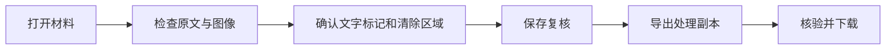

# 新增功能操作说明

2026-10-14。本地版本已验收；公网是否更新以部署记录为准。

## 操作总览

|目标|入口|操作|完成标志|
|---|---|---|---|
|按 Word 段落和表格审查|打开 DOCX → Word 版式审查|选中同一段的文字 → 将选中文字加入标记；或点击已有高亮 → 右侧处理决定|保存复核，再导出并核验下载 DOCX|
|纠正 OCR 识别结果|打开 PDF/图片 → 纠正识别文字|选择错误文字 → 输入正确内容 → 保存|复核版本更新，敏感标记重新待确认|
|寻找人脸或彩色印章|打开图片/PDF 页 → 自动查找敏感图像|寻找本页人脸/印章 → 定位区域 → 确认清除|区域加入草稿；保存复核并检查处理预览后导出|
|查看已保存版本|复核页面顶部 → 查看复核记录|查看版本和保存时间|显示当前材料历史记录；此入口不恢复版本|

## Word 版式审查

1. 上传 DOCX，等待自动识别完成。
2. 在“Word 版式审查”查看段落、字体、表格和页眉页脚等内容。可调整缩放。
3. 点击已有高亮，在右侧选择处理决定；漏标文字可在同一段中拖选，再点“将选中文字加入标记”。跨字体片段仍按同一段文字定位。
4. 切换“对象原文”检查其他对象与补充内容，确认全部待处理标记。
5. 保存复核，导出处理副本，等待“核验并下载 DOCX”可用后下载。

浏览器预览不保证与 Word 的字体、浮动对象和分页逐像素相同。最终导出沿用原 DOCX 格式适配器，遇到未支持对象会明确阻断。

## OCR 改字

1. 有未保存的区域或标记修改时，先保存复核。
2. 打开对应页面的“纠正识别文字”，选中误识别部分并填写替换文字。
3. 保存后，派生识别文字与坐标更新，原件图片不变。版本更新，旧复核失效，必须重新确认敏感标记。
4. 检查处理预览后保存复核并导出。增删字可能共用原字框，需检查有无多清除相邻内容。

没有可保留文字承接坐标的整页清空会被拒绝；要清除整页图像内容，请使用区域处理。

## 人脸与印章候选

1. 每页点击“寻找本页人脸”或“寻找本页印章”。
2. 候选仅供检查，查找本身不创建清除区域。
3. 点“定位区域”，检查框选位置；正确则“确认清除”，误报则“忽略候选”。
4. 确认后仍须保存复核、检查处理预览、导出并核验下载。

印章查找目前面向红色、蓝色图形；黑白章、签名以及漏检区域需人工补框。没有候选不代表图像中没有敏感信息。

## 本轮验证

- 单元测试 82 项、隔离集成 18 项通过。
- Edge 首次全量 37/38 通过；原 DOCX 用例等待导出超时，调整等待后相关文件流程定向 7/7 通过。
- 新 Word、OCR、印章候选流程通过。人脸仅做公开单图模型冒烟验证，未建立真实语料精度基准。
- 详细问题和限制见 [实现审查报告](../逆向台账/contracts/implementation-gap-closure-20261014.md)。
