# 脱敏汪电脑网页版使用指南

本指南面向第一次使用脱敏汪的用户，按登录、导入、人工复核、保存、生成与下载的顺序说明操作。先完成一个文本示例，再按材料类型阅读 Word、PDF 和图片章节。

正式工作台地址为 http://127.0.0.1:5188。正式环境使用本人设置的账号密码；截图中的demo-guide属于独立演示环境，演示材料均为虚构样本。

识别出的候选需要人工决定。保存复核、生成副本和核验下载是三个步骤，预览不能替代下载文件检查。

建议先阅读HTML版，点击截图可查看原始尺寸；Word版便于归档。每章说明操作步骤和本次实际结果，最后一章列出只读展示与尚未执行的操作。

复核工作台截图已按新版界面重新拍摄，部分项目管理截图保留此前实操画面。历史下载核验与新版界面重放分别说明；材料重新识别后，版本和候选数量可能变化。

适用日期 2026年10月13日 · 新版工作台界面

## 1 登录并建立项目

1. 打开正式工作台，输入账号和密码，点击“登录工作台”。
2. 在左侧展开“新建项目”，填写便于识别的项目名称，再点击“新建项目”；已有项目直接点击名称进入。
3. 进入项目材料列表后，点击“导入材料”。同一个事项的材料可放入同一项目。

操作结果：本次已建立演示项目，材料列表可查看识别状态和进入复核。

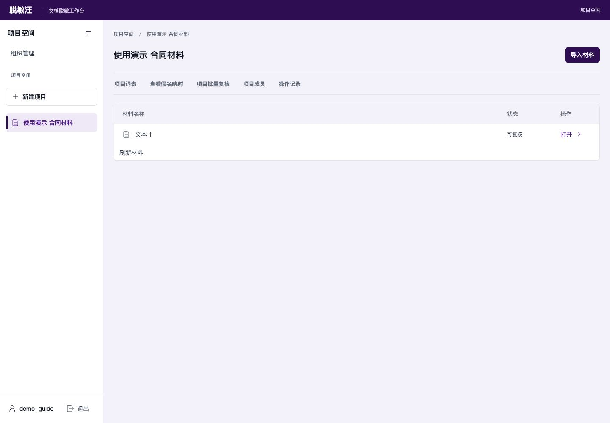

## 2 粘贴文字完成首次识别

1. 打开“导入材料”，在下方“待处理文本”粘贴要处理的文字。
2. 点击“提交并识别”，等待材料识别完成，再进入复核页。
3. 第一次练习可使用“示例材料/文本演示.txt”；不要把识别没有命中理解为无需检查。

操作结果：演示文本识别出两处手机号和一处邮箱；公司名称随后通过人工补标加入。

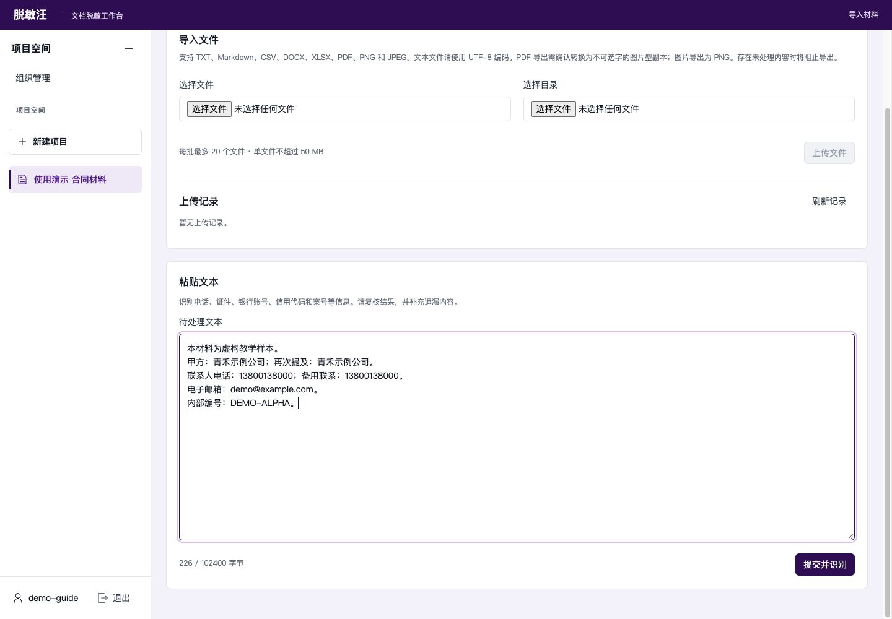

## 3 看懂复核工作台

1. 左侧切换项目材料，中间阅读原文，右侧处理敏感标记；正文上方集中提供查找、批量复核、漏标检查和人工添加入口。先把原文完整看一遍。
2. 对每个候选选择“脱敏处理”或“保留原值”。“待确认”需要继续处理。
3. 保存前可点击“撤销修改”退回最近一步，或用“重做修改”恢复；最多保留最近10步。

操作结果：三栏工作台可同时查看原文位置、敏感实体及左侧文档栏底部的保存和导出操作。

原文审查区只读。长文本分段显示时，应继续查看其他原文段落。

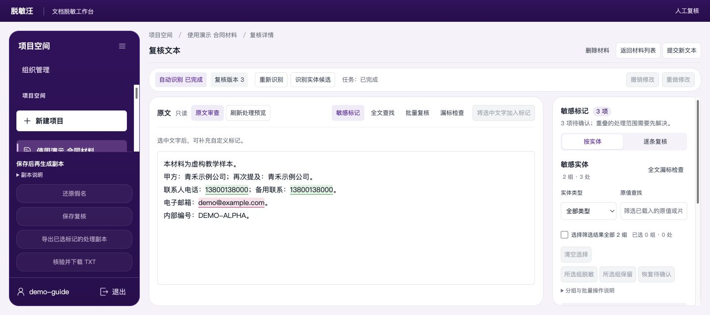

## 4 按实体处理并设置单处例外

1. 在“敏感标记”选择“按实体”，按信息类型或原值筛选，再勾选需要处理的实体组。
2. 点击类型标题可收起或展开该类型的实体；数字表示当前筛选结果中该类型的出现次数，折叠不会改变处理决定。
3. 点击所选组的脱敏、保留或恢复待确认操作；这会改变已有标记的决定，不会自动补上未标记位置。
4. 点击组原值定位，用组内“上一处”“下一处”查看重复位置；点击“编辑此处”进入逐条复核。
5. 同一原值的某一处可以保留，或使用不同的替换方式。出现决定或方式不一致提示时，核对这是否正是你的意图。

操作结果：此前实操：演示中同一手机号曾设置一处脱敏、一处保留；核对后最终使用了两种脱敏方式。

批量决定只改变所选已有标记，不会自动统一各处已设置的自定义文字或项目假名。

## 5 设置四种文字处理方式

1. 类型占位符：逐条选“脱敏处理”，脱敏方式保留“类型占位符”；例如手机号替换为【手机号】。
2. 部分遮盖：选择“部分遮盖”，设置保留前3字、后4字；演示结果为138***8000。
3. 自定义替换：选择“自定义替换”，填写替换文字；演示邮箱替换为“联系邮箱已隐藏”。
4. 项目假名：点击“选择项目假名”；创建新假名时核对页面提示，同一公司第二处需确认是同一实体，再使用已有【机构_000001】。

操作结果：此前实操：下载文本中，两处公司名使用同一个项目假名，两处手机号分别使用部分遮盖和类型占位符，邮箱使用自定义文字。

只有项目假名保存还原关系。部分遮盖、类型占位符和自定义替换不能用于恢复原值。图片中的文字采用像素清除。

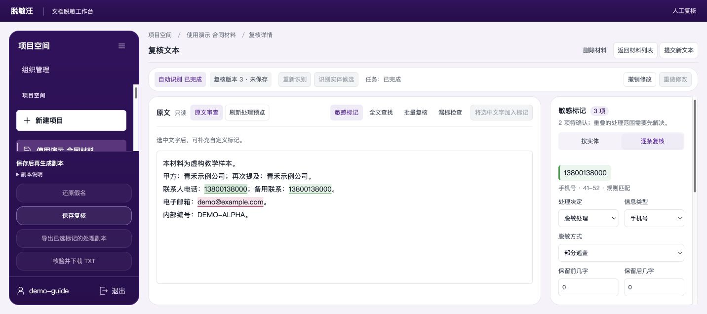

## 6 人工补标与全文漏标检查

1. 在原文中拖选漏掉的敏感文字，点击正文工具栏中的“将选中文字加入标记”；检查范围和信息类型。
2. 点击正文工具栏“漏标检查”，在独立对话框点击“检查全文漏标”，查看已知原值的其他出现位置。
3. 有可补录项时点击“补录全部漏标到草稿”；新项进入待确认，再逐项决定如何处理。
4. 出现保留项、同值策略或范围冲突时，点击“定位原文”会关闭对话框并返回正文；人工处理后需要重新检查。也可按 Escape 或点击“返回敏感标记”关闭工具。

操作结果：此前实操：演示中移出第二处公司名标记后，全文检查发现1处漏标，并可重新补入草稿。 新版对话框重放检查当前已知手机号和邮箱，显示均已完整标记、可补录0处。

本功能查找已知原值的重复位置，不能发现所有未知敏感信息；仍需阅读原文。

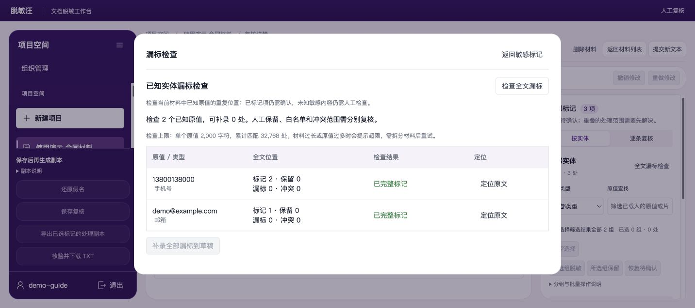

## 7 在全文中查找和逐处定位

1. 点击正文工具栏“全文查找”，输入精确文字，再选择“全部文字”“敏感标记内”或“敏感标记外”。查找在正文上方展开，右侧敏感实体仍可查看。
2. 点击“查找”，然后用“上一处”“下一处”逐处定位；也可点击结果摘要直接跳到原文。
3. 结果较多时点击“下一组结果”。修改查询、范围或草稿后，重新查找以得到当前结果。

操作结果：演示查找手机号，在全文中找到2处，可连续定位。

保留原值项不算敏感标记；命中必须完整落在同一个敏感标记里，才算“标记内”。这不是正则表达式搜索。

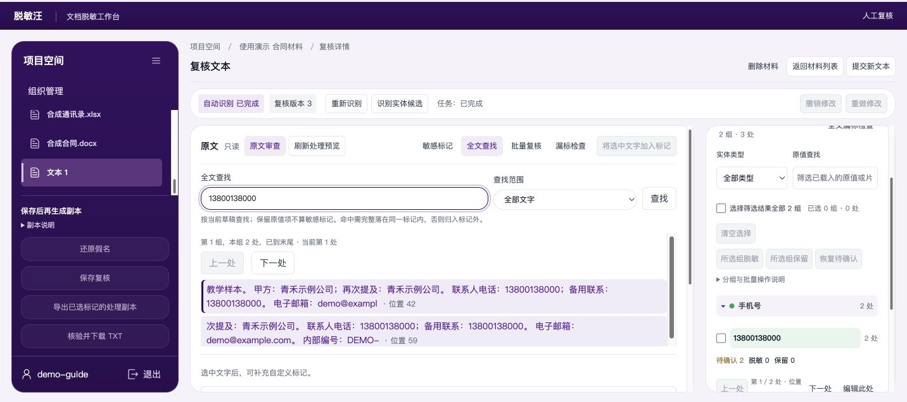

## 8 保存生成并下载文本副本

1. 检查待确认数量已为0，查看“处理预览”，确认选定的文字替换符合需要。
2. 点击左侧文档栏底部“保存复核”，等待显示已保存。侧栏收起时，保存与导出入口显示在工作区底部。继续修改草稿后需再次保存。
3. 点击“导出已选标记的处理副本”，等待副本任务完成。
4. 点击“核验并下载 TXT”，打开下载文件与原文对照；重点检查需要隐藏的原值和有意保留的内容。

操作结果：此前实操：本次TXT已实际下载。两处公司原名、原手机号和邮箱未再以完整原值出现；内部编号DEMO-ALPHA保留，第一处电话保留为138***8000。

按钮不可用时，依次检查是否未保存、仍有待确认、正在处理、缺少权限或存在版本冲突。不要把预览或任务完成单独当成下载核验完成。

## 9 使用项目假名还原文字

1. 如需先核对对应关系，在材料列表点击“查看假名映射”；该入口只向有映射权限的人员开放。
2. 先保存含项目假名的复核，再打开“还原假名”。
3. 粘贴只包含当前材料已确认假名的文字，点击“确认还原”，按页面提示确认展示敏感原文。
4. 核对还原结果；如需保存，点击“下载还原文本”。

操作结果：此前实操：仅包含两处【机构_000001】的公司文字已成功还原。将包含【手机号】的整段混合处理结果提交还原时，系统拒绝执行。

【手机号】属于不可还原的类型占位符。未知、变形或本版本未确认的代号不会被猜测还原；还原功能不是对所有脱敏方式的通用撤销。

还原应在含假名的复核已保存、当前材料版本有效时进行。后续更新项目词表会要求相关材料重新识别；请先完成需要的本版本还原。

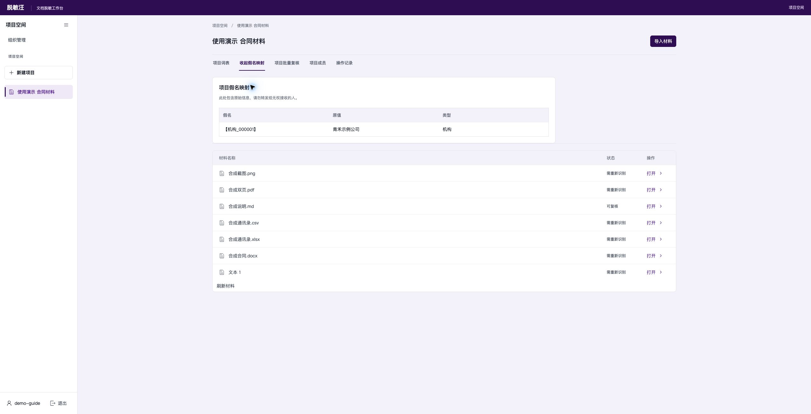

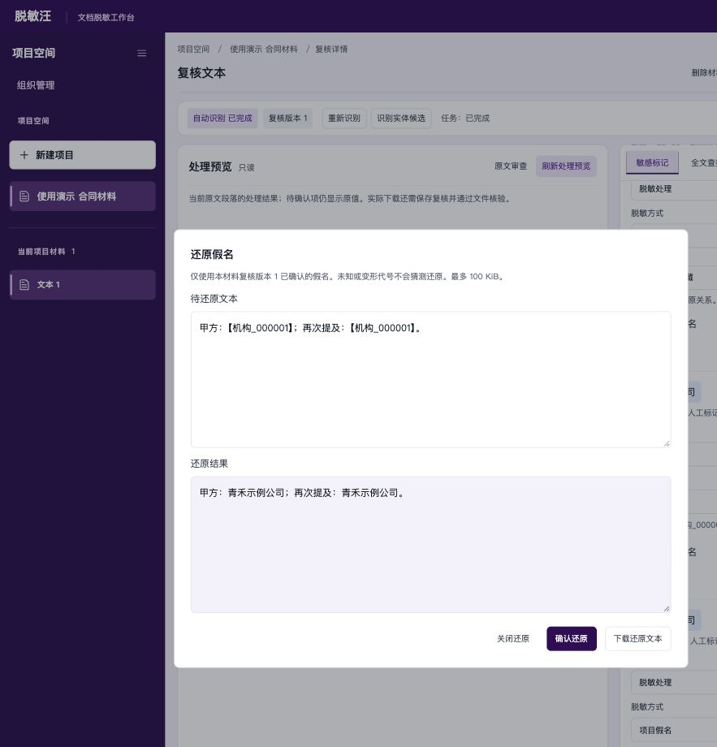

## 10 上传文件并处理Word正文

1. 进入“导入材料”，点击“选择文件”，选择文件后核对列表，再点击“上传文件”。
2. 每个文件显示“已保存”后，回到材料列表，等待识别完成再打开DOCX材料。
3. 按文本流程复核正文里的候选，保存复核后生成副本，再点击“核验并下载 DOCX”。

操作结果：6种示例文件已上传保存。首次DOCX下载“合成合同-处理结果.docx”处理2处电话和1处邮箱；后续“合成合同-实体识别处理结果.docx”另处理姓名与机构，共5处。本章新版截图展示后者的已保存版本4。

DOCX复核展示抽取后的正文，不是Word原版式逐页编辑。已核验下载包内指定手机号和邮箱无残留；尚未在Microsoft Word中检查版式。

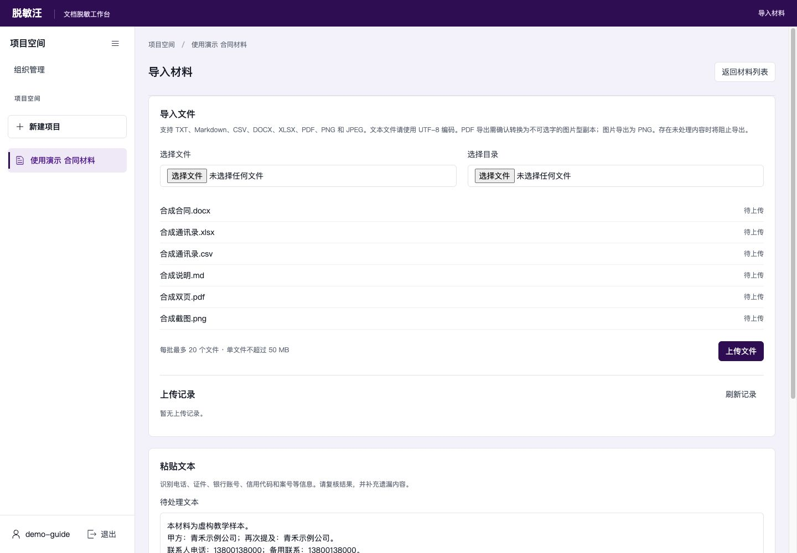

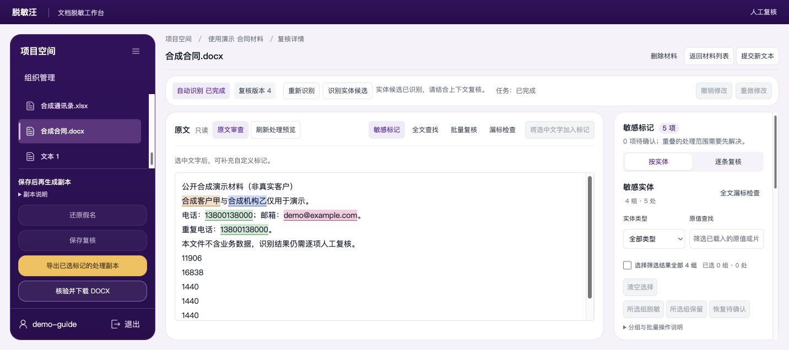

## 11 复核PDF并添加遮盖区域

1. 打开PDF，使用“上一页”“下一页”检查每页原件；右侧候选仍需逐项复核。
2. 在页面上拖动选出需要遮盖的范围，检查蓝色待添加框，再点击“添加本页区域”。添加后的区域显示为黑框。
3. 同位区域需要应用到多页时，填写起始和结束页，再点击“应用到指定页”；区域直接进入可撤销的草稿，随后逐页核对位置。
4. 选择图片型PDF输出方式。页面或区域操作有误时，可使用“撤销页面修改”退回前一步。

操作结果：此前演示PDF共2页，补充区域后可直接撤销。新版重放重新识别后，将两处电话设为脱敏，并把左上角30×30演示区域应用到两页；最终两页各1个区域，保存为版本4。

印章、签名、人脸等是手动区域标签，不代表自动识别这些对象。

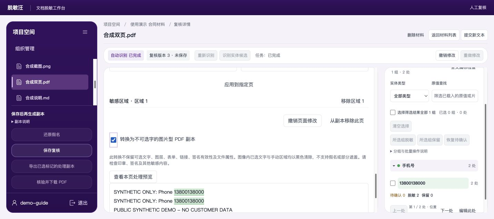

## 12 预览PDF并核验下载结果

1. 点击“查看本页处理预览”，检查敏感文字和手动区域是否已经黑色清除。
2. 如果曾使用“从副本移除此页”，最终检查是否需要“恢复此页”；原件页面始终保留。
3. 保存复核，生成副本，完成后点击“核验并下载 PDF”。下载后检查页数和处理位置。

操作结果：此前下载PDF保留2页；独立核验确认两页均为图片对象，原手机号位置为黑色像素，无可选文字层、附件、脚本或注释。新版界面重放已重新生成并实际下载版本4，区域位置与此前演示不同。 新下载副本也已独立回读：2页均仅含图片对象、文字层为空，原手机号区域约99.15%为黑色像素。

图片型PDF不可像原PDF一样选择文字。只删除文字层不足以证明原像素被清除，仍应检查页面图像。

实际文件：[v2-合成双页-处理结果.pdf](%E7%A4%BA%E4%BE%8B%E6%9D%90%E6%96%99/v2-%E5%90%88%E6%88%90%E5%8F%8C%E9%A1%B5-%E5%A4%84%E7%90%86%E7%BB%93%E6%9E%9C.pdf)

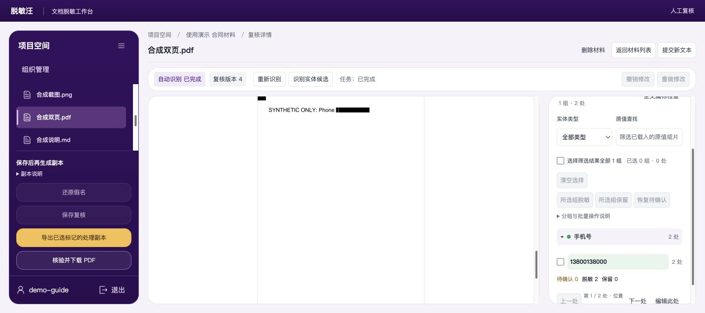

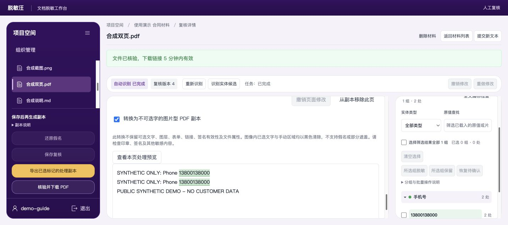

## 13 复核图片并下载PNG

1. 打开图片材料，查看原图和OCR文字候选。OCR可能漏识别，必要时手工添加遮盖区域。
2. 将需隐藏的手机号、邮箱等候选设为“脱敏处理”，并确认PNG像素清除输出方式。
3. 查看本页处理预览；确认后保存复核、生成副本，再点击“核验并下载 PNG”。

操作结果：本次PNG已完成识别、人工复核、像素清除预览、保存和下载。独立回读实际下载文件，手机号和邮箱原字形位置均为黑色像素；重新OCR未读出这两个原值。 新版界面重放重新识别、复核并保存为版本4，再次实际下载PNG。 新下载图与原图尺寸相同，独立核验手机号和邮箱原字形像素全部为黑色，重新OCR未读出原值。

核验针对本例手机号、邮箱及对应像素位置，不表示OCR能发现全部未知敏感信息。仍应检查整张图片。

实际文件：[v2-合成截图-处理结果.png](%E7%A4%BA%E4%BE%8B%E6%9D%90%E6%96%99/v2-%E5%90%88%E6%88%90%E6%88%AA%E5%9B%BE-%E5%A4%84%E7%90%86%E7%BB%93%E6%9E%9C.png)

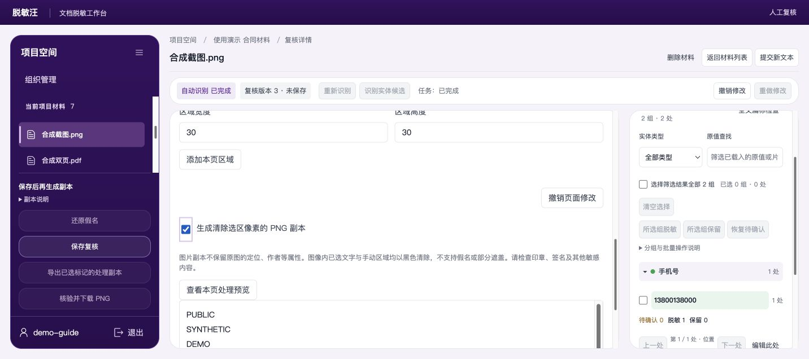

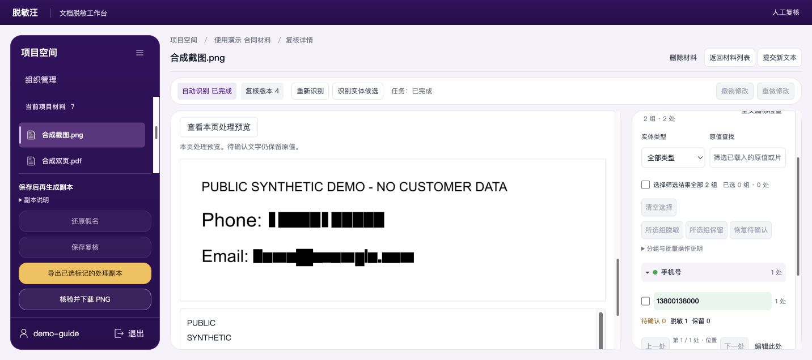

## 14 对多份材料批量复核

1. 先逐份阅读原文。回到材料列表，打开“项目批量复核”，勾选要处理的材料。
2. 选择候选类型与处理决定。需要只处理白名单建议时，勾选“仅白名单建议”。点击“核对批量范围”。
3. 核对每份材料的版本和受影响项数，再点击“确认批量保存”；在页面内确认窗口阅读影响，确认后才会保存。
4. 本次操作有误时，点击“撤销本次批量复核”，核对确认后创建新的复核版本；材料已经再次修改时会拒绝撤销。

操作结果：此前实操：本次同时选择Markdown、XLSX、CSV三份材料，待确认项分别为3、4、4。批量保存成功后，演示撤销恢复待确认并创建新版本，随后重新批量处理并保存。

每批最多20份，只处理已勾选材料的待确认项。这会直接保存多份材料，与当前文档内的草稿批量操作不同。

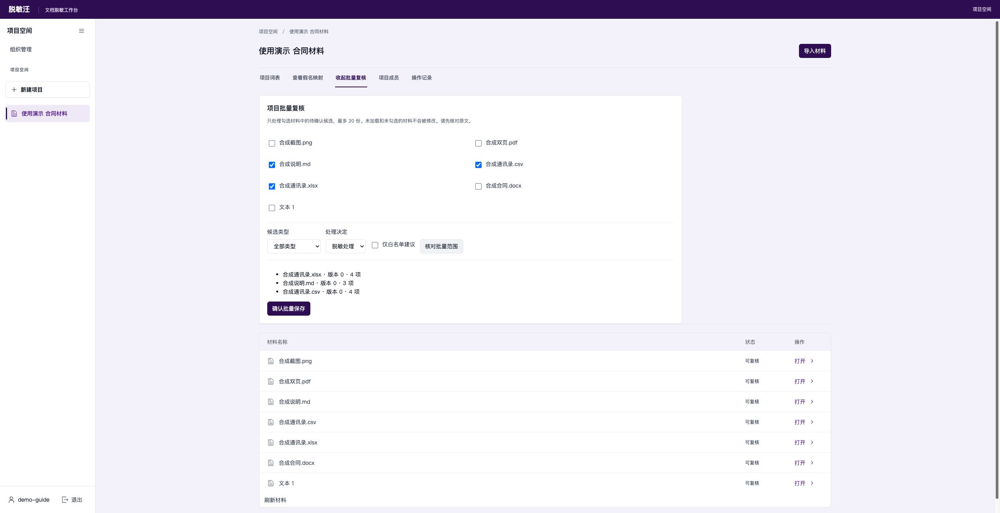

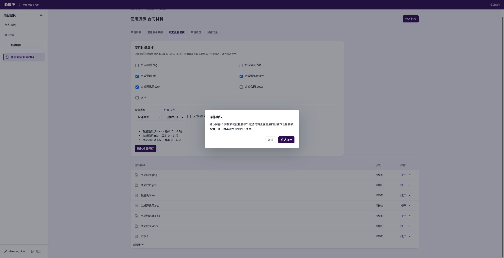

## 15 处理Excel和CSV表格

1. 在导入页选择XLSX或UTF-8编码的CSV，上传后等待识别，打开对应材料。
2. 按已有候选逐项复核，或在核对原文后使用项目批量复核；还应阅读未被识别出的字段。
3. 保存复核并生成副本，分别点击“核验并下载 XLSX”或“核验并下载 CSV”。
4. 打开下载副本，检查行列位置、需要隐藏的原值以及应保留的内容。

操作结果：本次XLSX与CSV均已实际下载。两个合成人名和两个手机号被替换，3行3列内容与预期一致；XLSX下载包完整，指定原值无残留。 新版重放通过“识别实体候选”重新识别并人工确认4处，再次保存为版本6并实际下载。 新下载文件再次独立核对行列和替换内容，结果符合预期。

XLSX不保留公式、超链接、条件格式和数据验证。CSV应使用UTF-8编码；打开后还需核对表格内容。

实际文件：[v2-合成通讯录-处理结果.xlsx](%E7%A4%BA%E4%BE%8B%E6%9D%90%E6%96%99/v2-%E5%90%88%E6%88%90%E9%80%9A%E8%AE%AF%E5%BD%95-%E5%A4%84%E7%90%86%E7%BB%93%E6%9E%9C.xlsx)

实际文件：[v2-合成通讯录-处理结果.csv](%E7%A4%BA%E4%BE%8B%E6%9D%90%E6%96%99/v2-%E5%90%88%E6%88%90%E9%80%9A%E8%AE%AF%E5%BD%95-%E5%A4%84%E7%90%86%E7%BB%93%E6%9E%9C.csv)

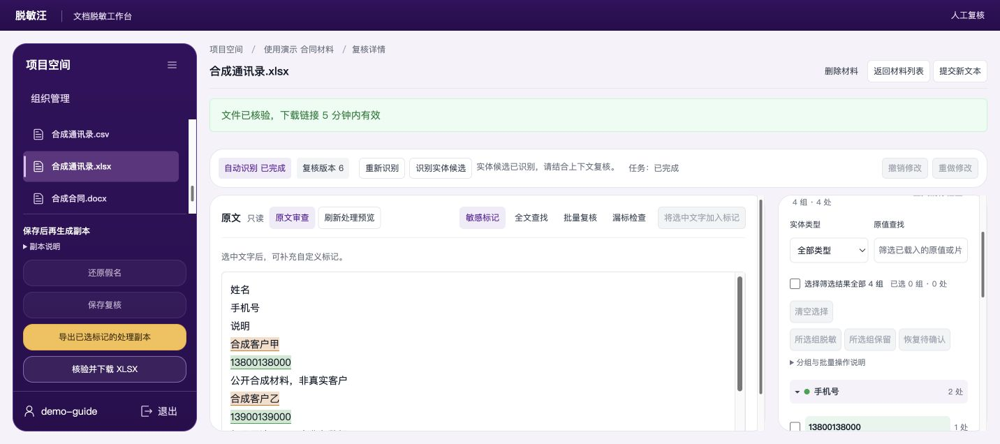

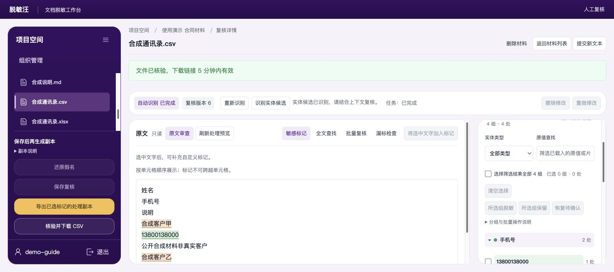

## 16 处理Markdown材料

1. 上传Markdown文件，等待识别后打开材料。
2. 逐项确认手机号、邮箱等候选；如果姓名或机构没有标记，使用人工补标或项目词表补充识别。
3. 保存复核、生成副本，再点击“核验并下载 MD”。打开下载文件检查Markdown内容与替换结果。

操作结果：首次下载“合成说明-处理结果.md”仅替换2处电话和1处邮箱，人名、机构和公开演示用语保留。新版截图已进入后续词表处理后的6项复核版本；人名和机构的补充识别步骤见第18章。

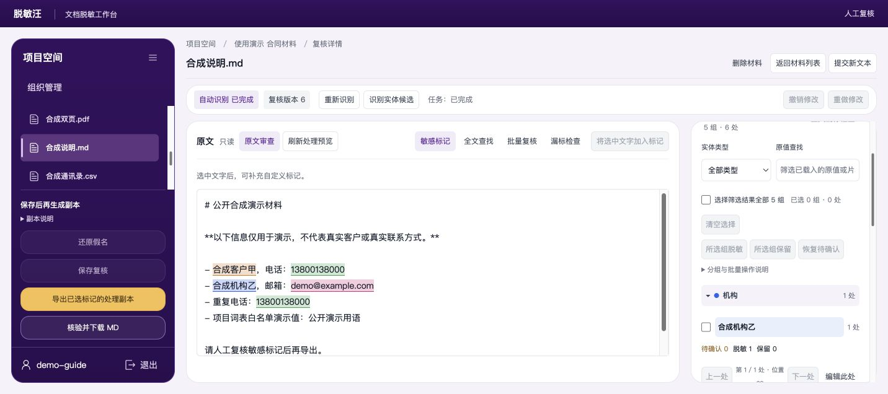

## 17 维护项目黑白名单

1. 回到材料列表，打开“项目词表”。可填写“名称或代号”、信息类型和黑白名单类别，然后点击“添加词条”。
2. 批量维护时，点击“导入名单 XLSX”，在系统文件选择器选择名单表；导入后先核对词条，尚未保存。
3. 点击“保存词表”，在页面内确认窗口核对已有材料需要重新识别的影响，再确认保存。
4. 需要保存名单时，点击“导出名单 XLSX”；下载表用于维护项目规则，包含词条原值。

操作结果：本次通过系统文件选择器导入并保存3条词表：2条黑名单、1条白名单。实际导出文件可重新解析，3条规则与导入样例一致。

黑名单补充候选，白名单提供保留建议，两者都需要人工复核。名单导出不是脱敏材料副本，应妥善管理其中原值。

需要导入模板时可先导出已有名单；表头为“名称或代号、信息类型、名单”，最多1000条。

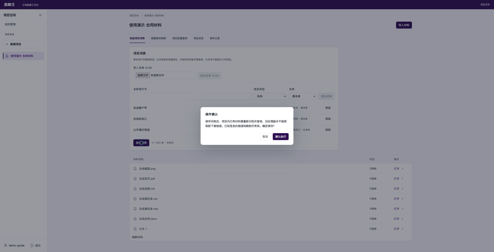

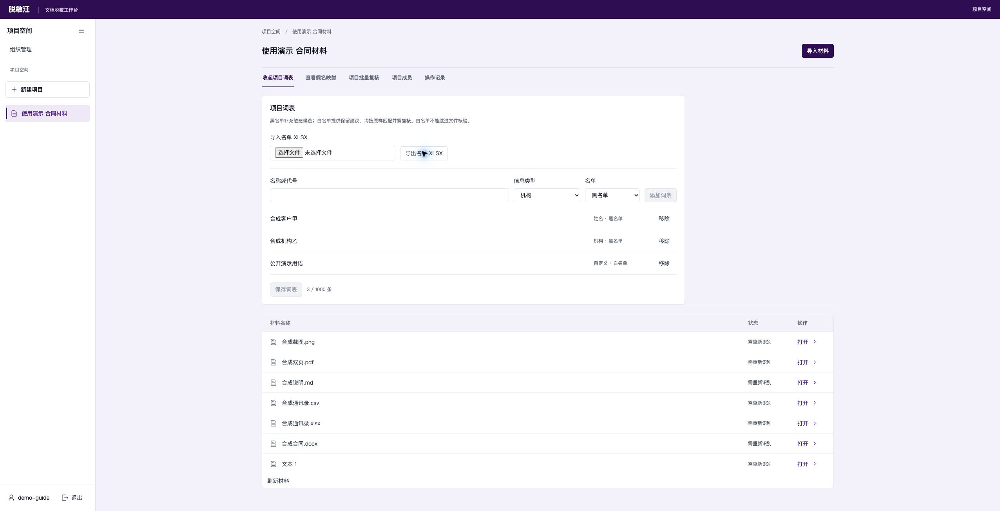

## 18 按更新后的词表重新识别

1. 词表保存后，打开显示“需重新识别”的材料，点击“重新识别”。
2. 等待任务完成，重新检查全部候选。黑名单命中成为候选，白名单建议仍需由你决定保留。
3. 逐项设定处理决定，保存复核后重新生成并核验下载；不要继续把旧副本当作本次规则的结果。

操作结果：更新词表后，Markdown新增合成人名、机构和白名单候选。新版实际下载结果中人名、机构、手机号及邮箱均按所选方式处理，“公开演示用语”经人工确认保留。 新版重放再次重新识别、人工确认并保存为版本8，已实际下载；预览仍保留Markdown正文与白名单用语。 新下载文件与此前已独立核验的词表处理结果字节一致。

重新识别不会自动沿用上一轮处理决定。每次更新词表或复核后，应使用对应版本的新副本。

实际文件：[v2-合成说明-词表处理结果.md](%E7%A4%BA%E4%BE%8B%E6%9D%90%E6%96%99/v2-%E5%90%88%E6%88%90%E8%AF%B4%E6%98%8E-%E8%AF%8D%E8%A1%A8%E5%A4%84%E7%90%86%E7%BB%93%E6%9E%9C.md)

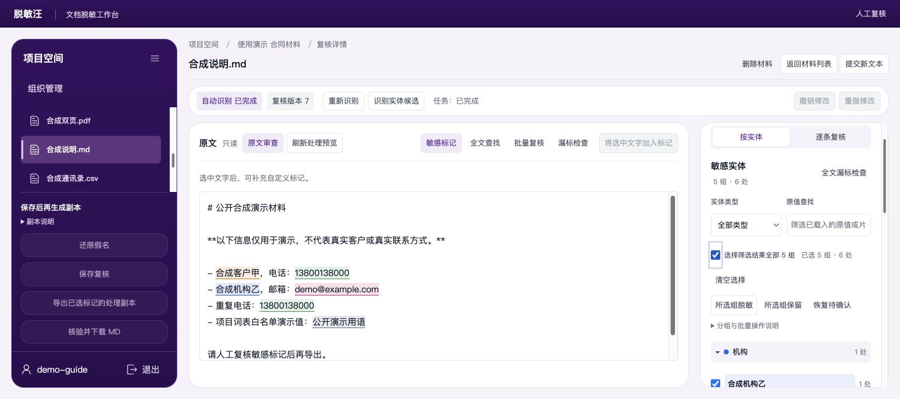

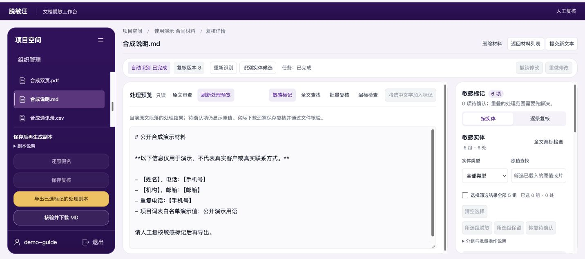

## 19 识别本地实体候选

1. 在模型可用且本人有相应权限时，复核页上方显示“识别实体候选”。先完成或妥善处理未保存草稿，再点击入口。
2. 阅读页面内确认：本次会创建新复核版本，旧处理决定不会自动沿用。确认后等待识别任务完成。
3. 重新核对姓名、机构、地址及其他已有候选，逐项选择处理决定；保存后生成并核验下载新副本。

操作结果：本次DOCX运行该入口后形成5处候选，随后全部人工确认并实际下载新DOCX。下载正文中1处姓名、1处机构、2处电话、1处邮箱按所选方式替换。 新版截图保留该已保存版本4：先临时恢复待确认展示复核入口，随后撤销，最后显示已保存处理预览。

候选同时可能来自规则、项目词表与本地实体识别。本例不能证明5处均由模型发现，也不是模型准确率验收。

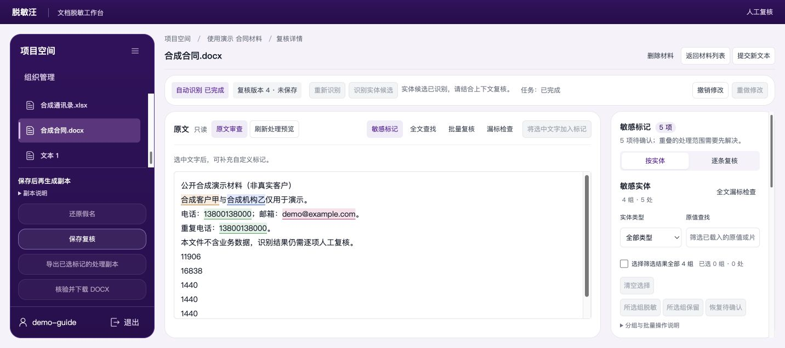

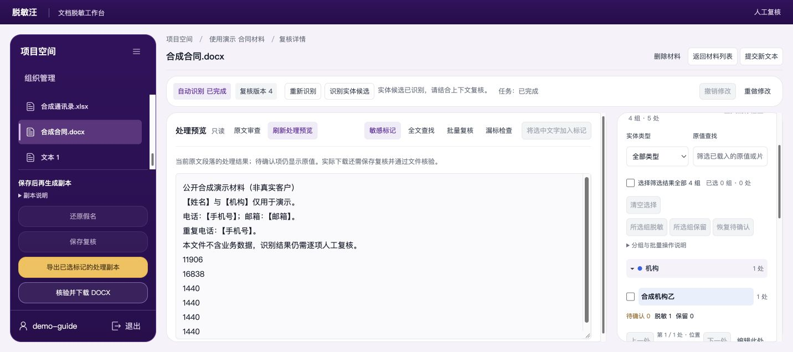

## 20 查看项目成员和操作权限

1. 回到项目材料列表，点击“项目成员”，选择成员查看相应权限。
2. 组织账号与项目授权分别管理。只有被授予对应项目权限的账号，才能查看原件、复核、导出、使用映射或执行其他授权操作。
3. 需要新增成员时，由有权限的人员先进入“组织管理”创建账号，再回到项目分配权限；权限调整应核对账号和项目后再保存。

操作结果：本次已打开项目成员入口并查看项目所有者权限，没有修改账号授权。

本次仅查看项目所有者权限，没有执行新增成员或授权修改；相关未实操步骤见最后一章。

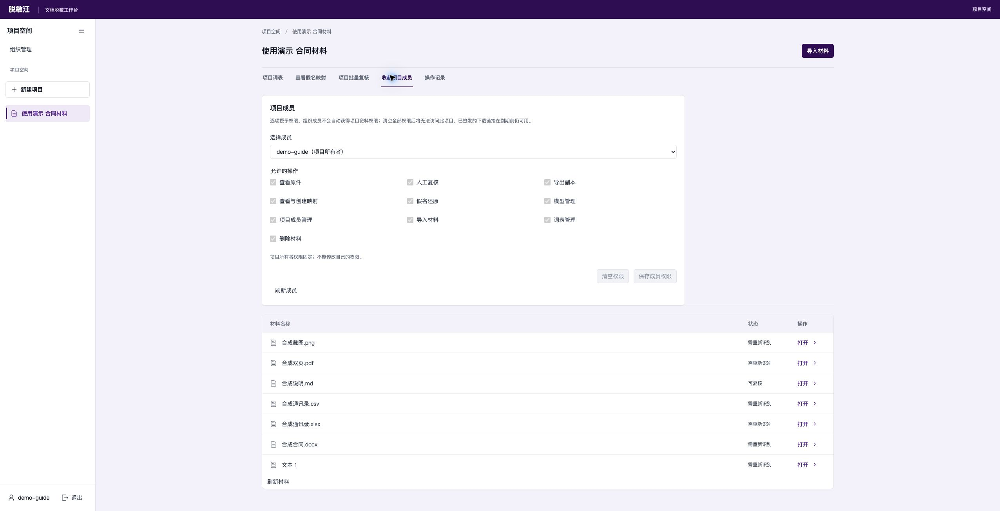

## 21 查看操作记录和组织配额

1. 在项目材料列表打开“操作记录”，核对时间、操作类型与对应对象；需要新记录时点击刷新。
2. 有组织管理权限的人员可打开“组织管理”，查看成员状态和“材料配额”。
3. 核对容量和材料数上限时，区分材料配额与实际磁盘占用；本轮仅查看，不调整数值或成员状态。

操作结果：本次查看到词表修改、重新识别、复核保存、副本生成和下载签发等项目记录；组织成员和材料配额已只读展示，没有改写。

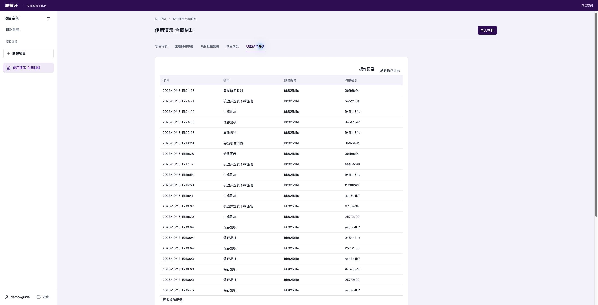

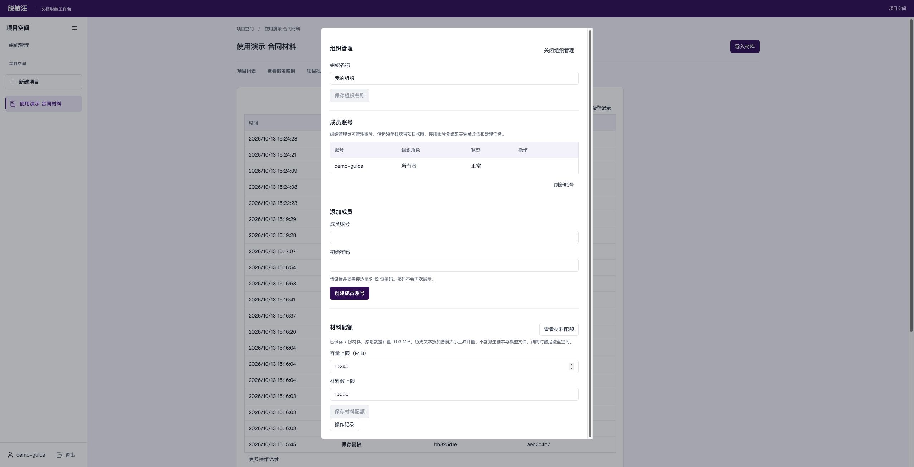

## 22 退出草稿与删除确认

1. 离开有未保存内容的页面时，按页面内提示选择取消或放弃；放弃不会替你保存草稿。
2. 需要删除材料时，点击“删除材料”，在页面内确认窗口核对材料和不可恢复说明。
3. 如果只是查看提示或点错了，点击取消；只有确认删除才会永久移除相应材料。

操作结果：本次打开了删除确认窗口，并点击取消，没有删除任何材料。

草稿内可撤销的修改直接生效，可用撤销按钮退回；保存词表、批量保存、删除或放弃等有后果的操作按页面内提示核对。

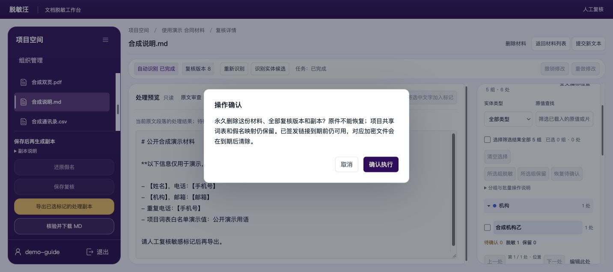

## 23 实操范围与其他操作步骤

下列范围区分真实操作、只读展示和根据当前实现核对的待实操步骤。成功下载某个示例，不等于所有材料、所有权限组合或全部未知敏感信息均已验收。

1. 本次已实际完成：文本四种处理方式、实体分组和单处例外、人工补标、全文查找、漏标检查、草稿撤销、假名还原、各示例材料的复核保存与下载、项目批量保存与撤销、词表导入保存导出及重新识别、本地实体候选入口。
2. 本次仅只读展示：假名映射、项目成员权限、组织成员、材料配额和项目操作记录。删除只演示确认后取消。
3. 尚未执行的新建账号与授权写入：有权限的管理员在“组织管理”填写成员账号和初始密码，创建后再到项目选择成员、勾选权限并保存。账号创建不会自动授予项目访问权。
4. 尚未执行的中断续传：从导入页上传记录点击“继续上传”，重新选择原文件或目录，再上传；系统校验路径、大小和内容，已保存文件会跳过。
5. 尚未执行的失败重试：先根据页面错误处理原因，再点击任务“重试”；未保存草稿、版本冲突或材料需重新识别时，应先处理相应提示。
6. 尚未执行的永久删除：仅在确实不再需要材料时，由有删除权限的人员在确认窗口核对并确认。删除后的原件、复核与副本记录不能通过撤销草稿恢复。

不支持的能力包括DOC/WPS导入、OCR原文字词校正、Word原版式逐页编辑和自动人脸或印章识别。页面中的人脸、印章等类型用于手动标注区域。

实际文件：[新版实际下载文件独立核验记录](%E5%AF%BC%E5%87%BA%E6%A0%B8%E9%AA%8C-v2.json)
