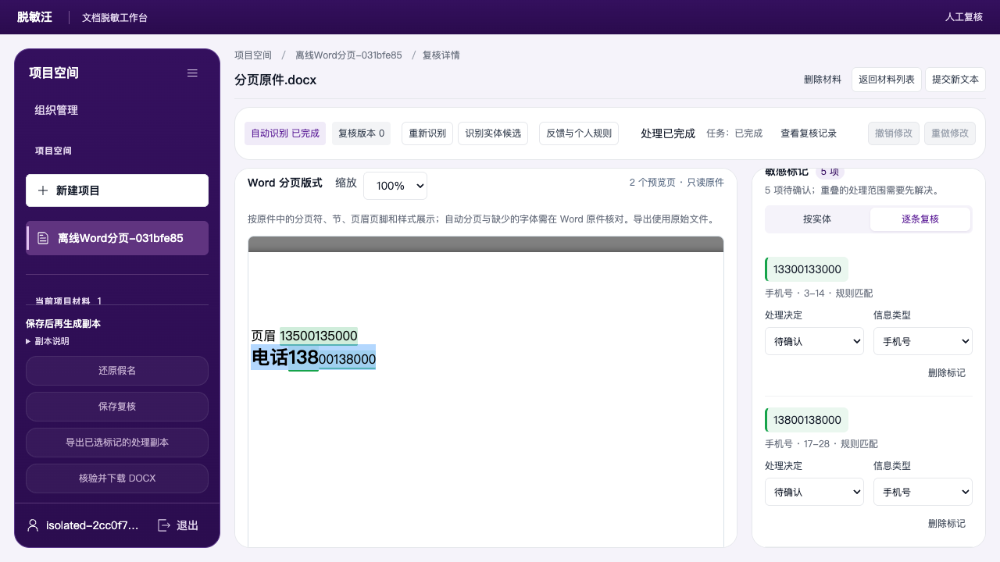
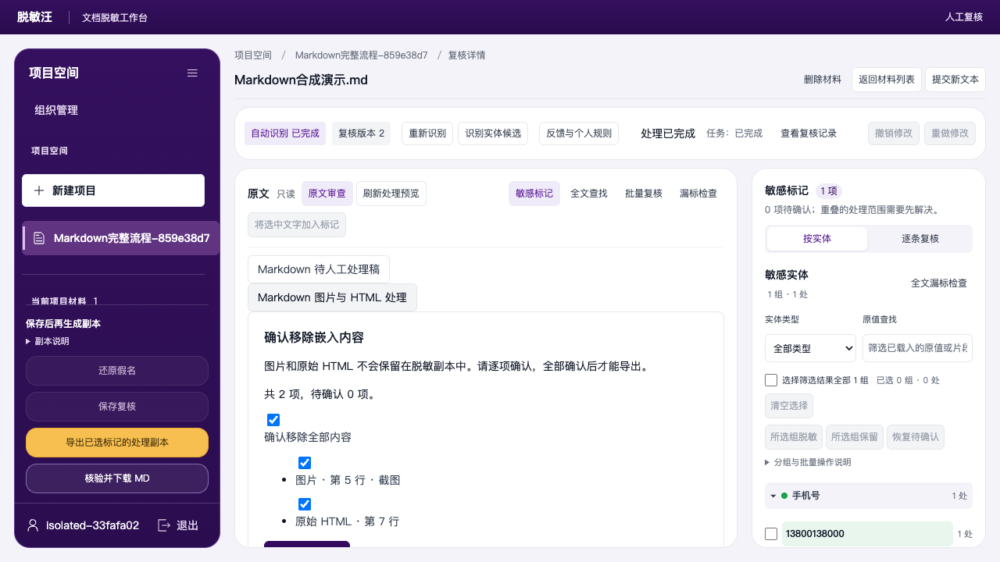
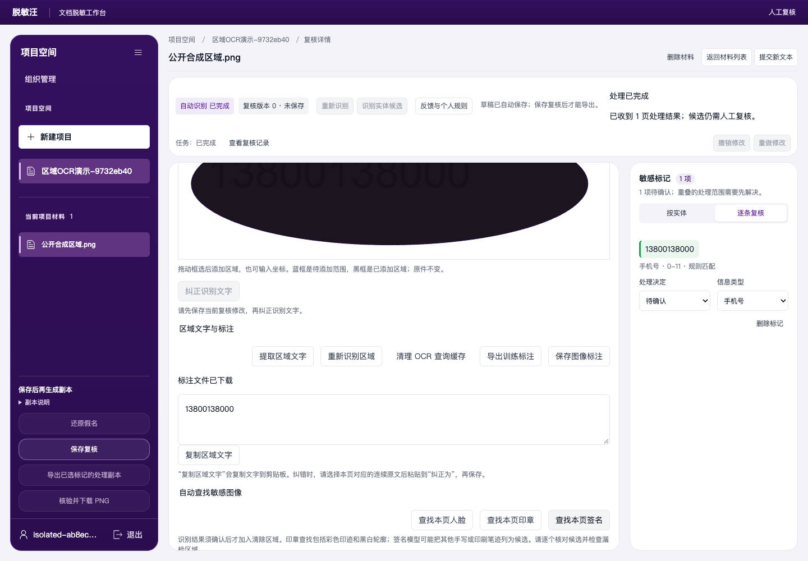
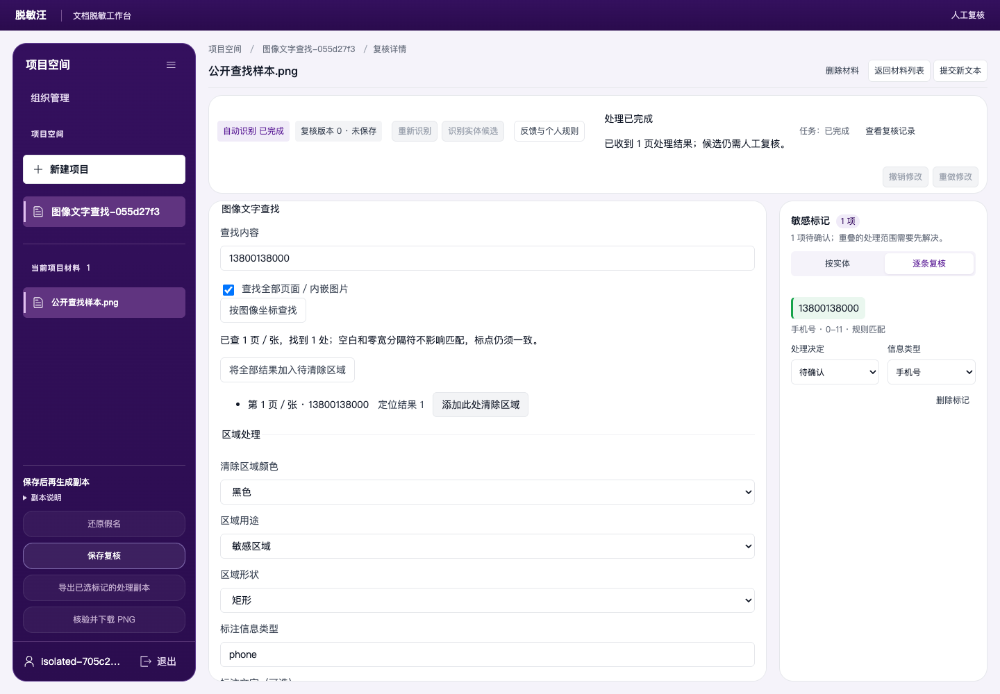
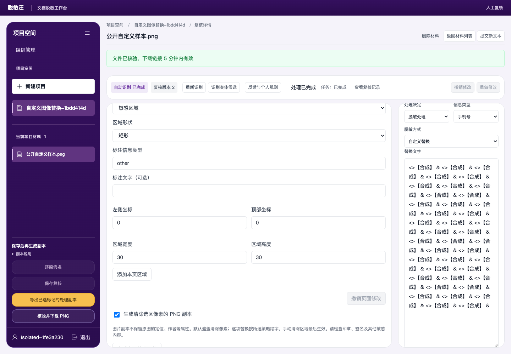
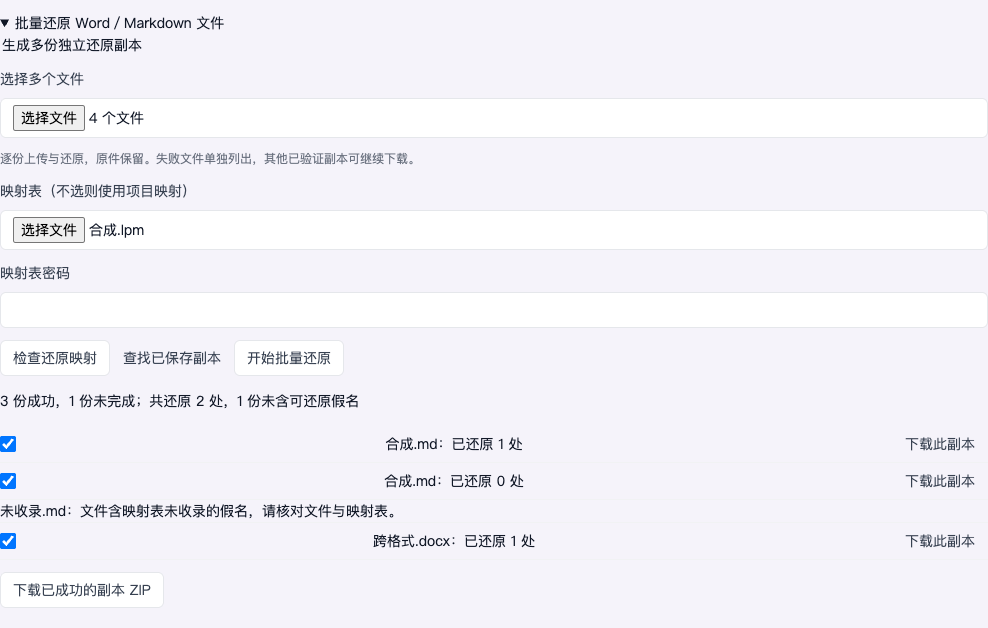
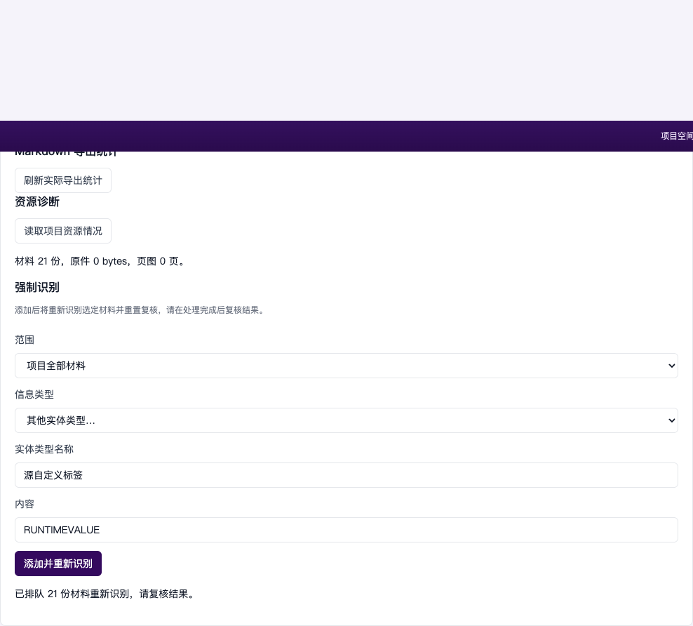
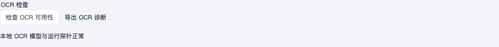
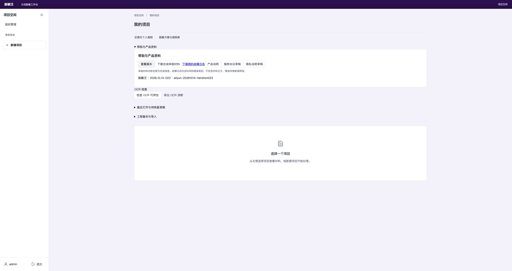

# 脱敏汪最新实操指南

适用版本：2026-10-14 完整移植迭代。公网实际回读版本为2026.10.14-023／aliyun-20261014-iteration023；本地验证和公网容量观察分开记录。

截图来自隔离账号和合成材料；旧版完整基础流程仍可见同目录《脱敏汪使用指南》。本补充指南对应本轮新增和修正的入口。

每份材料都需要“复核 → 保存 → 生成 → 核验并下载”。识别候选、预览成功、HTTP 成功与最终副本无残留是不同的验证。

## 1. 先完成一份材料

1. 打开 https://182.92.172.59/tuomin/，输入账号 admin 和密码 admin123，点击“登录工作台”。
2. 新建项目后点击左侧项目名称，进入“导入材料”。选择文件还需点击“上传文件”；粘贴文字需提交后等待识别完成。
3. 打开材料，逐组或逐条决定“脱敏”或“保留”。所有待确认项都需要决定；漏标内容可选中文字补标。
4. 有图像的材料还要检查页面区域。保存复核后生成副本，任务完成再点击“核验并下载”。下载文件才是处理结果，原文区仍保留原件用于审查。

先用一份合成材料熟悉流程，再逐份检查业务材料。

## 2. Word 原版式与内嵌图片

1. 打开 DOCX，切换到“Word 版式审查”，检查段落、表格、页眉页脚及高亮。
2. 在同一段内拖选文字，加入标记；再检查“对象原文”中其他文字对象。
3. Word 内嵌图片按资源展示，GIF/TIFF 等多帧内容需逐帧检查。定位、OCR 和视觉候选都针对实际图片。
4. 保存复核，生成并核验下载 DOCX。未知或无法安全回写的对象会明确阻断。

实际 Word 流程已运行。浏览器字体和分页不保证与原 Word 软件逐像素一致。

## 3. Markdown 保留格式与嵌入内容确认

1. 打开 .md 或 .markdown，默认复核页面可找到“Markdown 图片与 HTML 处理”。
2. 逐项检查图片和原始 HTML，确认移除并保存；未确认的嵌入内容会阻止导出。
3. 处理正文、表格和元数据的敏感标记，保存复核后生成并下载 MD。
4. 重新打开材料仍保留确认结果。遇到隐藏语法残留风险，输出可能安全降级为文字；不要把手工稿当作已核验副本。

实际上传、确认、保存、下载及重开已通过；有图片/HTML且无扫描文字的材料也可经明确确认生成空副本。

## 4. OCR 改字与区域文字

1. 在 PDF、图片或 Word 内嵌图片中打开“纠正识别文字”，修改误识别文字并保存。
2. 保存会创建新识别版本，原图片不变；敏感标记重新待确认，必须再次复核。
3. 拖选区域后可“提取区域文字”“复制区域文字”或“重新识别区域”；结果只用于复核，不会自动覆盖整篇原文。
4. “保存图像标注”“导出训练标注”下载真实 JSON，包含页面坐标、类型、原文、形状和来源信息。

实际区域提取、重新 OCR、剪贴板回读与两种 JSON 下载已通过。粗粒度字框可能覆盖相邻文字，请检查预览。

## 5. 矩形、椭圆与跨页文字定位

1. 在“区域用途”选择用途，设置“区域形状”和“标注信息类型”；自定义类型需填写有效名称。
2. 拖选后添加本页区域；多页材料可指定起止页按比例应用。坐标和类型无效时整次操作会被拒绝。
3. “图像文字查找”可查全部页，按真实 OCR 字符或词框定位；添加结果只进入待清除草稿。
4. 区域和文字策略可能重叠，需保存复核并检查处理预览和实际副本。人工清除区域优先清除其覆盖位置。

空白和零宽字符不影响查找，标点仍需一致。词级框的局部位置是估计值。

## 6. 自定义替换与最终清除结果

1. 逐项选择自定义替换，可输入多行、长文本或特殊符号；空字符串代表删除原值。
2. 图片中的全空白替换只清除像素，不重新绘字。其他策略需检查处理预览是否能在对应区域绘制。
3. 手动清除区域最后执行，不会因叠加假名或部分遮盖而重新出现敏感文字。
4. 保存复核、生成并下载后检查实际图片；Word 不允许的 XML 字符会明确拒绝，不会生成损坏的文件。

32 组跨格式实际验证和 18 组图像导出验证保留成功与明确拒绝；没有为了强行成功关闭编码检查。

## 7. 人脸、印章与签名

1. 在“自动查找敏感图像”查找本页人脸、印章或签名。
2. 候选仅供检查：定位后确认清除或忽略，不会自动批准。漏检内容需人工框选。
3. 印章查找期间可停止当前印章任务；此操作不停止人脸或签名查找。
4. 检查受影响页面的警告，保存复核后生成副本并核验下载。

人脸完整公开评估5,749图，严格框定位F1为76.05%；其中1张原尺寸图片被尺寸检查拒绝。签名35张验证集F1为62.2%，另一37张测试集F1为70.9%，存在训练家族重叠的不确定性。黑白章为本工具扩展，尚无可用真实专门金标语料；彩色章数值对齐不能当作业务准确率。全部候选仍需人工复核。

## 8. 批量还原假名文件

1. 打开“批量还原 Word／Markdown 文件”，选择多个文件。
2. 默认使用项目映射；也可选择 LPM/JSON 映射表并输入其密码。检查歧义并明确选择原文。
3. 点击“开始批量还原”，逐个查看成功或失败结果；失败不阻止已成功副本下载。
4. 单独下载或选择成功文件下载 ZIP；刷新后可“查找已保存副本”。

实际四份文件流程包括成功、失败和零替换结果，已核验 ZIP 内容。原件保持不变。

## 9. 工程备份、TMM 迁移与规则继承

1. 在“工程备份与导入”设置密码，下载包含原件、规则、方案、映射及复核记录的工程。
2. 导入 TMW/TMM 为新项目。旧 ZIP、secure-v2、secure-v3 可迁移或生成密码传输副本。
3. 原产品本机钥匙串保护的工程，需通过原产品合法导出传输副本；服务器不能凭空取得本机密钥。
4. 核对继承的配置、材料路由和映射。旧审批转为待确认；未能精确恢复的项完整列出，需人工处理。

真实三种格式和导出、迁移、重新识别、复核、导出及还原已逐项测试。

## 10. 规则、个人反馈与处理报告

1. 项目方案控制默认类别、文字策略和输出；按材料类型选择配置后重新识别并复核。
2. “反馈与个人规则”保存个人条目；导入规则库须选择应用范围，不会自动把未应用条目用于处理。
3. “处理报告与运行规则”可为全部材料生成报告，下载 ZIP/JSON/HTML/MD/CSV。报告记录真实版本、哈希及待审状态。
4. 运行时强制识别会重新识别选定文件或项目全部材料；重置后的标记仍需确认。

实际超过首屏的 21 份材料报告与项目范围更新已验证，避免只处理当前列表页。

## 11. 草稿、账号权限与帮助

1. 复核修改会自动保存为草稿；重新打开可恢复，恢复不等于正式保存复核。
2. 工程最近记录可打开待恢复材料。跨账号或跨标签页切换后，重新确认当前登录账号与项目权限。
3. “记录不存在，或你已无权访问”需核对当前账号和材料是否仍存在。组织管理员身份不会自动授予所有项目读取权限。
4. 帮助提供 OCR 检查、诊断、版本信息和日志下载。私有模型调用需单独配置，当前离线功能不会因此自动具备在线 AI。

草稿版本和内容哈希不匹配时会拒绝恢复，不能把旧决定套用到新材料。

## 实际下载结果：图像查找并添加区域后，实际下载的清除结果

## 实际下载结果：自定义空白替换后，实际下载的清除结果

## 线上发布版本实证

Edge实际打开公网版本，并通过“帮助与产品资料 → 查看版本”核对发布ID。

