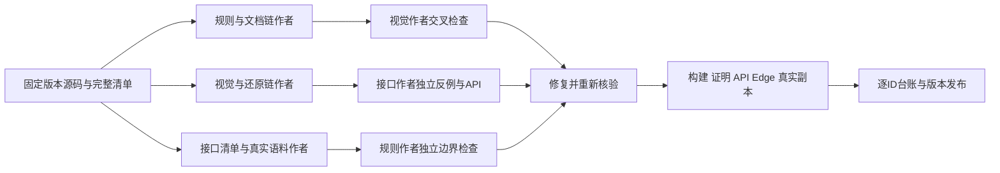

# 公开证据移植与交叉审查验收 · 2026-10-14

本次按完整清单实施和审查，不以界面出现、接口注册、HTTP 成功或合成准确率代替真实链路。所获 0.5.9 源码范围、我方运行和竞品运行分开记录；没有许可证的竞品处理链全部保持 R0。

## 全量覆盖

| 清单 | 数量 | 当前证据 |
|---|---:|---|
| 基础规则组 | 41 | 全量接入，保留各组条件、排除项、优先级和遮罩 |
| 金额规则 | 12族／17正则分支 | 全部保留，包括表格、标签、币种、中文金额和裸数字条件 |
| YAML 类别／数组项 | 108／3,012 | 3,009字符串和3项非字符串均保留，无抽样导出 |
| 完整接口稳定 ID | 258 | 逐项源码、实现、前端、测试及剩余差异，不按家族自动提升 |
| 链路／深层契约 | 37／170 | 保留逐成员索引，不把相关测试当作整条原生链等价 |

## 最终本地运行证据

- `pnpm check`：11项 Bend 法则、13项反向变异、TypeScript、82个测试文件／568项单元测试及前端构建通过。
- 完整隔离 API／数据库／worker 回归：39个测试文件／71项通过。随后更新的共享还原入口另跑2项映射和3项完整协议测试，全部通过。
- 完整真实 Edge 回归：50/50通过，包含登录、项目／权限、复核保存、真实导出、下载内容核验、Word／VML、Markdown、OCR、区域清除、备份和批量还原。
- 长别名新增专项：完整22,788,935字节、100,000条205字符别名；真实 worker、Markdown与跨文字段Word还原、持久化和下载均通过。另一作者独立4项API通过。300字符歧义键和200,001字符以上原值选择保留，未新增专用长度上限。
- Word两种预览只对 `PROCESSING_BUSY` 短暂重试；权限、版本和哈希失败不重试。旧请求取消不再启动后续重试或渲染旧结果。4项单元和真实Edge操作通过。
- 原件不可变、复核版本与哈希、不可变签发链接、权限门和 Bend 法则保留。未修改大模型启动加载策略，未为部署新增容器资源限制。

## 审查发现与关闭

保留原失败日志；已修复隐藏 YAML 语法泄漏、默认遮罩的图像绘字条件、人工清除后被文字覆盖、空白自定义绘字失败、亚像素区域越界、元数据未加密、Markdown零扫描文本确认、长映射正则进程崩溃、编码变形映射歧义、原型属性误读和 Word 临时忙状态卡住。详见 [全部规则交接](脱敏规则完整技术交接-迭代023.md)、[当前逐接口证据](逆向台账/contracts/current-interface-handoff-20261014.json)、[还原独立审查](逆向台账/contracts/review-restoration-final-by-inventory-20261014.md)及[预览审查](逆向台账/contracts/review-processing-read-by-visual-20261014.md)。

## 真实准确率与等价边界

| 数据／功能 | 完整评估结果 | 边界 |
|---|---|---|
| 人脸：5,749图，5,441普通GT框 | IoU .5 P75.85%、R76.25%、F1 76.05% | 原尺寸5748成功、1张超25MP拒绝；统一1024输入全部成功，明确5745同输入复用及4次新推理；153个GroupOf另列 |
| 签名35张验证图 | TP28／FP27／FN7，F1 62.2% | 固定生产阈值，不按结果挑阈值 |
| 签名37张RF100测试图 | TP45／FP28／FN9，F1 70.9% | 训练家族重叠的不确定性保留 |
| 中文NER完整500句 | P71.754%、R69.883%、F1 70.806% | 不外推中文合同 |
| 英文跨领域2,506句 | F1 0.07561% | 不能声称英语业务能力达标 |
| 彩色印章 | 26源码数值对照零差 | 合成数值对照不是实际业务准确率 |
| 黑白印章 | 本工具候选功能已接入 | 尚无可用独立商业印章框金标，真实准确率未验证 |

当前逐项建议登记：I4=38、I1=148、I3=60、I2=12。38项有确切方法真实运行；其余实现、平台适配、源端停用和私有依赖的差异均逐条列出。**不能据此宣称258项全部与原生竞品等价、未知规则已经穷尽或现实敏感信息全部自动识别。** OS安全域、原生Word分页、私有服务和未经授权的许可链不能用云端替代实现冒充原生验证。

## 使用与交接

[11章实操指南与12张真实截图](使用指南/脱敏汪最新实操指南.html) · [全部规则与流程图](脱敏规则完整技术交接-迭代023.md) · [完整人脸逐图证据与署名](评估/OpenImages人脸全量验证20261014/README.md) · [部署结果](../deploy/aliyun/部署状态.md)。线上版本以部署记录及应用版本接口实际回读为准，不由本地通过推定。
