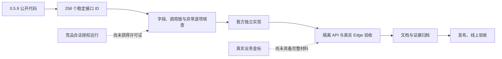

# 当前完成状态与剩余事项

> 2026-10-15 工作检查点。本文不表示发布完成。实际逐接口状态以逆向台账的稳定 ID、证据和验收结果为准。

## 结论

不能宣称“全部逆向完成”或“与脱敏猫完全等价”。本轮 3 位 gpt-6-sol 主审及 9 位 gpt-6-luna 子审已完成所获 0.5.9 公开发布代码的有界应用合同合图：224 项静态 S3、34 项边界 S2；未识别出可具体命名的未读公开应用节点。未获得的服务端实现、合法激活后的运行结果、未知版本及真实业务材料效果没有验证依据。

## 最终本地验收检查点

447产品文件冻结，128文件733单元、Bend11/13、类型和生产构建通过。85个API文件均有明确分层的成功证据：最终V4两文件4测试，V3三文件5测试，其余35/14/31文件保留各自来源，不称同源单次全量。完整Edge第二轮60通过6失败；修复后受影响5文件16项全部通过，未重跑完整67项。原失败日志均保留。真实CFB DOC批量默认原DOC输出补证通过。

以上表内“待最终门禁/新增Edge待验”为此前阶段描述，以本检查点及 [最终验收](逆向台账/contracts/local-release-verification-final-20261015.md)、[85文件API](逆向台账/contracts/api-85-evidence-layers-final-20261015.md)为当前结果。部署仍以单独上线记录为准。公开静态分析已闭合；私有许可运行、真实业务准确率、MS Word原生排版等边界继续保留。

## 各能力的实现、验收与证据边界

| 项目 | 当前结果 | 下一步与完成条件 |
|---|---|---|
| 老格式 DOC / WPS | 上传、规范化、识别、Word 审查、内嵌图 OCR、默认 DOCX/显式 DOC 导出、还原和工程重开实际接口已通过；转换取消已实测清理进程 | 纳入本轮合并后的最终全量门禁及 Edge 验收；独立转换服务尚未在线上启用；WPS 按参考 Mac 流程输出 DOCX |
| 印章识别 | 原算法已跑完混合公开集 786 张、1,315 个标注框；IoU≥0.5 的 P/R/F1 为 17.44% / 24.03% / 20.21% | Ooredoo 与 Paddle 的同一 786 张全量对比已完成，F1 分别 33.78% / 13.87%，尚不具备可靠全自动处理效果；专门黑白印章金标、来源及训练重叠仍须核实 |
| 人脸、签名与实体识别 | 有独立公开集实测，存在误检、漏检和跨领域差异 | 用真实业务金标分别统计类型、语言、文档格式及错误样例；当前候选仍须人工复核 |
| Word 原版式 | 已有分页审查和兼容文字预览；浏览器渲染不等于 Microsoft Word 原生排版 | 复杂表格、浮动对象、文本框、批注、页眉页脚和跨页位置逐项对照；无法可靠定位或转换时明确阻止不可靠导出 |
| 剩余接口与原生能力 | 258 个 ID、37 条链路；224 项有限公开合同已逐 ID 合并为 S3；19 项原生／外部、15 项私有服务保留 S2 | [逐项合图](逆向台账/contracts/static-semantic-closure-final-20261015.md)已纳台账，源运行全部 R0；当前无具体未读公开应用节点，但不能外推私有服务、平台库或未知版本 |
| 私有许可证、订单、付款及恢复签发 | 客户端请求、字段与使用逻辑可分析；供应方服务端和签发权限未取得 | 保留协议与不可验证项，不绕过授权、不伪造签发、不调用未授权交易接口 |
| 竞品端到端运行 | 全部保持 R0：未逐接口运行 | 取得合法许可证后，按同一稳定 ID 集合补运行证据 |
| 统一假名全生命周期 | `jc/UK/YK` 52 步源码对照通过；分组与不可变版本、合并/拆分/文件覆盖/重置已接正式接口；扩展的 3 项完整 API 验收通过，包括历史版本和权限收回 | 真实 Edge 全流程 1 项已通过（38.3 秒），含开关、全局/文件自定义、合并/拆分、重置、刷新、保存、导出与准确还原；无括号自定义假名的 MCP 完整流程 1 项通过（106.39 秒）；纳入最终合并回归 |
| 工作区按格式序列化 | 43 个源码函数已提取，按格式的真实策略、路由、OCR、进度、旋转及别名历史已接入；Word/Markdown 原始源码 codec 与工程历史实际接口通过 | OCR 语义纠错与 6 个自有附加类型的 native/source-only 四种 codec 实际往返 3 项已通过（Node 24，75.95 秒）；实体位置调整 PNG/PDF/Word × native/V1/V2/V3 的 12 链真实往返、确认、预览、导出和下载已通过（166.92 秒），老 DOC 合法规范化签名正反也通过（27.85 秒）；最终全量回归待完成 |
| 同位置批量标注与页面旋转 | 批量标注、整批撤销、手动旋转/重新识别均已实现；真实 PDF API 3 项通过并经另一 agent 独立复证；Edge 旋转/预览/实际导出通过 | 8 方向拖框、透明文字层选字、图像内外范围查找的 Edge 已通过（20.0 秒）；按格式同文多处标注与真实自动实体位置调整的 2 项新 Edge 均自然通过（5.9 分钟，含 Edge 后台进程延迟收尾）；实际位置调整 2 项 API 已通过并由另一 agent 独立复证，含 PNG/PDF/Word 像素和错位残留拒绝 |
| 项目范围 OCR 实体改字 | 项目级规划、预览、语义纠错、补录、手绘区域、并发与显式清除已实现；真实 PNG/PDF/Word 和四 codec 往返 3 项 API 已通过（Node 24，75.95 秒） | 手动页面改字后 PDF native/OCR 来源边界反例已实际修复通过（7.03 秒）；新面板完整 Edge 实操待验；保留原始规范文本/原件/字框，纠正值用于实体语义与输出；清除旧纠错后必须重新识别，不把清除动作冒称已重新识别 |
| 全文核查与审查来源 | 规范化查找 56 组源码金标、实际项目 API 通过；来源与继承记录的 API/Edge 通过；非审批历史表已通过实际加密、跨租户、篡改回滚及后续真实复核验证 | 重复槽位已改为绑定当前 opaque ID 的一对一链接，歧义/伪造/跨文档 ID 实际拒绝；独立 1 项 API 通过；OCR 文字移位、历史加密、重复实体保留的 3 项实际 API 通过（13.00 秒）；工程新增位置调整已实际往返；其中确认区域等 3 处修改 revision 的调用曾遗漏来源重绑定并已修复；不得把历史记录当审批 |
| 全文实体筛选与参考冲突图 | 全文后端筛选已实际核验 7,000+ 实体、末尾命中及旧版置信度规则；参考冲突图已有 114 组源码对照 | 12 万字符真实上传 TXT 的末尾筛选、真实索引编辑、保存与再筛选 Edge 已通过（19.8 秒）；未知原始类型冲突反例已补；参考可见/全部候选/冲突和 Markdown 原文视图的新 Edge 待验，不删除规范实体来掩盖待复核内容 |
| Word／Markdown 自动反馈副作用 | 对抗审查发现参考产品补录／删除会自动落反馈；原来只有手动反馈入口不够 | 明确 producer 自动持久化、138 原文／149 纠正语义分存、预去重、保存竞态、撤权及原件校验已完成；作者和独立审查者各 2 项实际 API 通过；完整 UI 自动记录断言纳入最终 Edge；隐藏类型／无变化／单纯保留不误记 FP，不自动学习 |
| 按类型隐藏与恢复 | 已实现隐藏后保存、重开、恢复待确认；保留原实体身份和真实来源，隐藏实体不参与输出或几何覆盖 | Word／Markdown × native／V1／V2／V3 的 8 种往返真实 API 已通过并独立复测；伪造手动出生字段不能改变自动实体来源；隐藏后的 OCR 改字不使其复活；新的 Edge 完整流程待本轮全量验收 |
| 规则集边界与旧字段 | 移除没有公开源码依据的 32,768 条上限；旧命名字段按源码归一，规则集／条目合法扩展字段保留，API 外层未知参数仍拒绝；通用／诉状材料路线正确接入实际规则 worker | 32,769 条全量保存、回读、快照、末条真正命中已实测并独立复证；POST／PUT 归一、逐条路线保留、实际 worker 执行已通过；配置描述与规则集描述分别遵循对应源合同；profile 各格式扩展、缺省／旧版归一、证件偏好写入和读取边界的 4 项实际 API 与源 helper VM 通过；自有签名识别作为扩展保留 |
| 自定义反馈类型与统计 | 反馈原始类型字符串可完整保存、回读与导出，保留大小写；全局包含式统计与审查／审计／证明的精确统计分别实现 | 自定义类型、大小写、特殊属性名、独立进程重开和五种导出真实 API 已通过；批量 FP／FN 行为不变；新精确审查统计入口为 `/feedback/review-statistics` |
| 活跃任务临时规则 | Word／PDF／图片补录的 file／project／spot 范围已接入；035 语义与原始范围校验、037 加密投递、任务代次与末次 drain 均已实现 | 3 项实际 API 与独立真实 worker 1 项通过；额外 038 终态清理迁移、四终态、两种真实事务锁顺序与旧 037 状态升级扫尾共 3 项测试通过，覆盖无 finally 的恢复；页面选字 producer 接线缺口已修，新增 Edge 请求断言待全量运行；仅影响活跃任务，不写长期词表，源即时追加与我方末次取窗仍有时点适配 |
| PDF 实体画布定位 | 视觉组定位到右栏实体没有驱动原件页切换 | 已补齐逐条 quote、实体组与查找的 canonical anchor 到页／图片资源定位；重复点击同一实体也重新定位；两页 PDF 跳页、重复定位已在针对性 Edge 通过；补充组内翻页等待与截图布局修复后的完整 Edge 待运行 |
| 项目实体逐处查漏 | 同类／异类／未标记、单项补录与替换、精确定位、未就绪跳过及几何绑定保留均已合入；完整单元与类型构建已通过 | 新增 3 个项目 API 场景已通过；双页 PDF 实际几何与新增 Edge 正在验收，服务器未更新；[实现记录](逆向台账/contracts/project-audit-actions-porting-20261015.md) |
| 全量门禁、文档、仓库与部署 | 本轮新增链路已有针对性验证；最终项目查漏合并快照（447 源文件）检查已通过 128 文件／733 单元、零跳过、Bend 11／13、类型与构建；真实转换镜像及取消控制代理已参与检查。全量 API、Edge、新转换链上线和文档审查继续 | 新增功能冻结后完成最终门禁、交叉审查、图文操作文档、私有仓库同步及服务器当前版本验收；线上现有版本不代表已包含本轮修改 |

## 本轮已经补齐的公开业务分支

| 能力 | 本轮结果 | 证据入口 |
|---|---|---|
| Word 兼容预览设置、内嵌图重新 OCR 及复核版本 | 已实现；独立接口验证；Edge 实际操作通过 | [视觉接口](逆向台账/contracts/visual-interface-closure-20261015.md) |
| 保存假名表、完整组合假名及首尾空格还原 | 已实现；加密保存、导出、跨 run Word 与 Markdown 还原已验 | [假名表](逆向台账/contracts/mapping-library-closure-20261015.md) |
| 类型路由、文件夹输出及报告 | 已实现；按公开函数做数值对照，包含大于 50 MiB 的多文件 ZIP 与完整性校验 | [路由与文件夹](逆向台账/contracts/rule-interface-closure-20261015.md) |
| 个人词表、规则、反馈等 49 项确切方法 | 已核对实际字段、持久化和返回值，移除若干没有源依据的额外截断 | [49 项接口](逆向台账/contracts/personal-settings-interface-closure-20261015.md) |
| 工程保存回执、最近工程记录与导入导出 17 项方法 | 已实现真实保存状态、幂等回执、权限与备份恢复 | [工程接口](逆向台账/contracts/workspace-interface-closure-20261015.md) |
| 部署版本、运行环境及版本提示偏好 | 已实现真实网页运行信息和偏好持久化；Edge 重载与定时读取通过 | `apps/api/release-state.ts`、`tests/release-state.integration.ts`、`tests/e2e/porting-closure.spec.ts` |

上述“已实现/通过”仅指所列我方合同与测试，不提升竞品 R0，也不表示该能力的所有现实场景已覆盖。

## 两个 GitHub 工具的采用结果

- [reverse-skill](https://github.com/zhaoxuya520/reverse-skill)：采用其证据驱动的逆向分析思路；未执行未知安装脚本，未用它绕过激活。
- [PentAGI](https://github.com/vxcontrol/pentagi)：属于自动渗透测试平台，本轮业务接口和文件规则补齐不需要在服务器安装它；没有发起竞品扫描。

## 检查入口

- [统一台账](逆向台账/README.md)：稳定 ID、链路、状态定义和变更记录。
- [逐项缺口核查](逆向台账/contracts/remaining-completion-20261015.md)：历史遗漏与当前补证，不按同一功能域批量判定通过。
- [印章全量实测](逆向台账/contracts/public-stamp-validation-20261015.md)：样本范围、完整计数和限制。

历史截图缺失已在台账单独记录。本轮保存了修改前的全部现存已固定证据；不能倒推已经丢失的历史字节已恢复。
