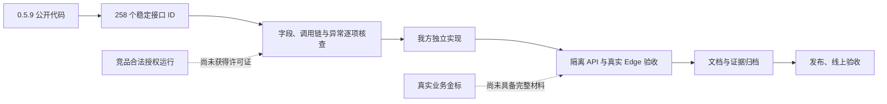

# 当前完成状态与剩余事项

> 2026-10-15 19:38 发布检查点：036已上线，TXT／PNG实际流程通过。首次部署发生过相邻Semantica OOM重启，已恢复并重新部署；详见[上线验收](逆向台账/contracts/aliyun-release036-verification-20261015.md)。实际逐接口状态仍以台账稳定ID和证据为准。

## 结论

不能宣称“全部逆向完成”或“与脱敏猫完全等价”。本轮 3 位 gpt-6-sol 主审及 9 位 gpt-6-luna 子审已完成所获 0.5.9 公开发布代码的有界应用合同合图：224 项静态 S3、34 项边界 S2；未识别出可具体命名的未读公开应用节点。未获得的服务端实现、合法激活后的运行结果、未知版本及真实业务材料效果没有验证依据。

## 最终本地验收检查点

447产品文件冻结，128文件733单元、Bend11/13、类型和生产构建通过。85个API文件均有明确分层的成功证据：最终V4两文件4测试，V3三文件5测试，其余35/14/31文件保留各自来源，不称同源单次全量。完整Edge第二轮60通过6失败；修复后受影响5文件16项全部通过，未重跑完整67项。原失败日志均保留。真实CFB DOC批量默认原DOC输出补证通过。

以上表内“待最终门禁/新增Edge待验”为此前阶段描述，以本检查点及 [最终验收](逆向台账/contracts/local-release-verification-final-20261015.md)、[85文件API](逆向台账/contracts/api-85-evidence-layers-final-20261015.md)为当前结果。036已部署，详见[发布记录](发布记录-20261015-036.md)。下表为当前结果；各阶段的具体用例、失败与补证仍保留在所链接报告和台账中。公开静态分析已闭合；私有许可运行、真实业务准确率、MS Word原生排版等边界继续保留。

## 各能力当前结果与仍需验证的范围

下表“通过”指我方所列分层证据，不提升竞品R0，也不表示最终同一版本做过单次全量API85／Edge67。当前公开应用分析与本轮产品补齐已交付；未具备证据的范围明确列出。

| 项目 | 当前结果 | 仍需验证或使用要求 |
|---|---|---|
| 老格式DOC／WPS | 转换、规范化、识别、内嵌图OCR、审查、导出与还原已有实际API证据；真实CFB DOC批量默认原DOC输出已补证。独立legacy-office转换服务已随036上线并健康 | 本次公网完整流程验证的是TXT和PNG，未在公网重跑DOC／WPS各链；WPS按参考Mac流程输出DOCX |
| 印章识别 | 原算法完整混合公开集786张、1315框，IoU≥0.5 F1为20.21%；Ooredoo／Paddle对照为33.78%／13.87%，未将对照模型自动换入产品 | 黑白印章业务金标、来源与训练重叠尚须核实，当前不能可靠全自动处理 |
| 人脸、签名与实体识别 | 有公开集实测及分项报告，误检漏检和跨领域差异仍存在 | 用真实业务金标分别统计语言、类型、格式与错误样例，人工复核 |
| Word原版式 | 分页审查、兼容预览和嵌图交互已实现，纳入本地分层API／Edge证据 | 浏览器不等于Microsoft Word原生逐像素排版；复杂表格、浮动对象、文本框、批注、页眉页脚和跨页位置仍需业务材料对照 |
| 剩余接口与原生能力 | 258个ID、37条链路；224项有限公开应用合同S3，19项原生／外部与15项私有边界S2；当前没有可具体命名的未读公开应用节点 | 不外推平台库、未知版本或供应方私有实现；[逐项合图](逆向台账/contracts/static-semantic-closure-final-20261015.md) |
| 私有许可证、订单、付款及恢复签发 | 已分析客户端字段、调用与消费逻辑 | 服务端和签发权限未取得；协议可分析，不能宣称等价实现或伪造签发 |
| 竞品端到端运行 | 全部258项R0，未以合法激活运行逐接口验证 | 取得正版许可证后按相同稳定ID补运行证据 |
| 统一假名全生命周期 | 52步源码对照、正式API、完整Edge及MCP实际还原证据齐备；全局／文件覆盖、合并／拆分、重置、不可变历史保留 | 分层证据不等于所有业务材料验证；自定义假名有歧义时按对应还原计划确认 |
| 工作区按格式序列化 | 43个源函数、四codec、PNG／PDF／Word的12条几何往返及老DOC规范化正反例已有实际证据 | 导入历史只读、不沿用旧审批；不把分层验收称最终单次全量 |
| 同位置批量标注与页面旋转 | 按格式匹配、批量／撤销、旋转与重新识别、8方向拖框、选字与实际几何产物已有API／Edge证据 | 人工核对跨对象与页面位置，原文残留或位置绑定失效时拒绝不可靠导出 |
| 项目范围OCR实体改字 | 规划／预览／原子应用、补录与显式清除已接入；PNG／PDF／Word及四codec实际往返；新面板已完成本轮受影响Edge验收 | 保留原始文字／原件／字框；清除旧纠错后需重新识别，不将清除冒称已完成识别 |
| 全文核查与审查来源 | 56组规范化查找金标、重复槽位一对一绑定、来源重绑、加密历史与跨租户／篡改反例已有实际验证 | 历史不是审批；失效、歧义、伪造或跨文档opaque ID明确拒绝 |
| 全文实体筛选与参考冲突图 | 7000+实体接口、12万字符末尾筛选、114组冲突金标与相关Edge已有证据；本轮忙碌／429恢复已修复验证 | 不用删除规范实体来掩盖待复核内容；本轮整体Edge证据仍分两次全量和最终受影响文件 |
| Word／Markdown自动反馈 | 自动producer、原文／纠正值分存、去重、保存竞态及权限边界已实现并留有真实API／Edge证据 | 不自动学习；隐藏、无变化或单纯保留不误记误报 |
| 按类型隐藏与恢复 | 8种格式／codec往返、来源保留与隐藏后纠错已有API证据；本轮完整受影响Edge文件通过 | 恢复回待确认，不继承旧批准 |
| 规则集边界与旧字段 | 32769条保存／回读／真实worker末条命中、额外字段、旧命名归一与profile各格式边界已有实际验证 | 规范化投影与API外层参数各按源合同处理，不能泛化成任意字段透传 |
| 自定义反馈类型与统计 | 原始类型、大小写、特殊属性名、重开及五类导出已实际验证；精确统计入口已实现 | 全局包含式与审查／审计／证明精确统计语义分别保留 |
| 活跃任务临时规则 | file／project／spot、加密投递、任务代次、末次窗口与038终态扫尾已实现；真实worker、事务锁反例与页面producer有证据 | 只影响本人活跃任务，不写长期词表；源即时追加与我方末次窗口仍有时点适配 |
| PDF实体画布定位 | 两页跳转、重复定位、组内导航与新截图已有Edge验证，已随036发布 | 本次公网没有重跑所有PDF交互；复杂业务PDF继续人工核对 |
| 项目实体逐处查漏 | 同／异类／未标记、单项补录／替换、版本并发与几何绑定已实现；最终3项项目API及对应受影响Edge通过，已随036发布 | 未就绪材料显式跳过；忙碌409／429后按提示重试；[实现记录](逆向台账/contracts/project-audit-actions-porting-20261015.md) |
| 门禁、文档、仓库与部署 | 447产品文件；128文件733单元，Bend11／13、类型、生产构建通过；API85分层，最终V4两文件4项；Edge第二轮60过6失败后，最终受影响5文件16项通过。036已部署；TXT／PNG完整公网流程通过 | 没有最终同源单次API85／Edge67报告；首次OOM造成Semantica一次重启已恢复，二次部署与真实处理后5相邻容器未再重启。无生产SIGKILL／数据库恢复演练；[完整上线证据](逆向台账/contracts/aliyun-release036-verification-20261015.md) |

## 本轮已经补齐的公开业务分支

| 能力 | 本轮结果 | 证据入口 |
|---|---|---|
| Word 兼容预览设置、内嵌图重新 OCR 及复核版本 | 已实现；独立接口验证；Edge 实际操作通过 | [视觉接口](逆向台账/contracts/visual-interface-closure-20261015.md) |
| 保存假名表、完整组合假名及首尾空格还原 | 已实现；加密保存、导出、跨 run Word 与 Markdown 还原已验 | [假名表](逆向台账/contracts/mapping-library-closure-20261015.md) |
| 类型路由、文件夹输出及报告 | 已实现；按公开函数做数值对照，包含大于 50 MiB 的多文件 ZIP 与完整性校验 | [路由与文件夹](逆向台账/contracts/rule-interface-closure-20261015.md) |
| 个人词表、规则、反馈等 49 项确切方法 | 已核对实际字段、持久化和返回值，移除若干没有源依据的额外截断 | [49 项接口](逆向台账/contracts/personal-settings-interface-closure-20261015.md) |
| 工程保存回执、最近工程记录与导入导出 17 项方法 | 已实现真实保存状态、幂等回执、权限与备份恢复 | [工程接口](逆向台账/contracts/workspace-interface-closure-20261015.md) |
| 部署版本、运行环境及版本提示偏好 | 已实现真实网页运行信息和偏好持久化；Edge 重载与定时读取通过 | `apps/api/release-state.ts`、`tests/release-state.integration.ts`、`tests/e2e/porting-closure.spec.ts` |

上述“已实现/通过”仅指所列我方合同与测试，不提升竞品 R0，也不表示该能力的所有现实场景已覆盖。

## 两个 GitHub 工具的采用结果

- [reverse-skill](https://github.com/zhaoxuya520/reverse-skill)：采用其证据驱动的逆向分析思路；未执行未知安装脚本，未用它绕过激活。
- [PentAGI](https://github.com/vxcontrol/pentagi)：属于自动渗透测试平台，本轮业务接口和文件规则补齐不需要在服务器安装它；没有发起竞品扫描。

## 检查入口

- [统一台账](逆向台账/README.md)：稳定 ID、链路、状态定义和变更记录。
- [逐项缺口核查](逆向台账/contracts/remaining-completion-20261015.md)：历史遗漏与当前补证，不按同一功能域批量判定通过。
- [印章全量实测](逆向台账/contracts/public-stamp-validation-20261015.md)：样本范围、完整计数和限制。

历史截图缺失已在台账单独记录。本轮保存了修改前的全部现存已固定证据；不能倒推已经丢失的历史字节已恢复。
