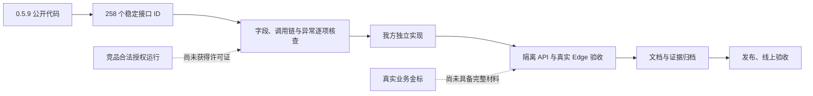

# 当前完成状态与剩余事项

## 056 使用指南文档可发布，原生操作仍待（180）

正式指南清单已标 **READY（仅文档交付）**：64份文件逐SHA／字节核对，61张图片在1280与1600宽度渲染无断链；旧HTML／Markdown原字节已归档。**Mac 原生另存、目录选择及取消仍待解锁实操**，OPFS读写不能替代原生OS证据。正式本地源码v32不变、线上仍054；此条不代表完整产品发布门禁通过，I／S／R和原版R0不升。

[180证据合同](逆向台账/contracts/iteration056-guide-document-ready-native-pending-180-20261017.json)。以下179及更早段落保留当时证据截止状态。

## 056 正式v32本地合入与API149原轮终态（179；未发布）

已按旧字节归档与冻结清单把 **v32／993份输入正式合入本地**：35条变化中31条旧文件逐字节归档，4条新增；离线 frozen 安装退出0。仅自家普通开发服务已恢复，API/Web真实200，规则与NER ready、AI未配置；**线上仍054，未发布**。

v30完整API149已自然结束：149文件／310案中**304通过、6失败**，唯一失败文件是原`mcp-automatic.integration.ts`的同IP登录夹具；前后守卫及隔离清理正常。测试专用IP修正版另行14／14真实通过并合入v32，但这属于**不同轮次及源码范围**，不能称v32完整149／310单轮全绿。v31完整Edge107真实107／107及v32类型检查证据也分别保留各自来源。

指南DRAFTv4已纳修正后的印章图、61张图渲染检查通过，仍缺原生OS实操／READY。Mac原生另存锁屏与竞品许可原版R0未验，线上054及I／S／R不升。可用原逆向代码直接复用，仅作必要Web／云适配，不新增原设计外流程。

[179证据合同](逆向台账/contracts/iteration056-formal-v32-promotion-api149-terminal-179-20261017.json)。以下178及更早段落保留当时证据截止状态。

## 056 v31 完整 Edge107 终态与 v32 单测试文件合并（178；未发布）

v31 双源完整 Edge107 已自然退出 **0**：65份测试／107个原ID全部单次通过，0跳过／重试／flaky；独立审计核对171件归档及源码、资产、锁、OpenCV守卫。印章补检后的旧 `SEAL_DEFERRED` 红提示在本轮真实截图中已消失。该终态属于**私树 v31**，不证明原生 Save As、许可原版运行或线上发布。

v32 私树以冻结 v31 的993份输入为底，**仅**替换已单文件定向14／14通过的 `tests/mcp-automatic.integration.ts` 测试IP夹具；其余992份生产／规则／单元／E2E／依赖文件逐字节相同。Node24整树类型检查退出0。**v32未重跑完整check、149 API或107 Edge**；v31工程／Web／Edge、v30 API长跑、候选单文件结果分列，不拼成同源全绿。API149 v30原单文件退出1且整轮仍在运行。正式v17、线上054、指南DRAFT、原生OS锁屏及R0边界不变，I／S／R不升。

[178证据合同](逆向台账/contracts/iteration056-edge31-terminal-v32-assembly-178-20261017.json)。以下177及更早段落保留各自证据截止状态。

## 056 MCP automatic 测试夹具定向复验（177；完整149仍在运行）

测试专用候选为每个 `session()` 指定独立合成来访 IP，且同案成员登录、后续请求与重启实例继续使用原会话 IP。原14案及断言保留，无重试或睡眠；生产登录 **10／分钟** 与全局 **120／分钟** 均未修改。隔离定向运行已真实退出 **0，14／14通过、0跳过／取消**，只证明这份候选测试文件。

v30 完整 API149 的原文件退出1及其8过6败历史保留；该长跑仍在自然运行，**不能把定向结果拼成149全绿**。v31完整浏览器仍在运行，截图中的印章旧红提示消失只是中途观察，不是107案终态。正式v17／线上054／指南DRAFT、原生OS与许可原版R0边界不变，I／S／R不升。

[177证据合同](逆向台账/contracts/iteration056-mcp-automatic-test-ip-focused-177-20261017.json)。以下176及更早段落保留各自证据截止状态。

## 056 API149 运行中的 MCP automatic 登录限流失败（176；整轮继续）

v30 API149 隔离长跑**仍在自然运行**，目前已完成`tests/mcp-automatic.integration.ts`，文件退出 **1**：原14案8过／6败、0取消／跳过。首败为第9案准备成员会话时`POST /api/login`返回真实`429 RATE_LIMITED`，预期200；后续五案均在`session()`第19行的登录准备步骤收到429，尚未执行各自MCP业务断言。已过八案只证明自身链路。不能把此轮称为149全绿，也不能以旧轮结果拼补六案。

只读源码计数显示同一注入IP前八案已有八次owner登录、第二案额外一次member登录、第九案owner再一次，到第九案member为第十一次，触发既有登录 **10／分钟** 门禁。v30前八案约57.669秒，v24同段约99.622秒；没有逐请求绝对时间，故这是源码顺序及整体时长支持的受限归因。此错误发生在登录夹具，**不是当前六个MCP业务分支的失败证据，也不是全局120／分钟额度耗尽证明**。production两个预算保持原值。protocol仅准备测试专用的合成来访IP隔离，须等整149自然结束后验证，保留14案全部业务断言，不加429重试／睡眠。

v30→v31两条只读执行切片报告确认两处Web／E2E变化不在API149计划和字面导入闭包，但它们只是`prepared_unrun`条件分析；已有文件exit1不能因此变绿。v31印章Web修复的完整107仍未跑。正式v17／线上054／指南DRAFT、原生OS与竞品R0未变，I／S／R不升；EOF清理具体HTTP码本次归档不可恢复，只能下次必要运行观察。

[176证据合同](逆向台账/contracts/iteration056-api149-mcp-automatic-login-limit-176-20261017.json)。以下175及更早段落为各自证据截止状态。

## 056 v30 完整 Edge107 终态与印章提示显示缺口（175；v31 浏览器待验）

v30 双源完整 Edge107 自然退出 **0**：65份测试、107个原ID全部通过，0跳过／重试／flaky。独立审计逐字节核对171件永久归档、原始107结果及正式v17／私树v30／资产／锁／OpenCV前后守卫。这仅证明v30既有断言通过，不能替代v31或原竞品R0。

人工复核该轮印章补检截图发现**旧 `SEAL_DEFERRED` 红提示仍列受影响页4–20**，同时处理已完成、保留19页／删除1页。只读核证是GET合成当前`sealProgress`而保留旧`recognition.visual.pages/complete`造成显示过时；不是截图时刻仍在运行。v31仅Web按当前完成状态或已完成／已删除页移除字面`SEAL_DEFERRED`，保留人脸、签名、未知警告及独立`sealWarning`；原同一E2E增暂停可见与补检后消失断言。独立只读peer无新finding，完整工程检查163文件／889用例／Bend18／21／类型／构建与Web8件发布构建均真实退出0。**v31浏览器回归尚未运行**，不能拿v30的107／107冒充修复验证。

v30 API149仍在运行且未有终态，不称API31同源通过。外部stdio业务单例通过与EOF清理`INTERNAL_ERROR`并存；同次证据已无法恢复`/api/logout`具体HTTP码，若需查码只能在下一次必要运行中记录。正式v17已恢复普通开发服务，线上054未改；原生选择／另存、指南READY、许可原版运行R0、业务精度及发布仍分别待验。九项差距、剩余11项、I／S／R不升。可用原函数直接复用，仅作必要平台适配，不添加原设计外流程。

[175证据合同](逆向台账/contracts/iteration056-full107-v30-terminal-seal-v31-boundary-175-20261017.json)。以下174及更早段落保留各自证据截止状态。

## 056 v30 外部 stdio 视觉交付单例实际通过与关闭诊断边界（174；全量仍待）

外部 stdio v6 在独立隔离环境自然退出 **0**：原单例 1／1 通过、0 跳过／重试；独立审计核对35件归档及正式／研究副本、28资产／8锁／OpenCV守卫无漂移。授权、两份材料识别／人工复核、PDF附件领取与渲染、92字节衍生报告提交、网页结果下载及归档字节一致均有本工具实际证据。该运行包含研究测试文件，不是原竞品许可运行，也不替代v30的149文件API或完整Edge107。

**同次归档另有 connector 关闭时的 `INTERNAL_ERROR` 失败诊断包**。只读排查定位到EOF清理的 `/api/logout` 返回非2xx，但通用错误抹去了具体HTTP状态，`DELETE /api/mcp`状态也未记录；不能猜是429、401或500。业务单例通过与关闭诊断并列保留，不能写“零错误”。完整Edge107 v30已启动但本证据截止无终态；API149长跑、原生另存、指南READY及部署仍待。继续遵守用户约束：可用的逆向原函数直接复用，仅做必要Web／云／OS适配，不增原设计以外流程或规则；原权限、人审、还原授权保持。正式v17／线上054、九项差距、剩余11项及I／S／R／竞品R0不升。

[174证据合同](逆向台账/contracts/iteration056-external-stdio-actual-and-shutdown-boundary-174-20261017.json)。以下173及更早段落保留各自证据截止状态。

## 056 v30 MCP 内部重复计数修复与外部演示边界（173；未完成全量）

v30 冻结993份输入：相对v29仅`apps/api/main.ts`、`apps/api/mcp.ts`两处生产字节和一份API集成测试新增，旧990行相同。原v29同一隔离测试真实RED（剩余113≠115）；最小内部调用限流候选定向API 1／1与Node24类型检查已实际0，独立只读安全peer无新具体finding。v30完整必需检查真实0（163文件／889测试／18条法律／21变异／类型／构建），Web构建8件实际0且与v29逐字节相同。**API149仅启动前`--validate`实际0，还没有149文件长跑；完整Edge107 v30也未启动。**不能将旧API24执行切片桥接到本次生产改动。

外部stdio旧v3因父artifact缺失失败，研究v4已用原选择器修正并实际走过领取、PDF字节SHA及PDFium渲染、衍生报告提交和有效性检查；但其整例仍因UI真实429为0／1。只读统计118可见请求为网页／应用101＋测试直调17（其中14次纯状态GET），此前内部`app.inject`额外9次扣额已消除。研究v5拟只减少探针，未运行，不宣称外部交付成功。正式17、线上054、指南DRAFT、Mac原生另存锁屏及原R0／I／S／R不变。

[173证据合同](逆向台账/contracts/iteration056-v30-internal-rate-and-external-stdio-173-20261017.json)。以下172及更早段落保留各自证据截止状态。

## 056 v29 必需检查与印章定向结果（172；完整验收未完成）

v29 相对 v28 **仅一份 PDF 印章 E2E 测试改变**，另991条输入相同；单测预期数885更正为实际889。完整 `pnpm check` 已真实通过：163文件／889测试、18条Bend法律／21个变异、类型与构建均0；`/tuomin/` Web 构建实际0、8件产物与v28逐字节相同。原印章2用例定向 v3 实际2／2，观察到0次429、0重试，原业务断言保留。早先 v2 的 wrapper ENOENT 及 bootstrap plan 失败均留原件，不能拿子进程绿替代完整定向终态。API24→29仅有严格执行切片说明，不称API29同清单运行。**旧完整Edge107 v28仍106／1，不拼成v29全绿**。

外部stdio视觉演示v2曾locator失败、v3又真实429，尚无交付通过结论。只读归因明确MCP内部`app.inject`额外扣同账号9次（prepare2、release7），生产修复仍在研究且未验证；不放宽120/min或外部权限。正式17、线上054、指南DRAFT、Mac原生另存锁屏、原版R0与I／S／R边界不变。

[172证据合同](逆向台账/contracts/iteration056-v29-check-web-pdf-seal-target-172-20261017.json)。以下171及更早段落保留各自证据截止状态。

## 056 v28 完整 Edge107 自然终态与印章429诊断（171；未通过全量）

完整 Edge107 v28 已自然结束：**106通过／1失败，0跳过／重试／flaky**。唯一失败是原 PDF 印章链用例在业务断言结束后，`afterEach` 捕获浏览器发起的两次真实429（`GET /api/session` 与同任务印章进度 GET）。独立原始归档复核证据一致，不可把106与任何定向候选拼成107全绿。只读诊断所见60秒窗口有网页／应用110次及测试直调13次请求，共用账号120/min限额；**不能据此宣称网页流量单独超限**。

仅测试研究候选 v2 使用现有页面已保留页数状态和同文档 GET200 读回代替两段额外直调轮询，保留原进度、暂停、人工复核、导出、补检和零429断言。v1监听300秒提前覆盖最长180秒部分等待的时序缺陷已在v2修正；v2为`prepared_unrun`，没有新运行结论，也未改全局限流或生产代码。Mac原生另存仍锁屏、指南DRAFT、线上054、外部stdio未运行；I／S／R与原R0均不提升。

[171证据合同](逆向台账/contracts/iteration056-pdf-seal-full107-terminal-171-20261017.json)。以下170及更早段落保留各自证据截止状态。

## 056 v28 原代码复用只读对抗审查（170；完整验收继续）

对正式 v17 与候选 v28 的 **10 条非测试生产／依赖差异**逐路径、调用链和相关测试做只读 defect-first 审查，本范围 **未发现可从当前差异证实的新回归**。个人 Excel 复用原版工作表 helper，仅作第四列原标签和 Web 入口必要适配；PDF 小型页面映射复用导入时已验证的字节，不缓冲源 PDF；会话只对只读 `/session` 的真实429按有效 Retry-After 最多重试一次，并以身份代际拒旧动作，写请求不重发。独立审查者先读到旧树 PDF 投影问题，按 v28 实际哈希核后已撤回。该审查不是运行验收或 258 入口整体等价声明。

原 `receive_sanitized_document` 是交给**外部 MCP 客户端**消费附件与受控槽的 stdio 工具，原合同没有要求新增 Lawbot 附件 UI。外部视觉附件／衍生报告实操 v2 仅冻结为 `prepared_unrun`，不是客户端已执行或竞品 R0 已验证。完整 Edge107 本证据截止仍无终态；Mac 原生另存锁屏、指南 DRAFT、线上054及发布边界不变。九项差距、剩余11项与I／S／R均不升级。

[170证据合同](逆向台账/contracts/iteration056-original-reuse-review-and-external-stdio-boundary-170-20261017.json)。以下169及更早段落保留各自证据截止状态。

## 056 v28 工程、Web与七项定向实际终态（169；完整验收继续）

候选 v28／992 份输入的完整工程检查实际退出 **0**：163 个单元文件／889 用例、Bend 18／21、类型检查与构建全部通过，源码、资产与恢复夹具无漂移。独立 `/tuomin/` Web 构建亦退出0，8件产物与引用已核；指南不包含在这8件中，仍单独准备。v27→v28只有五条路径变化，精确对应会话校验最小修复和两份 E2E 测试，API／服务端／规则原字节未变。

v28 定向浏览器七个**原ID同一轮7／7通过、0失败／跳过／flaky／重试**，包括 v27完整107的三个失败 ID 与四个既有会话同步 ID。旧v27完整107的104通过／3失败历史仍成立，不能与定向七项拼接为新完整107通过。v28完整 Edge107 已启动但本证据截止无终态。会话GET `/session` 仅真实429且有效Retry-After最多重读一次，写请求不重放；identity epoch防A→B→A旧动作放行。原全账号120／分钟及登录10／分钟预算不变。

另在v27独立私树，个人Excel选择／取消／确认与301页末页同次实操2／2通过；这不代表最终v28同源全部流程。指南 v2 仍为 `DRAFT`，静态渲染无断图仅证明文档呈现，不是发布READY。API24完整148文件通过可按严格执行切片只读映射至未变API范围，**不称API28同源实跑**。Mac原生另存锁屏失败保留；系统原生选择目录、指南READY、远端CAS和部署仍待。九项差距、剩余11项、I／S／R及原版R0均不升级，正式v17／服务器054。

[169证据合同](逆向台账/contracts/iteration056-v28-check-web-target7-terminal-169-20261017.json)。以下168及更早段落保留各自证据截止状态。

## 056 v27 完整浏览器真实终态与原代码复用边界（168；未发布）

v27 完整 Edge107 的107个原ID、65份测试文件自然执行，**104通过、3失败、0跳过／flaky／重试**。原始收据与172件归档经独立逐字节核对，源码、资产、锁与OpenCV前后守卫无漂移；这些守卫只证明输入和证据一致，不能把失败运行判成全绿。三个失败原ID分别为 entity-workflow、PDF OCR运行页流程、可选文字层提前预览。167的定向2／2历史真实保留，不能与本轮104拼接。

entity-workflow第二份材料已读到原文和1项待确认标记，同文档筛选一度返回200／1项，随后同文档筛选收到429及`Retry-After: 4`，页面显示等待限流重试，原组卡5秒断言到期。只读追查又发现全局 `120／分钟` 限流键仅按用户／IP，多个路由共享窗口；根任务报告 PDF 保存时 `/session` 被同一桶阻断、PUT未发送。故这次不能只按测试等待处理，需先验证按静态路由模板隔离预算的最小产品候选，同时保留每操作限制与登录门禁。entity 轨迹没有后续重试成功证据，也没有标记永久丢失证据；其余失败各按原轨迹继续诊断。[同事件限流补证](../.data/research/lawbot-2026-10-16/iteration056/arch/entity-workflow-shared-rate-limit-168-addendum-v1.json)。

相对正式v17，v27仅8条生产／依赖路径变化的只读复用审查确认个人名单解析直接复用原函数并作必要第四列与Web适配，审查范围内未发现额外默认规则或新流程；原版应用仍R0，不能据此宣布258入口完整等价。九项差距、剩余11项、I／S／R均不升级。正式v17／服务器054，原生另存、指南READY、远端CAS及部署仍待。

[168证据合同](逆向台账/contracts/iteration056-full107-v27-terminal-and-reuse-168-20261017.json)。以下167及更早段落保留当时证据截止状态。

## 056 v27 两个原失败用例定向通过（167；完整验收继续）

候选 v27 的 access 与 MCP 子任务接续两个原失败 ID 在同一次定向浏览器执行中 **2／2 通过，0 失败／跳过／重试**。独立审计核对两个原 ID、11 件原始归档、真实结果统计和源码／资产／锁／OpenCV 前后守卫；隔离清理无错。这证明这两条原业务链在此次 v27 定向运行中通过，**不能与 v26 完整 Edge107 的105通过／2失败相加并声称全107通过**。新 v27 完整 Edge107 已启动但尚无终态。

指南目前仅有草稿清单：51 图与一个本地文本链接已检查，四项原生系统实操尚未补齐，`READY` 和发布打包仍待。Mac 解锁及 v27 系统原生另存验收待执行；v26 锁屏失败原件保留。九项差距、剩余11项、I／S／R与原版 R0 均不升级；正式 v17／服务器054，未部署。

[167 证据合同](逆向台账/contracts/iteration056-target2-v27-directed-terminal-167-20261017.json)。以下166及更早段落保留对应时点事实。

## 056 v27 工程门禁与 v26 完整浏览器真实失败（166；未发布）

候选 v27／992 份输入的完整工程检查实际退出 **0**：163 个单元文件／885 用例、Bend 18／21、类型检查及构建全部通过；独立 `/tuomin/` Web 构建退出 0，8 件产物和资源前缀经核对，源码、资产与恢复夹具守卫无漂移。正式仍 v17，服务器仍 054。

v26 完整 Edge **107 个原ID自然执行，105 通过、2 失败、0 跳过／重试**。access 用例的目标文档权限及识别已就绪，点击后的同文档 GET 在原5秒断言窗口后才返回200；这支持增加精确读回等待，尚不证明浏览器之后呈现。MCP 子任务用例在处理过程中得到真实 `PROCESSING_BUSY`，旧轮询立即抛错；仅该暂态错误的有界重试候选尚未执行。两项测试候选已合入 v27 但新的完整 Edge107仍待；不得把历史定向通过与105项拼成全绿。

v26 系统原生另存用例自然退出 **1**：macOS 对话框锁屏两次、目标文件不存在，等待迁移响应180秒超时。它是环境阻挡的真实失败运行，不是人工取消，也不能当产品通过。原生 v27 解锁后重验、指南 READY、浏览器107与远端CAS仍待。301页材料已解析并预览末页，但UI演示未做。剩余11项仅按分支逐案对应，I／S／R及九项差距不升级。API24 的148文件／309用例真实通过；v24→v27仅七件E2E spec变化，其余985行相同，研究sidecar只限未变的API执行范围，**不称API27同源实跑**。

[166 证据合同](逆向台账/contracts/iteration056-v27-check-web-edge26-boundary-166-20261017.json)。以下165及更早段落为对应时点记录。

## 056 API24 完整终态及固定执行范围等价证据（165；未发布）

API24 原独立私树完整执行 **148文件、309用例全部通过**：每文件六项统计无失败、取消、跳过或 todo，原收据／日志SHA及预检、终态守卫与隔离库清理经独立复核均通过。该运行的真实源码是v24。v24→v26两份992行完整清单仅五件E2E spec变化、其余987行的SHA和字节数相同；冻结sidecar与独立审查仅允许把API24结果用于**未变化的API执行范围**，不声称在v26同清单重跑了API。发布研究v6已填原API收据和该sidecar，旧收据未改写。

v26必需检查与Web构建已各自通过，定向两例2/2通过；完整Edge107仍无终态，原生另存、指南和远端CAS也未齐，因此v6发布门仍不能放行。正式v17、服务器054，九项差距与I／S／R不变。

[165 证据合同](逆向台账/contracts/iteration056-api24-terminal-equivalence-165-20261017.json)。以下164及以前段落保留对应时点事实。

## 056 v26 完整工程检查与两例定向终态（164；未发布）

v26／992 份输入的完整必需检查已真实退出 **0**；独立 `/tuomin/` Web 构建也退出0、8件产物和资源前缀已核，源码、资产及恢复夹具守卫无漂移；v25 单元超时退出1的历史仍保留。此前失败的两个原 Edge 用例在 v26 定向运行 **2 通过、0 失败／跳过／重试**，独立审计逐一核对原ID与11件归档。该两例结果不替代完整 Edge107；v26完整107已启动但无终态，API24的148文件亦无终态。

原生另存、指南和部署仍待。v25固定的发布等价研究桥不能用于v26，当前仍为空，须另作精确五 E2E 差异审查并等真实API终态。正式v17、服务器054；九项差距与I／S／R不变。

[164 证据合同](逆向台账/contracts/iteration056-check26-and-target2-terminal-164-20261017.json)。以下163及以前段落保留对应时点事实。

## 056 v25 完整工程检查失败与 v26 候选准备（163；未发布）

v25 的完整必需检查实际退出 **1**：163 个单元文件中 162 过、1 失败，885 个用例中 884 过、`manual-clear-override` 原30秒超时1；Bend18／21与类型检查已过，构建未执行。源码、资产和恢复夹具没有漂移。同一私树、同一源码的原完整 manual-clear 文件随后 **5/5 通过、9.50秒**，未改30秒期限；这不能替代完整检查，也不能据此认定资源根因或排除产品时序风险。162 所述 check25 待终态是当时事实，本段更新其真实终态。

v26 已冻结992份输入，相比v25仅两件 E2E spec 变化，标准 frozen 安装退出0且源码无漂移；target2尚待真实终态，v26完整检查、完整Edge107、系统原生另存和指南仍待。API24 的148文件尚无终态。发布桥v4固定v25、当前为空，不能用于v26；正式仍v17、服务器仍054。九项差距和I／S／R不变。

[163 证据合同](逆向台账/contracts/iteration056-check25-failure-and-v26-prepared-163-20261017.json)。以下162及以前段落保留对应时点事实。

## 056 五项定向 Edge 的实际失败边界（162；未发布）

候选 v25 的五个原用例已真实执行：**3 通过、2 失败、0 跳过／flaky**。export-policy、lifecycle 与 Word 的原完整链通过；review-only 用例停在第130行权限提示未出现，page-selection 停在第17行**第一次**图像文字查找仍显示“正在核对页面文字与坐标…”。独立审计重核了五个原ID及19件原始归档。原私树终态清理错误为空，随后研究镜像因目录未预建写入失败；保留该控制层异常，不能称这一轮绿。

两项 E2E-only 读回候选仅冻结，尚未运行。v25完整工程检查和 API24 的148文件运行仍无终态；API24→v25 的五文件范围等价发布门仍是研究稿，桥接控制为空，不能据此发布。正式仍v17，候选v25；完整Edge、原生另存、指南与部署待验。九项差距和 I／S／R 不变。

[162 证据合同](逆向台账/contracts/iteration056-target5-and-equivalence-162-20261017.json)。以下161及以前段落保留对应时点事实。

## 056 完整 Edge107 真实终态与指南发布打包缺口（161；未发布）

候选 v24 的完整 Edge **107 项实际执行：102 通过、5 失败、0 跳过**。正式 v17／989 与私树 v24／992 的源码及资产、锁、OpenCV 前后守卫均无漂移；这轮不能称完整浏览器通过。export-policy 与 lifecycle 两例各在 5 秒等待“标记 1 处理决定”时失败：对应识别 job 的 events 已返回 succeeded／100%，而同文档后续 GET 在 trace 截止仍为 pending；export 失败快照已有 1 项标记，lifecycle 快照仍显示 0 项／排队。未取得最终文档 GET200，不能断言只是速度问题或已修复，其余三项失败保留独立追查。完整 API148 仍在运行、无终态，不能拼成通过。

发布准备脚本此前只复制 Vite Web 产物，遗漏 `/tuomin/guide/`。独立研究 v3 候选恢复指南 `index.html` 及相对资源的清单、源 SHA、路径和打包读回校验；当前更新后的 HTML／截图／公开依赖未交齐，`GUIDE_PENDING` 正确拒绝发布。静态正反例与语法检查通过，不等于真实指南、release stage 或线上验收。系统原生另存、个人名单／目录实操、服务器部署仍待；九项差距、11项待闭合与 I／S／R 不变。

[161 证据合同](逆向台账/contracts/iteration056-full107-guide-pending-161-20261017.json)。以下160及以前段落保留当时事实。

## 056 个人名单验收指针纠错与规则图导航（160；未发布）

逐项验收准备表纠正了一个具体误绑：`batch-review.spec.ts` 实际操作的是**项目词表／导入名单 XLSX**，不能作为个人黑白名单 `dictionary:select-excel-import-file` 的浏览器验收。修正表保留该用例为 excluded，个人名单改指向 `ReferenceDictionaryFiles` 的真实入口及已有 API 断言；浏览器真实选择、预览取消、显式确认与系统文件选择取消仍待独立演示。原两份准备表保留历史，本次更正仍是**静态证据**，不计全量运行通过。

新增[规则复用流程图](规则评审图解/脱敏规则复用流程.html)作为技术交接的辅助阅读入口；1440 浅色与 2048 深色已人工看图，校验／交付／视觉检查退出0。图不替代规则原值及第7–9节十个完整 JSON 块。完整 API148、Edge107 仍无终态，原生另存、指南、服务器部署待验；九项差距、11项待闭合与I／S／R不变。

[160 证据合同](逆向台账/contracts/iteration056-remaining11-dictionary-map-correction-and-rule-diagram-160-20261017.json)。以下159及以前段落保留对应时点事实。

## 056 候选 v24 Web 构建与完整门禁运行中（159；未发布）

同一 v24／992 份输入的 `/tuomin/` 发布 Web 构建已实际退出 **0**，正式与私树源码无漂移，产物 `index.html` 含 `/tuomin/` 资源前缀；这补上了158记录时尚未取得的独立构建回执。v24 完整工程检查退出0的结论仍按158原回执，不因本事件重复运行。

完整 API **148 文件** 的真实 runner PID 47416／controller PID 47469、完整 Edge **107 项** supervisor PID 45763 均仍在运行，**没有终态**。API只读运行观察不能替代启动证明或全量终态。11项逐项检查及15个Edge原ID／API文件定位表是已锁定源码与测试指针的**准备材料**，不能记为运行通过。v24 发布门禁研究候选 v2 已固定API预启动输入身份及Edge正式基线989／私树992、107原计划、资产28／锁8／OpenCV守卫；独立审查转录没有实质发现，但既不是原始探针日志也不是发布终态。系统原生另存、指南和部署仍待；服务器仍旧版，未部署。九个已确认差距、11项待闭合与I／S／R计数不变。

[159 证据合同](逆向台账/contracts/iteration056-v24-live-gates-159-20261017.json)。以下158及以前段落保留当时已知状态。

## 056 候选 v24 完整工程检查终态（158；未发布）

候选 v23 的完整检查实际退出 **2**：Bend 18 条法则／21 个反向变异通过，但新增 PDF 回归测试 helper 的 `payload?:unknown` 与 `app.inject` 类型不匹配；单元及构建尚未执行。仅在该测试引入 Fastify `InjectOptions['payload']` 类型，Node24 完整类型检查退出 0，前后 TypeScript 转译得到的 JavaScript SHA 完全相同，原定向 API 红／绿运行逻辑未改。v23 的失败回执和测试候选均保留。

统一 v24 冻结 **992** 份输入，与 v23 逐文件相比只有这一个测试文件的类型标注不同；标准 frozen 安装退出 0。完整 `pnpm check` 已自然退出 **0**：Bend 18／21、163 个单元文件／885 案、类型及 Web 构建全部通过；正式及私树源码、资产和三份恢复后的历史夹具均无漂移。单独 `/tuomin/` 发布 Web 构建尚无终态回执。v24 的 148 文件 API、107 项 Edge、系统原生另存、指南与服务器部署仍待实际终态，不能从工程检查推断已发布或全链验收通过。旧 v22 完整 API148 已受控取消，控制器退出 -15、`fullPass=false`；其信号影响的文件结果不能当成独立产品断言。九个差距和 I／S／R 分级不变。

[158 证据合同](逆向台账/contracts/iteration056-v24-required-check-typefix-158-20261017.json)。以下157及以前段落保留当时状态。

## 056 PDF 原生工程重导入修复候选与 v23 门禁（157；未发布）

旧 v22 的真实 PDF 工程经原生流保存后，multipart 重导入返回 HTTP 500。实际栈为近期记录投影将 `TmmFileRef` 页映射传给要求 `Buffer` 的 `nativeToReferenceStream`，抛出 `PORTABLE_PAGE_GEOMETRY_REQUIRED`。v23 候选只在近期记录投影复用已有 `smallAsset(map,page.mapHash)` 校验过的页映射字节；原 PDF 仍按流式引用保存，来源哈希和几何门禁未放宽。相同隔离 API 测试：旧生产字节 1 过／1 败、实际导入 500；叠加补丁 2／2 通过，含真实 PDF 页／映射、原生归档、原件 SHA、重导入及近期记录。Root 已独立读回红绿测试文件与生产哈希。

针对旧失败的浏览器 3 项已真实全部通过，0 跳过／0 flaky，且源码／资产守卫无漂移、清理无错；**这只是定向 3 项**。旧 v22 的完整 API148 因生产缺陷被明确取代并受控取消，实际控制器退出 -15、只观察 23／148 文件、`fullPass=false`，不能与任何新轮前缀拼成全绿。统一 v23 冻结 992 份输入，标准 frozen 安装退出 0；完整工程检查、148 文件 API、107 项 Edge、系统原生另存与发布仍待各自真实终态。正式与线上仍未发布 v23，九项差距及 I／S／R 分级不变。

[157 证据合同](逆向台账/contracts/iteration056-pdf-native-reimport-candidate-157-20261017.json)。以下156、155等段保留发生时的历史状态。

## 056 候选 v22 的 19 项 Edge 定向终态（156；未发布）

同源私树的 19 项浏览器定向检查已自然结束：17 项通过、2 项失败、0 跳过／0 flaky，子进程退出 1。正式 v17 的 989 份输入和候选 v22 的 992 份输入在测试前后均与各自清单逐项相等；模型资产28、运行锁8、OpenCV哈希均无漂移，测试清理无错误。失败项是 review-only 增补缺漏标记场景，以及两页 PDF 旋转／重复实体／几何编辑／重导入／下载像素场景。前者观察到 5 秒时仍处于 queued；后者 UI 实际请求 `/import-file`、旧测试等待 `/import`，同时失败上下文有 `INTERNAL_ERROR`／HTTP 500。两项的具体原因尚在核实，不能仅改测试监听词消除 HTTP 500，也不能把 17 项通过写成 19 项通过。

候选 v22 的工程检查、标准安装和 `/tuomin/` Web 构建已另有真实退出 0；它们不覆盖本次 Edge 失败。148 文件完整 API 本次仍在运行、未有终态；线上只读观察显示现行版仍为 `2026.10.16-054`，本工具及邻居容器状态正常，未写服务器。发布门禁 v2 的 API 运行身份 P2 代码缺口经独立只读审查已闭合、无新增发现，但真实 API 终态审计及发布执行仍待。九个已确认差距与 I／S／R 计数不变。

[156 证据合同](逆向台账/contracts/iteration056-target19-failures-release-identity-156-20261017.json)。下列155、154段落保留其观察时状态。

## 056 候选 v22 工程检查与发布构建终态（155；未发布）

候选 v22 仍为 992 份输入，[输入清单](../.data/research/lawbot-2026-10-16/iteration056/final-inputs-v22.json) SHA256 `fdca2359…92daa7`。同源标准 frozen 安装实际退出 0；`pnpm check` 已自然退出 **0**，Bend 18 条法则／21 个反向变异、163 个单元测试文件／885 案、类型检查与构建全部通过。三份历史生成夹具已按控制脚本恢复到原哈希，正式／私树源码及资产守卫无漂移。`VITE_BASE_PATH=/tuomin/` 的候选 Web 构建也实际退出 0，输出哈希和前缀已核。构建时 Git HEAD 为 `1e64fd62…` 且源码未提交，不能写作已发布镜像。

新源 148 文件 API、107 项 Edge 与系统原生另存的最终门禁仍待实际终态；FE 的 19 项目标用例仅 CLI `--list` 逐 ID 匹配，浏览器验收刚启动。旧 v17 API147 全过及旧 v19 Edge107 的 97 过／10 失败／0 跳过继续作为历史证据，不能拼成 v22 完整验收。九个已确认差距及 I／S／R 计数不变，服务器仍为旧版、未部署。

[155 证据合同](逆向台账/contracts/iteration056-v22-check-webbuild-155-20261017.json)。下列154状态是检查尚在运行时的历史记录。

## 056 名单原码容量修复候选与完整门禁状态（154；未发布）

冻结的 v21 候选有 992 份源码／测试输入，[输入清单](../.data/research/lawbot-2026-10-16/iteration056/final-inputs-v21.json) SHA256 `2693a128…411b9c9`。个人名单 v4 相对 v3 仅将既有 `esbuild: 0.28.1` workspace override 的三行写入锁文件；完整七项目工作区的标准 frozen 安装实际退出 0。此前 v20 三次安装准备失败均保留：私树依赖符号链接／离线元数据／锁与 workspace override 不匹配，不能被新安装成功改写为当时通过。

v21 同源 `pnpm check` 已实际退出 **2**：Bend 18 条法则／21 个反向变异通过，随后前端新增测试的 `new URL(await …getAttribute('href')!, …)` 空值类型错误阻断类型检查；单元和构建没有完成。源码、资产与夹具守卫无漂移。仅修该前端测试空值标注的 v22 已冻结 992 份输入（SHA256 `fdca2359…92daa7`），标准 frozen 安装退出 0，完整工程检查正在运行、尚无终态；148 文件 API、107 项 Edge 与系统原生另存仍待各自真实终态。v21 不能写为全绿，v22 也不能提前写绿。

已完成的全量结果属于旧源：v17 的 147 文件 API 本轮 `fullPass=true`、147／147 文件完成且零失败；v19 的 107 项 Edge 实际 97 通过／10 失败／0 跳过、进程退出 1。两者都不能直接背书 v21／v22。个人名单原代码完整解析函数与候选七件同样本逐项一致；隔离 API 两案通过，其中超过 64 MiB 的显式确认→JSON 全字符 SHA→XLSX 导出回读全字符 SHA→陈旧版本 409 已由 Root 再独立验证并清理测试库。该定向链与新长期回归保护不等于最终全套通过，九个已确认差距和 I／S／R 状态保持不变。服务器仍为旧版，未部署；模型、邻居服务和资源配置未改。

[154 证据合同](逆向台账/contracts/iteration056-v21-v22-dictionary-and-gate-boundary-154-20261017.json)。以下各节保留其发生时的旧候选／运行状态，不能按今天的最终结果合并解读。

## 056 名单原码逐行候选与独立审查（150；未发布）

个人名单v2保留原逐行顺序、重复行号及精确A/B/C/D列读取；与原完整纯解析函数七个同件entries/errors一致。Root独立用原四个反例重放完整导入器全部一致，八路径前后零漂移。独立luna审查曾误读确认路由无容量覆盖，重新读冻结代码及Fastify后撤回，原误报和纠正报告均保留。

七例增补时旧六例脚本／日志被覆盖的证据问题已明确披露；当前七例另存唯一新路径并锁哈希，旧冻结清单不冒称原证据仍可按旧pin重放。产品八路径未变、尚未合入；v2接口重验及实际超过64MiB确认、最终统一源完整门禁和部署仍待。

[150合同](逆向台账/contracts/iteration056-dictionary-original-reuse-v2-peer-150-20261017.json)。

## 056 名单候选独立反例与49接口实际证据（149；未发布）

冻结个人名单容量候选经独立原函数对照，实际发现AB／无列引用误覆盖及重复行号合并丢条；处理顺序也须保留原XML行序。候选未合入，正在直接复用原逐行逻辑修正，失败样本和原候选完整保留。

当前v17基线的个人设置49个稳定ID已真实逐名调用并保存方法、完整路由、200返回及各自断言，所在测试文件退出0。完整147仍在运行，这批证据不代表整轮通过，也不覆盖未来容量修复。完整Edge、系统另存、最终统一源验收及发布仍待；服务器未更新。

[149合同](逆向台账/contracts/iteration056-dictionary-candidate-peer-settings49-149-20261017.json)。

## 056 逐项验收调用纠正（148；未发布）

进一步复核发现三项规则集导入／更新／推广预览误绑定创建规则集，已改为逐名真实调用及各自断言。共47项改用更具体指针，包括全局统计与按文件统计、JSON导出、实际DOCX还原、GET映射列表及POST人工稿，88项均保留。108文件哈希、107标题和96调用锚点核对通过；旧误配报告及首次检查记录保留。

这些是源码验收指针，不代表完整原合同或运行验收通过；原许可证链仍R0。个人名单容量修复仅私树，完整API／Edge继续运行，正式源及服务器未改。

[148合同](逆向台账/contracts/iteration056-specific-operation-mapping-correction-148-20261017.json)。

## 056 个人Excel容量缺口独立原码差分确认（147；未发布）

同一份保留的6355873字节合法XLSX，机械提取的原完整纯解析函数（原类型／动作映射、fxp和AdmZip）成功返回合成甲/name_cn/whitelist、无错误；当前个人名单core真实拒绝DICTIONARY_FILE_LIMIT。Root用Node24独立同件重放一致。因此该入口新增为确认容量缺口，合计9个；I1／S3／原R0不变。

正在私树直接复用原读取／写入代码并核确认导入、再导出链，保留现有扩展字面值及权限／显式确认语义；还未合入或验收。生产字节一旦改变，最终完整API／Edge／工程检查必须按新源运行，不能用旧轮覆盖。当前147／107继续自然跑，系统另存、当前指南及部署仍待。

[147合同](逆向台账/contracts/iteration056-original-dictionary-capacity-differential-147-20261017.json)。

## 056 全148项I1审计与个人名单入口纠正（146；未发布）

审计没有停在10个已知差距：其余138项也逐ID列入，734个当前文件绑定和212个当前测试源码指针核对匹配。14个旧交接指针缺口补具体源码断言；88项准备表经独立审查发现相似路由／相邻断言误配，正在按真实完整路由纠正，不能把prepared表当验收通过。

原个人三列Excel对应“导入 Excel 名单”预览与显式确认链，不能用自有“项目词表”代替。已经找到当前具体API预览及不持久化断言，真实文件选择／取消仍待演示。另有5MiB容量差异待保留有效样本并执行原纯解析器差分，不提前判为已补齐。147接口及107页面继续自然跑，当前工程检查两超时仍需完整复验，服务器未改。

[146合同](逆向台账/contracts/iteration056-full-i1-audit-and-dictionary-source-correction-146-20261017.json)。

## 056 十个剩余入口逐项验收对应与规则导航（145；未发布）

准确整理8个确认差距与2个待最终验收入口，逐项连接原公开合同、实现文件、实际API／Edge具体用例及OS／外部叶。Root独立核对49份实现绑定、22个API用例绑定、12个Edge用例绑定及10段原handler，哈希与原文全匹配；这只是验收映射准备，不是运行通过或缺口闭合。

规则完整交接文件补直达流程图、遮罩对照、完整规则表及十个JSON数据块的导航，顶部状态更新到实际完整检查失败／同源定向复验及运行中的147／107。十个JSON原值逐字节不变，旧文档已归档。最终OS／完整门禁／服务器发布继续待验。

[145合同](逆向台账/contracts/iteration056-per-id-map-rule-navigation-145-20261017.json)。

## 056 最终工程检查超时与同源复验（144；未发布）

final-v19完整工程检查实际退出1：Bend18／21与类型通过，163单元文件162过1失败，879项877过2项原5000ms超时，构建未执行。全部源码、资产和夹具守卫零漂移。随后同源整份workspace-compat测试原时限5项通过，两失败项实际3202／3048ms；不将定向绿替代完整绿。

已保存实际进程／内存及同源比对证据。并发负载造成时间波动是待证假设，不改产品、密码派生参数、模型或超时。完整147接口和107页面继续自然执行，真实系统另存尚待，结束后原命令完整工程复验。v19继承旧Git元字段已单独更正实际冻结时HEAD，原manifest未重写。正式运行代码及服务器未更新。

[144合同](逆向台账/contracts/iteration056-final-check-timeouts-and-unchanged-repro-144-20261017.json)。

## 056 大文件全动作定向通过与最终测试源（143；未发布）

新增大文件Edge同1项实际通过，覆盖迁移导入、规则与假名沿用、三格式转换及当前项目三格式保存下载；两个原件按唯一文件身份逐一核完整SHA。同名保护与过时请求均零POST。只改测试时序／传输与核验方式，产品989基线中的运行代码不变。

最终v19冻结989份源码，仅1份E2E测试与正式v17不同；完整工程检查开始，完整107及实际系统另存继续。147接口仍自然运行，不将已完成前缀计为全绿。发布runner身份／Node24／原baseline必填缺陷经独立合成反例复验闭合，尚无真实全量API终态，不能据此发布。正式源与线上仍未更新。

[143合同](逆向台账/contracts/iteration056-large-file-edge-final-source-143-20261017.json)。

## 056 规则交接当前表与私有代码检查点（142；未发布）

正式989份源码字节保持不变，已提交并推送私有分支检查点`1e64fd6`，远端HEAD与PRIVATE权限读回一致。规则技术交接顶部旧v13／122状态表已更新到实际v17／本地055，原十个完整JSON块逐字节不变，旧文档已归档。

大文件V1迁移及导入已实际200，后续浏览器内网络SHA与OPFS／实际下载文件核对、全部原件和审查记录定向读回通过；同名保护及过时请求零POST已越过。三格式单例仍在逐步真实验收，完整107与原生系统另存未完成。147接口继续自然运行，不把已完成前缀称为全部绿。研究发布稿已纠正真实runner收据结构，producer／Node24身份补证的独立审查余项正闭合。服务器未写入。

[142合同](逆向台账/contracts/iteration056-rule-handoff-git-and-browser-progress-142-20261017.json)。

## 056 Edge真实探针与发布独立审查（141；未发布）

新增大文件Edge首轮在项目尚未切换完成时进入折叠区域，等待隐藏输入框至原900秒自然失败，迁移业务未执行。仅加三行真实页面就绪等待后，第二轮已通过原2001条目容量400及页面引导；随后被Playwright对大于50MiB内存buffer的上传限制拒绝，尚未进入大文件接口。继续将同一合成字节写本轮独立测试文件并按路径上传，保持原文件名、大小、哈希、全部断言及900秒时限。

正式v17保持不变，全147接口仍自然运行。v18仅冻结上述3行测试差异，工程检查尚未运行；完整107及系统原生另存均未闭合。发布研究脚本的一处证据字段缺失仍放行问题已补为明确必填，10个负例和独立审查通过；这些本地研究检查不代表真实镜像或服务器验收。线上未写入。

[141证据合同](逆向台账/contracts/iteration056-edge-probe-and-release-peer-141-20261017.json)。

## 056 部署路径构建与真实443入口核对（140；未发布）

同源989前端按`/tuomin/`路径完整构建实际通过，产物前缀和源码字节核对通过。首次私树依赖符号链接被pnpm安全检查拒绝，未执行构建；保留失败后改独立实体依赖复制，第二次实际退出0。

SSH只读发现旧研究发布模板误指另一个项目的8443代理；真实公网443为WeKnora前端，已有独立`/tuomin/`标记块。正在修正仅该块的模板／运行配置双份备份与哈希校验，保持块外字节不变。服务器未写入；实测线上仍054、健康200。完整147接口、107 Edge与系统原生另存继续验收，不据构建宣称上线。

[140证据合同](逆向台账/contracts/iteration056-public443-and-web-build-140-20261017.json)。

## 056 原码复用正式合入与本地055（139；未发布）

冻结989份同源源码／测试，完整工程检查实际退出0：163文件879单元、Bend18条／21反向变异、类型和生产构建全部通过。正式77路径已按冻结哈希合入，锁定依赖离线安装通过。本地业务库先做数据库与材料成对备份，再迁移055；既有表行摘要和8份材料字节保持不变。

沿用原三个文件动作及既有保存回执，补大文件流式入口和V3完整性检查；不增加业务模式。此前60MiB全A样本超原压缩比，已换为原阈值内94.4876倍样本并核完整字节，旧证据不追认。34处历史源码证据已保持原字节／行号归档，当前源码另有哈希映射。

147项接口文件、107项Edge用例已准备并继续实际验收；系统原生另存尚待。正常本地服务在隔离Edge结束后恢复。仅本工具三处nginx配置在本地语法验证并应用，服务器尚未更新。仍不得宣称全部逆向完成、授权运行等价或已上线。

[139证据合同](逆向台账/contracts/iteration056-v17-formal-check-local055-139-20261017.json)。

## 056 中间源完整单元终态及等价字节断言（138；未发布）

985源中间基线工程检查实际退出1：Bend18／21和类型通过；163单元文件完整执行，162过1失败，879测试878过1失败。唯一失败为加密存储边界循环深比较Buffer耗时31.825秒超过原30秒，构建未执行。失败日志及零漂移终态保留。仅将循环两处深比较改为原生Buffer.equals完整字节校验，17种长度、哈希、inode、权限和30秒时限均不变；独立重建Node24整文件5项通过、测试342毫秒，peer确认没有产品或模型修改。该定向绿不冒称新全量绿。

原三个文件动作继续适配中；52MiB跨格式实测发现V2 writer把缺省可选profile写成null而原schema拒绝，按原字段规则最小修复。最终新源工程／全API／Edge与发布仍未执行，正式944源和服务器不变。

[138证据合同](逆向台账/contracts/iteration056-v15-unit-terminal-and-byte-assertions-138-20261017.json)。

## 056 原码兼容定向补齐与既有文件动作余项（137；未发布）

v7修复原V2缺省版本、同名保存原件保护、普通导入旧格式三容量错误接续迁移。Node24类型、3项单元（含60MiB压缩原件字节校验）、2项隔离API实际通过；浏览器仅列出用例，尚未运行。与之前候选合成985源中间基线，正式944源仍未改。

全操作盘点另明确：通用转换、读取审查记录、沿用规则与假名仍走约50MiB Base64入口，旧格式导出仍整块Buffer/Blob。两个主agent按同File上传和既有读取／三格式写入／保存回执补齐，不新增业务模式；保持原按钮、权限、版本和冲突规则。最终同源工程／接口／Edge及部署仍待，不将单独导入通过等同全部TMM操作完成。

[137证据合同](逆向台账/contracts/iteration056-v7-and-existing-file-actions-137-20261017.json)。

## 056 原码复用组合检查通过与原件保护复核（136；未发布）

按原代码优先原则冻结984份源码／测试，完整 `pnpm check` 实际退出0：162文件876单元、Bend18条／21反向变异、类型和生产构建全部通过；源码与资产守卫无漂移。超过50MiB的V1迁移、V2重新导入及原件字节核对已通过两项隔离API验证。REA已在6.5.0，官方最新稳定版本复核一致。

独立审查继续修两项具体兼容问题：迁移保存时明确拒绝与原件同名目标，并检查页面代次；按原V2允许缺省workspaceSchemaVersion的规则补读取兼容，非法显式值与V3约束保持。冻结v14不回写。最终同源API145、Edge107与实际系统SaveAs尚待，正式944源及服务器仍未更新，不能称全部完成。

[136证据合同](逆向台账/contracts/iteration056-v14-check-and-original-saveas-136-20261017.json)。

## 056 保存链独立验收及原V3互通差异（129；未发布）

最小适配继续收敛到原流程：旧Buffer入口保持原解密／ZIP读取，仅明确新native wire扩展2／3时进入文件读取器，去掉所有旧文件额外密码探针。965份实际研究组合整体tsc通过，原workspace五例保持原断言和5秒超时全部通过；独立格式三例、取消两例、旧新原生兼容两例亦通过。真实保存回执三例及归一化来源完整性一例在独立数据库全部通过，包含同request字节复用、版本／密码／会话／权限约束、后台失败、MRU与来源篡改后拒绝；原件和已签发字节未改，隔离库均清理。

页面十个旧失败在定向10中的五项及后续定向5中的五项分别通过；后轮真实核HTTP200、完整ZIP字节和全部后续断言，0skip／retry。正常开发服务已恢复。本组合完整106尚未执行；旧status-1只证当时请求在teardown前未完成，不能追认同次请求成功，延迟观察单独保留。

对抗性审查仍有真实待修：batch v2在owned detection校验前提交统一化名前置副作用，protocol改v3恢复原先复核后preflight顺序，待自己完整回归；原V3 reader第22149行拒所有未声明entry，当前secure-v3共享native额外条目布局，仅我方自读通过不能证明原版可开，正在改回原声明布局。原native自有.tmw与原格式secure-v3必须明确区分，保留历史和原件，不能静默丢弃或换格式。大容器multipart导入／四格式完整链、新源码check／API140／Edge106及发布仍待。正式944份运行源码保持零漂移，schema055未进本地业务库／线上，本轮未部署。

[129证据合同](逆向台账/contracts/iteration056-independent-save-ui-and-v3-interop-129-20261017.json)。

## 056 旧文件接口兼容及Markdown回归（128；未发布）

旧Buffer读取入口仅增加新流式原生文件所需兼容，保留旧own-native明确格式分支和原reference完整返回。第二候选整体类型检查通过，旧原生DEK与新V3原生扩展的原件／历史／篡改／取消两例实际通过。但未修改的旧workspace兼容五例仍为三过两失败：V2/V3 reader在载入文档state前读取Markdown sidecar，已确认真实回归，正在修复，不能称所有格式已完成。

[128证据合同](逆向台账/contracts/iteration056-buffer-compat-and-markdown-regression-128-20261017.json)。

## 056 原码优先与独立复验（127；未发布）

用户已明确：可用的提取原代码直接复用，只做平台所需适配。原格式核心第四候选由独立相同三项格式差分和两项取消反例复验，五项实际通过、源码无漂移。

保存生产链尚未闭合：冻结producer v1加save v6整体类型检查通过，真实后台目录失败测试通过；既有保存回执与归一化完整性文件失败，暴露新原生扩展的旧Buffer入口兼容和非空工程SOURCE_MISMATCH，正在查根因，未降低校验。原接口矩阵补上只读fixture后，两个case通过、一个case在空源任务重启时404；需真实绑定合成来源验证后续断言。

另独立实测发现批量原子性缺陷：第二来源拒绝409后，第一来源已创建的导出job未回滚，正在修正跨child事务。浏览器原十项定向复验为五过五失败；剩余ZIP下载、mapping读回、OCR、筛选和provenance请求完成，继续核验实际响应和产物。正常开发服务已在该轮后恢复；下一轮测试仍由前端agent精确停止及恢复。完整API140继续自然执行。正式944份运行源码保持冻结，本轮未更新服务器。

[127证据合同](逆向台账/contracts/iteration056-original-reuse-and-independent-regression-127-20261017.json)。

## 056 旧保存升级实测、原格式差分及完整浏览器终态（126）

新保存候选继续补真实接口反例：临时目录无法创建时，真实API明确写failed、不给下载且同requestId回到同失败回执，实际1项0；完整旧v13／944源码用真实API生成非空inline回执，再由新候选同数据库／data目录／原session下载，字节长度与SHA完全相同，篡改hash、项目变更、新session和TTL均拒绝，原sealed payload未改，实际1项0。跨版本所需944份旧源码已永久存证，不含.env或session凭据；合成session fixture已在隔离验收finally删除。

原V1/V2核心的正例不足以证明等价。root独立使用真正原schema合法fixture，实测发现三处差分：V1未列checksum的source被误拒、缺Markdown sidecar被误接收、原schema拒绝的review被迁移接收。冻结core-v2三项实际RED；复用原schema断言和cg迁移、补sidecar完整重解析后，同字节三项对core-v3实际GREEN。又发现两处真实取消阻断：取消结束后异步打开的source未destroy，以及等待下一明文chunk时abort不能唤醒writer；两项独立RED日志已回交下一候选修，不能因14个核心正例而称完整API已过。

正式v13／944浏览器全量已自然结束：106／106执行，96通过／10失败、0skip／0flaky，exit1，源码和28资产前后漂移0，隔离库已清除；本项目正常开发服务已恢复。十处首停点分别涉及未授权归档前提、五处保存PUT后未完成同revision读回、识别尚未完成、known-entity请求尚未返回、状态定位歧义，以及空列表无刷新按钮。最后一项由root核trace确认：fixture外部API新增材料不会更新已挂载React空列表，候选改为真实reload／重选同项目并验证材料GET，保持全部PDF控件／进度边界断言。全部test-only候选仍待执行，不能称失败已关闭。

完整API140仍在自然执行：已有mcp-automatic两处首次失败，其中轮询允许ready却随后强断building，以及combined领取未带check返回的artifact_id，已形成保留所有后续断言的私有测试候选；另一文件mcp-complete-matrix因私树遗漏只读合同fixture而在正文前ENOENT退出，报告明确不计业务通过。正式运行树不改、不failfast。最新TMM四格式producer／流式导入、全部失败闭合及新源码完整门禁仍待，schema055仅隔离库验证，未正式合入或部署。

[126证据合同](逆向台账/contracts/iteration056-original-parity-and-save-upgrade-126-20261017.json)。

## 056 原码复用约束与大文件保存生命周期候选（125；未发布）

继续按“可使用的原代码直接复用、只做必要平台适配”推进，不用自有V3替换原V1/V2的格式承诺。原式V1/V2核心已形成独立候选，核心互通结果与完整API验收分开；交叉审查仍发现V1读源报错／取消联动及校验时整项聚合问题，已回交修复，不因正例通过而闭合。

保存回执候选沿用既有AES-GCM／对象ID AAD／owner硬链接，新归档对象ID和owner均取已提交receipt UUID；数据库只封存带哈希的指针，旧inline回执继续原样读取。真实51MiB＋1字节载荷的存储／完整认证后下载与篡改、跨owner拒绝单元2项实际0；schema055在隔离库的3项清理集成实际0，覆盖未提交pointer即中断、到期无需新保存请求、项目FK级联、活动writer锁跳过、poison队列不阻塞真实手机号检测及原件保留。全研究私树类型检查实际0，正式v13／944无漂移。

独审实际发现并修正了try外创建临时目录导致回执滞留、清理异常跳过明文目录rm、过期大对象无后台回收，以及异常清理队列阻塞所有worker任务的问题；失败队列保留并退避，不删除其他owner对象。长事务前后会话到期检查改用真实墙钟。早期两次42P08及一次Drizzle错误包装断言失败均保留日志，是测试fixture问题，不记为业务通过。最终候选v5保留2项同字节单元证据＋3项实际隔离清理证据，不能扩大为完整save/import/export链通过。

以上仍在研究区：schema055未迁移到本地业务库或服务器，四格式producer、流式导入及其真实API／Web验收仍待；当前正式完整API140与Edge106继续执行，不拼接不同源码的通过结果。公网未更新，R0及剩余私有叶范围不变。

[125证据合同](逆向台账/contracts/iteration056-tmm-save-receipt-lifecycle-125-20261017.json)。

## 056 TMM原件与结果容器预算分离（124；研究候选）

TMM备份／保存回执还存在独立上游阻断：原实现把整包返回值和base64再次封存进receipt，不能只改归档读写。专用候选现已区分原单source的4GiB预算，与整个secure容器原32GiB明文加头／GCM分块封装预算；后者只有内部显式purpose、显式maxBytes、expectedBytes与expectedHash全具备才允许，普通调用仍4GiB，普通上传及Office ZIP门禁不改。

storage候选v6的Node24类型检查实际0、2文件7测试实际0；独立预算增量复核无新增阻断，原双base64/GCM/对象ID AAD／inode清理均不变。测试只用小载荷检验预算门禁及旧格式互通，没有实分配32GiB样本，不以此称最大规模实测。原式逐文档／状态／OCR条目与历史分段、保存回执pointer、完整API/Web链仍由另一主agent接入；完整TMM容量修复仍待完成。正式代码保持v13／944，接口与浏览器全量仍在运行，公网未更新。

[124证据合同](逆向台账/contracts/iteration056-tmm-container-budget-adapter-124-20261017.json)。

## 056 TMM原件流式适配与对抗回归（123；研究候选）

TMM专用原件流式适配已在研究区实现，沿用既有双base64／AES-GCM／对象ID AAD及owner硬链接格式，没有另建存储格式，也未放宽普通文件门禁。Node24类型检查实际0，2个测试文件6项实际通过：旧写新读／新写旧读覆盖17种字节与分块边界，认证／哈希／大小／预算错误不返回明文spool，碰撞保留旧原件，写入或读取取消不残留可交付明文。

独立审查发现的owner路径复用竞态已有确定性旧红新绿证据：旧写入暂停→原owner合法释放→新owner写同ID→旧写失败，旧候选误删新flat，新候选按初始dev/ino仅清自己。实际测试还暴露了失败时raw fd被流关闭后FileHandle二次关闭导致EBADF，已由FileHandle直接分块I/O统一关闭权修复，保留producer原错误。独立复核无新增具体阻断；与既有storage同级的lstat→unlink极短并发信任边界仍明示。

该适配只是TMM容量修复的底层候选，尚未正式合入或通过完整TMM API／前端链。原容器／ZIP／metadata引用与V1→V2转换由另一主agent继续接入，并保留全部原件、历史复核和假名；4GiB仅为原容器单源预算，不宣称模型能识别任意4GiB材料。正式运行源码仍v13／944，工程检查838通过；API140与Edge106仍自然执行且已见浏览器失败，不能称全部完成，公网未更新。

[123证据合同](逆向台账/contracts/iteration056-tmm-storage-stream-adversarial-123-20261017.json)。

## 056 工程门禁通过与第三项容量差距（122）

v13／944 的独立私树完整 `pnpm check` 已实际退出0：152单元文件／838测试、Bend18条法则／21反向变异、类型和构建全部通过；正式／私树源码、28运行资产及锁文件无漂移，三项私树生成历史材料已恢复。该结果不等于全部逆向或发布完成，当前140接口文件与106浏览器用例仍在执行。

148项I1补审中的3项验收待和9项原生／浏览器边界逐ID复核后，进一步追TMM容量确认真实遗漏：原V1最多2000项／单项256MiB／总展开1GiB，原V2源项4GiB／源总量32GiB／单JSON64MiB，并有V1容量错误提示→V2转换→重开。我方对TMM整个JSON、密文、ZIP及base64入口套用通用50MiB，明显收窄原可接受工程范围。正在独立研究区复用原专用读写／流式分段链路，普通文件与Office ZIP通用门禁不泛化放开，权限、校验和审查记录不削弱，不因服务器规格缩小逆向范围。

规则交接文档已合入当前阅读表和人工／MCP自动分支图，十个完整JSON块逐字节不变；独立审查确认外部AI返回稿人审及还原授权仍保留。浏览器全量已观察两处失败：未授权任务的旧归档可见性前提、保存PUT200后同材料GET未完成的等待条件。失败证据与最小测试候选单独保存；后续业务断言未执行，不能预称修订后通过。公网尚未更新。

[122证据合同](逆向台账/contracts/iteration056-v13-check-and-tmm-capacity-gap-122-20261017.json)。

## 056 原码优先与容量修复正式整合（121；最终全量验收进行中）

按用户要求直接使用能复用的提取代码，保留原界面与业务流程，云端只做必要适配。原 batch-delivery 与 aiDiagnostics 两模块仍逐字节对应提取版本；未改模型启动，未另建目录框架。

目录一次完整导入取消任意 20 项截断；同一密封清单保存路径和跳过／空目录。交叉审查发现并修复普通文件子集续传、分解 Unicode 路径及空文件误记跳过。21 份材料已在隔离环境真实识别、人工复核、导出至同一 ZIP，逐件验证无原手机号且原件不变。原空目录按跳过列出，不在 ZIP 创建。零字节受既有 EMPTY_FILE 门禁明确列失败；原零字节下游终态未实跑，不声明等价。既有 700KB 请求体及 50MiB 下游字节预算属于保留的云适配边界，不能由下游预算推称原全部导入入口相同。

PDF 任意总 300 页截断已从读取、页码接口、复核、存储及备份重开链去除，保留实际页数和权限／版本／像素检查。隔离 301 页材料的末页读取、checkpoint、预览、导出、native 与 secure-v3 TMM 重开实际通过；原 041／050／051 SQL 不变，用新增 054 迁移。原产品许可运行仍为 R0。

正式 v13 共 944 输入、34 文件差异，旧字节与共享契约精确合并均留档，目录／PDF 经独立交叉审查。本地迁移退出 0，读回 54／054，诊断 RLS 与强制 RLS 仍启用。正在并行执行同一 v13 的 140 个接口测试文件、106 个浏览器用例及完整 pnpm check；旧版本通过记录不算本版全量通过。文档最终版、Git 同步和阿里云更新仍待本轮结果，公网未更新。

[121 证据合同](逆向台账/contracts/iteration056-final-v13-capacity-merge-121-20261017.json)。

## 056 容量链差距与本地 053 读回（120；修复待验）

本地 `pnpm db:migrate` 已实际退出 0；数据库读回为 53 项迁移／最新 053，诊断表的 RLS 与强制 RLS 均启用；正式 v12 的正常开发服务已恢复并读到健康 200。仅本地项目，未更新公网或相邻项目。

在 148 条逐 ID 审计后继续追 PDF 全链，确认第二项可见容量差异：原解析、渲染、OCR 与安全导出都遍历实际 `numPages`，超过 120 页只降低 DPI；原 TMM 的 100 页是自动分段大小。当前我方读 PDF、页码接口、工程迁移及部分存储检查会在 301 页或页索引 300 拒绝。原版本未经许可实跑仍为 R0，不能据静态无上限声称原引擎任意规模成功；同样不能把我方固定 300 页当作原规则。

目录完整扫描与 PDF 实际页数两项正在分别作最小适配：前者沿同一密封清单保存支持项／跳过项／空目录，兼容历史数组清单；后者需解除任意 300 截断并保留实际页数、版本、权限、几何及已有字节／像素检查。原有单文件 50 MiB 下游预算已找到源码依据，本轮保留；不修改模型启动加载方式。尚未取得两项最终实现与对抗性验收，完整新源码 API／Edge、文档最终版及服务器发布仍待。[120 证据合同](逆向台账/contracts/iteration056-pdf-capacity-chain-and-local-schema-120-20261017.json)。

## 056 正式整合与目录遗漏补齐（119；全量与发布待验）

MCP、真实父子批量任务、原模块复用、视觉回退、传输重试及授权接续已合入正式 v12／937 输入。只读状态推进的瞬时 CAS 竞争采用原调用者绑定下的有限重读重算；增强 API 8／8与真实 Edge 1／1均已通过，原 v5 同链失败保留。42 个新增或变化文件的旧字节与新哈希逐项留档；工程检查须在最终目录修复合层后重新绑定，不把 v5 的 837 单元结果当作最终整合发布完成。

独立逐 ID 审计覆盖 148 条 I1：确认一项目录功能缺口、3 项验收待、9 项浏览器／原生系统交互边界，其余 135 项有静态适配路径；文件和引用存在不等于语义等价。目录缺口已确认：原递归扫描无 20 项截断，我方还会拒绝 21 份文件，并缺少跳过项／空目录的同批次持久信息。正在复用现有清单、续传和目录导出补齐，不拆成多个批次。原下游也有单件 50 MiB预算，本轮保留；单独人工批量操作的 20 项限制未混改。

新正式源码登记迁移至 053，需完成本地迁移与恢复后再正常启动；新源码完整 API／106 Edge、最终图文、提交与公网部署仍待，现网保持 054／schema044。原版处理链仍 R0，模型身份和真实业务质量未冒称等价。[119 证据合同](逆向台账/contracts/iteration056-formal-v12-mcp-merge-and-folder-gap-119-20261017.json)。

## 056 原码复用、工程检查与接续并发（118；整合发布待验）

批量交付解析 `batchDelivery.js` 与本地诊断 `aiDiagnostics.js` 已直接复用提取原文件，独立审查确认字节一致；其余改动围绕既有 TypeScript、PostgreSQL 和浏览器完成必要适配，不以新产品流程代替原行为。原版处理链仍未获许可证运行验证。

研究整合 v5 的独立 `pnpm check` 实际退出 0：151 个单元文件、837 项测试，18 条 Bend 规则、21 个错误变异、类型检查和构建全部通过；936 个输入及运行资产未漂移。旧正式 v11／917 的完整 API 也已自然完成 133／133 文件、274 项测试，退出 0、0 跳过、无漂移。两者源码范围不同，不能拼成新增整合代码的全量 API 已通过。

批量同值假名与独立还原 8／8、合并领取撤权／当前版本与源哈希负例 5／5、视觉回退完整 7／7，以及实体操作完整 Edge 1／1 均有各自实际终态。正确 v5 生产的新增接续 Edge 在授权后遇到界面列表与 MCP 状态轮询同时推进导致的 `VERSION_CONFLICT`，本轮保留真实失败。仅对该读推进分支的有界 CAS 重读候选已通过类型检查和静态独审，真实并发 API／Edge 尚待；不通过等待列表请求结束来避开竞争。

当前 106 条浏览器用例保留原 105 个 ID 并新增真实父子任务接续；完整 106 尚未执行完成。新的整合全量 API、正式合并、指南最终图文、提交及部署仍待；公网保持之前的 054。人工材料流程、MCP 默认自动脱敏和外部 AI 结果人工批准是分别保留的入口，不互相替代。[118 证据合同](逆向台账/contracts/iteration056-api133-terminal-and-status-docs-118-20261017.json)。

## 056 MCP 通知与完整 Edge 终态（110；正式发布待验）

原版 `waitForReviewDelivery` 的下一动作、等待、失败提示和逐文档计数已按公开源码逐字段对照。研究候选 v6 在独立 917 私树通过 Node24 类型检查、纯函数 7／7 和隔离 API 1／1：未有识别统计时，失败及取消均明确停止轮询；仅 `status=failed` 计入 `failedDocumentCount`。候选只验证单任务，批量父任务仍须合入真实 child 状态与已核视觉回退，不能以此称完整原版通知链闭合。诊断候选 v4 的前置 started 与 `wait.retry` 分类已独立静态复审，作者定向隔离验收不等于最终全量；本地连接器故障不在云端可见范围。

传输研究 v5 私树 5 个隔离 API 例真实退出 0，其中双请求锁等待与授权后接续是真 DB 断言；仍不是正式 917 全套，也不证明原版父子任务接续。正式 v11／917 的完整 105 Edge 实际执行 105、85 符合预期、20 失败、0 跳过，退出 1；失败原始证据 20 份归档。末四项视觉和工作台的等待调整仅研究候选、未执行，不能称产品已修。完整 133 API 本轮仅记录运行中不可变前缀，不拼全绿；本地开发服务恢复仅以当时 4318／5178 实际 200 快照说明。服务器仍 054 未部署，S/I/R 未提级。详见 [110 证据合同](逆向台账/contracts/iteration056-mcp-delivery-notice-and-edge-917-20261017.json)。

## 056 MCP 后端类与传输研究（109；全链待验）

本轮逐函数读原版 MCP backend service 可见类，建立 86 方法起止行索引及九类调用合同。索引只是检索入口，**不等于 86 条链路完整闭合**。可达差异包括：原版接续时锁父任务及所有子任务、逐件校验交付物和还原输入；原版失败后重新准备只取失败子任务来源并新建关联任务。我方当前单任务会话切换和原任务复位未覆盖这些原义。批量部分交付、可信统计提示、诊断包亦继续待候选验收；竞品处理链仍 R0。

传输 v3 研究私树四个隔离 API 例实际退出 0，但只证顺序重试，不能代替并发或正式全量。独审发现授权与重试交错、已提交写与超时重试交错；v4 生产候选静态修正，v5 仅改真实锁等待测试计数，已启动、此刻**无终态**。诊断 v1 独审确认 053 未进静态迁移列表，启动前请求记录时机亦待修；后续候选和 DB 验收不能从 v1 的纯测试推定。旧 913 余 82 文件独立诊断实际 82／82 执行、1 文件失败，不与旧前 48 项拼成一次全绿，也不代表当前 917。

正式源清单仍 v11／917、check-v14 工程退出 0；服务器 054 未部署，I／S／R 未提级，10 个规则 JSON 块不动。[109 证据合同](逆向台账/contracts/iteration056-mcp-backend-transport-and-diagnostics-917-20261017.json)。

## 056 MCP 全源有界复核（108；研究候选）

REA 6.5.0 对已取得的 MCP 原包全部 7 文件作静态分析：6 个 JavaScript 文件共 85,149 字节、8,588 个 AST 节点，解析失败 0，源文件前后哈希一致。分析 envelope 与终态进度可核，启动器未记录操作系统退出码，因此**不称 CLI 退出 0**。1,690 条工具语义 unknown 不是 1,690 项功能缺口；竞品处理链仍 R0。

逐文件对照原码与我方接口，记录 4 项有界差异：批量子任务部分成功交付、可信识别统计与用户提示、同请求传输重试、诊断包。原网关只回显 request ID 并分派业务函数，没有全局去重；后续重试须沿已证业务幂等和鉴权边界核对。统计候选 v3 保留历史，v4 修正完成／失败终态提示并在研究区通过纯函数例 5／5，但完整 TypeScript 与真实 API 尚未合层实跑；批量、传输和诊断候选均不能写成已验收。旧 913 Edge 的任务存储恢复曾真实失败，后续隔离 API 针对例退出 0；正式 917 全量尚未走完，不能把旧失败或针对通过代替同源终态。

本事件不可变进度快照观察到：正式 v11／917 API 已完成 30／133 文件；Edge 启动至第 60／105 项；旧 913 余 82 文件独立诊断完成 77 项。三轮均非终态，互不拼绿。check-v14 退出 0 只证明工程门禁。服务器仍为 054；I／S／R 不提级，原 10 个规则 JSON 块逐字不变。[108 证据合同](逆向台账/contracts/iteration056-mcp-all-sources-bounded-audit-917-20261016.json)。

## 056 指南 v2 与 Edge 三项后续诊断（107；研究候选）

指南研究 v2 保留旧正文和 CSS，仅在第 2、28 节各插入一处；共 29 个编号、7 张真实阶段图和 53 个本地引用。静态浏览器渲染实际加载 49 张图，断图、页面错误、外网请求均为 0。前瞻预览第二张图只显示只读复制开关和禁用添加区域，未证明手机号高亮。补检完成图仍待取证。此指南**尚未合入正式文档或部署**。

另有实体纠正清除、实体窗口、Word 保存三份纯测试等待候选及两份独立审查；原 trace 支持时序差异，但候选**未运行**，不能写成产品问题已修复。正式源 v11／917 不变，check-v14 退出 0 仅为工程门禁。不可变快照时间为 2026-10-16 15:27:54 UTC：完整 API 已完成 13／133 文件、Edge 已启动至 46／105 且报告 8 项失败、旧 913 独立诊断完成 65／82 文件，三者均非终态，不能互拼。后两项 Edge 失败在该快照仅为报告，尚无本事件诊断。服务器仍是 054。[107 证据合同](逆向台账/contracts/iteration056-guide-v2-edge-diagnostics-917-20261016.json)。

## 056 三项完整 Edge 首轮失败诊断（106；候选未执行）

同源 v11／917 的完整 105 项 Edge 已启动，本次不可变前缀快照仅观察到第 24 项开始，**不是终态**。前三个失败分别为：权限测试在新材料识别排队／版本 0 时过早找标记；取消恢复测试在上传前单次争取重处理锁失败，业务取消路径未执行且该 trace 无 429；Word 版式测试的复核 PUT 200 用时 3165.3 ms，随后同文档两个 GET 在原 trace 中未完成，原 5 秒文案等待失败。三者均保留原 context／trace，未推定产品功能通过。

三份纯测试候选不改权限、取消、原件与导出断言：权限等本材料“自动识别 已完成”；取消恢复有界等待同一处理锁；Word 版式 v1 曾可误收旧 GET，v2 另验精确同文档 PUT 200、GET 200 正文 ID 与复核版本 1，独审未见新阻断。**候选均未实跑，正式 v11 源未改。** 133 文件完整 API、105 项 Edge、旧 913 私树剩余 82 文件诊断是三轮独立运行；本次不可变前缀各为 8／133、已启动至 24／105、51／82，不能互拼。Node 24 check-v14 退出 0 仅为工程门禁。研究部署模板 v3 只改版本注释及 source SHA，bash 语法通过；未组包、未替换远端 compose 占位哈希、未执行服务器命令。服务器仍 054。[诊断合同](逆向台账/contracts/iteration056-three-edge-failure-diagnostics-917-20261016.json)。

## 056 最新检查点：917 输入 v11，三处 Edge 测试修订待复验

本地正式工作树从 v10 仅更新三份 Edge 测试，产品运行代码未变；旧测试字节与 917 输入逐路径清单分别归档。[v11 清单](../.data/research/lawbot-2026-10-16/iteration056/final-inputs-v11.json)的 Node 24 `pnpm check` 已实际退出 0：146 文件、824 测试、Bend 18 条法律和 21 个反向变异、类型与构建通过，917 输入无漂移，477 个受保护历史路径恢复原字节。源版本变了，v10 工程回执不能替代这份 v11 回执。

916 私树的 10 项关键 Edge 已全部真实执行：7 通过、3 失败，零跳过／重试；私树 916 源和 28 项资产前后无漂移。正式工作树相对 916 的两处差异来自先已合入的 MCP 重试修复，不算私树漂移。三处失败的旧 context／trace 与三处测试修订独审已归档；修订仅是待复验候选，不能称三项已修好。两张提前预览截图中，第一张明确显示第 20 页，第二张只证明勾选只读选字且“添加”不可用，**画面未显示手机号高亮**。

当前完整 API 已按同一 v11 清单启动 133 文件隔离轮，复制清单固定 917 输入；完整 Edge 也已从 v11 私树启动 63 个 spec／105 项，旧 104 项与历史 101 个 ID 保留。两轮在本检查点均未终态，启动不等于通过。旧 913 输入的 API 48/130 文件、90 通过／1 失败、82 未执行及 Edge 104 项 86 通过／18 失败继续作为历史失败证据；剩余 82 文件仍在固定 913 私树独立诊断，不能与旧前 48 项或 v11 门禁拼接。原本健康 200 的自家本地开发服务已为隔离 Edge 停止，待该轮结束恢复；服务器仍为 054／schema044，未发布 056，S／I／R 和真实业务准确率边界不变。[本检查点证据](逆向台账/contracts/iteration056-three-edge-tests-917-checkpoint-20261016.json)。

## 历史：917 输入 v10 本任务重试检查点

本地正式工作树在 916 输入检查点之后，按旧字节和候选哈希逐路径合入 MCP 本任务重试修复 3 处（两个既有文件、一个新增测试），形成 [917 输入清单](../.data/research/lawbot-2026-10-16/iteration056/final-inputs-v10.json)。Node 24 的 `pnpm check` 已实际退出 0：146 文件、824 测试通过，Bend 18 条法律与 21 个反向变异、类型检查和构建通过；917 输入前后无漂移，477 个受保护历史路径恢复原字节。定向隔离测试分别为本任务重试 1/1、存储恢复 2/2，旧签发结果保留；测试通过 DB 将原作业置为失败后，实际调用轮询、重试与 worker，**不证明真实模型故障**。原任务 RLS 要求本人及 `view_original`，作业原有 `required_permissions` 仍核验；移除的只是重复检查，没有放宽跨任务、源版本或权限边界。[逐项收据](逆向台账/contracts/iteration056-owned-retry-917-checkpoint-20261016.json)。

完整 API 与 Edge 的最近终态仍是旧 **913 输入**的失败记录：API 130 文件计划仅执行 48 文件、90 测试通过／1 失败、82 未执行；Edge 104 项 86 通过／18 失败。82 文件在固定 913 私树上另行逐文件隔离诊断，不可变进展快照为 26/82 文件完成、无已报失败、尚未终态；关键 Edge 的 916 私树定向轮快照已启动至第 9/10 项并观察到 3 项失败，也尚未终态。两轮均不能冒充 917 的完整验收或与旧轮拼接全绿。服务器仍为 054／schema044，917 未提交发布或部署；竞品 258 项 R0、静态 S／我方 I 分级、模型身份与真实业务准确率边界不因此改变。

## 历史：916 输入工程检查点

本地正式工作树已按逐路径 CAS 合入 26 处修复，形成 [916 输入清单](../.data/research/lawbot-2026-10-16/iteration056/final-inputs-v9.json)；其中新增 3 个测试文件。Node 24 的 `pnpm check` 实际退出 0：146 文件、824 测试通过，Bend 18 条法律与 21 个反向变异、类型检查和构建通过；916 输入前后无漂移，477 个受保护历史路径恢复原字节。旧 23 个已存在路径的合入前字节和逐项哈希均已归档。[合入与检查收据](逆向台账/contracts/iteration056-known-fixes-916-checkpoint-20261016.json)记录可核路径及边界。重试链 v4 修复仍未合入。

完整接口与浏览器的最近终态仍属于**旧 913 输入**：API 计划 130 文件，仅 48 文件执行、90 测试通过／1 失败，82 文件未执行；Edge 104 项为 86 通过／18 失败、0 跳过。82 个未执行文件已在固定 913 私树上另起逐文件隔离诊断；本次不可变进展快照只记录已完成项，不与前 48 项拼作一次全绿，也不代表 916 的最终验收。本地正常开发服务 `/api/health` 与网页均只读返回 200；服务器仍为已部署 054／schema044，056 未提交发布或部署。远端只读计数显示本应用协作任务、协作作业、通用重试审计、未恢复隔离项及未过期成果均为 0；这不是备份或发布操作。竞品 258 项 R0、静态 S／我方 I 分级、真实业务金标与模型准确率边界均未因此升级。

## 历史：913 输入的完整门禁终态与合入前状态

**913 输入完整验收结果（历史）：** 接口130文件计划实际退出1：48文件执行、90用例通过／1失败，82文件未运行。完整Edge104项现已全部执行，86通过／18失败，0跳过／0重试，清理成功，正式／私树913源和28运行资产前后无漂移。本地开发服务已恢复并健康200。连续人工审定来源链的最小私树修复已有不可逆门禁2/2＋自动模式14/14退出0、无源漂移，独立审查无可证缺陷；不补称旧完整接口通过。PDF草稿刷新及透明画布命中修复当时仍待真实Edge；恢复快照对人工版本推进的校验缺口当时另修。旧定位、请求预算和虚拟时钟等测试适配保留全部原业务断言。下文旧“正在执行”或“两例已知”表述均以本节所述913终态为准；服务器当时仍为054。

## 056 历史检查点：913 输入代码已合入，完整验收尚未通过

本节更新于2026-10-16；下文054及更早章节均为历史记录。**服务器仍为054／schema044；本地正式代码为056／schema052，913个源码输入。** 模型身份与权重比较按用户要求暂缓，未改模型加载方式或生产资源限制。

| 范围 | 已取得的实际证据 | 剩余工作 |
|---|---|---|
| 工程检查 | 913源 `pnpm check` 退出0；146文件824单测、Bend18约束与21反向变异、类型检查及构建通过；477项历史产物受保护 | 实现再次改变时重新核验，不能用此回执覆盖后续改动 |
| PDF印章暂停与补检 | API2/2；原暂停／继续与补检流程已合入，当前来源、人工确认及几何去重保留 | 完整Edge的两条印章流程、真实截图及上线读回 |
| PDF提前预览与临时选字 | 专项Edge1/1：无OCR帧时预览第20页、65秒无429、后续OCR接管和只读选字；已合入 | 完整Edge；现有用例不会自动生成该两张新截图，指南如需配图须实际另采 |
| MCP视觉交付 | PDF／混合附件／Word与成果槽格式等专项7/7；PNG与JPEG补充1/1，包含实际结果提交、人审和还原下载 | 完整API及Edge；接口附件字段不冒充已有网页附件控件 |
| 默认自动与专用人工入口 | 已按用户批准保留两种模式；原件、权限、快照来源、结果人审和还原授权保持 | 完整Edge目前两例停在授权前：测试误找原始客户端名称，真实页面已规范显示“MCP客户端”；仅两处定位修正候选，后续业务步骤尚未验证 |
| 完整接口 | 130文件计划，旧129文件全部保留；新隔离运行已启动 | 等待实际终态、处理真实失败；此前912源首轮45文件85用例通过、1旧能力断言失败及83文件未运行的记录保留 |
| 完整浏览器 | 62spec／104case计划，旧104和历史101个ID均保留；正在完整执行 | 收齐全部结果后统一修正，不能把已知两例失败称作全绿 |
| 使用指南 | 正式正文保留；金额实际1/1及两张截图、真实导出样本已加入 | 正式目前只编号1–25，金额未编号；完整编号1–29的MD／HTML候选已准备，需核取最终真实截图后合入。此前“29节”实际为29个H2计数 |
| GitHub与服务器 | 私有仓库已存在；线上仍为054，当前用户原件和历史不重置 | 验收后提交、同步私库、部署056；保留其他项目，核对版本／运行文件／网页资源／健康及实际浏览器结果 |

**新确认待修：** 通用进度对TXT／已完成PDF／MCP PDF读取普通PDF检查点会404；MCP PDF可能显示不受后端支持的普通PDF运行控件。服务端派生布尔提示与前端条件门控的最小候选已完成；隔离API 1/1和Node24类型检查退出0，独立源码审查未发现新增缺陷。新增Edge仅完成列表检查、尚未实际执行；受保护接口不放宽，正式913源尚未改变。

代码、规则来源和逐项证据见[完整技术交接](脱敏规则完整技术交接-迭代023.md)、[统一台账](逆向台账/README.md)及[本轮检查／图片／完整门禁启动记录](逆向台账/contracts/iteration056-check-green-image-and-full-gates-start-20261016.json)。新增代码优先复用已提取的原实现与交互，只适配当前电脑网页架构所必需的部分，不另造功能。

**仍不能宣称全部逆向或完全等价。** 258项竞品运行均为R0，未授权处理链未运行；250项为有界公开静态S3，8项S2保留私有服务、更新服务或客户端兑付桩边界。中文公开NER F1约0.708、英文约0.000756，真实业务完整金标仍为0；复杂Word原生排版、印章／签名泛化质量不能由当前功能测试证明。当前可执行工作是完成已合入代码的完整验收、指南和发布，模型选型继续暂缓。

---

## 054已部署：公网只读验收与本地分层门禁

本地054的复制树标准接口矩阵单次覆盖112个文件、222项通过、0失败/跳过；新增六格式代表模式为另一次串行专项1项，因此是分层113文件证据，并非单次113。正式最终check为135文件798单元、Bend11法律/13变异、类型与构建终态0。新847输入范围为apps/packages/scripts/tests及7个根配置/Bend文件，前后无漂移；477份受保护历史及研究产物按新字节归档、旧字节恢复，无漂移。复制树执行时的API/runtime字节与正式合并后相同；正式合并仅涉及Web与测试。[054合同与原始回执](逆向台账/contracts/policy-ocr-portable-054-20261016.md)。

原88项完整Edge为83通过、5失败，失败与trace保留。受影响项另有严格复验；最终LF完整例、CRLF完整例、Word可见性各有实际通过证据，但来自分开的运行，不能合称单次89项全绿。CRLF最终例用受控DOM选区及合成mouseup验证真实React处理、保存、导出和原件字节，并未验证物理鼠标拖选。六格式专项各取一种代表模式，PNG/PDF核实际像素/OCR/哈希，不覆盖全部格式与替换模式组合。054已在2026-10-16北京时间07:55完成部署及公网只读读回，schema044；398个运行文件与网页资源校验，worker连续3次ready、重启0，5个相邻容器身份/启动/重启/健康状态未变。真实Edge登录admin读到054，当前0项目/0协作任务，指南28节30图加载无坏图或溢出，页面错误0；本轮没有在线上创建或处理业务材料。指南做了整体布局检查，未逐页文字审读。[054上线回执](逆向台账/contracts/aliyun-release054-verification-20261016.md)。258个竞品入口仍R0，S/I不升级，业务金标、印章/签名质量、复杂Word及私有/原生边界继续保留。

## 053历史已部署：文件名路由修复与公网只读验收

北京时间2026-10-16 05:34，版本2026.10.16-053／schema044已上线。397运行文件和全部网页资源hash一致；worker ready、重启0，5个相邻容器身份／启动／重启／健康状态前后完全一致。公网真实Edge登录admin并读回053；admin当前0项目、0任务，指南28节30图全部加载、无溢出或页面错误，未用业务账号写测试材料。[发布结果](逆向台账/contracts/aliyun-release053-verification-20261016.md)。

本地场景API1/1、完整PDF Edge1/1、134文件794单元、Bend11/13、类型构建均通过；未把旧105 API/87 Edge分层证据冒称本轮全量。原件、候选pending、模型读取和生产资源配置保持；规则十JSON未改。258R0、34S2、业务准确率、印章质量、原生Word、外部逐项边界与automatic业务选择仍未闭合。

## 053：本地验收（发布前检查点）

052末轮发现的portable fresh漏传原文件名已补齐，与worker/OCR使用相同解封名称；显式截图优先、原件和待人工复核语义保持。真实场景API1/1、PDF完整Edge1/1、完整check134文件794单元及Bend11/13、类型构建通过，856输入无漂移。候选纯测试修前14/15、修后15/15；原失败和v2漏import均保留。[修复、验证与剩余事项](逆向台账/contracts/portable-filename-053-20261016.md)。

本节为本地检查点；线上仍051e/schema044，053发布需另有服务器与浏览器回执。模型读取、资源限制和相邻项目未改。258R0、34S2、业务金标、印章质量、原生Word与外部边界仍保留，不能宣称全部逆向完成。

## 052：页面全套排查及规则分支补证，产品运行代码未改

原完整 Edge 83 项为71过／12失败／零跳过，失败全部保留。五文件14项复验与新增四链4项最终通过，结合69项字节不变的原成功证据，共87项分层覆盖（78真实／混合后端、9全mock），不称单次87全绿。完整check134文件793单元、Bend11／13、类型与构建通过，最终856输入不变。

金额17源分支／12族接线核查后，补五条独立正例及五条边界；研究区逐删对应分支，五条目标测试均准确失败。规则实现和十个完整JSON块未改。四链涵盖目录ZIP、已知密码PDF、单材料全星号设置、个人JSON规则迁入并明确应用，原件实际字节与结果均有断言及截图。[本轮结果、操作与未完成事项](逆向台账/contracts/reliability-052-edge-rules-20261016.md)。

线上保持已部署051e／schema044，本轮无需替换产品运行镜像，公网只读健康正常，本地服务已恢复。印章同码历史混合集F1约20.21%、真实业务金标、Word原生视觉、竞品授权运行及私有服务仍未闭合；automatic业务选择仍待决定，模型选型暂缓。S／I及258R0保持，不能宣称全部等价。

052末轮对抗复核新发现：工程草稿恢复的 freshPortableMarks 未传入原文件名，自动类型为 auto 时，民事判决书.pdf 可能重新加入本应被法律材料路由抑制的 SCENE-form 候选。worker／OCR 已有文件名上下文；portable fresh 属真实遗漏，053候选修复与隔离回归准备中，尚未合入或上线。

## 051e已上线，接口分段覆盖及公网只读验收完成

版本051／schema044已部署；397运行文件和全部网页资源哈希一致，相邻5容器身份／启动时间／重启数及健康状态未变。公网Edge实际登录admin，任务存储接口可读；指南28节30图全部加载、无溢出。当前admin可见0项目，未用业务账号写测试材料。[上线及边界](逆向台账/contracts/aliyun-release051-verification-20261016.md)。

105个接口测试文件按38+1+66分段成功覆盖，共209项，0失败／跳过／取消，当前854输入不变；原第39旧断言失败保留，不称单次全量全绿。完整check为134文件783单元及Bend11/13、类型构建通过。归档、任务隔离恢复、OCR检查点、复核草稿及网络反馈的分项真实Edge／API证据保持各自范围。[105文件逐项证据](逆向台账/contracts/api-105-layered-coverage-051-20261016.md)。

3名Sol主审及各3名Luna首轮和后续跨组反驳完成。当前未新确认可直接补的公开业务代码缺口；源258R0、私有／许可运行、真实业务金标、原生Word视觉和automatic模式决定仍保留。模型选型按要求暂缓，未改启动读取或加生产资源限制。

## 以下为此前发布前与历史检查点

> 发布检查点：050已上线，2026-10-15 23:48北京时间完成公网Edge只读验收。运行源码c2cbeb3，schema039；384个运行文件及全部前端资源哈希一致，相邻5容器未变。当前admin项目0，未冒称公网业务流程重跑。[050上线验收](逆向台账/contracts/aliyun-release050-verification-20261015.md)。

## 051第四批：任务存储恢复及Edge已验，105文件分段回归继续

SQL044损坏任务隔离、不可变同版本备份及恢复已正式合入；不再只是诊断入口。真实Edge第二轮1/1通过、进程退出0，保存本轮三张截图。含未确认隔离时已校验归档的只读回退、明确隔离／恢复确认、坏密文保留、健康任务可用及原件／成果／三种旧下载链接不变。正式首轮专项API2/2、坏密文叠加真实撤review专项1/1；研究v27另有修前409与修后新库2/2证据。

本批完整check134文件783单元、Bend11/13、类型和构建全过，854输入前后不变。Edge首轮采样早于签发链接，正常issued_until更新使整行断言失败；仅把测试基准移至成功签发后，仍保留issued_until和整行比较。新854清单只变此Edge测试，产品、API和单元代码相同，类型再验通过。新增归档界面回归2/2通过。

105文件API在第39文件停止：68项通过、1项失败、0跳过，输入未变；正常方案按ID和名称选择均已通过。失败是旧测试要求坏方案先创建任务、再授权失败，而产品已在创建任务前拒绝。保留预检，只修测试并加强任务／快照／job数量及来源文档逐值不变断言；正式新库1/1、类型检查通过。新854清单仅变此测试，产品代码完全相同。架构组逐文件确认前38文件68/68成功证据仍对应当前字节；尾66文件正在标准隔离库执行。最终将按38+1+66明确记为分段覆盖，不能称单次105全绿。原失败与受控终止的6文件9通过0失败1取消记录均保留。本机schema044、5178/4318及worker已恢复；线上仍050/schema039，本批尚未发布。[第四批机制、反例与验收范围](逆向台账/contracts/task-storage-recovery-051-20261016.md)。

自动交付仍待现行人工复核业务约束的明确选择；schema044前没有可信同版本快照的旧坏行只能保留和隔离，不能空白重造历史。竞品258项R0、私有许可运行、业务金标及原生Word边界保持。

### 第四批开始时的全量停点（历史）

851输入的104文件隔离API回归已在第35文件停止：61项通过、1项失败、0跳过，输入哈希未变。失败为正式撤权竞态测试保留研究期 `EXPECT_FIXED` 开关，默认仍断言修复前400和任务变更；实际接口正确返回403。原始日志和回执保留，正式测试已改为无条件403、任务与冻槽不变、归档0条，并独立重跑通过1/1。未把此次失败写成完整接口全绿，也未降低权限要求。

此时SQL044仍在研究候选，随后正式合入与验收结果见本节开头。下节第三批“全量继续执行”为此前检查点时态。

## 051第三批：正式恢复链已合入，归档与最终门禁继续（历史检查点）

3名GPT-6-Sol主组及各3名GPT-6-Luna首轮均已实际执行，之后由主组交叉反驳、根组合并。148个I1条目已按规则50、架构46、前端52逐项复查，ID集合无交叉遗漏；I1不代表148个空接口，不能因领域类似或一个用例成功就批量升级。

| 本批项目 | 当前可核验结果 |
|---|---|
| MCP标准能力与目录 | 正式API1/1，真实201条每组、前200顺序、控制码与120 UTF-16单位投影；自动模式仍不虚报 |
| 反馈与网络 | 正式Edge2/2；网络模块单元6/6；新模块误匹配Vite `/api`代理造成启动401的失败已修复并重验 |
| 旧Markdown | 409明确要求重识别，正式API5/5；原标记、版本、原文和全部既有快照逐值不变 |
| PDF完成页与恢复提示 | SQL041/042、缓存、worker及writer正式合入；PDF缓存API4/4、解析续扫1/1、提示/写入API3/3 |
| 复核草稿 | 正式真实Edge两文件各1/1；保存/心跳/重开/覆盖/撤销第二次写入/关闭回执已验，连同归档新增3张实图，指南27节27图 |
| 可还原配置与最终标记 | 正式2/2；历史matrix与完整MCP曾发现standalone被误拦，V4已修且完整MCP1/1再过，未削弱旧测试；最终全量门禁另记 |
| AI返回稿归档 | SQL043与V2已正式合入；API1/1、Edge2/2通过；解析失败撤权竞态已修，受控正式修前后源码验证拒绝时任务/冻槽不变。仅私有云项目归档，非本机目录写入 |

此前原95文件API在第62文件失败即停（121过1失败0跳过）；修正Markdown5/5和未执行尾33文件69/69后，分层覆盖原95文件成功结果191项，另有本批新增专项。该分层不能冒称同一最终版本单次全量通过。本批最终851输入现已完成完整check：134文件783单元、Bend11/13、类型与生产构建全过，0跳过，输入哈希前后一致。另有835输入同计数的旧中间检查点，两者回执分开保留。104文件接口门禁继续执行，未报接口最终全绿。

竞品258项仍R0；许可运行、供应方私有实现、真实业务金标与原生Word逐像素版式边界保留。全自动交付与现行人工复核约束不同，待用户明确选择；损坏协作任务存储当前仅诊断，源端隔离保留备份仍是明确功能差距，不能只以OS不同称已完成。

线上已在本轮再次只读核对：仍050/schema039、服务健康；相邻5容器运行。本地已恢复schema043及5178/4318/worker。旧051 e3f2d0e暂存镜像不等于本批源码，不应直接切换。指南Edge核验27节27图全部加载、目录有效、无横向溢出。模型启动读取与生产资源设置未改。[本批详细记录](逆向台账/contracts/reliability-051-thirdbatch-20261016.md)。

## 历史：051第二批本地门禁通过，完整接口回归继续

三Sol主组及九Luna子审首轮完成后，跨组反驳补齐分格签名整组决定、完整姓名黑白名单/profile一致性、历史缺组门禁、备份重建、Office逐位置核验和含图原件/输出索引；保留旧记录、原件和已签链接。取消后旧进度轮询与无ID接续选错未交付任务也已修复。777单元/133文件、Bend11/13、类型与构建通过，809输入前后哈希一致，0跳过。签名正式API6项、真实MCP两次交付的接续1项、取消Edge2项和签名完整Edge通过；失败与反驳均归档。

95文件API完整隔离回归仍在运行，未宣称接口集合全绿。线上仍050/schema039；本地schema040及5178/4318/worker已恢复。指南25节24图经Edge全部加载、目录有效、无溢出，四张新增图为本地051实际操作。[第二批修复、失败与验证边界](逆向台账/contracts/reliability-051-secondbatch-20261016.md)。竞品258R0、224S3/34S2和I级不升级；私有/许可运行、业务金标与Word原生视觉边界保留。待接口回归结束后继续发布读回。

## 历史：051第一批集成检查点

映射可选元数据、Office编码、取消后旧版本、文件夹取消状态及导入回滚清理第一批已合入本地。完整check：132文件772单元、Bend11/13、类型与构建通过，0跳过；真实Edge正常取消重识别及回执丢失后重载2项通过，正式files3项、外部回填6项、崩溃恢复1项亦通过。本地schema040，5178/4318及worker已恢复；本轮未部署。

原050冻结91文件API全部跑完：177项过、4失败、0跳过，原失败记录保留，不称全绿。签名整组决定、历史缺组材料、profile/forceSkip一致性及旧events误导提示仍在补齐；隐式MCP选择、真实业务准确率与许可/私有服务边界继续保留。三Sol主组、各三Luna子审已实际完成首轮，后续由主组跨组反驳。[051第一批证据与明确剩余工作](逆向台账/contracts/reliability-051-integration-20261016.md)；[初始反例检查点](逆向台账/contracts/reliability-051-20261016.md)。

## 050终版已部署并完成公网只读验收

三个GPT-6-Sol主组各带三名GPT-6-Luna已分批完成并交叉反驳；最终补丁14路径。终版792个源码/测试/配置文件前后哈希相同：131文件764单元、Bend11/13、类型及构建全部通过，零跳过；同版queue6、MCP完整生命周期1、gateway/connector矩阵3，以及3个真实Edge流程通过。此前组合候选external1/batch4/真DOC1的证据单独保留，不称终版单次全量API或完整Edge集合。指南23节20张实际截图，本地Edge检查全部加载、无横向溢出。

修复Word纯文本假名误改OPC/数值属性，保护自然metadata与完整wrapped回填；合法Default main mime及包根绝对Target兼容。MCP校验中断同轮重试、成功回执幂等、任务/作业同事务、独立归属、终态保护、子识别取消后重识别、重复接续与真实DELETE断连、新接收人显示和授权勾选重置均有分项证据。缺失原态的旧坏任务明确拒绝接续，保留原件/已存结果，不猜阶段。

050已实际发布并读回：公网版本、admin登录、指南23节20图、运行源码及静态资源哈希均通过；相邻5容器未变。本地schema039、5178/4318及worker已恢复。模型启动读取、生产资源限制未改。竞品258R0、224S3/34S2及I级不升级；原生Word、业务准确率、许可/私有边界仍在。详见[050验收](逆向台账/contracts/reliability-050-20261015.md)。

## 历史：049最终修订B已发布并完成线上只读验收

末次对抗发现并修复启动429等待期间跨标签切号的身份注册顺序。最新完整check130文件758单元、Bend11/13、类型/构建通过；最终5文件8项Edge全通过，源码前后哈希一致。含原两失败修复、外部/MCP真实下载、会话隔离及真实限流期间切号。独立复审未发现明确新增P1/P2。API保留048完整175与049分层，363后端文件相等；不称049单次全量API或73Edge全部重跑。23节17图指南渲染通过。Git已同步main和工作分支；049已部署，382运行文件及前端资源哈希通过，公网admin登录成功，相邻5容器未变。[完整记录](逆向台账/contracts/continuation-reliability-20261015.md)。

## 历史：048门禁执行期间（已由049检查点接续）

坏方案/MCP恢复、外部还原、表单补词、OCR跳过原因及截图/聊天场景补丁已合入。场景接线真实隔离API1通过，定向2文件16单元通过；此前PDF完整Edge1通过、OCR面板Edge2通过。完整检查首轮748过1失败，旧后缀假设夹具已修订，失败保留。当前448产品文件、90文件API、42文件71项Edge按同一代码冻结执行，尚无最终全绿报告。三Sol主审和九Luna子审分批完成，场景另作独立反驳。图表规则交接已补完整分支；线上仍036，本轮未部署。[本轮记录](逆向台账/contracts/continuation-reliability-20261015.md)。

## 结论

不能宣称“全部逆向完成”或“与脱敏猫完全等价”。此前 3 位 gpt-6-sol 主审及 9 位 gpt-6-luna 子审已完成所获 0.5.9 公开发布代码的有界应用合同合图：224 项静态 S3、34 项边界 S2；未识别出可具体命名的未读公开应用节点。未获得的服务端实现、合法激活后的运行结果、未知版本及真实业务材料效果没有验证依据。

## 036发布时的本地验收检查点（历史）

447产品文件冻结，128文件733单元、Bend11/13、类型和生产构建通过。85个API文件均有明确分层的成功证据：最终V4两文件4测试，V3三文件5测试，其余35/14/31文件保留各自来源，不称同源单次全量。完整Edge第二轮60通过6失败；修复后受影响5文件16项全部通过，未重跑完整67项。原失败日志均保留。真实CFB DOC批量默认原DOC输出补证通过。

以上表内“待最终门禁/新增Edge待验”为此前阶段描述，以本检查点及 [最终验收](逆向台账/contracts/local-release-verification-final-20261015.md)、[85文件API](逆向台账/contracts/api-85-evidence-layers-final-20261015.md)为当前结果。036已部署，详见[发布记录](发布记录-20261015-036.md)。下表为036历史结果；各阶段的具体用例、失败与补证仍保留在所链接报告和台账中。公开静态分析已闭合；私有许可运行、真实业务准确率、MS Word原生排版等边界继续保留。

## 036能力验收基线及保留的验证边界

下表“通过”指我方所列分层证据，不提升竞品R0，也不表示最终同一版本做过单次全量API85／Edge67。当前公开应用分析与本轮产品补齐已交付；未具备证据的范围明确列出。

| 项目 | 当前结果 | 仍需验证或使用要求 |
|---|---|---|
| 老格式DOC／WPS | 转换、规范化、识别、内嵌图OCR、审查、导出与还原已有实际API证据；真实CFB DOC批量默认原DOC输出已补证。独立legacy-office转换服务已随036上线并健康 | 本次公网完整流程验证的是TXT和PNG，未在公网重跑DOC／WPS各链；WPS按参考Mac流程输出DOCX |
| 印章识别 | 原算法完整混合公开集786张、1315框，IoU≥0.5 F1为20.21%；Ooredoo／Paddle对照为33.78%／13.87%，未将对照模型自动换入产品 | 黑白印章业务金标、来源与训练重叠尚须核实，当前不能可靠全自动处理 |
| 人脸、签名与实体识别 | 有公开集实测及分项报告，误检漏检和跨领域差异仍存在 | 用真实业务金标分别统计语言、类型、格式与错误样例，人工复核 |
| Word原版式 | 分页审查、兼容预览和嵌图交互已实现，纳入本地分层API／Edge证据 | 浏览器不等于Microsoft Word原生逐像素排版；复杂表格、浮动对象、文本框、批注、页眉页脚和跨页位置仍需业务材料对照 |
| 剩余接口与原生能力 | 258个ID、37条链路；224项有限公开应用合同S3，19项原生／外部与15项私有边界S2；当前没有可具体命名的未读公开应用节点 | 不外推平台库、未知版本或供应方私有实现；[逐项合图](逆向台账/contracts/static-semantic-closure-final-20261015.md) |
| 私有许可证、订单、付款及恢复签发 | 已分析客户端字段、调用与消费逻辑 | 服务端和签发权限未取得；协议可分析，不能宣称等价实现或伪造签发 |
| 竞品端到端运行 | 全部258项R0，未以合法激活运行逐接口验证 | 取得正版许可证后按相同稳定ID补运行证据 |
| 统一假名全生命周期 | 52步源码对照、正式API、完整Edge及MCP实际还原证据齐备；全局／文件覆盖、合并／拆分、重置、不可变历史保留 | 分层证据不等于所有业务材料验证；自定义假名有歧义时按对应还原计划确认 |
| 工作区按格式序列化 | 43个源函数、四codec、PNG／PDF／Word的12条几何往返及老DOC规范化正反例已有实际证据 | 导入历史只读、不沿用旧审批；不把分层验收称最终单次全量 |
| 同位置批量标注与页面旋转 | 按格式匹配、批量／撤销、旋转与重新识别、8方向拖框、选字与实际几何产物已有API／Edge证据 | 人工核对跨对象与页面位置，原文残留或位置绑定失效时拒绝不可靠导出 |
| 项目范围OCR实体改字 | 规划／预览／原子应用、补录与显式清除已接入；PNG／PDF／Word及四codec实际往返；新面板已完成本轮受影响Edge验收 | 保留原始文字／原件／字框；清除旧纠错后需重新识别，不将清除冒称已完成识别 |
| 全文核查与审查来源 | 56组规范化查找金标、重复槽位一对一绑定、来源重绑、加密历史与跨租户／篡改反例已有实际验证 | 历史不是审批；失效、歧义、伪造或跨文档opaque ID明确拒绝 |
| 全文实体筛选与参考冲突图 | 7000+实体接口、12万字符末尾筛选、114组冲突金标与相关Edge已有证据；本轮忙碌／429恢复已修复验证 | 不用删除规范实体来掩盖待复核内容；本轮整体Edge证据仍分两次全量和最终受影响文件 |
| Word／Markdown自动反馈 | 自动producer、原文／纠正值分存、去重、保存竞态及权限边界已实现并留有真实API／Edge证据 | 不自动学习；隐藏、无变化或单纯保留不误记误报 |
| 按类型隐藏与恢复 | 8种格式／codec往返、来源保留与隐藏后纠错已有API证据；本轮完整受影响Edge文件通过 | 恢复回待确认，不继承旧批准 |
| 规则集边界与旧字段 | 32769条保存／回读／真实worker末条命中、额外字段、旧命名归一与profile各格式边界已有实际验证 | 规范化投影与API外层参数各按源合同处理，不能泛化成任意字段透传 |
| 自定义反馈类型与统计 | 原始类型、大小写、特殊属性名、重开及五类导出已实际验证；精确统计入口已实现 | 全局包含式与审查／审计／证明精确统计语义分别保留 |
| 活跃任务临时规则 | file／project／spot、加密投递、任务代次、末次窗口与038终态扫尾已实现；真实worker、事务锁反例与页面producer有证据 | 只影响本人活跃任务，不写长期词表；源即时追加与我方末次窗口仍有时点适配 |
| PDF实体画布定位 | 两页跳转、重复定位、组内导航与新截图已有Edge验证，已随036发布 | 本次公网没有重跑所有PDF交互；复杂业务PDF继续人工核对 |
| 项目实体逐处查漏 | 同／异类／未标记、单项补录／替换、版本并发与几何绑定已实现；最终3项项目API及对应受影响Edge通过，已随036发布 | 未就绪材料显式跳过；忙碌409／429后按提示重试；[实现记录](逆向台账/contracts/project-audit-actions-porting-20261015.md) |
| 门禁、文档、仓库与部署 | 447产品文件；128文件733单元，Bend11／13、类型、生产构建通过；API85分层，最终V4两文件4项；Edge第二轮60过6失败后，最终受影响5文件16项通过。036已部署；TXT／PNG完整公网流程通过 | 没有最终同源单次API85／Edge67报告；首次OOM造成Semantica一次重启已恢复，二次部署与真实处理后5相邻容器未再重启。无生产SIGKILL／数据库恢复演练；[完整上线证据](逆向台账/contracts/aliyun-release036-verification-20261015.md) |

## 本轮已经补齐的公开业务分支

| 能力 | 本轮结果 | 证据入口 |
|---|---|---|
| Word 兼容预览设置、内嵌图重新 OCR 及复核版本 | 已实现；独立接口验证；Edge 实际操作通过 | [视觉接口](逆向台账/contracts/visual-interface-closure-20261015.md) |
| 保存假名表、完整组合假名及首尾空格还原 | 已实现；加密保存、导出、跨 run Word 与 Markdown 还原已验 | [假名表](逆向台账/contracts/mapping-library-closure-20261015.md) |
| 类型路由、文件夹输出及报告 | 已实现；按公开函数做数值对照，包含大于 50 MiB 的多文件 ZIP 与完整性校验 | [路由与文件夹](逆向台账/contracts/rule-interface-closure-20261015.md) |
| 个人词表、规则、反馈等 49 项确切方法 | 已核对实际字段、持久化和返回值，移除若干没有源依据的额外截断 | [49 项接口](逆向台账/contracts/personal-settings-interface-closure-20261015.md) |
| 工程保存回执、最近工程记录与导入导出 17 项方法 | 已实现真实保存状态、幂等回执、权限与备份恢复 | [工程接口](逆向台账/contracts/workspace-interface-closure-20261015.md) |
| 部署版本、运行环境及版本提示偏好 | 已实现真实网页运行信息和偏好持久化；Edge 重载与定时读取通过 | `apps/api/release-state.ts`、`tests/release-state.integration.ts`、`tests/e2e/porting-closure.spec.ts` |

上述“已实现/通过”仅指所列我方合同与测试，不提升竞品 R0，也不表示该能力的所有现实场景已覆盖。

## 两个 GitHub 工具的采用结果

- [reverse-skill](https://github.com/zhaoxuya520/reverse-skill)：采用其证据驱动的逆向分析思路；未执行未知安装脚本，未用它绕过激活。
- [PentAGI](https://github.com/vxcontrol/pentagi)：属于自动渗透测试平台，本轮业务接口和文件规则补齐不需要在服务器安装它；没有发起竞品扫描。

## 检查入口

- [统一台账](逆向台账/README.md)：稳定 ID、链路、状态定义和变更记录。
- [逐项缺口核查](逆向台账/contracts/remaining-completion-20261015.md)：历史遗漏与当前补证，不按同一功能域批量判定通过。
- [印章全量实测](逆向台账/contracts/public-stamp-validation-20261015.md)：样本范围、完整计数和限制。

历史截图缺失已在台账单独记录。本轮保存了修改前的全部现存已固定证据；不能倒推已经丢失的历史字节已恢复。
