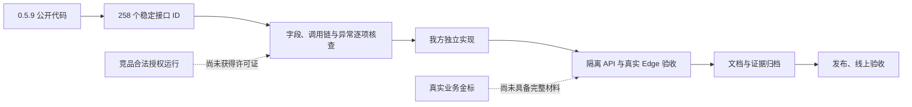

# 当前完成状态与剩余事项

## 053：工程草稿恢复的文件名路由已修复，本地验收完成

052末轮发现的portable fresh漏传原文件名已补齐，与worker/OCR使用相同解封名称；显式截图优先、原件和待人工复核语义保持。真实场景API1/1、PDF完整Edge1/1、完整check134文件794单元及Bend11/13、类型构建通过，856输入无漂移。候选纯测试修前14/15、修后15/15；原失败和v2漏import均保留。[修复、验证与剩余事项](逆向台账/contracts/portable-filename-053-20261016.md)。

本节为本地检查点；线上仍051e/schema044，053发布需另有服务器与浏览器回执。模型读取、资源限制和相邻项目未改。258R0、34S2、业务金标、印章质量、原生Word与外部边界仍保留，不能宣称全部逆向完成。

## 052：页面全套排查及规则分支补证，产品运行代码未改

原完整 Edge 83 项为71过／12失败／零跳过，失败全部保留。五文件14项复验与新增四链4项最终通过，结合69项字节不变的原成功证据，共87项分层覆盖（78真实／混合后端、9全mock），不称单次87全绿。完整check134文件793单元、Bend11／13、类型与构建通过，最终856输入不变。

金额17源分支／12族接线核查后，补五条独立正例及五条边界；研究区逐删对应分支，五条目标测试均准确失败。规则实现和十个完整JSON块未改。四链涵盖目录ZIP、已知密码PDF、单材料全星号设置、个人JSON规则迁入并明确应用，原件实际字节与结果均有断言及截图。[本轮结果、操作与未完成事项](逆向台账/contracts/reliability-052-edge-rules-20261016.md)。

线上保持已部署051e／schema044，本轮无需替换产品运行镜像，公网只读健康正常，本地服务已恢复。印章同码历史混合集F1约20.21%、真实业务金标、Word原生视觉、竞品授权运行及私有服务仍未闭合；automatic业务选择仍待决定，模型选型暂缓。S／I及258R0保持，不能宣称全部等价。

052末轮对抗复核新发现：工程草稿恢复的 freshPortableMarks 未传入原文件名，自动类型为 auto 时，民事判决书.pdf 可能重新加入本应被法律材料路由抑制的 SCENE-form 候选。worker／OCR 已有文件名上下文；portable fresh 属真实遗漏，053候选修复与隔离回归准备中，尚未合入或上线。

## 051e已上线，接口分段覆盖及公网只读验收完成

版本051／schema044已部署；397运行文件和全部网页资源哈希一致，相邻5容器身份／启动时间／重启数及健康状态未变。公网Edge实际登录admin，任务存储接口可读；指南28节30图全部加载、无溢出。当前admin可见0项目，未用业务账号写测试材料。[上线及边界](逆向台账/contracts/aliyun-release051-verification-20261016.md)。

105个接口测试文件按38+1+66分段成功覆盖，共209项，0失败／跳过／取消，当前854输入不变；原第39旧断言失败保留，不称单次全量全绿。完整check为134文件783单元及Bend11/13、类型构建通过。归档、任务隔离恢复、OCR检查点、复核草稿及网络反馈的分项真实Edge／API证据保持各自范围。[105文件逐项证据](逆向台账/contracts/api-105-layered-coverage-051-20261016.md)。

3名Sol主审及各3名Luna首轮和后续跨组反驳完成。当前未新确认可直接补的公开业务代码缺口；源258R0、私有／许可运行、真实业务金标、原生Word视觉和automatic模式决定仍保留。模型选型按要求暂缓，未改启动读取或加生产资源限制。

## 以下为此前发布前与历史检查点

> 发布检查点：050已上线，2026-10-15 23:48北京时间完成公网Edge只读验收。运行源码c2cbeb3，schema039；384个运行文件及全部前端资源哈希一致，相邻5容器未变。当前admin项目0，未冒称公网业务流程重跑。[050上线验收](逆向台账/contracts/aliyun-release050-verification-20261015.md)。

## 051第四批：任务存储恢复及Edge已验，105文件分段回归继续

SQL044损坏任务隔离、不可变同版本备份及恢复已正式合入；不再只是诊断入口。真实Edge第二轮1/1通过、进程退出0，保存本轮三张截图。含未确认隔离时已校验归档的只读回退、明确隔离／恢复确认、坏密文保留、健康任务可用及原件／成果／三种旧下载链接不变。正式首轮专项API2/2、坏密文叠加真实撤review专项1/1；研究v27另有修前409与修后新库2/2证据。

本批完整check134文件783单元、Bend11/13、类型和构建全过，854输入前后不变。Edge首轮采样早于签发链接，正常issued_until更新使整行断言失败；仅把测试基准移至成功签发后，仍保留issued_until和整行比较。新854清单只变此Edge测试，产品、API和单元代码相同，类型再验通过。新增归档界面回归2/2通过。

105文件API在第39文件停止：68项通过、1项失败、0跳过，输入未变；正常方案按ID和名称选择均已通过。失败是旧测试要求坏方案先创建任务、再授权失败，而产品已在创建任务前拒绝。保留预检，只修测试并加强任务／快照／job数量及来源文档逐值不变断言；正式新库1/1、类型检查通过。新854清单仅变此测试，产品代码完全相同。架构组逐文件确认前38文件68/68成功证据仍对应当前字节；尾66文件正在标准隔离库执行。最终将按38+1+66明确记为分段覆盖，不能称单次105全绿。原失败与受控终止的6文件9通过0失败1取消记录均保留。本机schema044、5178/4318及worker已恢复；线上仍050/schema039，本批尚未发布。[第四批机制、反例与验收范围](逆向台账/contracts/task-storage-recovery-051-20261016.md)。

自动交付仍待现行人工复核业务约束的明确选择；schema044前没有可信同版本快照的旧坏行只能保留和隔离，不能空白重造历史。竞品258项R0、私有许可运行、业务金标及原生Word边界保持。

### 第四批开始时的全量停点（历史）

851输入的104文件隔离API回归已在第35文件停止：61项通过、1项失败、0跳过，输入哈希未变。失败为正式撤权竞态测试保留研究期 `EXPECT_FIXED` 开关，默认仍断言修复前400和任务变更；实际接口正确返回403。原始日志和回执保留，正式测试已改为无条件403、任务与冻槽不变、归档0条，并独立重跑通过1/1。未把此次失败写成完整接口全绿，也未降低权限要求。

此时SQL044仍在研究候选，随后正式合入与验收结果见本节开头。下节第三批“全量继续执行”为此前检查点时态。

## 051第三批：正式恢复链已合入，归档与最终门禁继续（历史检查点）

3名GPT-6-Sol主组及各3名GPT-6-Luna首轮均已实际执行，之后由主组交叉反驳、根组合并。148个I1条目已按规则50、架构46、前端52逐项复查，ID集合无交叉遗漏；I1不代表148个空接口，不能因领域类似或一个用例成功就批量升级。

| 本批项目 | 当前可核验结果 |
|---|---|
| MCP标准能力与目录 | 正式API1/1，真实201条每组、前200顺序、控制码与120 UTF-16单位投影；自动模式仍不虚报 |
| 反馈与网络 | 正式Edge2/2；网络模块单元6/6；新模块误匹配Vite `/api`代理造成启动401的失败已修复并重验 |
| 旧Markdown | 409明确要求重识别，正式API5/5；原标记、版本、原文和全部既有快照逐值不变 |
| PDF完成页与恢复提示 | SQL041/042、缓存、worker及writer正式合入；PDF缓存API4/4、解析续扫1/1、提示/写入API3/3 |
| 复核草稿 | 正式真实Edge两文件各1/1；保存/心跳/重开/覆盖/撤销第二次写入/关闭回执已验，连同归档新增3张实图，指南27节27图 |
| 可还原配置与最终标记 | 正式2/2；历史matrix与完整MCP曾发现standalone被误拦，V4已修且完整MCP1/1再过，未削弱旧测试；最终全量门禁另记 |
| AI返回稿归档 | SQL043与V2已正式合入；API1/1、Edge2/2通过；解析失败撤权竞态已修，受控正式修前后源码验证拒绝时任务/冻槽不变。仅私有云项目归档，非本机目录写入 |

此前原95文件API在第62文件失败即停（121过1失败0跳过）；修正Markdown5/5和未执行尾33文件69/69后，分层覆盖原95文件成功结果191项，另有本批新增专项。该分层不能冒称同一最终版本单次全量通过。本批最终851输入现已完成完整check：134文件783单元、Bend11/13、类型与生产构建全过，0跳过，输入哈希前后一致。另有835输入同计数的旧中间检查点，两者回执分开保留。104文件接口门禁继续执行，未报接口最终全绿。

竞品258项仍R0；许可运行、供应方私有实现、真实业务金标与原生Word逐像素版式边界保留。全自动交付与现行人工复核约束不同，待用户明确选择；损坏协作任务存储当前仅诊断，源端隔离保留备份仍是明确功能差距，不能只以OS不同称已完成。

线上已在本轮再次只读核对：仍050/schema039、服务健康；相邻5容器运行。本地已恢复schema043及5178/4318/worker。旧051 e3f2d0e暂存镜像不等于本批源码，不应直接切换。指南Edge核验27节27图全部加载、目录有效、无横向溢出。模型启动读取与生产资源设置未改。[本批详细记录](逆向台账/contracts/reliability-051-thirdbatch-20261016.md)。

## 历史：051第二批本地门禁通过，完整接口回归继续

三Sol主组及九Luna子审首轮完成后，跨组反驳补齐分格签名整组决定、完整姓名黑白名单/profile一致性、历史缺组门禁、备份重建、Office逐位置核验和含图原件/输出索引；保留旧记录、原件和已签链接。取消后旧进度轮询与无ID接续选错未交付任务也已修复。777单元/133文件、Bend11/13、类型与构建通过，809输入前后哈希一致，0跳过。签名正式API6项、真实MCP两次交付的接续1项、取消Edge2项和签名完整Edge通过；失败与反驳均归档。

95文件API完整隔离回归仍在运行，未宣称接口集合全绿。线上仍050/schema039；本地schema040及5178/4318/worker已恢复。指南25节24图经Edge全部加载、目录有效、无溢出，四张新增图为本地051实际操作。[第二批修复、失败与验证边界](逆向台账/contracts/reliability-051-secondbatch-20261016.md)。竞品258R0、224S3/34S2和I级不升级；私有/许可运行、业务金标与Word原生视觉边界保留。待接口回归结束后继续发布读回。

## 历史：051第一批集成检查点

映射可选元数据、Office编码、取消后旧版本、文件夹取消状态及导入回滚清理第一批已合入本地。完整check：132文件772单元、Bend11/13、类型与构建通过，0跳过；真实Edge正常取消重识别及回执丢失后重载2项通过，正式files3项、外部回填6项、崩溃恢复1项亦通过。本地schema040，5178/4318及worker已恢复；本轮未部署。

原050冻结91文件API全部跑完：177项过、4失败、0跳过，原失败记录保留，不称全绿。签名整组决定、历史缺组材料、profile/forceSkip一致性及旧events误导提示仍在补齐；隐式MCP选择、真实业务准确率与许可/私有服务边界继续保留。三Sol主组、各三Luna子审已实际完成首轮，后续由主组跨组反驳。[051第一批证据与明确剩余工作](逆向台账/contracts/reliability-051-integration-20261016.md)；[初始反例检查点](逆向台账/contracts/reliability-051-20261016.md)。

## 050终版已部署并完成公网只读验收

三个GPT-6-Sol主组各带三名GPT-6-Luna已分批完成并交叉反驳；最终补丁14路径。终版792个源码/测试/配置文件前后哈希相同：131文件764单元、Bend11/13、类型及构建全部通过，零跳过；同版queue6、MCP完整生命周期1、gateway/connector矩阵3，以及3个真实Edge流程通过。此前组合候选external1/batch4/真DOC1的证据单独保留，不称终版单次全量API或完整Edge集合。指南23节20张实际截图，本地Edge检查全部加载、无横向溢出。

修复Word纯文本假名误改OPC/数值属性，保护自然metadata与完整wrapped回填；合法Default main mime及包根绝对Target兼容。MCP校验中断同轮重试、成功回执幂等、任务/作业同事务、独立归属、终态保护、子识别取消后重识别、重复接续与真实DELETE断连、新接收人显示和授权勾选重置均有分项证据。缺失原态的旧坏任务明确拒绝接续，保留原件/已存结果，不猜阶段。

050已实际发布并读回：公网版本、admin登录、指南23节20图、运行源码及静态资源哈希均通过；相邻5容器未变。本地schema039、5178/4318及worker已恢复。模型启动读取、生产资源限制未改。竞品258R0、224S3/34S2及I级不升级；原生Word、业务准确率、许可/私有边界仍在。详见[050验收](逆向台账/contracts/reliability-050-20261015.md)。

## 历史：049最终修订B已发布并完成线上只读验收

末次对抗发现并修复启动429等待期间跨标签切号的身份注册顺序。最新完整check130文件758单元、Bend11/13、类型/构建通过；最终5文件8项Edge全通过，源码前后哈希一致。含原两失败修复、外部/MCP真实下载、会话隔离及真实限流期间切号。独立复审未发现明确新增P1/P2。API保留048完整175与049分层，363后端文件相等；不称049单次全量API或73Edge全部重跑。23节17图指南渲染通过。Git已同步main和工作分支；049已部署，382运行文件及前端资源哈希通过，公网admin登录成功，相邻5容器未变。[完整记录](逆向台账/contracts/continuation-reliability-20261015.md)。

## 历史：048门禁执行期间（已由049检查点接续）

坏方案/MCP恢复、外部还原、表单补词、OCR跳过原因及截图/聊天场景补丁已合入。场景接线真实隔离API1通过，定向2文件16单元通过；此前PDF完整Edge1通过、OCR面板Edge2通过。完整检查首轮748过1失败，旧后缀假设夹具已修订，失败保留。当前448产品文件、90文件API、42文件71项Edge按同一代码冻结执行，尚无最终全绿报告。三Sol主审和九Luna子审分批完成，场景另作独立反驳。图表规则交接已补完整分支；线上仍036，本轮未部署。[本轮记录](逆向台账/contracts/continuation-reliability-20261015.md)。

## 结论

不能宣称“全部逆向完成”或“与脱敏猫完全等价”。此前 3 位 gpt-6-sol 主审及 9 位 gpt-6-luna 子审已完成所获 0.5.9 公开发布代码的有界应用合同合图：224 项静态 S3、34 项边界 S2；未识别出可具体命名的未读公开应用节点。未获得的服务端实现、合法激活后的运行结果、未知版本及真实业务材料效果没有验证依据。

## 036发布时的本地验收检查点（历史）

447产品文件冻结，128文件733单元、Bend11/13、类型和生产构建通过。85个API文件均有明确分层的成功证据：最终V4两文件4测试，V3三文件5测试，其余35/14/31文件保留各自来源，不称同源单次全量。完整Edge第二轮60通过6失败；修复后受影响5文件16项全部通过，未重跑完整67项。原失败日志均保留。真实CFB DOC批量默认原DOC输出补证通过。

以上表内“待最终门禁/新增Edge待验”为此前阶段描述，以本检查点及 [最终验收](逆向台账/contracts/local-release-verification-final-20261015.md)、[85文件API](逆向台账/contracts/api-85-evidence-layers-final-20261015.md)为当前结果。036已部署，详见[发布记录](发布记录-20261015-036.md)。下表为036历史结果；各阶段的具体用例、失败与补证仍保留在所链接报告和台账中。公开静态分析已闭合；私有许可运行、真实业务准确率、MS Word原生排版等边界继续保留。

## 036能力验收基线及保留的验证边界

下表“通过”指我方所列分层证据，不提升竞品R0，也不表示最终同一版本做过单次全量API85／Edge67。当前公开应用分析与本轮产品补齐已交付；未具备证据的范围明确列出。

| 项目 | 当前结果 | 仍需验证或使用要求 |
|---|---|---|
| 老格式DOC／WPS | 转换、规范化、识别、内嵌图OCR、审查、导出与还原已有实际API证据；真实CFB DOC批量默认原DOC输出已补证。独立legacy-office转换服务已随036上线并健康 | 本次公网完整流程验证的是TXT和PNG，未在公网重跑DOC／WPS各链；WPS按参考Mac流程输出DOCX |
| 印章识别 | 原算法完整混合公开集786张、1315框，IoU≥0.5 F1为20.21%；Ooredoo／Paddle对照为33.78%／13.87%，未将对照模型自动换入产品 | 黑白印章业务金标、来源与训练重叠尚须核实，当前不能可靠全自动处理 |
| 人脸、签名与实体识别 | 有公开集实测及分项报告，误检漏检和跨领域差异仍存在 | 用真实业务金标分别统计语言、类型、格式与错误样例，人工复核 |
| Word原版式 | 分页审查、兼容预览和嵌图交互已实现，纳入本地分层API／Edge证据 | 浏览器不等于Microsoft Word原生逐像素排版；复杂表格、浮动对象、文本框、批注、页眉页脚和跨页位置仍需业务材料对照 |
| 剩余接口与原生能力 | 258个ID、37条链路；224项有限公开应用合同S3，19项原生／外部与15项私有边界S2；当前没有可具体命名的未读公开应用节点 | 不外推平台库、未知版本或供应方私有实现；[逐项合图](逆向台账/contracts/static-semantic-closure-final-20261015.md) |
| 私有许可证、订单、付款及恢复签发 | 已分析客户端字段、调用与消费逻辑 | 服务端和签发权限未取得；协议可分析，不能宣称等价实现或伪造签发 |
| 竞品端到端运行 | 全部258项R0，未以合法激活运行逐接口验证 | 取得正版许可证后按相同稳定ID补运行证据 |
| 统一假名全生命周期 | 52步源码对照、正式API、完整Edge及MCP实际还原证据齐备；全局／文件覆盖、合并／拆分、重置、不可变历史保留 | 分层证据不等于所有业务材料验证；自定义假名有歧义时按对应还原计划确认 |
| 工作区按格式序列化 | 43个源函数、四codec、PNG／PDF／Word的12条几何往返及老DOC规范化正反例已有实际证据 | 导入历史只读、不沿用旧审批；不把分层验收称最终单次全量 |
| 同位置批量标注与页面旋转 | 按格式匹配、批量／撤销、旋转与重新识别、8方向拖框、选字与实际几何产物已有API／Edge证据 | 人工核对跨对象与页面位置，原文残留或位置绑定失效时拒绝不可靠导出 |
| 项目范围OCR实体改字 | 规划／预览／原子应用、补录与显式清除已接入；PNG／PDF／Word及四codec实际往返；新面板已完成本轮受影响Edge验收 | 保留原始文字／原件／字框；清除旧纠错后需重新识别，不将清除冒称已完成识别 |
| 全文核查与审查来源 | 56组规范化查找金标、重复槽位一对一绑定、来源重绑、加密历史与跨租户／篡改反例已有实际验证 | 历史不是审批；失效、歧义、伪造或跨文档opaque ID明确拒绝 |
| 全文实体筛选与参考冲突图 | 7000+实体接口、12万字符末尾筛选、114组冲突金标与相关Edge已有证据；本轮忙碌／429恢复已修复验证 | 不用删除规范实体来掩盖待复核内容；本轮整体Edge证据仍分两次全量和最终受影响文件 |
| Word／Markdown自动反馈 | 自动producer、原文／纠正值分存、去重、保存竞态及权限边界已实现并留有真实API／Edge证据 | 不自动学习；隐藏、无变化或单纯保留不误记误报 |
| 按类型隐藏与恢复 | 8种格式／codec往返、来源保留与隐藏后纠错已有API证据；本轮完整受影响Edge文件通过 | 恢复回待确认，不继承旧批准 |
| 规则集边界与旧字段 | 32769条保存／回读／真实worker末条命中、额外字段、旧命名归一与profile各格式边界已有实际验证 | 规范化投影与API外层参数各按源合同处理，不能泛化成任意字段透传 |
| 自定义反馈类型与统计 | 原始类型、大小写、特殊属性名、重开及五类导出已实际验证；精确统计入口已实现 | 全局包含式与审查／审计／证明精确统计语义分别保留 |
| 活跃任务临时规则 | file／project／spot、加密投递、任务代次、末次窗口与038终态扫尾已实现；真实worker、事务锁反例与页面producer有证据 | 只影响本人活跃任务，不写长期词表；源即时追加与我方末次窗口仍有时点适配 |
| PDF实体画布定位 | 两页跳转、重复定位、组内导航与新截图已有Edge验证，已随036发布 | 本次公网没有重跑所有PDF交互；复杂业务PDF继续人工核对 |
| 项目实体逐处查漏 | 同／异类／未标记、单项补录／替换、版本并发与几何绑定已实现；最终3项项目API及对应受影响Edge通过，已随036发布 | 未就绪材料显式跳过；忙碌409／429后按提示重试；[实现记录](逆向台账/contracts/project-audit-actions-porting-20261015.md) |
| 门禁、文档、仓库与部署 | 447产品文件；128文件733单元，Bend11／13、类型、生产构建通过；API85分层，最终V4两文件4项；Edge第二轮60过6失败后，最终受影响5文件16项通过。036已部署；TXT／PNG完整公网流程通过 | 没有最终同源单次API85／Edge67报告；首次OOM造成Semantica一次重启已恢复，二次部署与真实处理后5相邻容器未再重启。无生产SIGKILL／数据库恢复演练；[完整上线证据](逆向台账/contracts/aliyun-release036-verification-20261015.md) |

## 本轮已经补齐的公开业务分支

| 能力 | 本轮结果 | 证据入口 |
|---|---|---|
| Word 兼容预览设置、内嵌图重新 OCR 及复核版本 | 已实现；独立接口验证；Edge 实际操作通过 | [视觉接口](逆向台账/contracts/visual-interface-closure-20261015.md) |
| 保存假名表、完整组合假名及首尾空格还原 | 已实现；加密保存、导出、跨 run Word 与 Markdown 还原已验 | [假名表](逆向台账/contracts/mapping-library-closure-20261015.md) |
| 类型路由、文件夹输出及报告 | 已实现；按公开函数做数值对照，包含大于 50 MiB 的多文件 ZIP 与完整性校验 | [路由与文件夹](逆向台账/contracts/rule-interface-closure-20261015.md) |
| 个人词表、规则、反馈等 49 项确切方法 | 已核对实际字段、持久化和返回值，移除若干没有源依据的额外截断 | [49 项接口](逆向台账/contracts/personal-settings-interface-closure-20261015.md) |
| 工程保存回执、最近工程记录与导入导出 17 项方法 | 已实现真实保存状态、幂等回执、权限与备份恢复 | [工程接口](逆向台账/contracts/workspace-interface-closure-20261015.md) |
| 部署版本、运行环境及版本提示偏好 | 已实现真实网页运行信息和偏好持久化；Edge 重载与定时读取通过 | `apps/api/release-state.ts`、`tests/release-state.integration.ts`、`tests/e2e/porting-closure.spec.ts` |

上述“已实现/通过”仅指所列我方合同与测试，不提升竞品 R0，也不表示该能力的所有现实场景已覆盖。

## 两个 GitHub 工具的采用结果

- [reverse-skill](https://github.com/zhaoxuya520/reverse-skill)：采用其证据驱动的逆向分析思路；未执行未知安装脚本，未用它绕过激活。
- [PentAGI](https://github.com/vxcontrol/pentagi)：属于自动渗透测试平台，本轮业务接口和文件规则补齐不需要在服务器安装它；没有发起竞品扫描。

## 检查入口

- [统一台账](逆向台账/README.md)：稳定 ID、链路、状态定义和变更记录。
- [逐项缺口核查](逆向台账/contracts/remaining-completion-20261015.md)：历史遗漏与当前补证，不按同一功能域批量判定通过。
- [印章全量实测](逆向台账/contracts/public-stamp-validation-20261015.md)：样本范围、完整计数和限制。

历史截图缺失已在台账单独记录。本轮保存了修改前的全部现存已固定证据；不能倒推已经丢失的历史字节已恢复。
