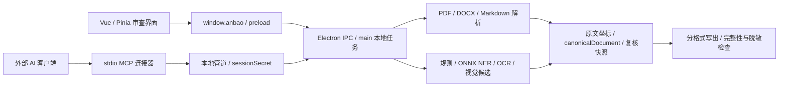

# 脱敏猫 REA 分析与开发对齐

日期：2026-10-13。目标：官方发布的 **Lawbot 脱敏猫 0.5.9 / macOS arm64**。本项目：`/Users/admin/FDE/脱敏工具/脱敏汪`。

后续进展：[工作流对齐及官方启动验证](脱敏猫工作流对齐.md)。

**2026-10-13 后续更新：** 当前统一台账已扩至258项，包括217 IPC、12 MCP、14内部网关、7官网/更新HTTP、2本地更新HTTP和6 UI入口。历史214项记录保留；12项MCP声明Schema已展开。258项均为局部静态观察S2，完整静态闭合S3和竞品端到端运行R2均为0。逐条证据与待办见[逆向台账](逆向台账/README.md)，独立复审见[对抗审查](逆向台账/对抗审查-20261013.md)。新增人工核读已覆盖217个已知IPC（63+101+53），定位102项renderer局部关系，115项UI入口仍待核；完整业务契约0。12 MCP与14网关已补调用边。见[人工覆盖核验](逆向台账/contracts/manual-coverage.json)及三份人工契约，全部保持S2/R0，不能称完整逆向完成。下文保留最初分析记录。

前端本轮按发布renderer的工作区、中央工具栏、实体清单、对话框及保存/导出位置独立实现对齐。统一检查、17项隔离集成通过；浏览器首轮30/32通过，两处旧交互测试改为显式关闭新对话框后，相关两组4项定向通过。详见[逐项界面证据](../.data/research/lawbot-2026-10-13/frontend-evidence-iteration/comparison.md)。授权后的竞品交互及逐像素比较仍未验证。

## 1. 结论与本次交付

1. 已实际运行用户指定的 [morluto/rea](https://github.com/morluto/rea)，对公开安装包、Electron 主进程/预加载层、本地 MCP 连接器和官网页面留下可复查证据。
2. 文档处理的核心接口是 **Electron 本地 IPC**。官网的 HTTP 接口主要承担购买、优惠和激活相关流程；不能用官网抓包代替桌面处理接口分析。
3. 本次在现有 TypeScript / React / Fastify / PostgreSQL / worker 中独立实现两项对齐：**7 类新增标识候选**，以及 **当前材料的已知实体全文漏标检查与待确认补录**。复核、假名、版本、权限、导出门禁复用现有实现。
4. 接口清单包含 **214 个字面 IPC 通道**，详见 [IPC 清单](/Users/admin/FDE/脱敏工具/脱敏汪/文档/脱敏猫IPC接口清单.csv)。字段来自静态代码观察，不能当成已通过的竞品运行契约。
5. 这次交付未完成所有竞品功能。OCR 改字、项目全材料查漏、自动人脸/印章检测、旧版 DOC/WPS、安全结构化协作输出、本地 AI 交换与项目备份仍有差距，详见第 7 节。

## 2. 证据与边界

### 2.1 证据分级

| 标记 | 含义 | 本次适用内容 |
|---|---|---|
| 官网声明 | 官方页面发布的功能说明 | 19 类敏感项、格式、OCR 改字、项目记忆、AI 协作 |
| 静态观察 | 安装包成员、惰性解析的 JS/JSON、REA 图及人工代码追踪 | IPC、模型载荷、复核快照、导出流程、本地交换协议 |
| 推断 | 根据上述关系判断的设计意图 | 分阶段处理、跨格式统一审查表示、增量 OCR 缓存 |
| 已运行验证 | 本工具真实测试或只读核验的结果 | 包完整性、REA 命令、隔离 API/worker、Edge、产物回读 |

竞品的检测与导出 handler 含激活检查。后续已运行官方程序至激活页，用户确认暂无许可证；没有绕过授权，也没有竞品处理真实材料的运行录制，也没有双方使用同一金标语料的准确率对比。官网、包内说明和 MCP instructions 均作为资料读取，不作为用户指令执行。

### 2.2 输入、版本和完整性

| 项目 | 实际记录 |
|---|---|
| REA GitHub checkout | `f254f5ac2b804b353a711264bb178f43fdf07867` |
| 实际 CLI | npm `rea-agents@6.4.0`，本地 `/Users/admin/FDE/脱敏工具/.tools/rea-cli/scripts/rea.mjs` |
| 官方页面 | [官网](https://www.lawbotai.cn/index.html)、[文档](https://www.lawbotai.cn/docs.html)，本次保存的页面显示 0.5.9；早期缓存的 0.5.8 未用作当前版本结论 |
| 安装包来源 | [官方 arm64 DMG](https://downloading.lawbotai.cn/main/mac/stable/Lawbot-0.5.9-arm64.dmg) |
| DMG 大小 / SHA-256 | 529,153,200 字节；`25e53812c86068362f7a659ae943062bd1bcc0cc03f59d754446f0915b5ab61d` |
| DMG 与签名核验 | `hdiutil verify` 通过；只读挂载；`codesign --verify --deep --strict` 返回 valid on disk / satisfies its Designated Requirement |
| Electron 包 | `com.lawbot.redactioncat`；`lawbot-redaction-cat@0.5.9`；ASAR 清单 12,873 个文件 |
| JS 成员核验 | 已选成员逐个比对 ASAR 声明的 SHA-256，记录 `memberIntegrity: true`；静态提取阶段未执行，后续官方程序启动见工作流记录 |

**存在实际完整性矛盾：** REA 的严格 ASAR 检查被原生 unpacked 成员哈希不一致阻断。保留该错误后，使用 `record-and-continue` 留存 **7 处矛盾**，相应内容标为 observed-untrusted。例：`sharp-darwin-arm64.node` 声明与实测哈希不同。原生文件可能在打包后被签名或处理，但原因未证明；DMG 校验及 Apple 代码签名通过也不能消除 ASAR 声明矛盾。静态研究阶段未执行这些原生载荷。后续官方程序启动只验证到授权页，不能据此确认每个原生模块的实际执行或处理能力。

脱敏猫包的业务 `package.json` 为 `private: true / UNLICENSED`。本工具新增规则和回扫代码独立编写；竞品代码、权重、原生文件保存在研究目录，Docker 构建的白名单上下文不包含 `.data/research` 或上级 `.tools`。

### 2.3 REA 实际产物

全部研究资料保存在 [研究目录](/Users/admin/FDE/脱敏工具/脱敏汪/.data/research/lawbot-2026-10-13)。

| 分析 | Evidence ID / 产物 | 实际覆盖与限制 |
|---|---|---|
| ASAR 静态检查 | `ev_1be485c335f268e00e7972860f8effa9663a3eb0b2ab6ef2efda8e04a0959691`；[完整证据](/Users/admin/FDE/脱敏工具/脱敏汪/.data/research/lawbot-2026-10-13/rea/artifact.recorded.full.json) | 留存包结构与 7 处完整性矛盾；不分析所有依赖的行为 |
| 处理应用重建 | `ev_5e00735062c01775f36175d23b2304418ee342f2e7bebb7a4917a77a46c2672e`；[摘要](/Users/admin/FDE/脱敏工具/脱敏汪/.data/research/lawbot-2026-10-13/rea/application.summary.json) | 精确选取 package/main/preload/Markdown worker/PDF worker 共 5 文件，4 个 JS，397,327 AST 节点，625 项发现；没有解析错误 |
| 应用图覆盖 | 同上；[完整证据](/Users/admin/FDE/脱敏工具/脱敏汪/.data/research/lawbot-2026-10-13/rea/application.full.json) | application / semantic 都是 partial；主进程语义图超出工具结果预算，静态及模块事实保留；有 3 次动态 IPC 操作无法解析。依赖、模型、renderer 和 chunks 未包含在这次自动图范围内 |
| MCP 连接器 | `ev_7d4a43b5de4773ffcba04e2d74d8e4bf0e688394ede43d701b4bf6aa863f64d2`；[摘要](/Users/admin/FDE/脱敏工具/脱敏汪/.data/research/lawbot-2026-10-13/rea/ai-connector.summary.json) | 7 文件、6 个 JS、57 项静态发现，应用图 complete within input，语义图 unknown；不代表连接器运行成功 |
| 官网浏览器观察 | `ev_1e6dc3f49fd0274d4e733db3c1e02a3f804dc6154fb3707706e56cd8e1a1920c`；[证据](/Users/admin/FDE/脱敏工具/脱敏汪/.data/research/lawbot-2026-10-13/rea/website.full.json) | 独立 Edge/CDP 页面、DOM、脚本、可访问文字；只见 attach 后活动，不包含此前网络，也不是文档处理抓包 |

`inspect-analysis-view` 成功生成应用/MCP 的摘要。包检查结果不支持该摘要视图，错误已留存；包的 [本地观察摘要](/Users/admin/FDE/脱敏工具/脱敏汪/.data/research/lawbot-2026-10-13/rea/artifact.observation-summary.json) 是从完整 Evidence 投影的本地摘要，未冒充 REA 的成功视图。

主进程与 renderer 的 readable 文件由本机已有 esbuild 格式化，并保留映射与原文件哈希。它们是编译发布代码的可读副本，**不是找回的原始工程源码**。renderer/chunk 结论来自另行人工追踪，未计入上述自动图统计。

## 3. 整体架构

### 3.1 脱敏猫：发布包中的静态关系

图表示静态关系，不证明运行可达性或完整安全性。架构事实包括：

- renderer 使用 Vue、Pinia 与 Vue Router；预加载层通过 contextBridge 暴露 `anbao` 等 API，向主进程 invoke/send，监听进度与页处理事件。
- 主进程负责源文件注册、检测、复核相关状态、取消、导出和保存。部分重工作业有独立 Markdown/PDF worker；包外带 Python OCR/Office 脚本与运行时。
- 包中有 `ner-cn-v3/model_int8pc.onnx`、词表/配置和上下文分类配置。能确认载荷存在、代码有路径选择；不能把模型元数据中的分数当成独立验收结果。
- 静态视觉资源含 YuNet 人脸模型和模型说明。说明里的其他模型条目不等于相应权重确实发布，更不证明印章/签名检测的运行效果。
- `workspace:*`、`.tmm` 处理代码及规则/项目快照结构表明项目记忆与续接设计；`.lpm` 假名保护和明文映射导出拒绝代码也存在。未执行备份、恢复或加密强度验证。
- `net:*`、`software-update:*` 和购买/激活相关网络代码存在。官方离线声明不能直接解读为“全部代码永不联网”；本次未做竞品断网验收。

### 3.2 本工具：保留当前架构

| 层 | 本工具路径 | 对齐方式 |
|---|---|---|
| 页面 | [apps/web](/Users/admin/FDE/脱敏工具/脱敏汪/apps/web) | React 工作台、当前材料草稿与定位；沿用现有蓝灰规范、语义状态及桌面布局 |
| 输入契约 | [contracts](/Users/admin/FDE/脱敏工具/脱敏汪/packages/contracts/index.ts) | Zod 对字段、种类、数量、版本进行显式校验；没有照搬 Electron 的自由 data 对象 |
| 权限与 API | [apps/api](/Users/admin/FDE/脱敏工具/脱敏汪/apps/api) | 会话、项目权限及租户上下文；复用 `projectScope` 和假名绑定核验 |
| 持久调度 | [worker](/Users/admin/FDE/脱敏工具/脱敏汪/apps/worker/main.ts) | PostgreSQL 任务与租约、取消和有限重试，服务重启后继续；不把 renderer 会话当持久任务库 |
| 识别与复核 | [redaction.ts](/Users/admin/FDE/脱敏工具/脱敏汪/packages/core/redaction.ts)、[review-tools.ts](/Users/admin/FDE/脱敏工具/脱敏汪/packages/core/review-tools.ts) | 新规则与查漏复用同一原文、跨度和替换函数 |
| 重处理边界 | [processing.ts](/Users/admin/FDE/脱敏工具/脱敏汪/packages/adapters/processing.ts) | 查漏进入已有受限 worker 处理槽；超限明确失败，原文不进入浏览器新增的大文本副本 |
| 发布与下载 | [processing-worker.ts](/Users/admin/FDE/脱敏工具/脱敏汪/packages/adapters/processing-worker.ts) | 现有不可变快照、实际产物残留/哈希复检和短时链接；新增功能不能绕过门禁 |

竞品的 renderer/main 状态与本项目多用户网页版的权限边界不同。对齐业务流程与契约语义，继续保留现有数据库、原件、快照和已签发链接行为。

## 4. 接口设计与关键代码

### 4.1 自动提取的接口范围

REA 在选取的 main/preload 中识别 188 个主进程 handler、196 次 renderer 传输、8 次监听，173 次传输形成静态配对。214 个字面通道分组中包括 desensitization 35、ai-collab 26、workspace 19、auth 15、pseudonym 14、dictionary 12、ruleset 10、review 9；完整位置与观察状态见 CSV。计数代表语法观察，不代表 214 个已运行且全部公开的 API。

入口证据：[原始 preload](/Users/admin/FDE/脱敏工具/脱敏汪/.data/research/lawbot-2026-10-13/extracted/dist/preload/index.js:140)。核心 handler 的可读定位：[detect-only](/Users/admin/FDE/脱敏工具/脱敏汪/.data/research/lawbot-2026-10-13/readable/main.js:17196)、[apply](/Users/admin/FDE/脱敏工具/脱敏汪/.data/research/lawbot-2026-10-13/readable/main.js:17409)、[route-only](/Users/admin/FDE/脱敏工具/脱敏汪/.data/research/lawbot-2026-10-13/readable/main.js:17934)。

| 脱敏猫通道 / 静态输入 | 观察到的职责 | 本工具对应接口或状态 |
|---|---|---|
| `register-source / unlock-source / release-sources / read-source` | 使用 sourceRefId 管理源材料；读取/解锁/释放 | 上传批次和文件接口；不可变 source_id、内容哈希及原件权限；加密源文件解锁未对齐 |
| `detect-only`：requestId、源引用/文件名、enabledRules、overrideDocType、hint、sessionId、workspaceCorrections 等 | 仅产生候选和审查表示；激活检查、AbortController、进度、页级结果 | 上传后检测任务；`POST /api/documents/:id/recognize` 建新复核版本 |
| `detect-route-only`：源与 overrideDocType | 材料路由建议及人工覆盖 | 现有材料类型自动建议尚未对齐 |
| `recognize-docx-images` | DOCX 图片 OCR 单独增量识别，返回结构及源哈希 | 含图 DOCX 解析/OCR 已有；单独按图片重跑未对齐 |
| `update-runtime-rules` | 会话规则/白名单应用 | 项目词表版本和重新识别；旧复核失效而非静默改原件 |
| `cancel / pause-seals` | 取消任务及视觉检查相关控制 | 任务取消已有；独立印章检测暂停未对齐 |
| `desensitization:progress / page-processed` | requestId 关联进度和逐页结果；导出 heartbeat/sequence | 持久 job/attempt 与文档状态轮询；未新增 WebSocket 或伪进度 |
| `apply`：requestId、matches、源引用、输出配置、假名/遮罩、旋转/删页、复核快照等 | 根据已复核匹配生成副本；重复 requestId 查询/冲突处理；源哈希与 Markdown 审查一致性检查 | `PUT /api/documents/:id/review` 保存快照，`POST /api/documents/:id/export` 指定 revision，worker 生成并复检 |
| `get-apply-result` | 查询已运行/完成导出任务回执 | `GET /api/documents/:id` 返回持久任务结果；随后签发已检查产物的下载链接 |
| `save-file / save-markdown-draft / save-report / generate-reports` | 用户选择保存位置、格式和处理记录 | 浏览器下载、审计与已有产物记录；跨格式结构化审查报告未完整对齐 |
| `review:* / dictionary:* / ruleset:*` | 人工反馈、名单、规则版本、审计与导入导出 | 项目黑白名单、XLSX 导入草稿、批量复核与审计已有 |
| `pseudonym:* / workspace:*` | 假名表与项目记忆/恢复 | 项目稳定假名、显式复用、权限控制、数据库续接已有；`.tmm/.lpm` 文件互通未实现 |

`apply` 的静态代码拒绝明文假名映射导出；同一个 requestId 绑定 senderId，运行中与已完成分别返回不同回执；每 5 秒发送一次带 sequence 的心跳；Markdown 审查含源 SHA-256 及 snapshot 一致性检查。这些设计与本工具的源绑定、版本、可重试任务和受检产物原则一致，但竞品的运行强度未实测。

### 4.2 漏标检查的前端证据

竞品 renderer 含 `inspect-text` 事件、按已知 text/type 全文补录的入口，以及“当前文档 / 项目所有文档”的作用范围选项。本次只确认相关发布代码及入口，未完成其全部内部函数与运行行为追踪。preload 没有单独命名为“漏标扫描”的静态 IPC 入口；这不等于功能不存在。

本工具依据现有 F10 要求增加显式服务端接口，而不让浏览器加载整份大原文自行推断覆盖。新增接口见第 5 节。

### 4.3 本地 AI 协作协议

包外 `lawbot-mcp/server.js` 接受 stdio JSON-RPC 的 initialize / tools/list / tools/call。`GatewayClient` 从应用的 `ai-collab/runtime/gateway-v1.json` 发现本地 pipe，使用换行分隔 JSON，带 requestId、sessionSecret、caller、method、params 和 diagnostics。代码中有超时、响应校验与重连；本次未启动网关，也未读取任何实际会话密钥。

12 个静态 MCP 工具覆盖：恢复任务、读取设置、开始脱敏、人工审查、开始还原、等待交付、领取脱敏交换件、提交结果、请求还原、继续审查轮次、读取能力、等待还原完成。提交结果的字段包括 job_id / round_id / slot_id / SHA-256，体现 **任务—轮次—受控交换槽—绑定映射** 的关系。

证据：[gatewayClient.js](/Users/admin/FDE/脱敏工具/脱敏汪/.data/research/lawbot-2026-10-13/extracted/lawbot-mcp/gatewayClient.js:143)、[工具静态契约](/Users/admin/FDE/脱敏工具/脱敏汪/.data/research/lawbot-2026-10-13/rea/mcp-contracts.json)。

这是可参考的脱敏副本与 AI 交换设计。本工具当前没有启用该外部 AI 流程。接口说明声称不返回原件/映射/还原输出，但它同时注明不能约束外部助手自己的 shell/文件访问；不能凭“有 MCP”宣称实现 OS 隔离。若后续实现，应复用本工具现有审查快照、独立权限、产物哈希及下载检查，不再建立旁路原件入口。

## 5. 已完成的开发对齐

### 5.1 新增 7 类候选

规则版本从 `cn-rules-2` 变为 **`cn-rules-3`**；保留原有 14 种标记类别及 v1 假名格式。当前 21 种标记类别不是 21 个独立识别模型。

| 新类别 | 已实现识别方式 | 明确限制 |
|---|---|---|
| 证券/资金账号 | 证券、股东、资金字段上下文；CSV/XLSX 对应列名 | 不是账户真实性校验；没有上下文的普通数字不强行认定 |
| 车牌号 | 常见中国普通/新能源牌格式 | 特殊牌照、境外格式未穷尽 |
| 微信号 | 微信号/账号或 WeChat ID 字段；对应列名 | 没有上下文的普通英文标识不强行认定 |
| 网址 | 有效 HTTP/HTTPS 地址；链接字段/列名 | 无协议域名不宣称通用识别；可用字典或人工标记 |
| 专利号 | 常见中国 CN/ZL 编号及字段 | 不是专利有效性验证；境外编号未全覆盖 |
| 备案号 | 常见中国 ICP 备案格式及列名 | 其他备案系统的编号仍需上下文/字典/人工 |
| 证照/许可证号 | 不动产、土地、房产、规划/施工许可、宗地等字段及列名 | 以字段提供候选，不校验证件真实性 |

调用链已贯通 contracts → detect → API/worker → 种类选择 → 词表 XLSX → 假名 v1 → 复核保存 → 受检导出。新增类别使用已有通用 `敏感项` 代号，不新增数据库迁移，也不重写历史映射。

重叠候选继续留给人工处理。例如网址包含手机号/邮箱时三个候选均保留 pending；同时选择重叠项导出会被阻断，不通过压掉证据假装解决。明确证券/证照字段中的偶然 Luhn 命中不再重复生成银行账号候选，项目词表证据仍保留。

### 5.2 当前材料的已知实体查漏

新增 **`POST /api/documents/:id/known-entities`**。

| 契约 | 行为 |
|---|---|
| 请求 | 当前 revision + 完整草稿 marks，复用 reviewSchema 和现有请求体上限 |
| 权限 | 同时要求 `view_original` 和 `review`，同项目/租户范围；假名仍核对真实绑定 |
| 数据 | 服务端读取完整不可变原文；客户端的 sources 不能冒充识别证据 |
| 返回 | 当前 revision、已知原值/类别/各出现位置及 marked / retained / missing / conflict，以及可补录 additions |
| 写入 | 检查接口只读；点击补录只更新草稿，新增项为 pending，保存才增加复核快照 |
| 保留项 | 已人工保留或白名单待确认项不作为起点；其他种子的相同值碰到保留范围不会自动覆盖 |
| 一致策略 | 同值起点沿用明确的类型/遮盖/自定义/项目假名；同值策略歧义进入冲突，不能自动补录 |
| 跨对象 | 跨 CSV 单元格或 Office 对象、重叠/交叉范围进入冲突，不能作为有效新增标记 |
| 草稿变化 | 任意标记或页复核变化使结果失效；过期异步响应不能套用；沿用撤销/重做与正常导出检查 |
| 资源边界 | 单原值最多 2,000 UTF-16 字符；累计匹配最多 32,768；全文长度 × 去重原值数最多 100,000,000。超限拒绝，不抽样或截断后宣称完成 |

界面提供汇总、每组 50 个原值、原文定位、待确认补录及状态反馈。支持定位到当前 32,768 字符窗口之外的真实全文位置。业务页面使用现有 token 与表格；工作量计算公式留在工程记录中，页面提示可理解的限制与恢复动作。

此检查只查找 **本材料已知原值的精确重复**。不能发现尚未成为任何种子的秘密、不做模糊实体归并，不是项目全部材料重扫，也不是 OCR 改字。

主要改动：[核心回扫](/Users/admin/FDE/脱敏工具/脱敏汪/packages/core/review-tools.ts:12)、[API](/Users/admin/FDE/脱敏工具/脱敏汪/apps/api/review-tools.ts)、[复核页面](/Users/admin/FDE/脱敏工具/脱敏汪/apps/web/review-tools.tsx)。

### 5.3 Office 回归的实际修复

新增网址候选后，原有 DOCX 图片集成被 `RESIDUE_FOUND` 正确阻断：标准 DrawingML picture URI 被当成敏感网址，但同值仍存在于图片 XML 命名空间。

修复只排除 Word XML `attribute:<n>:uri` **精确完整跨度**中的标准图片协议 URI 的自动 URL 候选。正文、域指令、其他属性及业务网址仍扫描；字典与手工标记也不受影响。解析文本、锚点、存量快照与 `verifyOffice` 未改变。手工选择该技术 URI 的导出仍被残留检查阻断。

含图 DOCX 测试检查业务属性网址实际清除、图片重建、标准图片协议保留以及副本重开核验；真实 OCR/API/worker 集成也已重新通过。已保存的旧候选不会在升级时被静默改写，需要显式重新识别或人工复核。

## 6. 类别对齐的实际口径

官网的 19 类包含视觉实体，不能直接与本工具 21 个文字标记枚举比较数量。

| 官网类别 | 本工具当前能力 |
|---|---|
| 姓名、公司/单位、地址 | 已有中文本地 NER 与人工/字典；准确率未独立验收 |
| 身份证、手机/电话、银行账号、邮箱、社会信用代码 | 已有校验/格式/字段规则与复核 |
| 金额 | 已有类型、列字段和人工/字典；不宣称通用金额语义识别完成 |
| 案号/文书编号 | 案号规则已有；任意文书编号未通用覆盖 |
| 证券/资金账号、车牌、微信、网址、专利、备案、证照许可 | 本次增加上述 7 类；范围限制见第 5 节 |
| 印章、人脸 | 已有独立区域复核和真实像素清除；自动视觉检测尚未对齐 |

商业秘密、护照、自定义标记继续保留。私有 L3 模型没有因本次 REA 分析自动启用或更换；本次新能力由规则和人工复核实现。

## 7. 功能差距与后续实施条件

下表与现有 [产品设计](/Users/admin/FDE/脱敏工具/脱敏汪/文档/产品设计.md:38) 对齐；不把历史记录中的“当时未完成”当成当前状态，也不将本次测试当成所有 F01–F26 验收。

| 能力 | 当前对应 | 尚缺内容与实施边界 |
|---|---|---|
| 批量导入、目录与续接 F01/F15 | 已有持久批次、幂等上传、内容哈希、关闭后重选续接 | 续接按文件，不是分块；未对照竞品每个目录边界 |
| DOCX 隐藏内容/图片 F02/F03 | 常见正文、页眉页脚、修订/批注/属性、含图 OCR 和受检输出已有 | 未知 Office 对象阻断；复杂版式/旧 DOC/WPS 未完成 |
| PDF/图像 F04/F05/F19 | 本地 OCR、区域、删页、旋转坐标处理、图片型 PDF/PNG 像素核验已有 | 保留 PDF 文字结构、自动人脸/印章候选未完成 |
| Markdown/XLSX/CSV F06/F07/F17 | 安全文本 Markdown、表格定位、XLSX 值快照已有 | Markdown HTML/嵌图阻断；跨格式完整结构化协作输出未完成 |
| 材料路由 F08 | 未宣称自动建议完成 | 需独立可解释分类策略和业务样本，不能复制竞品未授权模型来填空 |
| 识别/查漏 F09/F10 | 新类别和当前材料全篇已知值查漏已贯通；搜索/批量/人工补标已有 | 项目所有材料查漏、未知秘密与人工金标准确率仍缺 |
| OCR 改字 F11 | 未实现改字版本链 | 下一步需保留原 OCR、改字版本和作用域，重新定位/识别并使旧复核失效；不能直接改底层文本沿用旧坐标 |
| 假名/名单/还原 F12/F13/F14/F18 | 项目假名、明确复用、混合文字策略、名单、独立授权文本还原已有 | 像素输出不支持假名/部分遮盖；DOCX/PDF 自动还原与竞品文件互通未完成 |
| 项目加密备份 F16 | 数据库持久保存已有 | 原项目要求正在重新确认；本次没有替用户取消或自动新增备份，也未导入竞品 `.tmm` |
| 安全导出 F20/F21 | 不可变快照、原件/版本/产物哈希、残留/像素核验、任务恢复已有 | 不等于竞品每种格式或零泄露保证；未知对象继续硬阻断 |
| 权限/私有发行 F22/F23 | 组织与项目独立授权、撤销、容量、审计、容器与本地模型已有 | 不等于新环境完整备份恢复、SSO 或所有部署架构已验收 |
| 本地 AI 交换 | 当前未启用私有 AI 正式流程 | 已整理任务/轮次/槽位/绑定映射的参考契约；须解决真实模型授权及交换件验证，不绕过现有原件权限 |

## 8. 验证记录

只使用隔离账号、随机隔离 PostgreSQL 数据库和合成材料。没有用业务账号创建测试项目，没有清理用户数据，也未修改 Bend 法律使检查通过。

| 门禁 | 本次结果 | 说明 |
|---|---|---|
| `pnpm check` | 46 项单元测试、类型检查、Vite 构建通过；11 条 Bend 法律与 13 个反向变异通过 | 包括新类别、含图 Office 技术 URI、重叠候选与核心查漏边界 |
| `pnpm test:isolated` | **17 / 17 通过** | API/PG/worker、完整 50 MiB 原文、真实中文 NER/OCR、像素/Office 输出、权限/撤销/版本/已签发链接、假名及两个新增接口链路 |
| `pnpm test:e2e:isolated tests/e2e/review-tools.spec.ts` | **2 / 2 通过** | 实际 Edge：草稿/全文定位、失效、pending 补录、撤销/重做、统一替换、真实下载并逐字核验 |
| 页面目视检查 | 已检查漏标结果桌面截图 | 沿用现有侧栏、表格、按钮、状态色和提示；未重跑此前全部 25 项页面用例 |
| 本地容器 | 更新镜像和启动情况另见本记录末尾 | 容器成功启动不能替代模型准确率验收 |

失败后修复：原先 Office 用例的候选数量增加是因为新规则检出域指令、字面单元格和定义名称中的真实网址；改为核对原值/类别/对象和输出残留。Edge 用例先断言 pending，确认后再检查替换输入，并为真实长文本异步识别设置既有测试模式下的期限。没有通过减少扫描或跳过导出验证解决。

测试产物在 [test-results](/Users/admin/FDE/脱敏工具/脱敏汪/test-results)；截图及 trace 只含合成材料，但 trace 可能包含隔离登录信息，不宜作为公开附件。

## 9. 复查入口

- [214 个 IPC 通道清单](/Users/admin/FDE/脱敏工具/脱敏汪/文档/脱敏猫IPC接口清单.csv)。
- [原始选取成员的哈希及完整性](/Users/admin/FDE/脱敏工具/脱敏汪/.data/research/lawbot-2026-10-13/selected-members.json)。
- [包外连接器资源的哈希](/Users/admin/FDE/脱敏工具/脱敏汪/.data/research/lawbot-2026-10-13/selected-resources.json)。
- [自动图输入范围](/Users/admin/FDE/脱敏工具/脱敏汪/.data/research/lawbot-2026-10-13/rea-input-scope.json)。
- [应用完整 Evidence](/Users/admin/FDE/脱敏工具/脱敏汪/.data/research/lawbot-2026-10-13/rea/application.full.json) 与 [摘要](/Users/admin/FDE/脱敏工具/脱敏汪/.data/research/lawbot-2026-10-13/rea/application.summary.json)。
- [MCP 完整 Evidence](/Users/admin/FDE/脱敏工具/脱敏汪/.data/research/lawbot-2026-10-13/rea/ai-connector.full.json)。
- [主进程可读副本](/Users/admin/FDE/脱敏工具/脱敏汪/.data/research/lawbot-2026-10-13/readable/main.js) 与 [renderer 可读副本](/Users/admin/FDE/脱敏工具/脱敏汪/.data/research/lawbot-2026-10-13/readable/renderer.js)。

研究资料与本工具业务发行分开保存。本次结果足以复查接口、架构和已实现对齐点；不能据此声称竞品原始源码、全部算法、全部安全策略或完整产品行为已经还原。

## 10. 本地运行交付

更新后的 runtime/web 镜像已构建，并使用原有 `deploy/compose.yaml` 与私有环境文件启动。没有重建数据库或材料卷，没有重新创建管理员，也没有覆盖历史复核和已签发链接。

- 访问地址：[http://127.0.0.1:5188](http://127.0.0.1:5188)。
- 数据库、API、web 的 healthcheck 通过；worker 正在运行，未将“进程运行”写成额外的任务验收。
- `/api/health` 与首页均返回 200；实际提供最终构建的 `/assets/index-Dc9O80ni.js`。
- 使用用户已指定的本地管理员凭据完成真实网页登录，界面显示 admin；未使用该业务账号制造测试项目。
- [登录成功截图](/Users/admin/FDE/脱敏工具/脱敏汪/.data/research/lawbot-2026-10-13/rea/local-startup.jpg)。
- 研究用独立 Edge/CDP 已关闭，只读 DMG 挂载已卸载，原始安装包和分析证据保留。

运行交付与第 8 节的隔离测试分别记录；没有据此追加竞品运行或双方识别准确率已通过的结论。

## 11. 前端证据与对抗性审查追加

同日补齐 renderer 模板、CSS 视觉令牌、路由、导航、工具与实体颜色，完成三栏复核界面开发。独立 reviewer 发现的假名补录权限入口和侧栏样式泄漏均已修复；实测与边界见 [前端对齐记录](脱敏猫前端对齐.md)。此追加不改变上文模型准确率、原生载荷完整性与竞争产品运行验证的未知状态。
