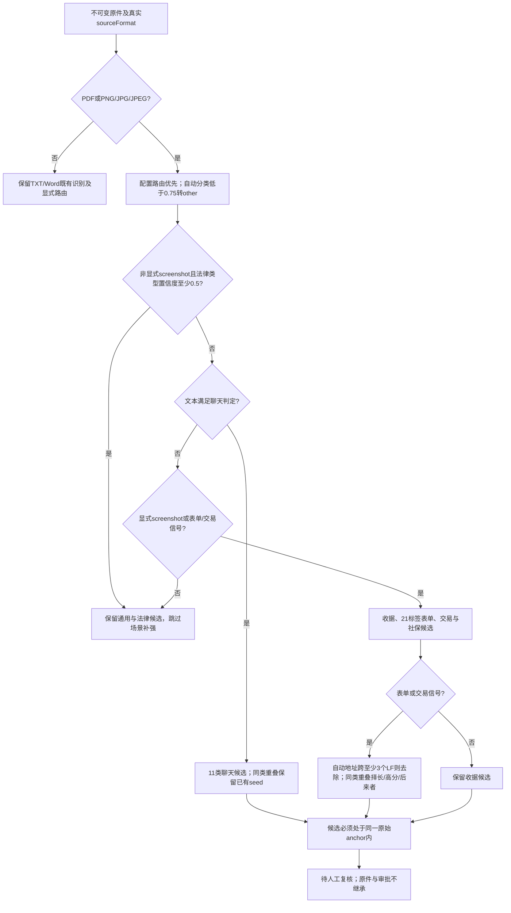
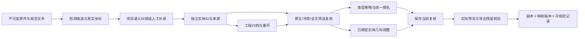
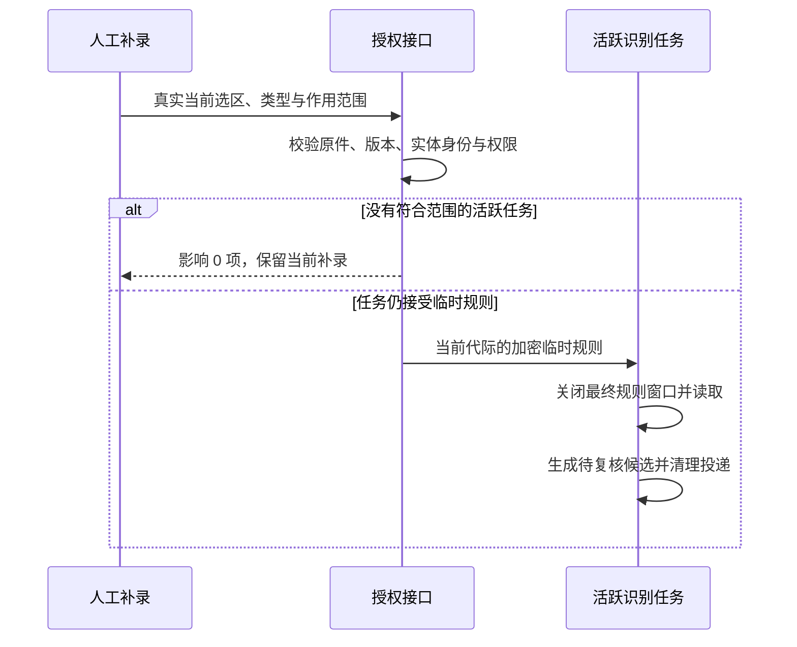
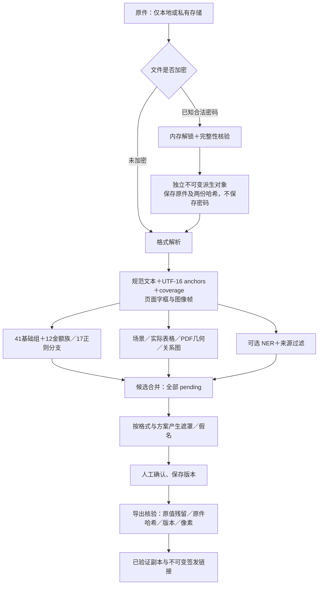
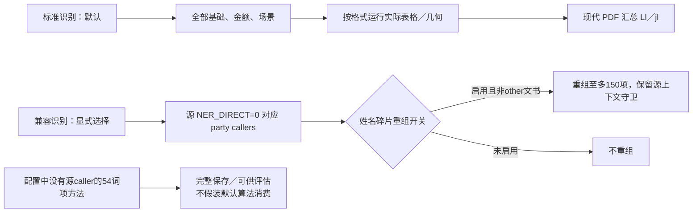
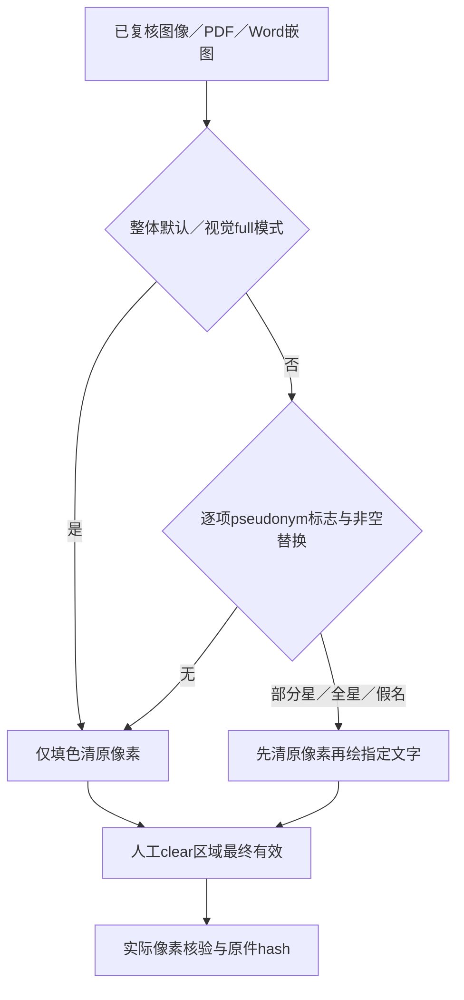
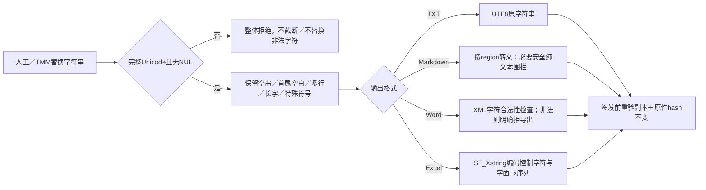
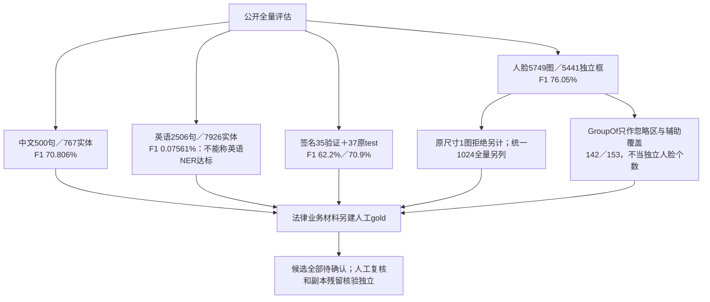
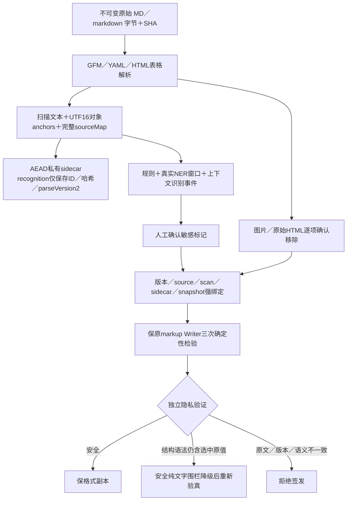
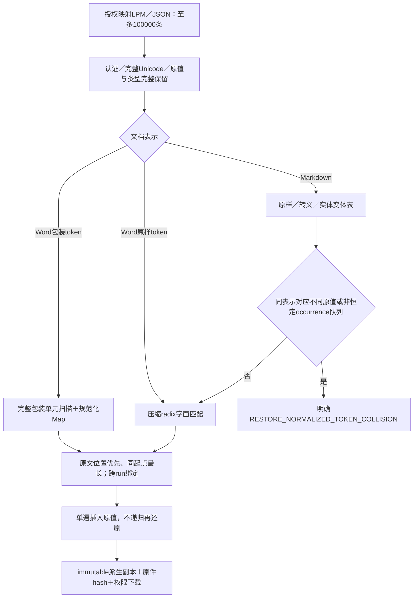

# 脱敏规则完整技术交接 · 049（已部署）

适用对象：技术负责人、其他工具／skill 的开发者。基于脱敏猫 **0.5.9 macOS／Windows** 静态证据和我方当前代码；所有竞品处理链仍为 **R0：未经正版激活运行验证**。本文完整列出已获得的规则与配置，不能据此宣称未知服务端、其他版本、平台原生组件全部等价。


## 后续本地迭代048：场景门与跨链路修复

本节描述尚未发布的本地工作树，服务器仍为036。其余章节中的036验收属于历史发布证据，不能外推为048已上线。完整同源单次API／Edge门禁尚待结束；竞品258项继续为R0。

### 专用场景的调用顺序



图片后缀与OCR状态不构成显式截图提示。公开渲染器选择的route可能来自自动推荐或用户菜单；我方使用已有的 `DocumentConfiguration.documentType`，不发明尚无producer的hint。自动分类0.75的策略门先于法律0.5早退门，两者不能合并。

|聊天提取族|输入线索|处理与重叠语义|
|---|---|---|
|首行姓名|前50字符附近首行中文姓名及律师/医生称呼|姓名过滤后加入，置信度0.85|
|文件名机构|公司名附近50字符内出现office/pdf/txt扩展名|机构0.88|
|括号机构|`【…】`内2–20字符|中文数量、金额/验证码等排除；0.90|
|银行名称|15个公开银行名称|机构0.95|
|公司与律所名称|有限责任公司、集团、律师/法律服务所|机构0.88|
|括号后姓名|闭括号后姓名与您好/你好/先生/女士|姓名0.88|
|尊称姓名|尊敬的/亲爱的后姓名|姓名0.92|
|职业称呼姓名|律师、医生、教授、主任等称呼前姓名|姓名0.90|
|问候姓名|段落或标点后姓名加您好/你好|姓名0.82|
|昵称|昵称标签后2–10字符；保留大括号终止符|姓名0.92|
|账号昵称|数字账号ID加昵称|姓名0.95；前一昵称规则可先占同类范围|

聊天候选从上游seed起步；同类重叠不覆盖已有seed，最后移除文字包含于机构文字的姓名候选。公开源自身会把 `【客服】` 判为机构，把部分短句如 `转账信息` 判为首行姓名；本次保留其语义并明确误检，未暗中删规则。

表单触发21标签新增核对出的唯一遗漏“银行帐号”，与原“银行账号”并存。`ur`表单/交易后处理限定在PDF/image新鲜自动候选，不修改通用merge算法。手机号与 `SCENE-form-phone` 同族，一般landline独立。同长同分时后进入者胜。manual、已复核、项目字典/白名单标记受保护，这是本地用户选择边界；源统一seed处理不能据此称运行逐字等价。

### 三处识别接线与新增修复

|入口|本地实现与验证状态|
|---|---|
|真实worker识别|使用真实sourceFormat、已解密的材料configuration；受控场景后不再重复通用扫描而复活较短候选|
|页面OCR改字|修正全文/anchors后使用同一sourceFormat与configuration重新识别；保留其它格式语义|
|native工程恢复|API先resolveDocumentPolicy，明文策略传给freshPortableMarks；导入标记仍待复核，不能读取raw DB密文作为配置|
|坏个人方案|逐项隔离损坏方案、修复默认项；MCP按ID/名称共用安全目录；错误全局密钥仍失败关闭|
|外部单件还原|MD/TXT/DOCX零匹配原样副本；BOM/CRLF保留，精确映射键先于转义派生键；受管还原门禁不变|
|OCR纠错跳过提示|显示每个文件的服务端原因；Markdown新增位置不支持自动补录时明确提示手工标注|

金额12族17条正则未发现新漏抄，源共有年份相邻抑制、每股候选重叠及中文角分截取仍需人工复核。14项场景单元及4项核心合同对照已经合入后通过；048完整门禁以最终记录为准。PDF完整Edge组合在此前版本已实际通过：旋转、分组/逐条定位、双几何编辑、备份重开、双确认、显式批准、真实预览/下载像素、无文字层/脚本/附件、原件不变。新增截图语句及后续合并版本仍要纳入最终完整回归。

## 049上线读回

049已部署，发布源码2f14b7b；382运行文件和全部前端资源哈希核对通过，公网admin登录/版本通过，相邻5容器前后完全相同。指南23节17图已上线。公网admin当前没有项目，本次没有重跑业务材料；本地最终check758与8项Edge为隔离合成证据。详见[发布验收](逆向台账/contracts/aliyun-release049-verification-20261015.md)。后续各本地检查点为历史记录，未验证范围不因部署消失。

## 049最终修订B

最后独立审查发现启动429等待期间切号的身份盲窗，已提前注册身份并保持旧请求可取消。最新完整check130文件758单元及Bend11/13/类型构建通过；最终5文件8项Edge实际通过，包含真实服务器限流后切号。源/测试哈希375b5b2c03a2c98934ac1578ea8ecbba8d7418d809855383fc7f36032af063b1前后相同。旧7项检查点保留为历史；API分层与私有/精度边界不升级，部署待读回。

## 049最终验收结果

完整check130文件758项、Bend11/13、类型/构建通过；048 Edge69过2失败修复后，最终受影响4项+会话隔离3项全部通过。API保留048完整175及049分层验收；未把不同版本拼成一次全量。363后端运行文件逐文件证明候选等于主树。操作指南现23节17图，渲染已验；部署尚待最终读回。原Word排版、识别准确率、无许可证运行及私有接口边界继续保留。

## 049：外部部分还原与MCP执行边界

|输入/调用|规则与结果|必须核对|
|---|---|---|
|外部MD/TXT/DOCX、批量及DOC转换|已知映射正常回填，未知标签不再令整件失败；统计输入中未完整匹配标签的不同写法|警告并不意味着标签字节一概原样：纯文本键可以命中标签内部片段|
|纯文本键例子|姓名→张三，输入【姓名999】，源及我方输出【张三999】|仍报告输入未完整匹配【姓名999】，下载后人工核对；不伪称已完整还原|
|受管还原/MCP|未知标签严格拒绝；权限、映射、版本及人工复核要求保留|外部宽松选项不能传入受管流程|
|MCP当前轮显式执行|已校验并人工复核+授权+项目权限→任务锁→源hash检查→实际产物→CAS登记|旧轮、旧槽、未授权拒绝；已完成轮重复执行返回既有产物|
|中断后接续|真实数据库任务锁占用时只读进度，锁空的持久restoring可显式接续|测试模拟持久中断点及真实锁，不冒称线上进程故障演练|

048同源检查749单元/175API通过，完整Edge69过2失败；049已合入且受影响Edge2通过，仍待最后门禁及发布。当前不能宣称完整同源全量全绿或竞品运行等价。

## 本次更新导航（2026-10-15）

文件名保留供既有链接使用，正文已更新到本轮实现。第 7–9 节继续保留完整规则、金额、场景、全部配置与固定来源；不抽样删减。新增交互和数据契约集中在本节。本地验收见 [最终验收记录](逆向台账/contracts/local-release-verification-final-20261015.md)，服务器036已上线，详见[发布记录](发布记录-20261015-036.md)，包含真实处理截图与首次OOM恢复记录。

|复用目标|可交接入口|必须一起保留的语义|
|---|---|---|
|按格式同文多处标注|`manual-occurrences` 契约／适配器／API／界面|Word 正文与嵌图、PDF 原生与 OCR、图像各自匹配；真实 UTF-16 分段与字框，不编造跨对象位置；50 项只是分页显示|
|项目级 OCR 语义纠错|`entity-corrections` core／adapter／API／界面|先预览绑定全部当前材料版本，再原子应用；原件、规范原始文字、字框保持；原识别值与纠正值都可查询；所有结果重新复核|
|直接修改页面 OCR 文字|`ocr-correction`＋`pdf-text-origin`|创建派生文本与字框版本；精确保留未变重复实体槽位；PDF 原生／OCR／混合来源按实际编辑范围重绑，历史无依据则未知|
|移动检测到的实体遮盖位置|`entity-geometry` 契约／adapter／API／界面|实际实体 ID＋当前页／字框哈希签名；整组或单框编辑、8 方向控制；预览／Word嵌图／PDF／图像导出共用同一几何；错位造成原文残留则拒绝签发|
|项目统一假名|`unified-aliases`＋映射库与历史|完整开关、刷新、全局／文件覆盖、合并／拆分、样式／选择性替换／继承；历史不可变，不能以最新值替代旧文件绑定；完整形式歧义需对应还原计划|
|审查历史与重复实体|`review-entity-slots`＋`review-provenance-history`|相同文字／类型／位置也可有独立槽位；使用当前服务端发出的 opaque ID；歧义、伪造、失效或跨文档 ID 明确拒绝；历史记录不是审批|
|工程搬迁|native／source V1／V2／V3 codec|原格式、旋转、OCR、规则策略、映射历史、纠错与来源记录分别往返；不能仅保我方私有扩展；导入历史只读、不沿用旧审批|
|旧 DOC／WPS|独立 `legacy-office` 转换服务＋规范化见证|原字节不覆盖；DOC/WPS→DOCX、默认DOCX/显式DOC输出；转换取消、错误、字节上限、原件与派生双哈希；不猜密码|
|补录后临时识别规则|`automatic-runtime-rules`＋任务最终规则窗口|文件／项目／仅此处范围分别处理；只送给仍运行的本人识别任务；任务结束失效，不写长期名单，不清空或重新排队已复核材料|
|按类型隐藏与恢复|`review-type-hide`＋四种工程 codec|隐藏后保存和重开仍不参与处理；恢复为待确认；保留实体 ID、自动／手工真实出生属性与来源，不能沿用旧审批|



### 补录、临时规则与长期名单的区别

|动作|影响范围|保存与结束行为|
|---|---|---|
|人工补录标记|当前真实文字／对象位置|新增候选仍待复核；不自动批准导出|
|自动发送补录临时规则|当前文件或当前项目中，本人仍在识别的任务；“仅添加当前标记”不发送|按当前任务代际、版本、原件和规范文本绑定并加密；最终规则窗口关闭后不再接受，读取后清理；没有活跃任务时返回影响 0 项|
|手动添加长期识别规则|用户明确选择的文件或项目|单独的“添加并重新识别”操作；需要相应权限，产生新的识别与复核版本|
|自动反馈记录|明确的补录／删除操作|记录实际原值与语义值及来源；不因反馈自动学习或启用长期规则|



此链采用 037 数据迁移。并发重试会开启新的任务代际，旧投递不能复用；撤权后仍能以只删不读的限定清理入口删除本人任务的临时密文。038 为增量终态回收迁移：撤权、重试耗尽、取消或成功时，在任务同一行锁事务内关闭窗口并清理所有代次投递，不依赖 worker 的 finally。真实 API 密文、缺 finally 的调度回收与双事务锁顺序 3 项通过；未将该数据库恢复验证冒称实际强杀生产 worker。完整合并后的 API／Edge 门禁仍以最终报告为准。

### 命名配置兼容与界面定位补齐

|输入／操作|完整保留与归一规则|当前核验|
|---|---|---|
|规则集及条目额外字段|源 `Bd` 对整份 JSON clone；规则集本体和条目保留合法扩展键。API 外层参数继续按接口合同校验；`applicability` 按源整体重建，不透传其额外键。Excel 导出仍只写既有列。|实际 PUT → GET → duplicate → 项目快照 → worker 末项命中 → native 工程往返通过|
|profile 各格式配置|仅在源保存的本体／格式／batch 子节点保留扩展。未知 pseudonymTypeActions 键仍拒绝；缺失、旧模式、party_slots 和证件偏好按源 helper 归一。写入与旧存储读取的证件偏好迁移不同。|源 helper VM 与实际接口 4 项通过；其后测试类型表达修正纳入最终门禁|
|签名字段|源 TI 会移除 signature；我方 API 内部保留用户显式选择，使已交付签名检测不退化。该字段不代表源等价。|合成 PNG 真实 worker 的识别 trace 包含 signature|
|PDF／图片实体侧栏定位|规范范围 → 当前原件 page anchor → 页面／图片资源；逐条、实体组和查找共享定位范围。|修正只改原件显示页，不改变实体、原件或审批；最新 Edge 两页补测待完成|

临时规则的时点也须区分：公开源在活跃 engine 上即时追加，我方在活跃识别任务完成规范文本后的最终窗口读取；范围、失效与待确认语义相应验证，但不宣称两种运行时序完全相同。

### 三主九子审查与静态范围

|审查范围|逐项结果|依据|
|---|---:|---|
|本发布包登记入口|258|稳定 ID 和 37 条业务链|
|有界公开应用合同|224 项 S3|逐入口 producer、handler、consumer、异常与声明叶已合图；未识别出具体未读公开应用节点|
|原生／外部及私有服务边界|19＋15 项 S2|保留明确边界，不能靠读取客户端取得服务端或平台内部实现|
|竞品实际运行|258 项 R0|未获得许可证，不能用我方通过代替|

3 位 `gpt-6-sol` 主审各带 3 位 `gpt-6-luna` 子审，受会话 4 个并发槽限制分批执行。逐 ID 合并见 [静态合同总表](逆向台账/contracts/static-semantic-closure-final-20261015.md)。当前固定产品快照的 730 个单元测试、11 条 Bend 法则、13 个反向变异、类型与构建通过；82 个 API 文件与完整 Edge 继续独立验收。源静态闭合不自动提升我方功能等级或识别质量结论。

### 识别质量最新结果

|印章算法／同一全量样本|范围|IoU≥0.5 F1|处理决定|
|---|---|---:|---|
|当前彩色／黑白候选基线|786 张、1,315 真值框|20.21%|保留人工确认与真实错误计数，不称业务达标|
|Ooredoo 公开候选|同一 786 张全量|33.78%|尚未整合为自动主链；IoU≥0.75 F1 仅 9.26%，不能用较宽阈值掩盖位置误差|
|Paddle 官方候选|同一 786 张全量|13.87%|尚未整合为自动主链；不因模型名称替代实际效果|

公开混合样本不能替代专门黑白章／中文合同业务金标，训练重叠尚未完全排除。英文 NER、签名、人脸的限制继续保留在第 5 节。模型评估与完整业务流程通过是两种证据。

最新操作截图见 [本轮图文操作](使用指南/公开功能补齐操作-20261015.md)，剩余门禁见 [当前状态](待办与完成状态-20261015.md)。逐接口、有限源码范围、真实运行及平台差异见 [统一台账](逆向台账/README.md)。

## 1. 怎样复用



|复用层|入口|关键责任|
|---|---|---|
|纯规则|`detectComplete`／`detectReferenceRules`|UTF-16 半开区间；跨对象候选禁止；不自动通过复核|
|格式与上下文|`contextualDocumentMarks`|Word／Markdown／CSV／Excel 真实单元格；PDF 路径与实际 glyph，不猜偏移|
|NER|`createNer`＋`filterCompleteNer`|同一会话复用；固定权重；不是可靠的英语通用识别器|
|默认遮罩|`referenceDetectedMask`|按 provenance 重算 `entity.masked`；text-final 与 raster-final 有真实差别|
|选择性部分星号|`referencePartialMask`|对应源 Nt；不能冒充所有默认 `entity.masked`|
|替换／假名|`replacementFor`／`applyReplacementPolicies`|预览与导出共用；保留显式人工例外；假名映射不可变|
|视觉候选|`detectVisual`／`detectOfficeImageFaces`|人脸／印章／签名全部待确认；GIF／TIFF 每帧，不只首帧|
|复核与导出|`validateFileMarks`／`assertExportable`|pending、重叠、coverage 阻断、版本变化必须阻止签发|
|文件密码|`unlockPdfDocument`／`unlockWordDocument`|用户已知密码；原件不覆盖；不提供密码猜测或竞品许可证绕过|
|跨工具|`scripts/mcp-stdio.ts`／12 MCP工具|实际 HTTP／stdio；云端不能读取客户端任意绝对路径；需人工授权|
|逐协议方法|25 AI协作＋14 gateway＋4连接器|43独立ID真实合成工作流；外部桌面安装与竞品授权runtime不包含|

### 1.1 给其他工具／skill 的推荐调用契约

```json
{"input":{"text":"规范文本","anchors":[],"sourceHash":"sha256","format":"docx","revision":0},"candidate":{"start":0,"end":2,"kind":"姓名","decision":"pending","sources":[{"layer":"rules","code":"稳定ID"}]}}
```

位置单位为 JavaScript UTF-16，`[start,end)`；拒绝半个代理对、超范围、跨单元格／跨图片对象的标记。不得用字节下标或 Unicode code point 下标替代。每个候选保留来源，不把不同类型的重叠项静默丢弃。实际脱敏输出只取人工确认的 `redact`。

## 2. 完整范围与激活

|类别|数量与口径|注意|
|---|---:|---|
|基础组|41|不是全部算法的总数|
|金额族／正则分支|12／17|上下文排除和金融表格还有独立分支|
|来源计算遮罩oracle|253例／75个来源code|完整sourcecomputed默认遮罩与Nt另表；纯函数零差异不冒称正版运行|
|配置类别／数组项|108／3012|3009字符串＋3非字符串；附录不去重、不挑选；运行按原调用图消费|
|默认实体类型|19|源类型表另含 signature，但 TI 配置归一会移除；我方签名识别作为自有可选扩展保留，另6项为显式类型扩展|
|接口／业务链|258／37|每项证据在台账；不能用一个 family 测试代替258项契约验收|



配置“完整移植”是保存所有来源条目及其真实调用条件；把源未调用的数据强行全局激活会改变误报行为。兼容策略和碎片开关在材料设置中明确选择。标准与兼容均保持人工复核。

## 3. 关键遮罩对照

|情形|源默认计算值／我方默认|选择性 partial_star|
|---|---|---|
|税号|前4字＋4星＋后4字|Nt 按信用代码家族保前6／后4|
|9位社保号|前3＋3星＋后3|Nt 全部固定遮盖|
|19位银行卡|按源长度计算星段，保前4后4|Nt 的独立部分遮盖规则|
|表格姓名／手机号／金额|表格 Do 全字符星号|Nt 类型规则|
|3字表单姓名|3星|源 Nt 姓名部分遮盖|
|机构|文字最终 An；图像普通 NER 常为3星|Nt 机构规则|
|金额|保留源货币／单位的金额模板|Nt 金额部分规则|
|回单已遮盖原值|原值不得原样输出，安全回退全星|同样检查原值残留|

人工自定义替换、clear／full、类型占位、假名都有独立契约；不能把它们混为相同能力。默认19类型的信用代码、身份证、案号选项分别覆盖源税号／EIN、护照／国际ID／社保、公文编号；子类型显式设置优先。

### 3.1 图像输出不会仅因 masked 字段存在而绘字



**253例／75个来源code验证的是computed masked字符串，不能据此让图像默认重新绘字。** 源整体default_star、image/PDF归一化full_star与Word普通嵌图默认均纯清除；selective里的partial_star／full_star才设置逐项pseudonym标志绘星；手工明确custom／type／alias按其选择绘字。Word正文与Markdown仍按字符串替换。手工画框／搜索清除必须最后有效，不能被自动派生文字重新覆盖。逐行来源与40个真实源码caller隔离控制流oracle见 [图像模式矩阵](逆向台账/contracts/raster-source-mode-matrix-20261014.md)；像素修正验收独立记录。

### 3.2 自定义替换协议：保留原值的完整字符串语义



|契约点|完整行为及源码依据|
|---|---|
|长度与字符|源后端main19208／19281只要求string，未设100上限或<>【】禁令；源renderer5381的maxlength30只约束那个UI入口，不能反推TMM/backend上限|
|空串与空白|源Markdown Writer接受空串删除和全空白；我方明确custom空串删除，clear仍为独立视觉清除；旧TMM未设置的空custom字段按其上下文处理，不能统一变成删除|
|多行与特殊符号|保留首尾空白、换行、tab、长Unicode、<>【】；Markdown根据普通文本／代码／frontmatter等region做转义，不渲染任意HTML|
|非法值|NUL、不完整Unicode整体拒绝；原值仍完整包含在替换结果也被安全契约拒绝；不悄悄截断或清洗|
|Word限制|XML 1.0不合法控制字符／U+FFFE／U+FFFF明确OFFICE_XML_VALUE_INVALID，不生成损坏或悄悄丢字符的Word副本|
|Excel无损|控制字符用_xHHHH_；字面_xHHHH_的下划线先编码为_x005F_，只解码一遍，避免把字面字符串误变控制字符|
|Markdown核验|actual Writer字节保空白；canonical解析忽略部分布局空白是Markdown语法，并非应用trim；隐私降级产品围栏不写固定info=text，避免选中原值text重复到语法侧|

源纯Writer的**10例**原结果均保存，不选择性只报告成功：空串、三空格、字面反斜杠t／n（非真实tab／换行）、U+0001、NUL、200汉字、【标签】、HTML样式字符串、真实多行tab、首尾空白。结果9成功／NUL 1明确invalid-operation。证据：`iteration029/custom-replacement-source-oracle.json`。这属于可独立执行的源码纯函数证据，不升级为竞品正版授权处理链验证。

独立真实接口核验：4格式×8类共32组合，4 tests PASS107.11s；30签发下载，Word非法XML2类明确拒绝且无artifact。TXT／Markdown空白和多行字节、Office重新解析、Excel控制字符与字面_xHHHH_无损、全部原件hash不变均实际断言；8次NUL／不完整Unicode保存整体拒绝。详见[自定义替换核验](逆向台账/contracts/custom-replacement-porting-20261014.md)。

## 4. 格式、版式与解锁

|输入|处理与复核|输出核验／已知边界|
|---|---|---|
|Word|分页预览、样式／表头页脚／表格／VML文本框；规范anchors用于标记|不是 Microsoft Word 像素等价排版；复杂freeform／OLE／altChunk明确阻断或提示|
|Word图像|PNG/JPEG/GIF/BMP/TIFF与VML imagedata；每帧OCR＋人脸|帧hash／媒体hash／规范坐标验证；统一生成无原值PNG|
|PDF|原生文本＋OCR，矢量表格路径＋Form变换|真实删除敏感像素、输出无旧文本层；再OCR与逐页RGB验证|
|图像|glyph／OCR改字、框选、4种遮盖颜色|OCR改字保存派生文本与坐标，不伪造原件改字|
|Markdown|GFM／YAML／HTML表格完整source-map；BOM／换行／markup保留；原件不变|图片／原始HTML逐项确认后移除；非安全结构降级纯文字围栏；独立canonical与隐藏原始语法残留验真|
|CSV／Excel|原单元格／表头／金融金额上下文|保原格式结构，跨cell标记拒绝；公式缓存／外部对象可阻断|
|加密PDF|RC4／AES，提供已知密码，PDFium无密码重载验全文／页形|保留原encryptedbytes；独立derived对象；不保存密码|
|加密Word／Excel|OOXML Agile／Standard；密码verifier／HMAC或ZIP CRC＋结构|旧DOC/WPS已接独立转换；旧XLS仍按明确格式支持范围处理；未知算法不返回假成功|
|工作区备份|原件、文本、页图／字框、方案、词表、映射、OCR派生稿|新UUID、重新识别；旧approval不信；解锁derived须本机签名验证或重新输入密码|

## 5. 准确率：全量真实语料与范围

|语料|全量gold范围|严格P／R／F1|不能外推|
|---|---|---|---|
|UNER Chinese-GSD|500繁体百科句子，767个PER/ORG/LOC|71.754%／69.883%／70.806%|中文合同、号码、金额、签名、印章|
|CrossNER|2506英语跨领域句子，7926个PER/ORG/LOC|33.333%／0.03785%／0.07561%|不能宣称英语NER达标|
|签名真实框|完整35张官方validation，非独立test；143train仅比较阈值|默认P50.9%／R80.0%／F1 62.2%，TP28／FP27／FN7，IoU≥.5|中文合同、严格IoU.75；训练域重叠不能排除|
|签名RF100原test|37张完整，数据族可能参与训练|P61.6%／R83.3%／F1 70.9%|不能称未见泛化|
|人脸公开全量|Open Images V7 Human face全部5749图，3124正／2625人工核验负；5594框含153 GroupOf|IoU≥.5：P75.85%／R76.25%／F1 76.05%，TP4149／FP1321／FN1292|原尺寸5748推理＋1张>25MP明确拒绝，拒绝不计TN；非合同、非官方mAP，训练重叠不能独立排除|
|人脸统一1024次评估|同5749图全量统一长边≤1024、不放大|5745相同输入字节复用预测＋4张真实新推理，全5749完成，P／R／F1同上|这是另列的统一预处理评估，不覆盖原尺寸拒绝事实|
|印章公开全量|混合公开集786图／1,315框；三种候选完整比较|基线F1 20.21%，Ooredoo33.78%，Paddle13.87%|不是专门黑白章／业务gold；后两者未并入主链；不宣称可靠自动识别|

中文语料为[作者公开Chinese-GSD](https://github.com/UniversalNER/UNER_Chinese-GSD)，CC-BY-SA 4.0；英文CrossNER由作者MIT发布。逐条结果、模型／语料／代码SHA在真实语料报告。源竞品无许可证，不运行其处理链；离线纯函数oracle相同不等于已激活产品端到端等价。

### 5.1 识别质量怎样判读



人脸固定生产confidence=.6／NMS=.3，未按此validation调参。重叠GroupOf辅助计数原141被独立审查修正为142／153；全部5749原始预测与gold保留，TP／FP／FN及ignored计数逐条不变，修正前后结果和代码hash另存。不能把GroupOf当人脸个数、把输入拒绝当真阴性、把固定阈值F1称官方Open Images mAP。全量原图／标注／模型／预处理路径指纹验证见[人脸评估](逆向台账/contracts/public-face-validation-20261014.md)。图片逐项CC BY2.0、标注CC BY4.0，原归属完整保留，不重发布原图；模型MIT与训练重叠不确定性明确列出。

## 6. 技术负责人验收清单

1. 在自己的材料类型建立人工gold，标注类型与UTF-16边界；区分候选精度和最终泄露率。
2. 每个配置类别按下表的真实调用条件验收；对未消费数据另立扩展规则，不能默认为现成功能。
3. 测试重复原值、跨run／table、错字、合并cell、表头单位、面积／金额歧义、图片多帧。
4. 复核全部pending／冲突，下载副本后搜索敏感原值并检查原件／派生hash。
5. 跨工具只返回最小必要字段，使用MCP授权、版本、scope；不把映射明文发送到外部模型。
6. 单独评估英语、真实签名／黑白印章、平台原生模块与未激活竞品运行链。

### 6.1 Markdown 可移植链及安全差异



|项目|来源实际行为|我方运行与差异|
|---|---|---|
|YAML数字／布尔／null|源仅字符串scalar进入scan，数字手机号可能未扫描|产品保原raw scalar字节文本进入scan，避免Number精度丢失；纯sourceCompatibility测试保原行为，禁止产品导出使用|
|YAML注释／锚点／alias名称|不进入source scan，原Writer可能保留选中原值|独立检查输出sourceMap未覆盖语法；发现原值安全降级，仍保人工明确保留的正文同值|
|图片／非表格HTML|源UI逐项remove确认，Writer自身会移除全部|真实GET／PUT确认，AEAD记录source／scan哈希并创建新snapshot；未全部确认阻止导出|
|仅图片／HTML、scan为0|可remove后输出0字节|仅新MD2经source／sidecar／完整inventory与ACK验证允许；空TXT、旧rawMD及原件空文件不放宽|
|旧Markdown坐标|旧项目raw source与新scan不同|parseVersion2与source/scan指纹屏障，必须重新识别，不套用旧offset；已签发旧副本维持原认证链|
|source-ready／matches|按首次、25k已完成文字、250ms或末尾刷新|实际parser／规则／NER126-token窗口／上下文完成回调；matches标provisional，最终仍待人工确认|
|精确可复核证据|27完整parser字段、103Writer操作／输出源码golden|同版本源码纯函数oracle全字段核验；不等同正版产品实际处理链|

### 6.2 任意类型、规则作用范围与互操作

|概念|完整保留方式|必须验证|
|---|---|---|
|未知原始类型|`kind: 自定义`＋`rawEntityType`，不猜测name_/org_动态前缀；__proto__等合法标签也保留|同span不同raw类型、预览、假名、LPM／XLSX、TMM、恢复与筛选不合并丢失|
|来源集合|无专用8项截断，保稳定source code；受整体运输／文件限额约束|第9来源加入仍合法，不静默丢证据|
|个人名单|源whitelist是forceDetect、blacklist是forceSkip；迁入规则库默认未启用|主动选择方案规则库、重新识别；forceSkip最终优先于runtime whitelist|
|继承文书范围|旧规则库materialTypes继承为每条`materialRouteKeys`|匹配实际文书route才运行，不把非诉／披露专用规则全局启用|
|Excel名单与映射|源18类型三列兼容，隐藏D保任意raw；ST_Xstring单次编解码|控制符、CR、FFFE／FFFF、literal `_xHHHH_`、中文／emoji无损往返|
|金额|12族17正则＋实际表格金额单元／金融排除／空间单位场景|面积／注册资本排除和人工／项目词表来源区分；默认computed mask与选择性Nt不混用|
|手工Markdown稿|独立双CAS不可变AEAD版本、风险提示下载|不是已验证脱敏副本，不自动批准、不计入签发安全结果|

协作协议43方法及实际恢复／重试逐项证据见 [逐方法验收](逆向台账/contracts/mcp-exact-method-runtime-20261014.md)。源绝对磁盘路径采用授权document ID适配；连接器只确认真实protocol session与配置，不冒称外部OS客户端可用。

真实识别指标见 [全量NER报告](逆向台账/contracts/real-porting-evaluation-result-20261014.md) 与 [签名真实框评估](逆向台账/contracts/signature-model-porting-20261014.md)。NER的繁体百科和英语跨域结果不外推至中文合同；源码／模型hash一致不消除训练数据重叠。签名模型是合法Apache2独立扩展，未发现竞品同类模型不能声称复制等价。真实黑白章业务gold与许可证运行边界继续保留。

### 6.3 还原容量、顺序与编码歧义



源main18978允许100000条继承映射；原独立还原器5000上限、Word包装token的巨大空白正则、100000个205字符多样plain别名约23MB导致的V8 native fatal均已修复，未新增别名字符上限或调大原512MiB worker预算。Word包装扫描与原样压缩radix、Markdown变体及shared `restoreText`共用字面匹配语义：原始位置最左、同起点最长、不递归重扫插入原值；未知编号／损坏包装拒绝，普通【标签】保留；Map／own-property处理__proto__等原样别名。

Markdown中A&B与A&amp;B、A-B与A\-B等编码后碰撞，若原值不同或occurrence队列不是相同恒定值则明确拒绝，不依赖JSON顺序猜选；Word按精确字面可独立还原。300字符别名选择与200000+字符原值沿现有文件／HTTP整体预算处理，不用旧256／200000专用字段上限截断。真实100000条包装及205字符多样plain映射，经LPM→原512MiB worker→MD／跨run DOCX→不可变副本下载已核验；作者与C独立4API PASS7.587s、A独立核心容量／小字典oracle／Word旧回归均通过。详见[容量最终报告](逆向台账/contracts/restoration-capacity-final-20261014.md)及[独立审查](逆向台账/contracts/review-restoration-final-by-inventory-20261014.md)。

视觉自定义空串／纯空白／Default-Ignorable仅清除原像素，不请求Sharp绘空字；多行按真实字框分片，空片不绘字且推进偏移，长字与<>【】按字面安全绘制。PNG／PDF／DOCX共18真实自定义导出及原件immutable已通过；人工clear区域永远最后有效，自动派生文字不能覆盖清除决定。

### 6.4 发布前证据分层与历史维护

历史发布023（2026-10-14）的全库门禁由root汇总：82文件568单测、11条法则／13变异与构建通过；39个真实API文件71测试无失败，shared mappings2／MCP3补跑通过；完整Edge50测试6.3分钟通过。Word预览开始两次真实busy返回后短重试进入实际render／复核保存／导出下载，独立18.5秒与完整Edge均通过。A只读补核26项核心测试（含100000长别名、编码碰撞、小字典oracle、face group、视觉空字及旧Word回归）通过。逐项接口状态以机器台账为准，当时I4 38／I1 148／I3 60／I2 12，合计258；这些等级不升级竞品授权runtime R0或OS原生组件实测。

旧迭代023完整交接按当时原generator和恢复的ITER023输入精确重建，301670bytes，SHA256 `bd2f702eff04d44ff39b2d63b1bdfc55aa59370392ffa17b9196e18ccf671980`，与历史pin完全相同，保存在`.data/research/lawbot-2026-10-14/iteration030/history/文档/脱敏规则完整技术交接-迭代023.md`。最新文档沿旧路径供既有链接使用，但不能直接覆盖旧pin；归档输入与receipt另存。部署与GitHub同步由root独立完成，此文档生成不代表线上已更新。

## 7. 逐项规则、金额、场景、配置激活表

### baseline

|id|source|implementation|runtime|status|
|---|---|---|---|---|
|REF41-id_card|main.js:662-668|baseline / urlsAndOcrEmail|processing-worker detectComplete per canonical anchor → applyDocumentRoute → NER postfilter if enabled → contextualDocumentMarks → enabledProfileMarks; same path after correctOcrText|active|
|REF41-mobile|main.js:670-683|baseline / urlsAndOcrEmail|processing-worker detectComplete per canonical anchor → applyDocumentRoute → NER postfilter if enabled → contextualDocumentMarks → enabledProfileMarks; same path after correctOcrText|active|
|REF41-wechat_labeled|main.js:685-690|baseline / urlsAndOcrEmail|processing-worker detectComplete per canonical anchor → applyDocumentRoute → NER postfilter if enabled → contextualDocumentMarks → enabledProfileMarks; same path after correctOcrText|active|
|REF41-wechat_wxid|main.js:692-695|baseline / urlsAndOcrEmail|processing-worker detectComplete per canonical anchor → applyDocumentRoute → NER postfilter if enabled → contextualDocumentMarks → enabledProfileMarks; same path after correctOcrText|active|
|REF41-bank|main.js:697-705|baseline / urlsAndOcrEmail|processing-worker detectComplete per canonical anchor → applyDocumentRoute → NER postfilter if enabled → contextualDocumentMarks → enabledProfileMarks; same path after correctOcrText|active|
|REF41-bank_labeled|main.js:707-725|baseline / urlsAndOcrEmail|processing-worker detectComplete per canonical anchor → applyDocumentRoute → NER postfilter if enabled → contextualDocumentMarks → enabledProfileMarks; same path after correctOcrText|active|
|REF41-email|main.js:727-740|baseline / urlsAndOcrEmail|processing-worker detectComplete per canonical anchor → applyDocumentRoute → NER postfilter if enabled → contextualDocumentMarks → enabledProfileMarks; same path after correctOcrText|active|
|REF41-uscc|main.js:764-770|baseline / urlsAndOcrEmail|processing-worker detectComplete per canonical anchor → applyDocumentRoute → NER postfilter if enabled → contextualDocumentMarks → enabledProfileMarks; same path after correctOcrText|active|
|REF41-tax_labeled|main.js:774-796|baseline / urlsAndOcrEmail|processing-worker detectComplete per canonical anchor → applyDocumentRoute → NER postfilter if enabled → contextualDocumentMarks → enabledProfileMarks; same path after correctOcrText|active|
|REF41-landline|main.js:798-809|baseline / urlsAndOcrEmail|processing-worker detectComplete per canonical anchor → applyDocumentRoute → NER postfilter if enabled → contextualDocumentMarks → enabledProfileMarks; same path after correctOcrText|active|
|REF41-local_phone|main.js:811-818|baseline / urlsAndOcrEmail|processing-worker detectComplete per canonical anchor → applyDocumentRoute → NER postfilter if enabled → contextualDocumentMarks → enabledProfileMarks; same path after correctOcrText|active|
|REF41-contact_name|main.js:820-829|baseline / urlsAndOcrEmail|processing-worker detectComplete per canonical anchor → applyDocumentRoute → NER postfilter if enabled → contextualDocumentMarks → enabledProfileMarks; same path after correctOcrText|active|
|REF41-transcript_name|main.js:831-834|baseline / urlsAndOcrEmail|processing-worker detectComplete per canonical anchor → applyDocumentRoute → NER postfilter if enabled → contextualDocumentMarks → enabledProfileMarks; same path after correctOcrText|active|
|REF41-officer_names|main.js:836-843|baseline / urlsAndOcrEmail|processing-worker detectComplete per canonical anchor → applyDocumentRoute → NER postfilter if enabled → contextualDocumentMarks → enabledProfileMarks; same path after correctOcrText|active|
|REF41-self_name|main.js:845-848|baseline / urlsAndOcrEmail|processing-worker detectComplete per canonical anchor → applyDocumentRoute → NER postfilter if enabled → contextualDocumentMarks → enabledProfileMarks; same path after correctOcrText|active|
|REF41-address_labeled_door|main.js:850-889|baseline / urlsAndOcrEmail|processing-worker detectComplete per canonical anchor → applyDocumentRoute → NER postfilter if enabled → contextualDocumentMarks → enabledProfileMarks; same path after correctOcrText|active|
|REF41-address_labeled_no_door|main.js:891-906|baseline / urlsAndOcrEmail|processing-worker detectComplete per canonical anchor → applyDocumentRoute → NER postfilter if enabled → contextualDocumentMarks → enabledProfileMarks; same path after correctOcrText|active|
|REF41-venue_labeled|main.js:908-922|baseline / urlsAndOcrEmail|processing-worker detectComplete per canonical anchor → applyDocumentRoute → NER postfilter if enabled → contextualDocumentMarks → enabledProfileMarks; same path after correctOcrText|active|
|REF41-address_unlabeled|main.js:924-993|baseline / urlsAndOcrEmail|processing-worker detectComplete per canonical anchor → applyDocumentRoute → NER postfilter if enabled → contextualDocumentMarks → enabledProfileMarks; same path after correctOcrText|active|
|REF41-garage|main.js:995-1000|baseline / urlsAndOcrEmail|processing-worker detectComplete per canonical anchor → applyDocumentRoute → NER postfilter if enabled → contextualDocumentMarks → enabledProfileMarks; same path after correctOcrText|active|
|REF41-property_base|main.js:1002-1005|baseline / urlsAndOcrEmail|processing-worker detectComplete per canonical anchor → applyDocumentRoute → NER postfilter if enabled → contextualDocumentMarks → enabledProfileMarks; same path after correctOcrText|active|
|REF41-attached_door|main.js:1007-1012|baseline / urlsAndOcrEmail|processing-worker detectComplete per canonical anchor → applyDocumentRoute → NER postfilter if enabled → contextualDocumentMarks → enabledProfileMarks; same path after correctOcrText|active|
|REF41-context_place|main.js:1014-1024|baseline / urlsAndOcrEmail|processing-worker detectComplete per canonical anchor → applyDocumentRoute → NER postfilter if enabled → contextualDocumentMarks → enabledProfileMarks; same path after correctOcrText|active|
|REF41-unit_range|main.js:1026-1031|baseline / urlsAndOcrEmail|processing-worker detectComplete per canonical anchor → applyDocumentRoute → NER postfilter if enabled → contextualDocumentMarks → enabledProfileMarks; same path after correctOcrText|active|
|REF41-plate|main.js:1033-1036|baseline / urlsAndOcrEmail|processing-worker detectComplete per canonical anchor → applyDocumentRoute → NER postfilter if enabled → contextualDocumentMarks → enabledProfileMarks; same path after correctOcrText|active|
|REF41-securities_account|main.js:1038-1044|baseline / urlsAndOcrEmail|processing-worker detectComplete per canonical anchor → applyDocumentRoute → NER postfilter if enabled → contextualDocumentMarks → enabledProfileMarks; same path after correctOcrText|active|
|REF41-case_no|main.js:1046-1049|baseline / urlsAndOcrEmail|processing-worker detectComplete per canonical anchor → applyDocumentRoute → NER postfilter if enabled → contextualDocumentMarks → enabledProfileMarks; same path after correctOcrText|active|
|REF41-admin_no|main.js:1051-1054|baseline / urlsAndOcrEmail|processing-worker detectComplete per canonical anchor → applyDocumentRoute → NER postfilter if enabled → contextualDocumentMarks → enabledProfileMarks; same path after correctOcrText|active|
|REF41-realty_cert|main.js:1056-1059|baseline / urlsAndOcrEmail|processing-worker detectComplete per canonical anchor → applyDocumentRoute → NER postfilter if enabled → contextualDocumentMarks → enabledProfileMarks; same path after correctOcrText|active|
|REF41-patent|main.js:1061-1064|baseline / urlsAndOcrEmail|processing-worker detectComplete per canonical anchor → applyDocumentRoute → NER postfilter if enabled → contextualDocumentMarks → enabledProfileMarks; same path after correctOcrText|active|
|REF41-patent_labeled|main.js:1066-1069|baseline / urlsAndOcrEmail|processing-worker detectComplete per canonical anchor → applyDocumentRoute → NER postfilter if enabled → contextualDocumentMarks → enabledProfileMarks; same path after correctOcrText|active|
|REF41-icp|main.js:1071-1074|baseline / urlsAndOcrEmail|processing-worker detectComplete per canonical anchor → applyDocumentRoute → NER postfilter if enabled → contextualDocumentMarks → enabledProfileMarks; same path after correctOcrText|active|
|REF41-filing_beizi|main.js:1076-1079|baseline / urlsAndOcrEmail|processing-worker detectComplete per canonical anchor → applyDocumentRoute → NER postfilter if enabled → contextualDocumentMarks → enabledProfileMarks; same path after correctOcrText|active|
|REF41-filing_labeled|main.js:1081-1084|baseline / urlsAndOcrEmail|processing-worker detectComplete per canonical anchor → applyDocumentRoute → NER postfilter if enabled → contextualDocumentMarks → enabledProfileMarks; same path after correctOcrText|active|
|REF41-land_cert|main.js:1086-1089|baseline / urlsAndOcrEmail|processing-worker detectComplete per canonical anchor → applyDocumentRoute → NER postfilter if enabled → contextualDocumentMarks → enabledProfileMarks; same path after correctOcrText|active|
|REF41-housing_permit|main.js:1091-1094|baseline / urlsAndOcrEmail|processing-worker detectComplete per canonical anchor → applyDocumentRoute → NER postfilter if enabled → contextualDocumentMarks → enabledProfileMarks; same path after correctOcrText|active|
|REF41-realty_unit|main.js:1096-1099|baseline / urlsAndOcrEmail|processing-worker detectComplete per canonical anchor → applyDocumentRoute → NER postfilter if enabled → contextualDocumentMarks → enabledProfileMarks; same path after correctOcrText|active|
|REF41-certificate_labeled|main.js:1101-1109|baseline / urlsAndOcrEmail|processing-worker detectComplete per canonical anchor → applyDocumentRoute → NER postfilter if enabled → contextualDocumentMarks → enabledProfileMarks; same path after correctOcrText|active|
|REF41-parcel|main.js:1111-1114|baseline / urlsAndOcrEmail|processing-worker detectComplete per canonical anchor → applyDocumentRoute → NER postfilter if enabled → contextualDocumentMarks → enabledProfileMarks; same path after correctOcrText|active|
|REF41-email_ocr|main.js:741-747|baseline / urlsAndOcrEmail|processing-worker detectComplete per canonical anchor → applyDocumentRoute → NER postfilter if enabled → contextualDocumentMarks → enabledProfileMarks; same path after correctOcrText|active|
|REF41-url|main.js:748-762|baseline / urlsAndOcrEmail|processing-worker detectComplete per canonical anchor → applyDocumentRoute → NER postfilter if enabled → contextualDocumentMarks → enabledProfileMarks; same path after correctOcrText|active|
|AMOUNT-label|main.js:1974-2134|detectReferenceAmounts → amountSpecs/amountExcluded|processing-worker detectComplete per canonical anchor → applyDocumentRoute → NER postfilter if enabled → contextualDocumentMarks → enabledProfileMarks; same path after correctOcrText|active|
|AMOUNT-currency|main.js:1974-2134|detectReferenceAmounts → amountSpecs/amountExcluded|processing-worker detectComplete per canonical anchor → applyDocumentRoute → NER postfilter if enabled → contextualDocumentMarks → enabledProfileMarks; same path after correctOcrText|active|
|AMOUNT-uppercase|main.js:1974-2134|detectReferenceAmounts → amountSpecs/amountExcluded|processing-worker detectComplete per canonical anchor → applyDocumentRoute → NER postfilter if enabled → contextualDocumentMarks → enabledProfileMarks; same path after correctOcrText|active|
|AMOUNT-standalone|main.js:1974-2134|detectReferenceAmounts → amountSpecs/amountExcluded|processing-worker detectComplete per canonical anchor → applyDocumentRoute → NER postfilter if enabled → contextualDocumentMarks → enabledProfileMarks; same path after correctOcrText|active|
|AMOUNT-table_summary|main.js:1974-2134|detectReferenceAmounts → amountSpecs/amountExcluded|processing-worker detectComplete per canonical anchor → applyDocumentRoute → NER postfilter if enabled → contextualDocumentMarks → enabledProfileMarks; same path after correctOcrText|active|
|AMOUNT-labeled_bare_number|main.js:1974-2134|detectReferenceAmounts → amountSpecs/amountExcluded|processing-worker detectComplete per canonical anchor → applyDocumentRoute → NER postfilter if enabled → contextualDocumentMarks → enabledProfileMarks; same path after correctOcrText|active|
|AMOUNT-post_yuan_bare_number|main.js:1974-2134|detectReferenceAmounts → amountSpecs/amountExcluded|processing-worker detectComplete per canonical anchor → applyDocumentRoute → NER postfilter if enabled → contextualDocumentMarks → enabledProfileMarks; same path after correctOcrText|active|
|AMOUNT-conversation_payment|main.js:1974-2134|detectReferenceAmounts → amountSpecs/amountExcluded|processing-worker detectComplete per canonical anchor → applyDocumentRoute → NER postfilter if enabled → contextualDocumentMarks → enabledProfileMarks; same path after correctOcrText|active|
|AMOUNT-standalone_yuan|main.js:1974-2134|detectReferenceAmounts → amountSpecs/amountExcluded|processing-worker detectComplete per canonical anchor → applyDocumentRoute → NER postfilter if enabled → contextualDocumentMarks → enabledProfileMarks; same path after correctOcrText|active|
|AMOUNT-per_share_price|main.js:1974-2134|detectReferenceAmounts → amountSpecs/amountExcluded|processing-worker detectComplete per canonical anchor → applyDocumentRoute → NER postfilter if enabled → contextualDocumentMarks → enabledProfileMarks; same path after correctOcrText|active|
|AMOUNT-thousand_sep|main.js:1974-2134|detectReferenceAmounts → amountSpecs/amountExcluded|processing-worker detectComplete per canonical anchor → applyDocumentRoute → NER postfilter if enabled → contextualDocumentMarks → enabledProfileMarks; same path after correctOcrText|active|
|AMOUNT-standalone_uppercase|main.js:1974-2134|detectReferenceAmounts → amountSpecs/amountExcluded|processing-worker detectComplete per canonical anchor → applyDocumentRoute → NER postfilter if enabled → contextualDocumentMarks → enabledProfileMarks; same path after correctOcrText|active|

### amountBranches

|id|source|implementation|activation|runtime|status|
|---|---|---|---|---|---|
|AMOUNT-REGEX-L2028|main.js:2028|amountSpecs: migratedPattern(line) + submit + amountExcluded|unconditional pure detector on every per-anchor input; no source enable flag|processing-worker detectComplete per canonical anchor → applyDocumentRoute → NER postfilter if enabled → contextualDocumentMarks → enabledProfileMarks; same path after correctOcrText|active|
|AMOUNT-REGEX-L2037|main.js:2037|amountSpecs: migratedPattern(line) + submit + amountExcluded|unconditional pure detector on every per-anchor input; no source enable flag|processing-worker detectComplete per canonical anchor → applyDocumentRoute → NER postfilter if enabled → contextualDocumentMarks → enabledProfileMarks; same path after correctOcrText|active|
|AMOUNT-REGEX-L2044|main.js:2044|amountSpecs: migratedPattern(line) + submit + amountExcluded|unconditional pure detector on every per-anchor input; no source enable flag|processing-worker detectComplete per canonical anchor → applyDocumentRoute → NER postfilter if enabled → contextualDocumentMarks → enabledProfileMarks; same path after correctOcrText|active|
|AMOUNT-REGEX-L2049|main.js:2049|amountSpecs: migratedPattern(line) + submit + amountExcluded|unconditional pure detector on every per-anchor input; no source enable flag|processing-worker detectComplete per canonical anchor → applyDocumentRoute → NER postfilter if enabled → contextualDocumentMarks → enabledProfileMarks; same path after correctOcrText|active|
|AMOUNT-REGEX-L2054|main.js:2054|amountSpecs: migratedPattern(line) + submit + amountExcluded|unconditional pure detector on every per-anchor input; no source enable flag|processing-worker detectComplete per canonical anchor → applyDocumentRoute → NER postfilter if enabled → contextualDocumentMarks → enabledProfileMarks; same path after correctOcrText|active|
|AMOUNT-REGEX-L2059|main.js:2059|amountSpecs: migratedPattern(line) + submit + amountExcluded|unconditional pure detector on every per-anchor input; no source enable flag|processing-worker detectComplete per canonical anchor → applyDocumentRoute → NER postfilter if enabled → contextualDocumentMarks → enabledProfileMarks; same path after correctOcrText|active|
|AMOUNT-REGEX-L2066|main.js:2066|amountSpecs: migratedPattern(line) + submit + amountExcluded|unconditional pure detector on every per-anchor input; no source enable flag|processing-worker detectComplete per canonical anchor → applyDocumentRoute → NER postfilter if enabled → contextualDocumentMarks → enabledProfileMarks; same path after correctOcrText|active|
|AMOUNT-REGEX-L2071|main.js:2071|amountSpecs: migratedPattern(line) + submit + amountExcluded|unconditional pure detector on every per-anchor input; no source enable flag|processing-worker detectComplete per canonical anchor → applyDocumentRoute → NER postfilter if enabled → contextualDocumentMarks → enabledProfileMarks; same path after correctOcrText|active|
|AMOUNT-REGEX-L2078|main.js:2078|amountSpecs: migratedPattern(line) + submit + amountExcluded|unconditional pure detector on every per-anchor input; no source enable flag|processing-worker detectComplete per canonical anchor → applyDocumentRoute → NER postfilter if enabled → contextualDocumentMarks → enabledProfileMarks; same path after correctOcrText|active|
|AMOUNT-REGEX-L2083|main.js:2083|amountSpecs: migratedPattern(line) + submit + amountExcluded|unconditional pure detector on every per-anchor input; no source enable flag|processing-worker detectComplete per canonical anchor → applyDocumentRoute → NER postfilter if enabled → contextualDocumentMarks → enabledProfileMarks; same path after correctOcrText|active|
|AMOUNT-REGEX-L2089|main.js:2089|amountSpecs: migratedPattern(line) + submit + amountExcluded|unconditional pure detector on every per-anchor input; no source enable flag|processing-worker detectComplete per canonical anchor → applyDocumentRoute → NER postfilter if enabled → contextualDocumentMarks → enabledProfileMarks; same path after correctOcrText|active|
|AMOUNT-REGEX-L2096|main.js:2096|amountSpecs: migratedPattern(line) + submit + amountExcluded|unconditional pure detector on every per-anchor input; no source enable flag|processing-worker detectComplete per canonical anchor → applyDocumentRoute → NER postfilter if enabled → contextualDocumentMarks → enabledProfileMarks; same path after correctOcrText|active|
|AMOUNT-REGEX-L2103|main.js:2103|amountSpecs: migratedPattern(line) + submit + amountExcluded|unconditional pure detector on every per-anchor input; no source enable flag|processing-worker detectComplete per canonical anchor → applyDocumentRoute → NER postfilter if enabled → contextualDocumentMarks → enabledProfileMarks; same path after correctOcrText|active|
|AMOUNT-REGEX-L2111|main.js:2111|amountSpecs: migratedPattern(line) + submit + amountExcluded|unconditional pure detector on every per-anchor input; no source enable flag|processing-worker detectComplete per canonical anchor → applyDocumentRoute → NER postfilter if enabled → contextualDocumentMarks → enabledProfileMarks; same path after correctOcrText|active|
|AMOUNT-REGEX-L2118|main.js:2118|amountSpecs: migratedPattern(line) + submit + amountExcluded|unconditional pure detector on every per-anchor input; no source enable flag|processing-worker detectComplete per canonical anchor → applyDocumentRoute → NER postfilter if enabled → contextualDocumentMarks → enabledProfileMarks; same path after correctOcrText|active|
|AMOUNT-REGEX-L2124|main.js:2124|amountSpecs: migratedPattern(line) + submit + amountExcluded|unconditional pure detector on every per-anchor input; no source enable flag|processing-worker detectComplete per canonical anchor → applyDocumentRoute → NER postfilter if enabled → contextualDocumentMarks → enabledProfileMarks; same path after correctOcrText|active|
|AMOUNT-REGEX-L2129|main.js:2129|amountSpecs: migratedPattern(line) + submit + amountExcluded|unconditional pure detector on every per-anchor input; no source enable flag|processing-worker detectComplete per canonical anchor → applyDocumentRoute → NER postfilter if enabled → contextualDocumentMarks → enabledProfileMarks; same path after correctOcrText|active|

### scenarios

|id|source|implementation|activation|runtime|status|
|---|---|---|---|---|---|
|INT-ein|main.js:1299-1348|international|all inputs|processing-worker detectComplete per canonical anchor → applyDocumentRoute → NER postfilter if enabled → contextualDocumentMarks → enabledProfileMarks; same path after correctOcrText|active|
|INT-passport|main.js:1299-1348|international|all inputs|processing-worker detectComplete per canonical anchor → applyDocumentRoute → NER postfilter if enabled → contextualDocumentMarks → enabledProfileMarks; same path after correctOcrText|active|
|INT-national-id|main.js:1305-1348|international|label+date/repetition/context guards|processing-worker detectComplete per canonical anchor → applyDocumentRoute → NER postfilter if enabled → contextualDocumentMarks → enabledProfileMarks; same path after correctOcrText|active|
|INT-phone|main.js:1299-1348|international|label/punctuation/mobile guards|processing-worker detectComplete per canonical anchor → applyDocumentRoute → NER postfilter if enabled → contextualDocumentMarks → enabledProfileMarks; same path after correctOcrText|active|
|SCENE-receipt-wechat-pair|main.js:1118-1173|receipt|receipt context + 微信号 or image flag|processing-worker detectComplete per canonical anchor → applyDocumentRoute → NER postfilter if enabled → contextualDocumentMarks → enabledProfileMarks; same path after correctOcrText|active|
|SCENE-receipt-name-pair|main.js:1118-1173|receipt|same|processing-worker detectComplete per canonical anchor → applyDocumentRoute → NER postfilter if enabled → contextualDocumentMarks → enabledProfileMarks; same path after correctOcrText|active|
|SCENE-receipt-timestamp-name|main.js:1118-1173|receipt|same|processing-worker detectComplete per canonical anchor → applyDocumentRoute → NER postfilter if enabled → contextualDocumentMarks → enabledProfileMarks; same path after correctOcrText|active|
|SCENE-receipt-standalone-wechat|main.js:1118-1173|receipt|same|processing-worker detectComplete per canonical anchor → applyDocumentRoute → NER postfilter if enabled → contextualDocumentMarks → enabledProfileMarks; same path after correctOcrText|active|
|SCENE-form-name_cn|main.js:2526-2617|formAndTransactions|>=3 source form labels|processing-worker detectComplete per canonical anchor → applyDocumentRoute → NER postfilter if enabled → contextualDocumentMarks → enabledProfileMarks; same path after correctOcrText|active|
|SCENE-form-org_name|main.js:2526-2617|formAndTransactions|>=3 source form labels|processing-worker detectComplete per canonical anchor → applyDocumentRoute → NER postfilter if enabled → contextualDocumentMarks → enabledProfileMarks; same path after correctOcrText|active|
|SCENE-form-address|main.js:2526-2617|formAndTransactions|>=3 source form labels|processing-worker detectComplete per canonical anchor → applyDocumentRoute → NER postfilter if enabled → contextualDocumentMarks → enabledProfileMarks; same path after correctOcrText|active|
|SCENE-form-id_card|main.js:2526-2617|formAndTransactions|>=3 source form labels|processing-worker detectComplete per canonical anchor → applyDocumentRoute → NER postfilter if enabled → contextualDocumentMarks → enabledProfileMarks; same path after correctOcrText|active|
|SCENE-form-phone|main.js:2526-2617|formAndTransactions|>=3 source form labels|processing-worker detectComplete per canonical anchor → applyDocumentRoute → NER postfilter if enabled → contextualDocumentMarks → enabledProfileMarks; same path after correctOcrText|active|
|SCENE-form-bank_card|main.js:2526-2617|formAndTransactions|>=3 source form labels|processing-worker detectComplete per canonical anchor → applyDocumentRoute → NER postfilter if enabled → contextualDocumentMarks → enabledProfileMarks; same path after correctOcrText|active|
|SCENE-form-uscc|main.js:2526-2617|formAndTransactions|>=3 source form labels|processing-worker detectComplete per canonical anchor → applyDocumentRoute → NER postfilter if enabled → contextualDocumentMarks → enabledProfileMarks; same path after correctOcrText|active|
|SCENE-form-contract_amount|main.js:2526-2617|formAndTransactions|>=3 source form labels|processing-worker detectComplete per canonical anchor → applyDocumentRoute → NER postfilter if enabled → contextualDocumentMarks → enabledProfileMarks; same path after correctOcrText|active|
|SCENE-transaction-merchant|main.js:2526-2617|formAndTransactions|transaction keyword context|processing-worker detectComplete per canonical anchor → applyDocumentRoute → NER postfilter if enabled → contextualDocumentMarks → enabledProfileMarks; same path after correctOcrText|active|
|SCENE-transaction-truncated-company|main.js:2526-2617|formAndTransactions|transaction context + ellipsis|processing-worker detectComplete per canonical anchor → applyDocumentRoute → NER postfilter if enabled → contextualDocumentMarks → enabledProfileMarks; same path after correctOcrText|active|
|SCENE-transaction-name|main.js:2526-2617|formAndTransactions|transaction context|processing-worker detectComplete per canonical anchor → applyDocumentRoute → NER postfilter if enabled → contextualDocumentMarks → enabledProfileMarks; same path after correctOcrText|active|
|SCENE-social-insurance-name|main.js:2526-2617|formAndTransactions|social insurance / transaction context|processing-worker detectComplete per canonical anchor → applyDocumentRoute → NER postfilter if enabled → contextualDocumentMarks → enabledProfileMarks; same path after correctOcrText|active|
|SCENE-social-insurance-number|main.js:2526-2617|formAndTransactions|same|processing-worker detectComplete per canonical anchor → applyDocumentRoute → NER postfilter if enabled → contextualDocumentMarks → enabledProfileMarks; same path after correctOcrText|active|
|SCENE-social-insurance-company|main.js:2526-2617|formAndTransactions|same|processing-worker detectComplete per canonical anchor → applyDocumentRoute → NER postfilter if enabled → contextualDocumentMarks → enabledProfileMarks; same path after correctOcrText|active|
|SCENE-explicit-name|main.js:2445-2490|explicitAndOfficial|all inputs; full name validator|processing-worker detectComplete per canonical anchor → applyDocumentRoute → NER postfilter if enabled → contextualDocumentMarks → enabledProfileMarks; same path after correctOcrText|active|
|SCENE-explicit-org|main.js:2445-2490|explicitAndOfficial|all inputs; org validator|processing-worker detectComplete per canonical anchor → applyDocumentRoute → NER postfilter if enabled → contextualDocumentMarks → enabledProfileMarks; same path after correctOcrText|active|
|OFFICIAL-signer|main.js:2224-2321|explicitAndOfficial|effective type official_letter|processing-worker detectComplete per canonical anchor → applyDocumentRoute → NER postfilter if enabled → contextualDocumentMarks → enabledProfileMarks; same path after correctOcrText|active|
|OFFICIAL-recipient|main.js:2224-2321|explicitAndOfficial|effective type official_letter|processing-worker detectComplete per canonical anchor → applyDocumentRoute → NER postfilter if enabled → contextualDocumentMarks → enabledProfileMarks; same path after correctOcrText|active|
|OFFICIAL-signatory|main.js:2224-2321|explicitAndOfficial|effective type official_letter|processing-worker detectComplete per canonical anchor → applyDocumentRoute → NER postfilter if enabled → contextualDocumentMarks → enabledProfileMarks; same path after correctOcrText|active|
|OFFICIAL-cert-subject|main.js:2224-2321|explicitAndOfficial|effective type official_letter|processing-worker detectComplete per canonical anchor → applyDocumentRoute → NER postfilter if enabled → contextualDocumentMarks → enabledProfileMarks; same path after correctOcrText|active|
|OFFICIAL-header-org|main.js:2224-2321|explicitAndOfficial|effective type official_letter|processing-worker detectComplete per canonical anchor → applyDocumentRoute → NER postfilter if enabled → contextualDocumentMarks → enabledProfileMarks; same path after correctOcrText|active|
|OFFICIAL-footer-org|main.js:2224-2321|explicitAndOfficial|effective type official_letter|processing-worker detectComplete per canonical anchor → applyDocumentRoute → NER postfilter if enabled → contextualDocumentMarks → enabledProfileMarks; same path after correctOcrText|active|
|OFFICIAL-recipient-org|main.js:2224-2321|explicitAndOfficial|effective type official_letter|processing-worker detectComplete per canonical anchor → applyDocumentRoute → NER postfilter if enabled → contextualDocumentMarks → enabledProfileMarks; same path after correctOcrText|active|
|OFFICIAL-staff-name|main.js:2224-2321|explicitAndOfficial|effective type official_letter|processing-worker detectComplete per canonical anchor → applyDocumentRoute → NER postfilter if enabled → contextualDocumentMarks → enabledProfileMarks; same path after correctOcrText|active|
|OFFICIAL-case-person|main.js:2224-2321|explicitAndOfficial|effective type official_letter|processing-worker detectComplete per canonical anchor → applyDocumentRoute → NER postfilter if enabled → contextualDocumentMarks → enabledProfileMarks; same path after correctOcrText|active|
|OFFICIAL-placeholder-org|main.js:2224-2321|explicitAndOfficial|effective type official_letter|processing-worker detectComplete per canonical anchor → applyDocumentRoute → NER postfilter if enabled → contextualDocumentMarks → enabledProfileMarks; same path after correctOcrText|active|
|SCENE-visual-relation-diagram|main.js:5682-5825/6214/11247|detectReferenceSpatialRelations|authenticated page map → root adapter after pure detection, and after OCR correction|processing-worker detectComplete per canonical anchor → applyDocumentRoute → NER postfilter if enabled → contextualDocumentMarks → enabledProfileMarks; same path after correctOcrText|active|

### filters

|id|source|implementation|runtime|status|notes|
|---|---|---|---|---|---|
|FILTER-name-base|un/On + Lt combinedNameBlacklist|validReferenceName / isReferenceBlacklisted name|processing-worker detectComplete per canonical anchor → applyDocumentRoute → NER postfilter if enabled → contextualDocumentMarks → enabledProfileMarks; same path after correctOcrText|active||
|FILTER-name-strict|main.js:1431-1436/5722; caller5771/5814|isReferenceNameBlacklistedStrict → classifyReferenceRelationNode||active-new-phase|This is relation-diagram node geometry, not a blanket table/name filter|
|FILTER-org-base|Yn + direct an + Lt.orgNameBlacklist|validReferenceOrganization + noisyDirectOrganization|processing-worker detectComplete per canonical anchor → applyDocumentRoute → NER postfilter if enabled → contextualDocumentMarks → enabledProfileMarks; same path after correctOcrText|active||
|FILTER-org-non-litigation|main.js:1383-1384/1441-1443|isReferenceBlacklisted org true / validReferenceOrganization fourth param true||source-no-caller utility-only|54 items are kept independently, not claimed default consumption|
|FILTER-partylist-dedicated|main.js:1416-1423/1444-1446|category retained in combined name blacklist||source-dedicated-method-no-caller|All strings used through source-equivalent combined name path; dedicated method does not imply another runtime|
|FILTER-address|source address cleanup + Yt/Zt|cleanAddress + isReferenceNoisyAddress + anchor-scoped province repair|processing-worker detectComplete per canonical anchor → applyDocumentRoute → NER postfilter if enabled → contextualDocumentMarks → enabledProfileMarks; same path after correctOcrText|active|Short prior-own locations retained uncertain; cross-object widening disallowed|
|FILTER-overlap|source several suppression routines|retain different types/overlapping spans pending; same kind/span combine evidence||intentional-safety-difference|Do not suppress conflicting sensitive evidence silently|

### yamlCategories

|id|file|category|arrayItems|runtime|status|notes|
|---|---|---|---|---|---|---|
|YAML-name_blacklist-partylist_blacklist|name_blacklist|partylist_blacklist|280|combined nameBlacklist → explicit name validation, direct NER filter; strict name source graph also uses name-only categories|active-exact-filter|Included in source combined names; dedicated party-list getter has no source caller|
|YAML-name_blacklist-procedural_words|name_blacklist|procedural_words|31|combined nameBlacklist → explicit name validation, direct NER filter; strict name source graph also uses name-only categories|active-exact-filter||
|YAML-name_blacklist-position_words|name_blacklist|position_words|28|combined nameBlacklist → explicit name validation, direct NER filter; strict name source graph also uses name-only categories|active-exact-filter||
|YAML-name_blacklist-organization_words|name_blacklist|organization_words|15|combined nameBlacklist → explicit name validation, direct NER filter; strict name source graph also uses name-only categories|active-exact-filter||
|YAML-name_blacklist-modifier_words|name_blacklist|modifier_words|16|combined nameBlacklist → explicit name validation, direct NER filter; strict name source graph also uses name-only categories|active-exact-filter||
|YAML-name_blacklist-verb_words|name_blacklist|verb_words|23|combined nameBlacklist → explicit name validation, direct NER filter; strict name source graph also uses name-only categories|active-exact-filter||
|YAML-name_blacklist-connector_words|name_blacklist|connector_words|16|combined nameBlacklist → explicit name validation, direct NER filter; strict name source graph also uses name-only categories|active-exact-filter||
|YAML-name_blacklist-contract_party_labels|name_blacklist|contract_party_labels|9|combined nameBlacklist → explicit name validation, direct NER filter; strict name source graph also uses name-only categories|active-exact-filter||
|YAML-name_blacklist-contract_role_words|name_blacklist|contract_role_words|20|combined nameBlacklist → explicit name validation, direct NER filter; strict name source graph also uses name-only categories|active-exact-filter||
|YAML-name_blacklist-legal_terms|name_blacklist|legal_terms|120|combined nameBlacklist → explicit name validation, direct NER filter; strict name source graph also uses name-only categories|active-exact-filter||
|YAML-name_blacklist-business_and_action_words|name_blacklist|business_and_action_words|12|combined nameBlacklist → explicit name validation, direct NER filter; strict name source graph also uses name-only categories|active-exact-filter||
|YAML-name_blacklist-product_and_commodity_words|name_blacklist|product_and_commodity_words|10|combined nameBlacklist → explicit name validation, direct NER filter; strict name source graph also uses name-only categories|active-exact-filter||
|YAML-name_blacklist-compound_false_positives|name_blacklist|compound_false_positives|13|combined nameBlacklist → explicit name validation, direct NER filter; strict name source graph also uses name-only categories|active-exact-filter||
|YAML-name_blacklist-narrative_fragments|name_blacklist|narrative_fragments|45|combined nameBlacklist → explicit name validation, direct NER filter; strict name source graph also uses name-only categories|active-exact-filter||
|YAML-name_blacklist-de_prefix_fragments|name_blacklist|de_prefix_fragments|4|combined nameBlacklist → explicit name validation, direct NER filter; strict name source graph also uses name-only categories|active-exact-filter||
|YAML-name_blacklist-short_noise_roots|name_blacklist|short_noise_roots|68|combined nameBlacklist → explicit name validation, direct NER filter; strict name source graph also uses name-only categories|active-exact-filter||
|YAML-name_blacklist-time_ordinal_words|name_blacklist|time_ordinal_words|11|combined nameBlacklist → explicit name validation, direct NER filter; strict name source graph also uses name-only categories|active-exact-filter||
|YAML-name_blacklist-object_words|name_blacklist|object_words|17|combined nameBlacklist → explicit name validation, direct NER filter; strict name source graph also uses name-only categories|active-exact-filter||
|YAML-name_blacklist-phrase_fragments|name_blacklist|phrase_fragments|175|combined nameBlacklist → explicit name validation, direct NER filter; strict name source graph also uses name-only categories|active-exact-filter||
|YAML-name_blacklist-party_list_noise|name_blacklist|party_list_noise|8|combined nameBlacklist → explicit name validation, direct NER filter; strict name source graph also uses name-only categories|active-exact-filter||
|YAML-name_blacklist-company_brand_names|name_blacklist|company_brand_names|46|combined nameBlacklist → explicit name validation, direct NER filter; strict name source graph also uses name-only categories|active-exact-filter||
|YAML-name_blacklist-single_chars|name_blacklist|single_chars|16|combined nameBlacklist → explicit name validation, direct NER filter; strict name source graph also uses name-only categories|active-exact-filter||
|YAML-name_blacklist-construction_terms|name_blacklist|construction_terms|56|combined nameBlacklist → explicit name validation, direct NER filter; strict name source graph also uses name-only categories|active-exact-filter||
|YAML-name_blacklist-financial_terms|name_blacklist|financial_terms|51|combined nameBlacklist → explicit name validation, direct NER filter; strict name source graph also uses name-only categories|active-exact-filter||
|YAML-name_blacklist-real_estate_terms|name_blacklist|real_estate_terms|54|combined nameBlacklist → explicit name validation, direct NER filter; strict name source graph also uses name-only categories|active-exact-filter||
|YAML-name_blacklist-role_descriptors|name_blacklist|role_descriptors|33|combined nameBlacklist → explicit name validation, direct NER filter; strict name source graph also uses name-only categories|active-exact-filter||
|YAML-name_blacklist-commercial_housing_fragments|name_blacklist|commercial_housing_fragments|47|combined nameBlacklist → explicit name validation, direct NER filter; strict name source graph also uses name-only categories|active-exact-filter||
|YAML-name_blacklist-civil_lending_fragments|name_blacklist|civil_lending_fragments|42|combined nameBlacklist → explicit name validation, direct NER filter; strict name source graph also uses name-only categories|active-exact-filter||
|YAML-name_blacklist-second_trial_fragments|name_blacklist|second_trial_fragments|41|combined nameBlacklist → explicit name validation, direct NER filter; strict name source graph also uses name-only categories|active-exact-filter||
|YAML-name_blacklist-location_names|name_blacklist|location_names|32|combined nameBlacklist → explicit name validation, direct NER filter; strict name source graph also uses name-only categories|active-exact-filter||
|YAML-name_blacklist-xinzexuan_high_freq_fp|name_blacklist|xinzexuan_high_freq_fp|26|combined nameBlacklist → explicit name validation, direct NER filter; strict name source graph also uses name-only categories|active-exact-filter||
|YAML-name_blacklist-verb_fragments_xinzexuan|name_blacklist|verb_fragments_xinzexuan|34|combined nameBlacklist → explicit name validation, direct NER filter; strict name source graph also uses name-only categories|active-exact-filter||
|YAML-name_blacklist-ordinal_fragments|name_blacklist|ordinal_fragments|6|combined nameBlacklist → explicit name validation, direct NER filter; strict name source graph also uses name-only categories|active-exact-filter||
|YAML-name_blacklist-document_types|name_blacklist|document_types|7|combined nameBlacklist → explicit name validation, direct NER filter; strict name source graph also uses name-only categories|active-exact-filter||
|YAML-name_blacklist-expense_types|name_blacklist|expense_types|6|combined nameBlacklist → explicit name validation, direct NER filter; strict name source graph also uses name-only categories|active-exact-filter||
|YAML-name_blacklist-short_org_fragments|name_blacklist|short_org_fragments|4|combined nameBlacklist → explicit name validation, direct NER filter; strict name source graph also uses name-only categories|active-exact-filter||
|YAML-name_blacklist-judicial_procedure_fragments|name_blacklist|judicial_procedure_fragments|69|combined nameBlacklist → explicit name validation, direct NER filter; strict name source graph also uses name-only categories|active-exact-filter||
|YAML-name_blacklist-org_name_fragments_zhuw|name_blacklist|org_name_fragments_zhuw|7|combined nameBlacklist → explicit name validation, direct NER filter; strict name source graph also uses name-only categories|active-exact-filter||
|YAML-name_blacklist-document_code_fragments|name_blacklist|document_code_fragments|6|combined nameBlacklist → explicit name validation, direct NER filter; strict name source graph also uses name-only categories|active-exact-filter||
|YAML-name_blacklist-contract_financial_terms|name_blacklist|contract_financial_terms|24|combined nameBlacklist → explicit name validation, direct NER filter; strict name source graph also uses name-only categories|active-exact-filter||
|YAML-name_blacklist-tianjin_guohai_fragments|name_blacklist|tianjin_guohai_fragments|22|combined nameBlacklist → explicit name validation, direct NER filter; strict name source graph also uses name-only categories|active-exact-filter||
|YAML-name_blacklist-ordinal_numbers_without_prefix|name_blacklist|ordinal_numbers_without_prefix|10|combined nameBlacklist → explicit name validation, direct NER filter; strict name source graph also uses name-only categories|active-exact-filter||
|YAML-name_blacklist-shenzhen_guangyun_fragments|name_blacklist|shenzhen_guangyun_fragments|15|combined nameBlacklist → explicit name validation, direct NER filter; strict name source graph also uses name-only categories|active-exact-filter||
|YAML-name_blacklist-tianjin_penghao_fragments|name_blacklist|tianjin_penghao_fragments|34|combined nameBlacklist → explicit name validation, direct NER filter; strict name source graph also uses name-only categories|active-exact-filter||
|YAML-name_blacklist-beijing_heshun_fragments|name_blacklist|beijing_heshun_fragments|44|combined nameBlacklist → explicit name validation, direct NER filter; strict name source graph also uses name-only categories|active-exact-filter||
|YAML-name_blacklist-shandong_hanlu_divorce_terms|name_blacklist|shandong_hanlu_divorce_terms|45|combined nameBlacklist → explicit name validation, direct NER filter; strict name source graph also uses name-only categories|active-exact-filter||
|YAML-name_blacklist-trademark_infringement_angl_terms|name_blacklist|trademark_infringement_angl_terms|37|combined nameBlacklist → explicit name validation, direct NER filter; strict name source graph also uses name-only categories|active-exact-filter||
|YAML-name_blacklist-construction_dongfang_fuli_terms|name_blacklist|construction_dongfang_fuli_terms|41|combined nameBlacklist → explicit name validation, direct NER filter; strict name source graph also uses name-only categories|active-exact-filter||
|YAML-name_blacklist-personal_injury_xuqiaoyun_terms|name_blacklist|personal_injury_xuqiaoyun_terms|20|combined nameBlacklist → explicit name validation, direct NER filter; strict name source graph also uses name-only categories|active-exact-filter||
|YAML-name_blacklist-ner_3char_high_freq_fp|name_blacklist|ner_3char_high_freq_fp|48|combined nameBlacklist → explicit name validation, direct NER filter; strict name source graph also uses name-only categories|active-exact-filter||
|YAML-name_blacklist-layer3_short_fragments|name_blacklist|layer3_short_fragments|8|combined nameBlacklist → explicit name validation, direct NER filter; strict name source graph also uses name-only categories|active-exact-filter||
|YAML-name_blacklist-layer3_prefix_cut|name_blacklist|layer3_prefix_cut|4|combined nameBlacklist → explicit name validation, direct NER filter; strict name source graph also uses name-only categories|active-exact-filter||
|YAML-name_blacklist-layer3_suffix_cut|name_blacklist|layer3_suffix_cut|6|combined nameBlacklist → explicit name validation, direct NER filter; strict name source graph also uses name-only categories|active-exact-filter||
|YAML-name_blacklist-layer3_middle_cut|name_blacklist|layer3_middle_cut|2|combined nameBlacklist → explicit name validation, direct NER filter; strict name source graph also uses name-only categories|active-exact-filter||
|YAML-name_blacklist-layer3_org_fragments|name_blacklist|layer3_org_fragments|6|combined nameBlacklist → explicit name validation, direct NER filter; strict name source graph also uses name-only categories|active-exact-filter||
|YAML-name_blacklist-layer3_name_fragments|name_blacklist|layer3_name_fragments|1|combined nameBlacklist → explicit name validation, direct NER filter; strict name source graph also uses name-only categories|active-exact-filter||
|YAML-name_blacklist-layer3_legal_fragments|name_blacklist|layer3_legal_fragments|3|combined nameBlacklist → explicit name validation, direct NER filter; strict name source graph also uses name-only categories|active-exact-filter||
|YAML-name_blacklist-layer3_address_fragments|name_blacklist|layer3_address_fragments|4|combined nameBlacklist → explicit name validation, direct NER filter; strict name source graph also uses name-only categories|active-exact-filter||
|YAML-name_blacklist-layer3_quantity_fragments|name_blacklist|layer3_quantity_fragments|1|combined nameBlacklist → explicit name validation, direct NER filter; strict name source graph also uses name-only categories|active-exact-filter||
|YAML-name_blacklist-layer3_other_fragments|name_blacklist|layer3_other_fragments|13|combined nameBlacklist → explicit name validation, direct NER filter; strict name source graph also uses name-only categories|active-exact-filter||
|YAML-name_blacklist-layer3_contextual_fp|name_blacklist|layer3_contextual_fp|9|combined nameBlacklist → explicit name validation, direct NER filter; strict name source graph also uses name-only categories|active-exact-filter||
|YAML-name_blacklist-layer3_long_fragments|name_blacklist|layer3_long_fragments|2|combined nameBlacklist → explicit name validation, direct NER filter; strict name source graph also uses name-only categories|active-exact-filter||
|YAML-name_blacklist-legal_roles_high_freq|name_blacklist|legal_roles_high_freq|12|combined nameBlacklist → explicit name validation, direct NER filter; strict name source graph also uses name-only categories|active-exact-filter||
|YAML-name_blacklist-legal_terms_high_freq|name_blacklist|legal_terms_high_freq|5|combined nameBlacklist → explicit name validation, direct NER filter; strict name source graph also uses name-only categories|active-exact-filter||
|YAML-name_blacklist-text_fragments_high_freq|name_blacklist|text_fragments_high_freq|5|combined nameBlacklist → explicit name validation, direct NER filter; strict name source graph also uses name-only categories|active-exact-filter||
|YAML-name_blacklist-org_fragments_high_freq|name_blacklist|org_fragments_high_freq|3|combined nameBlacklist → explicit name validation, direct NER filter; strict name source graph also uses name-only categories|active-exact-filter||
|YAML-name_blacklist-case_2026_02_03_fp|name_blacklist|case_2026_02_03_fp|16|combined nameBlacklist → explicit name validation, direct NER filter; strict name source graph also uses name-only categories|active-exact-filter||
|YAML-name_blacklist-case_2026_02_04_jiafuhua_fp|name_blacklist|case_2026_02_04_jiafuhua_fp|9|combined nameBlacklist → explicit name validation, direct NER filter; strict name source graph also uses name-only categories|active-exact-filter||
|YAML-name_blacklist-case_2026_02_06_angelo_fp|name_blacklist|case_2026_02_06_angelo_fp|17|combined nameBlacklist → explicit name validation, direct NER filter; strict name source graph also uses name-only categories|active-exact-filter||
|YAML-name_blacklist-case_2026_02_06_mayue_fp|name_blacklist|case_2026_02_06_mayue_fp|5|combined nameBlacklist → explicit name validation, direct NER filter; strict name source graph also uses name-only categories|active-exact-filter||
|YAML-name_blacklist-case_2026_02_07_stock_transfer_fp|name_blacklist|case_2026_02_07_stock_transfer_fp|2|combined nameBlacklist → explicit name validation, direct NER filter; strict name source graph also uses name-only categories|active-exact-filter||
|YAML-name_blacklist-case_2026_02_07_supervision_contract_fp|name_blacklist|case_2026_02_07_supervision_contract_fp|9|combined nameBlacklist → explicit name validation, direct NER filter; strict name source graph also uses name-only categories|active-exact-filter||
|YAML-name_blacklist-fragment_recomposer_fixes|name_blacklist|fragment_recomposer_fixes|9|combined nameBlacklist → explicit name validation, direct NER filter; strict name source graph also uses name-only categories|active-exact-filter||
|YAML-name_blacklist-contract_work_items|name_blacklist|contract_work_items|34|combined nameBlacklist → explicit name validation, direct NER filter; strict name source graph also uses name-only categories|active-exact-filter||
|YAML-name_blacklist-contract_field_labels_and_fragments|name_blacklist|contract_field_labels_and_fragments|14|combined nameBlacklist → explicit name validation, direct NER filter; strict name source graph also uses name-only categories|active-exact-filter||
|YAML-name_blacklist-contract_announcement_terms|name_blacklist|contract_announcement_terms|24|combined nameBlacklist → explicit name validation, direct NER filter; strict name source graph also uses name-only categories|active-exact-filter||
|YAML-name_blacklist-ipo_lawyer_report_fps|name_blacklist|ipo_lawyer_report_fps|45|combined nameBlacklist → explicit name validation, direct NER filter; strict name source graph also uses name-only categories|active-exact-filter||
|YAML-name_blacklist-hardcoded_noise_migration|name_blacklist|hardcoded_noise_migration|242|combined nameBlacklist → explicit name validation, direct NER filter; strict name source graph also uses name-only categories|active-exact-filter||
|YAML-name_blacklist-fp_pool_2026_04_30_class_a|name_blacklist|fp_pool_2026_04_30_class_a|97|combined nameBlacklist → explicit name validation, direct NER filter; strict name source graph also uses name-only categories|active-exact-filter||
|YAML-name_blacklist-fp_pool_2026_04_30_class_c|name_blacklist|fp_pool_2026_04_30_class_c|42|combined nameBlacklist → explicit name validation, direct NER filter; strict name source graph also uses name-only categories|active-exact-filter||
|YAML-name_blacklist-procurement_governance_fp|name_blacklist|procurement_governance_fp|12|combined nameBlacklist → explicit name validation, direct NER filter; strict name source graph also uses name-only categories|active-exact-filter||
|YAML-name_blacklist-hr_governance_fp|name_blacklist|hr_governance_fp|19|combined nameBlacklist → explicit name validation, direct NER filter; strict name source graph also uses name-only categories|active-exact-filter||
|YAML-ner_fp_blacklist-legal_terms|ner_fp_blacklist|legal_terms|18|combined nameBlacklist → explicit name validation, direct NER filter; strict name source graph also uses name-only categories|active-exact-filter||
|YAML-ner_fp_blacklist-action_verbs|ner_fp_blacklist|action_verbs|18|combined nameBlacklist → explicit name validation, direct NER filter; strict name source graph also uses name-only categories|active-exact-filter||
|YAML-ner_fp_blacklist-time_and_numbers|ner_fp_blacklist|time_and_numbers|12|combined nameBlacklist → explicit name validation, direct NER filter; strict name source graph also uses name-only categories|active-exact-filter||
|YAML-ner_fp_blacklist-contract_clauses|ner_fp_blacklist|contract_clauses|12|combined nameBlacklist → explicit name validation, direct NER filter; strict name source graph also uses name-only categories|active-exact-filter||
|YAML-ner_fp_blacklist-fragmentation_errors|ner_fp_blacklist|fragmentation_errors|12|combined nameBlacklist → explicit name validation, direct NER filter; strict name source graph also uses name-only categories|active-exact-filter||
|YAML-ner_fp_blacklist-pdf_high_fp_words|ner_fp_blacklist|pdf_high_fp_words|16|combined nameBlacklist → explicit name validation, direct NER filter; strict name source graph also uses name-only categories|active-exact-filter||
|YAML-ner_fp_blacklist-contract_field_labels|ner_fp_blacklist|contract_field_labels|14|combined nameBlacklist → explicit name validation, direct NER filter; strict name source graph also uses name-only categories|active-exact-filter||
|YAML-ner_fp_blacklist-securities_announcement_generic_terms|ner_fp_blacklist|securities_announcement_generic_terms|7|combined nameBlacklist → explicit name validation, direct NER filter; strict name source graph also uses name-only categories|active-exact-filter||
|YAML-ner_fp_blacklist-regex_patterns|ner_fp_blacklist|regex_patterns|16|combined nameBlacklist → explicit name validation, direct NER filter; strict name source graph also uses name-only categories|active-exact-filter|Source strings remain literal exact entries; never silently compiled as regex|
|YAML-org_name_blacklist-legal_documents|org_name_blacklist|legal_documents|11|orgBlacklist → explicit org validator and direct NER postfilter|active-exact-filter||
|YAML-org_name_blacklist-contract_types|org_name_blacklist|contract_types|10|orgBlacklist → explicit org validator and direct NER postfilter|active-exact-filter||
|YAML-org_name_blacklist-legal_procedures|org_name_blacklist|legal_procedures|8|orgBlacklist → explicit org validator and direct NER postfilter|active-exact-filter||
|YAML-org_name_blacklist-evidence_types|org_name_blacklist|evidence_types|7|orgBlacklist → explicit org validator and direct NER postfilter|active-exact-filter||
|YAML-org_name_blacklist-time_terms|org_name_blacklist|time_terms|6|orgBlacklist → explicit org validator and direct NER postfilter|active-exact-filter||
|YAML-org_name_blacklist-other_fp|org_name_blacklist|other_fp|7|orgBlacklist → explicit org validator and direct NER postfilter|active-exact-filter||
|YAML-org_name_blacklist-pattern_fp_fragments|org_name_blacklist|pattern_fp_fragments|39|orgBlacklist → explicit org validator and direct NER postfilter|active-exact-filter||
|YAML-org_name_blacklist-private_fund_generic_terms|org_name_blacklist|private_fund_generic_terms|11|orgBlacklist → explicit org validator and direct NER postfilter|active-exact-filter||
|YAML-org_name_blacklist-insurance_product_names|org_name_blacklist|insurance_product_names|15|orgBlacklist → explicit org validator and direct NER postfilter|active-exact-filter||
|YAML-org_name_blacklist-securities_issuance_generic_institution_types|org_name_blacklist|securities_issuance_generic_institution_types|7|orgBlacklist → explicit org validator and direct NER postfilter|active-exact-filter||
|YAML-org_name_blacklist-contract_announcement_generic_orgs|org_name_blacklist|contract_announcement_generic_orgs|12|orgBlacklist → explicit org validator and direct NER postfilter|active-exact-filter||
|YAML-org_name_blacklist-hardcoded_noise_migration|org_name_blacklist|hardcoded_noise_migration|157|orgBlacklist → explicit org validator and direct NER postfilter|active-exact-filter||
|YAML-org_name_blacklist-governance_bank_category_labels|org_name_blacklist|governance_bank_category_labels|7|orgBlacklist → explicit org validator and direct NER postfilter|active-exact-filter||
|YAML-org_name_blacklist-investment_announcement_noise|org_name_blacklist|investment_announcement_noise|6|orgBlacklist → explicit org validator and direct NER postfilter|active-exact-filter||
|YAML-org_name_blacklist-boundary_fragment_noise|org_name_blacklist|boundary_fragment_noise|6|orgBlacklist → explicit org validator and direct NER postfilter|active-exact-filter||
|YAML-org_name_blacklist-announcement_generic_orgs_round3|org_name_blacklist|announcement_generic_orgs_round3|34|isReferenceBlacklisted(value,organization,true), public optional API; no default detector caller (source method also has no caller)|source-no-caller utility-only||
|YAML-org_name_blacklist-disclosure_legal_opinion_and_charter_generic_orgs|org_name_blacklist|disclosure_legal_opinion_and_charter_generic_orgs|20|isReferenceBlacklisted(value,organization,true), public optional API; no default detector caller (source method also has no caller)|source-no-caller utility-only||

### masks

|id|source|implementation|activation|runtime|status|
|---|---|---|---|---|---|
|MASK-Nt-姓名|main.js:1224-1308|referencePartialMask + kind/type mapping|profile default_star / selective partial_star, replacementFor reference-mask, preview/export same|referencePartialMask for selective partial_star or explicit generic type mask; overall default_star uses source-provenance referenceDetectedMask; full_star uses Unicode referenceFullMask; preview/export share replacementFor|active|
|MASK-Nt-机构|main.js:1224-1308|referencePartialMask + kind/type mapping|profile default_star / selective partial_star, replacementFor reference-mask, preview/export same|referencePartialMask for selective partial_star or explicit generic type mask; overall default_star uses source-provenance referenceDetectedMask; full_star uses Unicode referenceFullMask; preview/export share replacementFor|active|
|MASK-Nt-地址|main.js:1224-1308|referencePartialMask + kind/type mapping|profile default_star / selective partial_star, replacementFor reference-mask, preview/export same|referencePartialMask for selective partial_star or explicit generic type mask; overall default_star uses source-provenance referenceDetectedMask; full_star uses Unicode referenceFullMask; preview/export share replacementFor|active|
|MASK-Nt-身份证号|main.js:1224-1308|referencePartialMask + kind/type mapping|profile default_star / selective partial_star, replacementFor reference-mask, preview/export same|referencePartialMask for selective partial_star or explicit generic type mask; overall default_star uses source-provenance referenceDetectedMask; full_star uses Unicode referenceFullMask; preview/export share replacementFor|active|
|MASK-Nt-手机号|main.js:1224-1308|referencePartialMask + kind/type mapping|profile default_star / selective partial_star, replacementFor reference-mask, preview/export same|referencePartialMask for selective partial_star or explicit generic type mask; overall default_star uses source-provenance referenceDetectedMask; full_star uses Unicode referenceFullMask; preview/export share replacementFor|active|
|MASK-Nt-固定电话|main.js:1224-1308|referencePartialMask + kind/type mapping|profile default_star / selective partial_star, replacementFor reference-mask, preview/export same|referencePartialMask for selective partial_star or explicit generic type mask; overall default_star uses source-provenance referenceDetectedMask; full_star uses Unicode referenceFullMask; preview/export share replacementFor|active|
|MASK-Nt-银行账号|main.js:1224-1308|referencePartialMask + kind/type mapping|profile default_star / selective partial_star, replacementFor reference-mask, preview/export same|referencePartialMask for selective partial_star or explicit generic type mask; overall default_star uses source-provenance referenceDetectedMask; full_star uses Unicode referenceFullMask; preview/export share replacementFor|active|
|MASK-Nt-证券/资金账号|main.js:1224-1308|referencePartialMask + kind/type mapping|profile default_star / selective partial_star, replacementFor reference-mask, preview/export same|referencePartialMask for selective partial_star or explicit generic type mask; overall default_star uses source-provenance referenceDetectedMask; full_star uses Unicode referenceFullMask; preview/export share replacementFor|active|
|MASK-Nt-信用代码|main.js:1224-1308|referencePartialMask + kind/type mapping|profile default_star / selective partial_star, replacementFor reference-mask, preview/export same|referencePartialMask for selective partial_star or explicit generic type mask; overall default_star uses source-provenance referenceDetectedMask; full_star uses Unicode referenceFullMask; preview/export share replacementFor|active|
|MASK-Nt-邮箱|main.js:1224-1308|referencePartialMask + kind/type mapping|profile default_star / selective partial_star, replacementFor reference-mask, preview/export same|referencePartialMask for selective partial_star or explicit generic type mask; overall default_star uses source-provenance referenceDetectedMask; full_star uses Unicode referenceFullMask; preview/export share replacementFor|active|
|MASK-Nt-网址|main.js:1224-1308|referencePartialMask + kind/type mapping|profile default_star / selective partial_star, replacementFor reference-mask, preview/export same|referencePartialMask for selective partial_star or explicit generic type mask; overall default_star uses source-provenance referenceDetectedMask; full_star uses Unicode referenceFullMask; preview/export share replacementFor|active|
|MASK-Nt-车牌号|main.js:1224-1308|referencePartialMask + kind/type mapping|profile default_star / selective partial_star, replacementFor reference-mask, preview/export same|referencePartialMask for selective partial_star or explicit generic type mask; overall default_star uses source-provenance referenceDetectedMask; full_star uses Unicode referenceFullMask; preview/export share replacementFor|active|
|MASK-Nt-案号|main.js:1224-1308|referencePartialMask + kind/type mapping|profile default_star / selective partial_star, replacementFor reference-mask, preview/export same|referencePartialMask for selective partial_star or explicit generic type mask; overall default_star uses source-provenance referenceDetectedMask; full_star uses Unicode referenceFullMask; preview/export share replacementFor|active|
|MASK-Nt-公文编号|main.js:1224-1308|referencePartialMask + kind/type mapping|profile default_star / selective partial_star, replacementFor reference-mask, preview/export same|referencePartialMask for selective partial_star or explicit generic type mask; overall default_star uses source-provenance referenceDetectedMask; full_star uses Unicode referenceFullMask; preview/export share replacementFor|active|
|MASK-Nt-证照/许可证号|main.js:1224-1308|referencePartialMask + kind/type mapping|profile default_star / selective partial_star, replacementFor reference-mask, preview/export same|referencePartialMask for selective partial_star or explicit generic type mask; overall default_star uses source-provenance referenceDetectedMask; full_star uses Unicode referenceFullMask; preview/export share replacementFor|active|
|MASK-Nt-专利号|main.js:1224-1308|referencePartialMask + kind/type mapping|profile default_star / selective partial_star, replacementFor reference-mask, preview/export same|referencePartialMask for selective partial_star or explicit generic type mask; overall default_star uses source-provenance referenceDetectedMask; full_star uses Unicode referenceFullMask; preview/export share replacementFor|active|
|MASK-Nt-备案号|main.js:1224-1308|referencePartialMask + kind/type mapping|profile default_star / selective partial_star, replacementFor reference-mask, preview/export same|referencePartialMask for selective partial_star or explicit generic type mask; overall default_star uses source-provenance referenceDetectedMask; full_star uses Unicode referenceFullMask; preview/export share replacementFor|active|
|MASK-Nt-护照号|main.js:1224-1308|referencePartialMask + kind/type mapping|profile default_star / selective partial_star, replacementFor reference-mask, preview/export same|referencePartialMask for selective partial_star or explicit generic type mask; overall default_star uses source-provenance referenceDetectedMask; full_star uses Unicode referenceFullMask; preview/export share replacementFor|active|
|MASK-Nt-微信号|main.js:1224-1308|referencePartialMask + kind/type mapping|profile default_star / selective partial_star, replacementFor reference-mask, preview/export same|referencePartialMask for selective partial_star or explicit generic type mask; overall default_star uses source-provenance referenceDetectedMask; full_star uses Unicode referenceFullMask; preview/export share replacementFor|active|
|MASK-Nt-自定义|main.js:1224-1308|referencePartialMask + kind/type mapping|profile default_star / selective partial_star, replacementFor reference-mask, preview/export same|referencePartialMask for selective partial_star or explicit generic type mask; overall default_star uses source-provenance referenceDetectedMask; full_star uses Unicode referenceFullMask; preview/export share replacementFor|active|
|MASK-Nt-商业秘密|main.js:1224-1308|referencePartialMask + kind/type mapping|profile default_star / selective partial_star, replacementFor reference-mask, preview/export same|referencePartialMask for selective partial_star or explicit generic type mask; overall default_star uses source-provenance referenceDetectedMask; full_star uses Unicode referenceFullMask; preview/export share replacementFor|active|
|MASK-Nt-金额|main.js:1224-1308|referencePartialMask + kind/type mapping|profile default_star / selective partial_star, replacementFor reference-mask, preview/export same|referencePartialMask for selective partial_star or explicit generic type mask; overall default_star uses source-provenance referenceDetectedMask; full_star uses Unicode referenceFullMask; preview/export share replacementFor|active|
|MASK-Nt-税号|main.js:1224-1308|referencePartialMask + kind/type mapping|profile default_star / selective partial_star, replacementFor reference-mask, preview/export same|referencePartialMask for selective partial_star or explicit generic type mask; overall default_star uses source-provenance referenceDetectedMask; full_star uses Unicode referenceFullMask; preview/export share replacementFor|active|
|MASK-Nt-雇主识别号|main.js:1224-1308|referencePartialMask + kind/type mapping|profile default_star / selective partial_star, replacementFor reference-mask, preview/export same|referencePartialMask for selective partial_star or explicit generic type mask; overall default_star uses source-provenance referenceDetectedMask; full_star uses Unicode referenceFullMask; preview/export share replacementFor|active|
|MASK-Nt-国际身份证号|main.js:1224-1308|referencePartialMask + kind/type mapping|profile default_star / selective partial_star, replacementFor reference-mask, preview/export same|referencePartialMask for selective partial_star or explicit generic type mask; overall default_star uses source-provenance referenceDetectedMask; full_star uses Unicode referenceFullMask; preview/export share replacementFor|active|
|MASK-Nt-社保号|main.js:1224-1308|referencePartialMask + kind/type mapping|profile default_star / selective partial_star, replacementFor reference-mask, preview/export same|referencePartialMask for selective partial_star or explicit generic type mask; overall default_star uses source-provenance referenceDetectedMask; full_star uses Unicode referenceFullMask; preview/export share replacementFor|active|
|MASK-official-name|main.js:_n/Sn|referencePartialMask official-name|root finalizeProfileReplacements OFFICIAL-* sources, inherited reference-mask only; manual exception retained|referencePartialMask for selective partial_star or explicit generic type mask; overall default_star uses source-provenance referenceDetectedMask; full_star uses Unicode referenceFullMask; preview/export share replacementFor|active|
|MASK-full|source full-star Unicode families|referenceFullMask|full_star explicit/overall/type + all preview/export|referencePartialMask for selective partial_star or explicit generic type mask; overall default_star uses source-provenance referenceDetectedMask; full_star uses Unicode referenceFullMask; preview/export share replacementFor|active|
|MASK-legacy-An|main.js:2242-2268; Qn.mask2494 when NER_DIRECT=0|referenceLegacyOrganizationMask Mn101/En179 + all props|text/Word sourced org finalizer + TABLE Do + source propagation; source raster ordinary NER retains computed ***|referencePartialMask for selective partial_star or explicit generic type mask; overall default_star uses source-provenance referenceDetectedMask; full_star uses Unicode referenceFullMask; preview/export share replacementFor|active-source-finalizer|
|MASK-legacy-Jn|main.js:2429-2433|referenceLegacyAddressMask uses identical address family|text/Word sourced address finalizer + TABLE Do; modern ordinary raster REF keeps branch-specific initial address prefix|referencePartialMask for selective partial_star or explicit generic type mask; overall default_star uses source-provenance referenceDetectedMask; full_star uses Unicode referenceFullMask; preview/export share replacementFor|active-source-finalizer|

### options

|id|source|runtime|status|reason|notes|
|---|---|---|---|---|---|
|OPT-ocr|main.js:yt/Ue/ze|worker pages.length>0; OCR correction true forwarded but never read by reference detector|metadata-only-by-design|Source OCR-tolerant email/digits branches run on all inputs; gating them on this flag would incorrectly reduce coverage||
|OPT-screenshot|main.js:1118-1173 receipt + source screenshot pipeline|initial detect + document route screenshot; OCR correction detectComplete screenshot and applyDocumentRoute; page hash verified spatial/table helpers consume corrected glyph override|active|||
|OPT-documentType|main.js:Qe and OfficialDocumentStrategy|full classification by filename/text passed per anchor; official_letter enables official regex families; explicit configured route reruns independent rules|active||Other classified types share pure baseline/form/amount code; classification output is not evidence of distinct algorithm equivalence|
|OPT-filename|main.js:475-509|worker source_name unseal + OCR correction filename → classifyReferenceDocumentDetail (40 score patterns/120 golden cases)|active|||
|OPT-windowOffset|source contexts metadata windowOffset|detectComplete per canonical anchor start → all candidate positions add exactly one offset|active|||

## 8. 完整数据附录（全部条目，不抽样）

下列结构保留来源regex／flags／行号与全部配置数组；重复项与非字符串也保留供审核，执行层使用源守卫。

### rule-data.json

SHA256：`1f11c5d39de1fb78bebd68316809cc5b77ef9ee104930a28cab473bff76646b4`

```json
{
  "version": "reference-static-0.5.9-1",
  "sourceSha256": "40542891ebcf0f880ff19f8232430b0d3cf49f5b2808b87591281ef9e0d621ba",
  "patterns": [
    {
      "line": 662,
      "source": "(?<!\\d)[1-9]\\d{5}(?:18|19|20)\\d{2}(?:0[1-9]|1[0-2])(?:0[1-9]|[12]\\d|3[01])\\d{3}[\\dXx](?!\\d)",
      "flags": "g"
    },
    {
      "line": 670,
      "source": "(?<!\\d)(?:\\+?86[\\-\\s()]{0,3})?1[3-9][\\d\\-\\s]{8,13}(?!\\d)",
      "flags": "g"
    },
    {
      "line": 685,
      "source": "(?:微信号|微信ID|WeChat(?:\\s*ID)?)[：:\\s]*([A-Za-z_][A-Za-z0-9_-]{5,19})",
      "flags": "gi"
    },
    {
      "line": 692,
      "source": "(?<![A-Za-z0-9_-])(wxid_[A-Za-z0-9_-]{2,15})(?![A-Za-z0-9_-])",
      "flags": "gi"
    },
    {
      "line": 697,
      "source": "(?<!\\d)\\d{12,22}(?!\\d)|(?<!\\d)\\d{4}(?:[\\s\\-]\\d{4}){2,4}(?:[ \\t\\-]\\d{1,6})?(?!\\d)",
      "flags": "g"
    },
    {
      "line": 707,
      "source": "(?:银行账号卡号|银行账号|银行帐号|银行账户|银行帐户|银行卡号|收款账号|付款账号|开户账号|开户帐号|账户号码|账号|账户|帐号|帐户|卡号)[：:\\s]*(?:为|是)?[：:\\s]*([0-9OoＯｏ〇○IlIｌ１l丨|￨](?:[0-9OoＯｏ〇○IlIｌ１l丨|￨ \\t-]*[0-9OoＯｏ〇○IlIｌ１l丨|￨])?)(?![0-9OoＯｏ〇○IlIｌ１l丨|￨])",
      "flags": "g"
    },
    {
      "line": 727,
      "source": "[A-Z0-9._%+-]+@[A-Z0-9.-]+\\.[A-Z]{2,}",
      "flags": "gi"
    },
    {
      "line": 730,
      "source": "^(1[3-9]\\d{9})(?=[A-Z][A-Z0-9._%+-]*@)",
      "flags": "i"
    },
    {
      "line": 764,
      "source": "(?<![\\dA-Za-z])[0-9A-HJ-NP-RTUWXYa-hj-np-rtuwxy]{18}(?![\\dA-Za-z])",
      "flags": "g"
    },
    {
      "line": 774,
      "source": "(?:纳税人(?:登记号|识别号|登记证号)|税务登记(?:号|证号)|税号|统一社会信用代码|社会信用代码|营业执照注册号)[：: \\t]*(?:\\n[ \\t]*){0,3}",
      "flags": "g"
    },
    {
      "line": 798,
      "source": "(?<!\\d)(?:(?:\\+86[\\s\\-]?)?(?:[（(]\\s*)?0(?:10|2[0-57-9]|[3-9]\\d{2})\\s*[）)]?[\\s\\-－—]?\\d{7,8}(?:[\\s\\-－—]\\d{1,4})?|\\+?86[\\s\\-](?:10|2[0-57-9]|[3-9]\\d{2})[\\s\\-－—]\\d{7,8}(?:[\\s\\-－—]\\d{1,4})?|\\+86(?:10|2[0-57-9]|[3-9]\\d{2})[\\s\\-]\\d{4}[\\s\\-]\\d{4}(?:[\\s\\-－—]\\d{1,4})?|[（(]\\s*86(?:10|2[0-57-9]|[3-9]\\d{2})\\s*[）)][\\s\\-－—]?\\d{7,8}(?:[\\s\\-－—]\\d{1,4})?|[（(]\\s*86[\\s\\-－—](?:10|2[0-57-9]|[3-9]\\d{2})\\s*[）)][\\s\\-－—]?\\d{3,4}[\\s\\-－—]\\d{4}(?:[\\s\\-－—]\\d{1,4})?)(?!\\d)",
      "flags": "g"
    },
    {
      "line": 811,
      "source": "(?:联系电话|电话号码|固定电话|电话(?:号码)?)[：:\\s]*([2-9]\\d{6,7})(?!\\d)",
      "flags": "g"
    },
    {
      "line": 820,
      "source": "(?:联系人姓名|联系人|联络人|经办人)[：:\\s_]*([\\u4e00-\\u9fa5·]{2,4})(?=邮箱|电子邮箱|邮件|电话|手机|联系方式|地址|身份证|证件|[，,。；;\\s、）)]|$)",
      "flags": "g"
    },
    {
      "line": 831,
      "source": "(?:被询问人|被讯问人|犯罪嫌疑人)(?:姓名)?(?:[（(]签名[）)])?[：:\\s]*([一-龥]{2,4})(?=性别|男|女|民族|年龄|出生日期|出生|身份证|证件|住址|户籍|联系方式)",
      "flags": "g"
    },
    {
      "line": 836,
      "source": "(?:讯问人|询问人|记录人)(?:[（(]签名[）)])?[：:\\s]*([一-龥]{2,4}(?:[、，,][一-龥]{2,4}){0,4})(?=工作单位)",
      "flags": "g"
    },
    {
      "line": 845,
      "source": "(?:我叫|本人叫|本人姓名(?:是|为)?)[：:\\s]*([一-龥]{2,4})(?=[，,。；;\\s]|男|女|汉族|壮族|民族|出生)",
      "flags": "g"
    },
    {
      "line": 850,
      "source": "(?:家庭住址|居住地址|联络地址|住址|住所|住所地|地址|单位地址|居住地|户籍地|户籍地址|户籍所在地|户籍住址|经常居住地|家住|暂住|现住|系住|联系地址|通讯地址|邮寄地址|送达地址|办公地址|注册地址|工作地址|实际经营地址|实际办公地址|活动地点|会议地点|举办地点|集合地点|举行地点)[：:,，、|｜\\s_]*((?!地)(?:(?:北京|天津|上海|重庆|河北|山西|辽宁|吉林|黑龙江|江苏|浙江|安徽|福建|江西|山东|河南|湖北|湖南|广东|海南|四川|贵州|云南|陕西|甘肃|青海|台湾|内蒙古|广西|西藏|宁夏|新疆|香港|澳门)(?:省|市|自治区|特别行政区)?\\s*)?[\\u4e00-\\u9fa5（）()\\d\\-\\s]{2,120}?(?:(?:号|室|房|层|楼|栋|单元|组)(?!\\s*(?:邮政编码|邮编|电话|传真|联系方式))(?:(?!见证人|不动产|权利人|义务人|身份|身分)[\\u4e00-\\u9fa5\\d\\w\\-\\.  ])*(?:室|房|层|楼|栋|单元|组|座|[A-Z]座|中心|广场|大厦|城|[A-Za-z]{1,6}\\d*|[A-Za-z][A-Za-z0-9 .&'\\-]{1,24})?|[A-Z]区(?:内|的)?[\\u4e00-\\u9fa5]{2,20}(?:小区|公寓|花园|苑|城|园|庄|居|里|新村|大厦|中心|广场)))",
      "flags": "g"
    },
    {
      "line": 891,
      "source": "(?:住址|住所(?:地)?|居住地|户籍(?:地|地址|所在地|住址)|经常居住地|家住|暂住|现住|系住)[：:,，、|｜\\s]*((?!地)[^\\n,，。；;]{6,100})",
      "flags": "g"
    },
    {
      "line": 908,
      "source": "(?:活动地点|会议地点|举办地点|集合地点|举行地点|开庭地点|比赛地点|活动场地|活动地址|场地地址|活动场所)[：:,，\\s]+([^\\n]{3,80})",
      "flags": "g"
    },
    {
      "line": 924,
      "source": "((?:中国[（(][\\u4e00-\\u9fa5]+[）)])?(?:自由贸易试验区|自贸试验区|自贸区)?(?:[（(][\\u4e00-\\u9fa5]+[）)])?(?:(?:北京|天津|上海|重庆|河北|山西|辽宁|吉林|黑龙江|江苏|浙江|安徽|福建|江西|山东|河南|湖北|湖南|广东|海南|四川|贵州|云南|陕西|甘肃|青海|台湾|内蒙古|广西|西藏|宁夏|新疆|香港|澳门)(?:省|市|自治区|特别行政区))?(?:[\\u4e00-\\u9fa5]{2,8}(?:市|地区|州|盟))?[\\u4e00-\\u9fa5]{2,8}(?:市|区|县|旗)(?:[\\u4e00-\\u9fa5]{2,15}(?:街道|镇|乡|地区))?(?:[\\u4e00-\\u9fa5]{2,15}(?:社区|村))?(?:[\\u4e00-\\u9fa5\\d]{2,50}(?:路|街|道|巷|里|弄|村|庄|胡同|大道|中路|工业区|开发区|产业园))?[\\u4e00-\\u9fa5\\d\\-\\s]{0,80}?(?:\\d+(?:[、,，]\\d+(?:[－\\-]\\d+)?)?(?:[－\\-]\\d+)?(?:号(?:的|内)?|栋|幢|座|弄)|[一二三四五六七八九十百千]+号)(?!\\s*(?:邮政编码|邮编|电话|传真|联系方式))(?:(?:[\\u4e00-\\u9fa5\\d\\w\\-\\. \\t]|(?:\\((?!见证人|不动产|权利人|义务人)[^)\\n]{1,15}\\)))*(?:室|房|层|楼|栋|单元|组|座|[A-Z]座|中心|广场|大厦|城|物流港|办公楼|(?:\\d+(?:[\\-－]\\d+)?))(?![室房层楼栋单元组座\\d]))?|(?:(?:北京|天津|上海|重庆|河北|山西|辽宁|吉林|黑龙江|江苏|浙江|安徽|福建|江西|山东|河南|湖北|湖南|广东|海南|四川|贵州|云南|陕西|甘肃|青海|台湾|内蒙古|广西|西藏|宁夏|新疆|香港|澳门)(?:省|市|自治区|特别行政区))?(?:[\\u4e00-\\u9fa5]{2,8}市)?[\\u4e00-\\u9fa5]{2,8}(?:区|县)(?:[\\u4e00-\\u9fa5]{2,15}(?:街道|镇|乡))?[\\u4e00-\\u9fa5\\d]{2,30}(?:小区|公寓|花园|苑))",
      "flags": "g"
    },
    {
      "line": 995,
      "source": "((?:(?:北京|天津|上海|重庆|河北|山西|辽宁|吉林|黑龙江|江苏|浙江|安徽|福建|江西|山东|河南|湖北|湖南|广东|海南|四川|贵州|云南|陕西|甘肃|青海|台湾|内蒙古|广西|西藏|宁夏|新疆|香港|澳门)(?:省|市|自治区|特别行政区))?(?:[\\u4e00-\\u9fa5]{2,8}(?:市|区|县|旗))?[\\u4e00-\\u9fa5A-Za-z0-9]{2,30}(?:路|街|大道|巷|弄)\\d+号(?:[^\\n\\r，。；;]{0,8}?负一层)?(?:[^\\n\\r，。；;]{0,4}?(?:地下车库|车库))\\d+号(?:车位)?)",
      "flags": "g"
    },
    {
      "line": 1002,
      "source": "((?:(?:北京|天津|上海|重庆|河北|山西|辽宁|吉林|黑龙江|江苏|浙江|安徽|福建|江西|山东|河南|湖北|湖南|广东|海南|四川|贵州|云南|陕西|甘肃|青海|台湾|内蒙古|广西|西藏|宁夏|新疆|香港|澳门)(?:省|市|自治区|特别行政区))?(?:[\\u4e00-\\u9fa5]{2,8}(?:市|区|县|旗))?[\\u4e00-\\u9fa5A-Za-z0-9]{2,30}(?:路|街|大道|巷|弄)\\d+号)(?=[^\\n\\r，。；;]{0,24}(?:地下车库|车库|车位|负一层|典雅天城|依山郡|天城))",
      "flags": "g"
    },
    {
      "line": 1007,
      "source": "((?:(?:北京|天津|上海|重庆|河北|山西|辽宁|吉林|黑龙江|江苏|浙江|安徽|福建|江西|山东|河南|湖北|湖南|广东|海南|四川|贵州|云南|陕西|甘肃|青海|台湾|内蒙古|广西|西藏|宁夏|新疆|香港|澳门)(?:省|市|自治区|特别行政区))?(?:[\\u4e00-\\u9fa5]{2,8}(?:市|区|县|旗))?[\\u4e00-\\u9fa5A-Za-z0-9]{2,30}(?:路|街|大道|巷|弄)[^\\n\\r，。；;]{0,20}?\\d+号附\\d+号)",
      "flags": "g"
    },
    {
      "line": 1014,
      "source": "(?:住|在|位于|坐落于?|地址|地点|租用|租赁|办公地点|工作地址)[：:：，,\\s-]*((?:(?:北京|天津|上海|重庆|[\\u4e00-\\u9fa5]{2,8}(?:市|区|县|旗))[\\u4e00-\\u9fa5A-Za-z0-9]{0,24})?(?:[\\u4e00-\\u9fa5A-Za-z0-9]{2,40}(?:酒店|宾馆|公寓|大厦|中心|广场|花园|新村|苑|郡|城|国贸三期|园|二区|三区)|[\\u4e00-\\u9fa5A-Za-z0-9]{2,24}(?:路|街|大道|巷|弄)\\d+号|[\\u4e00-\\u9fa5A-Za-z0-9]{2,24}(?:区|县)[\\u4e00-\\u9fa5A-Za-z0-9]{2,20}(?:[A-Z]座\\d+层|\\d+层))(?:[A-Z]座\\d+(?:室|层)|\\d+层|\\d+室|\\d+号楼\\d+室|\\d+号楼\\d+单元\\d+号|\\d+号楼|\\d+楼\\d+单元\\d+号|\\d+楼|\\d+单元\\d+号|\\d+单元|\\d+院\\d+号楼\\d+室|院\\d+号楼\\d+室)?)",
      "flags": "g"
    },
    {
      "line": 1026,
      "source": "((?:(?:北京|天津|上海|重庆|河北|山西|辽宁|吉林|黑龙江|江苏|浙江|安徽|福建|江西|山东|河南|湖北|湖南|广东|海南|四川|贵州|云南|陕西|甘肃|青海|台湾|内蒙古|广西|西藏|宁夏|新疆|香港|澳门)(?:省|市|自治区|特别行政区))?(?:[\\u4e00-\\u9fa5]{2,8}(?:市|区|县|旗))?[\\u4e00-\\u9fa5A-Za-z0-9]{2,30}(?:新村|花园|苑|郡|城)\\d+号\\d+单元至\\d+单元)",
      "flags": "g"
    },
    {
      "line": 1033,
      "source": "(?<![京沪津渝冀晋辽吉黑苏浙皖闽赣鲁豫鄂湘粤琼川贵云陕甘青台蒙桂藏宁新港澳A-Za-z0-9])([京沪津渝冀晋辽吉黑苏浙皖闽赣鲁豫鄂湘粤琼川贵云陕甘青台蒙桂藏宁新港澳])([A-HJ-NP-Z])[·•\\s-]?([A-HJ-NP-Z0-9]{5,6})(?![A-Za-z0-9])",
      "flags": "g"
    },
    {
      "line": 1038,
      "source": "(资金账户|资金账号|证券账户|证券账号|股东账户|股东账号|客户号|客户号码|账户号|账户号码|交易账号|交易账户)[：:：\\s]*([\\d\\s\\-\\*]{6,20})",
      "flags": "g"
    },
    {
      "line": 1046,
      "source": "[（(]\\d{4}[）)]\\s*[\\u4e00-\\u9fa5\\d\\s]{2,15}[\\u4e00-\\u9fa5]{1,4}\\s*\\d{1,8}\\s*号",
      "flags": "g"
    },
    {
      "line": 1051,
      "source": "[\\u4e00-\\u9fa5]{1,8}(?:发|字|办|函|通|审|评|鉴|核)?(?:〔\\d{4}〕|[（(]\\d{4}[）)]|\\[\\d{4}\\]|【\\d{4}】)\\s*第?\\s*\\d[\\dA-Za-z]{0,11}\\s*号",
      "flags": "g"
    },
    {
      "line": 1056,
      "source": "[京津冀晋蒙辽吉黑沪苏浙皖闽赣鲁豫鄂湘粤桂琼渝川蜀贵黔云滇藏陕秦甘陇青宁新台港澳][（(]\\d{4}[）)][一-龥]{2,12}不动产权第\\s*\\d{1,12}\\s*号",
      "flags": "g"
    },
    {
      "line": 1061,
      "source": "(?<![A-Za-z0-9])(?:ZL|zl)\\s?\\d{12}\\s?[.．]\\s?[0-9Xx](?![0-9])|(?<![A-Za-z0-9])CN\\s?\\d{12,13}(?:[.．][0-9Xx])?(?![0-9A-Za-z])|(?<![A-Za-z0-9])CN\\s?\\d{9}\\s?[A-Z](?![A-Za-z0-9])|(?<![A-Za-z0-9])PCT\\/[A-Z]{2}\\s?\\d{4}\\/?\\s?\\d{5,8}(?![0-9])|(?<![A-Za-z0-9])WO\\s?\\d{4}\\/?\\d{6,7}(?:[A-Z]\\d?)?(?![0-9])|(?<![A-Za-z0-9])US\\s?\\d{2}\\/\\d{3},?\\d{3}(?![0-9])|(?<![A-Za-z0-9])US\\s?\\d{7,8}(?:,\\d{3})?(?![0-9])|(?<![A-Za-z0-9])EP\\s?\\d{7,8}(?:[.．]\\d|[A-Z]\\d?)?(?![0-9])|(?<![A-Za-z0-9])JP\\s?\\d{4}[-－]?\\d{6,7}(?:[A-Z]\\d?)?(?![0-9])|(?<![A-Za-z0-9])JP\\s?\\d{6,7}(?:[A-Z]\\d?)?(?![0-9])|(?<![A-Za-z0-9])\\d{7}\\s?B[12](?![0-9A-Za-z])",
      "flags": "g"
    },
    {
      "line": 1066,
      "source": "(专利号|专利证书号|专利申请号|申请号|公开号|授权公告号|公告号)[：:\\s]*(?:为)?[：:\\s]*([A-Za-z]{0,2}\\d{8,14}(?:[.．]\\d)?[A-Za-z]?)",
      "flags": "g"
    },
    {
      "line": 1071,
      "source": "[京沪津渝冀晋辽吉黑苏浙皖闽赣鲁豫鄂湘粤琼川贵云陕甘青台蒙桂藏宁新港澳]ICP备\\s?\\d{4,15}\\s?号(?:[-－]\\d+)?",
      "flags": "g"
    },
    {
      "line": 1076,
      "source": "[一-龥]{0,6}备字第?\\s?\\d{4,15}\\s?号(?:[-－]\\d+)?",
      "flags": "g"
    },
    {
      "line": 1081,
      "source": "(备案号|备案编号|登记备案号|项目备案号|合同备案号)[：:\\s]*([A-Za-z0-9第号\\-]{6,24})",
      "flags": "g"
    },
    {
      "line": 1086,
      "source": "(?:[一-龥]{1,2}(?:市|县|区|湾)|[一-龥])?(?:国用|集用|集建|他项)[（(]\\d{4}[）)]\\s*字?第?\\s*[0-9A-Za-z]{3,12}\\s*号",
      "flags": "g"
    },
    {
      "line": 1091,
      "source": "[一-龥]?(?:房权证|房地证|房地产权证|房屋所有权证)[一-龥]{0,4}字?第\\s*[0-9A-Za-z\\-－]{4,15}\\s*号|(?:地|建)字第\\s*[0-9A-Za-z\\-－]{4,20}\\s*号",
      "flags": "g"
    },
    {
      "line": 1096,
      "source": "(?<![0-9A-Za-z])\\d{12}[GJ][A-Z]\\d{5}F\\d{8}(?![0-9A-Za-z])",
      "flags": "g"
    },
    {
      "line": 1101,
      "source": "(土地证号|土地证编号|土地权属证号|国有土地使用证(?:号|编号)?|集体土地使用证(?:号|编号)?|土地使用权证(?:号|编号)?|宗地编号|地块编号|不动产单元号|不动产权证号|不动产权证书号|不动产登记证明号|房地产权证号|房产证号|房屋所有权证(?:号|编号)?|房屋产权证号|建设用地规划许可(?:证号|证编号|编号)?|建设工程规划许可(?:证号|证编号|编号)?|规划许可证号|(?:建筑工程|建设工程)?施工许可(?:证号|证编号|编号)?|建设用地批准书(?:编号|号)?|用地批准书(?:编号|号)?)[：:\\s]*(?:为|是)?[：:\\s]*([A-Za-z0-9（）()\\-－]{5,30})",
      "flags": "g"
    },
    {
      "line": 1111,
      "source": "(?<![0-9A-Za-z])[（(〔[]\\d{4}[）)〕]\\s*第?\\s*[0-9A-Za-z]{1,10}\\s*号(?:地块|宗地)|(?<![0-9A-Za-z])第\\s*[0-9A-Za-z]{1,10}\\s*号(?:地块|宗地)|(?<![0-9A-Za-z])[A-Za-z]{0,3}[-－]?[A-Za-z0-9]{1,8}[-－][A-Za-z0-9]{1,8}\\s*号(?:地块|宗地)|(?<![0-9A-Za-z])\\d{1,6}\\s*号(?:地块|宗地)",
      "flags": "g"
    },
    {
      "line": 2028,
      "source": "(?:合同(?:总)?(?:价款|金额|价格|总价|报价)|工程(?:总)?(?:造价|价款|款|金额)|结算(?:金额|价款|总额|总价)|中标(?:价格?|金额)|暂定(?:价格?|金额)|服务(?:费|金额|总额)|采购(?:金额|总价|总额)|付款(?:金额|总额|总计)|(?:定金|预付款|首付款|尾款|阶段款)(?:金额)?|质量保证金|违约金(?:金额)?|赔偿(?:金额|总额)|含税(?:总)?(?:价款|金额|价格|总价)|不含税(?:总)?(?:价款|金额|价格|总价)|税(?:费|金|额)(?:金额)?|监理(?:费用?|酬金|报酬)|(?:勘察|设计|施工|建造|建设)费用?|(?:股权)?转让(?:价款|价格|金额)|租(?:金|赁费)|借款金额|借款本金|投资(?:金额|总额)|(?:作价|估价|估值|折价|入股价格?|转让作价|认购价格?|增资价格?|对价)(?:金额|款)?|总(?:价款|价格|金额|费用)|(?:合同)?总?费用(?:金额)?|(?:报酬|薪酬|工资|劳务费|咨询费|代理费|手续费|管理费|维护费)(?:金额)?|(?:案件)?(?:受理费|诉讼费|保全费|执行费|公告费|鉴定费|评估费|拍卖费|罚金|罚款|退赔款|违法所得|追缴款)(?:金额)?|(?:利息|逾期利息|罚息|本金|欠款|货款|借款本金|损失)(?:金额)?)[：: \\t]*(?:\\r?\\n[ \\t]*){0,3}(?:[（(][^）)\\n]{0,20}[）)])?[^\\n¥￥。！？；]{0,24}?(?=[¥￥ \\t\\d壹贰叁肆伍陆柒捌玖一二三四五六七八九十]|$)([¥￥]?[ \\t]*[\\d,，.]+(?:万|千|百)?元?(?:整|正)?(?:[ \\t]*[（(][^）)\\n]{2,60}[）)])?)",
      "flags": "g"
    },
    {
      "line": 2037,
      "source": "(?:合同(?:总)?(?:价款|金额|价格|总价|报价)|工程(?:总)?(?:造价|价款|款|金额)|结算(?:金额|价款|总额|总价)|中标(?:价格?|金额)|暂定(?:价格?|金额)|服务(?:费|金额|总额)|采购(?:金额|总价|总额)|付款(?:金额|总额|总计)|(?:定金|预付款|首付款|尾款|阶段款)(?:金额)?|质量保证金|违约金(?:金额)?|赔偿(?:金额|总额)|含税(?:总)?(?:价款|金额|价格|总价)|不含税(?:总)?(?:价款|金额|价格|总价)|税(?:费|金|额)(?:金额)?|监理(?:费用?|酬金|报酬)|(?:勘察|设计|施工|建造|建设)费用?|(?:股权)?转让(?:价款|价格|金额)|租(?:金|赁费)|借款金额|借款本金|投资(?:金额|总额)|(?:作价|估价|估值|折价|入股价格?|转让作价|认购价格?|增资价格?|对价)(?:金额|款)?|总(?:价款|价格|金额|费用)|(?:合同)?总?费用(?:金额)?|(?:报酬|薪酬|工资|劳务费|咨询费|代理费|手续费|管理费|维护费)(?:金额)?|(?:案件)?(?:受理费|诉讼费|保全费|执行费|公告费|鉴定费|评估费|拍卖费|罚金|罚款|退赔款|违法所得|追缴款)(?:金额)?|(?:利息|逾期利息|罚息|本金|欠款|货款|借款本金|损失)(?:金额)?)[：: \\t]*(?:\\r?\\n[ \\t]*){0,3}(?:[（(][^）)\\n]{0,20}[）)])?[^\\n¥￥。！？；]{0,24}?(?=[¥￥ \\t\\d壹贰叁肆伍陆柒捌玖一二三四五六七八九十]|$)([零一二三四五六七八九十壹贰叁肆伍陆柒捌玖拾百佰千仟万萬亿億]{3,}元(?:圆整|整|正)?)",
      "flags": "g"
    },
    {
      "line": 2044,
      "source": "[¥￥]\\s*[\\d,，.]+(?:万|千|百)?元?(?:整|正)?(?:[ \\t]*[（(][^）)\\n]{2,60}[）)])?",
      "flags": "g"
    },
    {
      "line": 2049,
      "source": "(?:RMB|CNY)[ \\t]+[\\d,，.]+(?:万|千|百)?元?(?:整|正)?",
      "flags": "gi"
    },
    {
      "line": 2054,
      "source": "人民币[ \t]*(?:[\\d,，.]+万?元(?:圆整|整|正)?|[零一二三四五六七八九十壹贰叁肆伍陆柒捌玖拾百佰千仟万萬亿億]{3,}(?:元(?:圆整|整|正)?|圆(?:整|正)))",
      "flags": "g"
    },
    {
      "line": 2059,
      "source": "[（(](?:人民币)?([零一二三四五六七八九十壹贰叁肆伍陆柒捌玖拾百佰千仟万萬亿億]{1}[零一二三四五六七八九十壹贰叁肆伍陆柒捌玖拾百佰千仟万萬亿億]{1,}(?:元(?:圆整|整|正)?|圆(?:整|正)))[）)]",
      "flags": "g"
    },
    {
      "line": 2066,
      "source": "(?<![零一二三四五六七八九十百千万亿壹贰叁肆伍陆柒捌玖])(\\d(?:[\\d,，.]|\\s+(?=[\\d,，.]))*\\s*(?:万|亿)\\s*(?:余)?元(?:整|正)?(?:[ \\t]*[（(][^）)\\n]{2,60}[）)])?)",
      "flags": "g"
    },
    {
      "line": 2071,
      "source": "大写[）)]*[：:]?[ \t]*(([零一二三四五六七八九十壹贰叁肆伍陆柒捌玖拾百佰千仟万萬亿億]{1}[零一二三四五六七八九十壹贰叁肆伍陆柒捌玖拾百佰千仟万萬亿億]{1,}(?:元(?:圆整|整|正)?|圆(?:整|正))))",
      "flags": "g"
    },
    {
      "line": 2078,
      "source": "(?<![\\d,，.])([\\d,，.]{4,}元人民币(?:[ \\t]*[（(][^）)\\n]{2,60}[）)])?)",
      "flags": "g"
    },
    {
      "line": 2083,
      "source": "(?:合计|小计|总计)[：: \\t|｜]*(?:\\n\\s*)?((?:\\d{1,3}(?:[,，]\\d{3})+|\\d{3,})(?:\\.\\d{1,6})?)(?![\\d,，.])",
      "flags": "g"
    },
    {
      "line": 2089,
      "source": "(?:金额人民币（大写）|金额人民币|含税金额合计|税金合计|价税合计|合同金额|合同价款|总价款|总金额|分包金额(?:（如有）)?小写|车辆价款|该房屋总价为|抵押金额为|金额|￥|¥)[^\\n\\d]{0,72}?(\\d{4,}(?:\\.\\d{1,6})?)(?!\\d)",
      "flags": "g"
    },
    {
      "line": 2096,
      "source": "(?:含税金额合计|税金合计|价税合计|分包金额(?:（如有）)?小写|该房屋总价为|抵押金额为|车辆价款(?:[:：]?\\s*人民币)?|金额[:：]?)[^\\n]{0,48}?元[^\\n\\d]{0,32}?(\\d{4,}(?:\\.\\d{1,6})?)(?!\\d)",
      "flags": "g"
    },
    {
      "line": 2103,
      "source": "(?:还欠|欠|还给|还我|还你|转给|转我|转你|借给|借我|借你|付给|付我|付你|收到|收了)[^\\d¥￥\\n]{0,4}([¥￥]?\\d{1,9}(?:\\.\\d{1,2})?\\s*(?:万|千|百)?(?:元|块(?:钱)?)?)(?!\\d)",
      "flags": "g"
    },
    {
      "line": 2111,
      "source": "(?<![¥￥\\d.,，])(\\d(?:[\\d.,，]|\\s+(?=[\\d.,，]))*\\s*元(?:圆整|整|正)?)(?![旦素件音宵年]|数据|[一二三四五六七八九十\\d]+次(?:方程|多项式|不等式)|\\s*[\\/／]\\s*股)",
      "flags": "g"
    },
    {
      "line": 2118,
      "source": "(?<![\\d.,，])([+-]?(?:\\d{1,3}(?:[,，]\\d{3})+|\\d+)(?:\\.\\d{1,6})?[ \\t]*(?:人民币)?(?:港元|元)[ \\t]*[\\/／][ \\t]*股)(?![\\d])",
      "flags": "g"
    },
    {
      "line": 2124,
      "source": "(\\d{1,3}(?:,\\d{3})+(?:\\.\\d{1,6})?(?:元(?:圆整|整|正)?)?)",
      "flags": "g"
    },
    {
      "line": 2129,
      "source": "(?<![大写：:])(([零一二三四五六七八九十壹贰叁肆伍陆柒捌玖拾百佰千仟万萬亿億]{3,})(?:元(?:圆整|整|正)?|圆(?:整|正)))",
      "flags": "g"
    }
  ],
  "literals": {
    "ct": [
      "com",
      "org",
      "net",
      "io",
      "gov",
      "edu",
      "co",
      "info",
      "biz",
      "us",
      "uk",
      "cn",
      "de",
      "fr",
      "jp",
      "au",
      "ca",
      "ru",
      "br",
      "in",
      "it",
      "nl",
      "se",
      "no",
      "es",
      "ch",
      "tk",
      "me",
      "tv",
      "cc",
      "xyz",
      "top",
      "site",
      "online",
      "store",
      "tech",
      "app",
      "dev",
      "ai",
      "cloud"
    ],
    "ht": "北京|天津|上海|重庆|河北|山西|辽宁|吉林|黑龙江|江苏|浙江|安徽|福建|江西|山东|河南|湖北|湖南|广东|海南|四川|贵州|云南|陕西|甘肃|青海|台湾|内蒙古|广西|西藏|宁夏|新疆|香港|澳门",
    "ft": "创意生活园区|留学人员创业园|创业园|产业园|物流港|商务中心|软件园|商业街|办公楼|办公区|园区|花园|新城|大厦|中心|广场|公寓|酒店|宾馆|整套|会议室|会议中心|会议厅|报告厅|多功能厅",
    "fn": [
      "某某",
      "甲方",
      "乙方",
      "丙方",
      "丁方",
      "利待遇",
      "方以下",
      "以下账",
      "福利",
      "待遇",
      "顾问费",
      "支行",
      "开户行",
      "公章",
      "联系",
      "职务",
      "职位",
      "电话",
      "权益受损",
      "同时基",
      "居住",
      "时处理",
      "联系客户",
      "向本院",
      "关系程度",
      "经济状况",
      "投资人",
      "创始人",
      "受益人",
      "发起人",
      "出资人",
      "控制人",
      "须持",
      "安全要求",
      "任用前",
      "任用中",
      "任用终",
      "解其职责",
      "高级职员",
      "全体董事",
      "全体董",
      "会议以上",
      "前述人士",
      "会员",
      "交易",
      "保密资料",
      "不排除其",
      "公司改制",
      "构成相",
      "开放相",
      "创始人有",
      "住址",
      "连同"
    ],
    "pn": [
      "赵",
      "钱",
      "孙",
      "李",
      "周",
      "吴",
      "郑",
      "王",
      "冯",
      "陈",
      "褚",
      "卫",
      "蒋",
      "沈",
      "韩",
      "杨",
      "朱",
      "秦",
      "尤",
      "许",
      "何",
      "吕",
      "施",
      "张",
      "孔",
      "曹",
      "严",
      "华",
      "金",
      "魏",
      "陶",
      "姜",
      "戚",
      "谢",
      "邹",
      "喻",
      "柏",
      "水",
      "窦",
      "章",
      "云",
      "苏",
      "潘",
      "葛",
      "奚",
      "范",
      "彭",
      "郎",
      "鲁",
      "韦",
      "昌",
      "马",
      "苗",
      "凤",
      "花",
      "方",
      "俞",
      "任",
      "袁",
      "柳",
      "唐",
      "罗",
      "贺",
      "齐",
      "伍",
      "余",
      "米",
      "贝",
      "姚",
      "孟",
      "顾",
      "尹",
      "江",
      "钟",
      "褚",
      "鲁",
      "高",
      "夏",
      "蔡",
      "田",
      "樊",
      "胡",
      "凌",
      "霍",
      "虞",
      "万",
      "支",
      "柯",
      "咸",
      "蔺",
      "晏",
      "欧",
      "栾",
      "宁",
      "仇",
      "甘",
      "景",
      "薄",
      "赖",
      "文",
      "方",
      "任",
      "连",
      "钟",
      "曾",
      "汤",
      "滕",
      "殷",
      "罗",
      "毕",
      "郝",
      "邬",
      "安",
      "常",
      "乐",
      "于",
      "时",
      "傅",
      "皮",
      "卞",
      "齐",
      "康",
      "伍",
      "余",
      "舒",
      "田",
      "庄",
      "窦",
      "章",
      "云",
      "林",
      "黄",
      "董",
      "兆",
      "龙",
      "邓",
      "叶",
      "程",
      "丁",
      "史",
      "卢",
      "崔",
      "吕",
      "龚",
      "邵",
      "史",
      "戴",
      "熊",
      "汪",
      "孔",
      "白",
      "秦",
      "江",
      "阎",
      "郭",
      "陆",
      "梁",
      "杜",
      "阮",
      "蓝",
      "闵",
      "席",
      "季",
      "麻",
      "强",
      "贾",
      "路",
      "娄",
      "危",
      "石",
      "牛",
      "饶",
      "关",
      "向",
      "古",
      "易",
      "慎",
      "戈",
      "廖",
      "庾",
      "终",
      "暨",
      "居",
      "衡",
      "步",
      "都",
      "耿",
      "满",
      "弘",
      "匡",
      "国",
      "文",
      "寇",
      "广",
      "禄",
      "阙",
      "东",
      "殴",
      "沃",
      "利",
      "蔚",
      "越",
      "夔",
      "隆",
      "师",
      "巩",
      "厍",
      "聂",
      "晁",
      "勾",
      "敖",
      "融",
      "冷",
      "訾",
      "辛",
      "阚",
      "那",
      "简",
      "饶",
      "空",
      "曾",
      "毋",
      "沙",
      "乜",
      "养",
      "鞠",
      "须",
      "丰",
      "巢",
      "关",
      "蒯",
      "相",
      "查",
      "后",
      "荆",
      "红",
      "游",
      "竺",
      "权",
      "逯",
      "盖",
      "益",
      "桓",
      "公",
      "荣",
      "曲",
      "敬",
      "辰",
      "楼",
      "梅",
      "元",
      "申",
      "欣",
      "佘",
      "闻",
      "卫",
      "许",
      "里",
      "路",
      "赵",
      "卫",
      "邓",
      "韩",
      "尤",
      "任",
      "柳",
      "刘",
      "徐",
      "宋",
      "肖",
      "於",
      "别",
      "阳",
      "麦",
      "卓",
      "邝",
      "邰",
      "邸",
      "虢",
      "苟",
      "续",
      "练",
      "宦",
      "郁",
      "邬",
      "缪",
      "仝",
      "植",
      "谌",
      "涂",
      "倪"
    ],
    "Mn": [
      "股份有限公司",
      "有限责任公司",
      "有限合伙企业",
      "集团有限公司",
      "职业技术学校",
      "有限公司",
      "股份公司",
      "分公司",
      "支公司",
      "集团公司",
      "合伙企业",
      "实业公司",
      "发展公司",
      "投资公司",
      "控股公司",
      "置业公司",
      "物业公司",
      "咨询公司",
      "科技公司",
      "服务公司",
      "物流公司",
      "公司",
      "集团",
      "农村商业银行",
      "商业银行",
      "村镇银行",
      "信用合作社",
      "证券公司",
      "保险公司",
      "基金公司",
      "银行",
      "支行",
      "分行",
      "信用社",
      "律师事务所",
      "会计师事务所",
      "税务师事务所",
      "资产评估事务所",
      "司法鉴定所",
      "事务所",
      "工作室",
      "仲裁委员会",
      "调解中心",
      "公证处",
      "研究中心",
      "技术中心",
      "研发中心",
      "培训中心",
      "专科学校",
      "研究院",
      "医学院",
      "大学",
      "学院",
      "中学",
      "小学",
      "学校",
      "幼儿园",
      "高级人民法院",
      "中级人民法院",
      "基层人民法院",
      "人民法院",
      "人民检察院",
      "人民政府",
      "监督管理局",
      "管理局",
      "公安局",
      "派出所",
      "看守所",
      "拘留所",
      "卫生局",
      "住建委",
      "法院",
      "检察院",
      "委员会",
      "办公室",
      "总队",
      "支队",
      "大队",
      "管委会",
      "指挥部",
      "项目部",
      "办事处",
      "代表处",
      "政府",
      "厅",
      "局",
      "疾控中心",
      "人民医院",
      "专科医院",
      "中医院",
      "保健院",
      "医院",
      "诊所",
      "卫生院",
      "卫生所",
      "基金会",
      "协会",
      "商会",
      "联合会",
      "促进会",
      "中心"
    ],
    "En": [
      "中华人民共和国",
      "中国",
      "中华",
      "国家",
      "中央",
      "全国",
      "中国华能",
      "中国大唐",
      "中国华电",
      "国家电投",
      "中国三峡",
      "中国一汽",
      "东风汽车",
      "中国一重",
      "中国二重",
      "中粮集团",
      "中储粮",
      "中国商飞",
      "中国节能",
      "中国建材",
      "中国有色",
      "中国黄金",
      "中国保利",
      "国家电网",
      "南方电网",
      "中国电信",
      "中国移动",
      "中国联通",
      "中车",
      "中铁",
      "中建",
      "中交",
      "中冶",
      "中航",
      "中船",
      "中石油",
      "中石化",
      "中海油",
      "中化",
      "中粮",
      "中煤",
      "中国工商",
      "中国农业",
      "中国银行",
      "中国建设",
      "中国邮政储蓄",
      "国家开发",
      "中国进出口",
      "中国农业发展",
      "北京大学",
      "清华大学",
      "复旦大学",
      "上海交通大学",
      "浙江大学",
      "南京大学",
      "中国人民大学",
      "北京师范大学",
      "北京市",
      "上海市",
      "天津市",
      "重庆市",
      "内蒙古自治区",
      "广西壮族自治区",
      "西藏自治区",
      "宁夏回族自治区",
      "新疆维吾尔自治区",
      "河北省",
      "山西省",
      "辽宁省",
      "吉林省",
      "黑龙江省",
      "江苏省",
      "浙江省",
      "安徽省",
      "福建省",
      "江西省",
      "山东省",
      "河南省",
      "湖北省",
      "湖南省",
      "广东省",
      "海南省",
      "四川省",
      "贵州省",
      "云南省",
      "陕西省",
      "甘肃省",
      "青海省",
      "台湾省",
      "内蒙古",
      "黑龙江",
      "北京",
      "上海",
      "天津",
      "重庆",
      "河北",
      "山西",
      "辽宁",
      "吉林",
      "江苏",
      "浙江",
      "安徽",
      "福建",
      "江西",
      "山东",
      "河南",
      "湖北",
      "湖南",
      "广东",
      "海南",
      "四川",
      "贵州",
      "云南",
      "陕西",
      "甘肃",
      "青海",
      "台湾",
      "广西",
      "西藏",
      "宁夏",
      "新疆",
      "乌鲁木齐市",
      "石家庄市",
      "哈尔滨市",
      "深圳市",
      "广州市",
      "杭州市",
      "南京市",
      "武汉市",
      "成都市",
      "西安市",
      "苏州市",
      "郑州市",
      "长沙市",
      "沈阳市",
      "青岛市",
      "大连市",
      "厦门市",
      "宁波市",
      "无锡市",
      "佛山市",
      "东莞市",
      "合肥市",
      "福州市",
      "南昌市",
      "昆明市",
      "贵阳市",
      "南宁市",
      "长春市",
      "太原市",
      "兰州市",
      "西宁市",
      "银川市",
      "温州市",
      "绍兴市",
      "嘉兴市",
      "金华市",
      "台州市",
      "湖州市",
      "芜湖市",
      "马鞍山市",
      "安庆市",
      "九江市",
      "赣州市",
      "烟台市",
      "潍坊市",
      "临沂市",
      "洛阳市",
      "开封市",
      "襄阳市",
      "宜昌市",
      "岳阳市",
      "常德市",
      "珠海市",
      "汕头市",
      "江门市",
      "湛江市",
      "中山市",
      "惠州市"
    ],
    "Dn": [
      "科物业公司",
      "来水公司",
      "和基金会",
      "物业公司",
      "保险公司",
      "担保公司",
      "置业公司",
      "原告公司",
      "被告公司",
      "上述公司",
      "该公司",
      "我公司",
      "贵公司",
      "本公司",
      "其公司",
      "标的股份",
      "标的股权",
      "标的资产",
      "标的债权",
      "标的物业",
      "纠正期限",
      "产业咨询公司",
      "街道办",
      "居委会",
      "村委会",
      "人民法院",
      "高级人民法院",
      "中级人民法院",
      "平谷分公司",
      "莫兰小镇实业有限公司",
      "天逸绣品印花厂",
      "归被告与其前妻所生育的··（1",
      "具体金额以法院",
      "据原告提交的被告在另案·1",
      "且儿子近几年都在广州中：",
      "也不申请对公司",
      "已被宝安区法院",
      "已在深圳经商多年也有固·",
      "以生活琐事及拒绝陪被告：",
      "用于被告公司",
      "告自述广州某投资公司",
      "亘（海口）律师事1",
      "谭植文海南省詹州市人民：",
      "向原告推介其任职某投资：（1",
      "自认将原告资金全部",
      "上市公司",
      "本次股份转让",
      "本次增资",
      "标的股权",
      "有限责任公司",
      "企业类型",
      "经营范围",
      "成立日期",
      "注册资本",
      "属于母公司",
      "剥离资产转让款",
      "本次发行",
      "本次交易",
      "投资人",
      "原股东",
      "交易对方",
      "竞争企业",
      "元已结案内蒙古自治区高级人民法院",
      "公司收到内蒙古自治区高级人民法院",
      "上市公司注册地的人民法院",
      "根据法院",
      "详细了解公司",
      "年度半年度审计部",
      "内部审计机构及会计师事务所",
      "相关数据尚未经过会计师事务所",
      "时充分发挥合伙企业",
      "上市公司合并报表范围内子公司",
      "成为上市公司的控股子公司",
      "助力上市公司优化公司",
      "夫妇合计控制公司",
      "届时公司有新增外部",
      "年度归属于母公司",
      "定价基准日前二十个交易日公司",
      "付款期限以及主承销商指定的用于收取股份认购价款的银行",
      "股份有限公司",
      "限责任公司",
      "协议和其他全部",
      "并完成协议和其为一方的全部",
      "序言和前述应被视作本协议的一部",
      "外投资内容公司",
      "券投资基金管理公司",
      "川发(海南)企业",
      "管理投资有限公司",
      "中国注册并具有相应资质的会计师事务所",
      "本所律师",
      "律师工作报告",
      "本激励计划",
      "本次激励计划",
      "激励计划",
      "法律法规",
      "上市公司证券",
      "公开发行证券",
      "公司章程",
      "本章程",
      "章程",
      "章程修正案",
      "股东大会",
      "董事会",
      "监事会",
      "公司董事会",
      "公司监事会",
      "董事会秘书",
      "股东名册",
      "股权登记日",
      "合格退出",
      "改制为股份有限公司",
      "上市中介机构中会计师事务所",
      "上市中介机构中律师事务所",
      "上市中介机构中证券公司",
      "补救致使公司",
      "营前景或集团公司",
      "资产收购或其他公司重组",
      "同行业可比公司",
      "同行业可比企业",
      "同行业公司",
      "同行业企业",
      "可比公司",
      "可比企业",
      "对标公司",
      "行业可比公司",
      "行业可比企业",
      "可比上市公司"
    ],
    "Rn": [
      "原告安格洛联营公司",
      "马坊镇政",
      "张凤芹承",
      "金由高炳",
      "丰继续缴",
      "从成立时",
      "高炳丰负",
      "张文飞共",
      "市药监局",
      "市监局",
      "向万",
      "广州帮",
      "巩润润"
    ],
    "Hn": [
      "深交所",
      "上交所",
      "北交所",
      "港交所",
      "深证交所",
      "上证交所",
      "抖音",
      "腾讯",
      "快手",
      "华为",
      "华为公司",
      "京东",
      "京东集团",
      "美团",
      "支付宝",
      "小红书",
      "网易",
      "百度",
      "拼多多",
      "饿了么",
      "滴滴",
      "淘宝",
      "天猫",
      "阿里",
      "阿里巴巴",
      "字节",
      "字节跳动",
      "微信",
      "微博",
      "哔哩哔哩",
      "米哈游",
      "科大讯飞",
      "大疆",
      "比亚迪",
      "蔚来",
      "理想",
      "小鹏",
      "小米",
      "小米集团",
      "中国移动",
      "中国联通",
      "中国电信",
      "广汽集团",
      "五粮液集团",
      "郎酒集团",
      "泰康保险",
      "盈峰环境",
      "顾家家居",
      "红杉资本",
      "创新工场",
      "鼎晖投资",
      "招商银行",
      "中信银行",
      "兴业银行",
      "光大银行",
      "浦发银行",
      "华夏银行",
      "平安银行",
      "民生银行",
      "广发银行",
      "邮储银行",
      "北京银行",
      "江苏银行",
      "宁波银行",
      "上海银行",
      "浙商银行",
      "渤海银行",
      "恒丰银行",
      "清华大学",
      "北京大学",
      "复旦大学",
      "浙江大学",
      "上海交通大学",
      "长江商学院",
      "中欧国际工商学院",
      "国务院",
      "网信办",
      "发改委",
      "证监会",
      "银保监会",
      "央行",
      "税务总局"
    ],
    "Gn": [
      "欧阳",
      "司马",
      "上官",
      "诸葛",
      "夏侯",
      "东方",
      "皇甫",
      "尉迟",
      "公孙",
      "慕容",
      "令狐",
      "宇文",
      "长孙",
      "司徒",
      "司空",
      "端木",
      "独孤",
      "南宫",
      "闻人",
      "轩辕",
      "钟离",
      "仲孙",
      "太史",
      "申屠"
    ]
  },
  "regexLiterals": [
    {
      "line": 570,
      "source": "https?(?::|：)[/／]{2}[^\\s<>\"'“”‘’，。；、！？]+",
      "flags": "giu"
    },
    {
      "line": 570,
      "source": "(^|[^A-Za-z0-9_@.-])(www\\.(?:[A-Za-z0-9-]+\\.)+[A-Za-z]{2,24}(?::\\d{1,5})?(?:[/?#][^\\s<>\"'“”‘’，。；、！？]*)?)",
      "flags": "giu"
    },
    {
      "line": 570,
      "source": "(?:网站地址|访问地址|网站|网址|官网|链接|域名|\\b(?:URL|website|site|homepage|portal|web\\s*page|web\\s*address|web|link|address)\\b)\\s*[：:]?\\s*((?:[A-Za-z0-9\\u3400-\\u9fff](?:[A-Za-z0-9\\u3400-\\u9fff-]{0,62})\\.)+(?:[A-Za-z]{2,24}|[\\u3400-\\u9fff]{2,24})(?::\\d{1,5})?(?:[/?#][^\\s<>\"'“”‘’，。；、！？]*)?)",
      "flags": "giu"
    },
    {
      "line": 570,
      "source": "(^|[^A-Za-z0-9_@.\\-])((?:[A-Za-z0-9](?:[A-Za-z0-9-]*[A-Za-z0-9])?\\.)+[A-Za-z]{2,24})(?![A-Za-z0-9_\\-])(?::\\d{1,5})?(?:[/?#][^\\s<>\"'“”‘’，。；、！？]*)?",
      "flags": "giu"
    },
    {
      "line": 570,
      "source": "[，。；、！？,.；;!！?？：:]$",
      "flags": "u"
    },
    {
      "line": 587,
      "source": "^(https?)：",
      "flags": "iu"
    },
    {
      "line": 587,
      "source": "^(https?:)[/／]{2}",
      "flags": "iu"
    },
    {
      "line": 605,
      "source": "[OoＯｏ〇○]",
      "flags": "g"
    },
    {
      "line": 605,
      "source": "[IlIｌ１l丨|￨]",
      "flags": "g"
    },
    {
      "line": 616,
      "source": "^(委托[\\u4e00-\\u9fa5A-Za-z0-9]{2,20}对)",
      "flags": ""
    },
    {
      "line": 618,
      "source": "^(?:住所为|注册地(?:址)?为|办公地(?:址)?为|经营场所为|场所为|所为|位于|地处于?|座落于?|坐落于?|址为|地为|为)(?=[一-龥]{2,6}(?:省|市|区|县|镇|街道|路|大道))",
      "flags": ""
    },
    {
      "line": 620,
      "source": "[\\u4e00-\\u9fa5]{2,10}(?:区|县|旗)",
      "flags": ""
    },
    {
      "line": 620,
      "source": "[\\u4e00-\\u9fa5A-Za-z0-9]{2,30}(?:新村|花园|苑|郡|城)\\d+号",
      "flags": ""
    },
    {
      "line": 620,
      "source": "[\\u4e00-\\u9fa5A-Za-z0-9]{2,30}(?:路|街道|街|道|镇|乡|村|大道|巷|弄|社区|小区|花园|新村|公寓|大厦|广场|城|苑|郡|庭|阁|湾|府|酒店|宾馆)",
      "flags": ""
    },
    {
      "line": 620,
      "source": "^中国[（(][\\u4e00-\\u9fa5]{2,6}[）)]",
      "flags": ""
    },
    {
      "line": 628,
      "source": "^([\\u4e00-\\u9fa5]{2,4})[）)]",
      "flags": ""
    },
    {
      "line": 629,
      "source": "^[\\u4e00-\\u9fa5]{0,6}(?:购买|出售|出租|租用|购置|转让|过户)(?=[\\u4e00-\\u9fa5]{2,8}(?:市|区|县|旗))",
      "flags": ""
    },
    {
      "line": 630,
      "source": "(?:现住(?:址|地)?|单位(?:地址|住址|所在地|座机|电话)|联系(?:电话|方式)|联系电话|电话|传真|邮编|邮政编码|身份证号(?:码)?|不动产权第|建筑面积).*$",
      "flags": "g"
    },
    {
      "line": 630,
      "source": "的(?:房产|房屋|住宅|商铺|车位|车库|房产证|不动产权证).*$",
      "flags": "g"
    },
    {
      "line": 630,
      "source": "(?:现|的房|的车|的住)$|[，,。；;：:、)\\]】》\\s]+$",
      "flags": "g"
    },
    {
      "line": 631,
      "source": "(?:附\\d+号|[A-Za-z]?\\d+(?:号附\\d+号|号楼|号|室|房|层|楼|栋|单元|组|座|幢|门|车位|车库|[Ff]\\d*)|[一二三四五六七八九十〇○零\\d]+(?:层|栋|单元|号|座|幢|[Ff]\\d*)|(?:酒店|宾馆|公寓|大厦|中心|广场|花园|新村|苑|郡|城|会议室|会议中心|会议厅|报告厅|多功能厅))(?:至[A-Za-z0-9一二三四五六七八九十〇○零\\d]+(?:号|室|层|楼|栋|单元|座|幢|门))?",
      "flags": "g"
    },
    {
      "line": 635,
      "source": "^[A-Za-z\\d][A-Za-z\\d\\-]*(?:[号室房户层楼栋](?![A-Za-z\\d]))?",
      "flags": ""
    },
    {
      "line": 637,
      "source": "^(?:[-－][A-Za-z\\d]{1,10})",
      "flags": ""
    },
    {
      "line": 639,
      "source": "^(?:地下室|地下层|院|区|村|平房|一楼|二楼|首层(?:之\\d+)?|[一二三四五六]期|对面路段)(?=[^\\u4e00-\\u9fa5，。；;\\n]|$)",
      "flags": ""
    },
    {
      "line": 641,
      "source": "^(?:[（(][^（）)\\n]{1,30}[）)])",
      "flags": ""
    },
    {
      "line": 644,
      "source": "[，,。；;：:、)\\]】》\\s]+$",
      "flags": "g"
    },
    {
      "line": 650,
      "source": "^[\\d\\s\\-]{8,30}$",
      "flags": ""
    },
    {
      "line": 651,
      "source": "^[.．]\\d",
      "flags": ""
    },
    {
      "line": 652,
      "source": "[ \\t-]+$",
      "flags": "g"
    },
    {
      "line": 653,
      "source": "[\\s\\-]",
      "flags": "g"
    },
    {
      "line": 656,
      "source": "^[\\d\\s\\-]{8,30}$",
      "flags": ""
    },
    {
      "line": 657,
      "source": "^[、]",
      "flags": ""
    },
    {
      "line": 658,
      "source": "[ \\t-]+$",
      "flags": "g"
    },
    {
      "line": 659,
      "source": "[\\s\\-]",
      "flags": "g"
    },
    {
      "line": 660,
      "source": "(?<!\\d)[1-9]\\d{5}(?:18|19|20)\\d{2}(?:0[1-9]|1[0-2])(?:0[1-9]|[12]\\d|3[01])\\d{3}[\\dXx](?!\\d)",
      "flags": "g"
    },
    {
      "line": 665,
      "source": "出生|出生日期|出生于|住址|地址|户籍|户籍地|户籍所在地|居住地|经常居住地",
      "flags": ""
    },
    {
      "line": 669,
      "source": "(?<!\\d)(?:\\+?86[\\-\\s()]{0,3})?1[3-9][\\d\\-\\s]{8,13}(?!\\d)",
      "flags": "g"
    },
    {
      "line": 671,
      "source": "\\s+$",
      "flags": ""
    },
    {
      "line": 671,
      "source": "\\D+",
      "flags": "g"
    },
    {
      "line": 674,
      "source": "1[3-9]\\d{9}",
      "flags": ""
    },
    {
      "line": 677,
      "source": "^1[3-9]\\d{9}$",
      "flags": ""
    },
    {
      "line": 678,
      "source": "[\\s()（）:：]",
      "flags": "g"
    },
    {
      "line": 679,
      "source": "[A-Za-z]{1,6}$",
      "flags": ""
    },
    {
      "line": 679,
      "source": "(?:编号|合同编号|借贷字第|担保字第|字第|合同号|协议号|保单号|凭证号)[A-Za-z\\-]*1[3-9]\\d{9,}",
      "flags": ""
    },
    {
      "line": 684,
      "source": "(?:微信号|微信ID|WeChat(?:\\s*ID)?)[：:\\s]*([A-Za-z_][A-Za-z0-9_-]{5,19})",
      "flags": "gi"
    },
    {
      "line": 687,
      "source": "^[_-]+$",
      "flags": ""
    },
    {
      "line": 691,
      "source": "(?<![A-Za-z0-9_-])(wxid_[A-Za-z0-9_-]{2,15})(?![A-Za-z0-9_-])",
      "flags": "gi"
    },
    {
      "line": 696,
      "source": "(?<!\\d)\\d{12,22}(?!\\d)|(?<!\\d)\\d{4}(?:[\\s\\-]\\d{4}){2,4}(?:[ \\t\\-]\\d{1,6})?(?!\\d)",
      "flags": "g"
    },
    {
      "line": 698,
      "source": "[\\s\\-]",
      "flags": "g"
    },
    {
      "line": 698,
      "source": "\\D+",
      "flags": "g"
    },
    {
      "line": 701,
      "source": "对公账户|公司账户|企业账户|对公转账|公司转账|收款信息|付款信息|汇款信息|转账信息|银行信息|收款账号|付款账号|开户账号|银行账号|银行帐号|银行账户|银行卡号|账号[：:\\s为是]|账户[：:\\s为是]|帐号[：:\\s为是]|帐户[：:\\s为是]|卡号[：:\\s为是]|开户行|开户银行|收款银行|收款单位|付款单位|乙方账[号户]|甲方账[号户]|户名[：:]|账户名[：:为是]|开户名[：:]|专项?账户|专户|募集资金|资金账户|资金专户|监管账户|结算账户|保证金账户|托管账户",
      "flags": ""
    },
    {
      "line": 706,
      "source": "(?:银行账号卡号|银行账号|银行帐号|银行账户|银行帐户|银行卡号|收款账号|付款账号|开户账号|开户帐号|账户号码|账号|账户|帐号|帐户|卡号)[：:\\s]*(?:为|是)?[：:\\s]*([0-9OoＯｏ〇○IlIｌ１l丨|￨](?:[0-9OoＯｏ〇○IlIｌ１l丨|￨ \\t-]*[0-9OoＯｏ〇○IlIｌ１l丨|￨])?)(?![0-9OoＯｏ〇○IlIｌ１l丨|￨])",
      "flags": "g"
    },
    {
      "line": 708,
      "source": "[OoＯｏ〇○IlIｌ１l丨|￨]",
      "flags": ""
    },
    {
      "line": 708,
      "source": "[\\s\\-]",
      "flags": "g"
    },
    {
      "line": 708,
      "source": "\\D+",
      "flags": "g"
    },
    {
      "line": 711,
      "source": "[\\r\\n]",
      "flags": ""
    },
    {
      "line": 711,
      "source": "^\\d{1,6}(?:[ \\t-]+\\d{1,6}){2,}$",
      "flags": ""
    },
    {
      "line": 716,
      "source": "^[1-9]\\d{5}(?:18|19|20)\\d{2}(?:0[1-9]|1[0-2])(?:0[1-9]|[12]\\d|3[01])\\d{3}[\\dXx]$",
      "flags": ""
    },
    {
      "line": 726,
      "source": "[A-Z0-9._%+-]+@[A-Z0-9.-]+\\.[A-Z]{2,}",
      "flags": "gi"
    },
    {
      "line": 730,
      "source": "^(1[3-9]\\d{9})(?=[A-Z][A-Z0-9._%+-]*@)",
      "flags": "i"
    },
    {
      "line": 737,
      "source": "[^.]+",
      "flags": ""
    },
    {
      "line": 745,
      "source": "[^.]+",
      "flags": ""
    },
    {
      "line": 763,
      "source": "(?<![\\dA-Za-z])[0-9A-HJ-NP-RTUWXYa-hj-np-rtuwxy]{18}(?![\\dA-Za-z])",
      "flags": "g"
    },
    {
      "line": 765,
      "source": "身份证|身分证|公民身份|居民身份|身份号码|证件号",
      "flags": ""
    },
    {
      "line": 765,
      "source": "甲方[:：]|乙方[:：]|丙方[:：]|丁方[:：]|承建方[:：]|发包方[:：]|承包方[:：]|受托人[:：]|委托人[:：]|出租方[:：]|承租方[:：]",
      "flags": ""
    },
    {
      "line": 765,
      "source": "[（(]\\s*$",
      "flags": ""
    },
    {
      "line": 765,
      "source": "^\\s*[）)]",
      "flags": ""
    },
    {
      "line": 772,
      "source": "(?:纳税人(?:登记号|识别号|登记证号)|税务登记(?:号|证号)|税号|统一社会信用代码|社会信用代码|营业执照注册号)[：: \\t]*(?:\\n[ \\t]*){0,3}",
      "flags": "g"
    },
    {
      "line": 776,
      "source": "^([0-9A-HJ-NP-RTUWXYa-hj-np-rtuwxy]{10,20})",
      "flags": ""
    },
    {
      "line": 778,
      "source": "^([0-9A-HJ-NP-RTUWXYa-hj-np-rtuwxy][0-9A-HJ-NP-RTUWXYa-hj-np-rtuwxy \\t]{0,25}[0-9A-HJ-NP-RTUWXYa-hj-np-rtuwxy])",
      "flags": ""
    },
    {
      "line": 780,
      "source": "[\\s\\t]+",
      "flags": "g"
    },
    {
      "line": 785,
      "source": "[\\s\\t]+",
      "flags": "g"
    },
    {
      "line": 786,
      "source": "^[1-9]\\d{5}(?:18|19|20)\\d{2}(?:0[1-9]|1[0-2])(?:0[1-9]|[12]\\d|3[01])\\d{3}[0-9X]$",
      "flags": ""
    },
    {
      "line": 799,
      "source": "\\D+",
      "flags": "g"
    },
    {
      "line": 799,
      "source": "\\d+$",
      "flags": ""
    },
    {
      "line": 799,
      "source": "^\\d+",
      "flags": ""
    },
    {
      "line": 802,
      "source": "^(?:\\+?86[\\s\\-])",
      "flags": ""
    },
    {
      "line": 802,
      "source": "^[（(]\\s*86",
      "flags": ""
    },
    {
      "line": 802,
      "source": "^\\+86\\d",
      "flags": ""
    },
    {
      "line": 810,
      "source": "(?:联系电话|电话号码|固定电话|电话(?:号码)?)[：:\\s]*([2-9]\\d{6,7})(?!\\d)",
      "flags": "g"
    },
    {
      "line": 819,
      "source": "(?:联系人姓名|联系人|联络人|经办人)[：:\\s_]*([\\u4e00-\\u9fa5·]{2,4})(?=邮箱|电子邮箱|邮件|电话|手机|联系方式|地址|身份证|证件|[，,。；;\\s、）)]|$)",
      "flags": "g"
    },
    {
      "line": 824,
      "source": "^[\\u4e00-\\u9fa5·]{2,4}$",
      "flags": ""
    },
    {
      "line": 830,
      "source": "(?:被询问人|被讯问人|犯罪嫌疑人)(?:姓名)?(?:[（(]签名[）)])?[：:\\s]*([一-龥]{2,4})(?=性别|男|女|民族|年龄|出生日期|出生|身份证|证件|住址|户籍|联系方式)",
      "flags": "g"
    },
    {
      "line": 835,
      "source": "(?:讯问人|询问人|记录人)(?:[（(]签名[）)])?[：:\\s]*([一-龥]{2,4}(?:[、，,][一-龥]{2,4}){0,4})(?=工作单位)",
      "flags": "g"
    },
    {
      "line": 839,
      "source": "[、，,]",
      "flags": ""
    },
    {
      "line": 841,
      "source": "^[一二三四五六七八九十百千万零〇]",
      "flags": ""
    },
    {
      "line": 844,
      "source": "(?:我叫|本人叫|本人姓名(?:是|为)?)[：:\\s]*([一-龥]{2,4})(?=[，,。；;\\s]|男|女|汉族|壮族|民族|出生)",
      "flags": "g"
    },
    {
      "line": 849,
      "source": "(?:家庭住址|居住地址|联络地址|住址|住所|住所地|地址|单位地址|居住地|户籍地|户籍地址|户籍所在地|户籍住址|经常居住地|家住|暂住|现住|系住|联系地址|通讯地址|邮寄地址|送达地址|办公地址|注册地址|工作地址|实际经营地址|实际办公地址|活动地点|会议地点|举办地点|集合地点|举行地点)[：:,，、|｜\\s_]*((?!地)(?:(?:北京|天津|上海|重庆|河北|山西|辽宁|吉林|黑龙江|江苏|浙江|安徽|福建|江西|山东|河南|湖北|湖南|广东|海南|四川|贵州|云南|陕西|甘肃|青海|台湾|内蒙古|广西|西藏|宁夏|新疆|香港|澳门)(?:省|市|自治区|特别行政区)?\\s*)?[\\u4e00-\\u9fa5（）()\\d\\-\\s]{2,120}?(?:(?:号|室|房|层|楼|栋|单元|组)(?!\\s*(?:邮政编码|邮编|电话|传真|联系方式))(?:(?!见证人|不动产|权利人|义务人|身份|身分)[\\u4e00-\\u9fa5\\d\\w\\-\\.  ])*(?:室|房|层|楼|栋|单元|组|座|[A-Z]座|中心|广场|大厦|城|[A-Za-z]{1,6}\\d*|[A-Za-z][A-Za-z0-9 .&'\\-]{1,24})?|[A-Z]区(?:内|的)?[\\u4e00-\\u9fa5]{2,20}(?:小区|公寓|花园|苑|城|园|庄|居|里|新村|大厦|中心|广场)))",
      "flags": "g"
    },
    {
      "line": 854,
      "source": "[\\r\\n]",
      "flags": ""
    },
    {
      "line": 863,
      "source": "([号室房层楼栋单元组座])(姓名|男方|女方|甲方|乙方|见证人|以上|双方|身份证|联系|董事会|项目负责|邮编|邮政编码)",
      "flags": ""
    },
    {
      "line": 865,
      "source": "(通讯地址|联系地址|邮寄地址|送达地址|办公地址|注册地址|工作地址|住址|住所|住所地|地址|居住地|户籍地|户籍地址|户籍所在地|户籍住址|经常居住地|实际经营地址|实际办公地址|项目服务|现住(?:址|地)?|单位(?:地址|住址|所在地|座机|电话)|联系电话|联系(?:方式|电话)|邮编|邮政编码)$",
      "flags": ""
    },
    {
      "line": 871,
      "source": "^([A-Za-z][A-Za-z0-9 .&'\\-]{2,24})",
      "flags": ""
    },
    {
      "line": 872,
      "source": "(?:层|楼|座|广场|中心|大厦|城|园|苑|里)$",
      "flags": ""
    },
    {
      "line": 875,
      "source": "^([\\-－][A-Za-z0-9]{1,10})?([（(][^（()）)\\n]{1,30}[）)])([A-Za-z0-9\\-]{0,20}(?:\\d+[栋幢楼层室号单元]){0,3})?",
      "flags": ""
    },
    {
      "line": 875,
      "source": "^([（(][^（()）)\\n]{1,30}[）)])([A-Za-z0-9\\-]{0,20}(?:\\d+[栋幢楼层室号单元]){0,3})?",
      "flags": ""
    },
    {
      "line": 876,
      "source": "\\s*$",
      "flags": ""
    },
    {
      "line": 877,
      "source": "\\s*$",
      "flags": ""
    },
    {
      "line": 879,
      "source": "^([A-Za-z\\d][A-Za-z\\d\\-－]*(?:[号室房户层楼栋](?![A-Za-z\\d]))?|(?:\\d+[栋幢楼层室号单元户之]){1,3})",
      "flags": ""
    },
    {
      "line": 884,
      "source": "\\d+(?:号|室|层|楼|栋|单元|组)",
      "flags": ""
    },
    {
      "line": 884,
      "source": "[A-Z]区(?:内|的)?[\\u4e00-\\u9fa5]{2,15}(?:小区|公寓|花园|苑|城|园|庄|居|里|新村)",
      "flags": ""
    },
    {
      "line": 886,
      "source": "\\s+",
      "flags": "g"
    },
    {
      "line": 886,
      "source": "^((?:北京|天津|上海|重庆|河北|山西|辽宁|吉林|黑龙江|江苏|浙江|安徽|福建|江西|山东|河南|湖北|湖南|广东|海南|四川|贵州|云南|陕西|甘肃|青海|台湾|内蒙古|广西|西藏|宁夏|新疆|香港|澳门)(?:省|市|自治区|特别行政区)?(?:[\\u4e00-\\u9fa5]{0,3})?(?:市)?)",
      "flags": ""
    },
    {
      "line": 890,
      "source": "(?:住址|住所(?:地)?|居住地|户籍(?:地|地址|所在地|住址)|经常居住地|家住|暂住|现住|系住)[：:,，、|｜\\s]*((?!地)[^\\n,，。；;]{6,100})",
      "flags": "g"
    },
    {
      "line": 896,
      "source": "(?:法定代表人|执行事务合伙人|委托代理人|代理人|负责人|联系人|联系电话|联系方式|电话|手机|传真|邮箱|邮政编码|邮编|成立日期|成立时间|注册资本|营业期限|经营范围|统一社会信用代码|身份证|开户行|开户银行|账号|账户|甲方|乙方|丙方|丁方|主送|抄送|签发人|鉴于|受托方|委托方)",
      "flags": ""
    },
    {
      "line": 897,
      "source": "[、，,。；;：:\\s（）()·\\-－—]+$",
      "flags": ""
    },
    {
      "line": 899,
      "source": "(?:省|市|自治区|特别行政区|区|县|旗|乡|镇|村|社区|街道|路|街|巷|里|弄|胡同)",
      "flags": ""
    },
    {
      "line": 900,
      "source": "北京|天津|上海|重庆|河北|山西|辽宁|吉林|黑龙江|江苏|浙江|安徽|福建|江西|山东|河南|湖北|湖南|广东|海南|四川|贵州|云南|陕西|甘肃|青海|台湾|内蒙古|广西|西藏|宁夏|新疆|香港|澳门",
      "flags": ""
    },
    {
      "line": 900,
      "source": "[\\u4e00-\\u9fa5]{2,6}(?:省|自治区|特别行政区)",
      "flags": ""
    },
    {
      "line": 900,
      "source": "[\\u4e00-\\u9fa5]{2,6}(?:市|县)[\\u4e00-\\u9fa5]",
      "flags": ""
    },
    {
      "line": 901,
      "source": "(镇|乡|村|社区|街道|路|街|巷|里|弄|胡同|大道)",
      "flags": ""
    },
    {
      "line": 902,
      "source": "\\d+(?:号|室|层|楼|栋|单元|组)",
      "flags": ""
    },
    {
      "line": 903,
      "source": "\\s+(?:姓名|男方|女方|甲方|乙方|电话|传真|邮编|身份证|双方|见证人|以上|联系方式).*$",
      "flags": "i"
    },
    {
      "line": 903,
      "source": "(?:通讯地址|联系地址|办公地址|注册地址|工作地址|住址|地址)$",
      "flags": ""
    },
    {
      "line": 904,
      "source": "\\s+",
      "flags": "g"
    },
    {
      "line": 904,
      "source": "^((?:北京|天津|上海|重庆|河北|山西|辽宁|吉林|黑龙江|江苏|浙江|安徽|福建|江西|山东|河南|湖北|湖南|广东|海南|四川|贵州|云南|陕西|甘肃|青海|台湾|内蒙古|广西|西藏|宁夏|新疆|香港|澳门)(?:省|市|自治区|特别行政区)?(?:[\\u4e00-\\u9fa5]{0,3})?(?:市)?)",
      "flags": ""
    },
    {
      "line": 907,
      "source": "(?:活动地点|会议地点|举办地点|集合地点|举行地点|开庭地点|比赛地点|活动场地|活动地址|场地地址|活动场所)[：:,，\\s]+([^\\n]{3,80})",
      "flags": "g"
    },
    {
      "line": 912,
      "source": "[，,。；;：:、)\\]】》\\s]+$",
      "flags": ""
    },
    {
      "line": 914,
      "source": "[；;]|(?<![零一二三四五六七八九十百])[一二三四五六七八九十百]+[、。]",
      "flags": ""
    },
    {
      "line": 915,
      "source": "[，,。；;：:、)\\]】》\\s]+$",
      "flags": ""
    },
    {
      "line": 918,
      "source": "^[\\d年月日时分秒：:\\-\\s]+$",
      "flags": ""
    },
    {
      "line": 919,
      "source": "^\\d+(?:人|名|位|个)$",
      "flags": ""
    },
    {
      "line": 923,
      "source": "((?:中国[（(][\\u4e00-\\u9fa5]+[）)])?(?:自由贸易试验区|自贸试验区|自贸区)?(?:[（(][\\u4e00-\\u9fa5]+[）)])?(?:(?:北京|天津|上海|重庆|河北|山西|辽宁|吉林|黑龙江|江苏|浙江|安徽|福建|江西|山东|河南|湖北|湖南|广东|海南|四川|贵州|云南|陕西|甘肃|青海|台湾|内蒙古|广西|西藏|宁夏|新疆|香港|澳门)(?:省|市|自治区|特别行政区))?(?:[\\u4e00-\\u9fa5]{2,8}(?:市|地区|州|盟))?[\\u4e00-\\u9fa5]{2,8}(?:市|区|县|旗)(?:[\\u4e00-\\u9fa5]{2,15}(?:街道|镇|乡|地区))?(?:[\\u4e00-\\u9fa5]{2,15}(?:社区|村))?(?:[\\u4e00-\\u9fa5\\d]{2,50}(?:路|街|道|巷|里|弄|村|庄|胡同|大道|中路|工业区|开发区|产业园))?[\\u4e00-\\u9fa5\\d\\-\\s]{0,80}?(?:\\d+(?:[、,，]\\d+(?:[－\\-]\\d+)?)?(?:[－\\-]\\d+)?(?:号(?:的|内)?|栋|幢|座|弄)|[一二三四五六七八九十百千]+号)(?!\\s*(?:邮政编码|邮编|电话|传真|联系方式))(?:(?:[\\u4e00-\\u9fa5\\d\\w\\-\\. \\t]|(?:\\((?!见证人|不动产|权利人|义务人)[^)\\n]{1,15}\\)))*(?:室|房|层|楼|栋|单元|组|座|[A-Z]座|中心|广场|大厦|城|物流港|办公楼|(?:\\d+(?:[\\-－]\\d+)?))(?![室房层楼栋单元组座\\d]))?|(?:(?:北京|天津|上海|重庆|河北|山西|辽宁|吉林|黑龙江|江苏|浙江|安徽|福建|江西|山东|河南|湖北|湖南|广东|海南|四川|贵州|云南|陕西|甘肃|青海|台湾|内蒙古|广西|西藏|宁夏|新疆|香港|澳门)(?:省|市|自治区|特别行政区))?(?:[\\u4e00-\\u9fa5]{2,8}市)?[\\u4e00-\\u9fa5]{2,8}(?:区|县)(?:[\\u4e00-\\u9fa5]{2,15}(?:街道|镇|乡))?[\\u4e00-\\u9fa5\\d]{2,30}(?:小区|公寓|花园|苑))",
      "flags": "g"
    },
    {
      "line": 926,
      "source": "^(?:(?:及|并)?位于|(?:及|并)?坐落于?|[\\u4e00-\\u9fa5]{2,6}(?:名下|所有|持有)?(?:位于|坐落于?|位置|地址|在|的)|坐落于?|位于|地址[:：]?|购买|出售|出租|租用|购置|转让|过户|寄到|邮寄至|租住在|暂住(?:地)?|户籍所在地|所在地[：:]?|在迁址至|迁址至|法定地址\\s*)",
      "flags": ""
    },
    {
      "line": 931,
      "source": "[（(](?:(?:产权证号(?:为)?|[^）)\\n]{0,20}产权证号(?:为)?|[^）)\\n]{0,20}不动产权第|鲁\\().*)$",
      "flags": "g"
    },
    {
      "line": 932,
      "source": "^(?:户籍所在地|户籍地|住所地|所地|经常居住地|现住址|现住|居住于|居住地|居住|住址|住)\\s*[:：]?\\s*(?=[\\u4e00-\\u9fa5]{2,8}(?:省|市|自治区|特别行政区|区|县|旗))",
      "flags": ""
    },
    {
      "line": 937,
      "source": "^[\\u4e00-\\u9fa5]{1,2}在(?=(?:北京|天津|上海|重庆|河北|山西|辽宁|吉林|黑龙江|江苏|浙江|安徽|福建|江西|山东|河南|湖北|湖南|广东|海南|四川|贵州|云南|陕西|甘肃|青海|台湾|内蒙古|广西|西藏|宁夏|新疆|香港|澳门))",
      "flags": ""
    },
    {
      "line": 945,
      "source": "人民政府(?:令)?第\\d+号",
      "flags": ""
    },
    {
      "line": 945,
      "source": "^北京市北京市",
      "flags": ""
    },
    {
      "line": 945,
      "source": "^[\\u4e00-\\u9fa5]{2,4}系本小区",
      "flags": ""
    },
    {
      "line": 945,
      "source": "从事(?:酒店|经营|办公)$",
      "flags": ""
    },
    {
      "line": 945,
      "source": "^(?:包括本小区|司将原|地址更改为)",
      "flags": ""
    },
    {
      "line": 945,
      "source": "^日[\\u4e00-\\u9fa5]",
      "flags": ""
    },
    {
      "line": 947,
      "source": "号$",
      "flags": ""
    },
    {
      "line": 948,
      "source": "^\\s*(附\\d+号)",
      "flags": ""
    },
    {
      "line": 951,
      "source": "(?:典雅天城|依山郡|天城)$",
      "flags": ""
    },
    {
      "line": 951,
      "source": "^\\s*(?:地下车库|车库|车位)",
      "flags": ""
    },
    {
      "line": 951,
      "source": "(?:典雅天城|依山郡|天城)$",
      "flags": "g"
    },
    {
      "line": 951,
      "source": "号$",
      "flags": ""
    },
    {
      "line": 951,
      "source": "是否就\\s*$",
      "flags": ""
    },
    {
      "line": 952,
      "source": "^\\s*((?:负一层)?(?:地下车库|车库)\\d+号(?:车位)?)",
      "flags": ""
    },
    {
      "line": 955,
      "source": "负一层$",
      "flags": ""
    },
    {
      "line": 956,
      "source": "^\\s*(车库\\d+号(?:车位)?)",
      "flags": ""
    },
    {
      "line": 959,
      "source": "负一层$",
      "flags": ""
    },
    {
      "line": 959,
      "source": "是否就\\s*$",
      "flags": ""
    },
    {
      "line": 959,
      "source": "负一层$",
      "flags": "g"
    },
    {
      "line": 959,
      "source": "负一层$",
      "flags": ""
    },
    {
      "line": 959,
      "source": "^\\s*车库中的一部分",
      "flags": ""
    },
    {
      "line": 963,
      "source": "是否就\\s*$",
      "flags": ""
    },
    {
      "line": 967,
      "source": "(?:地下车库|车库)\\d+号车位$",
      "flags": ""
    },
    {
      "line": 967,
      "source": "车位$",
      "flags": "g"
    },
    {
      "line": 967,
      "source": "车库\\d+号$",
      "flags": ""
    },
    {
      "line": 969,
      "source": "^(?:.+?(?:路|街|大道|巷|弄)\\d+号)车库\\d+号$",
      "flags": ""
    },
    {
      "line": 971,
      "source": "[号室房层楼栋幢单元]$",
      "flags": ""
    },
    {
      "line": 971,
      "source": "附|负一层|地下车库|车库",
      "flags": ""
    },
    {
      "line": 972,
      "source": "^([A-Za-z\\d][A-Za-z\\d\\-－]*(?:[号室房户层楼栋](?![A-Za-z\\d]))?)",
      "flags": ""
    },
    {
      "line": 976,
      "source": "(\\d+号)\\1",
      "flags": ""
    },
    {
      "line": 977,
      "source": "不动产权第[0-9A-Za-z一二三四五六七八九十百千〇○零（）()\\-]+号",
      "flags": ""
    },
    {
      "line": 978,
      "source": "建筑面积\\s*\\d+(?:\\.\\d+)?\\s*(?:平方米|平米)?",
      "flags": ""
    },
    {
      "line": 979,
      "source": "(?:公司|企业|单位)(?:[：:]\\s*(?:因|鉴于|查明|经|位于)?|(?:承接|位于|设在|坐落于|在|的工程地点|施工地点))$",
      "flags": ""
    },
    {
      "line": 979,
      "source": "^(?:[\\u4e00-\\u9fa5]{2,20}(?:公司|企业|单位)(?:承接|位于|设在|坐落于|在|的工程地点|施工地点))",
      "flags": ""
    },
    {
      "line": 982,
      "source": "人民法院",
      "flags": ""
    },
    {
      "line": 982,
      "source": "(?:于\\d{4}年|于\\d{1,2}月|于\\d{1,2}日|就以下|就下列)",
      "flags": ""
    },
    {
      "line": 984,
      "source": "(?:花园|新村|苑|郡|城)$",
      "flags": ""
    },
    {
      "line": 984,
      "source": "^(?:实施|房屋收购|新建|建设|综合体|项目|开发)",
      "flags": ""
    },
    {
      "line": 985,
      "source": "(?:北京|天津|上海|重庆|[一-龥]{2,8}(?:省|市|自治区|特别行政区|县|旗))",
      "flags": ""
    },
    {
      "line": 985,
      "source": "(?:街道|镇|乡|路|街|道|巷|里|弄|胡同|号|栋|幢|座|室|房|层|楼|单元|\\d)",
      "flags": ""
    },
    {
      "line": 985,
      "source": "(?:为使|正常生活|不受影响|维护安定|生活秩序|一直无偿|多次与|上述事宜|有关内容|报告|说明|问题)",
      "flags": ""
    },
    {
      "line": 987,
      "source": "大厦|写字楼|中心",
      "flags": ""
    },
    {
      "line": 987,
      "source": "\\d+(?:室|房)|自编[A-Z\\d\\-]+(?:室|房)",
      "flags": ""
    },
    {
      "line": 987,
      "source": "\\d+(?:层|楼)",
      "flags": ""
    },
    {
      "line": 987,
      "source": "工业区|工业园区|产业园",
      "flags": ""
    },
    {
      "line": 987,
      "source": "\\d+(?:室|房|楼|层|栋|号|单元)",
      "flags": ""
    },
    {
      "line": 991,
      "source": "\\s+",
      "flags": "g"
    },
    {
      "line": 991,
      "source": "^((?:北京|天津|上海|重庆|河北|山西|辽宁|吉林|黑龙江|江苏|浙江|安徽|福建|江西|山东|河南|湖北|湖南|广东|海南|四川|贵州|云南|陕西|甘肃|青海|台湾|内蒙古|广西|西藏|宁夏|新疆|香港|澳门)(?:省|市|自治区|特别行政区)?(?:[\\u4e00-\\u9fa5]{0,3})?(?:市)?)",
      "flags": ""
    },
    {
      "line": 998,
      "source": "\\s+",
      "flags": "g"
    },
    {
      "line": 1003,
      "source": "\\s+",
      "flags": "g"
    },
    {
      "line": 1010,
      "source": "\\s+",
      "flags": "g"
    },
    {
      "line": 1013,
      "source": "(?:住|在|位于|坐落于?|地址|地点|租用|租赁|办公地点|工作地址)[：:：，,\\s-]*((?:(?:北京|天津|上海|重庆|[\\u4e00-\\u9fa5]{2,8}(?:市|区|县|旗))[\\u4e00-\\u9fa5A-Za-z0-9]{0,24})?(?:[\\u4e00-\\u9fa5A-Za-z0-9]{2,40}(?:酒店|宾馆|公寓|大厦|中心|广场|花园|新村|苑|郡|城|国贸三期|园|二区|三区)|[\\u4e00-\\u9fa5A-Za-z0-9]{2,24}(?:路|街|大道|巷|弄)\\d+号|[\\u4e00-\\u9fa5A-Za-z0-9]{2,24}(?:区|县)[\\u4e00-\\u9fa5A-Za-z0-9]{2,20}(?:[A-Z]座\\d+层|\\d+层))(?:[A-Z]座\\d+(?:室|层)|\\d+层|\\d+室|\\d+号楼\\d+室|\\d+号楼\\d+单元\\d+号|\\d+号楼|\\d+楼\\d+单元\\d+号|\\d+楼|\\d+单元\\d+号|\\d+单元|\\d+院\\d+号楼\\d+室|院\\d+号楼\\d+室)?)",
      "flags": "g"
    },
    {
      "line": 1021,
      "source": "(?:医院|医学|卫生|军|武警|解放军|部队).*(?:中心|医院|医疗)$",
      "flags": ""
    },
    {
      "line": 1021,
      "source": "(?:政府|人民政府|政务)令第\\d+号",
      "flags": ""
    },
    {
      "line": 1021,
      "source": "^北京市北京市(?:城|市)?",
      "flags": ""
    },
    {
      "line": 1021,
      "source": "公积金管理",
      "flags": ""
    },
    {
      "line": 1021,
      "source": "^房公积金|^住房公积金",
      "flags": ""
    },
    {
      "line": 1021,
      "source": "^(?:报国家|报有关)",
      "flags": ""
    },
    {
      "line": 1021,
      "source": "^入驻[\\u4e00-\\u9fa5A-Za-z0-9]{3,20}(?:园|区|楼|中心)$",
      "flags": ""
    },
    {
      "line": 1021,
      "source": "婚姻存续期间",
      "flags": ""
    },
    {
      "line": 1021,
      "source": "^案证据",
      "flags": ""
    },
    {
      "line": 1021,
      "source": "^日[\\u4e00-\\u9fa5]",
      "flags": ""
    },
    {
      "line": 1021,
      "source": "^(?:所地|为空港|地址更改为)",
      "flags": ""
    },
    {
      "line": 1021,
      "source": "涉案房屋从事",
      "flags": ""
    },
    {
      "line": 1021,
      "source": "住房和城$",
      "flags": ""
    },
    {
      "line": 1021,
      "source": "(?:房地产管理局|住房和城乡建设局|资金管理中心)$",
      "flags": ""
    },
    {
      "line": 1021,
      "source": "^房保障",
      "flags": ""
    },
    {
      "line": 1021,
      "source": "^(?:那里|这里|市区|路上|车上).*(?:下车|转了|进酒店|打电话|很久)",
      "flags": ""
    },
    {
      "line": 1021,
      "source": "(?:下车进|转了很久|进去|进酒店|打电话)$",
      "flags": ""
    },
    {
      "line": 1022,
      "source": "\\s+",
      "flags": "g"
    },
    {
      "line": 1029,
      "source": "\\s+",
      "flags": "g"
    },
    {
      "line": 1032,
      "source": "(?<![京沪津渝冀晋辽吉黑苏浙皖闽赣鲁豫鄂湘粤琼川贵云陕甘青台蒙桂藏宁新港澳A-Za-z0-9])([京沪津渝冀晋辽吉黑苏浙皖闽赣鲁豫鄂湘粤琼川贵云陕甘青台蒙桂藏宁新港澳])([A-HJ-NP-Z])[·•\\s-]?([A-HJ-NP-Z0-9]{5,6})(?![A-Za-z0-9])",
      "flags": "g"
    },
    {
      "line": 1037,
      "source": "(资金账户|资金账号|证券账户|证券账号|股东账户|股东账号|客户号|客户号码|账户号|账户号码|交易账号|交易账户)[：:：\\s]*([\\d\\s\\-\\*]{6,20})",
      "flags": "g"
    },
    {
      "line": 1039,
      "source": "\\s+",
      "flags": "g"
    },
    {
      "line": 1039,
      "source": "[^\\d]",
      "flags": "g"
    },
    {
      "line": 1045,
      "source": "[（(]\\d{4}[）)]\\s*[\\u4e00-\\u9fa5\\d\\s]{2,15}[\\u4e00-\\u9fa5]{1,4}\\s*\\d{1,8}\\s*号",
      "flags": "g"
    },
    {
      "line": 1050,
      "source": "[\\u4e00-\\u9fa5]{1,8}(?:发|字|办|函|通|审|评|鉴|核)?(?:〔\\d{4}〕|[（(]\\d{4}[）)]|\\[\\d{4}\\]|【\\d{4}】)\\s*第?\\s*\\d[\\dA-Za-z]{0,11}\\s*号",
      "flags": "g"
    },
    {
      "line": 1055,
      "source": "[京津冀晋蒙辽吉黑沪苏浙皖闽赣鲁豫鄂湘粤桂琼渝川蜀贵黔云滇藏陕秦甘陇青宁新台港澳][（(]\\d{4}[）)][一-龥]{2,12}不动产权第\\s*\\d{1,12}\\s*号",
      "flags": "g"
    },
    {
      "line": 1060,
      "source": "(?<![A-Za-z0-9])(?:ZL|zl)\\s?\\d{12}\\s?[.．]\\s?[0-9Xx](?![0-9])|(?<![A-Za-z0-9])CN\\s?\\d{12,13}(?:[.．][0-9Xx])?(?![0-9A-Za-z])|(?<![A-Za-z0-9])CN\\s?\\d{9}\\s?[A-Z](?![A-Za-z0-9])|(?<![A-Za-z0-9])PCT\\/[A-Z]{2}\\s?\\d{4}\\/?\\s?\\d{5,8}(?![0-9])|(?<![A-Za-z0-9])WO\\s?\\d{4}\\/?\\d{6,7}(?:[A-Z]\\d?)?(?![0-9])|(?<![A-Za-z0-9])US\\s?\\d{2}\\/\\d{3},?\\d{3}(?![0-9])|(?<![A-Za-z0-9])US\\s?\\d{7,8}(?:,\\d{3})?(?![0-9])|(?<![A-Za-z0-9])EP\\s?\\d{7,8}(?:[.．]\\d|[A-Z]\\d?)?(?![0-9])|(?<![A-Za-z0-9])JP\\s?\\d{4}[-－]?\\d{6,7}(?:[A-Z]\\d?)?(?![0-9])|(?<![A-Za-z0-9])JP\\s?\\d{6,7}(?:[A-Z]\\d?)?(?![0-9])|(?<![A-Za-z0-9])\\d{7}\\s?B[12](?![0-9A-Za-z])",
      "flags": "g"
    },
    {
      "line": 1065,
      "source": "(专利号|专利证书号|专利申请号|申请号|公开号|授权公告号|公告号)[：:\\s]*(?:为)?[：:\\s]*([A-Za-z]{0,2}\\d{8,14}(?:[.．]\\d)?[A-Za-z]?)",
      "flags": "g"
    },
    {
      "line": 1070,
      "source": "[京沪津渝冀晋辽吉黑苏浙皖闽赣鲁豫鄂湘粤琼川贵云陕甘青台蒙桂藏宁新港澳]ICP备\\s?\\d{4,15}\\s?号(?:[-－]\\d+)?",
      "flags": "g"
    },
    {
      "line": 1075,
      "source": "[一-龥]{0,6}备字第?\\s?\\d{4,15}\\s?号(?:[-－]\\d+)?",
      "flags": "g"
    },
    {
      "line": 1080,
      "source": "(备案号|备案编号|登记备案号|项目备案号|合同备案号)[：:\\s]*([A-Za-z0-9第号\\-]{6,24})",
      "flags": "g"
    },
    {
      "line": 1085,
      "source": "(?:[一-龥]{1,2}(?:市|县|区|湾)|[一-龥])?(?:国用|集用|集建|他项)[（(]\\d{4}[）)]\\s*字?第?\\s*[0-9A-Za-z]{3,12}\\s*号",
      "flags": "g"
    },
    {
      "line": 1090,
      "source": "[一-龥]?(?:房权证|房地证|房地产权证|房屋所有权证)[一-龥]{0,4}字?第\\s*[0-9A-Za-z\\-－]{4,15}\\s*号|(?:地|建)字第\\s*[0-9A-Za-z\\-－]{4,20}\\s*号",
      "flags": "g"
    },
    {
      "line": 1095,
      "source": "(?<![0-9A-Za-z])\\d{12}[GJ][A-Z]\\d{5}F\\d{8}(?![0-9A-Za-z])",
      "flags": "g"
    },
    {
      "line": 1100,
      "source": "(土地证号|土地证编号|土地权属证号|国有土地使用证(?:号|编号)?|集体土地使用证(?:号|编号)?|土地使用权证(?:号|编号)?|宗地编号|地块编号|不动产单元号|不动产权证号|不动产权证书号|不动产登记证明号|房地产权证号|房产证号|房屋所有权证(?:号|编号)?|房屋产权证号|建设用地规划许可(?:证号|证编号|编号)?|建设工程规划许可(?:证号|证编号|编号)?|规划许可证号|(?:建筑工程|建设工程)?施工许可(?:证号|证编号|编号)?|建设用地批准书(?:编号|号)?|用地批准书(?:编号|号)?)[：:\\s]*(?:为|是)?[：:\\s]*([A-Za-z0-9（）()\\-－]{5,30})",
      "flags": "g"
    },
    {
      "line": 1102,
      "source": "[）)\\]]+$",
      "flags": ""
    },
    {
      "line": 1104,
      "source": "\\D+",
      "flags": "g"
    },
    {
      "line": 1110,
      "source": "(?<![0-9A-Za-z])[（(〔[]\\d{4}[）)〕]\\s*第?\\s*[0-9A-Za-z]{1,10}\\s*号(?:地块|宗地)|(?<![0-9A-Za-z])第\\s*[0-9A-Za-z]{1,10}\\s*号(?:地块|宗地)|(?<![0-9A-Za-z])[A-Za-z]{0,3}[-－]?[A-Za-z0-9]{1,8}[-－][A-Za-z0-9]{1,8}\\s*号(?:地块|宗地)|(?<![0-9A-Za-z])\\d{1,6}\\s*号(?:地块|宗地)",
      "flags": "g"
    },
    {
      "line": 1118,
      "source": "[（(](?:以下简称|下称|简称)",
      "flags": ""
    },
    {
      "line": 1120,
      "source": "^(.*?(?:\\d+(?:号楼?|单元|室|门|层|栋)))\\d{3,}(-\\d+)?$",
      "flags": ""
    },
    {
      "line": 1122,
      "source": "^(.*?(?:号|室|层|栋|楼|单元|幢|座|院|厂房?|大厦|中心|广场|花园|公寓|园区|开发区))(?:身份证号码?|统一社会信用代码|联系方式|联系电话|电话|手机号?|传真|邮政编码|邮编|的[一-龥]{2,4}市?)$",
      "flags": ""
    },
    {
      "line": 1148,
      "source": "^(?:址|在地为|所在地为|住址为|地址为)(?=(?:北京|天津|上海|重庆|广东|广西|河南|河北|湖南|湖北|山东|山西|江苏|浙江|安徽|福建|江西|辽宁|吉林|黑龙江|海南|四川|贵州|云南|陕西|甘肃|青海|内蒙古|西藏|宁夏|新疆|香港|澳门|台湾))",
      "flags": ""
    },
    {
      "line": 1150,
      "source": "(?:联系方式|联系电话|联系号码|户籍所在地)",
      "flags": ""
    },
    {
      "line": 1151,
      "source": "[，,；;：:\\s]+$",
      "flags": "g"
    },
    {
      "line": 1155,
      "source": "\\D",
      "flags": "g"
    },
    {
      "line": 1166,
      "source": "^[1-9]\\d{5}(?:18|19|20)\\d{2}(?:0[1-9]|1[0-2])(?:0[1-9]|[12]\\d|3[01])\\d{3}[0-9X]$",
      "flags": ""
    },
    {
      "line": 1167,
      "source": "^[0-9A-HJ-NP-RTUWXY]{18}$",
      "flags": ""
    },
    {
      "line": 1173,
      "source": "^(?:19|20)\\d{2}(?:0[1-9]|1[0-2])(?:0[1-9]|[12]\\d|3[01])$",
      "flags": ""
    },
    {
      "line": 1179,
      "source": "申请方|申请时间|申请人",
      "flags": ""
    },
    {
      "line": 1179,
      "source": "转账|支付|电子凭证|交易记录",
      "flags": ""
    },
    {
      "line": 1179,
      "source": "收款方|付款方|转账对方|对方微信号",
      "flags": ""
    },
    {
      "line": 1182,
      "source": "(付款方|收款方|申请方|申请人|转账对方)(?:姓名)?(?:微信号)?([A-Za-z0-9_*-]{5,20})(?:姓名)?([\\u4e00-\\u9fa5·]{2,4})(?=收款方|付款方|申请方|转账对方|交易|元|说明|状态|时间|$)",
      "flags": "g"
    },
    {
      "line": 1187,
      "source": "^\\d+$",
      "flags": ""
    },
    {
      "line": 1188,
      "source": "[A-Za-z0-9]",
      "flags": ""
    },
    {
      "line": 1200,
      "source": "(\\d{4}-\\d{2}-\\d{2}\\s+\\d{2}:\\d{2}:\\d{2})([\\u4e00-\\u9fa5·]{2,4})",
      "flags": "g"
    },
    {
      "line": 1209,
      "source": "(__[A-Za-z0-9_-]{3,18}__|[a-z][a-z*]{4,18}[a-z]{1,2})",
      "flags": "g"
    },
    {
      "line": 1212,
      "source": "^\\*+$",
      "flags": ""
    },
    {
      "line": 1212,
      "source": "^[a-z]+$",
      "flags": ""
    },
    {
      "line": 1213,
      "source": "[A-Za-z0-9]",
      "flags": ""
    },
    {
      "line": 1231,
      "source": "^(北京|上海|天津|重庆)(市)?",
      "flags": ""
    },
    {
      "line": 1231,
      "source": "^[\\u4e00-\\u9fa5]{2,4}(省|市|自治区|特别行政区)",
      "flags": ""
    },
    {
      "line": 1231,
      "source": "^[\\u4e00-\\u9fa5]{2,6}(市|地区|盟|州)",
      "flags": ""
    },
    {
      "line": 1231,
      "source": "^[\\u4e00-\\u9fa5]{2,6}(区|县|旗)",
      "flags": ""
    },
    {
      "line": 1231,
      "source": "^(中国|中华人民共和国)",
      "flags": ""
    },
    {
      "line": 1242,
      "source": "^([\\u4e00-\\u9fa5]{2,4}(?:省|市|自治区|特别行政区))",
      "flags": ""
    },
    {
      "line": 1242,
      "source": "(?:省|自治区|特别行政区)([\\u4e00-\\u9fa5]{2,4}(?:市|州|盟|地区))",
      "flags": ""
    },
    {
      "line": 1253,
      "source": "\\D+",
      "flags": "g"
    },
    {
      "line": 1259,
      "source": "\\D+",
      "flags": "g"
    },
    {
      "line": 1267,
      "source": "[^.]+",
      "flags": ""
    },
    {
      "line": 1273,
      "source": "\\D+",
      "flags": "g"
    },
    {
      "line": 1279,
      "source": "^([\\u4e00-\\u9fa5][A-Z])",
      "flags": ""
    },
    {
      "line": 1299,
      "source": "(?<![A-Za-z0-9_+-])(\\+?\\d{1,3}[\\s.-]?\\(?\\d{1,4}\\)?[\\s.-]?\\d{3,4}[\\s.-]?\\d{3,4}(?:[\\s.-]?\\d{1,4})?|\\(\\d{3}\\)\\s*\\d{3,4}[\\s.-]?\\d{4}|\\d{3}[\\s.-]\\d{3}[\\s.-]\\d{4})(?:\\s*(?:x|ext\\.?|extension)\\s*\\d{1,6})?",
      "flags": "g"
    },
    {
      "line": 1299,
      "source": "(?:phone|telephone|tel\\.?|mobile|fax|facsimile|contact(?:\\s+number)?|电话|联系电话|手机|传真)\\s*[:#：]?\\s*$",
      "flags": "i"
    },
    {
      "line": 1299,
      "source": "\\bpassport(?:\\s*(?:no|number|num|#|id|no\\.)?)?\\s*[:#\\s]\\s*([A-Za-z]{1,2}\\d{6,9}|\\d{8,9})\\b",
      "flags": "gi"
    },
    {
      "line": 1299,
      "source": "\\b(?:national\\s+(?:id|identification)|identity\\s+card|id\\s+card|citizen\\s+id|personal\\s+id|identification\\s+(?:no|number)|id\\s+(?:no|number))(?:\\s+(?:no|number|num)\\.?)?\\.?\\s*[:#]?\\s*",
      "flags": "gi"
    },
    {
      "line": 1299,
      "source": "\\b(?:EIN|Employer\\s+Identification\\s+(?:Number|No\\.?)|Tax\\s+ID)(?:\\s*(?:No\\.?|Number|#))?\\s*[:#]?\\s*(\\d{2}-\\d{7})\\b",
      "flags": "gi"
    },
    {
      "line": 1302,
      "source": "[.,;:!?)\\]}>]+$",
      "flags": ""
    },
    {
      "line": 1306,
      "source": "^([A-Za-z0-9][A-Za-z0-9-]*(?:[ \\t\\r\\n]+[A-Za-z0-9-]+){0,5})",
      "flags": ""
    },
    {
      "line": 1308,
      "source": "\\s+",
      "flags": ""
    },
    {
      "line": 1310,
      "source": "^[A-Za-z0-9-]+$",
      "flags": ""
    },
    {
      "line": 1311,
      "source": "^\\d[\\d-]*$",
      "flags": ""
    },
    {
      "line": 1312,
      "source": "[\\s-]",
      "flags": "g"
    },
    {
      "line": 1315,
      "source": "[\\s-]",
      "flags": "g"
    },
    {
      "line": 1316,
      "source": "\\d",
      "flags": ""
    },
    {
      "line": 1316,
      "source": "^[A-Za-z0-9]+$",
      "flags": ""
    },
    {
      "line": 1316,
      "source": "^(?:19|20)\\d{2}(?:0[1-9]|1[0-2])(?:0[1-9]|[12]\\d|3[01])$",
      "flags": ""
    },
    {
      "line": 1316,
      "source": "^(.)\\1+$",
      "flags": ""
    },
    {
      "line": 1327,
      "source": "\\s*(?:x|ext\\.?|extension)\\s*",
      "flags": "i"
    },
    {
      "line": 1327,
      "source": "\\d",
      "flags": "g"
    },
    {
      "line": 1329,
      "source": "^\\(?\\d{3}\\)?\\.\\d{3}\\.\\d{4}$",
      "flags": ""
    },
    {
      "line": 1330,
      "source": "^1[3-9]",
      "flags": ""
    },
    {
      "line": 1331,
      "source": "^\\d{2}-\\d{7,8}$",
      "flags": ""
    },
    {
      "line": 1332,
      "source": "[()\\s.-]",
      "flags": ""
    },
    {
      "line": 1333,
      "source": "^\\d{10}$",
      "flags": ""
    },
    {
      "line": 1339,
      "source": "^\\d+$",
      "flags": ""
    },
    {
      "line": 1343,
      "source": "(?:contract|agreement|order|invoice|reference|account|document|case|tax|employer)\\s+$",
      "flags": "i"
    },
    {
      "line": 1928,
      "source": "(?:本院|权益|受损|居住|处理|联系客户|同时|拒收|客观)",
      "flags": ""
    },
    {
      "line": 1929,
      "source": "证券$|保险$|投资$|银行$|基金$|资本$|财富$|金融$|信托$|期货$",
      "flags": ""
    },
    {
      "line": 1931,
      "source": "^[\\u4e00-\\u9fa5]+$",
      "flags": ""
    },
    {
      "line": 1932,
      "source": "[的之其此该]",
      "flags": ""
    },
    {
      "line": 1933,
      "source": "[本任]",
      "flags": ""
    },
    {
      "line": 1934,
      "source": "^[本任]",
      "flags": ""
    },
    {
      "line": 1940,
      "source": "[市县区镇村]$",
      "flags": ""
    },
    {
      "line": 1941,
      "source": "[东南西北中][路街]$",
      "flags": ""
    },
    {
      "line": 1942,
      "source": "[一二三四五六七八九十百千万][路街巷]$",
      "flags": ""
    },
    {
      "line": 1943,
      "source": "新城$|工业区$|开发区$",
      "flags": ""
    },
    {
      "line": 1944,
      "source": "[岭山湖河]{2}",
      "flags": ""
    },
    {
      "line": 1945,
      "source": "[路街]$",
      "flags": ""
    },
    {
      "line": 1946,
      "source": "[省市区县街镇乡村路]",
      "flags": ""
    },
    {
      "line": 1947,
      "source": "(?:损失|联方|元转|注册|发行|协议|合同|建设|著作|推广|研发|产品|劳动|庄农|南人|县祥|区东|省邳|市碧|招标|委派|指派|承担|政府|机关|部门|委员|简历|严格|时间|如更|后生|任职|董事|职员|改制|保密|排除|资格|报备)",
      "flags": ""
    },
    {
      "line": 1947,
      "source": "政府$|机关$|部门$|委员会$",
      "flags": ""
    },
    {
      "line": 1947,
      "source": "(?:利率|政策|外汇|渠道|名称|自律|专线|工作组|成员|公示|说明|规则|制度|条款|流程|标准|原则|办法|规定|细则|方案|措施|要求|职责|分工|排序|评分|评级|分类|分档|统计|公告|告知|承诺|管理|监督|考核|决议)$",
      "flags": ""
    },
    {
      "line": 1947,
      "source": "[委指承担派授]",
      "flags": ""
    },
    {
      "line": 1950,
      "source": "(?:法定代表人|委托代理人|授权代表|代表人|代理人|负责人|经办人|联系人|签字|签名|签章|盖章|经手人|当事人|原告|被告|上诉人|被上诉人|申请人|被申请人|申请执行人|被执行人|第三人|证人|鉴定人)",
      "flags": ""
    },
    {
      "line": 1977,
      "source": "(?:百分之|千分之|万分之|十分之)$",
      "flags": ""
    },
    {
      "line": 1977,
      "source": "^(?:[%％‰‱]|(?:个)?(?:百分点|千分点|万分点|基点)|(?:bp|bps)\\b|成(?:半|[零一二三四五六七八九十\\d])?|折|倍)",
      "flags": "i"
    },
    {
      "line": 1977,
      "source": "[%％‰‱]|(?:百分之|千分之|万分之)|(?:[零一二三四五六七八九十两半\\d]+(?:\\.\\d+)?(?:成(?:半|[零一二三四五六七八九十两\\d])?|折|倍))|(?:[零一二三四五六七八九十两百千万\\d]+分之[零一二三四五六七八九十两百千万\\d]+)|(?:\\d+(?:\\.\\d+)?(?:个百分点|千分点|万分点|基点|bps?|[：:／/]\\d+|比\\d+))",
      "flags": "i"
    },
    {
      "line": 1979,
      "source": "^[¥￥]",
      "flags": ""
    },
    {
      "line": 1980,
      "source": "\\s+",
      "flags": "g"
    },
    {
      "line": 1980,
      "source": "万?元(?:整|正)?",
      "flags": ""
    },
    {
      "line": 1981,
      "source": "[（(]",
      "flags": ""
    },
    {
      "line": 1983,
      "source": "^(?:RMB|CNY)",
      "flags": "i"
    },
    {
      "line": 1984,
      "source": "^[A-Za-z]+",
      "flags": ""
    },
    {
      "line": 1984,
      "source": "\\s+",
      "flags": "g"
    },
    {
      "line": 1984,
      "source": "万?元(?:整|正)?",
      "flags": ""
    },
    {
      "line": 1986,
      "source": "^人民币",
      "flags": ""
    },
    {
      "line": 1987,
      "source": "^[（(]",
      "flags": ""
    },
    {
      "line": 1988,
      "source": "\\s+",
      "flags": "g"
    },
    {
      "line": 1988,
      "source": "(?:万?元(?:圆整|整|正)?|圆(?:整|正))$",
      "flags": ""
    },
    {
      "line": 1993,
      "source": "[ \\t]*[（(][^）)\\n]{0,60}[）)]$",
      "flags": ""
    },
    {
      "line": 1994,
      "source": "[ \\t\\u00a0\\u3000]",
      "flags": "g"
    },
    {
      "line": 1996,
      "source": "(?:元|圆|万|亿|角|分)(?:整|正)?$",
      "flags": ""
    },
    {
      "line": 1998,
      "source": "^\\s*(?:(?:千|万|亿)\\s*)?股(?:份|票)?",
      "flags": ""
    },
    {
      "line": 1998,
      "source": "^\\s*份",
      "flags": ""
    },
    {
      "line": 1999,
      "source": "^\\s*(?:(?:万|亿)\\s*)?(?:平方米|平方公尺|平方英尺|平方呎|平米|㎡|亩|公顷|m(?:²|2)?|ft(?:²|2)?|sq\\.?(?:m|ft))",
      "flags": "i"
    },
    {
      "line": 2000,
      "source": "^\\s*(?:亿元|万元|亿|万|元(?:整|正)?)",
      "flags": ""
    },
    {
      "line": 2005,
      "source": "\\s+",
      "flags": "g"
    },
    {
      "line": 2005,
      "source": "\\s+",
      "flags": "g"
    },
    {
      "line": 2005,
      "source": "\\s+",
      "flags": "g"
    },
    {
      "line": 2005,
      "source": "[ \\t\\u00a0\\u3000]",
      "flags": "g"
    },
    {
      "line": 2005,
      "source": "[ \\t\\u00a0\\u3000]",
      "flags": "g"
    },
    {
      "line": 2006,
      "source": "^(?:[：:／/]|比)\\d",
      "flags": ""
    },
    {
      "line": 2006,
      "source": "\\d(?:[：:／/]|比)$",
      "flags": ""
    },
    {
      "line": 2006,
      "source": "[¥￥]|人民币|RMB|CNY|元|圆",
      "flags": ""
    },
    {
      "line": 2007,
      "source": "[¥￥]|人民币|RMB|CNY|元|圆|万|萬|亿|億",
      "flags": ""
    },
    {
      "line": 2007,
      "source": "(?:合同(?:价款|金额)|价款|金额|总价|单价|售价|交易对价|补偿款|赔偿款|租金|费用|余额|本金|借款)[：:为]?$",
      "flags": ""
    },
    {
      "line": 2007,
      "source": "^(?:元|圆|人民币|RMB|CNY|[¥￥])",
      "flags": ""
    },
    {
      "line": 2007,
      "source": "^\\d+\\.\\d+$",
      "flags": ""
    },
    {
      "line": 2007,
      "source": "^\\d+(?:\\.\\d+){2,}$",
      "flags": ""
    },
    {
      "line": 2007,
      "source": "^\\d{4}$",
      "flags": ""
    },
    {
      "line": 2007,
      "source": "^\\d{1,3}$",
      "flags": ""
    },
    {
      "line": 2009,
      "source": "(?:(?:房屋建筑|房屋|建筑|建筑物|宗地|土地|占地|用地|使用|套内|产权|规划|计容|实测|预测|租赁|出租|总)?面积)(?:合计|总计)?[：:为]?$",
      "flags": ""
    },
    {
      "line": 2009,
      "source": "^(?:平方米|平方公尺|平方英尺|平方呎|平米|㎡|亩|公顷|m(?:²|2)?|ft(?:²|2)?|sq\\.?(?:m|ft))",
      "flags": "i"
    },
    {
      "line": 2014,
      "source": "(?:^|[^\\d])\\d+(?:\\.\\d+)?(?:天|日|个月|月|年|期|条|款)(?:[^\\d]|$)",
      "flags": ""
    },
    {
      "line": 2015,
      "source": "(?:利率|年利率|月利率|日利率|LPR|罚息|逾期利息|利息)",
      "flags": ""
    },
    {
      "line": 2016,
      "source": "(?:第\\s*\\d+(?:\\.\\d+)+\\s*(?:条|款)?|^\\d+(?:\\.\\d+)+$)",
      "flags": ""
    },
    {
      "line": 2018,
      "source": "(?:年|月|日|期限|期间|届满|到期|截止|起至|自|至)",
      "flags": ""
    },
    {
      "line": 2018,
      "source": "contract_amount:(?:label|labeled_bare_number|post_yuan_bare_number|table_summary)",
      "flags": ""
    },
    {
      "line": 2018,
      "source": "(?:借款期限|期限|期间|利率|年利率|月利率|日利率|本合同所称|系指)",
      "flags": ""
    },
    {
      "line": 2021,
      "source": "[（(][^）)]*?([壹贰叁肆伍陆柒捌玖零拾百佰千仟万萬亿億]{2,}(?:元(?:圆整|整|正)?|圆(?:整|正)))[^）)]*[）)]",
      "flags": ""
    },
    {
      "line": 2022,
      "source": "\\d",
      "flags": ""
    },
    {
      "line": 2023,
      "source": "[\\s，,、；;：:]+$",
      "flags": "g"
    },
    {
      "line": 2024,
      "source": "\\D",
      "flags": "g"
    },
    {
      "line": 2031,
      "source": "\\D",
      "flags": "g"
    },
    {
      "line": 2033,
      "source": "\\r?\\n",
      "flags": ""
    },
    {
      "line": 2033,
      "source": "(?:利息|逾期利息|罚息|本金|欠款|货款|损失)(?:金额)?[：: \\\\t]*(?:\\r?\\n[ \\\\t]*){1,3}$",
      "flags": ""
    },
    {
      "line": 2033,
      "source": "(?:金额|人民币|RMB|CNY|[¥￥]|元|圆|万|萬|亿|億)",
      "flags": "i"
    },
    {
      "line": 2036,
      "source": "[百千万亿佰仟萬億拾]",
      "flags": ""
    },
    {
      "line": 2043,
      "source": "[¥￥]\\s*[\\d,，.]+(?:万|千|百)?元?(?:整|正)?(?:[ \\t]*[（(][^）)\\n]{2,60}[）)])?",
      "flags": "g"
    },
    {
      "line": 2046,
      "source": "\\D",
      "flags": "g"
    },
    {
      "line": 2048,
      "source": "(?:RMB|CNY)[ \\t]+[\\d,，.]+(?:万|千|百)?元?(?:整|正)?",
      "flags": "gi"
    },
    {
      "line": 2051,
      "source": "\\D",
      "flags": "g"
    },
    {
      "line": 2056,
      "source": "[人民币\\s]",
      "flags": "g"
    },
    {
      "line": 2056,
      "source": "\\D",
      "flags": "g"
    },
    {
      "line": 2056,
      "source": "[壹贰叁肆伍陆柒捌玖一二三四五六七八九]",
      "flags": ""
    },
    {
      "line": 2056,
      "source": "[一二三四五六七八九十]",
      "flags": ""
    },
    {
      "line": 2056,
      "source": "[百千万亿佰仟萬億拾]",
      "flags": ""
    },
    {
      "line": 2058,
      "source": "[¥￥]|RMB|CNY|人民币|合同(?:价款|金额)|工程(?:造价|价款)|结算金额",
      "flags": ""
    },
    {
      "line": 2065,
      "source": "(?<![零一二三四五六七八九十百千万亿壹贰叁肆伍陆柒捌玖])(\\d(?:[\\d,，.]|\\s+(?=[\\d,，.]))*\\s*(?:万|亿)\\s*(?:余)?元(?:整|正)?(?:[ \\t]*[（(][^）)\\n]{2,60}[）)])?)",
      "flags": "g"
    },
    {
      "line": 2068,
      "source": "\\D",
      "flags": "g"
    },
    {
      "line": 2074,
      "source": "[一二三四五六七八九十]",
      "flags": ""
    },
    {
      "line": 2074,
      "source": "[百千万亿佰仟萬億拾]",
      "flags": ""
    },
    {
      "line": 2077,
      "source": "(?<![\\d,，.])([\\d,，.]{4,}元人民币(?:[ \\t]*[（(][^）)\\n]{2,60}[）)])?)",
      "flags": "g"
    },
    {
      "line": 2080,
      "source": "\\D",
      "flags": "g"
    },
    {
      "line": 2082,
      "source": "(?:合计|小计|总计)[：: \\t|｜]*(?:\\n\\s*)?((?:\\d{1,3}(?:[,，]\\d{3})+|\\d{3,})(?:\\.\\d{1,6})?)(?![\\d,，.])",
      "flags": "g"
    },
    {
      "line": 2088,
      "source": "(?:金额人民币（大写）|金额人民币|含税金额合计|税金合计|价税合计|合同金额|合同价款|总价款|总金额|分包金额(?:（如有）)?小写|车辆价款|该房屋总价为|抵押金额为|金额|￥|¥)[^\\n\\d]{0,72}?(\\d{4,}(?:\\.\\d{1,6})?)(?!\\d)",
      "flags": "g"
    },
    {
      "line": 2093,
      "source": "税率",
      "flags": ""
    },
    {
      "line": 2095,
      "source": "(?:含税金额合计|税金合计|价税合计|分包金额(?:（如有）)?小写|该房屋总价为|抵押金额为|车辆价款(?:[:：]?\\s*人民币)?|金额[:：]?)[^\\n]{0,48}?元[^\\n\\d]{0,32}?(\\d{4,}(?:\\.\\d{1,6})?)(?!\\d)",
      "flags": "g"
    },
    {
      "line": 2100,
      "source": "税率",
      "flags": ""
    },
    {
      "line": 2102,
      "source": "(?:还欠|欠|还给|还我|还你|转给|转我|转你|借给|借我|借你|付给|付我|付你|收到|收了)[^\\d¥￥\\n]{0,4}([¥￥]?\\d{1,9}(?:\\.\\d{1,2})?\\s*(?:万|千|百)?(?:元|块(?:钱)?)?)(?!\\d)",
      "flags": "g"
    },
    {
      "line": 2106,
      "source": "\\s+",
      "flags": "g"
    },
    {
      "line": 2107,
      "source": "(?:[¥￥]|万|千|百|元|块)",
      "flags": ""
    },
    {
      "line": 2107,
      "source": "\\D",
      "flags": "g"
    },
    {
      "line": 2110,
      "source": "(?<![¥￥\\d.,，])(\\d(?:[\\d.,，]|\\s+(?=[\\d.,，]))*\\s*元(?:圆整|整|正)?)(?![旦素件音宵年]|数据|[一二三四五六七八九十\\d]+次(?:方程|多项式|不等式)|\\s*[\\/／]\\s*股)",
      "flags": "g"
    },
    {
      "line": 2114,
      "source": "\\s+",
      "flags": "g"
    },
    {
      "line": 2114,
      "source": "元(?:圆整|整|正)?$",
      "flags": ""
    },
    {
      "line": 2115,
      "source": "^(?:\\d+|\\d{1,3}(?:[,，]\\d{3})+)(?:\\.\\d+)?$",
      "flags": ""
    },
    {
      "line": 2117,
      "source": "(?<![\\d.,，])([+-]?(?:\\d{1,3}(?:[,，]\\d{3})+|\\d+)(?:\\.\\d{1,6})?[ \\t]*(?:人民币)?(?:港元|元)[ \\t]*[\\/／][ \\t]*股)(?![\\d])",
      "flags": "g"
    },
    {
      "line": 2123,
      "source": "(\\d{1,3}(?:,\\d{3})+(?:\\.\\d{1,6})?(?:元(?:圆整|整|正)?)?)",
      "flags": "g"
    },
    {
      "line": 2126,
      "source": "\\D",
      "flags": "g"
    },
    {
      "line": 2131,
      "source": "[一二三四五六七八九十]",
      "flags": ""
    },
    {
      "line": 2131,
      "source": "[百千万亿佰仟萬億拾]",
      "flags": ""
    },
    {
      "line": 2216,
      "source": "^[\\u4e00-\\u9fa5]+$",
      "flags": ""
    },
    {
      "line": 2241,
      "source": "^(北京|上海|天津|重庆)(市)?",
      "flags": ""
    },
    {
      "line": 2241,
      "source": "^[\\u4e00-\\u9fa5]{2,4}(省|市|自治区|特别行政区)",
      "flags": ""
    },
    {
      "line": 2241,
      "source": "^[\\u4e00-\\u9fa5]{2,6}(市|地区|盟|州)",
      "flags": ""
    },
    {
      "line": 2241,
      "source": "^[\\u4e00-\\u9fa5]{2,6}(区|县|旗)",
      "flags": ""
    },
    {
      "line": 2241,
      "source": "^(中国|中华人民共和国)",
      "flags": ""
    },
    {
      "line": 2283,
      "source": "兹(?:证明|介绍)([\\u4e00-\\u9fa5]{2,4}?)(?=先生|女士|同志|同学|，|,|身份证|现任|系)",
      "flags": "g"
    },
    {
      "line": 2300,
      "source": "^.*?(?:证据移送清单|调取证据通知书|立案决定书|通知书|决定书)",
      "flags": ""
    },
    {
      "line": 2307,
      "source": "^姓名\\d+$",
      "flags": ""
    },
    {
      "line": 2314,
      "source": "^姓名\\d+$",
      "flags": ""
    },
    {
      "line": 2317,
      "source": "(机构\\d+)(?=20\\d{2}年|日期\\d+)",
      "flags": "g"
    },
    {
      "line": 2351,
      "source": "^.{2,}(公司|集团|工作室|银行|法院|检察院|公安|局|院|所|中心|委员会|协会|事务所|学校|医院|研究院|分行|支行|分局|派出所|公证处|交易所|仲裁委|商会|联盟|联合会|信托|基金|酒店|驾校|客运段|业委会|加工店)$",
      "flags": ""
    },
    {
      "line": 2351,
      "source": "(科技|实业|软件|信托|基金|酒店|驾校|证券|保险|业委会|客运段|合伙)$",
      "flags": ""
    },
    {
      "line": 2351,
      "source": "(投资|置业|地产|房地产|房产|合伙|资本|传媒|互娱|星光|证券|交易所|证监会|证监局|精工|联投|科技|工贸|商贸|实业|物流|农业|医疗|能源|建材|建工|联合|联创|文化|传播|文旅|物产|商业|工程|设计|咨询|管理|发展|控股|融资|融通|合作|生物|制药|食品|环保|电力|石化|矿业|信息|网络|软件|数码|智能|航空|航运|铸造|机械|仪器|纺织|服装|印刷|包装)$",
      "flags": ""
    },
    {
      "line": 2351,
      "source": "公司$",
      "flags": ""
    },
    {
      "line": 2351,
      "source": "(?:有限责任公司|股份有限公司|有限公司|集团有限公司|集团公司|股份公司|总公司|分公司|子公司)$",
      "flags": ""
    },
    {
      "line": 2351,
      "source": "(?:可能会|导致|负责|制订|董事会|股东会|监事|法定代表人|注册资本|增资|认购|身份|权益类|股权转让|治理结构|优先购买|随售|拖售|第三方的身份)",
      "flags": ""
    },
    {
      "line": 2351,
      "source": "证券$",
      "flags": ""
    },
    {
      "line": 2351,
      "source": "证券公司$",
      "flags": ""
    },
    {
      "line": 2351,
      "source": "(?:购股权|权益类|等证券|类证券|认购|授予|优先购买|随售|拖售|拟转|新发行|注册资本|增资|违约|义务|职务|股权转让|交易条款)",
      "flags": ""
    },
    {
      "line": 2351,
      "source": "^(?:国家市场监督管理总局)$",
      "flags": ""
    },
    {
      "line": 2356,
      "source": "(?:保险公司|原告公司|被告公司)",
      "flags": ""
    },
    {
      "line": 2356,
      "source": "[A-Z]",
      "flags": ""
    },
    {
      "line": 2357,
      "source": "(?:保险公司|原告公司|被告公司)$",
      "flags": ""
    },
    {
      "line": 2358,
      "source": "^(?:进入|系|驾驶|年为|在|到|的|是|为|某|某某)",
      "flags": ""
    },
    {
      "line": 2360,
      "source": "(?:企业类型|公司类型|企业性质|企业状态|组织形式|成立日期|成立时间|登记日期|经营范围|经营期限|营业期限|存续期限|合伙期限|注册资本|注册资金|实缴资本|实收资本|认缴出资额?|实缴出资额?|认缴出资总额|实缴出资总额|执行事务合伙人|主要经营场所|主营业务|纳税人识别号|本公告披露日)",
      "flags": ""
    },
    {
      "line": 2361,
      "source": "(?:上市公司|目标公司|标的公司|关联公司|拟收购公司|被收购公司|挂牌公司|发行人公司|实际控制人公司)$",
      "flags": ""
    },
    {
      "line": 2362,
      "source": "^(?:一家|某家|该家|每家|多家|两家|三家|本事项|该事项|具体详见|详见|是否对|不会对|将对|拟对|拟由|将由|系一家|为一家)[一-龥]{0,24}公司$",
      "flags": ""
    },
    {
      "line": 2363,
      "source": "^(?:集团公司|合资公司|合营公司|合作公司|母公司|子公司|分公司|总公司|新公司|原公司|对方公司|相应公司|存续公司|新设公司|项目公司|关联公司|控股公司|参股公司|境内公司|境外公司|发起人公司|本集团|该集团|各方公司|双方公司|任何一方公司|另一方公司)$",
      "flags": ""
    },
    {
      "line": 2364,
      "source": "公司$",
      "flags": ""
    },
    {
      "line": 2364,
      "source": "(?:变更|新设|裁员|协商|指定|协助|努力|章程|约定|如为|如系|拟由|或由|应当|不得|履行|清算|解散|终止|退出|加入|转让|聘请|聘任|相应|否则|违反|经营范围内?的)",
      "flags": ""
    },
    {
      "line": 2365,
      "source": "的(?:有限责任公司|有限公司|股份有限公司|集团有限公司|集团股份有限公司|有限合伙企业?)$",
      "flags": ""
    },
    {
      "line": 2366,
      "source": "(?:合资公司|合营公司|合资企业|合营企业)$",
      "flags": ""
    },
    {
      "line": 2366,
      "source": "有限公司$",
      "flags": ""
    },
    {
      "line": 2367,
      "source": "^(?:保密信息|保密资料|保密义务|保密条款|商业秘密|技术秘密|敏感信息|个人信息|相关信息|相关资料|机密信息|涉密信息)$",
      "flags": ""
    },
    {
      "line": 2369,
      "source": "^(?:告|被告|原告)[\\u4e00-\\u9fa5]{2,}(?:公安分局|公安局|市监局|人力社保局|社保局|管理局|法院|检察院|政府|局)$",
      "flags": ""
    },
    {
      "line": 2370,
      "source": "^(?:不服被告|起诉被告|诉被告)[\\u4e00-\\u9fa5]{2,}(?:公安分局|公安局|市监局|人力资源和社会保障局|人力社保局|社保局|管理局|法院|检察院|政府|局)$",
      "flags": ""
    },
    {
      "line": 2371,
      "source": "^(?:本案全部|日前清偿全部|日在北京市民政局|告本人颈部|包含双方签字及公司|授权委托书及律师事务所|详细记载了案发中心)$",
      "flags": ""
    },
    {
      "line": 2372,
      "source": "^(?:受|在|向|对|由|经|从|给|与|按|依照|依据|根据|通过|针对|对于|自)[\\u4e00-\\u9fa5]{2,}(?:公司|集团|银行|法院|检察院|公安局|公安分局|分局|管理局|委员会|业主委员会|业委会|事务所|研究院|研究所|中心|医院|学校|政府|局|院|所)$",
      "flags": ""
    },
    {
      "line": 2373,
      "source": "^(?:行政许可法|公司登记管理条例|答复[一二三四五六七八九十两]?通?意见陈述|财务报告内部|内部控制|意见陈述)$",
      "flags": ""
    },
    {
      "line": 2374,
      "source": "^(?:股东会|董事会|执行董事|监事会?|法定代表人)(?:负责|召集|主持|审议|批准|监督|行使|担任)",
      "flags": ""
    },
    {
      "line": 2374,
      "source": "^(?:依据|依照)?本章程(?:规定|行使|负责)",
      "flags": ""
    },
    {
      "line": 2375,
      "source": "^(?:根据检测算法的需要对眼部|主要包括杭州宋城集团控股有限公司)$",
      "flags": ""
    },
    {
      "line": 2376,
      "source": "^(?:不同意[\\u4e00-\\u9fa5]{2,}(?:公司|集团|银行|法院|检察院|中心|委员会)|为了确保公司|融资方尚有全部|上一级人民法院|本案当事人[\\u4e00-\\u9fa5]{2,}(?:公司|集团|企业).+|可以自公告之日起十日内向人民法院)$",
      "flags": ""
    },
    {
      "line": 2377,
      "source": "(?:法|条例|规定|办法|规则|细则|意见)$",
      "flags": ""
    },
    {
      "line": 2377,
      "source": "(法院|检察院|公安局|公安分局|管理局|委员会|协会|事务所|学校|医院|研究院|研究所|中心|公司|集团|银行)$",
      "flags": ""
    },
    {
      "line": 2378,
      "source": "^[的在与及、，]",
      "flags": ""
    },
    {
      "line": 2379,
      "source": "^(公司|集团|银行|法院|局|院|所|中心|委员会|合伙企业|企业|基金|协会|单位|机构|合伙人|基金管理人|基金托管人|投资基金|有限合伙)$",
      "flags": ""
    },
    {
      "line": 2380,
      "source": "^[（(][一二三四五六七八九十百千\\d]+[)）]",
      "flags": ""
    },
    {
      "line": 2381,
      "source": "^(?:公司|企业|合伙企业|基金|合伙|机构|单位)(?:及|和|或|与|以及|、)(?:公司|企业|合伙企业|基金|合伙|机构|单位)$",
      "flags": ""
    },
    {
      "line": 2382,
      "source": "^(?:控股子公司|全资子公司|参股子公司|直接控股公司|间接控股公司|主要控股子公司|下属子公司|合并报表子公司)$",
      "flags": ""
    },
    {
      "line": 2383,
      "source": "^(?:公司(?:及|和|与|以及)(?:控股子公司|全资子公司|参股子公司|下属子公司|附属公司|关联公司))$",
      "flags": ""
    },
    {
      "line": 2384,
      "source": "(合伙企业|有限合伙|投资基金|基金管理人|基金托管人|基金|合伙人)$",
      "flags": ""
    },
    {
      "line": 2387,
      "source": "^(?:充分发挥|管理模式|出资认缴|受托管理|拟参与投资的?|股权投资|私募投资|私募|上市|非上市|境内|境外|目标|标的|底层|母|子|新设|存续|发起设立的?|拟设立的?|拟成立的?|设立|管理|运营|经营|投资|受托|认缴|实缴|发起|组织|成立|清算|解散|终止|变更|退出|加入|转让|增资|减资|参与|发挥|模式|制度|全部|各|本|该|其)*$",
      "flags": ""
    },
    {
      "line": 2389,
      "source": "的.{1,2}公司$",
      "flags": ""
    },
    {
      "line": 2390,
      "source": "银行(流水|账户|账单|存款记录|贷款|转账|汇款|存取款|对账单)",
      "flags": ""
    },
    {
      "line": 2391,
      "source": "所$",
      "flags": ""
    },
    {
      "line": 2391,
      "source": "(事务所|律师事务所|法律服务所|鉴定所|派出所|交易所|研究所|公证处|营业所|服务所|律所)$",
      "flags": ""
    },
    {
      "line": 2391,
      "source": "(?:原告|被告|诉请|请求|生活|财产|动产|前妻|生育|增加|超出|全部归|归原告|归被告|取得|依据前款|家庭日常|图像|因素|上市公司|检测算法|眼部|股票市场|证券市场)",
      "flags": ""
    },
    {
      "line": 2392,
      "source": "(?:内部|干部|人员|图像和所|因素所)$",
      "flags": ""
    },
    {
      "line": 2392,
      "source": "(委员会|研究所|事务所|派出所|公证处)$",
      "flags": ""
    },
    {
      "line": 2393,
      "source": "银行$",
      "flags": ""
    },
    {
      "line": 2394,
      "source": "^(?:从|向|对|在|由|经|按|通过|且|已|应|据|以|自认|用于|也不|告|方)",
      "flags": ""
    },
    {
      "line": 2394,
      "source": "(?:来源于|通过|流水|账号|账户|账单|存款|贷款|转账|汇款|购房款|广告费|土地作抵押)",
      "flags": ""
    },
    {
      "line": 2395,
      "source": "(?:建设银行|工商银行|农业银行|中国银行|交通银行|招商银行|邮政储蓄银行|邮储银行|民生银行|光大银行|兴业银行|浦发银行|中信银行|华夏银行|平安银行|北京银行|江苏银行|宁波银行|农村商业银行|信用社|合作银行|人民银行)$",
      "flags": ""
    },
    {
      "line": 2397,
      "source": "部$",
      "flags": ""
    },
    {
      "line": 2397,
      "source": "(司法部|财政部|教育部|公安部|商务部|民政部|外交部|组织部|宣传部|统战部|营业部|分部|总部)$",
      "flags": ""
    },
    {
      "line": 2397,
      "source": "^(?:基本|逾期|行政|主管|卫生行政|省级卫生行政)",
      "flags": ""
    },
    {
      "line": 2397,
      "source": "(?:有限公司部|公司部|集团部)$",
      "flags": ""
    },
    {
      "line": 2407,
      "source": "(?:pattern2-abbrev-definition|pattern2\\.5|defined_in_document_abbrev|doc_abbrev_fulltext|doc_short_org_fulltext|announcement-long-report-defined-short-org)",
      "flags": ""
    },
    {
      "line": 2408,
      "source": "(pattern2\\.5|pattern2-abbrev-definition|pattern10-abbr|defined_in_document_abbrev|doc_short_org_fulltext|org_abbrev_whitelist|alias_resolver|pattern6-1(?:\\.6-court)?|pattern-role-line-org|party_list_extractor|obligation_sentence|pattern3_split_by_[a-z_]+)",
      "flags": ""
    },
    {
      "line": 2408,
      "source": "(银行|法院|高院|中院|政府|律所)$",
      "flags": ""
    },
    {
      "line": 2412,
      "source": "^(我|贵|该|其|本|双方|各方)(公司|单位|司|集团|企业|机构)",
      "flags": ""
    },
    {
      "line": 2413,
      "source": "^(?:选择|确定|协议|约定)?(?:管辖|受理|审判|执行|一审|二审|原审|再审|上一级|本级|专属|海事)(?:人民法院|法院)$",
      "flags": ""
    },
    {
      "line": 2414,
      "source": "[一-龥]{3,}的人民法院$",
      "flags": ""
    },
    {
      "line": 2415,
      "source": "^(?:有限(?:责任)?公司|股份(?:有限)?公司|集团(?:有限)?公司|总公司|分公司|子公司|合伙企业|有限合伙)$",
      "flags": ""
    },
    {
      "line": 2416,
      "source": "^(原告|被告|第三人|原审|上诉人|被上诉人|申请人|被申请人|案外人|投资人|债权人|债务人)",
      "flags": ""
    },
    {
      "line": 2417,
      "source": "判令|判决|裁定|分割|驳回|归还|命令|责令|委托|依法委托|高于|通过|提供",
      "flags": ""
    },
    {
      "line": 2418,
      "source": "的(银行|公司|法院|检察院|机构|单位|政府|局)$",
      "flags": ""
    },
    {
      "line": 2423,
      "source": "^名下",
      "flags": ""
    },
    {
      "line": 2423,
      "source": "^[\\u4e00-\\u9fa5]{2,4}(?:在|持有的|生前系|所有的|名下的|签订了|签署了|向|对|与|及)[\\u4e00-\\u9fa5]",
      "flags": ""
    },
    {
      "line": 2423,
      "source": "(?:同期|贷款|基准)[\\u4e00-\\u9fa5]{0,4}银行$",
      "flags": ""
    },
    {
      "line": 2423,
      "source": "同期|基准",
      "flags": ""
    },
    {
      "line": 2423,
      "source": "(?:尽了|继承人|对被|被继|全部义务|已全部|了全部)",
      "flags": ""
    },
    {
      "line": 2423,
      "source": "^(?:该|此|其中|其|上述|如前|依据|鉴于|经由|由于)[\\u4e00-\\u9fa5]",
      "flags": ""
    },
    {
      "line": 2423,
      "source": "^的[\\u4e00-\\u9fa5]",
      "flags": ""
    },
    {
      "line": 2423,
      "source": "[\\u4e00-\\u9fa5]{2,4}向[\\u4e00-\\u9fa5]{1,6}(?:局|院|厅|委|部|司|庭|署|处|所|馆|中心)",
      "flags": ""
    },
    {
      "line": 2423,
      "source": "^(?:本次发行上市|支持上诉人的全部|下属子公司)$",
      "flags": ""
    },
    {
      "line": 2423,
      "source": "^(?:应当|应遵守|应经|应向|应在|须经|必须|不得|拟向|拟由|遵守|按照|根据|依照|依据)[一-龥]{2,}(?:协会|学会|委员会|公司|集团|银行|事务所|交易所|基金业协会|联合会|商会|研究院|研究所|中心)$",
      "flags": ""
    },
    {
      "line": 2423,
      "source": "^(?:主营|经营|从事|主要从事|专注|专营|主营业务|主要生产|生产销售|研发生产)",
      "flags": ""
    },
    {
      "line": 2423,
      "source": "(?:支行|分行|营业部)银行$",
      "flags": ""
    },
    {
      "line": 2423,
      "source": "开户银行|开户行",
      "flags": ""
    },
    {
      "line": 2423,
      "source": "^或",
      "flags": ""
    },
    {
      "line": 2423,
      "source": "(?:省|市|县|区|国家|总)级?(?:局|部|院|委)?或(?:省|市|县|区|国家|总)级",
      "flags": ""
    },
    {
      "line": 2423,
      "source": "(?:充分发挥|协商一致解散|占合资|合作运营方占|一致撤出|上报到双方)[\\u4e00-\\u9fa5]{0,10}(?:公司|集团|中心|委员会|协会|银行|法院|事务所|场馆|俱乐部|机构)$",
      "flags": ""
    },
    {
      "line": 2423,
      "source": "^中华人民共和国(?:公司|合同|民法|劳动|刑法|行政|证券|税务|商标|专利|仲裁|土地|环境|建筑)",
      "flags": ""
    },
    {
      "line": 2423,
      "source": "^(?:运营期内|当地政府职能|区等各级政府|全年累计|整个|招标单位指定|国内外各|各级|各地方|主要包括|国际单项体育)[\\u4e00-\\u9fa5]{0,8}(?:公司|委员会|部|协会|场馆|中心|局|事务所|俱乐部|机构)$",
      "flags": ""
    },
    {
      "line": 2423,
      "source": "(?:了解|已全|读和|研究了|等的全部|等全部|文件等)",
      "flags": ""
    },
    {
      "line": 2423,
      "source": "(?:场馆|闭馆)$",
      "flags": ""
    },
    {
      "line": 2423,
      "source": "^[\\u4e00-\\u9fa5]{2,6}(?:场馆|闭馆)管理",
      "flags": ""
    },
    {
      "line": 2430,
      "source": "^([\\u4e00-\\u9fa5]{2,4}(?:省|市|自治区|特别行政区))",
      "flags": ""
    },
    {
      "line": 2430,
      "source": "(?:省|自治区|特别行政区)([\\u4e00-\\u9fa5]{2,4}(?:市|州|盟|地区))",
      "flags": ""
    },
    {
      "line": 2433,
      "source": "(?:姓名|联系人|联络人|法定代表人|负责人|经办人|收件人|受送达人|送达人|收货人|开户人|户名|签字人|签署人)[：:]\\s*([\\u4e00-\\u9fa5·]{2,4})(?=律师|先生|女士|经理|主任|同志|教授|医生|法官|检察官|$|[\\s，,。；;、）)])",
      "flags": "g"
    },
    {
      "line": 2433,
      "source": "(?:单位名称|公司名称|机构名称|工作单位|任职单位|用人单位|所属单位|发文机关)[：:]\\s*([\\u4e00-\\u9fa5A-Za-z0-9（）()·]{3,50})(?=$|[\\s，,。；;])",
      "flags": "g"
    },
    {
      "line": 2498,
      "source": "^[\\u4e00-\\u9fa5]{2,4}$",
      "flags": ""
    },
    {
      "line": 2504,
      "source": "[\\u4e00-\\u9fa5]",
      "flags": "g"
    },
    {
      "line": 2504,
      "source": "(验证码|校验码|金额|元|小时|分钟|秒|\\d{4,})",
      "flags": ""
    },
    {
      "line": 2513,
      "source": "[OoＯｏ〇○]",
      "flags": "g"
    },
    {
      "line": 2513,
      "source": "[IlIｌ１l丨|￨]",
      "flags": "g"
    },
    {
      "line": 2515,
      "source": "(?:甲方姓名|乙方姓名|甲方联系人|乙方联系人|付款人|支付人|收款人|持卡人|姓\\s*名|调查人姓名|被调查人|申请人|当事人|经办人|合同联系人|联系人|负责人|联系方|对接人|联络人|经手人|签署人|收件人|寄件人|代理人|见证人|保证人|担保人|委托人|被委托人|借款人|贷款人|出借人|承租人|出租人|甲方代表|乙方代表|丙方代表|项目负责人|项目联系人|授权代表|授权人|被授权人|合伙人|发起人|户名|客户姓名|员工姓名|汇款人|受益人|投保人|被保人|被保险人|车主|驾驶员|产权人|房东|房主|法定代表)(?:[：:\\s]*\\n?)?\\s*",
      "flags": "g"
    },
    {
      "line": 2515,
      "source": "(?:甲方公司|乙方公司|付款方|收款方|付款单位|收款单位|单位名称|调查人单位|工作单位|所属单位|公司名称|企业名称|开户行|开户银行|开户支行|发票抬头|开票单位|开票公司|纳税人名称|合作方|委托方|被委托方|托管方|发包方|承包方|分包方|代理商|经销商|服务商|供应商|投资方|融资方|授权方|被授权方|甲方单位|乙方单位|总承包单位|施工单位|建设单位|监理单位|设计单位|勘察单位|出租方|承租方|机构名称|发证机关|登记机关|主管部门|审批机构|学校名称|毕业学校|院校|医院名称|客户名称|对方单位|申报单位|中标单位|公司全称|企业全称|单位全称|厂名|店铺名称|就职单位|雇主|机关|事业单位|社会团体|组织名称)(?:[：:\\s]*\\n?)\\s*",
      "flags": "g"
    },
    {
      "line": 2515,
      "source": "(?:户籍地址|家庭住址|联系地址|通讯地址|居住地址|现住址|住址|办公地址|注册地址|注册地|经营地址|营业地址|实际地址|现地址|送达地址|邮寄地址|收件地址|发件地址|签约地址|常住地址|住所地址|住所|居所|工作地址|公司地址)(?:[：:\\s]*\\n?)\\s*",
      "flags": "g"
    },
    {
      "line": 2515,
      "source": "(?:公民身份号码|身份证号码|身份证号|证件号码|调查人证件号码|居民身份证号|证件编号|身份号码|证件号|身份证件号码|法人身份证号|代理人身份证号|负责人证件号|法人证件号|二代身份证号|二代身份证号码|身份证编号)(?:[：:\\s]*\\n?)\\s*",
      "flags": "g"
    },
    {
      "line": 2515,
      "source": "(?:联系电话|手机号码|电话号码|移动电话|固定电话|联系方式|联系号码|手机|座机|传真|手机号|固话|联系人电话|紧急联系电话|紧急联系方式|办公电话|家庭电话|住宅电话|客服电话|售后电话)(?:[：:\\s]*\\n?)\\s*",
      "flags": "g"
    },
    {
      "line": 2515,
      "source": "(?:银行卡号|银行账号卡号|银行账号|银行帐号|银行账户|收款账号|付款账号|开户账号|开户帐号|账户号码|账号|帐号|账户|卡号|银行账户号码|银行卡账号|存款账号|转账账号|汇款账号|收款账户|付款账户|财务账户|公司账户|企业账户|账户编号|账号编码)(?:[：:\\s]*(?:为|是)?[：:\\s]*\\n?)\\s*",
      "flags": "g"
    },
    {
      "line": 2515,
      "source": "(?:统一社会信用代码|社会信用代码|信用代码|纳税人识别号|税号|纳税人登记号|社会信用码|企业信用代码|机构信用代码|营业执照号|营业执照编号|登记号|注册号|工商注册号|统一社会信用代码证号|企业统一代码|统一代码|统一社会信用码)(?:[：:\\s]*\\n?)\\s*",
      "flags": "g"
    },
    {
      "line": 2515,
      "source": "(?:出资(?:额)?(?:\\(?元\\)?)?|总?金额(?:\\(?元\\)?)?|付款金额|支付金额|转账金额|合同金额|合同总价|合计|小计|总价|价款|总费用|费用合计|含税金额|不含税金额|应付款|实付金额|结算金额|含税单价|不含税单价|单价|报价(?:金额)?|服务费(?:用)?|劳务费|咨询费|顾问费|承包费|工程款|工程总价|工程合同价|采购金额|采购总额|订单金额|订单总额|签约金额|签约价格|约定金额|合同价格|合同总金额|税前金额|税后金额|应收金额|应付金额|实收金额|折扣后金额|余款|首付款|尾款|预付款|进度款|保证金|押金|定金|订金|违约金|赔偿金|补偿金|大写金额|金额大写|小写金额|金额小写|发票金额|交易金额|中标金额|报销金额|本金|利息|税额|工资|薪资|薪酬|剩余金额|合计金额|总计)(?:[：:\\s]*\\n?)\\s*",
      "flags": "g"
    },
    {
      "line": 2531,
      "source": "\\n",
      "flags": "g"
    },
    {
      "line": 2550,
      "source": "^[\\u4e00-\\u9fa5·]+",
      "flags": ""
    },
    {
      "line": 2554,
      "source": "(?:公司|单位|律师事务所|法院|检察院|机关|部门|中心|协会|银行|学校|便利店|超市|商城|商店|专卖店|连锁店|会员店|会员商店|商行|店铺)",
      "flags": ""
    },
    {
      "line": 2556,
      "source": "(?:法定代表人|执行事务合伙人|委托代理人|代理人|负责人|联系人|联系电话|联系方式|电话|手机|传真|邮箱|邮政编码|邮编|成立日期|成立时间|注册资本|营业期限|经营范围|统一社会信用代码|身份证(?:号)?|开户行|开户银行|账号|账户|甲方|乙方|丙方|丁方|主送|抄送|签发人|鉴于)",
      "flags": ""
    },
    {
      "line": 2557,
      "source": "[、，,。；;：:\\s（）()·\\-－—]+$",
      "flags": ""
    },
    {
      "line": 2561,
      "source": "[\\s\\-]",
      "flags": "g"
    },
    {
      "line": 2561,
      "source": "\\D",
      "flags": "g"
    },
    {
      "line": 2575,
      "source": "([\\u4e00-\\u9fa5]{6,20}(?:科技|能源|通信|网络|信息|技术|智能|数据|软件|电子|传媒|文化|教育|医疗|金融|投资|贸易|物流|建筑|装饰|设计|咨询|管理|服务))(?:\\.{2,}|…)",
      "flags": "g"
    },
    {
      "line": 2579,
      "source": "^(?:本|该|某|一|二|三)",
      "flags": ""
    },
    {
      "line": 2579,
      "source": "(?:等|及|和|与|或)$",
      "flags": ""
    },
    {
      "line": 2579,
      "source": "^(?:微信|支付宝|银联|云闪付)$",
      "flags": ""
    },
    {
      "line": 2579,
      "source": "^(?:如|若|假如|倘若|当).*(?:银行|支付)",
      "flags": ""
    },
    {
      "line": 2579,
      "source": "^(?:国内|国外|境内|境外|省内|省外|市内)(?:支付|银行|转账)$",
      "flags": ""
    },
    {
      "line": 2581,
      "source": "有限公司|股份公司|集团公司",
      "flags": ""
    },
    {
      "line": 2581,
      "source": "连锁|会员|专卖|旗舰",
      "flags": ""
    },
    {
      "line": 2581,
      "source": "便利店|超市|商城",
      "flags": ""
    },
    {
      "line": 2591,
      "source": "(?:微信红包|红包)-来自([^\\-\\n\\s\\.]{2,10})(?:[-\\n\\s\\.]|$)",
      "flags": "g"
    },
    {
      "line": 2591,
      "source": "(?:扫二维码付款|转账|付款)-(?:转)?给([^\\-\\n\\s\\.]{2,10})(?:[-\\n\\s\\.]|$)",
      "flags": "g"
    },
    {
      "line": 2591,
      "source": "(?:转账|红包|付款)给([^\\-\\n\\s\\.]{2,10})(?:[-\\n\\s\\.]|$)",
      "flags": "g"
    },
    {
      "line": 2591,
      "source": "收款来自([^\\-\\n\\s\\.]{2,10})(?:[-\\n\\s\\.]|$)",
      "flags": "g"
    },
    {
      "line": 2591,
      "source": "([^\\n\\s]{2,10})发了一个红包",
      "flags": "g"
    },
    {
      "line": 2591,
      "source": "([^\\n\\s]{2,10})发起转账",
      "flags": "g"
    },
    {
      "line": 2596,
      "source": "^(?:本人|自己|我|您|他|她|对方|商家|店铺|卖家|买家)$",
      "flags": ""
    },
    {
      "line": 2596,
      "source": "[0-9]{2,}",
      "flags": ""
    },
    {
      "line": 2596,
      "source": "^(?:微信|支付宝|银联|云闪付)",
      "flags": ""
    },
    {
      "line": 2596,
      "source": "(?:有限公司|便利店|超市|商店)$",
      "flags": ""
    },
    {
      "line": 2596,
      "source": "^[\\u4e00-\\u9fa5a-zA-Z·]{2,10}$",
      "flags": ""
    },
    {
      "line": 2603,
      "source": "(?:参保人姓名|姓\\s*名)(?:[：:\\s]+)([\\u4e00-\\u9fa5]{2,4})(?:\\s|\\n|$)",
      "flags": "g"
    },
    {
      "line": 2609,
      "source": "(?:社保电脑号|社保号|电脑号)(?:[：:\\s]+)(\\d{9})(?:\\s|\\n|$)",
      "flags": "g"
    },
    {
      "line": 2614,
      "source": "(\\d{8})\\s*[/／]\\s*\\n?\\s*([\\u4e00-\\u9fa5（）()]{5,40}(?:有限责任公司|股份有限公司|有限公司|集团有限公司|集团公司|会员商店有限公司|技术有限公司|科技有限公司|产业.*?集团有限公司))",
      "flags": "g"
    }
  ],
  "formFields": [
    {
      "type": "name_cn",
      "maxLength": 4,
      "label": {
        "source": "(?:甲方姓名|乙方姓名|甲方联系人|乙方联系人|付款人|支付人|收款人|持卡人|姓\\s*名|调查人姓名|被调查人|申请人|当事人|经办人|合同联系人|联系人|负责人|联系方|对接人|联络人|经手人|签署人|收件人|寄件人|代理人|见证人|保证人|担保人|委托人|被委托人|借款人|贷款人|出借人|承租人|出租人|甲方代表|乙方代表|丙方代表|项目负责人|项目联系人|授权代表|授权人|被授权人|合伙人|发起人|户名|客户姓名|员工姓名|汇款人|受益人|投保人|被保人|被保险人|车主|驾驶员|产权人|房东|房主|法定代表)(?:[：:\\s]*\\n?)?\\s*",
        "flags": "g"
      }
    },
    {
      "type": "org_name",
      "maxLength": 60,
      "label": {
        "source": "(?:甲方公司|乙方公司|付款方|收款方|付款单位|收款单位|单位名称|调查人单位|工作单位|所属单位|公司名称|企业名称|开户行|开户银行|开户支行|发票抬头|开票单位|开票公司|纳税人名称|合作方|委托方|被委托方|托管方|发包方|承包方|分包方|代理商|经销商|服务商|供应商|投资方|融资方|授权方|被授权方|甲方单位|乙方单位|总承包单位|施工单位|建设单位|监理单位|设计单位|勘察单位|出租方|承租方|机构名称|发证机关|登记机关|主管部门|审批机构|学校名称|毕业学校|院校|医院名称|客户名称|对方单位|申报单位|中标单位|公司全称|企业全称|单位全称|厂名|店铺名称|就职单位|雇主|机关|事业单位|社会团体|组织名称)(?:[：:\\s]*\\n?)\\s*",
        "flags": "g"
      }
    },
    {
      "type": "address",
      "maxLength": 80,
      "label": {
        "source": "(?:户籍地址|家庭住址|联系地址|通讯地址|居住地址|现住址|住址|办公地址|注册地址|注册地|经营地址|营业地址|实际地址|现地址|送达地址|邮寄地址|收件地址|发件地址|签约地址|常住地址|住所地址|住所|居所|工作地址|公司地址)(?:[：:\\s]*\\n?)\\s*",
        "flags": "g"
      }
    },
    {
      "type": "id_card",
      "maxLength": 18,
      "label": {
        "source": "(?:公民身份号码|身份证号码|身份证号|证件号码|调查人证件号码|居民身份证号|证件编号|身份号码|证件号|身份证件号码|法人身份证号|代理人身份证号|负责人证件号|法人证件号|二代身份证号|二代身份证号码|身份证编号)(?:[：:\\s]*\\n?)\\s*",
        "flags": "g"
      }
    },
    {
      "type": "phone",
      "maxLength": 20,
      "label": {
        "source": "(?:联系电话|手机号码|电话号码|移动电话|固定电话|联系方式|联系号码|手机|座机|传真|手机号|固话|联系人电话|紧急联系电话|紧急联系方式|办公电话|家庭电话|住宅电话|客服电话|售后电话)(?:[：:\\s]*\\n?)\\s*",
        "flags": "g"
      }
    },
    {
      "type": "bank_card",
      "maxLength": 25,
      "label": {
        "source": "(?:银行卡号|银行账号卡号|银行账号|银行帐号|银行账户|收款账号|付款账号|开户账号|开户帐号|账户号码|账号|帐号|账户|卡号|银行账户号码|银行卡账号|存款账号|转账账号|汇款账号|收款账户|付款账户|财务账户|公司账户|企业账户|账户编号|账号编码)(?:[：:\\s]*(?:为|是)?[：:\\s]*\\n?)\\s*",
        "flags": "g"
      }
    },
    {
      "type": "uscc",
      "maxLength": 18,
      "label": {
        "source": "(?:统一社会信用代码|社会信用代码|信用代码|纳税人识别号|税号|纳税人登记号|社会信用码|企业信用代码|机构信用代码|营业执照号|营业执照编号|登记号|注册号|工商注册号|统一社会信用代码证号|企业统一代码|统一代码|统一社会信用码)(?:[：:\\s]*\\n?)\\s*",
        "flags": "g"
      }
    },
    {
      "type": "contract_amount",
      "maxLength": 24,
      "label": {
        "source": "(?:出资(?:额)?(?:\\(?元\\)?)?|总?金额(?:\\(?元\\)?)?|付款金额|支付金额|转账金额|合同金额|合同总价|合计|小计|总价|价款|总费用|费用合计|含税金额|不含税金额|应付款|实付金额|结算金额|含税单价|不含税单价|单价|报价(?:金额)?|服务费(?:用)?|劳务费|咨询费|顾问费|承包费|工程款|工程总价|工程合同价|采购金额|采购总额|订单金额|订单总额|签约金额|签约价格|约定金额|合同价格|合同总金额|税前金额|税后金额|应收金额|应付金额|实收金额|折扣后金额|余款|首付款|尾款|预付款|进度款|保证金|押金|定金|订金|违约金|赔偿金|补偿金|大写金额|金额大写|小写金额|金额小写|发票金额|交易金额|中标金额|报销金额|本金|利息|税额|工资|薪资|薪酬|剩余金额|合计金额|总计)(?:[：:\\s]*\\n?)\\s*",
        "flags": "g"
      }
    }
  ],
  "documentScores": {
    "complaint": [
      {
        "source": "^(民事|刑事|行政)?起诉状|^(民事|刑事|行政)?申请书|^上诉状|^诉讼请求|^事实(和|与)理由",
        "flags": "m",
        "weight": 15
      },
      {
        "source": "具状人|原告.*?诉称|诉讼请求如下|上诉人.*?上诉称",
        "flags": "g",
        "weight": 5
      },
      {
        "source": "^此致|^.*?人民法院$",
        "flags": "m",
        "weight": 8
      },
      {
        "source": "人民检察院.*?起诉|公诉机关|公诉人|犯罪事实",
        "flags": "g",
        "weight": 8
      },
      {
        "source": "离婚纠纷|请求判令.*?离婚|婚姻.*?破裂|感情.*?破裂",
        "flags": "g",
        "weight": 6
      },
      {
        "source": "上诉人|上诉请求|请求.*?撤销.*?判决",
        "flags": "g",
        "weight": 5
      }
    ],
    "reply": [
      {
        "source": "^(民事|刑事|行政)?答辩状|^答辩意见",
        "flags": "m",
        "weight": 10
      },
      {
        "source": "答辩人|被告.*?答辩称|被答辩人|答辩称.*?驳回|驳回.*?诉讼请求",
        "flags": "g",
        "weight": 3
      },
      {
        "source": "行政复议|复议机关|被申请人.*?答辩|维持.*?决定",
        "flags": "g",
        "weight": 4
      },
      {
        "source": "答辩理由|答辩如下|答辩称|特作如下答辩",
        "flags": "g",
        "weight": 3
      }
    ],
    "judgment": [
      {
        "source": "原告|被告|上诉人|被上诉人|申请人|被申请人",
        "flags": "g",
        "weight": 1
      },
      {
        "source": "审判长|审判员|书记员|法官助理|人民陪审员",
        "flags": "g",
        "weight": 3
      },
      {
        "source": "本院认为|经审理查明|综上所述|依照.*?判决如下|裁定如下",
        "flags": "g",
        "weight": 10
      },
      {
        "source": "一审|二审|终审|再审|上诉|裁判文书",
        "flags": "g",
        "weight": 2
      },
      {
        "source": "案件受理费.*?负担|驳回.*?诉讼请求|撤销.*?判决",
        "flags": "g",
        "weight": 4
      },
      {
        "source": "[（(]20\\d{2}[)）].*?号|案号.*?20\\d{2}",
        "flags": "g",
        "weight": 3
      },
      {
        "source": "公诉机关|人民检察院.*?指控|公诉人|被告人.*?犯|犯罪事实|经审理查明.*?事实|上述事实.*?证据|本院.*?认定.*?事实",
        "flags": "g",
        "weight": 6
      },
      {
        "source": "判处|并处罚金|有期徒刑|拘役|管制|缓刑|免予刑事处罚|责令退赔|追缴.*?违法所得",
        "flags": "g",
        "weight": 4
      },
      {
        "source": "证人.*?证言|鉴定意见|勘验.*?笔录|辨认笔录|户籍证明|抓获经过",
        "flags": "g",
        "weight": 3
      }
    ],
    "contract": [
      {
        "source": "甲方|乙方|丙方|丁方",
        "flags": "g",
        "weight": 2
      },
      {
        "source": "本合同|本协议|双方约定|协议条款|合同条款",
        "flags": "g",
        "weight": 3
      },
      {
        "source": "违约责任|守约方|违约方|违约金",
        "flags": "g",
        "weight": 2
      },
      {
        "source": "第[一二三四五六七八九十\\d]+条|签订日期|生效日期|合同编号",
        "flags": "g",
        "weight": 1
      },
      {
        "source": "出让方|受让方|转让方|承租人|出租人|借款人|出借人|委托人|受托人|买方|卖方",
        "flags": "g",
        "weight": 2
      },
      {
        "source": "协议人[：:]",
        "flags": "g",
        "weight": 5
      },
      {
        "source": "[分配|股权|租赁|买卖|借款|服务|劳动|保密|竞业|并购|采购]协议",
        "flags": "g",
        "weight": 4
      },
      {
        "source": "^.{0,20}协议书",
        "flags": "m",
        "weight": 5
      },
      {
        "source": "监理合同|工程监理|监理单位|监理工程师|监理人|发包人|承包人",
        "flags": "g",
        "weight": 5
      },
      {
        "source": "离婚协议|财产分配|子女抚养|共同财产|婚前财产",
        "flags": "g",
        "weight": 5
      },
      {
        "source": "证券代码|股票代码|证券简称|股票简称|本公司及董事会全体成员|信息披露义务人|指定信息披露|临时公告|公告编号|巨潮资讯网|发行股份购买资产|重大资产重组|独立财务顾问",
        "flags": "g",
        "weight": 5
      }
    ],
    "official_letter": [
      {
        "source": "律师事务所函|所函|律师函|检察院函|法院函",
        "flags": "g",
        "weight": 10
      },
      {
        "source": "[（(]\\d{4}[)）][^）)]{0,20}[律检]?[函诉刑民行]字第[\\s\\d]*号",
        "flags": "g",
        "weight": 10
      },
      {
        "source": "[^。]{0,30}人民法院[\\s：:]",
        "flags": "g",
        "weight": 5
      },
      {
        "source": "贵院受理|已委托本所|律师为其代理人|特此函告|请予配合|请协助",
        "flags": "g",
        "weight": 4
      },
      {
        "source": "执业证号|律师执业证|授权委托书",
        "flags": "g",
        "weight": 3
      },
      {
        "source": "[〇○零一二三四五六七八九十百千]+年[〇○零一二三四五六七八九十百千]+月[〇○零一二三四五六七八九十百千]+日",
        "flags": "g",
        "weight": 2
      },
      {
        "source": "立案决定书|调取证据通知书|证据移送清单|工作证明|任命通知|通知书|决定书",
        "flags": "g",
        "weight": 8
      },
      {
        "source": "人民检察院|区人民检察院|市人民检察院|省人民检察院",
        "flags": "g",
        "weight": 5
      },
      {
        "source": "检刑诉|检公诉|检民诉|公刑立|公刑侦",
        "flags": "g",
        "weight": 8
      },
      {
        "source": "本院在侦查|因查证|根据.*?刑事诉讼法|犯罪嫌疑人",
        "flags": "g",
        "weight": 5
      }
    ]
  }
}
```

### blacklists.json

SHA256：`369a14ee5c3f11f0a16a62228bc30b9c55d88a6d035450672011a6d60ab6ef0a`

```json
{
  "name_blacklist": {
    "partylist_blacklist": [
      "会议",
      "保健品",
      "股东会",
      "董事会",
      "监事会",
      "股东大会",
      "董事会议",
      "股东会议",
      "投资人",
      "出资人",
      "劳动合同",
      "租赁合同",
      "买卖合同",
      "借款合同",
      "承揽合同",
      "运输合同",
      "保管合同",
      "仓储合同",
      "委托合同",
      "居间合同",
      "行纪合同",
      "赠与合同",
      "通知",
      "回单",
      "警示函",
      "协议",
      "证明",
      "说明",
      "决定",
      "裁定",
      "判决",
      "调解书",
      "仲裁书",
      "鉴定书",
      "报告",
      "声明",
      "承诺",
      "保证",
      "关于解除",
      "的通",
      "合同中",
      "以开展",
      "咨询服务",
      "银行回单",
      "关于",
      "根据",
      "依据",
      "按照",
      "基于",
      "鉴于",
      "美国籍",
      "的内容",
      "作用",
      "生效",
      "认定",
      "确认",
      "支持",
      "驳回",
      "其他",
      "不连续",
      "分立",
      "仅凭",
      "评估费",
      "合理",
      "经查",
      "股东",
      "且数额",
      "上诉事实",
      "高新企业",
      "理由部",
      "股票",
      "首饰",
      "万元",
      "购房款",
      "借款",
      "利息",
      "本金",
      "租金",
      "即使",
      "提出",
      "提起",
      "至此",
      "情况",
      "上述规",
      "四至",
      "出租",
      "盖章均",
      "此后",
      "否则",
      "而未",
      "保理",
      "时上报",
      "玻璃占",
      "付款申",
      "于每月",
      "经过名",
      "开始制作",
      "盖章",
      "明金嘉",
      "金科公",
      "金嘉禾公",
      "通知函",
      "证据八",
      "证据九",
      "但参",
      "司商业承",
      "司在未出",
      "承担补充",
      "将第一项",
      "款数额后",
      "履行主体",
      "该证据系",
      "全部责任",
      "单价在进",
      "经监理单",
      "甲方现场",
      "项目负责",
      "甲方在审",
      "经乙方确",
      "甲方依据",
      "施工工地",
      "后七日内",
      "上海段",
      "徐闻海安",
      "凭证",
      "各方均",
      "该院认",
      "构筑物",
      "因而",
      "其中",
      "收益归南",
      "万元给南",
      "共同享受",
      "北组团由",
      "生效文书",
      "南北组团",
      "认刊单",
      "刊单",
      "南组团由",
      "税代扣代",
      "部分证据",
      "无进一步",
      "税务信息",
      "该部分贷",
      "约定由南",
      "办理等事",
      "付并证",
      "开立时所",
      "曾用名",
      "化油器厂",
      "方化油器",
      "江福景贸",
      "司缴纳",
      "时所拍",
      "物力",
      "第七",
      "第八",
      "专利号",
      "发明人",
      "专利权",
      "著作权",
      "商标权",
      "维权",
      "侵权",
      "贵司",
      "贵司虽",
      "贵公司",
      "本司",
      "敝司",
      "具结书",
      "第五组",
      "均涉",
      "情形",
      "状态",
      "条件",
      "方式",
      "方法",
      "措施",
      "手段",
      "途径",
      "单照",
      "应款",
      "车款",
      "均记",
      "明确表",
      "张其",
      "于车",
      "应收账款",
      "应付账款",
      "预付款",
      "保证金",
      "违约金",
      "赔偿金",
      "诉讼费",
      "鉴定费",
      "公证费",
      "律师费",
      "执行费",
      "保全费",
      "任何一方",
      "查询",
      "查询记录",
      "查询截图",
      "查询信息",
      "查询结果",
      "查询明细",
      "调查询问",
      "费卡代预",
      "国农业银",
      "经多次沟",
      "均已预交",
      "易明细清",
      "原告返利",
      "依法分割",
      "原告增加",
      "曾多次",
      "周岁止",
      "原告生活",
      "前往医院",
      "原告对其",
      "投入",
      "声誉",
      "配件",
      "业务关",
      "两者均",
      "案涉",
      "不可能",
      "年外",
      "授权书",
      "其余均",
      "宣传",
      "三性",
      "案发后",
      "其对接",
      "年初",
      "型外",
      "还涉",
      "绣花片",
      "经鉴定",
      "股份有限",
      "所显示京",
      "本案中京",
      "据证明京",
      "发现公司大部",
      "日公司的银行",
      "应一并计入公司",
      "年初才又移送回一审法院",
      "日系一审法院",
      "广州帮男",
      "服饰有限",
      "天逸绣品",
      "印花厂",
      "可以反映",
      "不能证明",
      "理由相信",
      "决定对海",
      "据证明海",
      "服已经由",
      "开心一笑",
      "家做",
      "格合下报",
      "客人呀",
      "都对",
      "时候拉头",
      "别都会数",
      "原告指定",
      "原告如能",
      "付凭证",
      "付的合理",
      "费难以确",
      "加工原料",
      "注册商标",
      "据此",
      "上述证据",
      "提交证据",
      "证据证明",
      "拟证明",
      "直接持有",
      "三的认",
      "中有几个"
    ],
    "procedural_words": [
      "另查",
      "裁定",
      "判决",
      "认定",
      "查明",
      "事实",
      "依据",
      "证据",
      "理由",
      "请求",
      "申请",
      "复议",
      "执行",
      "仲裁",
      "调解",
      "裁定如下",
      "判决如下",
      "另查明",
      "事实不符",
      "查封",
      "冻结",
      "扣押",
      "审理",
      "认为",
      "质证",
      "证明目的",
      "上述事实",
      "缺乏事实",
      "具有事实",
      "合法有效",
      "但是法律"
    ],
    "position_words": [
      "法官",
      "律师",
      "书记员",
      "助理",
      "董事",
      "经理",
      "主任",
      "局长",
      "处长",
      "科长",
      "员工",
      "职员",
      "总经理",
      "执行董事",
      "董事长",
      "法官助理",
      "审判长",
      "审判员",
      "代理人",
      "中控员",
      "客服中心",
      "工程人员",
      "保安",
      "保洁",
      "维修工",
      "客服",
      "前台",
      "专员"
    ],
    "organization_words": [
      "法院",
      "公司",
      "单位",
      "部门",
      "机关",
      "委员会",
      "管理局",
      "检察院",
      "公安",
      "一审法院",
      "二审法院",
      "人民法院",
      "中级法院",
      "高级法院",
      "基层法院"
    ],
    "modifier_words": [
      "正确",
      "错误",
      "明显",
      "严重",
      "合法",
      "非法",
      "应当",
      "必须",
      "可以",
      "及时",
      "立即",
      "同时",
      "相应",
      "显然",
      "确实",
      "实际"
    ],
    "verb_words": [
      "变卖",
      "支付",
      "偿还",
      "履行",
      "承担",
      "赔偿",
      "退还",
      "返还",
      "提供",
      "出示",
      "提交",
      "主张",
      "辩称",
      "确认",
      "撤销",
      "驳回",
      "运用",
      "修改",
      "分别",
      "查报",
      "时取",
      "向神",
      "明该"
    ],
    "connector_words": [
      "综上",
      "对此",
      "因此",
      "所以",
      "但是",
      "然而",
      "由于",
      "关于",
      "对于",
      "至于",
      "第一",
      "第二",
      "第三",
      "首先",
      "其次",
      "最后"
    ],
    "contract_party_labels": [
      "第三方",
      "第三人",
      "第二方",
      "第一方",
      "收益方",
      "权益方",
      "出卖方",
      "受让方",
      "赔偿方"
    ],
    "contract_role_words": [
      "投资人",
      "创始人",
      "联合创始人",
      "联合发起人",
      "受益人",
      "被投资人",
      "出资人",
      "合格投资人",
      "战略投资人",
      "机构投资人",
      "个人投资人",
      "原始投资人",
      "实际控制人",
      "实际出资人",
      "实际投资人",
      "领投人",
      "跟投人",
      "协议受益人",
      "委托投资人",
      "法定受益人"
    ],
    "legal_terms": [
      "法律依据",
      "权利",
      "义务",
      "责任",
      "担保",
      "抵押",
      "质押",
      "债务",
      "债权",
      "合同",
      "协议",
      "纠纷",
      "侵权",
      "违约",
      "赔偿",
      "代表人",
      "原告",
      "被告",
      "诉讼",
      "法官助",
      "申请人",
      "第三人",
      "诉人",
      "上诉人安",
      "上诉人",
      "决生效",
      "加诉讼",
      "回上诉",
      "诉请",
      "辩称",
      "审理",
      "查明",
      "认定",
      "裁定",
      "一审",
      "二审",
      "再审",
      "管辖",
      "证据",
      "质证",
      "举证",
      "庭审",
      "和解",
      "调解",
      "执行",
      "强制",
      "终审",
      "上诉状",
      "答辩状",
      "起诉状",
      "生效",
      "裁定面前",
      "无视",
      "取暖费",
      "处置权",
      "作用",
      "是典型的",
      "亲属关",
      "现在就更",
      "确切的说",
      "以所谓的",
      "水费",
      "电费",
      "物业费",
      "广告费",
      "水费欠费",
      "污水费",
      "水资源费",
      "污水处理费",
      "受益人",
      "规费",
      "项税费",
      "信用",
      "谨慎",
      "具体事项",
      "风险揭示",
      "风险的承",
      "管理报告",
      "明确约定",
      "国信托法",
      "化情况下",
      "经营正常",
      "第十八条",
      "风险管理",
      "查职责",
      "子版",
      "知情权",
      "答辩",
      "听证",
      "论证",
      "询问",
      "必要性",
      "承接性",
      "计算",
      "共计",
      "应予",
      "调减",
      "方式",
      "约定",
      "提示",
      "法律效力",
      "司不服本",
      "不服本",
      "已发生",
      "生法律",
      "的诉讼请",
      "诉讼请求",
      "元汇入文",
      "元汇入",
      "现有证据",
      "尚不足以",
      "利息部",
      "前退还全部",
      "完成商品房预告登记",
      "合同备案手续并交清全部",
      "通过网上企业银行",
      "起至实际清偿之日止按同期全国银行",
      "我们区域公司",
      "本金我们区域公司",
      "实际仅有保证金本金"
    ],
    "business_and_action_words": [
      "要求",
      "隐匿",
      "销售",
      "考试",
      "教育",
      "市场",
      "合同",
      "通知",
      "加工",
      "运输",
      "补偿",
      "海工"
    ],
    "product_and_commodity_words": [
      "花卉",
      "品种",
      "指标",
      "场地",
      "货物",
      "产品",
      "设备",
      "材料",
      "原料",
      "工程"
    ],
    "compound_false_positives": [
      "济补偿",
      "车指标",
      "兰品种",
      "兰花卉",
      "加工生",
      "海人社",
      "克山创",
      "原金桥",
      "九龙考试",
      "国际教育",
      "张京运",
      "多特凯兹",
      "李树桐"
    ],
    "narrative_fragments": [
      "河南过",
      "河南过家",
      "典型的",
      "开具的",
      "保护的",
      "交集的",
      "安排的",
      "庞大的",
      "法庭的",
      "汉寿的",
      "第五款的",
      "盖章的",
      "法规的",
      "章程的",
      "会议的",
      "决权的",
      "见书的",
      "付完毕应",
      "付该信托",
      "于各信托",
      "应的信托",
      "将现金形",
      "付信托财",
      "可能面临",
      "根据主合",
      "经完全知",
      "付该笔利",
      "任保证",
      "保证的债",
      "范银信类",
      "银监发",
      "于通道类",
      "金信托合",
      "于信托设",
      "应予维持",
      "任公司",
      "华融信",
      "结清前期所",
      "元未清偿部",
      "融资方尚有全部或部",
      "如融资方尚有全部或部",
      "融资方",
      "标的债权",
      "借信托通道跨省对生产通用航空器材的民营企业",
      "法的狡"
    ],
    "de_prefix_fragments": [
      "的全资子公司",
      "的证言",
      "的一人有限",
      "的配送公司"
    ],
    "short_noise_roots": [
      "刘明",
      "方均不",
      "结案通",
      "户到我",
      "根据法",
      "家建委",
      "据此判",
      "法概念",
      "根据涉",
      "官开庭",
      "法人任",
      "何拒不",
      "抗法者",
      "可能超",
      "法剥夺",
      "继承案",
      "根本否",
      "根据判",
      "抗法行",
      "房产",
      "如果给了",
      "离异",
      "滞纳金",
      "房屋",
      "不能处分",
      "更为适宜",
      "有占有",
      "收益",
      "判决后",
      "与本案无",
      "纠纷一案",
      "双方均",
      "明显不当",
      "双方虽均",
      "罚息",
      "的内容",
      "美国籍",
      "经交纳",
      "国家建",
      "任何拒",
      "陈述作",
      "居然违",
      "根本否定",
      "国家根",
      "开拒绝",
      "口头要",
      "继承官",
      "经生效",
      "于遗赠",
      "高额滞纳",
      "应把这",
      "基于这",
      "单方违",
      "应该按照",
      "继承姐",
      "才能变",
      "位证人",
      "多次说",
      "钱都不",
      "家不能",
      "程中两",
      "接受我",
      "见不一",
      "考二人",
      "居住情",
      "居住环",
      "境不利",
      "于其身"
    ],
    "time_ordinal_words": [
      "之前",
      "之后",
      "期间",
      "届时",
      "当时",
      "此时",
      "同期",
      "同月",
      "年度",
      "月份",
      "由此"
    ],
    "object_words": [
      "房屋",
      "土地",
      "车辆",
      "设备",
      "材料",
      "货物",
      "款项",
      "费用",
      "金额",
      "利息",
      "本金",
      "利率",
      "商品房",
      "空调器",
      "家冰",
      "决定乙",
      "房预售"
    ],
    "phrase_fragments": [
      "上诉人北",
      "被上诉",
      "被告人",
      "原告人",
      "申请人",
      "被申请",
      "当事人",
      "双方当",
      "方当事",
      "华人民共",
      "华人民",
      "进行了",
      "司支付",
      "国世通",
      "关联性",
      "科股份",
      "司主张",
      "司负担",
      "明目的",
      "和顺丙",
      "国纵横",
      "国民事",
      "决定书",
      "付工程",
      "连带责",
      "交上诉",
      "司签订",
      "据交换",
      "理人",
      "区人",
      "结算单",
      "决书送",
      "经济损",
      "后七日",
      "许可证",
      "司法鉴",
      "海淀法",
      "于本判",
      "繁殖材",
      "付租金",
      "周转材",
      "接触限",
      "基准日",
      "一审判决",
      "审计机构",
      "于京运",
      "向京运",
      "经丢失",
      "评估机构",
      "东会决",
      "章程规",
      "成故意",
      "公证员",
      "查人员",
      "接收声",
      "一审法院",
      "原告公司",
      "原审判",
      "不能证明",
      "冲击波",
      "无奈",
      "保人均不",
      "于民间借",
      "张不予采",
      "证截图后",
      "未参",
      "未参加",
      "凌依公司",
      "冀区域",
      "保局作",
      "白云区",
      "开发区",
      "未经凌依公司",
      "元系公司",
      "海淀法院",
      "高压发",
      "保质期",
      "机动车",
      "经营货",
      "尔鲁克",
      "游景区",
      "审计机构",
      "付解除",
      "法占用",
      "建国家",
      "于郯城",
      "开发商",
      "合理价",
      "操作位",
      "光城津",
      "评估机构",
      "第九条",
      "格式条",
      "计规划",
      "司设立",
      "口燕窝",
      "安装维",
      "的真实性",
      "全部租",
      "成要约",
      "陈述申",
      "陈述",
      "合法性",
      "开庭时",
      "合伙合",
      "佳园小",
      "司法审",
      "管理办",
      "局长",
      "解除劳",
      "方均认",
      "项目工",
      "练设施",
      "防设施",
      "创鑫",
      "技术支",
      "许经营",
      "教务系",
      "许可费",
      "海市长",
      "关规定",
      "于上海",
      "，上",
      "简称密",
      "简称英",
      "开展民",
      "程序",
      "繁简分",
      "改革试",
      "法由一",
      "独任审",
      "，并",
      "合并审",
      "理。",
      "月2",
      "公开开",
      "委托",
      "程协",
      "局责",
      "警示",
      "司立",
      "即停",
      "商标",
      "警告",
      "于解",
      "许可",
      "快递",
      "方当",
      "经审",
      "京市商",
      "经合社",
      "公开申",
      "吴店经合",
      "进口燕",
      "交纳物",
      "初字第",
      "付货款",
      "来施工",
      "绝付款",
      "明漏水",
      "款规定",
      "承兑人",
      "解释",
      "建筑物",
      "分居",
      "查后",
      "方同意",
      "方指定",
      "应商采",
      "方进一",
      "管理权",
      "房租怎么",
      "房东",
      "东说要发",
      "经营合"
    ],
    "party_list_noise": [
      "劳动合同",
      "租赁合同",
      "关于解除",
      "特许经营合同纠纷",
      "民事判决书",
      "民事裁定书",
      "刑事判决书",
      "行政判决书"
    ],
    "company_brand_names": [
      "东方富力",
      "东方富",
      "方当事",
      "坤恒运",
      "金叶公",
      "钱江罗",
      "钱江置",
      "海消防",
      "海淀区",
      "欧联公",
      "程有限",
      "浩建公",
      "锦唐悦",
      "唐悦宴",
      "安徽凤",
      "安徽凌",
      "建设公",
      "谷区云",
      "谷区人",
      "谷区政",
      "文清物业",
      "酒王室",
      "酒王家",
      "金曩公",
      "金啸公",
      "云市涤",
      "和通公",
      "家家农",
      "京分公",
      "安港中",
      "鲁丹北",
      "鲁丹公",
      "龙净环",
      "福航空",
      "海洋羽",
      "华麟丰",
      "方富力",
      "京客运",
      "京徽鼎",
      "京磁电",
      "京局北",
      "浩瀚公",
      "京市工",
      "京市平",
      "京市海",
      "阳区人"
    ],
    "single_chars": [
      "与",
      "和",
      "及",
      "或",
      "且",
      "但",
      "之",
      "地",
      "得",
      "等",
      "了",
      "在",
      "为",
      "是",
      "有",
      "无"
    ],
    "construction_terms": [
      "工程款",
      "施工方",
      "承包人",
      "发包人",
      "分包",
      "转包",
      "挂靠",
      "工期",
      "延期",
      "竣工",
      "验收",
      "结算",
      "审计",
      "造价",
      "定额",
      "清单",
      "签证",
      "变更",
      "索赔",
      "质保",
      "保修",
      "缺陷",
      "整改",
      "返工",
      "停工",
      "窝工",
      "材料款",
      "人工费",
      "机械费",
      "管理费",
      "税金",
      "利润",
      "进度款",
      "预付款",
      "保证金",
      "履约",
      "投标",
      "中标",
      "招标",
      "报价",
      "图纸",
      "设计",
      "监理",
      "甲方",
      "乙方",
      "总包",
      "专业",
      "分项",
      "单位",
      "分部",
      "检验批",
      "隐蔽",
      "见证",
      "旁站",
      "巡视",
      "平行"
    ],
    "financial_terms": [
      "投资",
      "融资",
      "抵押",
      "质押",
      "担保",
      "贷款",
      "借款",
      "还款",
      "利息",
      "本金",
      "债权",
      "债务",
      "资金",
      "股权",
      "股份",
      "股东",
      "分红",
      "收益",
      "亏损",
      "净值",
      "估值",
      "审计",
      "财务",
      "账目",
      "账户",
      "转账",
      "汇款",
      "结息",
      "计息",
      "逾期",
      "违约金",
      "罚息",
      "复利",
      "年化",
      "月息",
      "日息",
      "还本",
      "付息",
      "到期",
      "展期",
      "续贷",
      "资产",
      "负债",
      "净资产",
      "流动性",
      "变现",
      "清算",
      "破产",
      "重组",
      "增资",
      "减资"
    ],
    "real_estate_terms": [
      "楼盘",
      "楼层",
      "户型",
      "面积",
      "建面",
      "套内",
      "公摊",
      "得房率",
      "容积率",
      "绿化率",
      "覆盖率",
      "配套",
      "物业",
      "车位",
      "车库",
      "地下室",
      "储藏室",
      "阁楼",
      "露台",
      "阳台",
      "飘窗",
      "朝向",
      "采光",
      "通风",
      "景观",
      "园林",
      "交房",
      "收房",
      "验房",
      "装修",
      "毛坯",
      "精装",
      "硬装",
      "软装",
      "家具",
      "家电",
      "入住",
      "过户",
      "网签",
      "备案",
      "产权",
      "房本",
      "土地证",
      "使用权",
      "所有权",
      "共有",
      "按揭",
      "首付",
      "尾款",
      "定金",
      "订金",
      "认购",
      "选房",
      "签约"
    ],
    "role_descriptors": [
      "的代理人",
      "的委托代理人",
      "的诉讼代表人",
      "的法定代表人",
      "的负责人",
      "的经办人",
      "的联系人",
      "的代表",
      "的代言人",
      "的委托人",
      "的受托人",
      "的代办人",
      "的指定代表",
      "的授权代表",
      "的执行人",
      "的管理人",
      "的清算组",
      "的破产管理人",
      "的监护人",
      "的法定监护人",
      "的指定监护人",
      "的代管人",
      "的托管人",
      "的保管人",
      "的实际控制人",
      "的控股股东",
      "的大股东",
      "的原股东",
      "的现股东",
      "的前任",
      "的继任",
      "的继承人",
      "的受益人"
    ],
    "commercial_housing_fragments": [
      "原告要",
      "解除合",
      "交付手",
      "原告称",
      "房买卖",
      "交付条",
      "交付日",
      "付全部",
      "房价款",
      "常使用",
      "原告反",
      "继续履",
      "房交付",
      "合认",
      "于同月",
      "格证书",
      "原告支",
      "连带清",
      "原告交",
      "原告认",
      "程质量",
      "改方案",
      "原告询",
      "原告收",
      "于约定",
      "交付通",
      "交付涉",
      "原告答",
      "改情况",
      "方机构",
      "就涉",
      "改进",
      "原告催",
      "原告诉",
      "全部房",
      "于广东",
      "交付房",
      "原告拒",
      "原告提",
      "程质",
      "原告作",
      "东省广",
      "广州市越",
      "东省佛",
      "东省江",
      "区。",
      "简称越"
    ],
    "civil_lending_fragments": [
      "万元借",
      "抗辩理",
      "据不足",
      "间借贷",
      "据证明",
      "保人身",
      "文书鉴",
      "进行鉴",
      "可案涉",
      "合本案",
      "查笔录",
      "于适用",
      "安局物",
      "款人签",
      "保全费",
      "据显示",
      "时解释",
      "可能存",
      "公物鉴",
      "明案涉",
      "据规定",
      "常生活",
      "机构作",
      "全部证",
      "原审中",
      "具体签",
      "司罚决",
      "会主义",
      "程中均",
      "高法民",
      "抗诉机",
      "原审法",
      "原告代",
      "款人身",
      "于当事",
      "据上评析",
      "教授作",
      "节特征",
      "华人",
      "检材",
      "纸张",
      "条件"
    ],
    "second_trial_fragments": [
      "明保证",
      "保证函",
      "凯晨世",
      "向我公",
      "应按照",
      "解除本",
      "向国海",
      "根本不",
      "全资控",
      "独立性",
      "项持续性",
      "商登记",
      "津自贸试",
      "东疆保税",
      "东疆商",
      "贸中",
      "简称国",
      "简称桉",
      "简称实",
      "简称凯",
      "司要求",
      "加盖实",
      "于时间",
      "间去核",
      "司完全",
      "公章真",
      "公章申",
      "从保证函",
      "明确载明",
      "保系一",
      "明确载",
      "科技推广",
      "应用服务",
      "鄂尔多斯",
      "实习",
      "事。",
      "讼代",
      "人(",
      "内大",
      "人：",
      "验资报"
    ],
    "location_names": [
      "北京市",
      "上海市",
      "天津市",
      "重庆市",
      "广东省",
      "浙江省",
      "江苏省",
      "山东省",
      "四川省",
      "湖北省",
      "河南省",
      "福建省",
      "杭州市",
      "广州市",
      "佛山市",
      "深圳市",
      "南京市",
      "苏州市",
      "成都市",
      "武汉市",
      "西安市",
      "郑州市",
      "南海区",
      "西湖区",
      "朝阳区",
      "海淀区",
      "长宁区",
      "东城区",
      "西城区",
      "丰台区",
      "石景山区",
      "通州区"
    ],
    "xinzexuan_high_freq_fp": [
      "付手续",
      "合格证",
      "诉讼中",
      "原告要求",
      "法正常",
      "第十条",
      "付涉案",
      "进行",
      "付日前",
      "交付",
      "改修",
      "应于本",
      "决发生",
      "误工费",
      "交通费",
      "其他证据",
      "提交了",
      "反映",
      "原告办",
      "项目查验",
      "交付确",
      "使用",
      "高人民",
      "常居住使",
      "原告单方",
      "多处"
    ],
    "verb_fragments_xinzexuan": [
      "交付",
      "使用",
      "提交",
      "反映",
      "进行",
      "改修",
      "提交了",
      "关委",
      "院提",
      "计至",
      "计入",
      "开开庭",
      "简易程",
      "于同年",
      "于本判",
      "应于本",
      "决发生",
      "决生效",
      "案现已",
      "间依法",
      "法适用",
      "法正常",
      "讼中",
      "诉讼中",
      "告越",
      "原告办",
      "原告要求",
      "原告单方",
      "常居住使",
      "项目查验",
      "交付确",
      "付手续",
      "付涉案",
      "付日前"
    ],
    "ordinal_fragments": [
      "第十条",
      551,
      "7月",
      "计至2",
      ".被",
      "案。"
    ],
    "document_types": [
      "合格证",
      "许可证",
      "使用证",
      "结算单",
      "决定书",
      "判决书",
      "裁定书"
    ],
    "expense_types": [
      "误工费",
      "交通费",
      "手续费",
      "管理费",
      "诉讼费",
      "保全费"
    ],
    "short_org_fragments": [
      "一人公司",
      "广东新师",
      "蓝晓",
      "广东蕴德"
    ],
    "judicial_procedure_fragments": [
      "判断",
      "解释称",
      "建议重",
      "明确排",
      "作出",
      "应结合",
      "经充分",
      "具备相",
      "据上评",
      "边界造",
      "经过综",
      "合评判",
      "技术规",
      "据综合",
      "合案件",
      "全相反",
      "文书意",
      "后即交给",
      "法庭辩",
      "结前撤",
      "根据前",
      "别授权",
      "项抗辩",
      "均认可",
      "万元系",
      "抗诉书",
      "法民抗",
      "指派检",
      "简称一",
      "款还清日",
      "商事案",
      "原审诉",
      "界造成",
      "据前述",
      "款还清",
      "于调查",
      "明确要",
      "据矛盾",
      "家出庭",
      "于对杭",
      "从分辨",
      "结论阐",
      "保证人",
      "保证责",
      "焦点二",
      "后并未",
      "曾以东",
      "司承包款",
      "全面",
      "官职业",
      "明力大",
      "独立进",
      "公开判",
      "关键证",
      "查证属",
      "才能作",
      "断能力",
      "具备资",
      "断后作",
      "别其他",
      "考虑用",
      "经将调",
      "查令转",
      "原审调",
      "范对笔",
      "说明",
      "华硕文",
      "空间发生",
      "原审第"
    ],
    "org_name_fragments_zhuw": [
      "司法局",
      "局物证",
      "杭司罚",
      "二审法院",
      "一审法院",
      "法局处",
      "法局作"
    ],
    "document_code_fragments": [
      "法民再",
      "国最高人",
      "高检民",
      "贷纠",
      "服浙",
      "察机"
    ],
    "contract_financial_terms": [
      "庭审中",
      "验资报",
      "保证金",
      "利润情况",
      "具体金额",
      "经济秩序",
      "准确性",
      "剩余租期",
      "进行验收",
      "结清各自",
      "交还手续",
      "双方共同",
      "业务范围",
      "资产各自",
      "以高质量",
      "高水平",
      "未见不妥",
      "且此期间",
      "此同时",
      "经询",
      "我公司",
      "本案无关",
      "天津国海",
      "北京桉树"
    ],
    "tianjin_guohai_fragments": [
      "津自贸",
      "鄂尔多",
      "尔多斯",
      "商务中",
      "从保证",
      "项持续",
      "可保证",
      "司根本",
      "保人处",
      "北京德",
      "控股子",
      "会计师事",
      "会计师",
      "计报告中",
      "保留意",
      "章真实",
      "具日期",
      "司名称错",
      "甲乙双方",
      "时间紧",
      "间紧急",
      "司系属"
    ],
    "ordinal_numbers_without_prefix": [
      "一项",
      "二项",
      "三项",
      "四项",
      "五项",
      "六项",
      "七项",
      "八项",
      "九项",
      "十项"
    ],
    "shenzhen_guangyun_fragments": [
      {
        "人": null
      },
      "简称广",
      "简称路",
      "决一案",
      "3年",
      "。现已",
      "查终结",
      "15号",
      "决书",
      ";2.",
      "担。",
      "3年1",
      "回深圳",
      "包工程",
      "总包工程"
    ],
    "tianjin_penghao_fragments": [
      "安装工",
      "阳光城",
      "项目一",
      "段门窗",
      "成门窗",
      "将门窗",
      "津冀区",
      "程价款",
      "范围内",
      "可其证",
      "程进度",
      "成工程",
      "付已完",
      "安装合",
      "可其关",
      "建设工",
      "款数额",
      "公馆项",
      "进度付",
      "包人扣",
      "包人工",
      "施工进",
      "申报审",
      "进度申",
      "款共计",
      "会信用",
      "据十二",
      "据十四",
      "谷经济",
      "谷区兴",
      "津市宝坻",
      "口东塑",
      "区长",
      "河西路"
    ],
    "beijing_heshun_fragments": [
      "会决议",
      "司章程",
      "程规定",
      "保证合",
      "丙方",
      "关联担",
      "款优先",
      "制订公司",
      "人民共和国公司",
      "司对外",
      "会职权",
      "控制人",
      "控制",
      "北京",
      "简称福",
      "冠海大",
      "司不设",
      "东会选",
      "举产生",
      "决定聘",
      "任或者解聘公司",
      "时候方",
      "韩总签",
      "福控股",
      "福建通",
      "法权益",
      "方式就",
      "成越权",
      "代表公",
      "向其他",
      "依照公司",
      "公司为公司",
      "加前款",
      "项表决",
      "席会议",
      "东所持",
      "第五十条",
      "股东人数较少或者规模较小的有限责任公司",
      "事的职权由公司",
      "司法规",
      "成善意",
      "东大会",
      "代表",
      "福清市"
    ],
    "shandong_hanlu_divorce_terms": [
      "建设路",
      "位于郯",
      "车现值",
      "刘湖村",
      "接抚养",
      "房产现",
      "东佳园",
      "双方",
      "付抚养",
      "居生活",
      "兰山区",
      "弟弟",
      "后共同",
      "成轻伤",
      "证明原",
      "经人介",
      "怀疑",
      "子每月",
      "精神损",
      "房产系",
      "费数额",
      "离婚",
      "房产分",
      "居民",
      "全破裂",
      "花园镇",
      "爱联村",
      "子现值",
      "万元左",
      "张尊重",
      "见同证",
      "可奥迪",
      "海市虹",
      "房产归",
      "方权益",
      "名下",
      "路房产",
      "海市黄",
      "汉族",
      "住郯",
      "月17日",
      "，依",
      4,
      "告支",
      "婚过"
    ],
    "trademark_infringement_angl_terms": [
      "代加工",
      "品牌",
      "证据二",
      "商品类",
      "多次业",
      "法授权",
      "安机",
      "关提",
      "图纸",
      "吊牌",
      "证据六",
      "广东伟通",
      "经济技",
      "安徽协利",
      "简称安",
      "司跑不",
      "可于判",
      "交书面",
      "缓刑二年",
      "支付凭证",
      "无异议",
      "民事",
      "民初",
      "皋城东",
      "路北侧",
      "安徽楚淮",
      "安徽天禾",
      "关镇七",
      "用代",
      "简称海",
      "简称天",
      "花厂委",
      "复制品",
      "本合同涉",
      "的商标",
      "万元范围",
      "安市金"
    ],
    "construction_dongfang_fuli_terms": [
      "施工合",
      "改造项",
      "程款数",
      "施工人",
      "全部工",
      "付款利",
      "程款支",
      "付款补",
      "余工程",
      "法人代",
      "程施工",
      "建立劳",
      "应工程",
      "法改判",
      "经发生",
      "石化生",
      "洁能源",
      "保全保",
      "程范围",
      "会养老",
      "程系通",
      "项目负",
      "技术负",
      "管理负",
      "程款进",
      "付款数",
      "程联络",
      "合上述",
      "施工组织",
      "管理人员",
      "相关人员",
      "业拆",
      "就高达",
      "具合理",
      "程款存",
      "全部诉",
      "付款符",
      "合常情",
      "程款就",
      "程款时",
      "施工材"
    ],
    "personal_injury_xuqiaoyun_terms": [
      "具安装",
      "化碳中",
      "结论",
      "管理规",
      "公民身份",
      "从事燃",
      "化碳泄",
      "健康权",
      "国民法总",
      "代理行",
      "法未作",
      "接影响",
      "救措施",
      "诉讼利益",
      "研究",
      "简称居",
      "简称燃",
      "从事美",
      "于该协",
      "代理关"
    ],
    "ner_3char_high_freq_fp": [
      "交的证",
      "经济补",
      "植物新",
      "据的真",
      "原告北",
      "成的损",
      "鲁克山",
      "冠心病",
      "建筑面",
      "原告的",
      "国行政",
      "景区规",
      "京市密",
      "项目的",
      "文件规",
      "九月二",
      "客车指",
      "九条第",
      "成一致",
      "可供执",
      "第四十",
      "合规范",
      "固安县",
      "法传唤",
      "款的数",
      "京海人",
      "捐赠的",
      "霸州市",
      "京市东",
      "抗法人",
      "河北省",
      "从轻处",
      "经营者",
      "申辩意",
      "施工的",
      "谈话笔",
      "简称金",
      "第十六",
      "经营范",
      "京市房",
      "国刑法",
      "扩建工",
      "程的项",
      "判的正",
      "款的担",
      "付款的",
      "协议的",
      "合同的"
    ],
    "layer3_short_fragments": [
      "程款",
      "公开",
      "生产",
      "房产",
      "图表",
      "违法",
      "查找",
      "附件"
    ],
    "layer3_prefix_cut": [
      "程款",
      "程款的",
      "款的担",
      "款补偿"
    ],
    "layer3_suffix_cut": [
      "万元的",
      "保人的",
      "公开的",
      "决议的",
      "关系的",
      "举示的"
    ],
    "layer3_middle_cut": [
      "付的工",
      "明的事"
    ],
    "layer3_org_fragments": [
      "凌依公司",
      "最高人民法院",
      "宋城集团",
      "宋城股份公司",
      "南奥置业公司",
      "杭州市司法局"
    ],
    "layer3_name_fragments": [
      "刘老板"
    ],
    "layer3_legal_fragments": [
      "会议纪",
      "符合规",
      "合法性"
    ],
    "layer3_address_fragments": [
      "紧邻铁",
      "多平方",
      "拆迁方案",
      "安置方案"
    ],
    "layer3_quantity_fragments": [
      "万元范"
    ],
    "layer3_other_fragments": [
      "亲属关",
      "具体行",
      "范性文",
      "村委会",
      "原审法",
      "份声明",
      "任行权",
      "抵押物",
      "同时约",
      "生育情",
      "明被告",
      "前同性",
      "事材料"
    ],
    "layer3_contextual_fp": [
      "举证",
      "抗辩",
      "诉求",
      "协商",
      "协议",
      "合同",
      "纠纷",
      "争议",
      "和解"
    ],
    "layer3_long_fragments": [
      "并按照银行间同业拆借中心",
      "女方在男方公司拥有的公司所有的股份和债务全部由男方所"
    ],
    "legal_roles_high_freq": [
      "被告人",
      "原审被告",
      "原审原告",
      "被告",
      "第三人",
      "一审被告",
      "原告",
      "上诉人",
      "二审被告",
      "申请人",
      "一审原告",
      "代理人"
    ],
    "legal_terms_high_freq": [
      "揭露日",
      "公证处",
      "公证书",
      "合作协",
      "代理合"
    ],
    "text_fragments_high_freq": [
      "广东粤",
      "保护范",
      "管理类",
      "单元中",
      "接后的"
    ],
    "org_fragments_high_freq": [
      "责任",
      "有限",
      "公司"
    ],
    "case_2026_02_03_fp": [
      "足以证明",
      "月入职九",
      "就该",
      "解除",
      "不一致且",
      "未经九龙",
      "保险费数",
      "成立时间",
      "核实",
      "过核实",
      "任我单",
      "郝帅个",
      "张其于",
      "元津贴",
      "时间注",
      "时间、注"
    ],
    "case_2026_02_04_jiafuhua_fp": [
      "继续缴纳",
      "会打交道",
      "方共同",
      "从成立时",
      "法律依",
      "马坊镇",
      "和签字",
      "于证人",
      "凤鸣轩"
    ],
    "case_2026_02_06_angelo_fp": [
      "连带",
      "商誉损失",
      "广州帮",
      "法定",
      "原告如能",
      "皮带",
      "开心",
      "合下报给",
      "格合下",
      "时候拉",
      "时候",
      "别都会",
      "别都",
      "金六州",
      "安区",
      "安格洛",
      "安徽省"
    ],
    "case_2026_02_06_mayue_fp": [
      "正确",
      "合法的行",
      "冠疫情",
      "执行法官",
      "于人民"
    ],
    "case_2026_02_07_stock_transfer_fp": [
      "方为独",
      "文件资料"
    ],
    "case_2026_02_07_supervision_contract_fp": [
      "盐城响水",
      "陈家港经",
      "表人",
      "签章",
      "法定代表",
      "一方要求",
      "双方应及",
      "双方不在",
      "施工图"
    ],
    "fragment_recomposer_fixes": [
      "李敏出",
      "尤其在",
      "加以综合",
      "再审除",
      "基本要素",
      "据上所",
      "郦琳汇",
      "郦琳出具",
      "子赵丽萍"
    ],
    "contract_work_items": [
      "试验",
      "安装",
      "调试",
      "验收",
      "测试",
      "调研",
      "制造",
      "改造",
      "验证",
      "采购",
      "培训",
      "维修",
      "维护",
      "检修",
      "检测",
      "检验",
      "保养",
      "拆卸",
      "装配",
      "组装",
      "标定",
      "勘察",
      "调查",
      "加工",
      "储存",
      "运输",
      "勘测",
      "论证",
      "校验",
      "改装",
      "吊装",
      "焊接",
      "涂装",
      "现场"
    ],
    "contract_field_labels_and_fragments": [
      "身份证号",
      "身份证号码",
      "联系电话",
      "手机号码",
      "出生日期",
      "合伙人类",
      "合伙人类别",
      "合伙人类型",
      "退出其",
      "观察员有",
      "观察员",
      "执行事务",
      "普通合伙",
      "有限合伙"
    ],
    "contract_announcement_terms": [
      "技术服务",
      "技术咨询",
      "技术交流",
      "技术转让",
      "技术开发",
      "技术许可",
      "技术合作",
      "技术支持",
      "技术授权",
      "软件开发",
      "软件服务",
      "软件许可",
      "信息服务",
      "数据服务",
      "研发合作",
      "研发服务",
      "业务合作",
      "战略合作",
      "工程服务",
      "监理服务",
      "运营服务",
      "维保服务",
      "设计服务",
      "知识转让"
    ],
    "ipo_lawyer_report_fps": [
      "除发行人",
      "在发行人",
      "直接或者",
      "承诺如下",
      "协议项下",
      "合同主体",
      "关联方",
      "未依照法",
      "何损失",
      "万元转",
      "职务",
      "技术推广",
      "技术研发",
      "化工产品",
      "作品著作",
      "序号著作",
      "建设地点",
      "转租相",
      "华注册",
      "水东街",
      "和劳动",
      "和庄农",
      "罗区东",
      "苏省邳",
      "水市碧",
      "安徽万",
      "云南人",
      "云县祥",
      "沈阳市",
      "在八维集",
      "项肖九",
      "发行人",
      "承销商",
      "保荐人",
      "申请人",
      "发起人",
      "报告期",
      "投资者",
      "管理人",
      "执行人",
      "受让人",
      "转让人",
      "佛山播恩",
      "浙江播恩",
      "广州八维"
    ],
    "hardcoded_noise_migration": [
      "基本部",
      "逾期部",
      "非银行",
      "上述土地大部",
      "细包括总厂",
      "来之不动产所",
      "人取得该不动产或者动产的所",
      "人依据前款规定取得不动产或者动产的所",
      "人民法院",
      "一审法院",
      "二审法院",
      "上级法院",
      "最高法院",
      "本院",
      "人民银行",
      "当地人民银行",
      "区国资公司",
      "一审法院也知道其无权解释最高法院",
      "以上由当地人民银行",
      "本次发行上市",
      "支持上诉人的全部",
      "下属子公司",
      "严重违",
      "公积金",
      "施工",
      "地有管辖",
      "方执贰份",
      "章之日",
      "方执壹份",
      "开户行",
      "所",
      "部",
      "身份证号",
      "身份证号码",
      "联系电话",
      "手机号码",
      "出生日期",
      "合伙人类",
      "合伙人类别",
      "合伙人类型",
      "退出其",
      "观察员有",
      "观察员",
      "执行事务",
      "普通合伙",
      "有限合伙",
      "技术服务",
      "技术咨询",
      "技术交流",
      "技术转让",
      "技术开发",
      "技术合作",
      "技术支持",
      "技术授权",
      "技术许可",
      "软件开发",
      "软件服务",
      "软件许可",
      "信息服务",
      "数据服务",
      "研发合作",
      "研发服务",
      "业务合作",
      "战略合作",
      "工程服务",
      "监理服务",
      "运营服务",
      "维保服务",
      "设计服务",
      "知识转让",
      "控股子公司",
      "公司及控股子公司",
      "全资子公司",
      "参股子公司",
      "合并报表子公司",
      "直接控股公司",
      "间接控股公司",
      "主要控股子公司",
      "确认请以公司",
      "程序情况本合同为公司",
      "合同当事人公司",
      "除发行人",
      "在发行人",
      "直接或者",
      "承诺如下",
      "协议项下",
      "合同主体",
      "关联方",
      "作品著作",
      "序号著作",
      "建设地点",
      "未依照法",
      "万元转",
      "何损失",
      "技术推广",
      "技术研发",
      "化工产品",
      "职务",
      "在八维集",
      "项肖九",
      "华注册",
      "和劳动",
      "和庄农",
      "水东街",
      "水市碧",
      "安徽万",
      "云南人",
      "云县祥",
      "罗区东",
      "苏省邳",
      "转租相",
      "佛山播恩",
      "浙江播恩",
      "广州八维",
      "发行人",
      "承销商",
      "保荐人",
      "申请人",
      "发起人",
      "报告期",
      "投资者",
      "管理人",
      "执行人",
      "受让人",
      "转让人",
      "发起人之一",
      "申请人之一",
      "申辩",
      "集体讨论",
      "合法权益",
      "经济损失",
      "国有资产",
      "合同期内",
      "金钱义务",
      "结果正确",
      "关联性予",
      "存在重大",
      "信息答辩",
      "法人分支",
      "原产权人",
      "安全检查",
      "施工方案",
      "格式要求",
      "付物清单",
      "单独核算",
      "进行结算",
      "承包期内",
      "计算方式",
      "邮寄方式",
      "开标地点",
      "公证人员",
      "酒后驾驶",
      "高中文化",
      "结膜充血",
      "涉案专利",
      "涉案学校",
      "女方可迳",
      "国出入境",
      "第七组以",
      "客观地审",
      "我公司作",
      "我公司有",
      "国担保法",
      "房屋价值",
      "物业移交",
      "受伤情况",
      "进一步证",
      "矿泉水厂",
      "国某某厂",
      "原一期监",
      "答辩人",
      "辩护人",
      "监理人",
      "拆迁人",
      "出卖人",
      "买受人",
      "联系人",
      "顾问",
      "姓名",
      "向原",
      "向我院",
      "房向被",
      "多次",
      "长期",
      "经常",
      "居住",
      "都要",
      "连续",
      "坚持",
      "考虑",
      "应依",
      "向上",
      "后期",
      "第一次",
      "第二条",
      "应承担",
      "应在本",
      "应给付",
      "应予维",
      "符合再",
      "方损失",
      "公安机",
      "行政机",
      "包括但",
      "经检索",
      "但得到",
      "商标标",
      "路障板",
      "卷烟",
      "酒类",
      "冷鲜肉",
      "经质",
      "不能作",
      "销售方",
      "号他项",
      "利要求",
      "南组团",
      "期项目",
      "分两笔",
      "特别注",
      "风险申",
      "包括基",
      "且均位",
      "房前厂",
      "有责任",
      "该索赔",
      "利人因",
      "号他项",
      "系未有",
      "拥有相",
      "记载相",
      "金科",
      "向万",
      "巩润",
      "范围",
      "元整",
      "安全",
      "常赌博",
      "常用",
      "后复查",
      "过错",
      "签收后"
    ],
    "fp_pool_2026_04_30_class_a": [
      "涉案专利",
      "公安机",
      "政府行",
      "原产权人",
      "合同期内",
      "时间",
      "国政府",
      "收款账户",
      "施工方案",
      "范围",
      "辩护人",
      "上诉主张",
      "不动产",
      "且施工",
      "主要投资",
      "乡政府",
      "于各信",
      "于同日",
      "于待判",
      "于河南",
      "于被更",
      "于该系",
      "于这个",
      "云公安",
      "人民政府",
      "人的政府",
      "付款方式",
      "付请求权",
      "但委托人",
      "依法驳回",
      "侵权行",
      "公告费以",
      "其编制",
      "其辩护人",
      "军因政府",
      "初始登记",
      "协议中",
      "原合同中",
      "及其",
      "及其附件",
      "合同价",
      "合同传真",
      "合同约定",
      "名投资者",
      "商标侵权",
      "地方政府",
      "奖金结算",
      "安全",
      "安全检查",
      "审理政府",
      "工程地点",
      "工程未能",
      "开标地点",
      "开票时间",
      "律师费作",
      "房屋价值",
      "支配财产",
      "改判驳回",
      "施侵权行",
      "时间支",
      "根据方案",
      "段申请",
      "的政府",
      "相关资质",
      "管理",
      "管理软件",
      "经营活动",
      "结合合同",
      "结果合格",
      "维修记录",
      "营范围",
      "补充协议",
      "警告函",
      "评估范围",
      "过错认定",
      "进行结算",
      "违约行",
      "金额为",
      "向万",
      "且不能证",
      "且均位",
      "且设计",
      "也不能证",
      "也包括",
      "也可证",
      "但代表人",
      "但就",
      "但未",
      "均获得",
      "字号或者",
      "向其",
      "向法庭",
      "若代持",
      "证截图后",
      "元(已交",
      "方(借款",
      "方(出卖"
    ],
    "fp_pool_2026_04_30_class_c": [
      "项目",
      "金科",
      "龙考试场",
      "涉案学校",
      "酒后驾驶",
      "利人因",
      "号他项",
      "国担保法",
      "期项目",
      "监理人",
      "类毒品",
      "买受人仅",
      "元整",
      "具体准",
      "分两笔",
      "包括基",
      "单独核算",
      "原一期监",
      "国有资产",
      "国某某厂",
      "多次",
      "姓名",
      "存在重大",
      "房前厂",
      "才开始成",
      "拆迁人",
      "方损失",
      "有责任",
      "特别注",
      "矿泉水厂",
      "第七组以",
      "结膜充血",
      "行政机",
      "该索赔",
      "白色",
      "黑色",
      "红色",
      "蓝色",
      "绿色",
      "黄色",
      "欧莱雅",
      "监理人"
    ],
    "procurement_governance_fp": [
      "报价利率",
      "基准利率",
      "金融外汇",
      "宏观政策",
      "廉洁自律",
      "举报渠道",
      "公示时间",
      "文件组成",
      "搭建专线",
      "单位名称",
      "办公室",
      "工作组"
    ],
    "hr_governance_fp": [
      "安全要求",
      "任用前",
      "任用中",
      "任用终",
      "解其职责",
      "高级职员",
      "全体董事",
      "全体董",
      "会议以上",
      "前述人士",
      "会员",
      "交易",
      "保密资料",
      "不排除其",
      "公司改制",
      "构成相",
      "开放相",
      "创始人有",
      "投资方有"
    ]
  },
  "ner_fp_blacklist": {
    "legal_terms": [
      "改判驳",
      "决中认",
      "据不足",
      "原告要求",
      "法不认",
      "判断能力",
      "决定公司",
      "依照公司",
      "司法规定",
      "决书正文",
      "判决主文",
      "依法判决",
      "法院认定",
      "诉讼请求",
      "事实理由",
      "争议焦点",
      "证据认定",
      "法律适用"
    ],
    "action_verbs": [
      "交付",
      "付手续",
      "提交",
      "反映",
      "进行",
      "简称",
      "于本判",
      "于上海",
      "于解",
      "应支付",
      "应承担",
      "应返还",
      "履行",
      "执行",
      "申请",
      "上诉",
      "答辩",
      "质证"
    ],
    "time_and_numbers": [
      "任期三年",
      "可连选连",
      "第十条",
      "第十五",
      "于同月",
      "月2日",
      "7月",
      "第一条",
      "第二款",
      "第三项",
      "附则",
      "总则"
    ],
    "contract_clauses": [
      "东会决",
      "司决议",
      "章程第",
      "经营议",
      "保证函",
      "合认",
      "程协",
      "董事会",
      "股东会",
      "监事会",
      "总经理",
      "副总经理"
    ],
    "fragmentation_errors": [
      "原告办",
      "法正常",
      "交付确",
      "改修",
      "单方",
      "付予",
      "见书",
      "成确",
      "告知",
      "办理",
      "正常",
      "确认"
    ],
    "pdf_high_fp_words": [
      "资源",
      "破坏",
      "充分",
      "自然",
      "经济困难",
      "可通过恢",
      "现状图",
      "回函",
      "人供述",
      "环境损害",
      "国民法典",
      "境损害的",
      "国家规定",
      "本院均",
      "改变被占",
      "后三十日"
    ],
    "contract_field_labels": [
      "身份证号",
      "身份证号码",
      "联系电话",
      "手机号码",
      "出生日期",
      "合伙人类",
      "合伙人类别",
      "合伙人类型",
      "退出其",
      "观察员有",
      "观察员",
      "执行事务",
      "普通合伙",
      "有限合伙"
    ],
    "securities_announcement_generic_terms": [
      "证券公司",
      "信托公司",
      "财务公司",
      "理财公司",
      "证券投资基金管理公司",
      "第三届董事会审计委员会",
      "审计委员会"
    ],
    "regex_patterns": [
      "^[交付提反进简应须需已亦].*",
      ".*[决判议条规款项]局$",
      "^第[0-9一二三四五六七八九十百千]+[条款项章节]",
      "^.{1,2}月.{0,2}日",
      "^[东人方][要主请对]",
      "^(原|被)告[与对及和]",
      "^(本次|此次)(公告|发行|认购|收购|关联|交易|转让)",
      "^亦(不|未|没有|不会|不将)",
      "^直接(持有|控制|拥有|占有)",
      "^间接(持有|控制|拥有|占有)",
      "^关联交易",
      "^(头女|父子|母子|配偶)(合计|共同|直接|间接)",
      "^公司(召开|决定|宣告|举行|批准|审议|履行)",
      "^资本公积",
      "^期以(现金|方式)",
      "^.{28,}"
    ]
  },
  "org_name_blacklist": {
    "legal_documents": [
      "裁定书",
      "判决书",
      "起诉状",
      "答辩状",
      "上诉状",
      "调解书",
      "仲裁书",
      "决定书",
      "通知书",
      "执行通知",
      "协助执行"
    ],
    "contract_types": [
      "买卖合同",
      "借款合同",
      "租赁合同",
      "劳动合同",
      "承揽合同",
      "委托合同",
      "保管合同",
      "运输合同",
      "服务协议",
      "授权协议"
    ],
    "legal_procedures": [
      "一审法院",
      "二审法院",
      "原审法院",
      "本院",
      "上述法院",
      "审理中",
      "执行过程",
      "诉讼过程"
    ],
    "evidence_types": [
      "证明材料",
      "鉴定报告",
      "审计报告",
      "评估报告",
      "银行流水",
      "银行回单",
      "转账记录"
    ],
    "time_terms": [
      "生效日",
      "生效之日",
      "判决生效",
      "裁定生效",
      "送达之日",
      "执行期限"
    ],
    "other_fp": [
      "申请执行",
      "强制执行",
      "依法执行",
      "继续执行",
      "恢复执行",
      "终结执行",
      "中止执行"
    ],
    "pattern_fp_fragments": [
      "客户采用银行",
      "通过网上企业银行",
      "采用银行",
      "网上企业银行",
      "企业银行",
      "利息部",
      "佣金部",
      "全部",
      "部分",
      "本金部",
      "房源中部",
      "商品房部",
      "区域公司",
      "我们区域公司",
      "他们公司",
      "你们公司",
      "这两周我们区域公司已经代集团",
      "我们公司",
      "起至实际清偿之日止按同期全国银行",
      "按同期全国银行",
      "全国银行",
      "同期全国银行",
      "工作日内",
      "清全部",
      "付清全部",
      "准时支付",
      "支付完毕",
      "实际仅有",
      "保证金本",
      "本金",
      "客户采用",
      "通过网上",
      "已经代集",
      "这两周我",
      "周我们区",
      "代集团",
      "审查了全部",
      "全面负责公司",
      "人退赔违法所"
    ],
    "private_fund_generic_terms": [
      "受托管理股权投资基金",
      "私募投资基金管理人登记和基金",
      "私募投资基金管理人",
      "基金管理人登记",
      "股权投资基金",
      "投资决策委员会",
      "风险控制委员会",
      "合规管理委员会",
      "信息披露委员会",
      "基金托管委员会",
      "投资者关系委员会"
    ],
    "insurance_product_names": [
      "人身意外伤害综合保险",
      "人身意外伤害保险",
      "团体人身意外伤害保险",
      "现场服务期间的人身意外伤害综合保险",
      "雇主责任险",
      "第三者责任险",
      "工程一切险",
      "建筑工程一切险",
      "安装工程一切险",
      "责任保险",
      "财产保险",
      "人身意外险",
      "团体意外险",
      "职业责任险",
      "产品责任险"
    ],
    "securities_issuance_generic_institution_types": [
      "证券公司",
      "信托公司",
      "财务公司",
      "理财公司",
      "证券投资基金管理公司",
      "第三届董事会审计委员会",
      "审计委员会"
    ],
    "contract_announcement_generic_orgs": [
      "控股子公司",
      "公司及控股子公司",
      "全资子公司",
      "参股子公司",
      "合并报表子公司",
      "直接控股公司",
      "间接控股公司",
      "主要控股子公司",
      "下属子公司",
      "确认请以公司",
      "程序情况本合同为公司",
      "合同当事人公司"
    ],
    "hardcoded_noise_migration": [
      "基本部",
      "逾期部",
      "非银行",
      "上述土地大部",
      "细包括总厂",
      "来之不动产所",
      "人取得该不动产或者动产的所",
      "人依据前款规定取得不动产或者动产的所",
      "人民法院",
      "一审法院",
      "二审法院",
      "上级法院",
      "最高法院",
      "本院",
      "人民银行",
      "当地人民银行",
      "区国资公司",
      "一审法院也知道其无权解释最高法院",
      "以上由当地人民银行",
      "本次发行上市",
      "支持上诉人的全部",
      "下属子公司",
      "严重违",
      "公积金",
      "施工",
      "地有管辖",
      "方执贰份",
      "章之日",
      "方执壹份",
      "开户行",
      "所",
      "部",
      "身份证号",
      "身份证号码",
      "联系电话",
      "手机号码",
      "出生日期",
      "合伙人类",
      "合伙人类别",
      "合伙人类型",
      "退出其",
      "观察员有",
      "观察员",
      "执行事务",
      "普通合伙",
      "有限合伙",
      "技术服务",
      "技术咨询",
      "技术交流",
      "技术转让",
      "技术开发",
      "技术合作",
      "技术支持",
      "技术授权",
      "技术许可",
      "软件开发",
      "软件服务",
      "软件许可",
      "信息服务",
      "数据服务",
      "研发合作",
      "研发服务",
      "业务合作",
      "战略合作",
      "工程服务",
      "监理服务",
      "运营服务",
      "维保服务",
      "设计服务",
      "知识转让",
      "控股子公司",
      "公司及控股子公司",
      "全资子公司",
      "参股子公司",
      "合并报表子公司",
      "直接控股公司",
      "间接控股公司",
      "主要控股子公司",
      "确认请以公司",
      "程序情况本合同为公司",
      "合同当事人公司",
      "除发行人",
      "在发行人",
      "直接或者",
      "承诺如下",
      "协议项下",
      "合同主体",
      "关联方",
      "作品著作",
      "序号著作",
      "建设地点",
      "未依照法",
      "万元转",
      "何损失",
      "技术推广",
      "技术研发",
      "化工产品",
      "职务",
      "在八维集",
      "项肖九",
      "华注册",
      "和劳动",
      "和庄农",
      "水东街",
      "水市碧",
      "安徽万",
      "云南人",
      "云县祥",
      "罗区东",
      "苏省邳",
      "转租相",
      "佛山播恩",
      "浙江播恩",
      "广州八维",
      "发行人",
      "承销商",
      "保荐人",
      "申请人",
      "发起人",
      "报告期",
      "投资者",
      "管理人",
      "执行人",
      "受让人",
      "转让人",
      "发起人之一",
      "申请人之一",
      "申辩",
      "集体讨论",
      "目标公司",
      "物业公司",
      "拆迁公司",
      "拆除公司",
      "复印公司",
      "变更公司",
      "根据公司",
      "路桥公司",
      "恳请法院",
      "仲裁委员会",
      "有限责任公司",
      "限责任公司",
      "必须依照公司",
      "严重违反公司",
      "又未得到公司",
      "出资人或依公司",
      "职权由公司",
      "未经上级或公司",
      "定非我公司",
      "没有我公司",
      "不受上诉人公司",
      "全国银行间同业拆借中心",
      "期全国银行间同业拆借中心",
      "通货物运输有限公司",
      "诉不立案决定",
      "仲裁委员会",
      "限期补缴通知",
      "点万象公司"
    ],
    "governance_bank_category_labels": [
      "国有商业银行",
      "股份制商业银行",
      "城市商业银行",
      "农村商业银行",
      "系统重要性银行",
      "政策性银行",
      "外资银行"
    ],
    "investment_announcement_noise": [
      "归属于母公司",
      "具体内容详见公司",
      "前述人员为公司",
      "决定聘任或者解聘公司",
      "负责处理外部",
      "技术和管理等保密信息的全部"
    ],
    "boundary_fragment_noise": [
      "变更公司",
      "月对李艳所",
      "期全国银行",
      "出资人或依公司",
      "辞职申请书及该公司",
      "泄漏或者自己过失泄漏甲方公司"
    ],
    "announcement_generic_orgs_round3": [
      "上市公司",
      "会计师事务所",
      "律师事务所",
      "证券交易所",
      "证券公司",
      "证券登记结算机构",
      "董事会审计委员会",
      "董事会战略委员会",
      "考核委员会",
      "战略委员会",
      "提名委员会",
      "薪酬与考核委员会",
      "合并口径归属于母公司",
      "公司全资子公司",
      "收购子公司",
      "主要办公地点",
      "规定媒介",
      "规定网站",
      "规定报刊",
      "直接持有公司",
      "并授权公司",
      "最终发行价格将在公司",
      "实际控制人或者与其有重大利害关系的公司",
      "法律法规规定聘请会计师事务所",
      "法律法规为基金的利益对被投资公司",
      "归属于母公司",
      "主要股东",
      "实际控制人",
      "是否属于失信被执行人",
      "是否为失信被执行人",
      "前冠以",
      "登记结算公司",
      "理财公司",
      "财务公司"
    ],
    "disclosure_legal_opinion_and_charter_generic_orgs": [
      "本所律师",
      "律师工作报告",
      "本激励计划",
      "本次激励计划",
      "激励计划",
      "法律法规",
      "上市公司证券",
      "公开发行证券",
      "公司章程",
      "本章程",
      "章程",
      "章程修正案",
      "股东大会",
      "董事会",
      "监事会",
      "公司董事会",
      "公司监事会",
      "董事会秘书",
      "股东名册",
      "股权登记日"
    ]
  }
}
```

### reference-mask-data.json

SHA256：`de5bc4255716fe4a2c3ce3ddd5e7bacab9b870503baaeaf05526f3ef1b7850c6`

```json
{
  "source": "main.js:1223-1308",
  "It": [
    "股份有限公司",
    "有限责任公司",
    "有限合伙企业",
    "集团有限公司",
    "有限公司",
    "股份公司",
    "分公司",
    "支公司",
    "集团公司",
    "合伙企业",
    "公司",
    "集团",
    "商业银行",
    "农村商业银行",
    "村镇银行",
    "证券公司",
    "保险公司",
    "基金公司",
    "银行",
    "支行",
    "分行",
    "信用社",
    "律师事务所",
    "会计师事务所",
    "税务师事务所",
    "资产评估事务所",
    "事务所",
    "工作室",
    "研究中心",
    "技术中心",
    "研发中心",
    "研究院",
    "医学院",
    "大学",
    "学院",
    "中学",
    "小学",
    "学校",
    "高级人民法院",
    "中级人民法院",
    "基层人民法院",
    "人民法院",
    "人民检察院",
    "公安局",
    "派出所",
    "看守所",
    "拘留所",
    "法院",
    "检察院",
    "人民医院",
    "中医院",
    "医院",
    "诊所",
    "卫生院",
    "卫生所",
    "基金会",
    "协会",
    "商会",
    "联合会",
    "促进会",
    "中心"
  ],
  "St": [
    "中国",
    "中华",
    "中华人民共和国",
    "国家",
    "中央",
    "全国",
    "中车",
    "中铁",
    "中建",
    "中交",
    "中冶",
    "中航",
    "中船",
    "中石油",
    "中石化",
    "中海油",
    "中化",
    "中粮",
    "中煤",
    "国家电网",
    "南方电网",
    "中国电信",
    "中国移动",
    "中国联通",
    "北京市",
    "上海市",
    "天津市",
    "重庆市",
    "北京",
    "上海",
    "天津",
    "重庆",
    "河北",
    "山西",
    "辽宁",
    "吉林",
    "黑龙江",
    "江苏",
    "浙江",
    "安徽",
    "福建",
    "江西",
    "山东",
    "河南",
    "湖北",
    "湖南",
    "广东",
    "海南",
    "四川",
    "贵州",
    "云南",
    "陕西",
    "甘肃",
    "青海",
    "台湾",
    "内蒙古",
    "广西",
    "西藏",
    "宁夏",
    "新疆",
    "深圳市",
    "广州市",
    "杭州市",
    "南京市",
    "武汉市",
    "成都市",
    "西安市",
    "苏州市",
    "郑州市",
    "长沙市",
    "沈阳市",
    "青岛市",
    "大连市",
    "厦门市",
    "宁波市"
  ],
  "Mt": [
    "name_cn",
    "name_en",
    "name",
    "name_anchor_strict",
    "name_inline",
    "name_legal_rep",
    "name_procurator_role",
    "name_court_role",
    "name_label_inline",
    "name_intro",
    "name_loose",
    "name_sequence",
    "name_trailing_list",
    "name_kinship",
    "name_preposition",
    "name_judicial_role_list",
    "name_idcard_adjacent",
    "name_lawsuit_sued",
    "name_numbered_gender",
    "name_numbered_gender_relaxed",
    "name_complaint_reply",
    "name_signature",
    "name_joint_row"
  ],
  "Et": [
    "org_name",
    "org_name_en",
    "org_name_party",
    "org_brand_context",
    "org_brand_ownership",
    "org_brand_app",
    "org_brand_social"
  ],
  "vt": [
    "address",
    "address_en",
    "address_label",
    "address_inline",
    "address_inline2",
    "address_inline_aggressive",
    "address_region",
    "address_street",
    "address_cityline"
  ]
}
```

### table-rule-data.json

SHA256：`30bb8b9f7f3e4c8462e82d4edb60c1c7a2b42e3d4c1076f1b0a5a1ea3a246b42`

```json
{
  "source": "main.js static literal regex/config data",
  "items": {
    "Ns": {
      "line": 4858,
      "value": [
        {
          "category": "generic_amount",
          "pattern": {
            "pattern": "(?:金额|余额|价款|价格|单价|总价|原值|原价|账面价值|账面净值|公允价值|评估价值|市值|净值)",
            "flags": ""
          },
          "score": 4
        },
        {
          "category": "asset",
          "pattern": {
            "pattern": "(?:资产|应收|货币资金|预付款项|存货|债权投资|长期股权投资|权益工具投资|投资性房地产|在建工程|商誉|待摊费用)",
            "flags": ""
          },
          "score": 3
        },
        {
          "category": "liability",
          "pattern": {
            "pattern": "(?:负债|应付|借款|贷款|预收款项|应交税费|递延收益|应付债券)",
            "flags": ""
          },
          "score": 3
        },
        {
          "category": "equity",
          "pattern": {
            "pattern": "(?:资本|权益|库存股|综合收益|专项储备|盈余公积|未分配利润|资本公积)",
            "flags": ""
          },
          "score": 3
        },
        {
          "category": "profit_loss",
          "pattern": {
            "pattern": "(?:收入|收益|利润|成本|费用|支出|开支|税金|税额|税费|损失|利得|工资|薪酬|报酬)",
            "flags": ""
          },
          "score": 3
        },
        {
          "category": "cash_flow",
          "pattern": {
            "pattern": "(?:现金|存款|流入|流出|净增加额|收到|支付|偿还债务|分配股利)",
            "flags": ""
          },
          "score": 3
        },
        {
          "category": "note_movement",
          "pattern": {
            "pattern": "(?:坏账准备|减值准备|跌价准备|累计折旧|累计摊销|本期增加|本期减少|本期计提|本期转回|本期核销|本期转销|未确认融资费用)",
            "flags": ""
          },
          "score": 2
        },
        {
          "category": "valuation_transaction",
          "pattern": {
            "pattern": "(?:交易对价|营业额|投资额|融资额|出资额|保证金|押金|定金|补偿|赔偿|评估值|估值结果)",
            "flags": ""
          },
          "score": 3
        },
        {
          "category": "per_share",
          "pattern": {
            "pattern": "(?:每股收益|每股净资产|元\\s*[\\/／]\\s*股)",
            "flags": ""
          },
          "score": 4
        }
      ]
    },
    "ks": {
      "line": 4858,
      "value": {
        "pattern": "(?:比例|比率|占比|增幅|增减|变动率|同比|环比|增长率|收益率|利率|税率|毛利率|持股|换股|折股|数量|股数|股份数|发行在外.*股|股.*加权平均数|股价|股票价格|收盘价|开盘价|最高价|最低价|指数|点位|涨跌幅|人数|户数|家数|件数|次数|序号|代码|编号|日期|期限|年龄|账龄|附注|行次|行号)",
        "flags": ""
      }
    },
    "Ps": {
      "line": 4858,
      "value": {
        "pattern": "(?:比例|比率|占比|增幅|增减|变动率|同比|环比|增长率|收益率|利率|税率|毛利率|持股(?:数量|数)?|换股|折股|数量|股数|股份数|发行在外.*股|股.*加权平均数|股价|股票价格|收盘价|开盘价|最高价|最低价|指数|点位|涨跌幅|人数|户数|家数|件数|次数|序号|代码|编号|日期|期限|年龄|账龄|附注|行次|行号|万股|亿股|千股)",
        "flags": ""
      }
    },
    "Ts": {
      "line": 4858,
      "value": {
        "pattern": "(?:每股收益|每股净资产|元\\s*[\\/／]\\s*股)",
        "flags": ""
      }
    },
    "Os": {
      "line": 4858,
      "value": {
        "pattern": "(?:人民币\\s*)?(亿元|万元|千元|百元|元|美元|港元|欧元|英镑|日元)",
        "flags": ""
      }
    },
    "Ds": {
      "line": 4858,
      "value": {
        "pattern": "(?:人民币|RMB|CNY|￥|¥|美元|USD|港元|HKD|欧元|EUR|英镑|GBP|日元|JPY|亿元|万元|千元|百元|元)",
        "flags": "i"
      }
    },
    "Rs": {
      "line": 4858,
      "value": {
        "pattern": "[%％‰]|\\d\\s*[:：]\\s*\\d|(?:比例|比率|占比|率)$|倍$",
        "flags": ""
      }
    },
    "Cs": {
      "line": 4858,
      "value": {
        "pattern": "(?:股|份|人|户|家|件|次|项|笔|宗|套|台|辆|吨|公斤|千克|平方米|平方公尺|平方英尺|平方呎|平米|㎡|亩|公顷|m(?:²|2)?|ft(?:²|2)?|sq\\.?(?:m|ft))$",
        "flags": "i"
      }
    },
    "$s": {
      "line": 4858,
      "value": {
        "pattern": "^(?:平方米|平方公尺|平方英尺|平方呎|平米|㎡|亩|公顷|m(?:²|2)?|ft(?:²|2)?|sq\\.?(?:m|ft))",
        "flags": "i"
      }
    },
    "Ls": {
      "line": 4858,
      "value": {
        "pattern": "(?:(?:房屋建筑|房屋|建筑|建筑物|宗地|土地|占地|用地|使用|套内|产权|规划|计容|实测|预测|租赁|出租|总)?面积)(?:合计|总计)?[：:为]?$",
        "flags": ""
      }
    },
    "Fs": {
      "line": 4858,
      "value": {
        "pattern": "^(?:(?:(?:房屋建筑|房屋|建筑|建筑物|宗地|土地|占地|用地|使用|套内|产权|规划|计容|实测|预测|租赁|出租|总)?面积)(?:合计|总计)?|(?:平方米|平方公尺|平方英尺|平方呎|平米|㎡|亩|公顷|m(?:²|2)?|ft(?:²|2)?|sq\\.?(?:m|ft)))(?:[（(](?:平方米|平方公尺|平方英尺|平方呎|平米|㎡|亩|公顷|m(?:²|2)?|ft(?:²|2)?|sq\\.?(?:m|ft))[）)])?$",
        "flags": "i"
      }
    },
    "Bs": {
      "line": 4858,
      "value": {
        "pattern": "^(?:\\d{6}|\\d{5}|\\d{4})$",
        "flags": ""
      }
    },
    "js": {
      "line": 4858,
      "value": {
        "pattern": "^(?:(?:19|20)\\d{2}(?:年)?|(?:19|20)\\d{2}[-/.年]\\d{1,2}(?:[-/.月]\\d{1,2}日?)?)$",
        "flags": ""
      }
    },
    "Vs": {
      "line": 4858,
      "value": {
        "pattern": "^(?:\\(?\\d{1,3}(?:[．.]\\d{1,3})+[)）]?$|[（(]\\s*\\d{1,3}\\s*[）)]$|^\\d{1,3}$)",
        "flags": ""
      }
    },
    "Us": {
      "line": 4858,
      "value": {
        "pattern": "^(?:人民币|RMB|CNY|￥|¥|USD|HKD|EUR|GBP|JPY)?\\s*[（(]?\\s*[-−—]?\\s*(?:\\d{1,3}(?:[,，]\\d{3})+|\\d+)(?:\\.\\d{1,6})?\\s*(?:亿|万|千|百)?\\s*(?:元|美元|港元|欧元|英镑|日元)?\\s*(?:整|正)?\\s*(?:人民币)?\\s*[）)]?$",
        "flags": "i"
      }
    },
    "zs": {
      "line": 4858,
      "value": {
        "pattern": "(?:资产负债表|利润表|损益表|现金流量表|所有者权益变动表|财务数据|财务指标|财务状况|经营成果|财务报表|会计报表|财务附注|应收账款|应付账款|固定资产|无形资产|存货|借款|投资|减值准备)",
        "flags": ""
      }
    },
    "ho": {
      "line": 4996,
      "value": [
        {
          "label": {
            "pattern": "(?:甲方姓名|乙方姓名|甲方联系人|乙方联系人|付款人|支付人|收款人|持卡人|法人|法定代表人|法人代表|委托代理人|联系方|对接人|联络人|经手人|签署人|收件人|寄件人|代理人|见证人|保证人|担保人|委托人|被委托人|借款人|贷款人|出借人|承租人|出租人|甲方代表|乙方代表|丙方代表|项目负责人|项目联系人|授权代表|授权人|被授权人|合伙人|股东代表|发起人|户名|客户姓名|员工姓名|汇款人|受益人|投保人|被保人|车主|驾驶员|产权人|房东|房主|法定代表|联系人|股东姓名|出资人姓名|认购方姓名)",
            "flags": "g"
          },
          "type": "name_cn",
          "maxLength": 4
        },
        {
          "label": {
            "pattern": "(?:地址|单位地址|开户地址|办公地址|注册地址|注册地|经营地址|营业地址|实际地址|送达地址|邮寄地址|收件地址|发件地址|签约地址|常住地址|住所地址|住所|居所|工作地址|通讯地址|联系地址|居住地址|现住址|公司地址)",
            "flags": "g"
          },
          "type": "address",
          "maxLength": 80
        },
        {
          "label": {
            "pattern": "(?:甲方公司|乙方公司|付款方|收款方|付款单位|收款单位|公司|单位|企业|合作方|委托方|被委托方|发包方|承包方|分包方|代理商|经销商|服务商|供应商|投资方|融资方|授权方|被授权方|甲方单位|乙方单位|总承包单位|施工单位|建设单位|监理单位|设计单位|勘察单位|出租方|承租方|买方|卖方|甲方|乙方|丙方|机构|机关|客户名称|雇主|厂名|院校|医院)",
            "flags": "g"
          },
          "type": "org_name",
          "maxLength": 60
        },
        {
          "label": {
            "pattern": "(?:电话|联系方式|联系号码|手机|座机|传真|手机号|固话|移动电话|联系人电话|紧急联系电话|紧急联系方式|办公电话|家庭电话|住宅电话|客服电话)",
            "flags": "g"
          },
          "type": "phone",
          "maxLength": 20
        },
        {
          "label": {
            "pattern": "(?:统一社会信用代码|社会信用代码|信用代码|纳税人识别号|税号|纳税人登记号|社会信用码|企业信用代码|机构信用代码|组织信用代码|法人信用代码|营业执照号|营业执照编号|登记号|注册号|工商注册号|统一社会信用代码证号|企业统一代码|统一代码|统一社会信用码)",
            "flags": "g"
          },
          "type": "uscc",
          "maxLength": 18
        },
        {
          "label": {
            "pattern": "(?:出资(?:额)?(?:\\(?元\\)?)?|认缴注册资本|实缴注册资本|认缴金额|实缴金额|货币资金|其他资产|总?金额(?:\\(?元\\)?)?|付款金额|支付金额|转账金额|合同金额|合同总价|合计|小计|总价|价款|总费用|费用合计|含税金额|不含税金额|应付款|实付金额|结算金额|含税单价|不含税单价|单价|报价(?:金额)?|服务费(?:用)?|劳务费|咨询费|顾问费|承包费|工程款|工程总价|工程合同价|采购金额|采购总额|订单金额|订单总额|签约金额|签约价格|约定金额|合同价格|合同总金额|税前金额|税后金额|应收金额|应付金额|实收金额|折扣后金额|余款|首付款|尾款|预付款|进度款|保证金|押金|定金|订金|违约金|赔偿金|补偿金|大写金额|金额大写|小写金额|金额小写|发票金额|交易金额|中标金额|报销金额|本金|利息|税额|工资|薪资|薪酬|剩余金额|合计金额|总计)",
            "flags": "g"
          },
          "type": "contract_amount",
          "maxLength": 24
        },
        {
          "label": {
            "pattern": "(?:收款账户|付款账户|财务账户|公司账户|企业账户|账户编号|账号编码|存款账号|转账账号|汇款账号)",
            "flags": "g"
          },
          "type": "bank_card",
          "maxLength": 25
        },
        {
          "label": {
            "pattern": "(?:证件号|身份号码|法人身份证号|代理人身份证号|负责人证件号|法人证件号|持证人证件号|二代身份证号|身份证编号)",
            "flags": "g"
          },
          "type": "id_card",
          "maxLength": 18
        }
      ]
    },
    "fo": {
      "line": 4996,
      "value": [
        "序号",
        "姓名",
        "甲方姓名",
        "乙方姓名",
        "公司",
        "甲方公司",
        "乙方公司",
        "公司名称",
        "住址",
        "地址",
        "出资",
        "身份证号",
        "电话",
        "税率",
        "电子邮箱",
        "微信号码",
        "纳税人登记号",
        "法定代表人",
        "委托代理人",
        "付款方",
        "收款方",
        "签字日期",
        "甲方签字",
        "乙方签字",
        "联系方式",
        "手机",
        "传真",
        "甲方",
        "乙方",
        "丙方",
        "买方",
        "卖方",
        "委托方",
        "发包方",
        "承包方",
        "对接人",
        "联络人",
        "联系方",
        "信用代码",
        "营业执照号",
        "注册号",
        "登记号",
        "账户编号",
        "账号编码",
        "机构",
        "机关",
        "户名",
        "受益人",
        "投保人",
        "车主",
        "驾驶员",
        "产权人",
        "房东",
        "汇款人",
        "雇主",
        "院校",
        "医院",
        "厂名",
        "大写金额",
        "金额大写",
        "小写金额",
        "金额小写",
        "本金",
        "利息",
        "税额",
        "工资",
        "薪资",
        "剩余金额",
        "合计金额",
        "总计",
        "公司地址",
        "法定代表",
        "企业类型",
        "公司类型",
        "组织形式",
        "成立日期",
        "成立时间",
        "经营范围",
        "经营期限",
        "营业期限",
        "存续期限",
        "注册资本",
        "注册资金",
        "实缴资本",
        "实收资本",
        "主要经营场所",
        "主营业务",
        "纳税人识别号",
        "本公告披露日",
        "企业性质",
        "企业状态",
        "认缴出资总额",
        "实缴出资总额",
        "执行事务合伙人",
        "执行董事",
        "实际控制人",
        "控股股东",
        "主要股东",
        "第一大股东",
        "主要办公地点",
        "办公地点",
        "注册地址",
        "住所地",
        "是否为失信被执行人",
        "是否属于失信被执行人",
        "失信被执行人",
        "是否为失信被执行人或限制高消费人员",
        "是否失信被执行人",
        "主要财务数据",
        "是否为关联方",
        "关联关系"
      ]
    },
    "po": {
      "line": 4996,
      "value": [
        "姓名",
        "甲方姓名",
        "乙方姓名",
        "联系人",
        "甲方联系人",
        "乙方联系人",
        "付款人",
        "支付人",
        "收款人",
        "持卡人",
        "法人",
        "法定代表人",
        "法人代表",
        "负责人",
        "电子邮箱",
        "微信号码",
        "甲方签字",
        "乙方签字",
        "签字日期",
        "对接人",
        "联络人",
        "联系方",
        "代理人",
        "经手人",
        "签署人",
        "收件人",
        "见证人",
        "保证人",
        "担保人",
        "委托人",
        "借款人",
        "贷款人",
        "出借人",
        "承租人",
        "出租人",
        "合伙人",
        "股东",
        "户名",
        "客户姓名",
        "员工姓名",
        "汇款人",
        "受益人",
        "投保人",
        "被保人",
        "车主",
        "驾驶员",
        "产权人",
        "房东",
        "房主",
        "法定代表",
        "国籍",
        "曾用名",
        "监事",
        "董事",
        "职务",
        "性别",
        "民族",
        "学历",
        "住所",
        "通讯地址",
        "身份证号",
        "营业执照",
        "成立日期",
        "注册资本",
        "经营范围",
        "持股比例",
        "出资比例",
        "出资方式"
      ]
    },
    "mo": {
      "line": 4996,
      "value": [
        {
          "pattern": "^(?:税率|电子邮箱|微信号码|甲方签字|乙方签字|签字日期)$",
          "flags": "i"
        },
        {
          "pattern": "^(?:持股比例|出资比例|认缴比例|实缴比例|出资方式|出资形式|认缴时间|实缴时间|出资时间)$",
          "flags": "i"
        }
      ]
    },
    "go": {
      "line": 4996,
      "value": {
        "pattern": "^(?:交易对方|交易对方名称|承诺方|承诺方名称|自然人交易对方|自然人交易对方名称)$",
        "flags": ""
      }
    },
    "yo": {
      "line": 4996,
      "value": {
        "pattern": "^(?:安全员|施工员|资料员|质量员|测量员|取样员|见证员|材料员|预算员|造价员|技术员|监理员|标准员|机械员|劳务员|质检员|安全负责人|质量负责人|技术负责人|施工负责人|项目经理|项目负责|项目总工|总监|专业监理工程师|监理工程师|执行经理|校对人|审核人|批准人|取样人|送样人|交底人|负责人|经办人|联系人)$",
        "flags": ""
      }
    },
    "bo": {
      "line": 4996,
      "value": {
        "pattern": "(?:国科鼎鑫|众联世纪|金色木棉|百纳荟萃|上市公司|标的公司|目标公司|本公司|深交所|上交所|中国证监会|国务院|公司|集团|中心|合伙|基金|证券|银行|交易所|证监会|委员会|大学|学院|协会)$",
        "flags": ""
      }
    },
    "wo": {
      "line": 4996,
      "value": {
        "pattern": "^(?:指|系指|是指|即)$",
        "flags": ""
      }
    },
    "xo": {
      "line": 4996,
      "value": {
        "pattern": "^(?:本次|本公司|本集团|本预案|本报告|本协议|本合同|公司|集团|集团公司|持股平台|上市公司|本公司|本企业|目标公司|标的公司|标的企业|标的资产|标的股权|标的股份|交易对方|交易对手|关联方|发行人|认购方|转让方|受让方|出让方|交易标的|业绩承诺|业绩承诺方)$",
        "flags": ""
      }
    },
    "_o": {
      "line": 4996,
      "value": {
        "pattern": "[\\u4e00-\\u9fa5A-Za-z0-9（）()·\\-]{2,64}?(?:股份有限公司|有限责任公司|集团有限公司|有限合伙企业|(?:合伙企业|投资中心|中心|基金|企业)[（(]有限合伙[）)]|合伙企业|有限公司|集团公司|公司|集团|证券交易所|交易所|委员会|中心|基金|银行|证券|事务所|研究院|研究所|协会|学校|学院|医院|办公室|管理局|部)",
        "flags": ""
      }
    },
    "Po": {
      "line": 5026,
      "value": [
        {
          "suffix": {
            "pattern": "(?:金额|费用|价款|价格|单价)$",
            "flags": ""
          },
          "type": "contract_amount",
          "maxLength": 24
        },
        {
          "suffix": {
            "pattern": "姓名$",
            "flags": ""
          },
          "type": "name_cn",
          "maxLength": 4
        },
        {
          "suffix": {
            "pattern": "(?:地址|住址)$",
            "flags": ""
          },
          "type": "address",
          "maxLength": 80
        },
        {
          "suffix": {
            "pattern": "电话$",
            "flags": ""
          },
          "type": "phone",
          "maxLength": 20
        },
        {
          "suffix": {
            "pattern": "(?:账号|账户)$",
            "flags": ""
          },
          "type": "bank_card",
          "maxLength": 25
        }
      ]
    },
    "$o": {
      "line": 5088,
      "value": {
        "pattern": "^(?:欧阳|司马|上官|诸葛|东方|皇甫|尉迟|公孙|慕容|令狐|宇文|长孙|鲜于|闾丘|司徒|司空|夏侯|南宫|陈|林|黄|张|李|王|吴|刘|蔡|杨|许|郑|谢|洪|郭|邱|曾|廖|赖|徐|周|叶|苏|庄|吕|江|何|萧|罗|高|潘|简|朱|钟|游|彭|詹|胡|施|沈|余|卢|梁|赵|颜|柯|翁|魏|孙|戴|范|方|宋|邓|杜|傅|侯|曹|薛|丁|马|蒋|唐|卓|蓝|冯|姚|程|董|石|任|袁|范|田|金|陆|孔|白|崔|康|毛|邵|秦|钱|史|顾|孟|尹|严|段|雷|黎|贺|陶|史|郝|龚|邹|熊|万|夏|武|乔|贾|莫|向|汤|温|安|樊|殷|倪|佘|裴|文|华|舒|俞|瞿|展|赖|朱|马|邓|刘|林|宋|黄|魏)",
        "flags": ""
      }
    },
    "ri": {
      "line": 5393,
      "value": {
        "pattern": "(?:有限责任公司|股份有限公司|集团有限公司|有限公司|集团公司|公司|银行|支行|分行|事务所|研究院|研究所|委员会|协会|中心|学校|医院)$",
        "flags": ""
      }
    },
    "Ai": {
      "line": 5826,
      "value": {
        "pattern": "^(?:发行人|公司|集团|集团公司|本公司|本集团|本企业|持股平台|目标公司|上市公司|交易对方|有限合伙企业|合伙企业|有限责任公司|股份有限公司|有限公司|个人独资企业|企业名称|公司名称|本次.*|.*(?:协议|报告|意见书|合同))$",
        "flags": ""
      }
    },
    "ki": {
      "line": 5826,
      "value": {
        "pattern": "[\\u4e00-\\u9fa5A-Za-z0-9()（）·&.\\-]{2,90}?(?:股份有限公司|有限责任公司|有限公司|集团公司|有限合伙企业|合伙企业|企业|投资中心|中心|基金|事务所)(?:[（(]有限合伙[）)])?",
        "flags": "g"
      }
    },
    "Pi": {
      "line": 5826,
      "value": {
        "pattern": "[A-Za-z0-9][A-Za-z0-9 .,&'()\\-]{2,100}?(?:Limited|Ltd\\.?|LLC|Inc\\.?|Corporation)(?![A-Za-z])",
        "flags": "gi"
      }
    }
  }
}
```

### fragment-rule-data.json

SHA256：`3ba1a06438e07d2affc7f4368e0effdf83bdf340d36acdbf07f8757d6f3cb614`

```json
{
  "source": "main.js:3283-3407 fragmentRecomposer alternate NER_DIRECT=0",
  "arrays": [
    {
      "line": 3284,
      "values": []
    },
    {
      "line": 3285,
      "values": []
    },
    {
      "line": 3287,
      "values": []
    },
    {
      "line": 3337,
      "values": [
        "施工图",
        "设计图",
        "竣工图",
        "平面图",
        "效果图",
        "合同书",
        "协议书",
        "说明书",
        "申请书",
        "通知书",
        "签章",
        "盖章",
        "表人",
        "代表人",
        "法定代表",
        "方公司",
        "安装工",
        "施工员",
        "监理方",
        "甲方乙",
        "乙方甲",
        "工程部",
        "财务部",
        "采购部",
        "技术部",
        "质检部",
        "任何一",
        "时保质",
        "方表现",
        "方需交",
        "方提供",
        "安全卫",
        "元人民",
        "周期为",
        "方在岗",
        "严重失",
        "方文件",
        "和特殊",
        "需另行",
        "续签",
        "另行",
        "签订",
        "订立",
        "身份",
        "主要",
        "以下",
        "花园",
        "金海",
        "物业",
        "业主",
        "委员会",
        "名义",
        "授意",
        "余名",
        "证据",
        "判决",
        "证明",
        "裁定",
        "支路",
        "监控",
        "周边",
        "章)",
        "法定",
        "确有",
        "清偿",
        "暨",
        "共同",
        "及",
        "双方",
        "甲方",
        "乙方",
        "丙方",
        "经济损失",
        "家庭暴力",
        "涉案专利",
        "公证人员",
        "基本工资",
        "高速公路",
        "信息原告",
        "信息答辩",
        "费用",
        "本案",
        "委托",
        "是否",
        "时间为",
        "时任",
        "陈述其",
        "郑重承诺",
        "北京",
        "纸品",
        "签字",
        "证人",
        "当事",
        "施工",
        "合伙",
        "铸造",
        "梅山",
        "原料",
        "许可",
        "陈述",
        "范围内",
        "和解",
        "严重",
        "顾问",
        "和社会",
        "和劳务",
        "和安排",
        "和供热",
        "方机构",
        "方之间",
        "方应当",
        "方是劳",
        "章之日",
        "任人力",
        "于同月",
        "于同年",
        "费进行",
        "元以使",
        "时提交",
        "时间水",
        "苏省",
        "省南",
        "广东省",
        "于广东",
        "平区",
        "花乡",
        "康二",
        "和国北",
        "华人民",
        "都是",
        "金额",
        "平路",
        "施殴",
        "尤其",
        "常使用",
        "元都是",
        "金额为",
        "金部分",
        "金山云",
        "委派",
        "招标",
        "指派",
        "承担",
        "如更",
        "严格",
        "后生",
        "时间从",
        "时间为",
        "时间上",
        "时间内",
        "华人民",
        "和国北",
        "章并加",
        "于这个",
        "安路",
        "和保",
        "和解协",
        "元以上",
        "元以下",
        "元人民币",
        "费由",
        "日新",
        "费已",
        "日由",
        "于本",
        "于同",
        "时已",
        "费全",
        "任人",
        "于原",
        "时原",
        "人保",
        "人承",
        "人负",
        "方负",
        "方承",
        "部支",
        "部结",
        "部所",
        "日原",
        "时起",
        "所承",
        "所负",
        "所支",
        "元承",
        "元负",
        "安全文",
        "安全环",
        "安全生",
        "关键部",
        "会议汇",
        "文件首",
        "段管控",
        "施工单",
        "施工合",
        "建设工",
        "监理方",
        "施工方",
        "监理过",
        "施工过",
        "检测员",
        "安全员",
        "监理员",
        "质量员",
        "资料员",
        "测量员",
        "取样员",
        "见证员",
        "材料员",
        "技术员",
        "预算员",
        "造价员",
        "校对人",
        "审核人",
        "批准人",
        "取样人",
        "送样人",
        "监理师",
        "施工图纸",
        "施工方案",
        "钢筋混凝土",
        "竣工验收",
        "施工进度",
        "安全文明",
        "施工质量",
        "加班费",
        "出勤",
        "节假日",
        "全过程",
        "严禁",
        "冷弯",
        "于次月"
      ]
    },
    {
      "line": 3341,
      "values": [
        "和顺中",
        "方便一",
        "和执行",
        "张上海",
        "金科",
        "安爱琴",
        "陈日全"
      ]
    }
  ],
  "patterns": [
    {
      "line": 3288,
      "pattern": "(审判长|审判员|书记员|法官助理|证人|委托诉讼代理人|诉讼代理人|代理人|法定代表人|负责人|上诉人|被上诉人|原告|被告|申请人|被申请人|第三人)",
      "flags": ""
    },
    {
      "line": 3288,
      "pattern": "(?:@|微信|群聊|回复|表示|发送|邀请|加入了?群聊|拉入群聊|人员还有|人员包括|各位好|马总好)",
      "flags": ""
    },
    {
      "line": 3288,
      "pattern": "(?:回复|表示|称|说|发送|告知|询问|问道|提出)",
      "flags": ""
    },
    {
      "line": 3288,
      "pattern": "[、，,]$",
      "flags": ""
    },
    {
      "line": 3288,
      "pattern": "\\s+",
      "flags": "g"
    },
    {
      "line": 3288,
      "pattern": "^[、，,]",
      "flags": ""
    },
    {
      "line": 3291,
      "pattern": "(?:^|[\\n\\r（(【\\[])[ \\t]*?(?:第?[一二三四五六七八九十百千]+|[0-9０-９]{1,3})(?:[.)、．·])\\s*$",
      "flags": "m"
    },
    {
      "line": 3291,
      "pattern": "[（(][0-9０-９]{1,3}[)）]\\s*$",
      "flags": ""
    },
    {
      "line": 3291,
      "pattern": "^(?:\\s|[，,、]){0,2}(?:男|女|性别)[^\\n\\r]{0,12}",
      "flags": ""
    },
    {
      "line": 3291,
      "pattern": "\\d{1,3}\\s*岁",
      "flags": ""
    },
    {
      "line": 3291,
      "pattern": "身份证|公民身份号码",
      "flags": ""
    },
    {
      "line": 3291,
      "pattern": "(审判员|书记员|法官助理|证人|委托诉讼代理人|诉讼代理人|代理人|法定代表人|负责人|校长|主任|经理|出庭作证|证人证言|到庭参加诉讼|到庭参加|出庭参加)",
      "flags": ""
    },
    {
      "line": 3308,
      "pattern": "某",
      "flags": ""
    },
    {
      "line": 3309,
      "pattern": "的",
      "flags": ""
    },
    {
      "line": 3309,
      "pattern": "(个|等)$",
      "flags": ""
    },
    {
      "line": 3321,
      "pattern": "[的之收转代理律法表见证公证审计核准书职证身电联地邮住([（与到受对向参]+$",
      "flags": ""
    },
    {
      "line": 3326,
      "pattern": "[、，。；;：:]",
      "flags": ""
    },
    {
      "line": 3331,
      "pattern": "^[\\u4e00-\\u9fa5]{2,4}$",
      "flags": ""
    },
    {
      "line": 3345,
      "pattern": "^[\\u4e00-\\u9fa5]{2,4}(?:区|县|市|省|镇|乡|村|路|街)$",
      "flags": ""
    },
    {
      "line": 3349,
      "pattern": "(?:名称|账号|账户|电话|地址|金额|方式|协议|合同)$",
      "flags": ""
    },
    {
      "line": 3353,
      "pattern": "^(?:龙二飞的|霸州市城|宁波梅山|于本判|平谷区|多次|秦淮区|何剥夺|费是否|于委托|于本案|时间为|时任|陈述其|段和段|于北京|华纸品|陈述申|施工合|方当事|和签字|于证人|金桥铸|杨华等|郑重承(?:诺)?|和原料|水我不|时没有|云区夏|方化油|章外[,]?还|方了[“\"]?阿)$",
      "flags": ""
    },
    {
      "line": 3357,
      "pattern": "^[\\u4e00-\\u9fa5]{2,4}(?:区|镇|路|街|村|乡)$",
      "flags": ""
    },
    {
      "line": 3361,
      "pattern": "^[\\u4e00-\\u9fa5]{1,3}(?:纸品|铸|合|证|申|签字|证人|当事)$",
      "flags": ""
    },
    {
      "line": 3365,
      "pattern": "^[\\u4e00-\\u9fa5]{2,6}(?:的|于|在|可|参|违|内|间|时|当|行|协|使|提|应|保|劳|社|安|供|排|水|务|同|以|助|其|后|长|守|度|临|修|候|动|吃|告|知|代|收|证|还|致|查|定|均|再|总|才|此|与|到|用|打|写|签)$",
      "flags": ""
    },
    {
      "line": 3369,
      "pattern": "^[\\u4e00-\\u9fa5](?:上海|河路)$",
      "flags": ""
    },
    {
      "line": 3373,
      "pattern": "(?:公司|集团|银行|支行|分行|信用社|营业部|业委会|委员会|中心|物业)$",
      "flags": ""
    },
    {
      "line": 3373,
      "pattern": "^(?:华澳中|水公司|村支行|马关信)$",
      "flags": ""
    },
    {
      "line": 3377,
      "pattern": "^[\\u4e00-\\u9fa5]{2,4}\\d{1,2}$",
      "flags": ""
    },
    {
      "line": 3381,
      "pattern": "^[\\u4e00-\\u9fa5]{2,5}(?:省|市|区|县|镇|路|街|村|乡|组|号|室|层|栋|楼)$",
      "flags": ""
    },
    {
      "line": 3386,
      "pattern": "^[\\u4e00-\\u9fa5A-Za-z0-9（）()·\\-]{2,12}(?:公司|集团|银行|信用社|支行|分行|法院|检察院|委员会|中心|事务所|研究院|研究所)",
      "flags": ""
    },
    {
      "line": 3391,
      "pattern": "[\\u4e00-\\u9fa5]",
      "flags": ""
    },
    {
      "line": 3391,
      "pattern": "[\\u4e00-\\u9fa5]",
      "flags": ""
    }
  ],
  "surname": {
    "Hr": [
      "欧阳",
      "司马",
      "诸葛",
      "上官",
      "夏侯",
      "东方",
      "独孤",
      "太史",
      "皇甫",
      "尉迟",
      "公孙",
      "慕容",
      "长孙",
      "轩辕",
      "钟离",
      "宇文",
      "司徒",
      "司空",
      "南宫",
      "百里",
      "东郭",
      "西门",
      "南门",
      "公羊",
      "公冶",
      "淳于",
      "单于"
    ],
    "Kr": "赵钱孙李周吴郑王冯陈褚卫蒋沈韩杨朱秦尤许何吕施张孔曹严华金魏陶姜戚谢邹喻柏水窦章云苏潘葛范彭郎鲁韦昌马苗凤花方俞任袁柳酆鲍史唐费廉岑薛雷贺倪汤滕殷罗毕郝邬安常乐于时傅皮卞齐康伍余元卜顾孟平黄和穆萧尹"
  }
}
```

## 9. 来源、实现与模型固定版本

### packages/core/reference/source-manifest.json

SHA256：`b38349d13b2b1caf95bf79ab60d8fbba4f28c9e63ac941a45948e15d27e498b5`

```json
{
  "version": "reference-static-0.5.9-1",
  "source": "lawbot 0.5.9 static readable main.js",
  "sourceSha256": "40542891ebcf0f880ff19f8232430b0d3cf49f5b2808b87591281ef9e0d621ba",
  "implementation": "Independent TypeScript candidate interpreter; migrated regex and config data; no upstream runtime in release",
  "runtimeStatus": "competitor licensed application unexecuted; offline pure static oracle used only as evidence",
  "knownSafetyDifferences": [
    "All candidates stay pending; no upstream masked value or auto-approval is applied",
    "Conflicting overlapping kinds remain for human review, rather than upstream cross-type suppression",
    "Existing CN checksum gates remain in the original detector; new structural candidates are evidence, not identity validation",
    "National-ID whitespace end offsets retain actual original span rather than normalized-length offsets",
    "Compound surnames are supported beyond the single-surname set",
    "Generic/grammatical organization fragments are rejected before defined-abbreviation shortcuts",
    "Document-title/name noise omitted by upstream direct NER is explicitly filtered; legacy name validator already rejects the five-character title",
    "Mobile spans exclude trailing separators while preserving interior OCR spaces and country prefixes",
    "Email scans @-bounded local/domain intervals linearly instead of catastrophic unanchored retry; no sampling or input truncation",
    "URL scans skip dot-free input and bare-domain tokenization is linear; invalid overlong ports are rejected instead of source partial-port truncation",
    "Short NER locations remain pending with uncertain provenance to preserve prior own coverage despite upstream Yt suppression",
    "Full-star output counts Unicode code points; partial-name output preserves a whole leading code point instead of upstream lone surrogate",
    "NER province repair is confined to the narrowest containing original anchor; cross-object model spans are excluded rather than widened globally",
    "Relation-diagram nodes require canonical original spans; source bbox-only (0,0) placeholders are reported unbound rather than inventing marks",
    "Authenticated relation-diagram glyph boxes must be inside canonical page dimensions; invalid or split-surrogate maps fail closed",
    "Legacy organization prefix fallback preserves Unicode code points; source can split a surrogate"
  ],
  "counts": {
    "baseRuleGroups": 41,
    "amountBranchFamilies": 12,
    "amountRegexBranches": 17,
    "yamlCategories": 108,
    "yamlArrayItems": 3012,
    "documentScorePatterns": 40,
    "yamlNonEmptyStrings": 3009,
    "yamlIgnoredNonStrings": 3,
    "yamlDistinctStrings": 2516,
    "sourceNonLitigationNoCallerStrings": 54,
    "organizationLegacyPrefixes": 101,
    "organizationLegacyTails": 179,
    "relationDiagramBranches": 2
  },
  "files": {
    "packages/core/reference-rules.ts": "d48e976f8722958baf3b98c149051df3158509e365e886e22af3893eba37c6c9",
    "packages/core/reference/rule-data.json": "1f11c5d39de1fb78bebd68316809cc5b77ef9ee104930a28cab473bff76646b4",
    "packages/core/reference/blacklists.json": "369a14ee5c3f11f0a16a62228bc30b9c55d88a6d035450672011a6d60ab6ef0a",
    "tests/reference-rules.test.ts": "9cbc678769c61d6806bab271940f78fee0c51925d6e07f33dd464070b19df9be",
    "tests/fixtures/reference-document-types.json": "04c40fcd96a35339dea2d3b1d718f2604374ae2d79824554d1c35e3a568b58d6",
    "packages/core/reference-mask.ts": "589d408f723e1fbf758e252d5f211ca5a10881a75c4ac3f6aceffde597a5ab41",
    "packages/core/reference/reference-mask-data.json": "de5bc4255716fe4a2c3ce3ddd5e7bacab9b870503baaeaf05526f3ef1b7850c6",
    "tests/reference-mask.test.ts": "a4aa039c6a9c9355c285eab6a42a3016e57e1ef42b4cc403b660f93856448d55",
    "packages/core/reference-spatial.ts": "ce75477446f6716cfba412c8398b9aed8851d415dda5adcd48bdb36ec3cf1812",
    "packages/core/reference-scenario-mask.ts": "c6291bd9b12c4b4007b0dca2ff830cea2e7a06814deaa7aab61cb2a23e0d8048",
    "tests/reference-spatial.test.ts": "cb232fe0fea1a9043e2679662efa44121ab84818a19081d8453895c274d48916",
    "tests/reference-scenario-mask.test.ts": "856f44dfc2ab970b8c2029d65f13cfe9f887e514fba409d16cfab6eb3443bec4",
    "tests/reference-spatial-adapter.test.ts": "beae40a9c1534168e9db8dc9650c1b9ce5e3bcac39d6565d566d780a642d3097",
    "tests/fixtures/reference-spatial-golden.json": "1e0235fb48d43ae3e844b6e735db80700552e72434b37da17536d090942d91c3"
  },
  "remainingVerification": [
    "Real authorized material accuracy and recall evaluation",
    "Licensed upstream application processing chains",
    "Adversarial review of complex address cleanup, organizations, and format pipeline integration"
  ],
  "verification": {
    "unitTests": 72,
    "staticClassifierGoldenCases": 120,
    "staticClassifierDifferences": 0,
    "basicRuleExamples": 41,
    "originalSpanMatches": 40,
    "explicitDifference": "property_base remains as pending evidence alongside a larger address, whereas upstream containment suppression removes it",
    "ruleMaskPipelineTests": 79,
    "complete50MiBScan": "50MiB dot-free and invalid-TLD full inputs passed without sampling/truncation; all 3 targeted test files pass in 2.72s",
    "staticRelationDiagramGoldenCases": 100,
    "staticRelationDiagramDifferences": 0,
    "staticLegacyOrganizationMaskCases": 35,
    "staticLegacyOrganizationMaskDifferences": 0,
    "spatialAndScenarioTests": 10,
    "activationMatrix": "文档/逆向台账/contracts/rule-runtime-activation-20261014.json",
    "oldPins": ".data/research/lawbot-2026-10-14/iteration023/runtime-activation-old/old-file-pins.json",
    "spatialCanonicalGeometry": "negative/overflow/out-of-page glyphs and UTF16 splits rejected; hashes and corrected overrides checked by adapter tests",
    "finalTargetedTests": 92,
    "finalTargetedFiles": 7,
    "finalTargetedDurationSeconds": 3.48,
    "ocrProfileBoundary": "adapter correction receipt and pure default_star composition verified; automatic API replacement application remains root actual integration gate"
  },
  "runtimeActivationBoundary": {
    "nonLitigationBlacklist": "54 strings and optional API retained; complete source main has no caller and default pipeline does not pretend to consume them",
    "legacyAnOrganization": "Source NER_DIRECT=0 alternative API provided independently; default modern Nt mask kept; no claim all alternate strategies simultaneously execute",
    "strictName": "Source actual caller is relation diagram main.js:5722/5771/5814; independent spatial helper consumed by page-map adapter initial detect and OCR correction",
    "ocrFlag": "Metadata only in reference API; source OCR-tolerant regex branches unconditional, screenshot receipt flag is consumed on image initial/correction"
  }
}
```
### scripts/visual-lock.json

SHA256：`1c9306fe9fd05f97854e2e0d12cee5b49655c8c66683fff8ae16aacab401c33d`

```json
{
  "model": "opencv/face_detection_yunet_2023mar",
  "revision": "47534e27c9851bb1128ccc0102f1145e27f23f98",
  "license": "MIT",
  "files": {
    "face.onnx": "8f2383e4dd3cfbb4553ea8718107fc0423210dc964f9f4280604804ed2552fa4",
    "LICENSE": "c83b8120c50ccbd4c4f96edf53141bdd566ebb8f8e9227e415326aa1b1aba958"
  },
  "source": "https://github.com/opencv/opencv_zoo/tree/47534e27c9851bb1128ccc0102f1145e27f23f98/models/face_detection_yunet",
  "sizes": {
    "face.onnx": 232589,
    "LICENSE": 1085
  }
}
```
### scripts/render-font-lock.json

SHA256：`8e489e5a7dbd5e751c8bf0d905ed528336c3652d07cb7327ef212a2cee7a90e2`

```json
{
  "family": "Noto Sans SC Thin",
  "version": "2.004-H2",
  "license": "SIL OFL 1.1",
  "officialLicense": "https://github.com/notofonts/noto-cjk/blob/Sans2.004/LICENSE",
  "source": "Existing local NotoSansSC.ttf open font with embedded Adobe copyright/OFL declaration; no source changes",
  "files": {
    "NotoSansSC.ttf": "e80613a35583f59b46dbf6cc2eb640f3db0bb0f53fa7f6fbaa7b09faf20e5172",
    "LICENSE": "6a73f9541c2de74158c0e7cf6b0a58ef774f5a780bf191f2d7ec9cc53efe2bf2"
  },
  "sizes": {
    "NotoSansSC.ttf": 17773248,
    "LICENSE": 4301
  }
}
```

## 10. 当前仍不能宣称的内容

未获得正版许可的处理链保持R0；未知私有服务端／其他版本规则未被穷尽。真实业务视觉gold、跨平台原生模块、Microsoft Word原生排版及第三方桌面AI客户端实际安装互操作不能用纯函数或合成测试替代。接口逐项状态以 [完整接口核验清单](逆向台账/contracts/full-porting-inventory-20261014.md) 和 [逆向台账](逆向台账/README.md) 为准。部署状态独立记录，不用本文件生成成功冒充线上更新。
