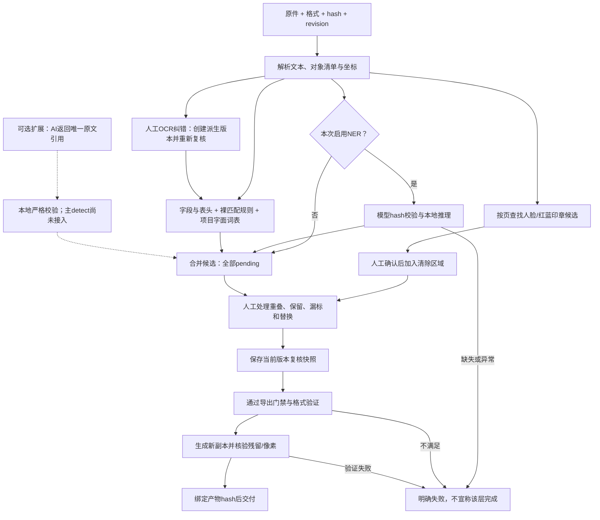
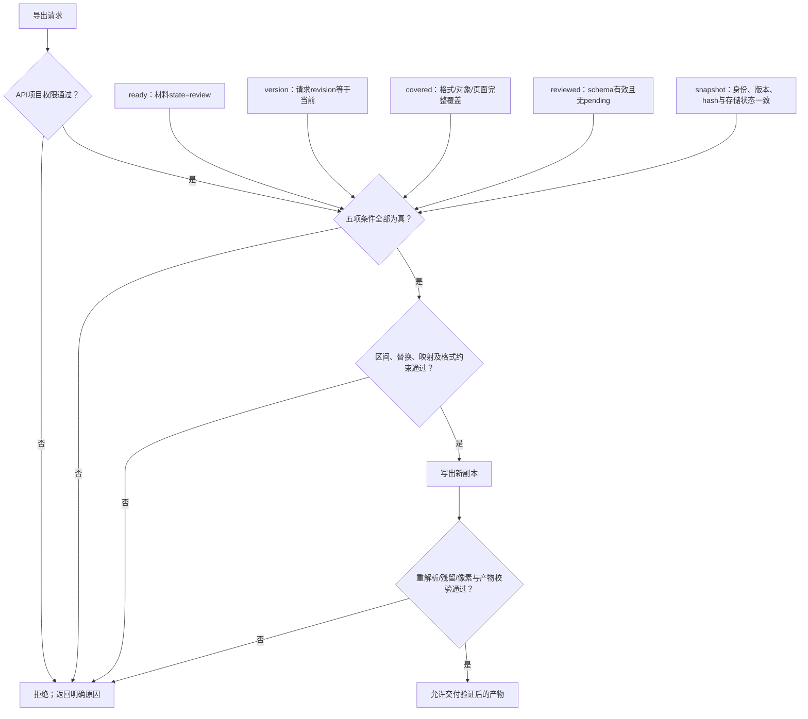
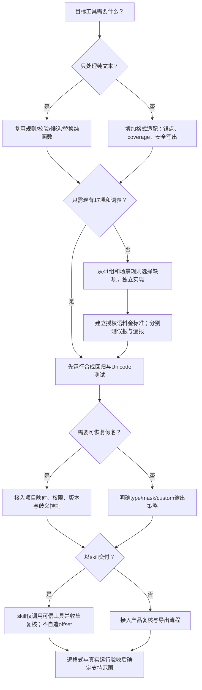

# 脱敏规则技术交接与移植评估

版本日期：2026-10-14。对象：技术负责人、规则引擎开发者、文档处理开发者、skill 维护者。

## 0. 阅读导航与图表速览

**先判断要复用什么，再看对应规则。** 下列图表是本文已有契约的阅读摘要；“源码已实现”与“运行验收通过”分开，竞品规则仍为静态已知，未补能力不会因画入流程而变成已完成。

### 0.1 按阅读目的导航

|你要回答的问题|先看|需要落地时再看|
|---|---|---|
|哪些可以带到其他工具？|本节能力对照与决策图|[第10节：移植与skill](#handoff-port)、[第12节：未完成项](#handoff-gaps)|
|我方究竟识别哪些内容？|[第3节：17项规则、校验与表头](#handoff-own-rules)|[第2节：输入输出契约](#handoff-contract)、[第5节：模型](#handoff-models)|
|竞品规则比我方多在哪里？|[第7节：41组逐项对照](#handoff-vendor-rules)|[第8节：场景及后处理](#handoff-vendor-detail)|
|掩码、假名和白名单如何处理？|[第4节：替换与复核](#handoff-review)|[第9节：完整配置附录](#handoff-config)|
|怎样防止导出残留或版本错配？|本节导出门禁图|[第6节：格式与导出](#handoff-export)|
|怎样验证这份文件？|[第10.3节：合成验收矩阵](#handoff-examples)|[第11节：源码行号与hash](#handoff-evidence)|

### 0.2 规则分类与状态对照

|能力类别|我方当前源码|竞品已知范围|移植决策|
|---|---|---|---|
|确定格式标识|**已实现**：11项裸匹配，含身份证/信用代码/Luhn校验|41基础组中的号码、网址、案号、证照等；部分仅格式检查|优先复用我方校验，再按第7节补差异|
|上下文字段与表头|**已实现**：6项字段规则、完整表头映射|联系人员、笔录、地址、回单、社保及表单增强|缺失的专用场景逐项实现和评估，不只增加类型名|
|姓名、机构、地址|**已接入可选NER**；另有表头/词表/人工|direct/legacy NER、文书路由、姓名与机构过滤|模型参数不同，不能互换；真实精度另验|
|金额、商业秘密|金额仅适用表头/词表等；**无广泛主流程自动识别**|金额多分支；不据此声称覆盖所有商业秘密|保留人工审核；新规则或AI接入单独立项|
|词表与误报排除|**已实现项目字面词表**；exclude仍pending|3份YAML、108类别；集合与strictName语义不同|完整词项留第9节；按场景精选，不默认整库启用|
|重叠、掩码、假名|**已实现**：候选并存、最终重叠阻断、4替换模式、版本映射|多套重叠启发式、类型遮盖及假名canonical|复用我方一致性门；不复制竞品跨层不一致|
|印章、人脸、签名区域|**已接入待确认候选**：YuNet人脸、红/蓝颜色连通域印章；签名仍为人工框|像素印章、YuNet人脸、若干平台缺失分支|候选须人工确认；黑白章、签名自动识别和真实准确率未完成|
|OCR纠错与Word审查|**已实现**：选区改字、保留派生坐标/版本；Word段落/表格/跨run标记只读投影|竞品另有纠错、版式与恢复链；不主张逐项等价|文字纠错不修改原件像素；Word预览不承诺原软件精确分页|
|安全文件导出|**已实现限定格式适配器及门禁**|存在当前/旧导出路径，旧盖层不等于删除|逐格式复用；不能用“文本改了”代替原件清理|
|AI/skill|**已有AI候选校验器，主detect未接入AI**|不推断竞品私有模型或服务端能力|skill调用确定性工具，保留用户复核和失败边界|

> 数量口径：我方 **17检测项=11裸匹配+6字段**；21个可标注类型不是21个检测器。竞品**41基础组**不含所有增强函数；**108配置类别**也不是108条算法。三份配置共3012数组项，含重复与被忽略的非字符串。

### 0.3 输入输出与责任边界

|阶段|输入|输出|必须保留的约束|
|---|---|---|---|
|解析|原件、格式、sourceHash|绑定版本的规范文本、anchors、coverage、页面字框|原件不可变；纠错创建派生文本版本；UTF-16半开区间|
|检测|文本、锚点、词表版本、可选模型|pending候选、来源、识别版本|同span/type合并；不同类型/重叠不静默丢失|
|OCR纠错|页、revision、选区expectedText与替换文字|新文本/hash、移位anchors、派生字框、新revision|保存后旧复核不可沿用；不能安全定位则拒绝|
|视觉查找|已校验页面预览、face/seal选择|规范页面坐标的待确认框|不自动写入区域；明确确认后仍须保存复核|
|人工复核|当前revision及候选|redact/ignore决定、替换策略、复核快照|白名单候选仍须解决pending；冲突显式处理|
|替换与导出|绑定版本的快照、映射、格式策略|新输出文件|权限、五项门禁、区间/映射/格式约束|
|验证与交付|输出、所选原值、预期内容或像素hash|通过的产物及hash，或明确错误|预览不是产物；失败不交付原件冒充成功|

### 0.4 当前处理流程与可选扩展



实线概括当前源码链；虚线表示未来可接入的AI候选路径。图中NER启用不代表本机运行条件已就绪。未知对象可能先记录blocked coverage，最终由导出门拒绝，不保证每种未知对象都在解析阶段立刻抛错。

### 0.5 复核与导出门禁



这张图展示依赖条件，不表示错误码检查优先级。权限在API层，Bend只证明五条件的布尔组合；core本身不提供登录。snapshot比较文档已存recognition等，不自动比较当前部署模型或规则代码版本；单纯升级运行环境不等于旧复核自动失效。

### 0.6 技术负责人决策图



这是一张实施选择图，**不是完成度图**。尚未实现的金额/场景规则、签名与黑白章自动检测、AI主流程接入仍待开发；需要模型或文件执行器而环境未具备时，只能交候选或明确阻断。

---

<a id="handoff-scope"></a>

## 1. 结论、范围与阅读方法

这是一份**规则与执行契约清单**。可据此评估复用我方纯函数、开发格式适配器、补充候选识别或封装 skill。它不证明任意材料已完成匿名化，也不证明我方与脱敏猫算法等价。

本文使用三个状态：

- **我方已实现**：当前脱敏汪源码有对应执行路径。存在源码不代表本机模型已安装、服务已启用或所有格式通过真实验收。
- **竞品静态已知（S2/R0）**：来源是已取得的公开 macOS 0.5.9 发布包及已审查的逆向报告；未执行竞品处理链。固定 confidence 是代码分数，不是实测准确率。
- **待补／未知**：我方没有该专用路径、或模型权重/外部库/运行结果无法由所读源码保证。本文不收集未公开私有模型的全部规则。

覆盖范围：我方 11 项裸匹配规则、6 项字段规则、表头规则、项目词表、NER/AI 候选接口、替换/映射/复核/格式导出门；竞品已提取 **41 组基础规则、3 份 YAML 的 108 个类别和全部数组项**，以及金额、英文标识、场景增强、姓名机构过滤、视觉区域、假名和格式定位规则。41 是基础调度组计数，不是整个产品全部正则数量。

竞品的具体实现用语义说明与伪代码表达，不整段复制竞品代码。附录保留配置词项以便评估覆盖范围；这些词项混有历史样本和领域噪声，不能当通用真值直接启用。

### 当前回归证据

根代理本轮执行 `vitest run tests/core.test.ts tests/recognition.test.ts tests/mappings.test.ts tests/review-tools.test.ts`：Node v26.6.0，4 文件 26 测试通过。范围是核心规则、候选、映射及复核工具等回归；**不包含 OCR/NER 实际推理、数据库、浏览器、竞品或线上测试**。本文件第10.3节的34个合成样例已独立调用当前 `detect(text,[],[])` 执行，34/34通过；记录为 `.data/research/lawbot-2026-10-14/iteration020/handoff-34-cases.json`，包含每例结果、输入清单hash及实际redaction源码hash，不借用上述26项结果。

本次审查发现并由作者修复了OCR纯删除丢失旧字框、保存期间草稿可能被回载覆盖两项问题。修复后独立运行 `vitest run tests/docx-layout.test.ts tests/ocr-correction.test.ts tests/visual-detection.test.ts`，3文件15测试通过（含删除/空白替换后旧区域像素确实清零）；未以早先测试通过替代缺陷修复。真实人脸模型已有公开OpenCV `messi5.jpg` 的单图smoke，记录 `.data/evals/visual/face-smoke.json` 返回一个候选（score约0.915）；这不是准确率评估，未证明所有人脸或印章均能检出。当前最终 `pnpm check` 日志已记录11条Bend laws、13个错误变异拒绝、TypeScript检查、17文件82测试及构建成功（`.data/evals/iteration021-check-release.log`）。隔离PostgreSQL/API/worker集成18/18通过（`iteration021-integration-final.log`）。真实Edge全量首次38项中37通过，新OCR/Word/视觉用例通过，旧DOCX下载就绪断言5秒超时；将下载就绪等待调整为45秒后，相关7项定向复跑7/7通过；首次失败与复跑分别保留（`iteration021-edge-final.log`、`iteration021-edge-files.log`），不写成一次全绿。这些是本地隔离验收，不证明已部署。

<a id="handoff-contract"></a>

## 2. 可移植的最小接口

### 2.1 文本、坐标与候选

我方 `detect(text, anchors=[], dictionary=[]) -> Mark[]` 使用 JS 字符串 **UTF-16 半开区间 `[start,end)`**。同一版本的源文字保持不变；OCR纠错保存为新派生版本。展示或匹配时的规范化必须有逆向偏移表。例：`😀张三` 的“张三”是 `[2,4)`；Python 的码点下标不能直接传入。

```json
{
  "start": 2,
  "end": 4,
  "kind": "姓名",
  "decision": "pending",
  "sources": [{"layer":"ner","code":"model-version","score":0.91}]
}
```

输入边界必须先由契约 schema 校验：整数非负 start、正整数 end、已知 kind/decision。`validateMarks` 负责文本长度、代理对边界、区间和选择冲突，不能独自替代 schema。当前 kind 共 21 个：手机号、固定电话、邮箱、身份证号、银行账号、信用代码、案号、护照号、姓名、机构、地址、金额、商业秘密、自定义、证券/资金账号、车牌号、微信号、网址、专利号、备案号、证照/许可证号。

`Anchor` 表示原件结构：`text`、`cell`、`object`、`page`；可含 part/object、1 起算行列、0 起算 page。页面 glyph 为 `[start,end,x,y,width,height]`，其 start/end 相对该页文本，几何属于规范化正向页面。Office/CSV 各对象在统一文本中用一个换行连接；不得把该换行当原件中可以跨对象替换的文字。

输出候选上限 32768；同位置同类型最多 8 个不同 `layer:code` 来源。超过限制显式失败，不静默截断。文件上限 50 MiB、页上限 300；限制是实现预算，不是能够完整识别所有该大小材料的承诺。

### 2.2 推荐流水线（移植设计）

```text
输入原件 + sourceHash + format + revision + projectPolicyVersion
  -> 格式解析与对象清单；记录每段文本及锚点，遇不支持对象标 blocked
  -> 字段/表头候选 + 格式规则候选 + 项目字面词表候选
  -> 若启用且模型验证成功，加入 NER 候选
  -> 若另行接入AI，只接受原文唯一引用的候选，不直接执行模型指令
  -> 以(start,end,kind)合并来源，保持 pending；保存识别版本和原文hash
  -> 人工选择 redact / ignore，指定替换策略，处理重叠与漏标
  -> 保存与原文版本绑定的复核快照
  -> 权限 + revision + 完整覆盖 + 无pending + 快照一致性
  -> 格式安全导出；重新解析/像素核验/选中原文残留检查
  -> 产物hash绑定下载，审计；失败不发可下载“成功”产物
```

其中 AI 接入是扩展设计：当前 processing-worker 的 detect 路径只有规则及可选 NER，识别记录 `ai:null`，不能写成现有全自动 AI 复核。

<a id="handoff-own-rules"></a>

## 3. 我方检测规则、优先级和校验

我方规则版本 `cn-rules-3`。精确正则及 flags 见下方 17 项目录。全部命中仅为 `pending` 候选；“格式匹配”不验证号码真实归属、账户存在或证照有效。

### 3.1 执行顺序

1. 6 项字段规则先运行，仅捕获值（group 1）；证照字段额外要求值中有数字。
2. 识别 row=1 的已知表头；对同 part/column 中 row>1 的非空对象整体生成候选。这里按表头语义识别，不对整格另做号码校验；金额仅此类“工资/薪酬”等表头可直接产生规则候选。
3. 建立证券/资金账号及证照字段的区间集合。删除被这些区间完全包含的银行账号候选；裸银行正则也跳过这些区间。不是所有跨类型重叠都按此优先级消除。
4. 执行 11 项裸匹配规则。唯一结构性网址豁免：Word XML 的 `attribute:<整数>:uri` 对象恰好等于 DrawingML picture 协议 URI；正文、描述属性或词表命中不受该豁免。
5. 项目词表逐字 `indexOf`，大小写敏感、不正规化、不当正则；下次从命中起点+1继续，允许重叠。include/未指定生成 `project-dictionary`；exclude 生成 `project-whitelist`，**仍 pending**，不删除其他候选，不自动 ignore。
6. 同 span/type 合并并去重来源；不同类型及重叠保留。排序 start、end、中文 kind。手工复核提交的来源不会被信任：旧 span/type 继承旧来源，新项标 manual/human-mark。

### 3.2 校验公式

- **身份证**：`[1-9]` 起始、18 位末位可 X/x；出生年≥1800，UTC 日期重建必须年月日相等。前 17 位权重 `[7,9,10,5,8,4,2,1,6,3,7,9,10,5,8,4,2]`，和模 11 后索引 `10X98765432`，等于末位大写。没有行政区划数据库校验或真实身份查询。
- **统一社会信用代码**：字符表 `0123456789ABCDEFGHJKLMNPQRTUWXY`，前 17 位权重 `[1,3,9,27,19,26,16,17,20,29,25,13,8,24,10,30,28]`。校验值 `(31 - Σ(index(char_i)×weight_i) mod31) mod31`，索引字符必须等于第18位。没有登记机关真实数据验证。
- **银行卡**：validator 先去 ASCII 空格/短横，须 4/5/6 起头、共13–19位、非单数字重复。自右向左每隔一位乘2，>9减9，总和模10等于0。裸规则只识别无分隔数字；有明确银行字段的公司账号不强制 Luhn。
- **网址**：正则限 http/https，禁止空白及指定标点，完整值≤2048且 `new URL` 有 hostname；不是竞品的裸域/TLD 白名单策略。
- **证照字段**：形状与长度匹配后额外 `/\d/`，没有各种证照的专有校验码。

### 3.3 表头映射、词表和边界

完整表头映射列在本节后；按 part 分隔列，避免不同工作表/对象共用列号。词表 API 最多1000项，每项 trim 后1–200 UTF-16字符，合法 Unicode，禁部分控制字符；core 再检查非空和最大长度。规范化、同义名和大小写折叠需要另行设计，不能擅自把项目字面匹配改成模糊匹配。

我方没有主流程“全金额识别”、通用法人人名字段提取、英文EIN/国际ID或自动商业秘密判断。金额/商业秘密是允许的标注类型，可由适用表头、词表、人工或未来校验后的AI候选提供；NER当前只输出姓名/地址/机构。

### 3.4 我方17项精确正则目录

以下是我方源码数据，不是竞品正则复制。所有 flags 均保留；字段组只输出捕获组1的跨度。无 validator 表示只按正则和上文通用门槛筛选。

#### OWN01 `id-checksum` — 身份证号

组：`rules`；来源：`packages/core/redaction.ts:38`。

```js
/(?<![A-Za-z0-9])[1-9]\d{16}[\dXx](?![A-Za-z0-9])/g
```

额外校验：`validId`。

#### OWN02 `cn-mobile` — 手机号

组：`rules`；来源：`packages/core/redaction.ts:39`。

```js
/(?<!\d)(?:\+86[ -]?)?1[3-9]\d{9}(?!\d)/g
```

额外校验：`无`。

#### OWN03 `cn-landline` — 固定电话

组：`rules`；来源：`packages/core/redaction.ts:40`。

```js
/(?<!\d)0\d{2,3}[- ]\d{7,8}(?:[-转]\d{1,6})?(?!\d)/g
```

额外校验：`无`。

#### OWN04 `card-luhn` — 银行账号

组：`rules`；来源：`packages/core/redaction.ts:41`。

```js
/(?<![A-Za-z0-9])[456]\d{12,18}(?![A-Za-z0-9])/g
```

额外校验：`validBankCard`。

#### OWN05 `uscc-mod31` — 信用代码

组：`rules`；来源：`packages/core/redaction.ts:42`。

```js
/(?<![A-Za-z0-9])[0-9A-HJ-NPQRTUWXY]{18}(?![A-Za-z0-9])/g
```

额外校验：`validCreditCode`。

#### OWN06 `case-format` — 案号

组：`rules`；来源：`packages/core/redaction.ts:43`。

```js
/[（(](?:19|20)\d{2}[)）][ \t]*(?:最高法|[京津沪渝冀豫云辽黑湘皖鲁新苏浙赣鄂桂甘晋蒙内陕吉闽贵粤青藏川宁琼军兵])\d{0,4}[\u4e00-\u9fff]{1,8}\d{1,10}号/g
```

额外校验：`无`。

#### OWN07 `cn-plate-format` — 车牌号

组：`rules`；来源：`packages/core/redaction.ts:44`。

```js
/(?<![A-Za-z0-9])[京津沪渝冀豫云辽黑湘皖鲁新苏浙赣鄂桂甘晋蒙陕吉闽贵粤青藏川宁琼][A-HJ-NP-Z][·• ]?(?:[DF][A-HJ-NP-Z0-9]\d{4}|\d{5}[DF]|[A-HJ-NP-Z0-9]{5})(?![A-Za-z0-9])/g
```

额外校验：`无`。

#### OWN08 `cn-patent-format` — 专利号

组：`rules`；来源：`packages/core/redaction.ts:45`。

```js
/(?<![A-Za-z0-9])(?:(?:CN|ZL)[ \t]*(?:19|20)\d{10}(?:\.[0-9X])?(?:[A-CUY][1-9]?)?|CN[ \t]*\d{9}[A-CUY][1-9]?)(?![A-Za-z0-9.])/gi
```

额外校验：`无`。

#### OWN09 `cn-icp-format` — 备案号

组：`rules`；来源：`packages/core/redaction.ts:46`。

```js
/[京津沪渝冀豫云辽黑湘皖鲁新苏浙赣鄂桂甘晋蒙陕吉闽贵粤青藏川宁琼]ICP备\d{6,12}号(?:-\d{1,5})?(?![A-Za-z0-9-])/gi
```

额外校验：`无`。

#### OWN10 `http-url-format` — 网址

组：`rules`；来源：`packages/core/redaction.ts:47`。

```js
/(?<![A-Za-z0-9_])https?:\/\/[^\s<>"'，；。！？、（）()【】\[\]“”‘’]{1,2048}(?![^\s<>"'，；。！？、（）()【】\[\]“”‘’])/gi
```

额外校验：`value => { try { return value.length <= 2048 && !!new URL(value).hostname; } catch { return false; } }`。

#### OWN11 `email-format` — 邮箱

组：`rules`；来源：`packages/core/redaction.ts:48`。

```js
/(?<![\w.%+-])[A-Za-z0-9._%+-]{1,64}@[A-Za-z0-9.-]{1,253}\.[A-Za-z]{2,63}(?![\w.-])/g
```

额外校验：`无`。

#### OWN12 `account-field` — 银行账号

组：`fields`；来源：`packages/core/redaction.ts:61`。

```js
/(?:开户账号|收款账号|银行账号|银行卡号|账户号码)[ \t]*[:：][ \t]*([0-9][0-9 -]{6,30}[0-9])(?!\d)/g
```

额外校验：`无`。

#### OWN13 `passport-field` — 护照号

组：`fields`；来源：`packages/core/redaction.ts:62`。

```js
/(?:护照号码|护照号)[ \t]*[:：][ \t]*([A-Z][A-Z0-9]{7,8})(?![A-Za-z0-9])/g
```

额外校验：`无`。

#### OWN14 `securities-account-field` — 证券/资金账号

组：`fields`；来源：`packages/core/redaction.ts:63`。

```js
/(?:证券(?:账户(?:号码|号)?|账号|帐号)|股东(?:账户号?|账号|代码)|资金(?:账户(?:号码|号)?|账号|帐号))(?:[ \t]*[:：][ \t]*|[ \t]+)([A-Za-z]?\d[\d -]{4,29}\d)(?![A-Za-z0-9]|[ -]*\d)/g
```

额外校验：`无`。

#### OWN15 `wechat-field` — 微信号

组：`fields`；来源：`packages/core/redaction.ts:64`。

```js
/(?:微信(?:号|账号|帐号)|WeChat[ \t]*ID)(?:[ \t]*[:：][ \t]*|[ \t]+)([A-Za-z][A-Za-z0-9_-]{5,19})(?![A-Za-z0-9_-])/gi
```

额外校验：`无`。

#### OWN16 `patent-field` — 专利号

组：`fields`；来源：`packages/core/redaction.ts:65`。

```js
/专利(?:申请|授权)?(?:号|编号)(?:[ \t]*[:：][ \t]*|[ \t]+)((?:19|20)\d{10}(?:\.[0-9X])?)(?![A-Za-z0-9.])/gi
```

额外校验：`无`。

#### OWN17 `license-field` — 证照/许可证号

组：`fields`；来源：`packages/core/redaction.ts:66`。

```js
/(?:证照(?:号|编号)|(?:不动产权证|土地证|房产证|房地产权证|规划许可证|施工许可证|建筑工程施工许可证|建设工程规划许可证)(?:号|编号)|许可证(?:号|编号)|宗地(?:编号|地块编号)|地块编号|不动产单元号)(?:[ \t]*[:：][ \t]*|[ \t]+)([A-Za-z0-9\u4e00-\u9fff()（）\-—〔〕]{4,64})(?![A-Za-z0-9\u4e00-\u9fff()（）\-—〔〕])/g
```

额外校验：`value => /\d/.test(value)`。

### 3.5 完整表头别名

|表头|候选类型|
|---|---|
|姓名|姓名|
|法定代表人|姓名|
|客户名称|机构|
|公司名称|机构|
|开户账号|银行账号|
|银行账号|银行账号|
|银行卡号|银行账号|
|住所|地址|
|联系地址|地址|
|工资|金额|
|薪酬|金额|
|证券账户|证券/资金账号|
|证券账户号|证券/资金账号|
|证券账户号码|证券/资金账号|
|证券账号|证券/资金账号|
|股东代码|证券/资金账号|
|资金账号|证券/资金账号|
|资金账户|证券/资金账号|
|资金账户号|证券/资金账号|
|资金账户号码|证券/资金账号|
|车牌号|车牌号|
|微信号|微信号|
|网址|网址|
|专利号|专利号|
|专利申请号|专利号|
|备案号|备案号|
|证照号|证照/许可证号|
|许可证号|证照/许可证号|
|土地证号|证照/许可证号|
|房产证号|证照/许可证号|
|不动产权证号|证照/许可证号|
|房地产权证号|证照/许可证号|
|规划许可证号|证照/许可证号|
|施工许可证号|证照/许可证号|
|建设工程规划许可证号|证照/许可证号|
|建筑工程施工许可证号|证照/许可证号|
|宗地编号|证照/许可证号|
|宗地地块编号|证照/许可证号|
|地块编号|证照/许可证号|
|不动产单元号|证照/许可证号|

<a id="handoff-review"></a>

## 4. 我方替换、假名、冲突与人工复核

### 4.1 四种替换模式

|模式|实际输出和约束|合成示例|
|---|---|---|
|type/缺省|`【类型】`；不自动采用竞品的类型专用保留位数|手机号→`【手机号】`|
|mask|prefix/suffix分别0–100整数，原文码点数必须大于两者之和；中间恒为三个ASCII星号，不按原长补星|`13800138000`,3/4→`138***8000`|
|custom|非空trim判断、≤100 UTF-16、合法Unicode，不含控制字符/`<>【】`；输出不能包含整段原值|`张三`→`某人`|
|alias|version=1；固定`【姓名/机构/地址/敏感项_六位数字】`；必须由映射ID/版本/token/kind/value全部匹配|`张三`→`【姓名_000001】`|

字符保留按 Unicode **码点**，不是 UTF-16 单元、不是用户感知字素簇。组合音标/ZWJ emoji仍需专项测试。alias/mask/custom在替换层检查输出不得包含完整原文；type/缺省直接返回类型占位，不走这项局部检查。例如原文“姓名”变成“【姓名】”可通过replacementFor，但最终verify仍会因原值残留拒绝。mask保留位数达到原长也拒绝。不要把“星号数量固定”改成“与原文字数等长”后仍声称同一规则。

### 4.2 同名与映射持久化

我方映射在项目范围存储。提议接口按**原文精确相等+kind**查已有项；不自动去括号/全半角/大小写，不自动把公司简称合并到全称。创建接口锁项目后按总数量+1生成六位序号（所有类型共享项目序号），最多1000个；requestId幂等冲突要报错。原文与类型加密保存并绑定 tenant/project/mapping/version；映射创建/查看/还原有独立权限与审计，不能让skill直接构造可信映射。

恢复时扫描 `【…】`，要求每个token已知且至少有一个、无游离括号或疑似被改写token；同token对应不同ID或不同原文视为歧义。只有授权、版本当前、全已知、无歧义四门全真才一次性替换；原文内看似token的字符串不会再递归展开。恢复接口还先通过对应材料的导出门。类型占位不是可恢复假名；没有映射表不可猜还原。

### 4.3 重叠、保留与残留

- 检测保留重叠，是候选并存；最终所有 `redact` 区间不得重叠，相邻可以。选外层网址后需将其内部电话/邮箱候选明确 ignore，不能同时 redact。
- final校验拒绝任何 pending；ignore不等于删除记录。预览保留pending/ignore内容，不能拿预览当已签发导出。
- 文本导出重新计算结果，必须与预期完全相等；任何已选中脱敏的**原值**仍出现在其他位置，都报 `RESIDUE_FOUND`。即便另一个位置明确ignore，同值残留仍可能阻断；这是一条保守的全局残留门。
- 漏标检查以未被retained的已知标记原文为种子逐字扫描。retained仅此功能定义为ignore，或pending且来源含project-whitelist；该定义不等于detect自动ignore。已有完整且仅单侧覆盖优先判marked/retained；同值不同类型/替换策略使种子ambiguous，阻止未覆盖位置补录，不会强制改写已完整单侧覆盖的状态。其余部分重叠、跨对象、补录候选彼此重叠判conflict。只给无冲突missing生成pending additions，不自动保存或导出。
- 漏标单值≤2000，`text.length×不同种子数≤100,000,000`，总命中及补录不超MAX_MARKS；越界拒绝，不抽样。它只找已知原值，不是全新语义漏报探测。

```text
merge(candidate):
  validate(schema, UTF16-boundary, range)
  key = start:end:kind
  union source evidence by layer:code; force pending
review:
  resolve overlaps explicitly; preserve server provenance
export:
  assert no pending
  sort redact spans; assert current.start >= previous.end
  replace from immutable original once
  assert no selected original string survives anywhere in verified output
```

<a id="handoff-models"></a>

## 5. 我方模型和AI边界

### 5.1 NER（已接入，可选）

锁文件指向 `shibing624/bertspan4ner-base-chinese@dc0de59380bcf4d42c1e9a8ff267e19e00f331f9`。模型包逐文件SHA256核验，缺失/不符报错；词表要求 UNK=100、CLS=101、SEP=102。ONNX CPU、intra线程2/inter线程1；最多128 token，内容每窗126码点、步94，首尾加CLS/SEP。每个anchor独立切窗；字符转token同时记录UTF-16 start/end，未知字符用100。

输出必须有start_logits/end_logits，长度均为tokens×5且全部finite。每个位置取start argmax，对应2姓名/3地址/4机构；向右取首个同label的end argmax，分数为起止softmax最小值。**当前没有按score阈值过滤**；候选仍pending。全文>200000 UTF-16拒绝。开启NER后失败不静默算“NER完成”，worker finally release；实际模型精度/速度未由本交接测试。

### 5.2 OCR（已接入格式链）

Tesseract `chi_sim+eng`，LSTM_ONLY，固定本地模型路径并逐hash核验，无CDN fallback，禁模型缓存写入，user_defined_dpi=150。页面OCR返回text/blocks，按word和symbol构造字框；symbol缺失时用word框。坐标除scale还原规范页面单位。OCR是文字/几何提供者，不直接证明文字无误；错误文字会影响后续规则和残留检查。

### 5.3 视觉候选（已接入；确认后才参与导出）

|分支|实际输入/算法/阈值|输出与限制|
|---|---|---|
|人脸|锁定 `opencv/face_detection_yunet_2023mar@47534e27c9851bb1128ccc0102f1145e27f23f98`，模型及LICENSE逐SHA256校验；ONNX CPU，640×640右/下黑色补边，BGR/CHW float32|三个stride 8/16/32输出长度与finite校验；`sqrt(clamp(cls)×clamp(obj)) >= .6`；bbox两侧各放大原宽/高的5%，夹到图片；模型缺失/不符明确失败|
|红/蓝印章候选|最长边缩至1000内；红 `r>140,r-g>35,r-b>35`，蓝 `b>110,b-r>30,b-g>20`；同色邻域连通，半径1–4|像素数≥40、框宽高≥16、面积占比.0008–.3、宽高比.45–2.2、填充率≤.8；加max(3,ceil(max边×.08))留边，固定score .65；这只是颜色形态候选|
|共同过滤|同reason按score降序、IoU≥.3抑制；最多200框|印章与人脸不互相抑制；预览像素框再按宽高比例变换为canonical页坐标，PDF 2倍渲染不得直接当页坐标|

API `POST /documents/:id/pages/:page/visual-candidates` 输入 `{revision,detectors:["face"或"seal"]}`，检查 `view_original + review`、当前revision、review状态及预览hash。返回 `{revision,page,width,height,candidates,faceVersion?,sealVersion?}`；每候选包含 `x,y,width,height,reason,score,detector`。调用本身不保存区域、不创建“已确认”文字标记。前端“定位”只调整待添加框，“确认清除”才加入当前复核草稿；仍须保存复核及通过导出门。

没有签名检测器，也没有黑白印章识别或可靠的印章真假分类。颜色图案/徽标可能误报，侧脸/小脸/遮挡等可能漏检；固定score不是准确率。不能把“返回0框”解释为图片已无敏感内容。模型下载器、固定锁文件与Docker打包路径已加入，但部署机器是否安装该bundle需要单独验收。

### 5.4 AI候选（有校验器，主detect未接入）

`validateAiResults`严格限制≤20样本、每样本≤100候选，quote1–2000字符、已知kind、固定reasonCode和uncertain布尔。返回样本ID必须与输入集合一一匹配；quote必须在原文出现且**唯一**，否则拒绝杜撰或歧义引用。模型不给可信offset，由本地indexOf计算，来源记ai且pending。

reasonCode允许 identity/contact/financial_identifier/organization/location/settlement_floor/litigation_strategy/nonpublic_transaction/relationship/uncertain。这是输出契约，不等于主流程已识别谈判底线、诉讼策略或关系网。不能把竞品的450/400切窗、BIO模型或面部阈值写成我方模型参数。

<a id="handoff-export"></a>

## 6. 我方格式、坐标与导出门

|格式|文本/对象处理|最终导出策略与阻断|
|---|---|---|
|TXT|严格UTF-8、非空、无NUL，单text anchor|统一替换与原值残留检查|
|Markdown|保留原始源码为文本；解析AST检查对象|图片、图片引用、raw HTML直接阻断；输出再次检查；不是仅替可见文本的Markdown writer|
|CSV|真实CSV解析，每cell建anchor，以换行串联；完整记录行coverage|任何标记不得跨cell；全部字段加引号，CRLF；以空白/BOM后`=+-@`或开头tab/换行的值前加单引号，防公式执行；重解析查残留|
|DOCX|ZIP/XML白名单对象清单；段落内把格式run与delText按DOM顺序拼接，跨run识别；其他可见/隐藏文字及属性也纳入|不得跨object；段落替换只在首触及run写替换，清后续命中字；去XML注释/处理指令、field指令、外部关系，展开超链接/简单字段；未知对象/macro/嵌入控件等coverage blocked|
|XLSX|所有worksheet包括隐藏sheet；sharedStrings展开，按单元格独立；公式只审缓存值|缺公式缓存blocked；导出移除公式，写literal值，去sharedStrings/calcChain、定义名称/超链接/数据验证/条件格式等；不保留工作簿计算语义|
|PDF|PDFium读取原生文本、字框、8类元数据；每页另OCR，同文同物理位置才压OCR重复|必须选择raster；像素真正清零后创建全新image-only PDF，不复制原对象/字体/元数据/脚本/附件；有附件/脚本coverage阻断；加密PDF拒绝|
|PNG/JPG/JPEG|签名/尺寸校验，单图、自动正向、白底；OCR坐标|输出PNG，真实清零像素，剥元数据，拒多帧；不支持用文字alias覆盖像素|
|DOCX内图片|仅受支持word/media PNG/JPEG并经过图像OCR/锚点绑定|调用独立图片适配器清像素，重新PNG命名/关系；不得删除内嵌“页”；复杂VML/外链/不支持图片对象阻断|

页面选择矩形最多3000，原因可敏感区域/印章/签名/人脸：这些原因用于已确认区域；目前人脸和红/蓝印章可由自动候选转入，签名仍须人工框选。自动候选尚未确认时不在这些区域内，也不自动参与导出。区域须finite、非负、正面积、页内；删除页索引必须唯一、合法且不能全删；重复直接拒绝，不自动去重。所选文字每个非空白UTF-16位置必须有有效glyph覆盖，否则 `PAGE_POSITION_MISSING`；字框向外扩2规范单位后夹到页面。最终page上的文字替换只支持type，实际效果是黑色像素清除，不绘制类型占位字。

像素处理：canonical矩形映射到真实像素，左上floor、右下ceil，RGB对应区域置0；输出PNG重读必须与目标RGB完全相同且无EXIF/XMP/ICC/IPTC。再OCR查选中原值（去空白）残留。PDF重新打开检查页数/尺寸、无可提取文字/元数据/附件/脚本，重渲染RGB hash一致。**追加不透明矩形到原PDF不等价于上述策略**；盖住但保留底层文字不得当安全脱敏。

### 6.1 OCR文字纠错：契约、几何与版本

|步骤|实际约束/副作用|
|---|---|
|读取|`GET /documents/:id/pages/:page/ocr-text?revision=N` 要求view_original与当前版本；返回页内text/glyphs、width/height及correctionRevision；支持PDF、PNG/JPG/JPEG和DOCX内图片|
|提交|`PUT` 同一路径，输入 `{revision,start,end,expectedText,text}`；UTF-16页内半开选区、end>start、旧值精确相等、代理对不拆开；新文字≤200000，拒非法控制字符；替换为空代表删除|
|定位|先剥离共同前后缀，只重映射改变部分；替换复用原矩形、不按新字数猜窄框；插入复用用户所选原文内最近有效旧框；无可定位非空新增字则拒绝。纯删除/纯空白替换额外将旧可见框绑定给距离最近且仍含非空文字的保留范围；无此范围则拒绝，不能丢弃原像素关联|
|保存|原件/预览不改；写新的mapId/mapHash与ocrRevision，完整规范文本与后续anchors/marks偏移移位；规则与已启用NER重新生成候选，原有未触及标记也重置pending；AI来源版本归null|
|并发/权限|要求view_original+review、project及document事务锁、revision及review状态；无变化不增版本。保存期间使用页面共用run阻止其他复核修改，避免回载覆盖新草稿|
|旧结果隔离|document revision+1，无当前版本已保存复核快照；未完成任务取消/租约清空；旧导出不能用于新版本。已签发链接继续绑定旧的不可变产物，不因纠错被悄悄替换|
|重新识别|若任一页ocrRevision>0，先核验原件、当前文本、所有map和预览hash，再使用保留的纠正文案/anchors/pages做规则/NER检测；不从原图重新OCR覆盖人工纠错|

纠错是修正文字解释，不能移动或擦掉原图像素。增删字会共享原几何，可能多清除邻近内容；必须检查处理预览。空白页没有可纠正选区时须用手工区域。

### 6.2 Word只读版式审查

输入是已校验hash的原始DOCX和当前版本规范文本/anchors/pageData；输出无可执行内容的JSON布局，前端由React文字节点及白名单样式渲染，**不执行DOCX中的HTML、脚本或关系URL**。解析沿用ZIP/XML入口限制、拒DOCTYPE/ENTITY，另有2百万文字、2万anchors、5万投影节点、布局递归64层预算；样式继承最多32层/去环。

|展示对象|映射与复核行为|不应承诺的能力|
|---|---|---|
|段落/格式run|按paragraph身份逐字核验anchors；run保留全局UTF-16范围，标记横跨粗体等run仍能连续高亮；选区只允许同段落的映射文字|不能跨段/跨对象一次标记；原有导出对象约束仍适用|
|样式/表格|继承段落及字符样式，直接属性覆盖；颜色仅hex、字体仅限定字符、尺寸有界；表格单元格/横向span，纵向合并续格作说明|浏览器字体、行高、列表、多节/浮动对象与实际Word分页不完全一致|
|页眉脚注等|页眉/页脚/脚注/尾注/批注，以及未放入正文的文本框段落列在补充区|其他属性和隐藏对象仍需“对象原文”审查；展示不代表coverage全部complete|
|图片|仅将本地支持图片关系映射到已处理page索引，以带revision的授权API显示；同资源复用共用处理|不加载远程图片，图像内文字/人脸/印章须在图片审查区处理|
|选择与导出|仅改变复核草稿；版式/对象原文可切换；最终导出仍使用原始ZIP及既有Office/图片清除适配器|不是把浏览器DOM另存为Word，不保证所见即最终分页|

### 6.3 五项导出门及版本绑定

`eligible = ready && version && covered && reviewed && snapshot`：

- ready：服务端材料state为review；version：调用revision安全非负且等于当前。
- covered：受支持格式、对象coverage全部complete；完整对象/页/锚点清单符合连续规则；paged final为raster；Office必须有package inventory，CSV每行覆盖。显式历史pasted TXT允许无source/anchors/coverage的迁移例外，不可扩张到任意空清单。
- reviewed：marks通过schema且无pending；之后再校验选中区间/替换/格式边界。
- snapshot：document/tenant/project/revision/parseVersion/contentHash均一致；actualHash匹配；marks/recognition/pageReview/pageData深相等。旧快照与当前文档已存状态不一致时阻断。此处不读取当前部署模型或RULES_VERSION；仅更换运行时模型/代码不自动使旧复核失效，需策略更新或显式重新识别等流程改变文档revision/state/recognition后再绑定新快照。

Bend证明覆盖上述布尔条件的组合，不证明解析器/OCR/权限查询/加密/第三方库或整个产品正确。API项目权限与worker gate是分层机制，单独调用core不会自动提供登录/授权。

<a id="handoff-vendor-rules"></a>

## 7. 竞品41组基础规则：语义、对应情况与用例设计

下表是已提取调度顺序。每条confidence是固定代码值；**竞品未执行**，不承诺组合上下文下最终保留。合成正反例在第10节用于我方确定性规则；竞品阈值仍须另建语料验收。完整格式、排除、遮盖细节以语义列和后续补充为准。我方“部分对应”仅指有相关规则，不表示等价。

|序号 / rule ID|置信分|静态语义|我方对应状态|
|---|---|---|---|
|01 `id_card`|.98|18 位、年份 18/19/20、月 1–12 日 1–31；出生/地址 ±50 上下文全遮，否则留后4|部分对应：id-checksum；增加真实日期/校验码|
|02 `mobile`|.95|可选86和分隔；取11位；排除前邻1–6字母及合同编号…号；留3/4|部分对应：cn-mobile|
|03 `wechat_labeled`|.97|标签后6–20位字母/下划线开头；拒全下划线/短横线；同位置去重，长于6留两端2|部分对应：wechat-field；要求字母开头|
|04 `wechat_wxid`|.96|wxid_ 后2–15字符，留两端2|未见同等专用分支；NER/表头/词表/人工可能产生相关候选，不是该规则已实现|
|05 `bank`|.92/.85|12–22候选或4位分组；小数/顿号前末位修整；13位时间戳排除；Luhn或银行上下文；留4/4|部分对应：card-luhn；限定4/5/6开头13–19位无分隔|
|06 `bank_labeled`|.84/.85|OCR8–25或非OCR分组12–22；非OCR禁止换行且组数1–6；排除时间戳/身份证；3位起点距离及包含替换|部分对应：account-field；不做专用OCR纠错|
|07 `email`|.97|基础邮箱；前缀被已识别手机覆盖则剥离；本地留2域留1|部分对应：email-format|
|08 `email_ocr`|.9|电子邮件/邮箱/E-mail 后去空白，保留原始偏移；删除被包含旧候选|未见同等专用分支；NER/表头/词表/人工可能产生相关候选，不是该规则已实现|
|09 `url`|.9–.995|调用ut，逐候选输出|部分对应：http-url-format；无裸域|
|10 `uscc`|.94|18位允许字符；身份证/当事人上下文排除；wt非校验码验证；留6/4|部分对应：uscc-mod31；增加加权校验|
|11 `tax_labeled`|.91|10–20或空格至25位；最多3换行；拒身份证形状；距3内同起点取长；留4/4|未见同等专用分支；NER/表头/词表/人工可能产生相关候选，不是该规则已实现|
|12 `landline`|.88|中国区号/可选86、0、括号、分机；相邻数字排除，至少10位|部分对应：cn-landline；形状较窄|
|13 `local_phone`|.9|标签后7–8位2–9开头；无已识别座机重叠；后4遮|未见同等专用分支；NER/表头/词表/人工可能产生相关候选，不是该规则已实现|
|14 `contact_name`|.88|2–4中文中点，末尾/手机/邮箱边界；词黑名单与任何重叠排除；此分支无pageNumber|未见同等专用分支；NER/表头/词表/人工可能产生相关候选，不是该规则已实现|
|15 `transcript_name`|.99|嫌疑/被询问标签2–4字后需性别出生身份证住所|未见同等专用分支；NER/表头/词表/人工可能产生相关候选，不是该规则已实现|
|16 `officer_names`|.97|最多5个2–4字姓名加工作单位；中文数字开头与姓名重叠排除|未见同等专用分支；NER/表头/词表/人工可能产生相关候选，不是该规则已实现|
|17 `self_name`|.98|我叫/本人叫等2–4字|未见同等专用分支；NER/表头/词表/人工可能产生相关候选，不是该规则已实现|
|18 `address_labeled_door`|.98|2–120混合字符；清理标签、gt、英文场所/括号/门牌延伸；至少10且门牌或A区|未见同等专用分支；NER/表头/词表/人工可能产生相关候选，不是该规则已实现|
|19 `address_labeled_no_door`|.95|6–100候选；至少8、行政及道路乡村标记；编号门牌走其他分支|未见同等专用分支；NER/表头/词表/人工可能产生相关候选，不是该规则已实现|
|20 `venue_labeled`|.9|会议/活动/听证地点3–80至换行；拒日期时间和人数|未见同等专用分支；NER/表头/词表/人工可能产生相关候选，不是该规则已实现|
|21 `address_unlabeled`|.98|省市区+道路编号小区；排除机关文件、房产证、面积、股票LPR、银行公司等前缀；工业区无号/短楼无房拒绝；包含少数物业专名修补；最短10|未见同等专用分支；NER/表头/词表/人工可能产生相关候选，不是该规则已实现|
|22 `garage`|.98|街道门牌+车库|未见同等专用分支；NER/表头/词表/人工可能产生相关候选，不是该规则已实现|
|23 `property_base`|.97|路号后24字内车库/负层/住宅|未见同等专用分支；NER/表头/词表/人工可能产生相关候选，不是该规则已实现|
|24 `attached_door`|.98|路号附号|未见同等专用分支；NER/表头/词表/人工可能产生相关候选，不是该规则已实现|
|25 `context_place`|.97|位置租赁+楼宇场所；至少7，拒医院政府公积金时间动作|未见同等专用分支；NER/表头/词表/人工可能产生相关候选，不是该规则已实现|
|26 `unit_range`|.98|小区号+单元至单元|未见同等专用分支；NER/表头/词表/人工可能产生相关候选，不是该规则已实现|
|27 `plate`|.93|省份+非I/O字母+5–6字母数字|部分对应：cn-plate-format|
|28 `securities_account`|.89|标签+6–20数字/空格/*/-且至少6数字；original包含标签|部分对应：securities-account-field；只输出值|
|29 `case_no`|.96|括号年份+案件代码流水号|部分对应：case-format|
|30 `admin_no`|.95|中文前缀+括号年份+第流水号|未见同等专用分支；NER/表头/词表/人工可能产生相关候选，不是该规则已实现|
|31 `realty_cert`|.96|省份(年)不动产权第编号号|未见同等专用分支；NER/表头/词表/人工可能产生相关候选，不是该规则已实现|
|32 `patent`|.94|ZL/CN/PCT/WO/US/EP/JP形状，无校验码|部分对应：cn-patent-format；无PCT/WO/US/EP/JP|
|33 `patent_labeled`|.9|标签+8–14字母数字，已包含跳过；包含标签|部分对应：patent-field；仅19/20年数字形状|
|34 `icp`|.95|省ICP备数字号后缀|部分对应：cn-icp-format|
|35 `filing_beizi`|.9|中文备字第编号号|未见同等专用分支；NER/表头/词表/人工可能产生相关候选，不是该规则已实现|
|36 `filing_labeled`|.88|标签+6–24字母数字第号短横线，包含跳过|未见同等专用分支；NER/表头/词表/人工可能产生相关候选，不是该规则已实现|
|37 `land_cert`|.95|国用/集用/集建/他项年份字第编号|未见同等专用分支；NER/表头/词表/人工可能产生相关候选，不是该规则已实现|
|38 `housing_permit`|.93|房权证/地建字第编号|未见同等专用分支；NER/表头/词表/人工可能产生相关候选，不是该规则已实现|
|39 `realty_unit`|.94|12数字+[GJ][A-Z]+5数字+F+8数字|未见同等专用分支；NER/表头/词表/人工可能产生相关候选，不是该规则已实现|
|40 `certificate_labeled`|.9|物业许可标签+5–30ASCII括号短横；右括号修整，cert重叠跳过，至少8位数字删除被包含银行号；masked含标签而original仅值|部分对应：license-field；标签/长度不同|
|41 `parcel`|.88|(年)第编号号地块/宗地|未见同等专用分支；NER/表头/词表/人工可能产生相关候选，不是该规则已实现|

### 7.1 每组精确源范围

原始inclusive行范围；范围SHA256见证据附录。

- `id_card` → `.data/research/lawbot-2026-10-13/readable/main.js:660–668`，证据ID `rule-id_card`。
- `mobile` → `.data/research/lawbot-2026-10-13/readable/main.js:669–683`，证据ID `rule-mobile`。
- `wechat_labeled` → `.data/research/lawbot-2026-10-13/readable/main.js:684–690`，证据ID `rule-wechat_labeled`。
- `wechat_wxid` → `.data/research/lawbot-2026-10-13/readable/main.js:691–695`，证据ID `rule-wechat_wxid`。
- `bank` → `.data/research/lawbot-2026-10-13/readable/main.js:696–705`，证据ID `rule-bank`。
- `bank_labeled` → `.data/research/lawbot-2026-10-13/readable/main.js:706–725`，证据ID `rule-bank_labeled`。
- `email` → `.data/research/lawbot-2026-10-13/readable/main.js:726–740`，证据ID `rule-email`。
- `email_ocr` → `.data/research/lawbot-2026-10-13/readable/main.js:741–747`，证据ID `rule-email_ocr`。
- `url` → `.data/research/lawbot-2026-10-13/readable/main.js:748–762`，证据ID `rule-url`。
- `uscc` → `.data/research/lawbot-2026-10-13/readable/main.js:763–770`，证据ID `rule-uscc`。
- `tax_labeled` → `.data/research/lawbot-2026-10-13/readable/main.js:771–796`，证据ID `rule-tax_labeled`。
- `landline` → `.data/research/lawbot-2026-10-13/readable/main.js:797–809`，证据ID `rule-landline`。
- `local_phone` → `.data/research/lawbot-2026-10-13/readable/main.js:810–818`，证据ID `rule-local_phone`。
- `contact_name` → `.data/research/lawbot-2026-10-13/readable/main.js:819–829`，证据ID `rule-contact_name`。
- `transcript_name` → `.data/research/lawbot-2026-10-13/readable/main.js:830–834`，证据ID `rule-transcript_name`。
- `officer_names` → `.data/research/lawbot-2026-10-13/readable/main.js:835–843`，证据ID `rule-officer_names`。
- `self_name` → `.data/research/lawbot-2026-10-13/readable/main.js:844–848`，证据ID `rule-self_name`。
- `address_labeled_door` → `.data/research/lawbot-2026-10-13/readable/main.js:849–889`，证据ID `rule-address_labeled_door`。
- `address_labeled_no_door` → `.data/research/lawbot-2026-10-13/readable/main.js:890–906`，证据ID `rule-address_labeled_no_door`。
- `venue_labeled` → `.data/research/lawbot-2026-10-13/readable/main.js:907–922`，证据ID `rule-venue_labeled`。
- `address_unlabeled` → `.data/research/lawbot-2026-10-13/readable/main.js:923–993`，证据ID `rule-address_unlabeled`。
- `garage` → `.data/research/lawbot-2026-10-13/readable/main.js:994–1000`，证据ID `rule-garage`。
- `property_base` → `.data/research/lawbot-2026-10-13/readable/main.js:1001–1005`，证据ID `rule-property_base`。
- `attached_door` → `.data/research/lawbot-2026-10-13/readable/main.js:1006–1012`，证据ID `rule-attached_door`。
- `context_place` → `.data/research/lawbot-2026-10-13/readable/main.js:1013–1024`，证据ID `rule-context_place`。
- `unit_range` → `.data/research/lawbot-2026-10-13/readable/main.js:1025–1031`，证据ID `rule-unit_range`。
- `plate` → `.data/research/lawbot-2026-10-13/readable/main.js:1032–1036`，证据ID `rule-plate`。
- `securities_account` → `.data/research/lawbot-2026-10-13/readable/main.js:1037–1044`，证据ID `rule-securities_account`。
- `case_no` → `.data/research/lawbot-2026-10-13/readable/main.js:1045–1049`，证据ID `rule-case_no`。
- `admin_no` → `.data/research/lawbot-2026-10-13/readable/main.js:1050–1054`，证据ID `rule-admin_no`。
- `realty_cert` → `.data/research/lawbot-2026-10-13/readable/main.js:1055–1059`，证据ID `rule-realty_cert`。
- `patent` → `.data/research/lawbot-2026-10-13/readable/main.js:1060–1064`，证据ID `rule-patent`。
- `patent_labeled` → `.data/research/lawbot-2026-10-13/readable/main.js:1065–1069`，证据ID `rule-patent_labeled`。
- `icp` → `.data/research/lawbot-2026-10-13/readable/main.js:1070–1074`，证据ID `rule-icp`。
- `filing_beizi` → `.data/research/lawbot-2026-10-13/readable/main.js:1075–1079`，证据ID `rule-filing_beizi`。
- `filing_labeled` → `.data/research/lawbot-2026-10-13/readable/main.js:1080–1084`，证据ID `rule-filing_labeled`。
- `land_cert` → `.data/research/lawbot-2026-10-13/readable/main.js:1085–1089`，证据ID `rule-land_cert`。
- `housing_permit` → `.data/research/lawbot-2026-10-13/readable/main.js:1090–1094`，证据ID `rule-housing_permit`。
- `realty_unit` → `.data/research/lawbot-2026-10-13/readable/main.js:1095–1099`，证据ID `rule-realty_unit`。
- `certificate_labeled` → `.data/research/lawbot-2026-10-13/readable/main.js:1100–1109`，证据ID `rule-certificate_labeled`。
- `parcel` → `.data/research/lawbot-2026-10-13/readable/main.js:1110–1114`，证据ID `rule-parcel`。

<a id="handoff-vendor-detail"></a>

## 8. 竞品补充语义：不能压缩成41个正则

以下重述已审查静态报告，全部为竞品S2/R0；除前文明确对应外，我方未按这些阈值或启发式实现，不是我方新增默认参数。

### DPS01 基础规则调度、URL、地址清洗

- URL ut 规范化全角协议符号、去尾标点和不成对右括号，排除 @ 邻接；仅 http/https，裸域须点，端口 1–65535；40 个 TLD 白名单。协议/www/标签/裸域置信度分别 .995/.99/.97/.9；排序 start 升/end 降/conf 降，再与所有前序候选比较重叠，包括已被舍弃候选。
- pt 将 O/o/全角/〇○ 变 0，I/l/全角1/丨/竖线变 1。mt 提取街道门牌基址。gt 去标签和叙述前缀、财产尾词，截取至门牌/楼层/房间/场所，可延伸编码/括号；最短 6，返回 text 与 offset；无行政地址数据库验证。
- yt 输出 type/original/masked/position/confidence/pageNumber?/meta.source/ruleId；DEBUG 才补 reason/pattern/timestamp。按下列 41 规则组执行；末尾调整地址 original/end 而不重算 masked，先精确键去重再删除被包含地址，最后 xt 回单增强；没有全类型统一冲突消解。
- bt 去非数字后要求 12–19 位并做 Luhn。wt 仅检查 18 位字符集、前两位区间、局部数字与日期形状排除；没有统一社会信用代码加权校验。身份证基础正则只验证年/月/日范围，没有校验码或真实日历验证。

证据范围：.data/research/lawbot-2026-10-13/readable/main.js:567–659；.data/research/lawbot-2026-10-13/readable/main.js:1115–1174。

### DPS02 回单场景增强、类型遮盖及国际规则

- xt 须微信号或截图提示且回单/时间、转账支付凭证、收付双方词组至少2组。付款人/收款人/申请人+微信5–20+姓名2–4配对，噪声及纯数字微信排除；.95，跨类型位置去重。时间戳旁姓名 .85，独立 __…__ 或含星小写微信须数字/字母且星/下划线 .95；已有星号保留。
- Nt 归一姓名/机构/地址别名；姓名首UTF16字符+按码点计星；机构按有序后缀和地域前缀保留，回退首2；地址保留省市；身份证/护照留后4、手机号3/4、银行卡4/4、USCC6/4、邮箱部分、车牌2；证书标签保留，未知类型****。
- Ct 英文 EIN .88；电话7–15数字有标签/排除上下文 .85，+开头归mobile，否则landline；护照数字8–9 .82/字母1–2+数字6–9 .88；national ID 排除合同订单发票等前24字符，Rt最多48字符/6组、紧凑6–20字母数字，须有数字，拒日期/单字符重复 .86。
- 英文重叠优先 passport/id4 > ein3 > mobile2 > landline1；$t 合并中文与英文，交集/较短跨度 >.7 才冲突，同类高置信替换。

证据范围：.data/research/lawbot-2026-10-13/readable/main.js:1175–1363；.data/research/lawbot-2026-10-13/readable/main.js:390–399。

### DPS03 YAML 黑名单加载和实际生效集合

- Lt 将 name_blacklist.yaml 与 ner_fp_blacklist.yaml 所有数组中的字符串并入姓名集合；非字符串忽略。ner_fp.regex_patterns 是字符串集合，不在此类中编译正则。
- 机构通用集合排除 announcement_generic_orgs_round3 与 disclosure_legal_opinion_and_charter_generic_orgs；这两组进入独立非诉讼集合。partylist 单独有集合。普通方法精确匹配；strictName 还做噪声、角色子串及含指定语义正则的长度>=2黑名单条目子串检查。
- 读取/解析失败吞掉并保留空集合；reload重建单例。Ft日志创建userData并追加JSON，任何写失败吞掉。ASAR抽取记录和配置类别/条目计数见configInventory；完整原始YAML及解析JSON作为证据，不把类别名推定为调用策略。

证据范围：.data/research/lawbot-2026-10-13/readable/main.js:1364–1463。

### DPS04 策略路由、去重和姓名验证

- NER_DIRECT != "0" 默认直接模式。ln 同步只有$t+金额；异步再加on；直接模式不调用策略applyTypeSpecificRules。on分块450/步400，仅姓名机构地址并走黑名单/rn/an/Yt/Zt，Kt不可用抛错，predict失败终止，取消/进度取消重抛；一般进度回调异常吞掉。上游Kt及模型初始化见主报告DP03/DP04。
- sn按start稳定排序，与已接受候选逆序比，遇之前end<=当前start即停；交集/当前长度>.7抑制，跨类先到保留，同类高分替换，非对称。
- un姓名2–4中文、黑名单精确及>=2条目子串，角色/语法/财务/地点排除；默认首字常见姓，第三参数放宽姓氏。xn是另一套较弱2–4字验证；_n三字姓名保留首尾，中间*，其他路径hn/kl首字后全*；并非所有策略同一遮盖。
- mn合同策略target .9/balanced/redactMust；applyTypeSpecificRules、确认引用、当事人、签名、简称添加/查找、标题、机构判定等为空数组/false/no-op。yn叙述器prewarm=false、增强空；bn法律策略target.95/strict但apply空、processAsync走基类、entitiesToMatches空、prefilter恒等、maskAddress恒等。On NameDetector多数检测/采集为no-op，仅委派un/dn/hn。
- Tn公文使用Sn角色姓名边界和冒号回退减.02，签发.9、收件.85、签署.88、证书主体.96、头部机构.98、尾部.97、收件政府银行.96、工作人员.95、案涉人员.96、占位机构.95；同值同位去重。An长机构后缀有序、地域+En前缀、回退2字符。
- Kn先放行Hn品牌再执行大量机构噪声排除。Yn短机构<=4须后缀或可信来源；银行法院最低.55、可信.6、普通.95，定义简称.6快捷通过；排除证券产品/监管通称/治理角色/语法前缀。Gn处理24个复姓。置信阈值是分支条件，不能代表准确率。

证据范围：.data/research/lawbot-2026-10-13/readable/main.js:1742–1749；.data/research/lawbot-2026-10-13/readable/main.js:1799–1919；.data/research/lawbot-2026-10-13/readable/main.js:1920–1973；.data/research/lawbot-2026-10-13/readable/main.js:2135–2433。

### DPS05 金额识别各分支

- 金额标签覆盖合同价、工程款、支付、押金、租金、借贷、工资、诉讼费用等。修整值、删除含百分比括号、在非股份/面积上下文延伸币种单位；排除百分比/bps/时间年份/利率LPR/多小数/面积，已有重叠先到保留，windowOffset加回定位。
- 分支及置信度：labeled .93；currency .92/.90；uppercase .91；standalone .82；table_summary .84；labeled_bare .88；post_yuan .89；conversation_payment .89；standalone_yuan .80；per_share_price .92；thousand_sep .85；standalone_uppercase .82。
- 大小写括号金额可拆为独立实体；masked保留货币/单位与[金额]占位；规则匹配形状与上下文，不做金额加总或币种一致性验证。

证据范围：.data/research/lawbot-2026-10-13/readable/main.js:1974–2134。

### DPS06 一般文档与OCR表单交易增强

- Qn仅NER_DIRECT=0使用旧策略NER：yt+显式姓名机构.96+金额，最多等ready3秒，失败退规则；姓名>=.88且un，四字须复姓；机构>=.9且Yn/黑名单；地址>=.92且长度5。验证finite跨度但trim实体文本不改start；同类重叠规则优先。
- sr为姓名/机构/地址/身份证/电话/银行/USCC/金额8组标签，长度上限4/60/80/18/20/25/18/24。cr须>=3不同表单标签，lr至少一组交易社保语义。
- ur无表单/交易场景原样返回；先删>=3换行地址。表单采值到换行/制表和长度上限，最短2；姓名中文前缀2，机构须机构词，地址>=6，银行OCR8–25且数字比例>=.5；身份证/电话/USCC/金额在此分支没有对应格式校验，统一.95。
- 交易商户机构置信默认.75/有限公司.92/连锁.85/商店.78，行业加省略号.85；交易人名2–10中文拉丁中点.88，排除2数字/泛称/平台商户。社保姓名.92，9位社保号.95留3/3，公司跟8位数.9。
- 去重把mobile归phone，同类重叠优先更长再高分，跨类型同时保留。OCR纠错 ar 与普通正则的数字验证不相同。

证据范围：.data/research/lawbot-2026-10-13/readable/main.js:2434–2655。

### DPS07 OCR与canonical文档偏移构造

- fr OCR行按中心Y与left排序，同行容忍max(2,.6*较小高度)，无效bbox变0。文本规范化删除常见中文词内部空白、拉丁数字与中文间空白及公司/身份证上下文空白，保留字符映射。
- fromOCR跳过失败页但保留原pageIndex；行间距在[-.3,.8)*最大行高加空格，否则换行；输出charOffsets/charBoxes及归一化映射、bbox范围，页置信为行算术均值。getLine按成功pages数组索引，可能与跳过前的pageIndex不同。save递归mkdir写JSON；load缺失/错误/版本不符返回null。
- Sr DOCX units用换行拼接，重复unitID映射最后一个；记录missing/approximate锚点与unsupported警告。图片全文页间两个换行但offsetMap只串联原映射，没有相应分隔符映射。
- PDF native按块在原全文顺序indexOf，否则用近似偏移。PDF OCR缺ocrText时unit用fallbacklines，但返回text仅ocrText||空，可能出现unit位置指向空doctext；页间两个换行同样不补offsetMap条目。此处是构造分支风险，未以运行样本确认触发频率。

证据范围：.data/research/lawbot-2026-10-13/readable/main.js:2656–2921。

### DPS08 假名键、导入和保留逻辑

- vr统一18个基础类型，未知归other。Nr归一中文空格/括号，Ar按类型格式归一，kr唯一后字典序。Pr姓名lower/compact、机构去括号、电话去86和分隔、邮箱和URL全部小写、身份证大写、银行卡去空格短横、地址去标点、金额去货币单位但保留中文大写。因此不同币种同数值可能同键，URL大小写路径可能合并。
- Tr按类型计数生成【类别001】，避开预留；>=1000不截断。Or map键type:normalized，已有项只增occurrences不替假名；JSON_meta版本.5，支持details或旧数组；JSON.parse在clear前，语法错保留旧表，但解析成功后形状错误可已清空旧表，details无深入形状校验。
- Br可信机构简称长度2–20、全称>=4且有机构后缀、全称更长、不泛称/诉讼噪声；不要求简称为全称子序列。jr第一遍预留已有pseudonym，再应用遍set一次，保留条目可能两次累计occurrences；restoreOriginal优先；全称锚仅精确org_name且可信来源/definedInDocument/abbrevAnchor。未知类型映射other而被Er接收。

证据范围：.data/research/lawbot-2026-10-13/readable/main.js:2923–3192。

### DPS09 实体粒度后处理与修补

- splitGranular直接保留table_engine_docx及有bbox的visualTable；地址长法律叙述>100拒绝，>30保留，按标点切地址段>=4，定位于原span，Jn重遮。合同品牌/app/社交上下文去掉，律师函pattern机构走专门重遮。
- 机构剥序号、数字向、叙述前缀，延伸律师/会计事务所有限公司，清公司部/分部，允许前置中文+ASCII公司重建；可信简称先原位或±500搜索，找不到仍保留原锚。普通机构按标点/长后缀切割，合同后缀更严格且最短5，其他最短4。
- 含特定补字：京→北京、国证券→中国证券、央→中央、济贸易→经济贸易、龙考试场→九龙考试场。多机构顺序搜再±500；单候选找不到可清空，多个全失败可保留原实体。
- 姓名只2–4中文，经角色/语法/数字地点噪声修整；判决/诉状/答辩可放宽二字姓，合同须常见姓。最终机构原文与跨度不一致先±500，再全局前20次出现选最近，失败删除；未处理非机构保留。补字与全局定位是启发式，不能视为几何真值。

证据范围：.data/research/lawbot-2026-10-13/readable/main.js:12481–12727；.data/research/lawbot-2026-10-13/readable/main.js:8489–8492。

### DPS11 印章颜色、PDF图片与Python分支

- el RGB转色相条件max>=70、饱和>=60/255，红h/2<=20或>=170、蓝95–135。hasPossibleInk按buffer WeakMap缓存Promise，sharp SRGB去alpha取raw，8个彩色像素即true；异常或异常通道数返回true。
- 像素detector仅底部35%，采样步长floor(dim/2000)至少1，红R>150差>35/蓝B>120差>30，alpha>=32。至少180采样色点，框面积>=max(.0015页,4000)且<=.12页，上边>=.5H、高<=.22H；行列>=max2,floor(6%采样宽)再收紧，padding=max12,.007最大边；最终上边>=.45H，高<=.22H，宽高比.55–1.7；错误[]。
- Hough在darwin立即[]；其他平台读scripts/ocr/seal_detector.py经OCR Python，临时PNG，stdout JSON，DEBUG stderr，30秒SIGTERM并返回空，close/error返回空、finally删临时文件，无AbortSignal。当前mac包该脚本缺失，不能推断Windows脚本算法。
- detectSealsBatch仅像素fallback，confidence.65，dpi150转点，页间取消/回调；PDF buffer通过PDF.js图片operator和transform查候选，中心x5–95%、从底部中心<55%、尺寸>=max18,.03短边)、宽<=45%高<=35%、比.5–2；canvas存在则渲染1.5、彩色比例默认.015（环境可改），crop/过滤异常保留候选；否则不筛色；confidence.8，finally清理PDF。
- 文本PDF先原生图片候选标完成，余页ink筛选及72dpi预览（有人脸96）再150dpi像素；seal错误降级，人脸错误中止。扫描页Hough即使空也标已完成；图片路径Hough局部未见sealDetectionEnabled条件，身份证抑所有章、营业执照仅下右(.55W/.48H)并排页眉/过大/边缘；不等于所有平台均实际调用成功。

证据范围：.data/research/lawbot-2026-10-13/readable/main.js:8035–8276；.data/research/lawbot-2026-10-13/readable/main.js:10957–11021；.data/research/lawbot-2026-10-13/readable/main.js:12250–12305；.data/research/lawbot-2026-10-13/readable/main.js:12420–12480。

### DPS12 人脸模型验证、输入、推理与NMS

- cl要求相邻model_metadata.json.models["face_yunet.onnx"]的fileSizeBytes正安全整数及64hex SHA，stat普通文件、大小和整文件hash一致，否则FACE_MODEL_UNAVAILABLE。路径优先显式或LAWBOT_FACE_MODEL，否则resources/support与mac共享目录/应用support首存在项。
- onnxruntime-node失败尝试web。init缓存Promise；mac或ONNX_FORCE_CPU非空选CPU，其他DML+CPU失败再CPU；输入名第一个，inputMetadata.shape[3]可改默认640。失败Promise一直拒绝直到dispose；release异常忽略。
- 检测默认confidence .6，padding .05，NMS .3。sharp取尺寸、缺尺寸[]；等比contain方形黑底居中、去alpha，BGR CHW float32，数值0–255未均值归一。stride8/16/32读cls,obj,bbox，缺输出跳过；分数sqrt(clamp(cls)*clamp(obj))，网格中心偏移、exp宽高，反letterbox加padding裁剪/round；输出长度/NaN无独立严格校验。
- 按分数降序NMS，IoU<.3才保留；.3恰相等被抑制。face匹配original人脸、masked█、position0、bbox和noReplace；未使用landmark。DOCX只枚举word/media受支持图片且>=5000bytes，eu可读尺寸才推理，图片间检查取消，session.run期间无中止；错误包装上抛。

证据范围：.data/research/lawbot-2026-10-13/readable/main.js:8277–8412；.data/research/lawbot-2026-10-13/readable/main.js:10365–10384；.data/research/lawbot-2026-10-13/readable/main.js:11364–11385。

### DPS13 旧图片遮盖helper的非安全降级

- mergeMaskRegions同类（address别名合并）在横向阈值内且竖向重叠/短边>=.35合并；第二遍包含删除不看类型，跨类相等矩形可能互相删除。
- su.applyMasksToImage用RGBA黑色alpha .95 overlay，经sharp composite转PNG，宽高/坐标没有完整上界裁剪；任何异常catch返回原始buffer。扫描/图片旧处理12293/12434/12442可达此helper。它不同于当前apply handler调用的Sc.applyMasksToImage（main6838起），本结论不泛化全部导出路径。

证据范围：.data/research/lawbot-2026-10-13/readable/main.js:10161–10211。

### DPS14 ns PDF overlay及helper

- Qa页码finite正值取floor，否则1；Xa按框宽分配假名码点，无效宽按1。es展开meta.bboxes并按page分组，仅拒绝Za定义的approximate且原因含回退默认框且无用户修正/范围；不是拒所有missing anchor。
- ns通过pdf-lib ignoreEncryption加载、画圆/矩形opacity1；black/white/purple/lightgray，白色边.9。校验有限框和裁剪后面积<=25%页，转换OCR像素→crop PDF点和Y方向，但实际绘制仍使用变换后原框的一部分字段，不能视为完整页面裁剪。
- 这是追加绘图operator，不删除底层文字。假名字体从打包Noto及OS路径查找，失败静默省略文字；字号6–24拟合，多框无fragment选最大；单框drawPseudonymOnMask进入要求>1框的分割helper可不绘字。旋转就近90取模。Mosaic和TextReplacement方法直接抛未实现；watermarkHelvetica中文字形能力未测试。

证据范围：.data/research/lawbot-2026-10-13/readable/main.js:4260–4484。

### 8.1 竞品路由、模型及运行时词表补丁

- **DP02 运行中规则更新**：trim 必填；blacklist 返回 deprecated 不写入；spot immediateOnly；project 作用于匹配 session 的活动任务。whitelist 直接 append，不去重，后续 literal variants 增加识别候选；名称“白名单”在此是强制识别。 无 await/外部 I/O；随任务/进程生命周期丢失；该接口无撤销或持久恢复。
- **DP03 文档类型路由**：Qe 是带文件名加分与规则优先分支的分类器：默认 other 分1；文件名多为30分、笔录35、部分申请25；文书词频加权，判断与文件名强制修正后计算最大分/总分并按最高分段限幅。用户协议特殊归 other。nt 默认阈值.75，engine设.5；pageRouting默认关；override other 或无效 override 都回默认策略。judgment/complaint/reply/contract 均绑定 LegalStrategy；独立 contractStrategy 不能推断为路由所用。 不可读/加密/坏ZIP由route handler分类失败；Vr 在策略调用前后检查取消，不把 signal 传给底层 ONNX session。
- **DP04 NER 加载、切片、BIO解码及偏移**：默认 NER_DIRECT 非"0"即启用。候选优先 ner-cn-v3/int8/base/tiny；Mac/显式CPU用CPU，其余DML失败退CPU，web用WASM。文本450 UTF16切片、stride400；输入按 codepoint 截 maxLen-2；BIO映射 PER/name、ORG/company/government/organization、address；token softmax均值置信度。包内两个 config max_position_embeddings均512，所以默认450切片没有短maxLen空洞。 direct 推理错误附片段offset；回调取消码重抛，其余回调错误吞掉；ONNX运行自身不接受本链signal。buildInputs 的位置累加每codepoint为1而后续String.slice是UTF16，在非BMP字符后发生偏移漂移。

竞品runtime whitelist增加识别，不能与UI/数据库白名单保留或我方project-whitelist混同。偏移风险、跨层canonical差异、旧helper失败返回原图用于迁移时增加约束，不照搬为目标行为。

### 8.2 竞品假名跨层差异

- renderer cc 将 name/name_* 归 name_cn，landline/mobile 归 phone，passport 归 id_card；bank_account 落 other。main vr 将 bank_account 归 bank_card、hotline_400_800 归 phone，但 raw name 落 other。renderer seal/face 有专门类，vr 回 other。
- renderer HK/Lc 主要删除空白并将全角括号变半角；main Pr 依类型处理大小写、括号、电话前缀和标点。由同一文本得到相同 canonical key 不是跨层不变量。
- Tr 新 token 依据类型计数并避开 reserved；jr 先预留所有显式 meta.pseudonym=true 且 masked.trim 非空项，再逐实体复用或生成。Or 对已有 key 只增 occurrences，不覆盖首 token；但显式实体仍保留自身 token，输入同 canonical 多 token 未统一拒绝。
- main 仅原始 type===org_name 的 fullName 只有满足 definedInDocument、abbrevAnchor 或 trusted source 条件，长度至少 max(surface.trim长度,6)、后缀与 Br 检查才用于 canonical。这比 renderer of/UK 的全称准入多了信任来源条件。
- 因此 alias preview、主引擎补配和持久化映射可能依据不同规范化/可信度规则归并；本报告不把三者视为语义等价实现。
- hm 先认 masked 中括号 token，随后 meta.pseudonym 字符串或 true+masked；pm 优先非全星 restoreOriginal，再 original/text。Mm 按 token 聚合不同原文 forms 并选择 canonical，不是遇到多个不同原文一律拒绝。
- 混合星号动作排除；复合重叠 groups 使用 kd/Pd 的计划结果，存在局部组成冲突校验，不能外推为任意 token 全局唯一校验。同 token 聚合后仍无任何可用原文映射才抛错；单个空原文项会先跳过，另一同 token 实体可提供映射。保存输出 mappings/details/entityMap/occurrences 版本0.6。
- mf 持久化 .lpm 和索引，读回，失败尝试补偿；补偿本身仍可失败。pf 只检查根对象及 mappings 对象。本次仅跟随调用，不重新证明加密实现。
- Ad 从 mappings、details、occurrences、entityMap 收集原文，Nd 排序选规范值；当前函数未使用传入 restoreChoices，unresolved 为空。DOCX/Markdown restore handler调用Ad再交Rp/Td；inspect返回 ambiguities=[]。这不是人工消歧已完成的证据。

<a id="handoff-config"></a>

## 9. 三份YAML：作用域与完整词项附录

这里只提供静态配置数据，不表示我方已加载。这些集合应按项目/文档场景版本化，误用可能把真实姓名机构删除。普通匹配与strictName子串分开；名字像regex_patterns的数组在Lt仅作字面字符串，不能擅自编译。姓名配置与NER误报配置的字符串并入姓名集合；机构两类非诉集合与通用集合分开；partylist另有专用集合。解析失败可退空集合是竞品行为，不是推荐的安全目标。

以下保留原类别、数组顺序、重复及非字符串值；计数不是全部唯一词数。数字/对象按原解析类型展示，实际加载忽略非字符串。适用标签：name-exact=姓名精确集合，org-exact=机构通用精确集合，non-litigation-org-exact=独立非诉机构集合；strictName额外行为见DPS03。

### name_blacklist.yaml

82类，2524数组项，2260唯一字符串。

#### `partylist_blacklist`

作用：`name-exact (including regex_patterns literals)`；数组项280，字符串280，唯一字符串280。

```json
["会议","保健品","股东会","董事会","监事会","股东大会","董事会议","股东会议","投资人","出资人","劳动合同","租赁合同","买卖合同","借款合同","承揽合同","运输合同","保管合同","仓储合同","委托合同","居间合同","行纪合同","赠与合同","通知","回单","警示函","协议","证明","说明","决定","裁定","判决","调解书","仲裁书","鉴定书","报告","声明","承诺","保证","关于解除","的通","合同中","以开展","咨询服务","银行回单","关于","根据","依据","按照","基于","鉴于","美国籍","的内容","作用","生效","认定","确认","支持","驳回","其他","不连续","分立","仅凭","评估费","合理","经查","股东","且数额","上诉事实","高新企业","理由部","股票","首饰","万元","购房款","借款","利息","本金","租金","即使","提出","提起","至此","情况","上述规","四至","出租","盖章均","此后","否则","而未","保理","时上报","玻璃占","付款申","于每月","经过名","开始制作","盖章","明金嘉","金科公","金嘉禾公","通知函","证据八","证据九","但参","司商业承","司在未出","承担补充","将第一项","款数额后","履行主体","该证据系","全部责任","单价在进","经监理单","甲方现场","项目负责","甲方在审","经乙方确","甲方依据","施工工地","后七日内","上海段","徐闻海安","凭证","各方均","该院认","构筑物","因而","其中","收益归南","万元给南","共同享受","北组团由","生效文书","南北组团","认刊单","刊单","南组团由","税代扣代","部分证据","无进一步","税务信息","该部分贷","约定由南","办理等事","付并证","开立时所","曾用名","化油器厂","方化油器","江福景贸","司缴纳","时所拍","物力","第七","第八","专利号","发明人","专利权","著作权","商标权","维权","侵权","贵司","贵司虽","贵公司","本司","敝司","具结书","第五组","均涉","情形","状态","条件","方式","方法","措施","手段","途径","单照","应款","车款","均记","明确表","张其","于车","应收账款","应付账款","预付款","保证金","违约金","赔偿金","诉讼费","鉴定费","公证费","律师费","执行费","保全费","任何一方","查询","查询记录","查询截图","查询信息","查询结果","查询明细","调查询问","费卡代预","国农业银","经多次沟","均已预交","易明细清","原告返利","依法分割","原告增加","曾多次","周岁止","原告生活","前往医院","原告对其","投入","声誉","配件","业务关","两者均","案涉","不可能","年外","授权书","其余均","宣传","三性","案发后","其对接","年初","型外","还涉","绣花片","经鉴定","股份有限","所显示京","本案中京","据证明京","发现公司大部","日公司的银行","应一并计入公司","年初才又移送回一审法院","日系一审法院","广州帮男","服饰有限","天逸绣品","印花厂","可以反映","不能证明","理由相信","决定对海","据证明海","服已经由","开心一笑","家做","格合下报","客人呀","都对","时候拉头","别都会数","原告指定","原告如能","付凭证","付的合理","费难以确","加工原料","注册商标","据此","上述证据","提交证据","证据证明","拟证明","直接持有","三的认","中有几个"]
```

#### `procedural_words`

作用：`name-exact (including regex_patterns literals)`；数组项31，字符串31，唯一字符串31。

```json
["另查","裁定","判决","认定","查明","事实","依据","证据","理由","请求","申请","复议","执行","仲裁","调解","裁定如下","判决如下","另查明","事实不符","查封","冻结","扣押","审理","认为","质证","证明目的","上述事实","缺乏事实","具有事实","合法有效","但是法律"]
```

#### `position_words`

作用：`name-exact (including regex_patterns literals)`；数组项28，字符串28，唯一字符串28。

```json
["法官","律师","书记员","助理","董事","经理","主任","局长","处长","科长","员工","职员","总经理","执行董事","董事长","法官助理","审判长","审判员","代理人","中控员","客服中心","工程人员","保安","保洁","维修工","客服","前台","专员"]
```

#### `organization_words`

作用：`name-exact (including regex_patterns literals)`；数组项15，字符串15，唯一字符串15。

```json
["法院","公司","单位","部门","机关","委员会","管理局","检察院","公安","一审法院","二审法院","人民法院","中级法院","高级法院","基层法院"]
```

#### `modifier_words`

作用：`name-exact (including regex_patterns literals)`；数组项16，字符串16，唯一字符串16。

```json
["正确","错误","明显","严重","合法","非法","应当","必须","可以","及时","立即","同时","相应","显然","确实","实际"]
```

#### `verb_words`

作用：`name-exact (including regex_patterns literals)`；数组项23，字符串23，唯一字符串23。

```json
["变卖","支付","偿还","履行","承担","赔偿","退还","返还","提供","出示","提交","主张","辩称","确认","撤销","驳回","运用","修改","分别","查报","时取","向神","明该"]
```

#### `connector_words`

作用：`name-exact (including regex_patterns literals)`；数组项16，字符串16，唯一字符串16。

```json
["综上","对此","因此","所以","但是","然而","由于","关于","对于","至于","第一","第二","第三","首先","其次","最后"]
```

#### `contract_party_labels`

作用：`name-exact (including regex_patterns literals)`；数组项9，字符串9，唯一字符串9。

```json
["第三方","第三人","第二方","第一方","收益方","权益方","出卖方","受让方","赔偿方"]
```

#### `contract_role_words`

作用：`name-exact (including regex_patterns literals)`；数组项20，字符串20，唯一字符串20。

```json
["投资人","创始人","联合创始人","联合发起人","受益人","被投资人","出资人","合格投资人","战略投资人","机构投资人","个人投资人","原始投资人","实际控制人","实际出资人","实际投资人","领投人","跟投人","协议受益人","委托投资人","法定受益人"]
```

#### `legal_terms`

作用：`name-exact (including regex_patterns literals)`；数组项120，字符串120，唯一字符串120。

```json
["法律依据","权利","义务","责任","担保","抵押","质押","债务","债权","合同","协议","纠纷","侵权","违约","赔偿","代表人","原告","被告","诉讼","法官助","申请人","第三人","诉人","上诉人安","上诉人","决生效","加诉讼","回上诉","诉请","辩称","审理","查明","认定","裁定","一审","二审","再审","管辖","证据","质证","举证","庭审","和解","调解","执行","强制","终审","上诉状","答辩状","起诉状","生效","裁定面前","无视","取暖费","处置权","作用","是典型的","亲属关","现在就更","确切的说","以所谓的","水费","电费","物业费","广告费","水费欠费","污水费","水资源费","污水处理费","受益人","规费","项税费","信用","谨慎","具体事项","风险揭示","风险的承","管理报告","明确约定","国信托法","化情况下","经营正常","第十八条","风险管理","查职责","子版","知情权","答辩","听证","论证","询问","必要性","承接性","计算","共计","应予","调减","方式","约定","提示","法律效力","司不服本","不服本","已发生","生法律","的诉讼请","诉讼请求","元汇入文","元汇入","现有证据","尚不足以","利息部","前退还全部","完成商品房预告登记","合同备案手续并交清全部","通过网上企业银行","起至实际清偿之日止按同期全国银行","我们区域公司","本金我们区域公司","实际仅有保证金本金"]
```

#### `business_and_action_words`

作用：`name-exact (including regex_patterns literals)`；数组项12，字符串12，唯一字符串12。

```json
["要求","隐匿","销售","考试","教育","市场","合同","通知","加工","运输","补偿","海工"]
```

#### `product_and_commodity_words`

作用：`name-exact (including regex_patterns literals)`；数组项10，字符串10，唯一字符串10。

```json
["花卉","品种","指标","场地","货物","产品","设备","材料","原料","工程"]
```

#### `compound_false_positives`

作用：`name-exact (including regex_patterns literals)`；数组项13，字符串13，唯一字符串13。

```json
["济补偿","车指标","兰品种","兰花卉","加工生","海人社","克山创","原金桥","九龙考试","国际教育","张京运","多特凯兹","李树桐"]
```

#### `narrative_fragments`

作用：`name-exact (including regex_patterns literals)`；数组项45，字符串45，唯一字符串45。

```json
["河南过","河南过家","典型的","开具的","保护的","交集的","安排的","庞大的","法庭的","汉寿的","第五款的","盖章的","法规的","章程的","会议的","决权的","见书的","付完毕应","付该信托","于各信托","应的信托","将现金形","付信托财","可能面临","根据主合","经完全知","付该笔利","任保证","保证的债","范银信类","银监发","于通道类","金信托合","于信托设","应予维持","任公司","华融信","结清前期所","元未清偿部","融资方尚有全部或部","如融资方尚有全部或部","融资方","标的债权","借信托通道跨省对生产通用航空器材的民营企业","法的狡"]
```

#### `de_prefix_fragments`

作用：`name-exact (including regex_patterns literals)`；数组项4，字符串4，唯一字符串4。

```json
["的全资子公司","的证言","的一人有限","的配送公司"]
```

#### `short_noise_roots`

作用：`name-exact (including regex_patterns literals)`；数组项68，字符串68，唯一字符串68。

```json
["刘明","方均不","结案通","户到我","根据法","家建委","据此判","法概念","根据涉","官开庭","法人任","何拒不","抗法者","可能超","法剥夺","继承案","根本否","根据判","抗法行","房产","如果给了","离异","滞纳金","房屋","不能处分","更为适宜","有占有","收益","判决后","与本案无","纠纷一案","双方均","明显不当","双方虽均","罚息","的内容","美国籍","经交纳","国家建","任何拒","陈述作","居然违","根本否定","国家根","开拒绝","口头要","继承官","经生效","于遗赠","高额滞纳","应把这","基于这","单方违","应该按照","继承姐","才能变","位证人","多次说","钱都不","家不能","程中两","接受我","见不一","考二人","居住情","居住环","境不利","于其身"]
```

#### `time_ordinal_words`

作用：`name-exact (including regex_patterns literals)`；数组项11，字符串11，唯一字符串11。

```json
["之前","之后","期间","届时","当时","此时","同期","同月","年度","月份","由此"]
```

#### `object_words`

作用：`name-exact (including regex_patterns literals)`；数组项17，字符串17，唯一字符串17。

```json
["房屋","土地","车辆","设备","材料","货物","款项","费用","金额","利息","本金","利率","商品房","空调器","家冰","决定乙","房预售"]
```

#### `phrase_fragments`

作用：`name-exact (including regex_patterns literals)`；数组项175，字符串175，唯一字符串173。

```json
["上诉人北","被上诉","被告人","原告人","申请人","被申请","当事人","双方当","方当事","华人民共","华人民","进行了","司支付","国世通","关联性","科股份","司主张","司负担","明目的","和顺丙","国纵横","国民事","决定书","付工程","连带责","交上诉","司签订","据交换","理人","区人","结算单","决书送","经济损","后七日","许可证","司法鉴","海淀法","于本判","繁殖材","付租金","周转材","接触限","基准日","一审判决","审计机构","于京运","向京运","经丢失","评估机构","东会决","章程规","成故意","公证员","查人员","接收声","一审法院","原告公司","原审判","不能证明","冲击波","无奈","保人均不","于民间借","张不予采","证截图后","未参","未参加","凌依公司","冀区域","保局作","白云区","开发区","未经凌依公司","元系公司","海淀法院","高压发","保质期","机动车","经营货","尔鲁克","游景区","审计机构","付解除","法占用","建国家","于郯城","开发商","合理价","操作位","光城津","评估机构","第九条","格式条","计规划","司设立","口燕窝","安装维","的真实性","全部租","成要约","陈述申","陈述","合法性","开庭时","合伙合","佳园小","司法审","管理办","局长","解除劳","方均认","项目工","练设施","防设施","创鑫","技术支","许经营","教务系","许可费","海市长","关规定","于上海","，上","简称密","简称英","开展民","程序","繁简分","改革试","法由一","独任审","，并","合并审","理。","月2","公开开","委托","程协","局责","警示","司立","即停","商标","警告","于解","许可","快递","方当","经审","京市商","经合社","公开申","吴店经合","进口燕","交纳物","初字第","付货款","来施工","绝付款","明漏水","款规定","承兑人","解释","建筑物","分居","查后","方同意","方指定","应商采","方进一","管理权","房租怎么","房东","东说要发","经营合"]
```

#### `party_list_noise`

作用：`name-exact (including regex_patterns literals)`；数组项8，字符串8，唯一字符串8。

```json
["劳动合同","租赁合同","关于解除","特许经营合同纠纷","民事判决书","民事裁定书","刑事判决书","行政判决书"]
```

#### `company_brand_names`

作用：`name-exact (including regex_patterns literals)`；数组项46，字符串46，唯一字符串46。

```json
["东方富力","东方富","方当事","坤恒运","金叶公","钱江罗","钱江置","海消防","海淀区","欧联公","程有限","浩建公","锦唐悦","唐悦宴","安徽凤","安徽凌","建设公","谷区云","谷区人","谷区政","文清物业","酒王室","酒王家","金曩公","金啸公","云市涤","和通公","家家农","京分公","安港中","鲁丹北","鲁丹公","龙净环","福航空","海洋羽","华麟丰","方富力","京客运","京徽鼎","京磁电","京局北","浩瀚公","京市工","京市平","京市海","阳区人"]
```

#### `single_chars`

作用：`name-exact (including regex_patterns literals)`；数组项16，字符串16，唯一字符串16。

```json
["与","和","及","或","且","但","之","地","得","等","了","在","为","是","有","无"]
```

#### `construction_terms`

作用：`name-exact (including regex_patterns literals)`；数组项56，字符串56，唯一字符串56。

```json
["工程款","施工方","承包人","发包人","分包","转包","挂靠","工期","延期","竣工","验收","结算","审计","造价","定额","清单","签证","变更","索赔","质保","保修","缺陷","整改","返工","停工","窝工","材料款","人工费","机械费","管理费","税金","利润","进度款","预付款","保证金","履约","投标","中标","招标","报价","图纸","设计","监理","甲方","乙方","总包","专业","分项","单位","分部","检验批","隐蔽","见证","旁站","巡视","平行"]
```

#### `financial_terms`

作用：`name-exact (including regex_patterns literals)`；数组项51，字符串51，唯一字符串51。

```json
["投资","融资","抵押","质押","担保","贷款","借款","还款","利息","本金","债权","债务","资金","股权","股份","股东","分红","收益","亏损","净值","估值","审计","财务","账目","账户","转账","汇款","结息","计息","逾期","违约金","罚息","复利","年化","月息","日息","还本","付息","到期","展期","续贷","资产","负债","净资产","流动性","变现","清算","破产","重组","增资","减资"]
```

#### `real_estate_terms`

作用：`name-exact (including regex_patterns literals)`；数组项54，字符串54，唯一字符串54。

```json
["楼盘","楼层","户型","面积","建面","套内","公摊","得房率","容积率","绿化率","覆盖率","配套","物业","车位","车库","地下室","储藏室","阁楼","露台","阳台","飘窗","朝向","采光","通风","景观","园林","交房","收房","验房","装修","毛坯","精装","硬装","软装","家具","家电","入住","过户","网签","备案","产权","房本","土地证","使用权","所有权","共有","按揭","首付","尾款","定金","订金","认购","选房","签约"]
```

#### `role_descriptors`

作用：`name-exact (including regex_patterns literals)`；数组项33，字符串33，唯一字符串33。

```json
["的代理人","的委托代理人","的诉讼代表人","的法定代表人","的负责人","的经办人","的联系人","的代表","的代言人","的委托人","的受托人","的代办人","的指定代表","的授权代表","的执行人","的管理人","的清算组","的破产管理人","的监护人","的法定监护人","的指定监护人","的代管人","的托管人","的保管人","的实际控制人","的控股股东","的大股东","的原股东","的现股东","的前任","的继任","的继承人","的受益人"]
```

#### `commercial_housing_fragments`

作用：`name-exact (including regex_patterns literals)`；数组项47，字符串47，唯一字符串47。

```json
["原告要","解除合","交付手","原告称","房买卖","交付条","交付日","付全部","房价款","常使用","原告反","继续履","房交付","合认","于同月","格证书","原告支","连带清","原告交","原告认","程质量","改方案","原告询","原告收","于约定","交付通","交付涉","原告答","改情况","方机构","就涉","改进","原告催","原告诉","全部房","于广东","交付房","原告拒","原告提","程质","原告作","东省广","广州市越","东省佛","东省江","区。","简称越"]
```

#### `civil_lending_fragments`

作用：`name-exact (including regex_patterns literals)`；数组项42，字符串42，唯一字符串42。

```json
["万元借","抗辩理","据不足","间借贷","据证明","保人身","文书鉴","进行鉴","可案涉","合本案","查笔录","于适用","安局物","款人签","保全费","据显示","时解释","可能存","公物鉴","明案涉","据规定","常生活","机构作","全部证","原审中","具体签","司罚决","会主义","程中均","高法民","抗诉机","原审法","原告代","款人身","于当事","据上评析","教授作","节特征","华人","检材","纸张","条件"]
```

#### `second_trial_fragments`

作用：`name-exact (including regex_patterns literals)`；数组项41，字符串41，唯一字符串41。

```json
["明保证","保证函","凯晨世","向我公","应按照","解除本","向国海","根本不","全资控","独立性","项持续性","商登记","津自贸试","东疆保税","东疆商","贸中","简称国","简称桉","简称实","简称凯","司要求","加盖实","于时间","间去核","司完全","公章真","公章申","从保证函","明确载明","保系一","明确载","科技推广","应用服务","鄂尔多斯","实习","事。","讼代","人(","内大","人：","验资报"]
```

#### `location_names`

作用：`name-exact (including regex_patterns literals)`；数组项32，字符串32，唯一字符串32。

```json
["北京市","上海市","天津市","重庆市","广东省","浙江省","江苏省","山东省","四川省","湖北省","河南省","福建省","杭州市","广州市","佛山市","深圳市","南京市","苏州市","成都市","武汉市","西安市","郑州市","南海区","西湖区","朝阳区","海淀区","长宁区","东城区","西城区","丰台区","石景山区","通州区"]
```

#### `xinzexuan_high_freq_fp`

作用：`name-exact (including regex_patterns literals)`；数组项26，字符串26，唯一字符串26。

```json
["付手续","合格证","诉讼中","原告要求","法正常","第十条","付涉案","进行","付日前","交付","改修","应于本","决发生","误工费","交通费","其他证据","提交了","反映","原告办","项目查验","交付确","使用","高人民","常居住使","原告单方","多处"]
```

#### `verb_fragments_xinzexuan`

作用：`name-exact (including regex_patterns literals)`；数组项34，字符串34，唯一字符串34。

```json
["交付","使用","提交","反映","进行","改修","提交了","关委","院提","计至","计入","开开庭","简易程","于同年","于本判","应于本","决发生","决生效","案现已","间依法","法适用","法正常","讼中","诉讼中","告越","原告办","原告要求","原告单方","常居住使","项目查验","交付确","付手续","付涉案","付日前"]
```

#### `ordinal_fragments`

作用：`name-exact (including regex_patterns literals)`；数组项6，字符串5，唯一字符串5。

忽略非字符串：`[551]`。

```json
["第十条",551,"7月","计至2",".被","案。"]
```

#### `document_types`

作用：`name-exact (including regex_patterns literals)`；数组项7，字符串7，唯一字符串7。

```json
["合格证","许可证","使用证","结算单","决定书","判决书","裁定书"]
```

#### `expense_types`

作用：`name-exact (including regex_patterns literals)`；数组项6，字符串6，唯一字符串6。

```json
["误工费","交通费","手续费","管理费","诉讼费","保全费"]
```

#### `short_org_fragments`

作用：`name-exact (including regex_patterns literals)`；数组项4，字符串4，唯一字符串4。

```json
["一人公司","广东新师","蓝晓","广东蕴德"]
```

#### `judicial_procedure_fragments`

作用：`name-exact (including regex_patterns literals)`；数组项69，字符串69，唯一字符串69。

```json
["判断","解释称","建议重","明确排","作出","应结合","经充分","具备相","据上评","边界造","经过综","合评判","技术规","据综合","合案件","全相反","文书意","后即交给","法庭辩","结前撤","根据前","别授权","项抗辩","均认可","万元系","抗诉书","法民抗","指派检","简称一","款还清日","商事案","原审诉","界造成","据前述","款还清","于调查","明确要","据矛盾","家出庭","于对杭","从分辨","结论阐","保证人","保证责","焦点二","后并未","曾以东","司承包款","全面","官职业","明力大","独立进","公开判","关键证","查证属","才能作","断能力","具备资","断后作","别其他","考虑用","经将调","查令转","原审调","范对笔","说明","华硕文","空间发生","原审第"]
```

#### `org_name_fragments_zhuw`

作用：`name-exact (including regex_patterns literals)`；数组项7，字符串7，唯一字符串7。

```json
["司法局","局物证","杭司罚","二审法院","一审法院","法局处","法局作"]
```

#### `document_code_fragments`

作用：`name-exact (including regex_patterns literals)`；数组项6，字符串6，唯一字符串6。

```json
["法民再","国最高人","高检民","贷纠","服浙","察机"]
```

#### `contract_financial_terms`

作用：`name-exact (including regex_patterns literals)`；数组项24，字符串24，唯一字符串24。

```json
["庭审中","验资报","保证金","利润情况","具体金额","经济秩序","准确性","剩余租期","进行验收","结清各自","交还手续","双方共同","业务范围","资产各自","以高质量","高水平","未见不妥","且此期间","此同时","经询","我公司","本案无关","天津国海","北京桉树"]
```

#### `tianjin_guohai_fragments`

作用：`name-exact (including regex_patterns literals)`；数组项22，字符串22，唯一字符串22。

```json
["津自贸","鄂尔多","尔多斯","商务中","从保证","项持续","可保证","司根本","保人处","北京德","控股子","会计师事","会计师","计报告中","保留意","章真实","具日期","司名称错","甲乙双方","时间紧","间紧急","司系属"]
```

#### `ordinal_numbers_without_prefix`

作用：`name-exact (including regex_patterns literals)`；数组项10，字符串10，唯一字符串10。

```json
["一项","二项","三项","四项","五项","六项","七项","八项","九项","十项"]
```

#### `shenzhen_guangyun_fragments`

作用：`name-exact (including regex_patterns literals)`；数组项15，字符串14，唯一字符串14。

忽略非字符串：`[{"人": null}]`。

```json
[{"人":null},"简称广","简称路","决一案","3年","。现已","查终结","15号","决书",";2.","担。","3年1","回深圳","包工程","总包工程"]
```

#### `tianjin_penghao_fragments`

作用：`name-exact (including regex_patterns literals)`；数组项34，字符串34，唯一字符串34。

```json
["安装工","阳光城","项目一","段门窗","成门窗","将门窗","津冀区","程价款","范围内","可其证","程进度","成工程","付已完","安装合","可其关","建设工","款数额","公馆项","进度付","包人扣","包人工","施工进","申报审","进度申","款共计","会信用","据十二","据十四","谷经济","谷区兴","津市宝坻","口东塑","区长","河西路"]
```

#### `beijing_heshun_fragments`

作用：`name-exact (including regex_patterns literals)`；数组项44，字符串44，唯一字符串44。

```json
["会决议","司章程","程规定","保证合","丙方","关联担","款优先","制订公司","人民共和国公司","司对外","会职权","控制人","控制","北京","简称福","冠海大","司不设","东会选","举产生","决定聘","任或者解聘公司","时候方","韩总签","福控股","福建通","法权益","方式就","成越权","代表公","向其他","依照公司","公司为公司","加前款","项表决","席会议","东所持","第五十条","股东人数较少或者规模较小的有限责任公司","事的职权由公司","司法规","成善意","东大会","代表","福清市"]
```

#### `shandong_hanlu_divorce_terms`

作用：`name-exact (including regex_patterns literals)`；数组项45，字符串44，唯一字符串44。

忽略非字符串：`[4.0]`。

```json
["建设路","位于郯","车现值","刘湖村","接抚养","房产现","东佳园","双方","付抚养","居生活","兰山区","弟弟","后共同","成轻伤","证明原","经人介","怀疑","子每月","精神损","房产系","费数额","离婚","房产分","居民","全破裂","花园镇","爱联村","子现值","万元左","张尊重","见同证","可奥迪","海市虹","房产归","方权益","名下","路房产","海市黄","汉族","住郯","月17日","，依",4.0,"告支","婚过"]
```

#### `trademark_infringement_angl_terms`

作用：`name-exact (including regex_patterns literals)`；数组项37，字符串37，唯一字符串37。

```json
["代加工","品牌","证据二","商品类","多次业","法授权","安机","关提","图纸","吊牌","证据六","广东伟通","经济技","安徽协利","简称安","司跑不","可于判","交书面","缓刑二年","支付凭证","无异议","民事","民初","皋城东","路北侧","安徽楚淮","安徽天禾","关镇七","用代","简称海","简称天","花厂委","复制品","本合同涉","的商标","万元范围","安市金"]
```

#### `construction_dongfang_fuli_terms`

作用：`name-exact (including regex_patterns literals)`；数组项41，字符串41，唯一字符串41。

```json
["施工合","改造项","程款数","施工人","全部工","付款利","程款支","付款补","余工程","法人代","程施工","建立劳","应工程","法改判","经发生","石化生","洁能源","保全保","程范围","会养老","程系通","项目负","技术负","管理负","程款进","付款数","程联络","合上述","施工组织","管理人员","相关人员","业拆","就高达","具合理","程款存","全部诉","付款符","合常情","程款就","程款时","施工材"]
```

#### `personal_injury_xuqiaoyun_terms`

作用：`name-exact (including regex_patterns literals)`；数组项20，字符串20，唯一字符串20。

```json
["具安装","化碳中","结论","管理规","公民身份","从事燃","化碳泄","健康权","国民法总","代理行","法未作","接影响","救措施","诉讼利益","研究","简称居","简称燃","从事美","于该协","代理关"]
```

#### `ner_3char_high_freq_fp`

作用：`name-exact (including regex_patterns literals)`；数组项48，字符串48，唯一字符串48。

```json
["交的证","经济补","植物新","据的真","原告北","成的损","鲁克山","冠心病","建筑面","原告的","国行政","景区规","京市密","项目的","文件规","九月二","客车指","九条第","成一致","可供执","第四十","合规范","固安县","法传唤","款的数","京海人","捐赠的","霸州市","京市东","抗法人","河北省","从轻处","经营者","申辩意","施工的","谈话笔","简称金","第十六","经营范","京市房","国刑法","扩建工","程的项","判的正","款的担","付款的","协议的","合同的"]
```

#### `layer3_short_fragments`

作用：`name-exact (including regex_patterns literals)`；数组项8，字符串8，唯一字符串8。

```json
["程款","公开","生产","房产","图表","违法","查找","附件"]
```

#### `layer3_prefix_cut`

作用：`name-exact (including regex_patterns literals)`；数组项4，字符串4，唯一字符串4。

```json
["程款","程款的","款的担","款补偿"]
```

#### `layer3_suffix_cut`

作用：`name-exact (including regex_patterns literals)`；数组项6，字符串6，唯一字符串6。

```json
["万元的","保人的","公开的","决议的","关系的","举示的"]
```

#### `layer3_middle_cut`

作用：`name-exact (including regex_patterns literals)`；数组项2，字符串2，唯一字符串2。

```json
["付的工","明的事"]
```

#### `layer3_org_fragments`

作用：`name-exact (including regex_patterns literals)`；数组项6，字符串6，唯一字符串6。

```json
["凌依公司","最高人民法院","宋城集团","宋城股份公司","南奥置业公司","杭州市司法局"]
```

#### `layer3_name_fragments`

作用：`name-exact (including regex_patterns literals)`；数组项1，字符串1，唯一字符串1。

```json
["刘老板"]
```

#### `layer3_legal_fragments`

作用：`name-exact (including regex_patterns literals)`；数组项3，字符串3，唯一字符串3。

```json
["会议纪","符合规","合法性"]
```

#### `layer3_address_fragments`

作用：`name-exact (including regex_patterns literals)`；数组项4，字符串4，唯一字符串4。

```json
["紧邻铁","多平方","拆迁方案","安置方案"]
```

#### `layer3_quantity_fragments`

作用：`name-exact (including regex_patterns literals)`；数组项1，字符串1，唯一字符串1。

```json
["万元范"]
```

#### `layer3_other_fragments`

作用：`name-exact (including regex_patterns literals)`；数组项13，字符串13，唯一字符串13。

```json
["亲属关","具体行","范性文","村委会","原审法","份声明","任行权","抵押物","同时约","生育情","明被告","前同性","事材料"]
```

#### `layer3_contextual_fp`

作用：`name-exact (including regex_patterns literals)`；数组项9，字符串9，唯一字符串9。

```json
["举证","抗辩","诉求","协商","协议","合同","纠纷","争议","和解"]
```

#### `layer3_long_fragments`

作用：`name-exact (including regex_patterns literals)`；数组项2，字符串2，唯一字符串2。

```json
["并按照银行间同业拆借中心","女方在男方公司拥有的公司所有的股份和债务全部由男方所"]
```

#### `legal_roles_high_freq`

作用：`name-exact (including regex_patterns literals)`；数组项12，字符串12，唯一字符串12。

```json
["被告人","原审被告","原审原告","被告","第三人","一审被告","原告","上诉人","二审被告","申请人","一审原告","代理人"]
```

#### `legal_terms_high_freq`

作用：`name-exact (including regex_patterns literals)`；数组项5，字符串5，唯一字符串5。

```json
["揭露日","公证处","公证书","合作协","代理合"]
```

#### `text_fragments_high_freq`

作用：`name-exact (including regex_patterns literals)`；数组项5，字符串5，唯一字符串5。

```json
["广东粤","保护范","管理类","单元中","接后的"]
```

#### `org_fragments_high_freq`

作用：`name-exact (including regex_patterns literals)`；数组项3，字符串3，唯一字符串3。

```json
["责任","有限","公司"]
```

#### `case_2026_02_03_fp`

作用：`name-exact (including regex_patterns literals)`；数组项16，字符串16，唯一字符串16。

```json
["足以证明","月入职九","就该","解除","不一致且","未经九龙","保险费数","成立时间","核实","过核实","任我单","郝帅个","张其于","元津贴","时间注","时间、注"]
```

#### `case_2026_02_04_jiafuhua_fp`

作用：`name-exact (including regex_patterns literals)`；数组项9，字符串9，唯一字符串9。

```json
["继续缴纳","会打交道","方共同","从成立时","法律依","马坊镇","和签字","于证人","凤鸣轩"]
```

#### `case_2026_02_06_angelo_fp`

作用：`name-exact (including regex_patterns literals)`；数组项17，字符串17，唯一字符串17。

```json
["连带","商誉损失","广州帮","法定","原告如能","皮带","开心","合下报给","格合下","时候拉","时候","别都会","别都","金六州","安区","安格洛","安徽省"]
```

#### `case_2026_02_06_mayue_fp`

作用：`name-exact (including regex_patterns literals)`；数组项5，字符串5，唯一字符串5。

```json
["正确","合法的行","冠疫情","执行法官","于人民"]
```

#### `case_2026_02_07_stock_transfer_fp`

作用：`name-exact (including regex_patterns literals)`；数组项2，字符串2，唯一字符串2。

```json
["方为独","文件资料"]
```

#### `case_2026_02_07_supervision_contract_fp`

作用：`name-exact (including regex_patterns literals)`；数组项9，字符串9，唯一字符串9。

```json
["盐城响水","陈家港经","表人","签章","法定代表","一方要求","双方应及","双方不在","施工图"]
```

#### `fragment_recomposer_fixes`

作用：`name-exact (including regex_patterns literals)`；数组项9，字符串9，唯一字符串9。

```json
["李敏出","尤其在","加以综合","再审除","基本要素","据上所","郦琳汇","郦琳出具","子赵丽萍"]
```

#### `contract_work_items`

作用：`name-exact (including regex_patterns literals)`；数组项34，字符串34，唯一字符串34。

```json
["试验","安装","调试","验收","测试","调研","制造","改造","验证","采购","培训","维修","维护","检修","检测","检验","保养","拆卸","装配","组装","标定","勘察","调查","加工","储存","运输","勘测","论证","校验","改装","吊装","焊接","涂装","现场"]
```

#### `contract_field_labels_and_fragments`

作用：`name-exact (including regex_patterns literals)`；数组项14，字符串14，唯一字符串14。

```json
["身份证号","身份证号码","联系电话","手机号码","出生日期","合伙人类","合伙人类别","合伙人类型","退出其","观察员有","观察员","执行事务","普通合伙","有限合伙"]
```

#### `contract_announcement_terms`

作用：`name-exact (including regex_patterns literals)`；数组项24，字符串24，唯一字符串24。

```json
["技术服务","技术咨询","技术交流","技术转让","技术开发","技术许可","技术合作","技术支持","技术授权","软件开发","软件服务","软件许可","信息服务","数据服务","研发合作","研发服务","业务合作","战略合作","工程服务","监理服务","运营服务","维保服务","设计服务","知识转让"]
```

#### `ipo_lawyer_report_fps`

作用：`name-exact (including regex_patterns literals)`；数组项45，字符串45，唯一字符串45。

```json
["除发行人","在发行人","直接或者","承诺如下","协议项下","合同主体","关联方","未依照法","何损失","万元转","职务","技术推广","技术研发","化工产品","作品著作","序号著作","建设地点","转租相","华注册","水东街","和劳动","和庄农","罗区东","苏省邳","水市碧","安徽万","云南人","云县祥","沈阳市","在八维集","项肖九","发行人","承销商","保荐人","申请人","发起人","报告期","投资者","管理人","执行人","受让人","转让人","佛山播恩","浙江播恩","广州八维"]
```

#### `hardcoded_noise_migration`

作用：`name-exact (including regex_patterns literals)`；数组项242，字符串242，唯一字符串241。

```json
["基本部","逾期部","非银行","上述土地大部","细包括总厂","来之不动产所","人取得该不动产或者动产的所","人依据前款规定取得不动产或者动产的所","人民法院","一审法院","二审法院","上级法院","最高法院","本院","人民银行","当地人民银行","区国资公司","一审法院也知道其无权解释最高法院","以上由当地人民银行","本次发行上市","支持上诉人的全部","下属子公司","严重违","公积金","施工","地有管辖","方执贰份","章之日","方执壹份","开户行","所","部","身份证号","身份证号码","联系电话","手机号码","出生日期","合伙人类","合伙人类别","合伙人类型","退出其","观察员有","观察员","执行事务","普通合伙","有限合伙","技术服务","技术咨询","技术交流","技术转让","技术开发","技术合作","技术支持","技术授权","技术许可","软件开发","软件服务","软件许可","信息服务","数据服务","研发合作","研发服务","业务合作","战略合作","工程服务","监理服务","运营服务","维保服务","设计服务","知识转让","控股子公司","公司及控股子公司","全资子公司","参股子公司","合并报表子公司","直接控股公司","间接控股公司","主要控股子公司","确认请以公司","程序情况本合同为公司","合同当事人公司","除发行人","在发行人","直接或者","承诺如下","协议项下","合同主体","关联方","作品著作","序号著作","建设地点","未依照法","万元转","何损失","技术推广","技术研发","化工产品","职务","在八维集","项肖九","华注册","和劳动","和庄农","水东街","水市碧","安徽万","云南人","云县祥","罗区东","苏省邳","转租相","佛山播恩","浙江播恩","广州八维","发行人","承销商","保荐人","申请人","发起人","报告期","投资者","管理人","执行人","受让人","转让人","发起人之一","申请人之一","申辩","集体讨论","合法权益","经济损失","国有资产","合同期内","金钱义务","结果正确","关联性予","存在重大","信息答辩","法人分支","原产权人","安全检查","施工方案","格式要求","付物清单","单独核算","进行结算","承包期内","计算方式","邮寄方式","开标地点","公证人员","酒后驾驶","高中文化","结膜充血","涉案专利","涉案学校","女方可迳","国出入境","第七组以","客观地审","我公司作","我公司有","国担保法","房屋价值","物业移交","受伤情况","进一步证","矿泉水厂","国某某厂","原一期监","答辩人","辩护人","监理人","拆迁人","出卖人","买受人","联系人","顾问","姓名","向原","向我院","房向被","多次","长期","经常","居住","都要","连续","坚持","考虑","应依","向上","后期","第一次","第二条","应承担","应在本","应给付","应予维","符合再","方损失","公安机","行政机","包括但","经检索","但得到","商标标","路障板","卷烟","酒类","冷鲜肉","经质","不能作","销售方","号他项","利要求","南组团","期项目","分两笔","特别注","风险申","包括基","且均位","房前厂","有责任","该索赔","利人因","号他项","系未有","拥有相","记载相","金科","向万","巩润","范围","元整","安全","常赌博","常用","后复查","过错","签收后"]
```

#### `fp_pool_2026_04_30_class_a`

作用：`name-exact (including regex_patterns literals)`；数组项97，字符串97，唯一字符串97。

```json
["涉案专利","公安机","政府行","原产权人","合同期内","时间","国政府","收款账户","施工方案","范围","辩护人","上诉主张","不动产","且施工","主要投资","乡政府","于各信","于同日","于待判","于河南","于被更","于该系","于这个","云公安","人民政府","人的政府","付款方式","付请求权","但委托人","依法驳回","侵权行","公告费以","其编制","其辩护人","军因政府","初始登记","协议中","原合同中","及其","及其附件","合同价","合同传真","合同约定","名投资者","商标侵权","地方政府","奖金结算","安全","安全检查","审理政府","工程地点","工程未能","开标地点","开票时间","律师费作","房屋价值","支配财产","改判驳回","施侵权行","时间支","根据方案","段申请","的政府","相关资质","管理","管理软件","经营活动","结合合同","结果合格","维修记录","营范围","补充协议","警告函","评估范围","过错认定","进行结算","违约行","金额为","向万","且不能证","且均位","且设计","也不能证","也包括","也可证","但代表人","但就","但未","均获得","字号或者","向其","向法庭","若代持","证截图后","元(已交","方(借款","方(出卖"]
```

#### `fp_pool_2026_04_30_class_c`

作用：`name-exact (including regex_patterns literals)`；数组项42，字符串42，唯一字符串41。

```json
["项目","金科","龙考试场","涉案学校","酒后驾驶","利人因","号他项","国担保法","期项目","监理人","类毒品","买受人仅","元整","具体准","分两笔","包括基","单独核算","原一期监","国有资产","国某某厂","多次","姓名","存在重大","房前厂","才开始成","拆迁人","方损失","有责任","特别注","矿泉水厂","第七组以","结膜充血","行政机","该索赔","白色","黑色","红色","蓝色","绿色","黄色","欧莱雅","监理人"]
```

#### `procurement_governance_fp`

作用：`name-exact (including regex_patterns literals)`；数组项12，字符串12，唯一字符串12。

```json
["报价利率","基准利率","金融外汇","宏观政策","廉洁自律","举报渠道","公示时间","文件组成","搭建专线","单位名称","办公室","工作组"]
```

#### `hr_governance_fp`

作用：`name-exact (including regex_patterns literals)`；数组项19，字符串19，唯一字符串19。

```json
["安全要求","任用前","任用中","任用终","解其职责","高级职员","全体董事","全体董","会议以上","前述人士","会员","交易","保密资料","不排除其","公司改制","构成相","开放相","创始人有","投资方有"]
```

### ner_fp_blacklist.yaml

9类，125数组项，125唯一字符串。

#### `legal_terms`

作用：`name-exact (including regex_patterns literals)`；数组项18，字符串18，唯一字符串18。

```json
["改判驳","决中认","据不足","原告要求","法不认","判断能力","决定公司","依照公司","司法规定","决书正文","判决主文","依法判决","法院认定","诉讼请求","事实理由","争议焦点","证据认定","法律适用"]
```

#### `action_verbs`

作用：`name-exact (including regex_patterns literals)`；数组项18，字符串18，唯一字符串18。

```json
["交付","付手续","提交","反映","进行","简称","于本判","于上海","于解","应支付","应承担","应返还","履行","执行","申请","上诉","答辩","质证"]
```

#### `time_and_numbers`

作用：`name-exact (including regex_patterns literals)`；数组项12，字符串12，唯一字符串12。

```json
["任期三年","可连选连","第十条","第十五","于同月","月2日","7月","第一条","第二款","第三项","附则","总则"]
```

#### `contract_clauses`

作用：`name-exact (including regex_patterns literals)`；数组项12，字符串12，唯一字符串12。

```json
["东会决","司决议","章程第","经营议","保证函","合认","程协","董事会","股东会","监事会","总经理","副总经理"]
```

#### `fragmentation_errors`

作用：`name-exact (including regex_patterns literals)`；数组项12，字符串12，唯一字符串12。

```json
["原告办","法正常","交付确","改修","单方","付予","见书","成确","告知","办理","正常","确认"]
```

#### `pdf_high_fp_words`

作用：`name-exact (including regex_patterns literals)`；数组项16，字符串16，唯一字符串16。

```json
["资源","破坏","充分","自然","经济困难","可通过恢","现状图","回函","人供述","环境损害","国民法典","境损害的","国家规定","本院均","改变被占","后三十日"]
```

#### `contract_field_labels`

作用：`name-exact (including regex_patterns literals)`；数组项14，字符串14，唯一字符串14。

```json
["身份证号","身份证号码","联系电话","手机号码","出生日期","合伙人类","合伙人类别","合伙人类型","退出其","观察员有","观察员","执行事务","普通合伙","有限合伙"]
```

#### `securities_announcement_generic_terms`

作用：`name-exact (including regex_patterns literals)`；数组项7，字符串7，唯一字符串7。

```json
["证券公司","信托公司","财务公司","理财公司","证券投资基金管理公司","第三届董事会审计委员会","审计委员会"]
```

#### `regex_patterns`

作用：`name-exact (including regex_patterns literals)`；数组项16，字符串16，唯一字符串16。

```json
["^[交付提反进简应须需已亦].*",".*[决判议条规款项]局$","^第[0-9一二三四五六七八九十百千]+[条款项章节]","^.{1,2}月.{0,2}日","^[东人方][要主请对]","^(原|被)告[与对及和]","^(本次|此次)(公告|发行|认购|收购|关联|交易|转让)","^亦(不|未|没有|不会|不将)","^直接(持有|控制|拥有|占有)","^间接(持有|控制|拥有|占有)","^关联交易","^(头女|父子|母子|配偶)(合计|共同|直接|间接)","^公司(召开|决定|宣告|举行|批准|审议|履行)","^资本公积","^期以(现金|方式)","^.{28,}"]
```

### org_name_blacklist.yaml

17类，363数组项，341唯一字符串。

#### `legal_documents`

作用：`org-exact`；数组项11，字符串11，唯一字符串11。

```json
["裁定书","判决书","起诉状","答辩状","上诉状","调解书","仲裁书","决定书","通知书","执行通知","协助执行"]
```

#### `contract_types`

作用：`org-exact`；数组项10，字符串10，唯一字符串10。

```json
["买卖合同","借款合同","租赁合同","劳动合同","承揽合同","委托合同","保管合同","运输合同","服务协议","授权协议"]
```

#### `legal_procedures`

作用：`org-exact`；数组项8，字符串8，唯一字符串8。

```json
["一审法院","二审法院","原审法院","本院","上述法院","审理中","执行过程","诉讼过程"]
```

#### `evidence_types`

作用：`org-exact`；数组项7，字符串7，唯一字符串7。

```json
["证明材料","鉴定报告","审计报告","评估报告","银行流水","银行回单","转账记录"]
```

#### `time_terms`

作用：`org-exact`；数组项6，字符串6，唯一字符串6。

```json
["生效日","生效之日","判决生效","裁定生效","送达之日","执行期限"]
```

#### `other_fp`

作用：`org-exact`；数组项7，字符串7，唯一字符串7。

```json
["申请执行","强制执行","依法执行","继续执行","恢复执行","终结执行","中止执行"]
```

#### `pattern_fp_fragments`

作用：`org-exact`；数组项39，字符串39，唯一字符串39。

```json
["客户采用银行","通过网上企业银行","采用银行","网上企业银行","企业银行","利息部","佣金部","全部","部分","本金部","房源中部","商品房部","区域公司","我们区域公司","他们公司","你们公司","这两周我们区域公司已经代集团","我们公司","起至实际清偿之日止按同期全国银行","按同期全国银行","全国银行","同期全国银行","工作日内","清全部","付清全部","准时支付","支付完毕","实际仅有","保证金本","本金","客户采用","通过网上","已经代集","这两周我","周我们区","代集团","审查了全部","全面负责公司","人退赔违法所"]
```

#### `private_fund_generic_terms`

作用：`org-exact`；数组项11，字符串11，唯一字符串11。

```json
["受托管理股权投资基金","私募投资基金管理人登记和基金","私募投资基金管理人","基金管理人登记","股权投资基金","投资决策委员会","风险控制委员会","合规管理委员会","信息披露委员会","基金托管委员会","投资者关系委员会"]
```

#### `insurance_product_names`

作用：`org-exact`；数组项15，字符串15，唯一字符串15。

```json
["人身意外伤害综合保险","人身意外伤害保险","团体人身意外伤害保险","现场服务期间的人身意外伤害综合保险","雇主责任险","第三者责任险","工程一切险","建筑工程一切险","安装工程一切险","责任保险","财产保险","人身意外险","团体意外险","职业责任险","产品责任险"]
```

#### `securities_issuance_generic_institution_types`

作用：`org-exact`；数组项7，字符串7，唯一字符串7。

```json
["证券公司","信托公司","财务公司","理财公司","证券投资基金管理公司","第三届董事会审计委员会","审计委员会"]
```

#### `contract_announcement_generic_orgs`

作用：`org-exact`；数组项12，字符串12，唯一字符串12。

```json
["控股子公司","公司及控股子公司","全资子公司","参股子公司","合并报表子公司","直接控股公司","间接控股公司","主要控股子公司","下属子公司","确认请以公司","程序情况本合同为公司","合同当事人公司"]
```

#### `hardcoded_noise_migration`

作用：`org-exact`；数组项157，字符串157，唯一字符串156。

```json
["基本部","逾期部","非银行","上述土地大部","细包括总厂","来之不动产所","人取得该不动产或者动产的所","人依据前款规定取得不动产或者动产的所","人民法院","一审法院","二审法院","上级法院","最高法院","本院","人民银行","当地人民银行","区国资公司","一审法院也知道其无权解释最高法院","以上由当地人民银行","本次发行上市","支持上诉人的全部","下属子公司","严重违","公积金","施工","地有管辖","方执贰份","章之日","方执壹份","开户行","所","部","身份证号","身份证号码","联系电话","手机号码","出生日期","合伙人类","合伙人类别","合伙人类型","退出其","观察员有","观察员","执行事务","普通合伙","有限合伙","技术服务","技术咨询","技术交流","技术转让","技术开发","技术合作","技术支持","技术授权","技术许可","软件开发","软件服务","软件许可","信息服务","数据服务","研发合作","研发服务","业务合作","战略合作","工程服务","监理服务","运营服务","维保服务","设计服务","知识转让","控股子公司","公司及控股子公司","全资子公司","参股子公司","合并报表子公司","直接控股公司","间接控股公司","主要控股子公司","确认请以公司","程序情况本合同为公司","合同当事人公司","除发行人","在发行人","直接或者","承诺如下","协议项下","合同主体","关联方","作品著作","序号著作","建设地点","未依照法","万元转","何损失","技术推广","技术研发","化工产品","职务","在八维集","项肖九","华注册","和劳动","和庄农","水东街","水市碧","安徽万","云南人","云县祥","罗区东","苏省邳","转租相","佛山播恩","浙江播恩","广州八维","发行人","承销商","保荐人","申请人","发起人","报告期","投资者","管理人","执行人","受让人","转让人","发起人之一","申请人之一","申辩","集体讨论","目标公司","物业公司","拆迁公司","拆除公司","复印公司","变更公司","根据公司","路桥公司","恳请法院","仲裁委员会","有限责任公司","限责任公司","必须依照公司","严重违反公司","又未得到公司","出资人或依公司","职权由公司","未经上级或公司","定非我公司","没有我公司","不受上诉人公司","全国银行间同业拆借中心","期全国银行间同业拆借中心","通货物运输有限公司","诉不立案决定","仲裁委员会","限期补缴通知","点万象公司"]
```

#### `governance_bank_category_labels`

作用：`org-exact`；数组项7，字符串7，唯一字符串7。

```json
["国有商业银行","股份制商业银行","城市商业银行","农村商业银行","系统重要性银行","政策性银行","外资银行"]
```

#### `investment_announcement_noise`

作用：`org-exact`；数组项6，字符串6，唯一字符串6。

```json
["归属于母公司","具体内容详见公司","前述人员为公司","决定聘任或者解聘公司","负责处理外部","技术和管理等保密信息的全部"]
```

#### `boundary_fragment_noise`

作用：`org-exact`；数组项6，字符串6，唯一字符串6。

```json
["变更公司","月对李艳所","期全国银行","出资人或依公司","辞职申请书及该公司","泄漏或者自己过失泄漏甲方公司"]
```

#### `announcement_generic_orgs_round3`

作用：`non-litigation-org-exact`；数组项34，字符串34，唯一字符串34。

```json
["上市公司","会计师事务所","律师事务所","证券交易所","证券公司","证券登记结算机构","董事会审计委员会","董事会战略委员会","考核委员会","战略委员会","提名委员会","薪酬与考核委员会","合并口径归属于母公司","公司全资子公司","收购子公司","主要办公地点","规定媒介","规定网站","规定报刊","直接持有公司","并授权公司","最终发行价格将在公司","实际控制人或者与其有重大利害关系的公司","法律法规规定聘请会计师事务所","法律法规为基金的利益对被投资公司","归属于母公司","主要股东","实际控制人","是否属于失信被执行人","是否为失信被执行人","前冠以","登记结算公司","理财公司","财务公司"]
```

#### `disclosure_legal_opinion_and_charter_generic_orgs`

作用：`non-litigation-org-exact`；数组项20，字符串20，唯一字符串20。

```json
["本所律师","律师工作报告","本激励计划","本次激励计划","激励计划","法律法规","上市公司证券","公开发行证券","公司章程","本章程","章程","章程修正案","股东大会","董事会","监事会","公司董事会","公司监事会","董事会秘书","股东名册","股权登记日"]
```

<a id="handoff-port"></a>

## 10. 移植实现与skill约束

### 10.1 建议的工程边界

|模块|可直接复用/实现|另需补齐|
|---|---|---|
|纯文本规则库|我方17规则、校验、候选合并、替换与残留函数|不同语言正则及Unicode回归、规则版本注册|
|竞品规则补齐|按41语义逐条独立实现，配置按场景加载|真实语料标注、误报漏报度量、统一冲突策略；不能用固定confidence当效果|
|格式适配器|锚点/覆盖契约、逐对象替换、像素清除|各格式解析与再读取、未知对象失败策略、资源限制|
|假名服务|项目范围原文精确匹配、版本与权限绑定|数据库事务、唯一性、并发、密钥、审计、恢复授权|
|模型接口|hash校验、输出schema、候选而非直接定案|模型部署与许可证核对、真实精度、吞吐、内存及取消|
|skill|调用确定性工具、收集复核决定、解释错误和交付产物|安全运行环境、可信工具接口、隔离原文/映射及权限|

**JS迁移陷阱**：JS字符串跨度是UTF-16；Python默认码点索引和默认 `\d/\w` 的Unicode行为不同。lookbehind、`g/i/u`、matchAll零宽/重叠行为、大小写折叠、URL解析及日期构造均须显式对齐。不要把所有正则机械翻译后认作等价。掩码按码点，检测下标按UTF-16，两个计数必须同时存在。

**skill约束**：LLM只规划调用和整理人工选择；不凭自由文本生成可信offset、不直接盖章“无敏感信息”、不承诺零漏报。源文档里的指令是材料内容，不能覆盖用户要求或工具权限。原文/映射不写公共日志；未知页/对象/模型失败返回明确阻断；没有真实执行器的skill只能输出候选清单，不能声称生成了安全文件。

### 10.2 可实现伪代码

```text
DetectRequest = {sourceHash, revision, format, text, anchors, dictionaryVersion, enabledLayers}
DetectResponse = {sourceHash, revision, rulesVersion, modelHash?, candidates, coverage, warnings}

detect(request):
  assert immutable source hash and validated UTF16/anchor schema
  fields = match contextual rules and exact table headers
  suppress only bank candidates fully inside securities/license fields
  formats = match standalone regex + rule-specific validators
  terms = literal dictionary matches; exclude is provenance, not final ignore
  ner = optional hash-locked local inference; on enabled-layer failure fail explicitly
  return union by(start,end,kind), all pending, union provenance

apply(review):
  require project permission + current revision + complete coverage + saved snapshot
  require all decisions resolved and selected intervals nonoverlapping
  if alias: verify mapping id/version/token/kind/original, never invent mapping
  write new output through format adapter, not original overwrite
  reparse/reopen output; compare expected content or pixel hashes
  check selected original residues; error => no downloadable success artifact

port_vendor_rule(ruleSpec, source):
  find candidate shape -> apply specified context filters and numeric checks
  trim/extend using offset map; recompute output mask after every span change
  retain ruleId and reason; differing type/overlap goes to explicit review queue
  use scenario-specific false-positive sets; keep exact vs substring semantics separate
```

这是目标实现建议；其中复用我方规则的部分已有源码，竞品场景规则和统一重建的部分仍需实现与验收。

<a id="handoff-examples"></a>

### 10.3 合成验收矩阵（34/34已执行通过）

附录JSON约定：调用**我方** `detect(text,[],[])`，筛选 `kind`，`expectedMatch=true` 时需有该kind且原文等于quote；false时该kind应无候选。不启NER、不传词表。样例仅验证特定类型，并不断言整段没有其他类型。部分号码取自项目既有测试或刻意构造，不查询、不联系真实主体。

本轮已按上述契约运行34例，全部通过；仅证明这些输入的指定kind/quote结果。以下集成反例需按对应测试证据分别验收，不能由34例推定通过：

- `😀`前缀与非BMP姓名，UTF-16边界错1位必须拒绝；combining/ZWJ掩码显示检查。
- 同网址含电话邮箱：并存pending；全部redact应报重叠；仅网址redact、其余ignore可输出。
- 相同原值两处：只隐藏一处仍报残留；白名单不自动改变这一门槛。
- 词表include/exclude同值、不同kind、子串交叠；exclude仍pending，漏标检查按retained处理而非导出免审。
- CSV跨格/Office跨object选择拒绝；DOCX格式run拆开的手机号仍应能被识别并删除。
- 缺页字框、OCR错字、隐藏sheet、修订删除文本、附件/脚本/外链、未知嵌入对象阻断或完整覆盖。
- 过期revision、snapshot内容差异、映射越项目/歧义token、模型hash不符、输出hash不符均失败。
- 竞争更新、导出后再修改、取消/超时、内存限制、文件重解析与实际浏览器下载需独立验收。

```json
[
  {
    "id": "id-checksum-positive",
    "text": "11010519491231002X",
    "kind": "身份证号",
    "quote": "11010519491231002X",
    "expectedMatch": true
  },
  {
    "id": "id-checksum-negative",
    "text": "110105194912310021",
    "kind": "身份证号",
    "expectedMatch": false
  },
  {
    "id": "cn-mobile-positive",
    "text": "13800138000",
    "kind": "手机号",
    "quote": "13800138000",
    "expectedMatch": true
  },
  {
    "id": "cn-mobile-negative",
    "text": "123138001380001",
    "kind": "手机号",
    "expectedMatch": false
  },
  {
    "id": "cn-landline-positive",
    "text": "010-12345678",
    "kind": "固定电话",
    "quote": "010-12345678",
    "expectedMatch": true
  },
  {
    "id": "cn-landline-negative",
    "text": "电话23456789",
    "kind": "固定电话",
    "expectedMatch": false
  },
  {
    "id": "card-luhn-positive",
    "text": "4111111111111111",
    "kind": "银行账号",
    "quote": "4111111111111111",
    "expectedMatch": true
  },
  {
    "id": "card-luhn-negative",
    "text": "4111111111111112",
    "kind": "银行账号",
    "expectedMatch": false
  },
  {
    "id": "uscc-mod31-positive",
    "text": "91350100M000100Y43",
    "kind": "信用代码",
    "quote": "91350100M000100Y43",
    "expectedMatch": true
  },
  {
    "id": "uscc-mod31-negative",
    "text": "91350100M000100Y44",
    "kind": "信用代码",
    "expectedMatch": false
  },
  {
    "id": "case-format-positive",
    "text": "(2026)粤0106民初123号",
    "kind": "案号",
    "quote": "(2026)粤0106民初123号",
    "expectedMatch": true
  },
  {
    "id": "case-format-negative",
    "text": "(2026)说明",
    "kind": "案号",
    "expectedMatch": false
  },
  {
    "id": "cn-plate-format-positive",
    "text": "粤B·A1234",
    "kind": "车牌号",
    "quote": "粤B·A1234",
    "expectedMatch": true
  },
  {
    "id": "cn-plate-format-negative",
    "text": "粤BI1234",
    "kind": "车牌号",
    "expectedMatch": false
  },
  {
    "id": "cn-patent-format-positive",
    "text": "CN202610123456.7",
    "kind": "专利号",
    "quote": "CN202610123456.7",
    "expectedMatch": true
  },
  {
    "id": "cn-patent-format-negative",
    "text": "CN202610123456.789",
    "kind": "专利号",
    "expectedMatch": false
  },
  {
    "id": "cn-icp-format-positive",
    "text": "粤ICP备2026123456号-1",
    "kind": "备案号",
    "quote": "粤ICP备2026123456号-1",
    "expectedMatch": true
  },
  {
    "id": "cn-icp-format-negative",
    "text": "粤ICP备202612345678901号",
    "kind": "备案号",
    "expectedMatch": false
  },
  {
    "id": "http-url-format-positive",
    "text": "https://example.invalid/path?q=1",
    "kind": "网址",
    "quote": "https://example.invalid/path?q=1",
    "expectedMatch": true
  },
  {
    "id": "http-url-format-negative",
    "text": "example.invalid",
    "kind": "网址",
    "expectedMatch": false
  },
  {
    "id": "email-format-positive",
    "text": "demo@example.com",
    "kind": "邮箱",
    "quote": "demo@example.com",
    "expectedMatch": true
  },
  {
    "id": "email-format-negative",
    "text": "demo@",
    "kind": "邮箱",
    "expectedMatch": false
  },
  {
    "id": "account-field-positive",
    "text": "银行账号：123456789012",
    "kind": "银行账号",
    "quote": "123456789012",
    "expectedMatch": true
  },
  {
    "id": "account-field-negative",
    "text": "普通编号123456789012",
    "kind": "银行账号",
    "expectedMatch": false
  },
  {
    "id": "passport-field-positive",
    "text": "护照号：E12345678",
    "kind": "护照号",
    "quote": "E12345678",
    "expectedMatch": true
  },
  {
    "id": "passport-field-negative",
    "text": "E12345678",
    "kind": "护照号",
    "expectedMatch": false
  },
  {
    "id": "securities-account-field-positive",
    "text": "证券账户 A123456789",
    "kind": "证券/资金账号",
    "quote": "A123456789",
    "expectedMatch": true
  },
  {
    "id": "securities-account-field-negative",
    "text": "A123456789",
    "kind": "证券/资金账号",
    "expectedMatch": false
  },
  {
    "id": "wechat-field-positive",
    "text": "微信号：wxid_example",
    "kind": "微信号",
    "quote": "wxid_example",
    "expectedMatch": true
  },
  {
    "id": "wechat-field-negative",
    "text": "wxid_example",
    "kind": "微信号",
    "expectedMatch": false
  },
  {
    "id": "patent-field-positive",
    "text": "专利号：202610234567.8",
    "kind": "专利号",
    "quote": "202610234567.8",
    "expectedMatch": true
  },
  {
    "id": "patent-field-negative",
    "text": "202610234567.8",
    "kind": "专利号",
    "expectedMatch": false
  },
  {
    "id": "license-field-positive",
    "text": "许可证号：ABC12345678",
    "kind": "证照/许可证号",
    "quote": "ABC12345678",
    "expectedMatch": true
  },
  {
    "id": "license-field-negative",
    "text": "许可证号：甲乙丙丁",
    "kind": "证照/许可证号",
    "expectedMatch": false
  }
]
```

<a id="handoff-evidence"></a>

## 11. 源码与证据锁定

工程根目录：`/Users/admin/FDE/脱敏工具/脱敏汪`。下列相对路径均相对此根；行号从1开始、闭区间。SHA256按原始字节（保留行结束符），不是格式化后文本。完整文件hash与范围hash分别列出，可用同一快照复核；hash证明来源一致性，不证明规则准确性。

### 11.1 我方完整函数所在文件

除第3节逐规则精确行号外，以下整文件范围覆盖本文我方契约及其直接格式/worker桥接；这不是全部应用代码审计。新增OCR、Word与视觉入口分别锁定；测试记录仅证明其声明范围。

|路径 / 范围|整文件SHA256|
|---|---|
|`packages/contracts/index.ts:1–95`|`8af905ab790172de6bddc3c1b4bd49eb7b7cab4fb65c74bf49d8b53a6337e5b4`|
|`packages/core/redaction.ts:1–191`|`58b0db92d38f30b4e089398d0b858d567524d98a08b2a6571eb9596a133a75b5`|
|`packages/core/mappings.ts:1–28`|`c176537a5b55bff19e73dfa05e2ed8d2da3a148fa8e3b232e358fb98960844a0`|
|`packages/core/review-tools.ts:1–111`|`c85f404f79ca8f780434c41448afc5cfb81d5a36f8c9ba7b77a7fa069099c857`|
|`packages/core/ner.ts:1–70`|`dd3927a426fdfe7e953a2f7119a6594f44d594b94a76e806635aec325a70373d`|
|`packages/core/ocr.ts:1–38`|`028b581372437dcf88dbec259be9d8f99bd70d27644d01e20802bb05e2443e10`|
|`packages/core/ai-candidates.ts:1–25`|`45d9ed97d0408a344a84fa55a7e5619dae773cfe516b04808182908795c59d06`|
|`packages/core/files.ts:1–94`|`0bd833b3197d18323207e7f25bc40324f6c5264a89f4dda6f05e47685ba15d37`|
|`packages/core/office.ts:1–268`|`96fc2166fbd4fb6f9fe0de268d8917b694ed487cad5a893f562ef85f8c1feb50`|
|`packages/core/page-redaction.ts:1–89`|`493aaea212e47322683a12b73d049842e39fb63cc8d2f927cdb03e133caf09f8`|
|`packages/core/pdf-reader.ts:1–71`|`b119581cdd8e3a65808a6dbb86b7adaffdf36a90e8ecd4e1d4ea495fd73dc9c5`|
|`packages/core/export-gate.ts:1–96`|`4e79d457c8b77140c6ecb7c645a95abd2e672518353b924613d61c478dd450a2`|
|`packages/core/export-policy.bend:1–10`|`50306ffa9d364e1ceb2fdb6b16adaf7d145a3fc685053c5c499c7fd68c52dfd0`|
|`packages/core/text-window.ts:1–9`|`3adfc8feb168d911ad61fdbaeec5fbfda383a42d5e7c205807c337692ae86fdb`|
|`packages/adapters/processing-worker.ts:1–150`|`0447daea19be5042ae7387d320e76d982bd9345b5d4f07cc65e26656b92a1539`|
|`packages/adapters/page-parser.ts:1–58`|`9a03eab1c37083e14d0323c0401dc1513615c94e21c01fb0872eb8873c0dd0da`|
|`packages/adapters/page-export.ts:1–62`|`203eaf260d8021380fbf06ef3b96f5eecf3dce9b976186192868c6b46f19453f`|
|`apps/api/mappings.ts:1–92`|`e5fb55effe673cd53d390058c1eb19daeeb98502be1061a5898be12e0b5db266`|
|`scripts/ner-runtime-lock.json:1–14`|`c79fbaa6c50a3129fa897f8b04e3a2770039f4de7feb8d246423955fd98c3cfa`|
|`scripts/ocr-lock.json:1–10`|`a816cbc7c9a70738373cef27ebe3c3ba61970a904f865d74d0343fec00236c79`|
|`tests/core.test.ts:1–90`|`52f5531b7c6f93717e512f25fce8a3fa586fa699df59abd1eb4468d018a239f1`|
|`tests/recognition.test.ts:1–95`|`a7db0bf298577ef8eceab6805c6253102d7c80c484d1bd94794d3dcc87266ad1`|
|`tests/mappings.test.ts:1–34`|`c27aae25788514c21801de7008d8052252948e50827a2bf0b2a770aeda640951`|
|`tests/review-tools.test.ts:1–116`|`d0d9c50f1e8606477d00b202e38829600190dff08b53bbb0f763c324d8729bf2`|
|`packages/contracts/ocr.ts:1–10`|`ed2d60de2bf73aa6cfa70809dbb5af379f3fc9913ff65a8caf37023b9bd3a9a7`|
|`packages/contracts/docx-layout.ts:1–7`|`734849b54023c31ff23f539f3edde7d3ac36560d30ba806937d14ab9c0da77a7`|
|`packages/core/ocr-correction.ts:1–64`|`b679a676a0210fc7229e8d88b5fb2b2f9689db7cab7fb5c23c0aec69745067fe`|
|`packages/core/docx-layout.ts:1–117`|`03ab637dbe842a8affa03646ac44dd66886733f41887ebe39650a59209bff512`|
|`packages/core/visual-detection.ts:1–100`|`353ba241c55feeced7004596bfdc17ec7fa65f697bd5146a605a32144cb4dc59`|
|`packages/adapters/ocr-correction.ts:1–38`|`1589ff174e76096b93acb78d8bd1eba59efb922e1da59370c854c5ad7bde5408`|
|`packages/adapters/docx-layout.ts:1–11`|`561f35896c8bf6464cec6bc9a6c20bb0dbf77dd80a6ac7a04ddd7dee9c9e679f`|
|`packages/adapters/office-images.ts:1–50`|`1a78cb57f655e7cc32375fadb33c24a1a1fea77e958c0ef5e6464ef589b6dcdd`|
|`packages/adapters/processing.ts:1–42`|`af35828db5be522ddc10c7e32e152fa02ead17fb34abadf6a7f6a7837e9d96be`|
|`apps/api/ocr.ts:1–39`|`5ec6b12f2605b2a4bbe63bb11fb916dddb7bfd44635c81b998d7bcf22c1b5376`|
|`apps/api/docx-layout.ts:1–22`|`aa299e7f9723a43d1398dee2e1008adbd30e0a1b8dc3f74de7f5e13d4b7b68f4`|
|`apps/api/visual.ts:1–20`|`36ade77b92408a57853b75711216004c7dbf86a1ef4ad2e2cdf4bde22ad22781`|
|`apps/api/recognition.ts:1–80`|`c5bf20ed7841b9c38bbe8999c4626a16eac9ae7098ae12a63839cad01eed624c`|
|`apps/web/ocr-text-editor.tsx:1–46`|`30252ebfb44a44479e4ab63a7102dbea2ba2e721a9ad0f2e4656a60d14f29bc8`|
|`apps/web/docx-review.tsx:1–94`|`47b0f8f84b54e635c3a4a570a4522db9adf5c47fa103b058145d84d3f96fba87`|
|`apps/web/docx-review.css:1–23`|`1e4959fa092ba0b6eca9770307099cb5a2bff0b538bbc232a741ab9531adce93`|
|`apps/web/visual-suggestions.tsx:1–21`|`ebd81c64d77d5cca32be7066a7ffd74d8bec0d00becb77e9ad4ed81ee10ba652`|
|`apps/web/page-review.tsx:1–64`|`39cd0043fc2cf9303a6a7384b8218544b6ef6fc6db9d06b7daf191e429f898b6`|
|`apps/web/main.tsx:1–1000`|`410e9a92582feceb21f2aee5b57061d7a555e35c7bd1418dd5b1b8a700b83a9a`|
|`scripts/visual-lock.json:1–10`|`1cf36bf6c10d935c72ed87c2f2926b7450e2ffd7907db2e1a5182295cb4ba4ab`|
|`scripts/visual-models.ts:1–24`|`e842347f073413f34c3fa7265ab76224134fc31a0a981154b43ba5c25840b756`|
|`tests/ocr-correction.test.ts:1–53`|`1c883e296ce9e72df51e642c6371b769adce23e6523863587b2212afd06d1661`|
|`tests/docx-layout.test.ts:1–73`|`d34706030f9ebfc0a8412633e9f646ef4a7551488660b1b6984634fd80ceda60`|
|`tests/visual-detection.test.ts:1–25`|`572e3eacc0dc545a06879782c51d7ca164915e05d0c29cdc3be5f8ca66dbec2b`|
|`.data/research/lawbot-2026-10-14/iteration020/handoff-34-cases.json:1–538`|`3f7c72754de3388140e7a770e60f62540babb48fa7665f19ce1fcfae2f419c91`|
|`.data/evals/visual/face-smoke.json:1–18`|`1a2b9c292b8c98b791c07d07693e8dec8ee04200699850c17f46b0ca1288de0a`|
|`apps/web/revision-history.tsx:1–7`|`c9b061ca0568460b39f660c69a90067aa649a2be6dae274de466ab3ad67c9fb2`|

### 11.2 竞品静态来源及配置文件hash

竞品内容来源于既有静态报告，本交接未重新运行竞品、未重新逐条证明所有源分支。源范围hash现已与磁盘逐一核对。完整正文在本文件，以下路径用于审计追溯而非代替语义说明。

|路径|整文件SHA256|
|---|---|
|`.data/research/lawbot-2026-10-13/readable/main.js`|`40542891ebcf0f880ff19f8232430b0d3cf49f5b2808b87591281ef9e0d621ba`|
|`.data/research/lawbot-2026-10-13/readable/renderer.js`|`4517cb61dcb7c5bc4771ccbe6655f3cf6303fb44c282e0d06f73bd859fd32cdc`|
|`.data/research/lawbot-2026-10-13/runtime-mount/Lawbot脱敏猫.app/Contents/Resources/support/models/ner-cn-v3/config.json`|`374e4c6ef295a02cdbde90b7c9e94fd27c517899f17f261d6a589bb4726d51b4`|
|`.data/research/lawbot-2026-10-13/runtime-mount/Lawbot脱敏猫.app/Contents/Resources/support/models/ner_base_bert/config.json`|`48e38323071c96fdce44081898baf843f3057f592d1b8f19398c5e54cb904c7f`|
|`.data/research/lawbot-2026-10-14/rules-supplement/name_blacklist.yaml`|`1588569109e33ef8603f0a5a8d3585f72c3ed725b4378a790f0facdd337f5de4`|
|`.data/research/lawbot-2026-10-14/rules-supplement/name_blacklist.yaml.json`|`c1863b28534235f8f5b7f4a2ebed2a61dc3a91b159199e722e087980fcfa62ea`|
|`.data/research/lawbot-2026-10-14/rules-supplement/ner_fp_blacklist.yaml`|`249b35487e45647d9eb8d42c3780ad15743320553fd023b81de9692cd3ec51fc`|
|`.data/research/lawbot-2026-10-14/rules-supplement/ner_fp_blacklist.yaml.json`|`9716a0c0e8537af9dc094ed4f999618bfecfcde14b848253ca15c21d2c56b628`|
|`.data/research/lawbot-2026-10-14/rules-supplement/org_name_blacklist.yaml`|`afc2d6873a36d9f1b5897a93c9e7865eb567c3788f1b601fcbb34cafb41f2f4b`|
|`.data/research/lawbot-2026-10-14/rules-supplement/org_name_blacklist.yaml.json`|`c8190116a72443cd87f0423ecde6b225cbd87dff7eb8d7fd320e750925b8d9fe`|
|`文档/逆向台账/contracts/deep-processing-20261014.json`|`33b0e8530a6ac05225345976a8181b18c34dab19545912fc5ae3b4ebf70deb00`|
|`文档/逆向台账/contracts/deep-processing-supplement-rules-20261014.json`|`e7e2e75cc540f4e80dff21977b770866e518ac1e0478c812082fbddb169c368b`|
|`文档/逆向台账/contracts/renderer-policy-dependencies-20261014.json`|`e6fc594ba87768708578f7e985fa829f104a0fb7cc35e9ed1821b5083dea1613`|

### 11.3 竞品规则及配置范围hash

|证据ID|路径:起–止|范围SHA256|
|---|---|---|
|`rule-id_card`|`.data/research/lawbot-2026-10-13/readable/main.js:660–668`|`4da505944e3343a41fa64c5f18ed8ee55bb3f76abf62fbf9100da238ab2bc6f5`|
|`rule-mobile`|`.data/research/lawbot-2026-10-13/readable/main.js:669–683`|`45ff2630127fd9544b24dfa19a43db8b53df15b8b02f34406050f5439ab3aaef`|
|`rule-wechat_labeled`|`.data/research/lawbot-2026-10-13/readable/main.js:684–690`|`103b4d4c939eefa39398be87522928a750ca18a03e35b84bafa60c29137283b7`|
|`rule-wechat_wxid`|`.data/research/lawbot-2026-10-13/readable/main.js:691–695`|`10e6b7ee6acda2a668044d43b8adf6bcfb31ede85de837dfc8a8159b4d9f1e66`|
|`rule-bank`|`.data/research/lawbot-2026-10-13/readable/main.js:696–705`|`9ef42493380078b2db8ffe310a671081ad559481df29c82c322bbee35198f5c3`|
|`rule-bank_labeled`|`.data/research/lawbot-2026-10-13/readable/main.js:706–725`|`429aa7cf70936f851bb93096decc89be8b590f29accc1c8ae1cf127c1bcdb07d`|
|`rule-email`|`.data/research/lawbot-2026-10-13/readable/main.js:726–740`|`b2af004428ce78247da23fed60ced3bdf89ba24acdc779715f3a9aa107e06ac4`|
|`rule-email_ocr`|`.data/research/lawbot-2026-10-13/readable/main.js:741–747`|`30985e81529a569ed55e4edecbff2fea781e26db495be4e86ee34d8e9d291084`|
|`rule-url`|`.data/research/lawbot-2026-10-13/readable/main.js:748–762`|`767346d86c223f86501594f7ddfa6aafa7378afa398e59b69d1def72ed18dba8`|
|`rule-uscc`|`.data/research/lawbot-2026-10-13/readable/main.js:763–770`|`395a7817ef3ff07409f64bef2ec43039f7258a216170bb2167c525ad785324fe`|
|`rule-tax_labeled`|`.data/research/lawbot-2026-10-13/readable/main.js:771–796`|`0838917f3d471baada353353740b151381c07fce1cb0d15bb515e08e6ce9c436`|
|`rule-landline`|`.data/research/lawbot-2026-10-13/readable/main.js:797–809`|`468819c3d13a389da5b318826569cd838e9bb87584137ee985b18284e2711081`|
|`rule-local_phone`|`.data/research/lawbot-2026-10-13/readable/main.js:810–818`|`907b5861d9fa26cd89d7a5d497a4593be6e90c0ba5a70520994413152e99c328`|
|`rule-contact_name`|`.data/research/lawbot-2026-10-13/readable/main.js:819–829`|`76a45402fcc317ed3fc995a8dbd50b861a4bb1249c5406bdd650da07b4ab0fd4`|
|`rule-transcript_name`|`.data/research/lawbot-2026-10-13/readable/main.js:830–834`|`f81f0ee1f21b3d4a92eb7ac3c5651716867d1aebaf5aade796d2a9b9405a25b1`|
|`rule-officer_names`|`.data/research/lawbot-2026-10-13/readable/main.js:835–843`|`14b1024de1625640cf3efc5b9545e65f964db7f142be66e6e2e6881bdf3f9392`|
|`rule-self_name`|`.data/research/lawbot-2026-10-13/readable/main.js:844–848`|`dbbf9c56718353f9abb327a52a4ca23e393c0fecdc6a2c9f6e6b81119cae844c`|
|`rule-address_labeled_door`|`.data/research/lawbot-2026-10-13/readable/main.js:849–889`|`50354e6690bd2d35f02d7dcfe5d7b4226d85071928dca6c67dd1a5b47ec38741`|
|`rule-address_labeled_no_door`|`.data/research/lawbot-2026-10-13/readable/main.js:890–906`|`e8fb8b40fb8441ebd066240918a72b5c436d60c2e76cfe9ff6b488d7999dd0c9`|
|`rule-venue_labeled`|`.data/research/lawbot-2026-10-13/readable/main.js:907–922`|`26f5919b7d4de3a517b82acdb8d0ecdaa8a49bd3935e516d759147da02d6a61c`|
|`rule-address_unlabeled`|`.data/research/lawbot-2026-10-13/readable/main.js:923–993`|`acd04f7855ed3aa3990bad573fbc39f6dd3dc91eb068a6b54cc50c73149166e5`|
|`rule-garage`|`.data/research/lawbot-2026-10-13/readable/main.js:994–1000`|`06d260b04e6bdfdca395c70d711b341356c04702c8e887598d9a792a7b156aff`|
|`rule-property_base`|`.data/research/lawbot-2026-10-13/readable/main.js:1001–1005`|`823c508ba644893f07fca71f5bd377b541724db337bad202697c999516103a80`|
|`rule-attached_door`|`.data/research/lawbot-2026-10-13/readable/main.js:1006–1012`|`3f814cb6e48c5b40ee07c766174a04282346d77e516e08abfce43e41b2e82342`|
|`rule-context_place`|`.data/research/lawbot-2026-10-13/readable/main.js:1013–1024`|`2b867dad88dee9c62fc074ed6a0568925c269bd4a09d81c81e4a136e7dc19e2d`|
|`rule-unit_range`|`.data/research/lawbot-2026-10-13/readable/main.js:1025–1031`|`5d56c107b1d48e2299c4e0dc10c0814a4663ce41275e2eef53a24ac2e25beb16`|
|`rule-plate`|`.data/research/lawbot-2026-10-13/readable/main.js:1032–1036`|`790ed52b59f851d00c9636373540d56527a8c982f6aa1fb94aa7aecb56406388`|
|`rule-securities_account`|`.data/research/lawbot-2026-10-13/readable/main.js:1037–1044`|`1da4be676d143e2aa5b51368c788c8b87807d134b4d614885695ebb85ef969d1`|
|`rule-case_no`|`.data/research/lawbot-2026-10-13/readable/main.js:1045–1049`|`aa0e78834d080d8ea27605b35d4a3bc0e710ef49103279f290722c79c1327488`|
|`rule-admin_no`|`.data/research/lawbot-2026-10-13/readable/main.js:1050–1054`|`77dd823100d2c69886739a21dd032a65e9a51b6f163ea77ed517083344727f86`|
|`rule-realty_cert`|`.data/research/lawbot-2026-10-13/readable/main.js:1055–1059`|`a5c561aa4b0109b9e762ec54339c1616041b58dbf485963a7cb6d7415c1325dc`|
|`rule-patent`|`.data/research/lawbot-2026-10-13/readable/main.js:1060–1064`|`ab6f504c841fafd4131304dbbd39d4a4ffe23356c4e556156dac86add768d63a`|
|`rule-patent_labeled`|`.data/research/lawbot-2026-10-13/readable/main.js:1065–1069`|`52f1f6c44203801b0030e09c50a50659828857b134b5f7e360b085a5f47a2c38`|
|`rule-icp`|`.data/research/lawbot-2026-10-13/readable/main.js:1070–1074`|`62d1432747a3a9a88b9d3193f38ebfad01634f355bf0d06ccc969267c8aa410a`|
|`rule-filing_beizi`|`.data/research/lawbot-2026-10-13/readable/main.js:1075–1079`|`e4b53386035e708809f59f6c62e0fdb4e959eefbb6e360b2cd9df82061d9126a`|
|`rule-filing_labeled`|`.data/research/lawbot-2026-10-13/readable/main.js:1080–1084`|`900136d568d57f8fd8a48db974b2d888d9b18cbd41f0545904b149fe6df90423`|
|`rule-land_cert`|`.data/research/lawbot-2026-10-13/readable/main.js:1085–1089`|`576fa048cf93a37c084fcc726284e3529d0e12dc10202e2010832b714ed48ff4`|
|`rule-housing_permit`|`.data/research/lawbot-2026-10-13/readable/main.js:1090–1094`|`beaee395194325656877981e3d882567d4d9a92448627280d85cf2996b623662`|
|`rule-realty_unit`|`.data/research/lawbot-2026-10-13/readable/main.js:1095–1099`|`3a25d7fcc72f304b6a3f3a8738da9bbe214f7840d0ad8aeef5b8bac20c0d89bd`|
|`rule-certificate_labeled`|`.data/research/lawbot-2026-10-13/readable/main.js:1100–1109`|`3724702d864d3bdded8cefdcc483c7ee9d4c829efe738f447387d9df7002afe5`|
|`rule-parcel`|`.data/research/lawbot-2026-10-13/readable/main.js:1110–1114`|`f3db4fc4a9de04a61d9827e2e1937ef913074ba54e98fb48d3901cda284280f6`|
|`DPS01-1`|`.data/research/lawbot-2026-10-13/readable/main.js:567–659`|`12727ab325ea410c87299bb018e65a29b99db7789b1f0640173c33a7a47b66fd`|
|`DPS01-2`|`.data/research/lawbot-2026-10-13/readable/main.js:1115–1174`|`1c094e64704a86f74f8b0daf0c20e8d6acbbf1719bc42dc58669f575a821386f`|
|`DPS02-1`|`.data/research/lawbot-2026-10-13/readable/main.js:1175–1363`|`24f0d03fe60bcfa373a5d8a0191bb045927ca7016d396af8936ad460528d1a88`|
|`DPS02-2`|`.data/research/lawbot-2026-10-13/readable/main.js:390–399`|`474b9b762d47c4af2813020ad6d1ed4dd1e400d9ff90485a6476e9d3898b2ab4`|
|`DPS03-1`|`.data/research/lawbot-2026-10-13/readable/main.js:1364–1463`|`05d1a55d0db1bbeed4895c69c59d2b94a4ba3d57515583c753d469af52eafa3f`|
|`DPS04-1`|`.data/research/lawbot-2026-10-13/readable/main.js:1742–1749`|`227ac568a00e88b7e785ac05c2746b39c94b68c11f0121e975c5e334d9899c7c`|
|`DPS04-2`|`.data/research/lawbot-2026-10-13/readable/main.js:1799–1919`|`6ae085c74c0491f757d45808217b114ac82d15b1d04769cbdeb2fd05d809290b`|
|`DPS04-3`|`.data/research/lawbot-2026-10-13/readable/main.js:1920–1973`|`ddf8ac5669b7dd94f373abade9f59f4f8ac93aa581b03214aad89fe5a299315c`|
|`DPS04-4`|`.data/research/lawbot-2026-10-13/readable/main.js:2135–2433`|`339ea6adbd15d920ac4f0f3e470c1aa00fb904ca4bf2db8a9d158942b5665769`|
|`DPS05-1`|`.data/research/lawbot-2026-10-13/readable/main.js:1974–2134`|`8ee26efd44bdae273247582e895d81c4907a3017d34b82be0de6264b1a95868f`|
|`DPS06-1`|`.data/research/lawbot-2026-10-13/readable/main.js:2434–2655`|`2ec903b2ce2c6815a40494b621e5bfffd520791b080f4a665b5cb57cc0ab0209`|
|`DPS07-1`|`.data/research/lawbot-2026-10-13/readable/main.js:2656–2921`|`f871bd253379d621b9c4df43de83f60e439e489a314ea45986207243d3c5ee68`|
|`DPS08-1`|`.data/research/lawbot-2026-10-13/readable/main.js:2923–3192`|`ac17861bb776d20c417f32d768ecf4548900ca7e333db5169e020f861a42d77e`|
|`DPS09-1`|`.data/research/lawbot-2026-10-13/readable/main.js:12481–12727`|`ee59df429b7180900a1157f331e6a680b3225780236b52c4dade51808a917e2a`|
|`DPS09-2`|`.data/research/lawbot-2026-10-13/readable/main.js:8489–8492`|`80ebfa9bef35f16666ab910e066246f8df0f4e36d3f452ae73462cb576577f69`|
|`DPS11-1`|`.data/research/lawbot-2026-10-13/readable/main.js:8035–8276`|`d3b9da22e7f189e44bf2b47f5b16fc929a3f6185589a19a10d1590fc5d032001`|
|`DPS11-2`|`.data/research/lawbot-2026-10-13/readable/main.js:10957–11021`|`39192915a0541de21399056a87b2a806e8a0f41a7c102c62144a4c4f25cbd7aa`|
|`DPS11-3`|`.data/research/lawbot-2026-10-13/readable/main.js:12250–12305`|`f8439eb0023ca199098937200aeef93289a509cc2ac49626f98683f74f570f91`|
|`DPS11-4`|`.data/research/lawbot-2026-10-13/readable/main.js:12420–12480`|`90fa745696859043765c99b3581f7f2d3419a4a0ae098c7b72ea33f0d770fec7`|
|`DPS12-1`|`.data/research/lawbot-2026-10-13/readable/main.js:8277–8412`|`40a0a88b4772df02d76625ebe528143cbe3ffd34d5b2e7485e249a3c7b0ff6e6`|
|`DPS12-2`|`.data/research/lawbot-2026-10-13/readable/main.js:10365–10384`|`1921b16f08d8f47c344699eb6c87fd1dc3e74d529a33afd44d63cbcbf7b8d1fe`|
|`DPS12-3`|`.data/research/lawbot-2026-10-13/readable/main.js:11364–11385`|`35bb4cb622d599493b6740c8df58c3e1776e36f463261bd4c252e92958f4987a`|
|`DPS13-1`|`.data/research/lawbot-2026-10-13/readable/main.js:10161–10211`|`2a3de8bbc716c2037a538889e7da39136ee1e20b6a1f3784a38e3b1a75190dc9`|
|`DPS14-1`|`.data/research/lawbot-2026-10-13/readable/main.js:4260–4484`|`fe16a5c68a2283bca595db53848f51c1b13bce39be3cb96328c5e3f453baf8e9`|
|`config-name_blacklist`|`.data/research/lawbot-2026-10-14/rules-supplement/name_blacklist.yaml:1–2979`|`1588569109e33ef8603f0a5a8d3585f72c3ed725b4378a790f0facdd337f5de4`|
|`config-parsed-name_blacklist`|`.data/research/lawbot-2026-10-14/rules-supplement/name_blacklist.yaml.json:1–2692`|`c1863b28534235f8f5b7f4a2ebed2a61dc3a91b159199e722e087980fcfa62ea`|
|`config-ner_fp_blacklist`|`.data/research/lawbot-2026-10-14/rules-supplement/ner_fp_blacklist.yaml:1–157`|`249b35487e45647d9eb8d42c3780ad15743320553fd023b81de9692cd3ec51fc`|
|`config-parsed-ner_fp_blacklist`|`.data/research/lawbot-2026-10-14/rules-supplement/ner_fp_blacklist.yaml.json:1–145`|`9716a0c0e8537af9dc094ed4f999618bfecfcde14b848253ca15c21d2c56b628`|
|`config-org_name_blacklist`|`.data/research/lawbot-2026-10-14/rules-supplement/org_name_blacklist.yaml:1–478`|`afc2d6873a36d9f1b5897a93c9e7865eb567c3788f1b601fcbb34cafb41f2f4b`|
|`config-parsed-org_name_blacklist`|`.data/research/lawbot-2026-10-14/rules-supplement/org_name_blacklist.yaml.json:1–399`|`c8190116a72443cd87f0423ecde6b225cbd87dff7eb8d7fd320e750925b8d9fe`|
|`DP/runtime-ipc`|`.data/research/lawbot-2026-10-13/readable/main.js:17183–17195`|`36aa6de88e6de22a9d85df600284f75cc4e1d560097ac0a7c30903c07ab1d59f`|
|`DP/runtime-engine`|`.data/research/lawbot-2026-10-13/readable/main.js:9286–9304`|`a9deb11a110fafe9fb3ba57ef735d06d3f87ef6222594456389adc7bc7de092d`|
|`DP/learned-whitelist`|`.data/research/lawbot-2026-10-13/readable/main.js:9439–9464`|`49615652aabda0e05b42026dca62087cf0fb75e84ac5725d66dd00af4d1b1401`|
|`DP/routing`|`.data/research/lawbot-2026-10-13/readable/main.js:475–566`|`18d5d575557c0664d6a9e46ed632b963fc1dff58942be4c9fa3edd33eb1be79a`|
|`DP/router-binding`|`.data/research/lawbot-2026-10-13/readable/main.js:9368–9386`|`9118b94934f8ca50feb046be67d9329457d87c3c323caf07f7d9dce43ccd3182`|
|`DP/strategy-dispatch`|`.data/research/lawbot-2026-10-13/readable/main.js:3193–3202`|`376af1cf269aff60ececeedd22604ed1a0a50a787ac598f1c2c603297a750f7e`|
|`DP/detect-route`|`.data/research/lawbot-2026-10-13/readable/main.js:10569–10598`|`2cfa90979bfa221e6165e531a8ea840b2067e56ebf64e0b654e3c05b3e5e3b37`|
|`DP/pdf-classifier`|`.data/research/lawbot-2026-10-13/readable/main.js:3464–3540`|`458bc3a336c8c7060bab950f39a96bc64cb6a72c70e18441e708d1cc32717af3`|
|`DP/ner`|`.data/research/lawbot-2026-10-13/readable/main.js:1464–1750`|`df988e86505b77511f00e341cdcf2a5d4ee2ea8e3f3c0813777324a1792b77f1`|
|`DP/direct-ner`|`.data/research/lawbot-2026-10-13/readable/main.js:1799–1906`|`fdce7c1f283083122f954d07a964a0c151e36723ec9534888d9804e016b54b35`|
|`DP/legacy-ner`|`.data/research/lawbot-2026-10-13/readable/main.js:2444–2495`|`ec3142bd7e007e36734da83c0fb51bb4a3b4a93bc59126f1d8cafb21a61cb8bb`|
|`DP/ner-v3-config`|`.data/research/lawbot-2026-10-13/runtime-mount/Lawbot脱敏猫.app/Contents/Resources/support/models/ner-cn-v3/config.json:1–51`|`374e4c6ef295a02cdbde90b7c9e94fd27c517899f17f261d6a589bb4726d51b4`|
|`DP/ner-base-config`|`.data/research/lawbot-2026-10-13/runtime-mount/Lawbot脱敏猫.app/Contents/Resources/support/models/ner_base_bert/config.json:1–141`|`48e38323071c96fdce44081898baf843f3057f592d1b8f19398c5e54cb904c7f`|
|`RP01/1`|`.data/research/lawbot-2026-10-13/readable/renderer.js:4204–4207`|`ec97314e9c0374d6d7d826bfa38127e5afb60bf81154b3b41b4980f3224ecadc`|
|`RP01/2`|`.data/research/lawbot-2026-10-13/readable/renderer.js:4404–4417`|`f9e432e0464533342589a3128f889735fe7414c6ecb19d6b7e9da1e5b5164c15`|
|`RP01/3`|`.data/research/lawbot-2026-10-13/readable/renderer.js:29836–29859`|`2e649db82d0cefba4ea1595a9f6b31f22dfc34c55417b4368e34de690a380fe6`|
|`RP01/4`|`.data/research/lawbot-2026-10-13/readable/main.js:2922–3036`|`66d8c7d1be3e9d1427b9bd52868d791c0ea791a640532f8279725459d8b35d72`|
|`RP07/1`|`.data/research/lawbot-2026-10-13/readable/main.js:2922–3105`|`f948b254922fb71a9a3218b488ab075bfce371e29836c9584e2ece2ac00aed83`|
|`RP07/2`|`.data/research/lawbot-2026-10-13/readable/main.js:3123–3192`|`3baf2932c988d0876f050cf87511936dd2c5ffa0ed62e4c776edfc9035073551`|
|`RP09/1`|`.data/research/lawbot-2026-10-13/readable/main.js:16523–16631`|`4b753713e34fe34bcafd83dac63f3b832ac97a279758542f98b5b3ceb7d50969`|
|`RP09/2`|`.data/research/lawbot-2026-10-13/readable/main.js:14199–14228`|`ad8c2406bafe6b6d804ab522fdc0df13fb15c3a36bf04237b007b36c3c3bef8e`|
|`RP09/3`|`.data/research/lawbot-2026-10-13/readable/main.js:15147–15263`|`b69e3db0303a95fb04327a39d6b99ddaf9841418a29b7fab659cc1d90f15213e`|
|`RP09/4`|`.data/research/lawbot-2026-10-13/readable/main.js:14159–14198`|`eeb7cc5e9280450821fb2d66ac306214f5433e34c9715ec09ec6ae247bb05282`|
|`RP09/5`|`.data/research/lawbot-2026-10-13/readable/main.js:18384–18427`|`761f2dc0f648f3cd48429bb9cc42ca9bd7c825436e4c148ac96078f661df7a8b`|
|`RP09/6`|`.data/research/lawbot-2026-10-13/readable/main.js:18473–18493`|`c9184fce587a1a099b8fed2809841448be81afa83365a270d18ac8329764d6e2`|

<a id="handoff-gaps"></a>

## 12. 未完成项与评估结论

- 我方还未实现竞品41组的全部专有场景规则、金额12分支、英文EIN/国际ID、复杂机构简称/非诉过滤、签名及黑白印章自动检测。已接入的人脸/彩色印章候选需要人工确认，其真实误报漏报率尚无完整评估。
- 未收集私有模型训练集、不可见服务端规则、其他平台缺失脚本或用户私有词表。公开配置完整列出不等于全部运行时规则穷尽。
- 竞品基础身份证/信用代码验证较弱、规范化跨层不一致、某些旧图像失败回原图、某些PDF仅盖层等风险不应复制；可借鉴覆盖语义，但迁移需按我方安全契约重新实现。
- 我方core规则可以作为独立库起点；完整文件脱敏还依赖格式解析、权限、版本快照、映射、OCR与产物验证，单个LLM skill不具备这些保证。
- 推荐技术评估顺序：先以本文34条确定性例子和既有测试验证纯函数，再逐条补41组差异；建立合成与授权真实语料金标准，分别测误报/漏报/偏移/文件残留；最后评估模型和多格式性能。阈值优化不能以绕过pending、coverage或snapshot门为代价。
- 本文件已同步当前OCR纠错、Word只读版式及视觉候选源码；作者没有修改业务实现或执行竞品，部署状态由发布记录单独证明。静态范围、纯函数回归、模型smoke及真实验收分开，不因文档更新宣称全链通过。
