# 脱敏规则细则

适用对象：律师、业务复核人、技术负责人。整理日期：2026年10月19日。

这份文件列出当前取得的全部**识别规则、脱敏方式、合成输入的确定结果**，并以流程图说明完整处理链。每张表同时给出识别场景、采用的脱敏方式、脱敏前原文和脱敏后结果，便于律师直接核对。线上版本与验收状态在末节列明。

## 一、先看原文怎样变化

### 1. 可选的脱敏动作

系统对已识别内容提供以下动作。文字材料使用前四种；PDF、图片和扫描件可额外使用像素清除；假名用于需要保持同一对象前后称呼一致的场景。

| 动作 | 处理结果 | 适用材料 | 是否保留同一对象的统一替称 |
|---|---|---|---|
| 按类型遮盖 | 按下方类别规则保留部分字符，其余位置放星号 | 文字、表格、PDF 文字层、扫描文字 | 否 |
| 全部星号 | 每个字符替换为一个星号 | 文字、表格、PDF、图片 | 否 |
| 部分遮盖 | 操作人指定保留前几个字和后几个字，中间固定替换为三个星号 | 文字、表格、PDF 文字层、扫描文字 | 否 |
| 自定义替换 | 用操作人填写的固定文字替换选中内容 | 文字、表格、PDF 文字层、扫描文字 | 否 |
| 类型占位符 | 用“【类别】”替换选中内容，例如“【手机号】” | 文字、表格、PDF 文字层、扫描文字 | 否 |
| 假名 | 为同一对象分配统一替称，全文使用同一替称 | 文字、表格、PDF 文字层、扫描文字 | 是 |
| 像素清除 | 用黑色、白色、紫色或浅灰色清除 PDF、图片中的选中区域 | PDF、图片 | 否 |

### 2. 按类型遮盖的具体规则

下表是“按类型遮盖”的完整算法。表中“固定四星”表示无论原文长度，都输出四个星号；不是保留原长度。

| 类别 | 脱敏前 | 采用的脱敏方式 | 脱敏后 |
|---|---|---|---|
| 姓名 | 张三 | 保留第1个字符，其余每个字符替换为一个星号；三字公文姓名可另选“保留首尾” | 张&#42; |
| 机构 | 北京安和科技有限公司 | 有已知法定名称后缀时保留后缀，并保留开头地区或品牌；中段固定替换为两个星号 | 北京&#42;&#42;有限公司 |
| 地址 | 北京市朝阳区建国路88号 | 保留省、自治区、直辖市名；原文含地级市时再保留地级市名；其余固定替换为四个星号 | 北京市&#42;&#42;&#42;&#42; |
| 身份证号 | 110101199001011234 | 18位时前14位逐位替换为星号，保留末4位；非18位时固定替换为四个星号 | &#42;&#42;&#42;&#42;&#42;&#42;&#42;&#42;&#42;&#42;&#42;&#42;&#42;&#42;1234 |
| 手机号 | 13800138000 | 11位数字时保留前3位和后4位，中间4位逐位替换为星号；其他位数固定替换为四个星号 | 138&#42;&#42;&#42;&#42;8000 |
| 固定电话 | 010-12345678 | 保留下一个短横线前的3位或4位区号、短横线和末4位，中间4位逐位替换为星号 | 010-&#42;&#42;&#42;&#42;-5678 |
| 银行账号 | 6222021234567890 | 至少12位数字时保留前4位和后4位，中间固定替换为四个星号；不足12位时固定替换为四个星号 | 6222&#42;&#42;&#42;&#42;7890 |
| 证券/资金账号 | 1234567890123456 | 至少12位数字时保留前4位和后4位，中间固定替换为四个星号；不足12位时固定替换为四个星号 | 1234&#42;&#42;&#42;&#42;3456 |
| 信用代码 | 91110108MA01234567 | 18位时保留前6位和后4位，中间固定替换为八个星号；非18位时固定替换为四个星号 | 911101&#42;&#42;&#42;&#42;&#42;&#42;&#42;&#42;4567 |
| 邮箱 | zhangsan@example.com | 邮箱名称超过2个字符时保留前2个字符并加三个星号；不超过2个字符时全部置星。域名第一段保留首字符并加三个星号，其余域名保留 | zh&#42;&#42;&#42;@e&#42;&#42;&#42;.com |
| 网址 | https://example.com/path | 固定替换为四个星号 | &#42;&#42;&#42;&#42; |
| 车牌号 | 京A12345 | 保留省级简称和字母，其后固定替换为五个星号 | 京A&#42;&#42;&#42;&#42;&#42; |
| 案号 | （2026）京0101民初123号 | 固定替换为“三颗星＋案号／文件号＋三颗星” | &#42;&#42;&#42;案号/文件号&#42;&#42;&#42; |
| 公文编号 | 京政发〔2026〕123号 | 与案号共用类型遮盖，固定替换为“三颗星＋案号／文件号＋三颗星” | &#42;&#42;&#42;案号/文件号&#42;&#42;&#42; |
| 证照/许可证号 | 京房权证第12345号 | 固定替换为“三颗星＋证照／许可证号＋三颗星” | &#42;&#42;&#42;证照/许可证号&#42;&#42;&#42; |
| 专利号 | CN123456789A | 固定替换为“三颗星＋专利号＋三颗星” | &#42;&#42;&#42;专利号&#42;&#42;&#42; |
| 备案号 | 京ICP备12345678号 | 固定替换为“三颗星＋备案号＋三颗星” | &#42;&#42;&#42;备案号&#42;&#42;&#42; |
| 护照号 | E12345678 | 至少8个字符时前5个字符逐位置星，保留末4位；不足8个字符时固定替换为四个星号 | &#42;&#42;&#42;&#42;&#42;5678 |
| 微信号 | wxid_abc12345 | 固定替换为四个星号 | &#42;&#42;&#42;&#42; |
| 自定义 | 机密配方 | 每个字符替换为一个星号，至少输出一个星号 | &#42;&#42;&#42;&#42; |
| 商业秘密 | 配方比例 | 每个字符替换为一个星号，至少输出一个星号 | &#42;&#42;&#42;&#42; |
| 金额 | ¥100,000元 | 固定替换为四个星号；金额专用识别来源另行保留币种或“元”“万元”等单位 | &#42;&#42;&#42;&#42; |
| 税号 | 123456789012345 | 固定替换为四个星号 | &#42;&#42;&#42;&#42; |
| 雇主识别号 | 12-3456789 | 固定替换为四个星号 | &#42;&#42;&#42;&#42; |
| 国际身份证号 | 110101199001011234 | 18位时前14位逐位替换为星号，保留末4位；非18位时固定替换为四个星号 | &#42;&#42;&#42;&#42;&#42;&#42;&#42;&#42;&#42;&#42;&#42;&#42;&#42;&#42;1234 |
| 社保号 | 123456789012345678 | 固定替换为四个星号 | &#42;&#42;&#42;&#42; |

文字材料按上表替换；PDF 和图片可选择像素清除。选择性逐项修改、人工框选和导出验收见第四节。

### 3. 来源和上下文改变结果

下面 253 行逐条列出 **75 种识别来源**的全部合成样例。每一行给出识别来源、脱敏前材料、采用的脱敏方式和脱敏后结果；表内 **↵ 表示原文中的换行**。国际电话来源中的信用代码、备案号、社保编号片段误报和左括号截取错误在对应行写明。同一段文字由多个来源分别收录时，各行按自身来源展示。253 行记录的是来源与替换结果；不是 253 个独立规则，也不把误报行当作正确识别样例。

展开查看全部253条来源结果

| 序号 | 识别来源与触发场景 | 脱敏前材料 | 采用的脱敏方式 | 脱敏后结果 |
|---:|---|---|---|---|
| 1 | 基础识别：身份证号 | 身份证号：110101199001011234 | 身份证号：上下文含出生或住址时全字符置星；普通情形前14位置星，保留末4位 | &#42;&#42;&#42;&#42;&#42;&#42;&#42;&#42;&#42;&#42;&#42;&#42;&#42;&#42;1234 |
| 2 | 基础识别：身份证号 | 身份证号：110101199001011234 | 身份证号：上下文含出生或住址时全字符置星；普通情形前14位置星，保留末4位 | &#42;&#42;&#42;&#42;&#42;&#42;&#42;&#42;&#42;&#42;&#42;&#42;&#42;&#42;1234 |
| 3 | 基础识别：手机号 | 手机：138 1234 5678 | 手机号：提取11位号码，保留前3位和后4位，中间四星 | 138&#42;&#42;&#42;&#42;5678 |
| 4 | 基础识别：手机号 | 手机：138 1234 5678 | 手机号：提取11位号码，保留前3位和后4位，中间四星 | 138&#42;&#42;&#42;&#42;5678 |
| 5 | 基础识别：带“微信号”标签的账号 | 微信号：_alice123 | 微信号：长度大于6时保留首2位和末2位，中间逐位置星；长度不超过6时全字符置星 | _a&#42;&#42;&#42;&#42;&#42;23 |
| 6 | 基础识别：带“微信号”标签的账号 | 微信号：_alice123 | 微信号：长度大于6时保留首2位和末2位，中间逐位置星；长度不超过6时全字符置星 | _a&#42;&#42;&#42;&#42;&#42;23 |
| 7 | 基础识别：以 wxid 开头的微信号 | wxid_abc123 | 微信号：长度大于6时保留首2位和末2位，中间逐位置星；长度不超过6时全字符置星 | wx&#42;&#42;&#42;&#42;&#42;&#42;&#42;23 |
| 8 | 基础识别：以 wxid 开头的微信号 | wxid_abc123 | 微信号：长度大于6时保留首2位和末2位，中间逐位置星；长度不超过6时全字符置星 | wx&#42;&#42;&#42;&#42;&#42;&#42;&#42;23 |
| 9 | 基础识别：连续或分组的银行账号 | 银行账号：1234567890123456 | 银行账号：保留前4位和后4位，中间按四位一组置星 | 1234&#42;&#42;&#42;&#42;&#42;&#42;&#42;&#42;3456 |
| 10 | 基础识别：连续或分组的银行账号 | 银行账号：1234567890123456 | 银行账号：保留前4位和后4位，中间按四位一组置星 | 1234&#42;&#42;&#42;&#42;&#42;&#42;&#42;&#42;3456 |
| 11 | 基础识别：带银行账号标签的号码 | 银行账号：1234 5678 9O12 3456 | 带标签银行账号：保留前4位和后4位；含识别混淆字母时中间固定四星 | 1234&#42;&#42;&#42;&#42;3456 |
| 12 | 基础识别：带银行账号标签的号码 | 银行账号：1234 5678 9O12 3456 | 带标签银行账号：保留前4位和后4位；含识别混淆字母时中间固定四星 | 1234&#42;&#42;&#42;&#42;3456 |
| 13 | 基础识别：电子邮箱 | alice@example.com | 邮箱：名称超过2个字符时保留首2位并加三星，不超过2个字符时全部置星；域名首段保留首字并加三星，其余域名保留 | al&#42;&#42;&#42;@e&#42;&#42;&#42;.com |
| 14 | 基础识别：电子邮箱 | alice@example.com | 邮箱：名称超过2个字符时保留首2位并加三星，不超过2个字符时全部置星；域名首段保留首字并加三星，其余域名保留 | al&#42;&#42;&#42;@e&#42;&#42;&#42;.com |
| 15 | 基础识别：扫描文字中的电子邮箱 | 邮箱：alice @ example . com | 邮箱：名称超过2个字符时保留首2位并加三星，不超过2个字符时全部置星；域名首段保留首字并加三星，其余域名保留 | al&#42;&#42;&#42;@e&#42;&#42;&#42;.com |
| 16 | 基础识别：扫描文字中的电子邮箱 | 邮箱：alice @ example . com | 邮箱：名称超过2个字符时保留首2位并加三星，不超过2个字符时全部置星；域名首段保留首字并加三星，其余域名保留 | al&#42;&#42;&#42;@e&#42;&#42;&#42;.com |
| 17 | 基础识别：网址 | 官网：www.example.com/path | 网址：固定替换为四个星号 | &#42;&#42;&#42;&#42; |
| 18 | 基础识别：网址 | 官网：www.example.com/path | 网址：固定替换为四个星号 | &#42;&#42;&#42;&#42; |
| 19 | 国际标识：电话（误报示例：信用代码片段被识别为电话） | 统一社会信用代码：91330100MA12345678 | 国际电话：保留国家码和区号，中间置四星，保留末4位；无法解析时固定四星 | &#42;&#42;&#42;&#42; |
| 20 | 国际标识：电话（误报示例：信用代码片段被识别为电话） | 统一社会信用代码：91330100MA12345678 | 国际电话：保留国家码和区号，中间置四星，保留末4位；无法解析时固定四星 | &#42;&#42;&#42;&#42; |
| 21 | 基础识别：统一社会信用代码 | 统一社会信用代码：91330100MA12345678 | 信用代码：保留前6位和后4位，中间固定八星 | 913301&#42;&#42;&#42;&#42;&#42;&#42;&#42;&#42;5678 |
| 22 | 基础识别：统一社会信用代码 | 统一社会信用代码：91330100MA12345678 | 信用代码：保留前6位和后4位，中间固定八星 | 913301&#42;&#42;&#42;&#42;&#42;&#42;&#42;&#42;5678 |
| 23 | 基础识别：带税号标签的号码 | 税号：123456789012345 | 带标签税号：保留前4位和后4位，中间固定四星 | 1234&#42;&#42;&#42;&#42;2345 |
| 24 | 基础识别：带税号标签的号码 | 税号：123456789012345 | 带标签税号：保留前4位和后4位，中间固定四星 | 1234&#42;&#42;&#42;&#42;2345 |
| 25 | 国际标识：电话 | 010-12345678 | 国际电话：保留国家码和区号，中间置四星，保留末4位；无法解析时固定四星 | 010-&#42;&#42;&#42;&#42;-5678 |
| 26 | 国际标识：电话 | 010-12345678 | 国际电话：保留国家码和区号，中间置四星，保留末4位；无法解析时固定四星 | 010-&#42;&#42;&#42;&#42;-5678 |
| 27 | 基础识别：含区号的固定电话 | 010-12345678 | 固定电话：保留国家码和区号，中间四星，保留末4位 | 010-&#42;&#42;&#42;&#42;-5678 |
| 28 | 基础识别：含区号的固定电话 | 010-12345678 | 固定电话：保留国家码和区号，中间四星，保留末4位 | 010-&#42;&#42;&#42;&#42;-5678 |
| 29 | 国际标识：电话（来源重叠：同一本地号码另由本地电话规则命中） | 联系电话：23456789 | 国际电话：保留国家码和区号，中间置四星，保留末4位；无法解析时固定四星 | &#42;&#42;&#42;&#42; |
| 30 | 国际标识：电话（来源重叠：同一本地号码另由本地电话规则命中） | 联系电话：23456789 | 国际电话：保留国家码和区号，中间置四星，保留末4位；无法解析时固定四星 | &#42;&#42;&#42;&#42; |
| 31 | 基础识别：电话标签后的本地号码 | 联系电话：23456789 | 本地电话：保留号码前部，末4位替换为四个星号 | 2345&#42;&#42;&#42;&#42; |
| 32 | 基础识别：电话标签后的本地号码 | 联系电话：23456789 | 本地电话：保留号码前部，末4位替换为四个星号 | 2345&#42;&#42;&#42;&#42; |
| 33 | 基础识别：联系人字段姓名 | 联系人：张三， | 姓名：保留首字，其余逐位置星 | 张&#42; |
| 34 | 基础识别：联系人字段姓名 | 联系人：张三， | 姓名：保留首字，其余逐位置星 | 张&#42; |
| 35 | 明确字段：姓名／机构 | 联系人：张三， | 姓名：保留首字，其余逐位置星 | 张&#42; |
| 36 | 明确字段：姓名／机构 | 联系人：张三， | 姓名：保留首字，其余逐位置星 | 张&#42; |
| 37 | 基础识别：笔录当事人姓名 | 被询问人：李四男 | 姓名：保留首字，其余逐位置星 | 李&#42; |
| 38 | 基础识别：笔录当事人姓名 | 被询问人：李四男 | 姓名：保留首字，其余逐位置星 | 李&#42; |
| 39 | 基础识别：讯问人与记录人姓名 | 询问人：张三、李四工作单位 | 姓名：保留首字，其余逐位置星 | 张&#42; |
| 40 | 基础识别：讯问人与记录人姓名 | 询问人：张三、李四工作单位 | 姓名：保留首字，其余逐位置星 | 张&#42; |
| 41 | 基础识别：讯问人与记录人姓名 | 询问人：张三、李四工作单位 | 姓名：保留首字，其余逐位置星 | 李&#42; |
| 42 | 基础识别：讯问人与记录人姓名 | 询问人：张三、李四工作单位 | 姓名：保留首字，其余逐位置星 | 李&#42; |
| 43 | 基础识别：“我叫／本人姓名”后的姓名 | 我叫王五，男 | 姓名：保留首字，其余逐位置星 | 王&#42; |
| 44 | 基础识别：“我叫／本人姓名”后的姓名 | 我叫王五，男 | 姓名：保留首字，其余逐位置星 | 王&#42; |
| 45 | 基础识别：住址字段与门牌 | 联系地址：北京市朝阳区建国路88号101室 | 地址专用：保留省、市或原文开头地名，其余固定替换为四个星号；无可保留地名时固定四星 | 北京市&#42;&#42;&#42;&#42; |
| 46 | 基础识别：住址字段与门牌 | 联系地址：北京市朝阳区建国路88号101室 | 地址专用：保留省、市或原文开头地名，其余固定替换为四个星号；无可保留地名时固定四星 | 北京市朝阳区&#42;&#42;&#42;&#42; |
| 47 | 基础识别：无标签的完整地址 | 联系地址：北京市朝阳区建国路88号101室 | 地址专用：保留省、市或原文开头地名，其余固定替换为四个星号；无可保留地名时固定四星 | 北京市&#42;&#42;&#42;&#42; |
| 48 | 基础识别：无标签的完整地址 | 联系地址：北京市朝阳区建国路88号101室 | 地址专用：保留省、市或原文开头地名，其余固定替换为四个星号；无可保留地名时固定四星 | 北京市朝阳区&#42;&#42;&#42;&#42; |
| 49 | 基础识别：“位于／坐落于”后的地点 | 联系地址：北京市朝阳区建国路88号101室 | 地址专用：保留省、市或原文开头地名，其余固定替换为四个星号；无可保留地名时固定四星 | 北京市&#42;&#42;&#42;&#42; |
| 50 | 基础识别：住址字段与非门牌地址 | 住址：浙江省杭州市西湖区文三路 | 地址专用：保留省、市或原文开头地名，其余固定替换为四个星号；无可保留地名时固定四星 | 浙江省杭州市&#42;&#42;&#42;&#42; |
| 51 | 基础识别：住址字段与非门牌地址 | 住址：浙江省杭州市西湖区文三路 | 地址专用：保留省、市或原文开头地名，其余固定替换为四个星号；无可保留地名时固定四星 | 浙江省杭州市&#42;&#42;&#42;&#42; |
| 52 | 基础识别：“位于／坐落于”后的地点 | 会议地点：北京市某某会议中心 | 地址专用：保留省、市或原文开头地名，其余固定替换为四个星号；无可保留地名时固定四星 | 北京市&#42;&#42;&#42;&#42; |
| 53 | 基础识别：活动或会议地点 | 会议地点：北京市某某会议中心 | 会议或活动地点：文字导出保留省、市地名，PDF／图片候选清除区域固定四星 | 北京市&#42;&#42;&#42;&#42; |
| 54 | 基础识别：活动或会议地点 | 会议地点：北京市某某会议中心 | 会议或活动地点：文字导出保留省、市地名，PDF／图片候选清除区域固定四星 | &#42;&#42;&#42;&#42; |
| 55 | 基础识别：无标签的完整地址 | 北京市朝阳区建国路88号101室 | 地址专用：保留省、市或原文开头地名，其余固定替换为四个星号；无可保留地名时固定四星 | 北京市&#42;&#42;&#42;&#42; |
| 56 | 基础识别：无标签的完整地址 | 北京市朝阳区建国路88号101室 | 地址专用：保留省、市或原文开头地名，其余固定替换为四个星号；无可保留地名时固定四星 | 北京市朝阳区&#42;&#42;&#42;&#42; |
| 57 | 基础识别：无标签的完整地址 | 北京市朝阳区建国路88号地下车库12号 | 地址专用：保留省、市或原文开头地名，其余固定替换为四个星号；无可保留地名时固定四星 | 北京市&#42;&#42;&#42;&#42; |
| 58 | 基础识别：房产位置 | 北京市朝阳区建国路88号地下车库12号 | 地址专用：保留省、市或原文开头地名，其余固定替换为四个星号；无可保留地名时固定四星 | 北京市&#42;&#42;&#42;&#42; |
| 59 | 基础识别：车位／车库地址 | 北京市朝阳区建国路88号地下车库12号 | 地址专用：保留省、市或原文开头地名，其余固定替换为四个星号；无可保留地名时固定四星 | 北京市&#42;&#42;&#42;&#42; |
| 60 | 基础识别：车位／车库地址 | 北京市朝阳区建国路88号地下车库12号 | 地址专用：保留省、市或原文开头地名，其余固定替换为四个星号；无可保留地名时固定四星 | 北京市朝阳区&#42;&#42;&#42;&#42; |
| 61 | 基础识别：房产位置 | 北京市朝阳区建国路88号负一层住宅 | 地址专用：保留省、市或原文开头地名，其余固定替换为四个星号；无可保留地名时固定四星 | 北京市&#42;&#42;&#42;&#42; |
| 62 | 基础识别：无标签的完整地址 | 北京市朝阳区建国路88号负一层住宅 | 地址专用：保留省、市或原文开头地名，其余固定替换为四个星号；无可保留地名时固定四星 | 北京市&#42;&#42;&#42;&#42; |
| 63 | 基础识别：无标签的完整地址 | 北京市朝阳区建国路88号负一层住宅 | 地址专用：保留省、市或原文开头地名，其余固定替换为四个星号；无可保留地名时固定四星 | 北京市朝阳区&#42;&#42;&#42;&#42; |
| 64 | 基础识别：无标签的完整地址 | 北京市朝阳区建国路88号附1号 | 地址专用：保留省、市或原文开头地名，其余固定替换为四个星号；无可保留地名时固定四星 | 北京市&#42;&#42;&#42;&#42; |
| 65 | 基础识别：附号门牌 | 北京市朝阳区建国路88号附1号 | 地址专用：保留省、市或原文开头地名，其余固定替换为四个星号；无可保留地名时固定四星 | 北京市&#42;&#42;&#42;&#42; |
| 66 | 基础识别：附号门牌 | 北京市朝阳区建国路88号附1号 | 地址专用：保留省、市或原文开头地名，其余固定替换为四个星号；无可保留地名时固定四星 | 北京市朝阳区&#42;&#42;&#42;&#42; |
| 67 | 基础识别：无标签的完整地址 | 位于北京市海淀区阳光花园 | 地址专用：保留省、市或原文开头地名，其余固定替换为四个星号；无可保留地名时固定四星 | 北京市&#42;&#42;&#42;&#42; |
| 68 | 基础识别：无标签的完整地址 | 位于北京市海淀区阳光花园 | 地址专用：保留省、市或原文开头地名，其余固定替换为四个星号；无可保留地名时固定四星 | 北京市海淀区&#42;&#42;&#42;&#42; |
| 69 | 基础识别：“位于／坐落于”后的地点 | 位于北京市海淀区阳光花园 | 地址专用：保留省、市或原文开头地名，其余固定替换为四个星号；无可保留地名时固定四星 | 北京市&#42;&#42;&#42;&#42; |
| 70 | 基础识别：无标签的完整地址 | 北京市朝阳区阳光花园88号1单元至3单元 | 地址专用：保留省、市或原文开头地名，其余固定替换为四个星号；无可保留地名时固定四星 | 北京市&#42;&#42;&#42;&#42; |
| 71 | 基础识别：无标签的完整地址 | 北京市朝阳区阳光花园88号1单元至3单元 | 地址专用：保留省、市或原文开头地名，其余固定替换为四个星号；无可保留地名时固定四星 | 北京市朝阳区&#42;&#42;&#42;&#42; |
| 72 | 基础识别：楼栋、单元、房间范围 | 北京市朝阳区阳光花园88号1单元至3单元 | 地址专用：保留省、市或原文开头地名，其余固定替换为四个星号；无可保留地名时固定四星 | 北京市&#42;&#42;&#42;&#42; |
| 73 | 基础识别：楼栋、单元、房间范围 | 北京市朝阳区阳光花园88号1单元至3单元 | 地址专用：保留省、市或原文开头地名，其余固定替换为四个星号；无可保留地名时固定四星 | 北京市朝阳区&#42;&#42;&#42;&#42; |
| 74 | 基础识别：中国车牌 | 粤A123456 | 车牌号：保留省级简称和字母，其后固定五星 | 粤A&#42;&#42;&#42;&#42;&#42; |
| 75 | 基础识别：中国车牌 | 粤A123456 | 车牌号：保留省级简称和字母，其后固定五星 | 粤A&#42;&#42;&#42;&#42;&#42; |
| 76 | 基础识别：证券或资金账号 | 资金账号：1234567890 | 证券／资金账号：保留账号标签，中间固定五星，保留末4位 | 资金账号：&#42;&#42;&#42;&#42;&#42;7890 |
| 77 | 基础识别：证券或资金账号 | 资金账号：1234567890 | 证券／资金账号：保留账号标签，中间固定五星，保留末4位 | 资金账号：&#42;&#42;&#42;&#42;&#42;7890 |
| 78 | 基础识别：司法案号 | （2026）京0101民初123号 | 司法案号：年份和序号置星，保留括号与“号” | （&#42;&#42;&#42;&#42;）&#42;&#42;&#42;&#42;号 |
| 79 | 基础识别：司法案号 | （2026）京0101民初123号 | 司法案号：年份和序号置星，保留括号与“号” | （&#42;&#42;&#42;&#42;）&#42;&#42;&#42;&#42;号 |
| 80 | 基础识别：公文编号 | 京政发〔2026〕第123号 | 公文编号：年份和序号置星，保留括号与“号” | 〔&#42;&#42;&#42;&#42;〕&#42;&#42;&#42;&#42;号 |
| 81 | 基础识别：公文编号 | 京政发〔2026〕第123号 | 公文编号：年份和序号置星，保留括号与“号” | 〔&#42;&#42;&#42;&#42;〕&#42;&#42;&#42;&#42;号 |
| 82 | 基础识别：不动产权证编号 | 京（2026）北京市不动产权第123456号 | 不动产权证：年份和证书序号置星，保留“不动产权第…号” | （&#42;&#42;&#42;&#42;）不动产权第&#42;&#42;&#42;&#42;号 |
| 83 | 基础识别：不动产权证编号 | 京（2026）北京市不动产权第123456号 | 不动产权证：年份和证书序号置星，保留“不动产权第…号” | （&#42;&#42;&#42;&#42;）不动产权第&#42;&#42;&#42;&#42;号 |
| 84 | 基础识别：司法案号 | 京（2026）北京市不动产权第123456号 | 司法案号：年份和序号置星，保留括号与“号” | （&#42;&#42;&#42;&#42;）&#42;&#42;&#42;&#42;号 |
| 85 | 基础识别：司法案号 | 京（2026）北京市不动产权第123456号 | 司法案号：年份和序号置星，保留括号与“号” | （&#42;&#42;&#42;&#42;）&#42;&#42;&#42;&#42;号 |
| 86 | 基础识别：专利编号 | PCT/CN2026/123456 | 专利号：固定替换为四个星号 | 专利号：&#42;&#42;&#42;&#42; |
| 87 | 基础识别：专利编号 | PCT/CN2026/123456 | 专利号：固定替换为四个星号 | 专利号：&#42;&#42;&#42;&#42; |
| 88 | 基础识别：带专利标签的编号 | 专利号：202612345678 | 带标签专利号：保留原标签，编号固定四星 | 专利号：&#42;&#42;&#42;&#42; |
| 89 | 基础识别：带专利标签的编号 | 专利号：202612345678 | 带标签专利号：保留原标签，编号固定四星 | 专利号：&#42;&#42;&#42;&#42; |
| 90 | 基础识别：ICP备案编号 | 京ICP备12345678号 | 备案号：保留原标签，编号固定四星 | 备案号：&#42;&#42;&#42;&#42; |
| 91 | 基础识别：ICP备案编号 | 京ICP备12345678号 | 备案号：保留原标签，编号固定四星 | 备案号：&#42;&#42;&#42;&#42; |
| 92 | 国际标识：电话（误报示例：备案号片段被识别为电话） | 京ICP备12345678号 | 国际电话：保留国家码和区号，中间置四星，保留末4位；无法解析时固定四星 | &#42;&#42;&#42;&#42; |
| 93 | 国际标识：电话（误报示例：备案号片段被识别为电话） | 京ICP备12345678号 | 国际电话：保留国家码和区号，中间置四星，保留末4位；无法解析时固定四星 | &#42;&#42;&#42;&#42; |
| 94 | 基础识别：“备字”编号 | 粤备字第123456号 | 备案号：保留原标签，编号固定四星 | 备案号：&#42;&#42;&#42;&#42; |
| 95 | 基础识别：“备字”编号 | 粤备字第123456号 | 备案号：保留原标签，编号固定四星 | 备案号：&#42;&#42;&#42;&#42; |
| 96 | 基础识别：带备案标签的编号 | 备案号：AB123456 | 备案号：保留原标签，编号固定四星 | 备案号：&#42;&#42;&#42;&#42; |
| 97 | 基础识别：带备案标签的编号 | 备案号：AB123456 | 备案号：保留原标签，编号固定四星 | 备案号：&#42;&#42;&#42;&#42; |
| 98 | 基础识别：土地证号 | 京国用（2026）字第123456号 | 证照号：保留原证照标签，编号固定四星 | 证号：&#42;&#42;&#42;&#42; |
| 99 | 基础识别：土地证号 | 京国用（2026）字第123456号 | 证照号：保留原证照标签，编号固定四星 | 证号：&#42;&#42;&#42;&#42; |
| 100 | 基础识别：房产证／施工许可号 | 京房权证字第123456号 | 证照号：保留原证照标签，编号固定四星 | 证号：&#42;&#42;&#42;&#42; |
| 101 | 基础识别：房产证／施工许可号 | 京房权证字第123456号 | 证照号：保留原证照标签，编号固定四星 | 证号：&#42;&#42;&#42;&#42; |
| 102 | 基础识别：不动产单元号 | 123456789012GA12345F12345678 | 证照号：保留原证照标签，编号固定四星 | 证号：&#42;&#42;&#42;&#42; |
| 103 | 基础识别：不动产单元号 | 123456789012GA12345F12345678 | 证照号：保留原证照标签，编号固定四星 | 证号：&#42;&#42;&#42;&#42; |
| 104 | 基础识别：带证照标签的证号 | 施工许可证号：AB123456 | 证照号：保留原证照标签，编号固定四星 | 施工许可证号：&#42;&#42;&#42;&#42; |
| 105 | 基础识别：带证照标签的证号 | 施工许可证号：AB123456 | 证照号：保留原证照标签，编号固定四星 | 施工许可证号：&#42;&#42;&#42;&#42; |
| 106 | 基础识别：地块／宗地编号 | （2026）第123号地块 | 宗地／地块编号：编号固定四星，保留“宗地”或“地块” | &#42;&#42;&#42;&#42;地块 |
| 107 | 基础识别：地块／宗地编号 | （2026）第123号地块 | 宗地／地块编号：编号固定四星，保留“宗地”或“地块” | &#42;&#42;&#42;&#42;地块 |
| 108 | 基础识别：身份证号 | 出生日期：1990-01-01 ↵ 身份证号：110101199001011234 | 身份证号：上下文含出生或住址时全字符置星；普通情形前14位置星，保留末4位 | &#42;&#42;&#42;&#42;&#42;&#42;&#42;&#42;&#42;&#42;&#42;&#42;&#42;&#42;&#42;&#42;&#42;&#42; |
| 109 | 基础识别：身份证号 | 出生日期：1990-01-01 ↵ 身份证号：110101199001011234 | 身份证号：上下文含出生或住址时全字符置星；普通情形前14位置星，保留末4位 | &#42;&#42;&#42;&#42;&#42;&#42;&#42;&#42;&#42;&#42;&#42;&#42;&#42;&#42;&#42;&#42;&#42;&#42; |
| 110 | 国际标识：电话（来源重叠：同一手机号另由基础手机号规则命中） | 手机：+86 138 1234 5678 | 国际电话：保留国家码和区号，中间置四星，保留末4位；无法解析时固定四星 | &#42;&#42;&#42;&#42; |
| 111 | 国际标识：电话（来源重叠：同一手机号另由基础手机号规则命中） | 手机：+86 138 1234 5678 | 国际电话：保留国家码和区号，中间置四星，保留末4位；无法解析时固定四星 | &#42;&#42;&#42;&#42; |
| 112 | 基础识别：手机号 | 手机：+86 138 1234 5678 | 手机号：提取11位号码，保留前3位和后4位，中间四星 | 138&#42;&#42;&#42;&#42;5678 |
| 113 | 基础识别：手机号 | 手机：+86 138 1234 5678 | 手机号：提取11位号码，保留前3位和后4位，中间四星 | 138&#42;&#42;&#42;&#42;5678 |
| 114 | 国际标识：电话 | 010-12345678 | 国际电话：保留国家码和区号，中间置四星，保留末4位；无法解析时固定四星 | 010-&#42;&#42;&#42;&#42;-5678 |
| 115 | 国际标识：电话 | 010-12345678 | 国际电话：保留国家码和区号，中间置四星，保留末4位；无法解析时固定四星 | 010-&#42;&#42;&#42;&#42;-5678 |
| 116 | 基础识别：含区号的固定电话 | 010-12345678 | 固定电话：保留国家码和区号，中间四星，保留末4位 | 010-&#42;&#42;&#42;&#42;-5678 |
| 117 | 基础识别：含区号的固定电话 | 010-12345678 | 固定电话：保留国家码和区号，中间四星，保留末4位 | 010-&#42;&#42;&#42;&#42;-5678 |
| 118 | 国际标识：电话 | +86-010-12345678 | 国际电话：保留国家码和区号，中间置四星，保留末4位；无法解析时固定四星 | &#42;&#42;&#42;&#42; |
| 119 | 国际标识：电话 | +86-010-12345678 | 国际电话：保留国家码和区号，中间置四星，保留末4位；无法解析时固定四星 | &#42;&#42;&#42;&#42; |
| 120 | 基础识别：含区号的固定电话 | +86-010-12345678 | 固定电话：保留国家码和区号，中间四星，保留末4位 | 86-010-&#42;&#42;&#42;&#42;-5678 |
| 121 | 基础识别：含区号的固定电话 | +86-010-12345678 | 固定电话：保留国家码和区号，中间四星，保留末4位 | 86-010-&#42;&#42;&#42;&#42;-5678 |
| 122 | 基础识别：含区号的固定电话 | (8621)12345678 | 固定电话：保留国家码和区号，中间四星，保留末4位 | 86-21-&#42;&#42;&#42;&#42;-5678 |
| 123 | 基础识别：含区号的固定电话 | (8621)12345678 | 固定电话：保留国家码和区号，中间四星，保留末4位 | 86-21-&#42;&#42;&#42;&#42;-5678 |
| 124 | 国际标识：电话（截取错误：候选遗漏原文左括号） | (8621)12345678 | 国际电话：保留国家码和区号，中间置四星，保留末4位；无法解析时固定四星 | 8621-&#42;&#42;&#42;&#42;-5678 |
| 125 | 国际标识：电话（截取错误：候选遗漏原文左括号） | (8621)12345678 | 国际电话：保留国家码和区号，中间置四星，保留末4位；无法解析时固定四星 | 8621-&#42;&#42;&#42;&#42;-5678 |
| 126 | 基础识别：连续或分组的银行账号 | 银行账号：1234567890123456789 | 银行账号：保留前4位和后4位，中间按四位一组置星 | 1234&#42;&#42;&#42;&#42;&#42;&#42;&#42;&#42;6789 |
| 127 | 基础识别：连续或分组的银行账号 | 银行账号：1234567890123456789 | 银行账号：保留前4位和后4位，中间按四位一组置星 | 1234&#42;&#42;&#42;&#42;&#42;&#42;&#42;&#42;6789 |
| 128 | 基础识别：带“微信号”标签的账号 | 微信号：alice1 | 微信号：长度大于6时保留首2位和末2位，中间逐位置星；长度不超过6时全字符置星 | &#42;&#42;&#42;&#42;&#42;&#42; |
| 129 | 基础识别：带“微信号”标签的账号 | 微信号：alice1 | 微信号：长度大于6时保留首2位和末2位，中间逐位置星；长度不超过6时全字符置星 | &#42;&#42;&#42;&#42;&#42;&#42; |
| 130 | 基础识别：扫描文字中的电子邮箱 | 邮箱：a @ e . com | 邮箱：名称超过2个字符时保留首2位并加三星，不超过2个字符时全部置星；域名首段保留首字并加三星，其余域名保留 | &#42;@e&#42;&#42;&#42;.com |
| 131 | 基础识别：扫描文字中的电子邮箱 | 邮箱：a @ e . com | 邮箱：名称超过2个字符时保留首2位并加三星，不超过2个字符时全部置星；域名首段保留首字并加三星，其余域名保留 | &#42;@e&#42;&#42;&#42;.com |
| 132 | 基础识别：带备案标签的编号 | 登记备案号：AB123456 | 备案号：保留原标签，编号固定四星 | 登记备案号：&#42;&#42;&#42;&#42; |
| 133 | 基础识别：带备案标签的编号 | 登记备案号：AB123456 | 备案号：保留原标签，编号固定四星 | 登记备案号：&#42;&#42;&#42;&#42; |
| 134 | 基础识别：带专利标签的编号 | 专利申请号：202612345678 | 带标签专利号：保留原标签，编号固定四星 | 专利申请号：&#42;&#42;&#42;&#42; |
| 135 | 基础识别：带专利标签的编号 | 专利申请号：202612345678 | 带标签专利号：保留原标签，编号固定四星 | 专利申请号：&#42;&#42;&#42;&#42; |
| 136 | 金额识别：“元”之后的数字 | 车辆价款说明说明说明说明说明说明说明说明说明说明说明说明说明说明说明说明说明说明说明说明说明说明说明说明元人民币人民币人民币人民币人民币人民币人民币人民币人民币人民币10000 | 金额专用：金额数字替换为三星占位，按原文保留币种、元、万元和“整”字；括号金额显示“[金额]” | &#42;&#42;&#42; |
| 137 | 金额识别：“元”之后的数字 | 车辆价款说明说明说明说明说明说明说明说明说明说明说明说明说明说明说明说明说明说明说明说明说明说明说明说明元人民币人民币人民币人民币人民币人民币人民币人民币人民币人民币10000 | 金额专用：金额数字替换为三星占位，按原文保留币种、元、万元和“整”字；括号金额显示“[金额]” | &#42;&#42;&#42; |
| 138 | 明确字段：姓名／机构 | 姓名：张三 ↵ 性别：男 ↵ 身份证号：110101199001011234 ↵ 联系电话：23456789 ↵ 工作单位：上海合成甲有限公司 ↵ 住址：北京市海淀区合成路88号 ↵ 银行账号：1234567890123456 ↵ 信用代码：91330100MA12345678 ↵ 金额：10000元 | 姓名：保留首字，其余逐位置星 | 张&#42; |
| 139 | 明确字段：姓名／机构 | 姓名：张三 ↵ 性别：男 ↵ 身份证号：110101199001011234 ↵ 联系电话：23456789 ↵ 工作单位：上海合成甲有限公司 ↵ 住址：北京市海淀区合成路88号 ↵ 银行账号：1234567890123456 ↵ 信用代码：91330100MA12345678 ↵ 金额：10000元 | 姓名：保留首字，其余逐位置星 | 张&#42; |
| 140 | 表单字段：姓名 | 姓名：张三 ↵ 性别：男 ↵ 身份证号：110101199001011234 ↵ 联系电话：23456789 ↵ 工作单位：上海合成甲有限公司 ↵ 住址：北京市海淀区合成路88号 ↵ 银行账号：1234567890123456 ↵ 信用代码：91330100MA12345678 ↵ 金额：10000元 | 表单姓名：固定替换为两个星号 | &#42;&#42; |
| 141 | 表单字段：姓名 | 姓名：张三 ↵ 性别：男 ↵ 身份证号：110101199001011234 ↵ 联系电话：23456789 ↵ 工作单位：上海合成甲有限公司 ↵ 住址：北京市海淀区合成路88号 ↵ 银行账号：1234567890123456 ↵ 信用代码：91330100MA12345678 ↵ 金额：10000元 | 表单姓名：固定替换为两个星号 | &#42;&#42; |
| 142 | 基础识别：身份证号 | 姓名：张三 ↵ 性别：男 ↵ 身份证号：110101199001011234 ↵ 联系电话：23456789 ↵ 工作单位：上海合成甲有限公司 ↵ 住址：北京市海淀区合成路88号 ↵ 银行账号：1234567890123456 ↵ 信用代码：91330100MA12345678 ↵ 金额：10000元 | 身份证号：上下文含出生或住址时全字符置星；普通情形前14位置星，保留末4位 | &#42;&#42;&#42;&#42;&#42;&#42;&#42;&#42;&#42;&#42;&#42;&#42;&#42;&#42;&#42;&#42;&#42;&#42; |
| 143 | 基础识别：身份证号 | 姓名：张三 ↵ 性别：男 ↵ 身份证号：110101199001011234 ↵ 联系电话：23456789 ↵ 工作单位：上海合成甲有限公司 ↵ 住址：北京市海淀区合成路88号 ↵ 银行账号：1234567890123456 ↵ 信用代码：91330100MA12345678 ↵ 金额：10000元 | 身份证号：上下文含出生或住址时全字符置星；普通情形前14位置星，保留末4位 | &#42;&#42;&#42;&#42;&#42;&#42;&#42;&#42;&#42;&#42;&#42;&#42;&#42;&#42;&#42;&#42;&#42;&#42; |
| 144 | 表单字段：身份证 | 姓名：张三 ↵ 性别：男 ↵ 身份证号：110101199001011234 ↵ 联系电话：23456789 ↵ 工作单位：上海合成甲有限公司 ↵ 住址：北京市海淀区合成路88号 ↵ 银行账号：1234567890123456 ↵ 信用代码：91330100MA12345678 ↵ 金额：10000元 | 表单身份证、电话、银行账号、信用代码或金额：固定替换为四个星号 | &#42;&#42;&#42;&#42; |
| 145 | 表单字段：身份证 | 姓名：张三 ↵ 性别：男 ↵ 身份证号：110101199001011234 ↵ 联系电话：23456789 ↵ 工作单位：上海合成甲有限公司 ↵ 住址：北京市海淀区合成路88号 ↵ 银行账号：1234567890123456 ↵ 信用代码：91330100MA12345678 ↵ 金额：10000元 | 表单身份证、电话、银行账号、信用代码或金额：固定替换为四个星号 | &#42;&#42;&#42;&#42; |
| 146 | 国际标识：电话（来源重叠：同一本地号码另由本地电话规则命中） | 姓名：张三 ↵ 性别：男 ↵ 身份证号：110101199001011234 ↵ 联系电话：23456789 ↵ 工作单位：上海合成甲有限公司 ↵ 住址：北京市海淀区合成路88号 ↵ 银行账号：1234567890123456 ↵ 信用代码：91330100MA12345678 ↵ 金额：10000元 | 国际电话：保留国家码和区号，中间置四星，保留末4位；无法解析时固定四星 | &#42;&#42;&#42;&#42; |
| 147 | 国际标识：电话（来源重叠：同一本地号码另由本地电话规则命中） | 姓名：张三 ↵ 性别：男 ↵ 身份证号：110101199001011234 ↵ 联系电话：23456789 ↵ 工作单位：上海合成甲有限公司 ↵ 住址：北京市海淀区合成路88号 ↵ 银行账号：1234567890123456 ↵ 信用代码：91330100MA12345678 ↵ 金额：10000元 | 国际电话：保留国家码和区号，中间置四星，保留末4位；无法解析时固定四星 | &#42;&#42;&#42;&#42; |
| 148 | 基础识别：电话标签后的本地号码 | 姓名：张三 ↵ 性别：男 ↵ 身份证号：110101199001011234 ↵ 联系电话：23456789 ↵ 工作单位：上海合成甲有限公司 ↵ 住址：北京市海淀区合成路88号 ↵ 银行账号：1234567890123456 ↵ 信用代码：91330100MA12345678 ↵ 金额：10000元 | 本地电话：保留号码前部，末4位替换为四个星号 | 2345&#42;&#42;&#42;&#42; |
| 149 | 基础识别：电话标签后的本地号码 | 姓名：张三 ↵ 性别：男 ↵ 身份证号：110101199001011234 ↵ 联系电话：23456789 ↵ 工作单位：上海合成甲有限公司 ↵ 住址：北京市海淀区合成路88号 ↵ 银行账号：1234567890123456 ↵ 信用代码：91330100MA12345678 ↵ 金额：10000元 | 本地电话：保留号码前部，末4位替换为四个星号 | 2345&#42;&#42;&#42;&#42; |
| 150 | 表单字段：电话 | 姓名：张三 ↵ 性别：男 ↵ 身份证号：110101199001011234 ↵ 联系电话：23456789 ↵ 工作单位：上海合成甲有限公司 ↵ 住址：北京市海淀区合成路88号 ↵ 银行账号：1234567890123456 ↵ 信用代码：91330100MA12345678 ↵ 金额：10000元 | 表单身份证、电话、银行账号、信用代码或金额：固定替换为四个星号 | &#42;&#42;&#42;&#42; |
| 151 | 表单字段：电话 | 姓名：张三 ↵ 性别：男 ↵ 身份证号：110101199001011234 ↵ 联系电话：23456789 ↵ 工作单位：上海合成甲有限公司 ↵ 住址：北京市海淀区合成路88号 ↵ 银行账号：1234567890123456 ↵ 信用代码：91330100MA12345678 ↵ 金额：10000元 | 表单身份证、电话、银行账号、信用代码或金额：固定替换为四个星号 | &#42;&#42;&#42;&#42; |
| 152 | 明确字段：姓名／机构 | 姓名：张三 ↵ 性别：男 ↵ 身份证号：110101199001011234 ↵ 联系电话：23456789 ↵ 工作单位：上海合成甲有限公司 ↵ 住址：北京市海淀区合成路88号 ↵ 银行账号：1234567890123456 ↵ 信用代码：91330100MA12345678 ↵ 金额：10000元 | 交易商户：文字导出按机构规则保留开头地区或品牌及法定后缀；无可用名称片段时输出固定占位 | 上海&#42;&#42;有限公司 |
| 153 | 明确字段：姓名／机构 | 姓名：张三 ↵ 性别：男 ↵ 身份证号：110101199001011234 ↵ 联系电话：23456789 ↵ 工作单位：上海合成甲有限公司 ↵ 住址：北京市海淀区合成路88号 ↵ 银行账号：1234567890123456 ↵ 信用代码：91330100MA12345678 ↵ 金额：10000元 | 交易商户：文字导出按机构规则保留开头地区或品牌及法定后缀；无可用名称片段时输出固定占位 | 上海&#42;&#42;有限公司 |
| 154 | 表单字段：机构 | 姓名：张三 ↵ 性别：男 ↵ 身份证号：110101199001011234 ↵ 联系电话：23456789 ↵ 工作单位：上海合成甲有限公司 ↵ 住址：北京市海淀区合成路88号 ↵ 银行账号：1234567890123456 ↵ 信用代码：91330100MA12345678 ↵ 金额：10000元 | 表单机构：文字导出按机构规则保留地区和法定后缀；PDF／图片候选清除区域固定四星 | 上海&#42;&#42;有限公司 |
| 155 | 表单字段：机构 | 姓名：张三 ↵ 性别：男 ↵ 身份证号：110101199001011234 ↵ 联系电话：23456789 ↵ 工作单位：上海合成甲有限公司 ↵ 住址：北京市海淀区合成路88号 ↵ 银行账号：1234567890123456 ↵ 信用代码：91330100MA12345678 ↵ 金额：10000元 | 表单机构：文字导出按机构规则保留地区和法定后缀；PDF／图片候选清除区域固定四星 | &#42;&#42;&#42;&#42; |
| 156 | 基础识别：住址字段与门牌 | 姓名：张三 ↵ 性别：男 ↵ 身份证号：110101199001011234 ↵ 联系电话：23456789 ↵ 工作单位：上海合成甲有限公司 ↵ 住址：北京市海淀区合成路88号 ↵ 银行账号：1234567890123456 ↵ 信用代码：91330100MA12345678 ↵ 金额：10000元 | 地址专用：保留省、市或原文开头地名，其余固定替换为四个星号；无可保留地名时固定四星 | 北京市&#42;&#42;&#42;&#42; |
| 157 | 基础识别：住址字段与门牌 | 姓名：张三 ↵ 性别：男 ↵ 身份证号：110101199001011234 ↵ 联系电话：23456789 ↵ 工作单位：上海合成甲有限公司 ↵ 住址：北京市海淀区合成路88号 ↵ 银行账号：1234567890123456 ↵ 信用代码：91330100MA12345678 ↵ 金额：10000元 | 地址专用：保留省、市或原文开头地名，其余固定替换为四个星号；无可保留地名时固定四星 | 北京市海淀区&#42;&#42;&#42;&#42; |
| 158 | 基础识别：无标签的完整地址 | 姓名：张三 ↵ 性别：男 ↵ 身份证号：110101199001011234 ↵ 联系电话：23456789 ↵ 工作单位：上海合成甲有限公司 ↵ 住址：北京市海淀区合成路88号 ↵ 银行账号：1234567890123456 ↵ 信用代码：91330100MA12345678 ↵ 金额：10000元 | 地址专用：保留省、市或原文开头地名，其余固定替换为四个星号；无可保留地名时固定四星 | 北京市&#42;&#42;&#42;&#42; |
| 159 | 基础识别：无标签的完整地址 | 姓名：张三 ↵ 性别：男 ↵ 身份证号：110101199001011234 ↵ 联系电话：23456789 ↵ 工作单位：上海合成甲有限公司 ↵ 住址：北京市海淀区合成路88号 ↵ 银行账号：1234567890123456 ↵ 信用代码：91330100MA12345678 ↵ 金额：10000元 | 地址专用：保留省、市或原文开头地名，其余固定替换为四个星号；无可保留地名时固定四星 | 北京市海淀区&#42;&#42;&#42;&#42; |
| 160 | 表单字段：地址 | 姓名：张三 ↵ 性别：男 ↵ 身份证号：110101199001011234 ↵ 联系电话：23456789 ↵ 工作单位：上海合成甲有限公司 ↵ 住址：北京市海淀区合成路88号 ↵ 银行账号：1234567890123456 ↵ 信用代码：91330100MA12345678 ↵ 金额：10000元 | 表单地址：文字导出保留地区和地级市；PDF／图片候选清除区域固定四星 | 北京市&#42;&#42;&#42;&#42; |
| 161 | 表单字段：地址 | 姓名：张三 ↵ 性别：男 ↵ 身份证号：110101199001011234 ↵ 联系电话：23456789 ↵ 工作单位：上海合成甲有限公司 ↵ 住址：北京市海淀区合成路88号 ↵ 银行账号：1234567890123456 ↵ 信用代码：91330100MA12345678 ↵ 金额：10000元 | 表单地址：文字导出保留地区和地级市；PDF／图片候选清除区域固定四星 | &#42;&#42;&#42;&#42; |
| 162 | 基础识别：连续或分组的银行账号 | 姓名：张三 ↵ 性别：男 ↵ 身份证号：110101199001011234 ↵ 联系电话：23456789 ↵ 工作单位：上海合成甲有限公司 ↵ 住址：北京市海淀区合成路88号 ↵ 银行账号：1234567890123456 ↵ 信用代码：91330100MA12345678 ↵ 金额：10000元 | 银行账号：保留前4位和后4位，中间按四位一组置星 | 1234&#42;&#42;&#42;&#42;&#42;&#42;&#42;&#42;3456 |
| 163 | 基础识别：连续或分组的银行账号 | 姓名：张三 ↵ 性别：男 ↵ 身份证号：110101199001011234 ↵ 联系电话：23456789 ↵ 工作单位：上海合成甲有限公司 ↵ 住址：北京市海淀区合成路88号 ↵ 银行账号：1234567890123456 ↵ 信用代码：91330100MA12345678 ↵ 金额：10000元 | 银行账号：保留前4位和后4位，中间按四位一组置星 | 1234&#42;&#42;&#42;&#42;&#42;&#42;&#42;&#42;3456 |
| 164 | 表单字段：银行账号 | 姓名：张三 ↵ 性别：男 ↵ 身份证号：110101199001011234 ↵ 联系电话：23456789 ↵ 工作单位：上海合成甲有限公司 ↵ 住址：北京市海淀区合成路88号 ↵ 银行账号：1234567890123456 ↵ 信用代码：91330100MA12345678 ↵ 金额：10000元 | 表单身份证、电话、银行账号、信用代码或金额：固定替换为四个星号 | &#42;&#42;&#42;&#42; |
| 165 | 表单字段：银行账号 | 姓名：张三 ↵ 性别：男 ↵ 身份证号：110101199001011234 ↵ 联系电话：23456789 ↵ 工作单位：上海合成甲有限公司 ↵ 住址：北京市海淀区合成路88号 ↵ 银行账号：1234567890123456 ↵ 信用代码：91330100MA12345678 ↵ 金额：10000元 | 表单身份证、电话、银行账号、信用代码或金额：固定替换为四个星号 | &#42;&#42;&#42;&#42; |
| 166 | 国际标识：电话（来源重叠：同一本地号码另由本地电话规则命中） | 姓名：张三 ↵ 性别：男 ↵ 身份证号：110101199001011234 ↵ 联系电话：23456789 ↵ 工作单位：上海合成甲有限公司 ↵ 住址：北京市海淀区合成路88号 ↵ 银行账号：1234567890123456 ↵ 信用代码：91330100MA12345678 ↵ 金额：10000元 | 国际电话：保留国家码和区号，中间置四星，保留末4位；无法解析时固定四星 | &#42;&#42;&#42;&#42; |
| 167 | 国际标识：电话（来源重叠：同一本地号码另由本地电话规则命中） | 姓名：张三 ↵ 性别：男 ↵ 身份证号：110101199001011234 ↵ 联系电话：23456789 ↵ 工作单位：上海合成甲有限公司 ↵ 住址：北京市海淀区合成路88号 ↵ 银行账号：1234567890123456 ↵ 信用代码：91330100MA12345678 ↵ 金额：10000元 | 国际电话：保留国家码和区号，中间置四星，保留末4位；无法解析时固定四星 | &#42;&#42;&#42;&#42; |
| 168 | 基础识别：统一社会信用代码 | 姓名：张三 ↵ 性别：男 ↵ 身份证号：110101199001011234 ↵ 联系电话：23456789 ↵ 工作单位：上海合成甲有限公司 ↵ 住址：北京市海淀区合成路88号 ↵ 银行账号：1234567890123456 ↵ 信用代码：91330100MA12345678 ↵ 金额：10000元 | 信用代码：保留前6位和后4位，中间固定八星 | 913301&#42;&#42;&#42;&#42;&#42;&#42;&#42;&#42;5678 |
| 169 | 基础识别：统一社会信用代码 | 姓名：张三 ↵ 性别：男 ↵ 身份证号：110101199001011234 ↵ 联系电话：23456789 ↵ 工作单位：上海合成甲有限公司 ↵ 住址：北京市海淀区合成路88号 ↵ 银行账号：1234567890123456 ↵ 信用代码：91330100MA12345678 ↵ 金额：10000元 | 信用代码：保留前6位和后4位，中间固定八星 | 913301&#42;&#42;&#42;&#42;&#42;&#42;&#42;&#42;5678 |
| 170 | 表单字段：信用代码 | 姓名：张三 ↵ 性别：男 ↵ 身份证号：110101199001011234 ↵ 联系电话：23456789 ↵ 工作单位：上海合成甲有限公司 ↵ 住址：北京市海淀区合成路88号 ↵ 银行账号：1234567890123456 ↵ 信用代码：91330100MA12345678 ↵ 金额：10000元 | 表单身份证、电话、银行账号、信用代码或金额：固定替换为四个星号 | &#42;&#42;&#42;&#42; |
| 171 | 表单字段：信用代码 | 姓名：张三 ↵ 性别：男 ↵ 身份证号：110101199001011234 ↵ 联系电话：23456789 ↵ 工作单位：上海合成甲有限公司 ↵ 住址：北京市海淀区合成路88号 ↵ 银行账号：1234567890123456 ↵ 信用代码：91330100MA12345678 ↵ 金额：10000元 | 表单身份证、电话、银行账号、信用代码或金额：固定替换为四个星号 | &#42;&#42;&#42;&#42; |
| 172 | 金额识别：金额标签后的裸数字 | 姓名：张三 ↵ 性别：男 ↵ 身份证号：110101199001011234 ↵ 联系电话：23456789 ↵ 工作单位：上海合成甲有限公司 ↵ 住址：北京市海淀区合成路88号 ↵ 银行账号：1234567890123456 ↵ 信用代码：91330100MA12345678 ↵ 金额：10000元 | 金额专用：金额数字替换为三星占位，按原文保留币种、元、万元和“整”字；括号金额显示“[金额]” | &#42;&#42;&#42;元 |
| 173 | 金额识别：金额标签后的裸数字 | 姓名：张三 ↵ 性别：男 ↵ 身份证号：110101199001011234 ↵ 联系电话：23456789 ↵ 工作单位：上海合成甲有限公司 ↵ 住址：北京市海淀区合成路88号 ↵ 银行账号：1234567890123456 ↵ 信用代码：91330100MA12345678 ↵ 金额：10000元 | 金额专用：金额数字替换为三星占位，按原文保留币种、元、万元和“整”字；括号金额显示“[金额]” | &#42;&#42;&#42;元 |
| 174 | 表单字段：金额 | 姓名：张三 ↵ 性别：男 ↵ 身份证号：110101199001011234 ↵ 联系电话：23456789 ↵ 工作单位：上海合成甲有限公司 ↵ 住址：北京市海淀区合成路88号 ↵ 银行账号：1234567890123456 ↵ 信用代码：91330100MA12345678 ↵ 金额：10000元 | 表单身份证、电话、银行账号、信用代码或金额：固定替换为四个星号 | &#42;&#42;&#42;&#42; |
| 175 | 表单字段：金额 | 姓名：张三 ↵ 性别：男 ↵ 身份证号：110101199001011234 ↵ 联系电话：23456789 ↵ 工作单位：上海合成甲有限公司 ↵ 住址：北京市海淀区合成路88号 ↵ 银行账号：1234567890123456 ↵ 信用代码：91330100MA12345678 ↵ 金额：10000元 | 表单身份证、电话、银行账号、信用代码或金额：固定替换为四个星号 | &#42;&#42;&#42;&#42; |
| 176 | 交易记录：商户／付款方 | 微信支付 商户：合成超市有限公司 ↵ 付款给张三100元 社保电脑号：123456789 | 交易商户：文字导出按机构规则保留开头地区或品牌及法定后缀；无可用名称片段时输出固定占位 | &#42;&#42; |
| 177 | 交易记录：商户／付款方 | 微信支付 商户：合成超市有限公司 ↵ 付款给张三100元 社保电脑号：123456789 | 交易商户：文字导出按机构规则保留开头地区或品牌及法定后缀；无可用名称片段时输出固定占位 | &#42;&#42;&#42;&#42; |
| 178 | 交易记录：商户／付款方 | 微信支付 商户：合成超市有限公司 ↵ 付款给张三100元 社保电脑号：123456789 | 交易商户：文字导出按机构规则保留开头地区或品牌及法定后缀；无可用名称片段时输出固定占位 | 合成超市&#42;&#42;有限公司 |
| 179 | 交易记录：商户／付款方 | 微信支付 商户：合成超市有限公司 ↵ 付款给张三100元 社保电脑号：123456789 | 交易商户：文字导出按机构规则保留开头地区或品牌及法定后缀；无可用名称片段时输出固定占位 | &#42;&#42;&#42;&#42; |
| 180 | 金额识别：独立的“元”金额 | 微信支付 商户：合成超市有限公司 ↵ 付款给张三100元 社保电脑号：123456789 | 金额专用：金额数字替换为三星占位，按原文保留币种、元、万元和“整”字；括号金额显示“[金额]” | &#42;&#42;&#42;元 |
| 181 | 金额识别：独立的“元”金额 | 微信支付 商户：合成超市有限公司 ↵ 付款给张三100元 社保电脑号：123456789 | 金额专用：金额数字替换为三星占位，按原文保留币种、元、万元和“整”字；括号金额显示“[金额]” | &#42;&#42;&#42;元 |
| 182 | 社保资料：姓名／编号／单位 | 微信支付 商户：合成超市有限公司 ↵ 付款给张三100元 社保电脑号：123456789 | 社保编号：保留前3位和后3位，中间固定三星 | 123&#42;&#42;&#42;789 |
| 183 | 社保资料：姓名／编号／单位 | 微信支付 商户：合成超市有限公司 ↵ 付款给张三100元 社保电脑号：123456789 | 社保编号：保留前3位和后3位，中间固定三星 | 123&#42;&#42;&#42;789 |
| 184 | 国际标识：电话（误报示例：社保编号片段被识别为电话） | 社会保险 12345678/上海合成甲有限公司 | 国际电话：保留国家码和区号，中间置四星，保留末4位；无法解析时固定四星 | &#42;&#42;&#42;&#42; |
| 185 | 国际标识：电话（误报示例：社保编号片段被识别为电话） | 社会保险 12345678/上海合成甲有限公司 | 国际电话：保留国家码和区号，中间置四星，保留末4位；无法解析时固定四星 | &#42;&#42;&#42;&#42; |
| 186 | 社保资料：姓名／编号／单位 | 社会保险 12345678/上海合成甲有限公司 | 社保资料机构：文字导出按机构规则保留开头地区和法定后缀；无可用名称片段时输出固定占位 | 上海&#42;&#42;有限公司 |
| 187 | 社保资料：姓名／编号／单位 | 社会保险 12345678/上海合成甲有限公司 | 社保资料机构：文字导出按机构规则保留开头地区和法定后缀；无可用名称片段时输出固定占位 | 上海&#42;&#42;&#42;公司 |
| 188 | 交易记录：商户／付款方 | 社会保险 12345678/上海合成甲有限公司 | 交易商户：文字导出按机构规则保留开头地区或品牌及法定后缀；无可用名称片段时输出固定占位 | 上海&#42;&#42;有限公司 |
| 189 | 交易记录：商户／付款方 | 社会保险 12345678/上海合成甲有限公司 | 交易商户：文字导出按机构规则保留开头地区或品牌及法定后缀；无可用名称片段时输出固定占位 | &#42;&#42;&#42;&#42; |
| 190 | 电子回单：姓名／微信号（含合成占位文本，不是真实微信号） | 微信号 转账申请人 收款方付款方 ↵ 付款方alice123张三收款方 ↵ 2026-10-14 12:00:00李四 ↵ &#95;&#95;masked_id&#95;&#95; | 电子回单微信号：长度大于6时保留首2位和末2位，中间逐位置星；不超过6时保留首字，其余置星；原文已有星号时不再改写 | al&#42;&#42;&#42;&#42;23 |
| 191 | 电子回单：姓名／微信号（含合成占位文本，不是真实微信号） | 微信号 转账申请人 收款方付款方 ↵ 付款方alice123张三收款方 ↵ 2026-10-14 12:00:00李四 ↵ &#95;&#95;masked_id&#95;&#95; | 电子回单微信号：长度大于6时保留首2位和末2位，中间逐位置星；不超过6时保留首字，其余置星；原文已有星号时不再改写 | al&#42;&#42;&#42;&#42;23 |
| 192 | 电子回单：姓名／微信号（含合成占位文本，不是真实微信号） | 微信号 转账申请人 收款方付款方 ↵ 付款方alice123张三收款方 ↵ 2026-10-14 12:00:00李四 ↵ &#95;&#95;masked_id&#95;&#95; | 姓名：保留首字，其余逐位置星 | 张&#42; |
| 193 | 电子回单：姓名／微信号（含合成占位文本，不是真实微信号） | 微信号 转账申请人 收款方付款方 ↵ 付款方alice123张三收款方 ↵ 2026-10-14 12:00:00李四 ↵ &#95;&#95;masked_id&#95;&#95; | 姓名：保留首字，其余逐位置星 | 张&#42; |
| 194 | 电子回单：姓名／微信号（含合成占位文本，不是真实微信号） | 微信号 转账申请人 收款方付款方 ↵ 付款方alice123张三收款方 ↵ 2026-10-14 12:00:00李四 ↵ &#95;&#95;masked_id&#95;&#95; | 姓名：保留首字，其余逐位置星 | 李&#42; |
| 195 | 电子回单：姓名／微信号（含合成占位文本，不是真实微信号） | 微信号 转账申请人 收款方付款方 ↵ 付款方alice123张三收款方 ↵ 2026-10-14 12:00:00李四 ↵ &#95;&#95;masked_id&#95;&#95; | 姓名：保留首字，其余逐位置星 | 李&#42; |
| 196 | 电子回单：姓名／微信号（含合成占位文本，不是真实微信号） | 微信号 转账申请人 收款方付款方 ↵ 付款方alice123张三收款方 ↵ 2026-10-14 12:00:00李四 ↵ &#95;&#95;masked_id&#95;&#95; | 电子回单微信号：长度大于6时保留首2位和末2位，中间逐位置星；不超过6时保留首字，其余置星；原文已有星号时不再改写 | &#95;&#95;&#42;&#42;&#42;&#42;&#42;&#42;&#42;&#42;&#42;&#95;&#95; |
| 197 | 电子回单：姓名／微信号（含合成占位文本，不是真实微信号） | 微信号 转账申请人 收款方付款方 ↵ 付款方alice123张三收款方 ↵ 2026-10-14 12:00:00李四 ↵ &#95;&#95;masked_id&#95;&#95; | 电子回单微信号：长度大于6时保留首2位和末2位，中间逐位置星；不超过6时保留首字，其余置星；原文已有星号时不再改写 | &#95;&#95;&#42;&#42;&#42;&#42;&#42;&#42;&#42;&#42;&#42;&#95;&#95; |
| 198 | 金额识别：合同／工程金额标签 | 合同金额：10000元 | 金额专用：金额数字替换为三星占位，按原文保留币种、元、万元和“整”字；括号金额显示“[金额]” | &#42;&#42;&#42;元 |
| 199 | 金额识别：合同／工程金额标签 | 合同金额：10000元 | 金额专用：金额数字替换为三星占位，按原文保留币种、元、万元和“整”字；括号金额显示“[金额]” | &#42;&#42;&#42;元 |
| 200 | 金额识别：人民币符号或币种金额 | ￥10000 | 金额专用：金额数字替换为三星占位，按原文保留币种、元、万元和“整”字；括号金额显示“[金额]” | ¥&#42;&#42;&#42;元 |
| 201 | 金额识别：人民币符号或币种金额 | ￥10000 | 金额专用：金额数字替换为三星占位，按原文保留币种、元、万元和“整”字；括号金额显示“[金额]” | ¥&#42;&#42;&#42;元 |
| 202 | 金额识别：人民币符号或币种金额 | ￥10000元（壹万元整） | 金额专用：金额数字替换为三星占位，按原文保留币种、元、万元和“整”字；括号金额显示“[金额]” | ¥&#42;&#42;&#42;元 |
| 203 | 金额识别：人民币符号或币种金额 | ￥10000元（壹万元整） | 金额专用：金额数字替换为三星占位，按原文保留币种、元、万元和“整”字；括号金额显示“[金额]” | ¥&#42;&#42;&#42;元 |
| 204 | 金额识别：人民币中文大写金额 | ￥10000元（壹万元整） | 金额专用：金额数字替换为三星占位，按原文保留币种、元、万元和“整”字；括号金额显示“[金额]” | &#42;&#42;&#42;万元整 |
| 205 | 金额识别：人民币中文大写金额 | ￥10000元（壹万元整） | 金额专用：金额数字替换为三星占位，按原文保留币种、元、万元和“整”字；括号金额显示“[金额]” | &#42;&#42;&#42;万元整 |
| 206 | 金额识别：人民币符号或币种金额 | RMB 10000元 | 金额专用：金额数字替换为三星占位，按原文保留币种、元、万元和“整”字；括号金额显示“[金额]” | RMB &#42;&#42;&#42;元 |
| 207 | 金额识别：人民币符号或币种金额 | RMB 10000元 | 金额专用：金额数字替换为三星占位，按原文保留币种、元、万元和“整”字；括号金额显示“[金额]” | RMB &#42;&#42;&#42;元 |
| 208 | 金额识别：人民币符号或币种金额 | 人民币10000元 | 金额专用：金额数字替换为三星占位，按原文保留币种、元、万元和“整”字；括号金额显示“[金额]” | 人民币[金额] |
| 209 | 金额识别：人民币符号或币种金额 | 人民币10000元 | 金额专用：金额数字替换为三星占位，按原文保留币种、元、万元和“整”字；括号金额显示“[金额]” | 人民币[金额] |
| 210 | 金额识别：人民币中文大写金额 | 大写：壹万元整 | 金额专用：金额数字替换为三星占位，按原文保留币种、元、万元和“整”字；括号金额显示“[金额]” | &#42;&#42;&#42;万元整 |
| 211 | 金额识别：人民币中文大写金额 | 大写：壹万元整 | 金额专用：金额数字替换为三星占位，按原文保留币种、元、万元和“整”字；括号金额显示“[金额]” | &#42;&#42;&#42;万元整 |
| 212 | 金额识别：独立金额表达 | 支付了 12万元 | 金额专用：金额数字替换为三星占位，按原文保留币种、元、万元和“整”字；括号金额显示“[金额]” | &#42;&#42;&#42;万元 |
| 213 | 金额识别：独立金额表达 | 支付了 12万元 | 金额专用：金额数字替换为三星占位，按原文保留币种、元、万元和“整”字；括号金额显示“[金额]” | &#42;&#42;&#42;万元 |
| 214 | 金额识别：表格合计／小计金额 | 合计：1000 | 金额专用：金额数字替换为三星占位，按原文保留币种、元、万元和“整”字；括号金额显示“[金额]” | &#42;&#42;&#42; |
| 215 | 金额识别：表格合计／小计金额 | 合计：1000 | 金额专用：金额数字替换为三星占位，按原文保留币种、元、万元和“整”字；括号金额显示“[金额]” | &#42;&#42;&#42; |
| 216 | 金额识别：金额标签后的裸数字 | 金额人民币：10000 | 金额专用：金额数字替换为三星占位，按原文保留币种、元、万元和“整”字；括号金额显示“[金额]” | &#42;&#42;&#42; |
| 217 | 金额识别：金额标签后的裸数字 | 金额人民币：10000 | 金额专用：金额数字替换为三星占位，按原文保留币种、元、万元和“整”字；括号金额显示“[金额]” | &#42;&#42;&#42; |
| 218 | 金额识别：借款／转账／收款对话 | 还我500块钱 | 金额专用：金额数字替换为三星占位，按原文保留币种、元、万元和“整”字；括号金额显示“[金额]” | &#42;&#42;&#42; |
| 219 | 金额识别：借款／转账／收款对话 | 还我500块钱 | 金额专用：金额数字替换为三星占位，按原文保留币种、元、万元和“整”字；括号金额显示“[金额]” | &#42;&#42;&#42; |
| 220 | 金额识别：独立的“元”金额 | 需500元 | 金额专用：金额数字替换为三星占位，按原文保留币种、元、万元和“整”字；括号金额显示“[金额]” | &#42;&#42;&#42;元 |
| 221 | 金额识别：独立的“元”金额 | 需500元 | 金额专用：金额数字替换为三星占位，按原文保留币种、元、万元和“整”字；括号金额显示“[金额]” | &#42;&#42;&#42;元 |
| 222 | 金额识别：每股金额 | 12.50港元/股 | 金额专用：金额数字替换为三星占位，按原文保留币种、元、万元和“整”字；括号金额显示“[金额]” | &#42;&#42;&#42; |
| 223 | 金额识别：每股金额 | 12.50港元/股 | 金额专用：金额数字替换为三星占位，按原文保留币种、元、万元和“整”字；括号金额显示“[金额]” | &#42;&#42;&#42; |
| 224 | 金额识别：千分位数字 | 1,234,567 | 金额专用：金额数字替换为三星占位，按原文保留币种、元、万元和“整”字；括号金额显示“[金额]” | &#42;&#42;&#42; |
| 225 | 金额识别：千分位数字 | 1,234,567 | 金额专用：金额数字替换为三星占位，按原文保留币种、元、万元和“整”字；括号金额显示“[金额]” | &#42;&#42;&#42; |
| 226 | 金额识别：独立中文大写金额 | 壹万贰仟元整 | 金额专用：金额数字替换为三星占位，按原文保留币种、元、万元和“整”字；括号金额显示“[金额]” | &#42;&#42;&#42;元整 |
| 227 | 金额识别：独立中文大写金额 | 壹万贰仟元整 | 金额专用：金额数字替换为三星占位，按原文保留币种、元、万元和“整”字；括号金额显示“[金额]” | &#42;&#42;&#42;元整 |
| 228 | 明确字段：姓名／机构 | 姓名：张三 ↵ 性别：男 ↵ 身份证号：110101199001011234 | 姓名：保留首字，其余逐位置星 | 张&#42; |
| 229 | 明确字段：姓名／机构 | 姓名：张三 ↵ 性别：男 ↵ 身份证号：110101199001011234 | 姓名：保留首字，其余逐位置星 | 张&#42; |
| 230 | 表单字段：姓名 | 姓名：张三 ↵ 性别：男 ↵ 身份证号：110101199001011234 | 表单姓名：固定替换为两个星号 | &#42;&#42; |
| 231 | 表单字段：姓名 | 姓名：张三 ↵ 性别：男 ↵ 身份证号：110101199001011234 | 表单姓名：固定替换为两个星号 | &#42;&#42; |
| 232 | 基础识别：身份证号 | 姓名：张三 ↵ 性别：男 ↵ 身份证号：110101199001011234 | 身份证号：上下文含出生或住址时全字符置星；普通情形前14位置星，保留末4位 | &#42;&#42;&#42;&#42;&#42;&#42;&#42;&#42;&#42;&#42;&#42;&#42;&#42;&#42;1234 |
| 233 | 基础识别：身份证号 | 姓名：张三 ↵ 性别：男 ↵ 身份证号：110101199001011234 | 身份证号：上下文含出生或住址时全字符置星；普通情形前14位置星，保留末4位 | &#42;&#42;&#42;&#42;&#42;&#42;&#42;&#42;&#42;&#42;&#42;&#42;&#42;&#42;1234 |
| 234 | 表单字段：身份证 | 姓名：张三 ↵ 性别：男 ↵ 身份证号：110101199001011234 | 表单身份证、电话、银行账号、信用代码或金额：固定替换为四个星号 | &#42;&#42;&#42;&#42; |
| 235 | 表单字段：身份证 | 姓名：张三 ↵ 性别：男 ↵ 身份证号：110101199001011234 | 表单身份证、电话、银行账号、信用代码或金额：固定替换为四个星号 | &#42;&#42;&#42;&#42; |
| 236 | 社保资料：姓名／编号／单位 | 社会保险 社保电脑号：123456789 参保人姓名：张三丰 ↵ | 社保编号：保留前3位和后3位，中间固定三星 | 123&#42;&#42;&#42;789 |
| 237 | 社保资料：姓名／编号／单位 | 社会保险 社保电脑号：123456789 参保人姓名：张三丰 ↵ | 社保编号：保留前3位和后3位，中间固定三星 | 123&#42;&#42;&#42;789 |
| 238 | 明确字段：姓名／机构 | 社会保险 社保电脑号：123456789 参保人姓名：张三丰 ↵ | 姓名：保留首字，其余逐位置星 | 张&#42;&#42; |
| 239 | 明确字段：姓名／机构 | 社会保险 社保电脑号：123456789 参保人姓名：张三丰 ↵ | 姓名：保留首字，其余逐位置星 | 张&#42;&#42; |
| 240 | 社保资料：姓名／编号／单位 | 社会保险 社保电脑号：123456789 参保人姓名：张三丰 ↵ | 社保资料姓名：固定替换为两个星号 | &#42;&#42; |
| 241 | 社保资料：姓名／编号／单位 | 社会保险 社保电脑号：123456789 参保人姓名：张三丰 ↵ | 社保资料姓名：固定替换为两个星号 | &#42;&#42; |
| 242 | 金额识别：金额标签后的裸数字 | 付款方：张三 ↵ 交易 订单 金额：10000元 | 金额专用：金额数字替换为三星占位，按原文保留币种、元、万元和“整”字；括号金额显示“[金额]” | &#42;&#42;&#42;元 |
| 243 | 金额识别：金额标签后的裸数字 | 付款方：张三 ↵ 交易 订单 金额：10000元 | 金额专用：金额数字替换为三星占位，按原文保留币种、元、万元和“整”字；括号金额显示“[金额]” | &#42;&#42;&#42;元 |
| 244 | 国际标识：雇主识别号 | EIN: 12-3456789 | 雇主识别号：固定替换为四个星号 | &#42;&#42;&#42;&#42; |
| 245 | 国际标识：雇主识别号 | EIN: 12-3456789 | 雇主识别号：固定替换为四个星号 | &#42;&#42;&#42;&#42; |
| 246 | 国际标识：护照 | Passport: AB1234567 | 护照号：前5位置星，保留末4位 | &#42;&#42;&#42;&#42;&#42;4567 |
| 247 | 国际标识：护照 | Passport: AB1234567 | 护照号：前5位置星，保留末4位 | &#42;&#42;&#42;&#42;&#42;4567 |
| 248 | 国际标识：身份证号 | National ID: 123456789012345678 | 国际身份证号：18位时前14位置星，保留末4位 | &#42;&#42;&#42;&#42;&#42;&#42;&#42;&#42;&#42;&#42;&#42;&#42;&#42;&#42;5678 |
| 249 | 国际标识：身份证号 | National ID: 123456789012345678 | 国际身份证号：18位时前14位置星，保留末4位 | &#42;&#42;&#42;&#42;&#42;&#42;&#42;&#42;&#42;&#42;&#42;&#42;&#42;&#42;5678 |
| 250 | 基础识别：统一社会信用代码 | National ID: 123456789012345678 | 信用代码：保留前6位和后4位，中间固定八星 | 123456&#42;&#42;&#42;&#42;&#42;&#42;&#42;&#42;5678 |
| 251 | 基础识别：统一社会信用代码 | National ID: 123456789012345678 | 信用代码：保留前6位和后4位，中间固定八星 | 123456&#42;&#42;&#42;&#42;&#42;&#42;&#42;&#42;5678 |
| 252 | 国际标识：电话（类型粗分：国际号码按手机号规则输出） | Phone: +1 212 555 1234 | 国际电话：保留国家码和区号，中间置四星，保留末4位；无法解析时固定四星 | 121&#42;&#42;&#42;&#42;1234 |
| 253 | 国际标识：电话（类型粗分：国际号码按手机号规则输出） | Phone: +1 212 555 1234 | 国际电话：保留国家码和区号，中间置四星，保留末4位；无法解析时固定四星 | 121&#42;&#42;&#42;&#42;1234 |

同一原文在不同来源下的确定差异：身份证号遇到出生、住址语境时全遮；银行账号的基础识别按分组产生的星号数与通用类型遮盖不同；金额专用来源保留货币和单位。国际电话分支采用宽松候选匹配，缺少排除一般编号的边界，且把带加号的号码粗分为手机号；该分支的误报行不得作为正确脱敏实例。复核时按该行列出的采用规则读取结果，不能跨行套用。

## 二、逐项识别规则目录

此目录逐条列出 **41 项基础识别**和 **12 组金额识别**，不是把 41 误写成全部规则总数。每条规则仍受格式、配置和复核决定约束。

### 1. 基础识别 41 项

| 序号 | 识别对象与触发形态 | 脱敏前示例 | 采用的脱敏方式 | 脱敏后结果 |
|---:|---|---|---|---|
| 1 | 身份证号 | 身份证号：110101199001011234 | 身份证号：上下文含出生或住址时全字符置星；普通情形前14位置星，保留末4位 | &#42;&#42;&#42;&#42;&#42;&#42;&#42;&#42;&#42;&#42;&#42;&#42;&#42;&#42;1234 |
| 2 | 手机号 | 手机：138 1234 5678 | 手机号：提取11位号码，保留前3位和后4位，中间四星 | 138&#42;&#42;&#42;&#42;5678 |
| 3 | 带“微信号”标签的账号 | 微信号：_alice123 | 微信号：保留首2位和末2位，中间逐位置星 | _a&#42;&#42;&#42;&#42;&#42;23 |
| 4 | 以 wxid 开头的微信号 | wxid_abc123 | 微信号：保留首2位和末2位，中间逐位置星 | wx&#42;&#42;&#42;&#42;&#42;&#42;&#42;23 |
| 5 | 连续或分组的银行账号 | 银行账号：1234567890123456 | 银行账号：保留前4位和后4位，中间按四位一组置星 | 1234&#42;&#42;&#42;&#42;&#42;&#42;&#42;&#42;3456 |
| 6 | 带银行账号标签的号码 | 银行账号：1234 5678 9O12 3456 | 带标签银行账号：保留前4位和后4位；含识别混淆字母时中间固定四星 | 1234&#42;&#42;&#42;&#42;3456 |
| 7 | 电子邮箱 | alice@example.com | 邮箱：名称保留首2位并加三星；域名首段保留首字并加三星，其余域名保留 | al&#42;&#42;&#42;@e&#42;&#42;&#42;.com |
| 8 | 统一社会信用代码 | 统一社会信用代码：91330100MA12345678 | 信用代码：保留前6位和后4位，中间固定八星 | 913301&#42;&#42;&#42;&#42;&#42;&#42;&#42;&#42;5678 |
| 9 | 带税号标签的号码 | 税号：123456789012345 | 带标签税号：保留前4位和后4位，中间固定四星 | 1234&#42;&#42;&#42;&#42;2345 |
| 10 | 含区号的固定电话 | 010-12345678 | 固定电话：保留国家码和区号，中间四星，保留末4位 | 010-&#42;&#42;&#42;&#42;-5678 |
| 11 | 电话标签后的本地号码 | 联系电话：23456789 | 本地电话：保留前段，末尾固定四星 | 2345&#42;&#42;&#42;&#42; |
| 12 | 联系人字段姓名 | 联系人：张三， | 姓名：保留首字，其余逐位置星 | 张&#42; |
| 13 | 笔录当事人姓名 | 被询问人：李四男 | 姓名：保留首字，其余逐位置星 | 李&#42; |
| 14 | 讯问人与记录人姓名 | 询问人：张三、李四工作单位 | 姓名：保留首字，其余逐位置星 | 张&#42; |
| 15 | “我叫／本人姓名”后的姓名 | 我叫王五，男 | 姓名：保留首字，其余逐位置星 | 王&#42; |
| 16 | 住址字段与门牌 | 联系地址：北京市朝阳区建国路88号101室 | 地址专用：保留省、市或原文开头地名，其余固定替换为四个星号 | 北京市&#42;&#42;&#42;&#42; |
| 17 | 住址字段与非门牌地址 | 住址：浙江省杭州市西湖区文三路 | 地址专用：保留省、市或原文开头地名，其余固定替换为四个星号 | 浙江省杭州市&#42;&#42;&#42;&#42; |
| 18 | 活动或会议地点 | 会议地点：北京市某某会议中心 | 活动或会议地点：固定替换为四个星号 | 北京市&#42;&#42;&#42;&#42; |
| 19 | 无标签的完整地址 | 联系地址：北京市朝阳区建国路88号101室 | 地址专用：保留省、市或原文开头地名，其余固定替换为四个星号 | 北京市&#42;&#42;&#42;&#42; |
| 20 | 车位／车库地址 | 北京市朝阳区建国路88号地下车库12号 | 地址专用：保留省、市或原文开头地名，其余固定替换为四个星号 | 北京市&#42;&#42;&#42;&#42; |
| 21 | 房产位置 | 北京市朝阳区建国路88号地下车库12号 | 地址专用：保留省、市或原文开头地名，其余固定替换为四个星号 | 北京市&#42;&#42;&#42;&#42; |
| 22 | 附号门牌 | 北京市朝阳区建国路88号附1号 | 地址专用：保留省、市或原文开头地名，其余固定替换为四个星号 | 北京市&#42;&#42;&#42;&#42; |
| 23 | “位于／坐落于”后的地点 | 联系地址：北京市朝阳区建国路88号101室 | 地址专用：保留省、市或原文开头地名，其余固定替换为四个星号 | 北京市&#42;&#42;&#42;&#42; |
| 24 | 楼栋、单元、房间范围 | 北京市朝阳区阳光花园88号1单元至3单元 | 地址专用：保留省、市或原文开头地名，其余固定替换为四个星号 | 北京市&#42;&#42;&#42;&#42; |
| 25 | 中国车牌 | 粤A123456 | 车牌号：保留省级简称和字母，其后固定五星 | 粤A&#42;&#42;&#42;&#42;&#42; |
| 26 | 证券或资金账号 | 资金账号：1234567890 | 证券／资金账号：保留账号标签，中间固定五星，保留末4位 | 资金账号：&#42;&#42;&#42;&#42;&#42;7890 |
| 27 | 司法案号 | （2026）京0101民初123号 | 司法案号：年份和序号置星，保留括号与“号” | （&#42;&#42;&#42;&#42;）&#42;&#42;&#42;&#42;号 |
| 28 | 公文编号 | 京政发〔2026〕第123号 | 公文编号：年份和序号置星，保留括号与“号” | 〔&#42;&#42;&#42;&#42;〕&#42;&#42;&#42;&#42;号 |
| 29 | 不动产权证编号 | 京（2026）北京市不动产权第123456号 | 不动产权证：年份和证书序号置星，保留“不动产权第…号” | （&#42;&#42;&#42;&#42;）不动产权第&#42;&#42;&#42;&#42;号 |
| 30 | 专利编号 | PCT/CN2026/123456 | 专利号：固定替换为四个星号 | 专利号：&#42;&#42;&#42;&#42; |
| 31 | 带专利标签的编号 | 专利号：202612345678 | 带标签专利号：保留原标签，编号固定四星 | 专利号：&#42;&#42;&#42;&#42; |
| 32 | ICP备案编号 | 京ICP备12345678号 | 备案号：保留原标签，编号固定四星 | 备案号：&#42;&#42;&#42;&#42; |
| 33 | “备字”编号 | 粤备字第123456号 | 备案号：保留原标签，编号固定四星 | 备案号：&#42;&#42;&#42;&#42; |
| 34 | 带备案标签的编号 | 备案号：AB123456 | 备案号：保留原标签，编号固定四星 | 备案号：&#42;&#42;&#42;&#42; |
| 35 | 土地证号 | 京国用（2026）字第123456号 | 证照号：保留原证照标签，编号固定四星 | 证号：&#42;&#42;&#42;&#42; |
| 36 | 房产证／施工许可号 | 京房权证字第123456号 | 证照号：保留原证照标签，编号固定四星 | 证号：&#42;&#42;&#42;&#42; |
| 37 | 不动产单元号 | 123456789012GA12345F12345678 | 证照号：保留原证照标签，编号固定四星 | 证号：&#42;&#42;&#42;&#42; |
| 38 | 带证照标签的证号 | 施工许可证号：AB123456 | 证照号：保留原证照标签，编号固定四星 | 施工许可证号：&#42;&#42;&#42;&#42; |
| 39 | 地块／宗地编号 | （2026）第123号地块 | 宗地／地块编号：编号固定四星，保留“宗地”或“地块” | &#42;&#42;&#42;&#42;地块 |
| 40 | 扫描文字中的电子邮箱 | 邮箱：alice @ example . com | 邮箱：名称保留首2位并加三星；域名首段保留首字并加三星，其余域名保留 | al&#42;&#42;&#42;@e&#42;&#42;&#42;.com |
| 41 | 网址 | 官网：www.example.com/path | 网址：固定替换为四个星号 | &#42;&#42;&#42;&#42; |

### 2. 金额识别 12 组

| 序号 | 触发形态 | 脱敏前示例 | 采用的脱敏方式 | 脱敏后结果 |
|---:|---|---|---|---|
| 1 | 合同／工程金额标签 | 合同金额：10000元 | 金额专用：金额数字替换为三星占位，按原文保留币种、元、万元和“整”字；括号金额显示“[金额]” | &#42;&#42;&#42;元 |
| 2 | 人民币符号或币种金额 | ￥10000 | 金额专用：金额数字替换为三星占位，按原文保留币种、元、万元和“整”字；括号金额显示“[金额]” | ¥&#42;&#42;&#42;元 |
| 3 | 人民币中文大写金额 | ￥10000元（壹万元整） | 金额专用：金额数字替换为三星占位，按原文保留币种、元、万元和“整”字；括号金额显示“[金额]” | &#42;&#42;&#42;万元整 |
| 4 | 独立金额表达 | 支付了 12万元 | 金额专用：金额数字替换为三星占位，按原文保留币种、元、万元和“整”字；括号金额显示“[金额]” | &#42;&#42;&#42;万元 |
| 5 | 表格合计／小计金额 | 合计：1000 | 金额专用：金额数字替换为三星占位，按原文保留币种、元、万元和“整”字；括号金额显示“[金额]” | &#42;&#42;&#42; |
| 6 | 金额标签后的裸数字 | 姓名：张三 ↵ 性别：男 ↵ 身份证号：110101199001011234 ↵ 联系电话：23456789 ↵ 工作单位：上海合成甲有限公司 ↵ 住址：北京市海淀区合成路88号 ↵ 银行账号：1234567890123456 ↵ 信用代码：91330100MA12345678 ↵ 金额：10000元 | 金额专用：金额数字替换为三星占位，按原文保留币种、元、万元和“整”字；括号金额显示“[金额]” | &#42;&#42;&#42;元 |
| 7 | “元”之后的数字 | 车辆价款说明说明说明说明说明说明说明说明说明说明说明说明说明说明说明说明说明说明说明说明说明说明说明说明元人民币人民币人民币人民币人民币人民币人民币人民币人民币人民币10000 | 金额专用：金额数字替换为三星占位，按原文保留币种、元、万元和“整”字；括号金额显示“[金额]” | &#42;&#42;&#42; |
| 8 | 借款／转账／收款对话 | 还我500块钱 | 金额专用：金额数字替换为三星占位，按原文保留币种、元、万元和“整”字；括号金额显示“[金额]” | &#42;&#42;&#42; |
| 9 | 独立的“元”金额 | 微信支付 商户：合成超市有限公司 ↵ 付款给张三100元 社保电脑号：123456789 | 金额专用：金额数字替换为三星占位，按原文保留币种、元、万元和“整”字；括号金额显示“[金额]” | &#42;&#42;&#42;元 |
| 10 | 每股金额 | 12.50港元/股 | 金额专用：金额数字替换为三星占位，按原文保留币种、元、万元和“整”字；括号金额显示“[金额]” | &#42;&#42;&#42; |
| 11 | 千分位数字 | 1,234,567 | 金额专用：金额数字替换为三星占位，按原文保留币种、元、万元和“整”字；括号金额显示“[金额]” | &#42;&#42;&#42; |
| 12 | 独立中文大写金额 | 壹万贰仟元整 | 金额专用：金额数字替换为三星占位，按原文保留币种、元、万元和“整”字；括号金额显示“[金额]” | &#42;&#42;&#42;元整 |

金额族内部还有 **17 条精确匹配条件**。金额标签、人民币符号／大写、表格合计、千分位数字、每股金额和交易对话分别处理；比例、利率、面积、年份、期限等排除条件不能按“出现数字”统一处理。前文主匹配条件业务清单第41至57条逐项列出这些金额条件及合成示例。

### 3. 姓名、机构、地址与专用场景

| 规则层 | 明确处理内容 | 生效边界 |
|---|---|---|
| 姓名字段与笔录 | 联系人、被询问人、讯问人、记录人、自述姓名，以及三字公文姓名 | 按字段与文书场景取值，过滤通用词、职务词和片段误报 |
| 机构名称 | 公司、机关、学校、医院、金融机构及其简称 | 结合后缀、上下文与误报词；有两组来源配置仅供显式调用，不在默认识别链启用 |
| 地址与不动产 | 住址、门牌、楼栋单元、会场、车位、地块、证照位置 | 保留页／对象坐标，跨对象拼接无效；无安全位置时拒绝安全导出 |
| 表格和字段 | 表头、行列值、金融金额、实际单元格 | 一个候选不得越过真实单元格；字段遮罩与普通文本来源不同 |
| 场景增强 | 回单、表单、交易、社保、公文、关系图 | 先满足对应文书与字段条件，再产生候选；来源回执不替代复核 |
| 图片视觉 | 人脸、彩色印章、签名候选 | 都先形成待确认候选；确认保存后才能用于像素清除 |
| 兼容碎片重组 | 姓名／机构 OCR 片段及上下文重组 | 显式兼容路径生效；原始数组和条件列在第六节 |
| 国际标识 | 国际电话、雇主识别号、护照、国际身份证号 | 由对应识别路径与启用家族决定，不把所有编号视为已自动命中 |

### 4. 57 条主匹配条件的业务含义

下表把 57 条主匹配条件逐条翻译为业务表述，列出匹配对象、触发语境和合成示例。每条规则的入口启用范围按对应场景确定；实际材料的候选结论由文书复核确定。脱敏动作统一采用第二节列明的按类型规则或操作人选择的动作。

展开查看57条主匹配条件及合成示例

| 编号 | 业务对象 | 触发条件 | 合成示例 |
|---:|---|---|---|
| 1 | 居民身份证号码 | 连续18位且包含出生日期与校验位的身份证号码 | 身份证号：110101199001011234 |
| 2 | 中国大陆手机号码 | 手机标签后或独立出现的11位大陆手机号，可带国家区号、空格或连字符 | 手机：138 1234 5678 |
| 3 | 带标签的微信号 | “微信号”“微信ID”或“WeChat ID”等标签后跟账号 | 微信号：_alice123 |
| 4 | wxid形式的微信号 | 以常见微信账号前缀开头、边界完整的账号 | wxid_abc123 |
| 5 | 连续或分组的银行账号 | 独立的长数字账号，或按四位分组的账号 | 银行账号：1234 5678 9012 3456 |
| 6 | 带标签的银行账号 | 银行账号、银行卡号、收款账号等标签后跟连续或分组数字；兼容常见识别混淆字符 | 收款账号：6222 0212 3456 7890 |
| 7 | 电子邮箱 | 由邮箱名称、域名和后缀构成的完整邮箱 | 联系邮箱：alice@example.com |
| 8 | 邮箱中类似手机号的片段边界 | 邮箱名称以类似手机号的数字开头并接字母时，不把邮箱内数字单独当作手机号 | 13800138000a@example.com |
| 9 | 统一社会信用代码 | 边界完整的18位机构信用代码 | 91330100MA12345678 |
| 10 | 带标签的税号或信用代码 | 税号、纳税人识别号、统一社会信用代码等标签及其后续号码 | 纳税人识别号：91330100MA12345678 |
| 11 | 国际格式固定电话 | 含国家区号、区号、分隔符或括号的固定电话 | 电话：+86 10 1234 5678 |
| 12 | 带标签的本地固定电话 | 电话或固定电话标签后的7至8位本地号码 | 联系电话：23456789 |
| 13 | 联系人姓名 | 联系人、联络人或经办人标签后、下一个字段前的中文姓名 | 联系人：张三，电话：13800138000 |
| 14 | 笔录当事人姓名 | 被询问人、被讯问人或犯罪嫌疑人标签后，性别等字段前的姓名 | 被询问人：李四 性别：男 |
| 15 | 讯问人或记录人姓名 | 讯问人、询问人或记录人标签后，工作单位字段前的一人或多人姓名 | 询问人：张三、李四 工作单位：某单位 |
| 16 | 自述姓名 | “我叫”“本人叫”或“本人姓名”等表述后、身份描述前的姓名 | 我叫王五，男 |
| 17 | 带门牌的地址字段 | 住所、住址、联系地址等标签后，至门牌或房间信息的地址 | 联系地址：北京市海淀区合成路88号101室 |
| 18 | 不带门牌的地址字段 | 住址、户籍地等地址标签后、至句子分隔或下一个字段前的地点 | 住址：浙江省杭州市西湖区文三路 |
| 19 | 活动或会议地点 | 会议、活动、开庭、比赛等地点或场地标签后的地点 | 会议地点：北京市某某会议中心 |
| 20 | 无标签的完整地址 | 含省市区县、道路或小区及门牌信息的地址，即使没有明确地址标签 | 北京市朝阳区合成路88号101室 |
| 21 | 车库或车位地址 | 普通门牌之后包含地下车库、车库或车位编号的地址 | 北京市朝阳区合成路88号地下车库12号车位 |
| 22 | 房产基础位置 | 地址门牌后跟楼层、住宅或车库等房产语境的地点 | 北京市朝阳区合成路88号负一层住宅 |
| 23 | 附号门牌 | 门牌号后追加“附”及支号的地址 | 北京市朝阳区合成路88号附1号 |
| 24 | 位置表述中的地址 | “住在”“位于”“租赁”等语句后的道路、小区、楼层或房间位置 | 租住在北京市海淀区合成路88号2单元 |
| 25 | 楼栋、单元或房间范围 | 地址中表示多个楼栋、单元或房间范围的片段 | 北京市朝阳区阳光花园88号1单元至3单元 |
| 26 | 中国车牌号 | 省级简称、字母及后续车牌字符构成的车牌 | 京A12345 |
| 27 | 证券或资金账户 | 证券账户、股东账户、客户号或资金账号标签后的账号 | 证券账户：1234567890123456 |
| 28 | 法院案号 | 年份、法院或案件类型及序号组成的案号 | （2026）京0101民初123号 |
| 29 | 行政公文编号 | 机关或文书类别、年份及序号构成的发文编号 | 京政发〔2026〕123号 |
| 30 | 不动产登记证照编号 | 不动产权属或登记资料中的证书编号 | 不动产权第123456号 |
| 31 | 专利编号 | 中国、国际或其他专利编号格式 | PCT/CN2026/123456 |
| 32 | 带标签的专利编号 | 专利号、申请号或公告号等标签后的编号 | 专利申请号：CN123456789A |
| 33 | 互联网备案编号 | 以省级简称和备案类别组成的网站备案编号 | 京ICP备12345678号 |
| 34 | 备案批文编号 | 包含备案字样及年份或序号的批文编号 | 项目备案字第2026号 |
| 35 | 带标签的备案编号 | 备案号、备案编号或项目备案号等标签后的编号 | 项目备案号：AB123456 |
| 36 | 土地权属证号 | 国有或集体土地使用权等权属证号 | 国有土地使用证第123456号 |
| 37 | 房屋产权证号 | 房屋所有权证或房地产权证中的证号 | 房屋所有权证第123456号 |
| 38 | 不动产单元编号 | 符合不动产单元编号结构的字母数字组合 | 123456789012GA12345F12345678 |
| 39 | 带标签的证照或许可证号 | 土地、规划、施工等证照标签后的编号 | 施工许可证号：AB123456 |
| 40 | 地块或宗地编号 | 年份序号或分段编号并标明地块、宗地的编号 | 2026年第123号地块 |
| 41 | 合同、工程及相关金额标签 | 合同价款、工程造价、结算、服务费、赔偿、租金、借款等金额标签后的金额 | 合同金额：10000元 |
| 42 | 金额标签后的中文大写金额 | 合同或相关金额标签后出现的中文大写价款 | 合同金额：壹万元整 |
| 43 | 币种符号金额 | 人民币符号或日元等币种符号后出现的金额 | ￥10000 |
| 44 | 币种英文缩写金额 | RMB或CNY标记后出现的金额 | RMB 10000元 |
| 45 | 人民币字样后的金额 | “人民币”后出现阿拉伯数字或中文大写金额 | 人民币壹万元整 |
| 46 | 括号内的中文大写金额 | 括号中标注的人民币大写金额 | （壹万元整） |
| 47 | 带万或亿单位的金额 | 数字后跟万或亿及元，可带“余”等限定词 | 12万元 |
| 48 | 大写标签后的中文大写金额 | “大写”标签后出现的中文大写金额 | 大写：壹万元整 |
| 49 | “元人民币”顺序金额 | 阿拉伯数字后按“元人民币”顺序书写的金额 | 10000元人民币 |
| 50 | 表格合计或小计数字 | 合计、小计或总计字段后的数字金额 | 合计：1000 |
| 51 | 金额字段后的裸数字 | 金额、含税金额、税金合计、合同金额等字段后的裸数字 | 金额：10000 |
| 52 | 标签后先出现元再出现数字 | 金额语境中“元”字后另列的数字金额 | 金额：元人民币10000 |
| 53 | 交易对话中的金额 | 欠、还、转、借、付、收到等交易动词附近出现的金额 | 还我500块钱 |
| 54 | 独立的元金额 | 未由前述标签限定但带元的数字；排除年份、数据、数学式及每股表达 | 支付了100元 |
| 55 | 每股价格 | 金额后明确以元或港元每股计价的单价 | 12.50港元/股 |
| 56 | 千分位金额数字 | 逗号分组的千分位数字，可带小数或元 | 1,234,567 |
| 57 | 独立中文大写金额 | 没有“大写”标签但单独出现的中文大写金额 | 壹万贰仟元整 |

### 5. 527 条辅助技术条件逐项索引

这 527 项是辅助匹配、边界、规范化或排除条件，**不是 527 条独立脱敏规则**。编号按静态资料原顺序排列。下表逐项列出条件所属的技术范围；带有具体业务对象的行列出边界条件，没有独立业务对象的行登记为技术表达式，不生成业务结论。实际脱敏动作统一由第二节的 41 项基础识别和 12 组金额识别执行。

展开查看527条辅助条件的逐项业务索引

| 编号 | 对应的业务对象或技术范围 | 合成示意 / 非独立规则说明 |
|---:|---|---|
| 1 | 网址或域名候选辅助条件：仅在网址/域名文字片段中识别协议地址、www链接、带地址标签的域名或裸域名；尾部标点清理属于边界辅助，不独立决定脱敏。 | 网址：www.example.com/path |
| 2 | 网址或域名候选辅助条件：仅在网址/域名文字片段中识别协议地址、www链接、带地址标签的域名或裸域名；尾部标点清理属于边界辅助，不独立决定脱敏。 | 网址：www.example.com/path |
| 3 | 网址或域名候选辅助条件：仅在网址/域名文字片段中识别协议地址、www链接、带地址标签的域名或裸域名；尾部标点清理属于边界辅助，不独立决定脱敏。 | 网址：www.example.com/path |
| 4 | 网址尾部边界清理：网址候选末尾紧邻逗号、句号等标点时剔除标点；不独立决定脱敏。 | 网址：www.example.com。 |
| 5 | 网址尾部边界清理：网址候选末尾紧邻逗号、句号等标点时剔除标点；不独立决定脱敏。 | 网址：www.example.com。 |
| 6 | 网址写法规范化：网址候选使用全角冒号或斜线时，辅助规范为常见半角写法；不独立决定脱敏。 | https：／／example.com |
| 7 | 网址写法规范化：网址候选使用全角冒号或斜线时，辅助规范为常见半角写法；不独立决定脱敏。 | https：／／example.com |
| 8 | OCR数字字符规范化：号码候选中出现易混淆的字母或全角字符时辅助统一为数字；具体字段仍由主候选规则决定。 | 账号片段：12O4 |
| 9 | OCR数字字符规范化：号码候选中出现易混淆的字母或全角字符时辅助统一为数字；具体字段仍由主候选规则决定。 | 账号片段：12O4 |
| 10 | 地址和位置候选辅助条件：地址标签、行政区划、道路、小区、门牌、楼层或地点文本的提取边界/片段清理；此条件只做地址边界处理，不独立触发地址脱敏。 | 联系地址：北京市海淀区合成路88号 |
| 11 | 地址和位置候选辅助条件：地址标签、行政区划、道路、小区、门牌、楼层或地点文本的提取边界/片段清理；此条件只做地址边界处理，不独立触发地址脱敏。 | 联系地址：北京市海淀区合成路88号 |
| 12 | 地址和位置候选辅助条件：地址标签、行政区划、道路、小区、门牌、楼层或地点文本的提取边界/片段清理；此条件只做地址边界处理，不独立触发地址脱敏。 | 联系地址：北京市海淀区合成路88号 |
| 13 | 地址和位置候选辅助条件：地址标签、行政区划、道路、小区、门牌、楼层或地点文本的提取边界/片段清理；此条件只做地址边界处理，不独立触发地址脱敏。 | 联系地址：北京市海淀区合成路88号 |
| 14 | 地址和位置候选辅助条件：地址标签、行政区划、道路、小区、门牌、楼层或地点文本的提取边界/片段清理；此条件只做地址边界处理，不独立触发地址脱敏。 | 联系地址：北京市海淀区合成路88号 |
| 15 | 地址和位置候选辅助条件：地址标签、行政区划、道路、小区、门牌、楼层或地点文本的提取边界/片段清理；此条件只做地址边界处理，不独立触发地址脱敏。 | 联系地址：北京市海淀区合成路88号 |
| 16 | 地址和位置候选辅助条件：地址标签、行政区划、道路、小区、门牌、楼层或地点文本的提取边界/片段清理；此条件只做地址边界处理，不独立触发地址脱敏。 | 联系地址：北京市海淀区合成路88号 |
| 17 | 地址和位置候选辅助条件：地址标签、行政区划、道路、小区、门牌、楼层或地点文本的提取边界/片段清理；此条件只做地址边界处理，不独立触发地址脱敏。 | 联系地址：北京市海淀区合成路88号 |
| 18 | 身份号码或身份字段辅助条件：身份证件标签、出生信息或身份字段附近的候选边界；不可单独据此断言命中正确。 | 身份证号：110101199001011234 |
| 19 | 地址和位置候选辅助条件：地址标签、行政区划、道路、小区、门牌、楼层或地点文本的提取边界/片段清理；此条件只做地址边界处理，不独立触发地址脱敏。 | 联系地址：北京市海淀区合成路88号 |
| 20 | 地址和位置候选辅助条件：地址标签、行政区划、道路、小区、门牌、楼层或地点文本的提取边界/片段清理；此条件只做地址边界处理，不独立触发地址脱敏。 | 联系地址：北京市海淀区合成路88号 |
| 21 | 地址和位置候选辅助条件：地址标签、行政区划、道路、小区、门牌、楼层或地点文本的提取边界/片段清理；此条件只做地址边界处理，不独立触发地址脱敏。 | 联系地址：北京市海淀区合成路88号 |
| 22 | 地址和位置候选辅助条件：地址标签、行政区划、道路、小区、门牌、楼层或地点文本的提取边界/片段清理；此条件只做地址边界处理，不独立触发地址脱敏。 | 联系地址：北京市海淀区合成路88号 |
| 23 | 地址和位置候选辅助条件：地址标签、行政区划、道路、小区、门牌、楼层或地点文本的提取边界/片段清理；此条件只做地址边界处理，不独立触发地址脱敏。 | 联系地址：北京市海淀区合成路88号 |
| 24 | 地址和位置候选辅助条件：地址标签、行政区划、道路、小区、门牌、楼层或地点文本的提取边界/片段清理；此条件只做地址边界处理，不独立触发地址脱敏。 | 联系地址：北京市海淀区合成路88号 |
| 25 | 地址和位置候选辅助条件：地址标签、行政区划、道路、小区、门牌、楼层或地点文本的提取边界/片段清理；此条件只做地址边界处理，不独立触发地址脱敏。 | 联系地址：北京市海淀区合成路88号 |
| 26 | 地址和位置候选辅助条件：地址标签、行政区划、道路、小区、门牌、楼层或地点文本的提取边界/片段清理；此条件只做地址边界处理，不独立触发地址脱敏。 | 联系地址：北京市海淀区合成路88号 |
| 27 | 文本边界或换行清理条件：只处理空白、标点或换行边界，不单独触发任何类别的脱敏。 | 姓名：张三，电话：13800138000 |
| 28 | 仅技术表达式记录/非独立脱敏规则；本项只登记为技术表达式，不单独触发脱敏，也不作为独立业务规则。 | 无独立业务示例：此项不单独触发脱敏。 |
| 29 | 文本边界或换行清理条件：只处理空白、标点或换行边界，不单独触发任何类别的脱敏。 | 姓名：张三，电话：13800138000 |
| 30 | 文本边界或换行清理条件：只处理空白、标点或换行边界，不单独触发任何类别的脱敏。 | 姓名：张三，电话：13800138000 |
| 31 | 文本边界或换行清理条件：只处理空白、标点或换行边界，不单独触发任何类别的脱敏。 | 姓名：张三，电话：13800138000 |
| 32 | 仅技术表达式记录/非独立脱敏规则；本项只登记为技术表达式，不单独触发脱敏，也不作为独立业务规则。 | 无独立业务示例：此项不单独触发脱敏。 |
| 33 | 文本边界或换行清理条件：只处理空白、标点或换行边界，不单独触发任何类别的脱敏。 | 姓名：张三，电话：13800138000 |
| 34 | 文本边界或换行清理条件：只处理空白、标点或换行边界，不单独触发任何类别的脱敏。 | 姓名：张三，电话：13800138000 |
| 35 | 仅技术表达式记录/非独立脱敏规则；本项只登记为技术表达式，不单独触发脱敏，也不作为独立业务规则。 | 无独立业务示例：此项不单独触发脱敏。 |
| 36 | 身份号码或身份字段辅助条件：身份证件标签、出生信息或身份字段附近的候选边界；不可单独据此断言命中正确。 | 身份证号：110101199001011234 |
| 37 | 电话候选辅助条件：电话标签、区号或号码格式附近的候选边界/数字整理；需与主电话条件结合。 | 联系电话：010-12345678 |
| 38 | 文本边界或换行清理条件：只处理空白、标点或换行边界，不单独触发任何类别的脱敏。 | 姓名：张三，电话：13800138000 |
| 39 | 仅技术表达式记录/非独立脱敏规则；本项只登记为技术表达式，不单独触发脱敏，也不作为独立业务规则。 | 无独立业务示例：此项不单独触发脱敏。 |
| 40 | 电话候选辅助条件：电话标签、区号或号码格式附近的候选边界/数字整理；需与主电话条件结合。 | 联系电话：010-12345678 |
| 41 | 电话候选辅助条件：电话标签、区号或号码格式附近的候选边界/数字整理；需与主电话条件结合。 | 联系电话：010-12345678 |
| 42 | 文本边界或换行清理条件：只处理空白、标点或换行边界，不单独触发任何类别的脱敏。 | 姓名：张三，电话：13800138000 |
| 43 | 仅技术表达式记录/非独立脱敏规则；本项只登记为技术表达式，不单独触发脱敏，也不作为独立业务规则。 | 无独立业务示例：此项不单独触发脱敏。 |
| 44 | 电话候选辅助条件：电话标签、区号或号码格式附近的候选边界/数字整理；需与主电话条件结合。 | 联系电话：010-12345678 |
| 45 | 微信账号候选辅助条件：仅在文字含微信账号标签或微信账号形态时辅助识别、清理边界；是否进入复核取决于相应候选链。 | 微信号：_alice123 |
| 46 | 仅技术表达式记录/非独立脱敏规则；本项只登记为技术表达式，不单独触发脱敏，也不作为独立业务规则。 | 无独立业务示例：此项不单独触发脱敏。 |
| 47 | 微信账号候选辅助条件：仅在文字含微信账号标签或微信账号形态时辅助识别、清理边界；是否进入复核取决于相应候选链。 | 微信号：_alice123 |
| 48 | 文本边界或换行清理条件：只处理空白、标点或换行边界，不单独触发任何类别的脱敏。 | 姓名：张三，电话：13800138000 |
| 49 | 文本边界或换行清理条件：只处理空白、标点或换行边界，不单独触发任何类别的脱敏。 | 姓名：张三，电话：13800138000 |
| 50 | 仅技术表达式记录/非独立脱敏规则；本项只登记为技术表达式，不单独触发脱敏，也不作为独立业务规则。 | 无独立业务示例：此项不单独触发脱敏。 |
| 51 | 机构名称候选辅助条件：机构名称、组织后缀或法律主体角色相关的候选边界/排除条件；只做机构边界处理，不独立触发机构脱敏。 | 工作单位：合成甲有限公司 |
| 52 | 机构名称候选辅助条件：机构名称、组织后缀或法律主体角色相关的候选边界/排除条件；只做机构边界处理，不独立触发机构脱敏。 | 工作单位：合成甲有限公司 |
| 53 | 仅技术表达式记录/非独立脱敏规则；本项只登记为技术表达式，不单独触发脱敏，也不作为独立业务规则。 | 无独立业务示例：此项不单独触发脱敏。 |
| 54 | 文本边界或换行清理条件：只处理空白、标点或换行边界，不单独触发任何类别的脱敏。 | 姓名：张三，电话：13800138000 |
| 55 | 仅技术表达式记录/非独立脱敏规则；本项只登记为技术表达式，不单独触发脱敏，也不作为独立业务规则。 | 无独立业务示例：此项不单独触发脱敏。 |
| 56 | 文本边界或换行清理条件：只处理空白、标点或换行边界，不单独触发任何类别的脱敏。 | 姓名：张三，电话：13800138000 |
| 57 | 文本边界或换行清理条件：只处理空白、标点或换行边界，不单独触发任何类别的脱敏。 | 姓名：张三，电话：13800138000 |
| 58 | 仅技术表达式记录/非独立脱敏规则；本项只登记为技术表达式，不单独触发脱敏，也不作为独立业务规则。 | 无独立业务示例：此项不单独触发脱敏。 |
| 59 | 邮箱候选辅助条件：邮箱字段或邮箱地址片段的识别边界、纠错或清理辅助；不独立决定脱敏。 | 邮箱：alice@example.com |
| 60 | 电话候选辅助条件：电话标签、区号或号码格式附近的候选边界/数字整理；需与主电话条件结合。 | 联系电话：010-12345678 |
| 61 | 仅技术表达式记录/非独立脱敏规则；本项只登记为技术表达式，不单独触发脱敏，也不作为独立业务规则。 | 无独立业务示例：此项不单独触发脱敏。 |
| 62 | 仅技术表达式记录/非独立脱敏规则；本项只登记为技术表达式，不单独触发脱敏，也不作为独立业务规则。 | 无独立业务示例：此项不单独触发脱敏。 |
| 63 | 仅技术表达式记录/非独立脱敏规则；本项只登记为技术表达式，不单独触发脱敏，也不作为独立业务规则。 | 无独立业务示例：此项不单独触发脱敏。 |
| 64 | 身份号码或身份字段辅助条件：身份证件标签、出生信息或身份字段附近的候选边界；不可单独据此断言命中正确。 | 身份证号：110101199001011234 |
| 65 | 仅技术表达式记录/非独立脱敏规则；本项只登记为技术表达式，不单独触发脱敏，也不作为独立业务规则。 | 无独立业务示例：此项不单独触发脱敏。 |
| 66 | 文本边界或换行清理条件：只处理空白、标点或换行边界，不单独触发任何类别的脱敏。 | 姓名：张三，电话：13800138000 |
| 67 | 文本边界或换行清理条件：只处理空白、标点或换行边界，不单独触发任何类别的脱敏。 | 姓名：张三，电话：13800138000 |
| 68 | 编号候选辅助条件：证照、备案、文书或权属编号附近的候选边界/格式整理；应与对应编号主规则结合。 | 备案号：AB123456 |
| 69 | 仅技术表达式记录/非独立脱敏规则；本项只登记为技术表达式，不单独触发脱敏，也不作为独立业务规则。 | 无独立业务示例：此项不单独触发脱敏。 |
| 70 | 文本边界或换行清理条件：只处理空白、标点或换行边界，不单独触发任何类别的脱敏。 | 姓名：张三，电话：13800138000 |
| 71 | 文本边界或换行清理条件：只处理空白、标点或换行边界，不单独触发任何类别的脱敏。 | 姓名：张三，电话：13800138000 |
| 72 | 文本边界或换行清理条件：只处理空白、标点或换行边界，不单独触发任何类别的脱敏。 | 姓名：张三，电话：13800138000 |
| 73 | 仅技术表达式记录/非独立脱敏规则；本项只登记为技术表达式，不单独触发脱敏，也不作为独立业务规则。 | 无独立业务示例：此项不单独触发脱敏。 |
| 74 | 仅技术表达式记录/非独立脱敏规则；本项只登记为技术表达式，不单独触发脱敏，也不作为独立业务规则。 | 无独立业务示例：此项不单独触发脱敏。 |
| 75 | 仅技术表达式记录/非独立脱敏规则；本项只登记为技术表达式，不单独触发脱敏，也不作为独立业务规则。 | 无独立业务示例：此项不单独触发脱敏。 |
| 76 | 仅技术表达式记录/非独立脱敏规则；本项只登记为技术表达式，不单独触发脱敏，也不作为独立业务规则。 | 无独立业务示例：此项不单独触发脱敏。 |
| 77 | 文本边界或换行清理条件：只处理空白、标点或换行边界，不单独触发任何类别的脱敏。 | 姓名：张三，电话：13800138000 |
| 78 | 文本边界或换行清理条件：只处理空白、标点或换行边界，不单独触发任何类别的脱敏。 | 姓名：张三，电话：13800138000 |
| 79 | 仅技术表达式记录/非独立脱敏规则；本项只登记为技术表达式，不单独触发脱敏，也不作为独立业务规则。 | 无独立业务示例：此项不单独触发脱敏。 |
| 80 | 电话候选辅助条件：电话标签、区号或号码格式附近的候选边界/数字整理；需与主电话条件结合。 | 联系电话：010-12345678 |
| 81 | 邮箱候选辅助条件：邮箱字段或邮箱地址片段的识别边界、纠错或清理辅助；不独立决定脱敏。 | 邮箱：alice@example.com |
| 82 | 仅技术表达式记录/非独立脱敏规则；本项只登记为技术表达式，不单独触发脱敏，也不作为独立业务规则。 | 无独立业务示例：此项不单独触发脱敏。 |
| 83 | 身份号码或身份字段辅助条件：身份证件标签、出生信息或身份字段附近的候选边界；不可单独据此断言命中正确。 | 身份证号：110101199001011234 |
| 84 | 姓名候选辅助条件：姓名标签、当事人角色或人名片段附近的候选边界/排除条件；只做姓名边界处理，不独立触发姓名脱敏。 | 联系人：张三 |
| 85 | 仅技术表达式记录/非独立脱敏规则；本项只登记为技术表达式，不单独触发脱敏，也不作为独立业务规则。 | 无独立业务示例：此项不单独触发脱敏。 |
| 86 | 仅技术表达式记录/非独立脱敏规则；本项只登记为技术表达式，不单独触发脱敏，也不作为独立业务规则。 | 无独立业务示例：此项不单独触发脱敏。 |
| 87 | 姓名候选辅助条件：姓名标签、当事人角色或人名片段附近的候选边界/排除条件；只做姓名边界处理，不独立触发姓名脱敏。 | 联系人：张三 |
| 88 | 电话候选辅助条件：电话标签、区号或号码格式附近的候选边界/数字整理；需与主电话条件结合。 | 联系电话：010-12345678 |
| 89 | 地址和位置候选辅助条件：地址标签、行政区划、道路、小区、门牌、楼层或地点文本的提取边界/片段清理；此条件只做地址边界处理，不独立触发地址脱敏。 | 联系地址：北京市海淀区合成路88号 |
| 90 | 身份号码或身份字段辅助条件：身份证件标签、出生信息或身份字段附近的候选边界；不可单独据此断言命中正确。 | 身份证号：110101199001011234 |
| 91 | 身份号码或身份字段辅助条件：身份证件标签、出生信息或身份字段附近的候选边界；不可单独据此断言命中正确。 | 身份证号：110101199001011234 |
| 92 | 地址和位置候选辅助条件：地址标签、行政区划、道路、小区、门牌、楼层或地点文本的提取边界/片段清理；此条件只做地址边界处理，不独立触发地址脱敏。 | 联系地址：北京市海淀区合成路88号 |
| 93 | 地址和位置候选辅助条件：地址标签、行政区划、道路、小区、门牌、楼层或地点文本的提取边界/片段清理；此条件只做地址边界处理，不独立触发地址脱敏。 | 联系地址：北京市海淀区合成路88号 |
| 94 | 地址和位置候选辅助条件：地址标签、行政区划、道路、小区、门牌、楼层或地点文本的提取边界/片段清理；此条件只做地址边界处理，不独立触发地址脱敏。 | 联系地址：北京市海淀区合成路88号 |
| 95 | 地址和位置候选辅助条件：地址标签、行政区划、道路、小区、门牌、楼层或地点文本的提取边界/片段清理；此条件只做地址边界处理，不独立触发地址脱敏。 | 联系地址：北京市海淀区合成路88号 |
| 96 | 地址和位置候选辅助条件：地址标签、行政区划、道路、小区、门牌、楼层或地点文本的提取边界/片段清理；此条件只做地址边界处理，不独立触发地址脱敏。 | 联系地址：北京市海淀区合成路88号 |
| 97 | 地址和位置候选辅助条件：地址标签、行政区划、道路、小区、门牌、楼层或地点文本的提取边界/片段清理；此条件只做地址边界处理，不独立触发地址脱敏。 | 联系地址：北京市海淀区合成路88号 |
| 98 | 地址和位置候选辅助条件：地址标签、行政区划、道路、小区、门牌、楼层或地点文本的提取边界/片段清理；此条件只做地址边界处理，不独立触发地址脱敏。 | 联系地址：北京市海淀区合成路88号 |
| 99 | 地址和位置候选辅助条件：地址标签、行政区划、道路、小区、门牌、楼层或地点文本的提取边界/片段清理；此条件只做地址边界处理，不独立触发地址脱敏。 | 联系地址：北京市海淀区合成路88号 |
| 100 | 地址和位置候选辅助条件：地址标签、行政区划、道路、小区、门牌、楼层或地点文本的提取边界/片段清理；此条件只做地址边界处理，不独立触发地址脱敏。 | 联系地址：北京市海淀区合成路88号 |
| 101 | 地址和位置候选辅助条件：地址标签、行政区划、道路、小区、门牌、楼层或地点文本的提取边界/片段清理；此条件只做地址边界处理，不独立触发地址脱敏。 | 联系地址：北京市海淀区合成路88号 |
| 102 | 地址和位置候选辅助条件：地址标签、行政区划、道路、小区、门牌、楼层或地点文本的提取边界/片段清理；此条件只做地址边界处理，不独立触发地址脱敏。 | 联系地址：北京市海淀区合成路88号 |
| 103 | 身份号码或身份字段辅助条件：身份证件标签、出生信息或身份字段附近的候选边界；不可单独据此断言命中正确。 | 身份证号：110101199001011234 |
| 104 | 邮箱候选辅助条件：邮箱字段或邮箱地址片段的识别边界、纠错或清理辅助；不独立决定脱敏。 | 邮箱：alice@example.com |
| 105 | 地址和位置候选辅助条件：地址标签、行政区划、道路、小区、门牌、楼层或地点文本的提取边界/片段清理；此条件只做地址边界处理，不独立触发地址脱敏。 | 联系地址：北京市海淀区合成路88号 |
| 106 | 地址和位置候选辅助条件：地址标签、行政区划、道路、小区、门牌、楼层或地点文本的提取边界/片段清理；此条件只做地址边界处理，不独立触发地址脱敏。 | 联系地址：北京市海淀区合成路88号 |
| 107 | 地址和位置候选辅助条件：地址标签、行政区划、道路、小区、门牌、楼层或地点文本的提取边界/片段清理；此条件只做地址边界处理，不独立触发地址脱敏。 | 联系地址：北京市海淀区合成路88号 |
| 108 | 地址和位置候选辅助条件：地址标签、行政区划、道路、小区、门牌、楼层或地点文本的提取边界/片段清理；此条件只做地址边界处理，不独立触发地址脱敏。 | 联系地址：北京市海淀区合成路88号 |
| 109 | 地址和位置候选辅助条件：地址标签、行政区划、道路、小区、门牌、楼层或地点文本的提取边界/片段清理；此条件只做地址边界处理，不独立触发地址脱敏。 | 联系地址：北京市海淀区合成路88号 |
| 110 | 地址和位置候选辅助条件：地址标签、行政区划、道路、小区、门牌、楼层或地点文本的提取边界/片段清理；此条件只做地址边界处理，不独立触发地址脱敏。 | 联系地址：北京市海淀区合成路88号 |
| 111 | 地址和位置候选辅助条件：地址标签、行政区划、道路、小区、门牌、楼层或地点文本的提取边界/片段清理；此条件只做地址边界处理，不独立触发地址脱敏。 | 联系地址：北京市海淀区合成路88号 |
| 112 | 身份号码或身份字段辅助条件：身份证件标签、出生信息或身份字段附近的候选边界；不可单独据此断言命中正确。 | 身份证号：110101199001011234 |
| 113 | 地址和位置候选辅助条件：地址标签、行政区划、道路、小区、门牌、楼层或地点文本的提取边界/片段清理；此条件只做地址边界处理，不独立触发地址脱敏。 | 联系地址：北京市海淀区合成路88号 |
| 114 | 地址和位置候选辅助条件：地址标签、行政区划、道路、小区、门牌、楼层或地点文本的提取边界/片段清理；此条件只做地址边界处理，不独立触发地址脱敏。 | 联系地址：北京市海淀区合成路88号 |
| 115 | 地址和位置候选辅助条件：地址标签、行政区划、道路、小区、门牌、楼层或地点文本的提取边界/片段清理；此条件只做地址边界处理，不独立触发地址脱敏。 | 联系地址：北京市海淀区合成路88号 |
| 116 | 地址和位置候选辅助条件：地址标签、行政区划、道路、小区、门牌、楼层或地点文本的提取边界/片段清理；此条件只做地址边界处理，不独立触发地址脱敏。 | 联系地址：北京市海淀区合成路88号 |
| 117 | 地址和位置候选辅助条件：地址标签、行政区划、道路、小区、门牌、楼层或地点文本的提取边界/片段清理；此条件只做地址边界处理，不独立触发地址脱敏。 | 联系地址：北京市海淀区合成路88号 |
| 118 | 地址和位置候选辅助条件：地址标签、行政区划、道路、小区、门牌、楼层或地点文本的提取边界/片段清理；此条件只做地址边界处理，不独立触发地址脱敏。 | 联系地址：北京市海淀区合成路88号 |
| 119 | 地址和位置候选辅助条件：地址标签、行政区划、道路、小区、门牌、楼层或地点文本的提取边界/片段清理；此条件只做地址边界处理，不独立触发地址脱敏。 | 联系地址：北京市海淀区合成路88号 |
| 120 | 地址和位置候选辅助条件：地址标签、行政区划、道路、小区、门牌、楼层或地点文本的提取边界/片段清理；此条件只做地址边界处理，不独立触发地址脱敏。 | 联系地址：北京市海淀区合成路88号 |
| 121 | 地址和位置候选辅助条件：地址标签、行政区划、道路、小区、门牌、楼层或地点文本的提取边界/片段清理；此条件只做地址边界处理，不独立触发地址脱敏。 | 联系地址：北京市海淀区合成路88号 |
| 122 | 电话候选辅助条件：电话标签、区号或号码格式附近的候选边界/数字整理；需与主电话条件结合。 | 联系电话：010-12345678 |
| 123 | 身份号码或身份字段辅助条件：身份证件标签、出生信息或身份字段附近的候选边界；不可单独据此断言命中正确。 | 身份证号：110101199001011234 |
| 124 | 地址和位置候选辅助条件：地址标签、行政区划、道路、小区、门牌、楼层或地点文本的提取边界/片段清理；此条件只做地址边界处理，不独立触发地址脱敏。 | 联系地址：北京市海淀区合成路88号 |
| 125 | 身份号码或身份字段辅助条件：身份证件标签、出生信息或身份字段附近的候选边界；不可单独据此断言命中正确。 | 身份证号：110101199001011234 |
| 126 | 地址和位置候选辅助条件：地址标签、行政区划、道路、小区、门牌、楼层或地点文本的提取边界/片段清理；此条件只做地址边界处理，不独立触发地址脱敏。 | 联系地址：北京市海淀区合成路88号 |
| 127 | 地址和位置候选辅助条件：地址标签、行政区划、道路、小区、门牌、楼层或地点文本的提取边界/片段清理；此条件只做地址边界处理，不独立触发地址脱敏。 | 联系地址：北京市海淀区合成路88号 |
| 128 | 地址和位置候选辅助条件：地址标签、行政区划、道路、小区、门牌、楼层或地点文本的提取边界/片段清理；此条件只做地址边界处理，不独立触发地址脱敏。 | 联系地址：北京市海淀区合成路88号 |
| 129 | 地址和位置候选辅助条件：地址标签、行政区划、道路、小区、门牌、楼层或地点文本的提取边界/片段清理；此条件只做地址边界处理，不独立触发地址脱敏。 | 联系地址：北京市海淀区合成路88号 |
| 130 | 地址和位置候选辅助条件：地址标签、行政区划、道路、小区、门牌、楼层或地点文本的提取边界/片段清理；此条件只做地址边界处理，不独立触发地址脱敏。 | 联系地址：北京市海淀区合成路88号 |
| 131 | 地址和位置候选辅助条件：地址标签、行政区划、道路、小区、门牌、楼层或地点文本的提取边界/片段清理；此条件只做地址边界处理，不独立触发地址脱敏。 | 联系地址：北京市海淀区合成路88号 |
| 132 | 地址和位置候选辅助条件：地址标签、行政区划、道路、小区、门牌、楼层或地点文本的提取边界/片段清理；此条件只做地址边界处理，不独立触发地址脱敏。 | 联系地址：北京市海淀区合成路88号 |
| 133 | 地址和位置候选辅助条件：地址标签、行政区划、道路、小区、门牌、楼层或地点文本的提取边界/片段清理；此条件只做地址边界处理，不独立触发地址脱敏。 | 联系地址：北京市海淀区合成路88号 |
| 134 | 地址和位置候选辅助条件：地址标签、行政区划、道路、小区、门牌、楼层或地点文本的提取边界/片段清理；此条件只做地址边界处理，不独立触发地址脱敏。 | 联系地址：北京市海淀区合成路88号 |
| 135 | 地址和位置候选辅助条件：地址标签、行政区划、道路、小区、门牌、楼层或地点文本的提取边界/片段清理；此条件只做地址边界处理，不独立触发地址脱敏。 | 联系地址：北京市海淀区合成路88号 |
| 136 | 地址和位置候选辅助条件：地址标签、行政区划、道路、小区、门牌、楼层或地点文本的提取边界/片段清理；此条件只做地址边界处理，不独立触发地址脱敏。 | 联系地址：北京市海淀区合成路88号 |
| 137 | 地址和位置候选辅助条件：地址标签、行政区划、道路、小区、门牌、楼层或地点文本的提取边界/片段清理；此条件只做地址边界处理，不独立触发地址脱敏。 | 联系地址：北京市海淀区合成路88号 |
| 138 | 地址和位置候选辅助条件：地址标签、行政区划、道路、小区、门牌、楼层或地点文本的提取边界/片段清理；此条件只做地址边界处理，不独立触发地址脱敏。 | 联系地址：北京市海淀区合成路88号 |
| 139 | 地址和位置候选辅助条件：地址标签、行政区划、道路、小区、门牌、楼层或地点文本的提取边界/片段清理；此条件只做地址边界处理，不独立触发地址脱敏。 | 联系地址：北京市海淀区合成路88号 |
| 140 | 地址和位置候选辅助条件：地址标签、行政区划、道路、小区、门牌、楼层或地点文本的提取边界/片段清理；此条件只做地址边界处理，不独立触发地址脱敏。 | 联系地址：北京市海淀区合成路88号 |
| 141 | 地址和位置候选辅助条件：地址标签、行政区划、道路、小区、门牌、楼层或地点文本的提取边界/片段清理；此条件只做地址边界处理，不独立触发地址脱敏。 | 联系地址：北京市海淀区合成路88号 |
| 142 | 地址和位置候选辅助条件：地址标签、行政区划、道路、小区、门牌、楼层或地点文本的提取边界/片段清理；此条件只做地址边界处理，不独立触发地址脱敏。 | 联系地址：北京市海淀区合成路88号 |
| 143 | 地址和位置候选辅助条件：地址标签、行政区划、道路、小区、门牌、楼层或地点文本的提取边界/片段清理；此条件只做地址边界处理，不独立触发地址脱敏。 | 联系地址：北京市海淀区合成路88号 |
| 144 | 地址和位置候选辅助条件：地址标签、行政区划、道路、小区、门牌、楼层或地点文本的提取边界/片段清理；此条件只做地址边界处理，不独立触发地址脱敏。 | 联系地址：北京市海淀区合成路88号 |
| 145 | 地址和位置候选辅助条件：地址标签、行政区划、道路、小区、门牌、楼层或地点文本的提取边界/片段清理；此条件只做地址边界处理，不独立触发地址脱敏。 | 联系地址：北京市海淀区合成路88号 |
| 146 | 地址和位置候选辅助条件：地址标签、行政区划、道路、小区、门牌、楼层或地点文本的提取边界/片段清理；此条件只做地址边界处理，不独立触发地址脱敏。 | 联系地址：北京市海淀区合成路88号 |
| 147 | 地址和位置候选辅助条件：地址标签、行政区划、道路、小区、门牌、楼层或地点文本的提取边界/片段清理；此条件只做地址边界处理，不独立触发地址脱敏。 | 联系地址：北京市海淀区合成路88号 |
| 148 | 地址和位置候选辅助条件：地址标签、行政区划、道路、小区、门牌、楼层或地点文本的提取边界/片段清理；此条件只做地址边界处理，不独立触发地址脱敏。 | 联系地址：北京市海淀区合成路88号 |
| 149 | 地址和位置候选辅助条件：地址标签、行政区划、道路、小区、门牌、楼层或地点文本的提取边界/片段清理；此条件只做地址边界处理，不独立触发地址脱敏。 | 联系地址：北京市海淀区合成路88号 |
| 150 | 地址和位置候选辅助条件：地址标签、行政区划、道路、小区、门牌、楼层或地点文本的提取边界/片段清理；此条件只做地址边界处理，不独立触发地址脱敏。 | 联系地址：北京市海淀区合成路88号 |
| 151 | 地址和位置候选辅助条件：地址标签、行政区划、道路、小区、门牌、楼层或地点文本的提取边界/片段清理；此条件只做地址边界处理，不独立触发地址脱敏。 | 联系地址：北京市海淀区合成路88号 |
| 152 | 地址和位置候选辅助条件：地址标签、行政区划、道路、小区、门牌、楼层或地点文本的提取边界/片段清理；此条件只做地址边界处理，不独立触发地址脱敏。 | 联系地址：北京市海淀区合成路88号 |
| 153 | 地址和位置候选辅助条件：地址标签、行政区划、道路、小区、门牌、楼层或地点文本的提取边界/片段清理；此条件只做地址边界处理，不独立触发地址脱敏。 | 联系地址：北京市海淀区合成路88号 |
| 154 | 地址和位置候选辅助条件：地址标签、行政区划、道路、小区、门牌、楼层或地点文本的提取边界/片段清理；此条件只做地址边界处理，不独立触发地址脱敏。 | 联系地址：北京市海淀区合成路88号 |
| 155 | 地址和位置候选辅助条件：地址标签、行政区划、道路、小区、门牌、楼层或地点文本的提取边界/片段清理；此条件只做地址边界处理，不独立触发地址脱敏。 | 联系地址：北京市海淀区合成路88号 |
| 156 | 地址和位置候选辅助条件：地址标签、行政区划、道路、小区、门牌、楼层或地点文本的提取边界/片段清理；此条件只做地址边界处理，不独立触发地址脱敏。 | 联系地址：北京市海淀区合成路88号 |
| 157 | 地址和位置候选辅助条件：地址标签、行政区划、道路、小区、门牌、楼层或地点文本的提取边界/片段清理；此条件只做地址边界处理，不独立触发地址脱敏。 | 联系地址：北京市海淀区合成路88号 |
| 158 | 地址和位置候选辅助条件：地址标签、行政区划、道路、小区、门牌、楼层或地点文本的提取边界/片段清理；此条件只做地址边界处理，不独立触发地址脱敏。 | 联系地址：北京市海淀区合成路88号 |
| 159 | 地址和位置候选辅助条件：地址标签、行政区划、道路、小区、门牌、楼层或地点文本的提取边界/片段清理；此条件只做地址边界处理，不独立触发地址脱敏。 | 联系地址：北京市海淀区合成路88号 |
| 160 | 地址和位置候选辅助条件：地址标签、行政区划、道路、小区、门牌、楼层或地点文本的提取边界/片段清理；此条件只做地址边界处理，不独立触发地址脱敏。 | 联系地址：北京市海淀区合成路88号 |
| 161 | 地址和位置候选辅助条件：地址标签、行政区划、道路、小区、门牌、楼层或地点文本的提取边界/片段清理；此条件只做地址边界处理，不独立触发地址脱敏。 | 联系地址：北京市海淀区合成路88号 |
| 162 | 地址和位置候选辅助条件：地址标签、行政区划、道路、小区、门牌、楼层或地点文本的提取边界/片段清理；此条件只做地址边界处理，不独立触发地址脱敏。 | 联系地址：北京市海淀区合成路88号 |
| 163 | 地址和位置候选辅助条件：地址标签、行政区划、道路、小区、门牌、楼层或地点文本的提取边界/片段清理；此条件只做地址边界处理，不独立触发地址脱敏。 | 联系地址：北京市海淀区合成路88号 |
| 164 | 地址和位置候选辅助条件：地址标签、行政区划、道路、小区、门牌、楼层或地点文本的提取边界/片段清理；此条件只做地址边界处理，不独立触发地址脱敏。 | 联系地址：北京市海淀区合成路88号 |
| 165 | 地址和位置候选辅助条件：地址标签、行政区划、道路、小区、门牌、楼层或地点文本的提取边界/片段清理；此条件只做地址边界处理，不独立触发地址脱敏。 | 联系地址：北京市海淀区合成路88号 |
| 166 | 地址和位置候选辅助条件：地址标签、行政区划、道路、小区、门牌、楼层或地点文本的提取边界/片段清理；此条件只做地址边界处理，不独立触发地址脱敏。 | 联系地址：北京市海淀区合成路88号 |
| 167 | 地址和位置候选辅助条件：地址标签、行政区划、道路、小区、门牌、楼层或地点文本的提取边界/片段清理；此条件只做地址边界处理，不独立触发地址脱敏。 | 联系地址：北京市海淀区合成路88号 |
| 168 | 地址和位置候选辅助条件：地址标签、行政区划、道路、小区、门牌、楼层或地点文本的提取边界/片段清理；此条件只做地址边界处理，不独立触发地址脱敏。 | 联系地址：北京市海淀区合成路88号 |
| 169 | 地址和位置候选辅助条件：地址标签、行政区划、道路、小区、门牌、楼层或地点文本的提取边界/片段清理；此条件只做地址边界处理，不独立触发地址脱敏。 | 联系地址：北京市海淀区合成路88号 |
| 170 | 地址和位置候选辅助条件：地址标签、行政区划、道路、小区、门牌、楼层或地点文本的提取边界/片段清理；此条件只做地址边界处理，不独立触发地址脱敏。 | 联系地址：北京市海淀区合成路88号 |
| 171 | 地址和位置候选辅助条件：地址标签、行政区划、道路、小区、门牌、楼层或地点文本的提取边界/片段清理；此条件只做地址边界处理，不独立触发地址脱敏。 | 联系地址：北京市海淀区合成路88号 |
| 172 | 地址和位置候选辅助条件：地址标签、行政区划、道路、小区、门牌、楼层或地点文本的提取边界/片段清理；此条件只做地址边界处理，不独立触发地址脱敏。 | 联系地址：北京市海淀区合成路88号 |
| 173 | 地址和位置候选辅助条件：地址标签、行政区划、道路、小区、门牌、楼层或地点文本的提取边界/片段清理；此条件只做地址边界处理，不独立触发地址脱敏。 | 联系地址：北京市海淀区合成路88号 |
| 174 | 地址和位置候选辅助条件：地址标签、行政区划、道路、小区、门牌、楼层或地点文本的提取边界/片段清理；此条件只做地址边界处理，不独立触发地址脱敏。 | 联系地址：北京市海淀区合成路88号 |
| 175 | 地址和位置候选辅助条件：地址标签、行政区划、道路、小区、门牌、楼层或地点文本的提取边界/片段清理；此条件只做地址边界处理，不独立触发地址脱敏。 | 联系地址：北京市海淀区合成路88号 |
| 176 | 地址和位置候选辅助条件：地址标签、行政区划、道路、小区、门牌、楼层或地点文本的提取边界/片段清理；此条件只做地址边界处理，不独立触发地址脱敏。 | 联系地址：北京市海淀区合成路88号 |
| 177 | 地址和位置候选辅助条件：地址标签、行政区划、道路、小区、门牌、楼层或地点文本的提取边界/片段清理；此条件只做地址边界处理，不独立触发地址脱敏。 | 联系地址：北京市海淀区合成路88号 |
| 178 | 地址和位置候选辅助条件：地址标签、行政区划、道路、小区、门牌、楼层或地点文本的提取边界/片段清理；此条件只做地址边界处理，不独立触发地址脱敏。 | 联系地址：北京市海淀区合成路88号 |
| 179 | 地址和位置候选辅助条件：地址标签、行政区划、道路、小区、门牌、楼层或地点文本的提取边界/片段清理；此条件只做地址边界处理，不独立触发地址脱敏。 | 联系地址：北京市海淀区合成路88号 |
| 180 | 地址和位置候选辅助条件：地址标签、行政区划、道路、小区、门牌、楼层或地点文本的提取边界/片段清理；此条件只做地址边界处理，不独立触发地址脱敏。 | 联系地址：北京市海淀区合成路88号 |
| 181 | 地址和位置候选辅助条件：地址标签、行政区划、道路、小区、门牌、楼层或地点文本的提取边界/片段清理；此条件只做地址边界处理，不独立触发地址脱敏。 | 联系地址：北京市海淀区合成路88号 |
| 182 | 地址和位置候选辅助条件：地址标签、行政区划、道路、小区、门牌、楼层或地点文本的提取边界/片段清理；此条件只做地址边界处理，不独立触发地址脱敏。 | 联系地址：北京市海淀区合成路88号 |
| 183 | 地址和位置候选辅助条件：地址标签、行政区划、道路、小区、门牌、楼层或地点文本的提取边界/片段清理；此条件只做地址边界处理，不独立触发地址脱敏。 | 联系地址：北京市海淀区合成路88号 |
| 184 | 地址和位置候选辅助条件：地址标签、行政区划、道路、小区、门牌、楼层或地点文本的提取边界/片段清理；此条件只做地址边界处理，不独立触发地址脱敏。 | 联系地址：北京市海淀区合成路88号 |
| 185 | 地址和位置候选辅助条件：地址标签、行政区划、道路、小区、门牌、楼层或地点文本的提取边界/片段清理；此条件只做地址边界处理，不独立触发地址脱敏。 | 联系地址：北京市海淀区合成路88号 |
| 186 | 地址和位置候选辅助条件：地址标签、行政区划、道路、小区、门牌、楼层或地点文本的提取边界/片段清理；此条件只做地址边界处理，不独立触发地址脱敏。 | 联系地址：北京市海淀区合成路88号 |
| 187 | 地址和位置候选辅助条件：地址标签、行政区划、道路、小区、门牌、楼层或地点文本的提取边界/片段清理；此条件只做地址边界处理，不独立触发地址脱敏。 | 联系地址：北京市海淀区合成路88号 |
| 188 | 地址和位置候选辅助条件：地址标签、行政区划、道路、小区、门牌、楼层或地点文本的提取边界/片段清理；此条件只做地址边界处理，不独立触发地址脱敏。 | 联系地址：北京市海淀区合成路88号 |
| 189 | 地址和位置候选辅助条件：地址标签、行政区划、道路、小区、门牌、楼层或地点文本的提取边界/片段清理；此条件只做地址边界处理，不独立触发地址脱敏。 | 联系地址：北京市海淀区合成路88号 |
| 190 | 地址和位置候选辅助条件：地址标签、行政区划、道路、小区、门牌、楼层或地点文本的提取边界/片段清理；此条件只做地址边界处理，不独立触发地址脱敏。 | 联系地址：北京市海淀区合成路88号 |
| 191 | 地址和位置候选辅助条件：地址标签、行政区划、道路、小区、门牌、楼层或地点文本的提取边界/片段清理；此条件只做地址边界处理，不独立触发地址脱敏。 | 联系地址：北京市海淀区合成路88号 |
| 192 | 地址和位置候选辅助条件：地址标签、行政区划、道路、小区、门牌、楼层或地点文本的提取边界/片段清理；此条件只做地址边界处理，不独立触发地址脱敏。 | 联系地址：北京市海淀区合成路88号 |
| 193 | 地址和位置候选辅助条件：地址标签、行政区划、道路、小区、门牌、楼层或地点文本的提取边界/片段清理；此条件只做地址边界处理，不独立触发地址脱敏。 | 联系地址：北京市海淀区合成路88号 |
| 194 | 地址和位置候选辅助条件：地址标签、行政区划、道路、小区、门牌、楼层或地点文本的提取边界/片段清理；此条件只做地址边界处理，不独立触发地址脱敏。 | 联系地址：北京市海淀区合成路88号 |
| 195 | 地址和位置候选辅助条件：地址标签、行政区划、道路、小区、门牌、楼层或地点文本的提取边界/片段清理；此条件只做地址边界处理，不独立触发地址脱敏。 | 联系地址：北京市海淀区合成路88号 |
| 196 | 地址和位置候选辅助条件：地址标签、行政区划、道路、小区、门牌、楼层或地点文本的提取边界/片段清理；此条件只做地址边界处理，不独立触发地址脱敏。 | 联系地址：北京市海淀区合成路88号 |
| 197 | 文本边界或换行清理条件：只处理空白、标点或换行边界，不单独触发任何类别的脱敏。 | 姓名：张三，电话：13800138000 |
| 198 | 文本边界或换行清理条件：只处理空白、标点或换行边界，不单独触发任何类别的脱敏。 | 姓名：张三，电话：13800138000 |
| 199 | 文本边界或换行清理条件：只处理空白、标点或换行边界，不单独触发任何类别的脱敏。 | 姓名：张三，电话：13800138000 |
| 200 | 文本边界或换行清理条件：只处理空白、标点或换行边界，不单独触发任何类别的脱敏。 | 姓名：张三，电话：13800138000 |
| 201 | 仅技术表达式记录/非独立脱敏规则；本项只登记为技术表达式，不单独触发脱敏，也不作为独立业务规则。 | 无独立业务示例：此项不单独触发脱敏。 |
| 202 | 文本边界或换行清理条件：只处理空白、标点或换行边界，不单独触发任何类别的脱敏。 | 姓名：张三，电话：13800138000 |
| 203 | 文本边界或换行清理条件：只处理空白、标点或换行边界，不单独触发任何类别的脱敏。 | 姓名：张三，电话：13800138000 |
| 204 | 编号候选辅助条件：证照、备案、文书或权属编号附近的候选边界/格式整理；应与对应编号主规则结合。 | 备案号：AB123456 |
| 205 | 文本边界或换行清理条件：只处理空白、标点或换行边界，不单独触发任何类别的脱敏。 | 姓名：张三，电话：13800138000 |
| 206 | 编号候选辅助条件：证照、备案、文书或权属编号附近的候选边界/格式整理；应与对应编号主规则结合。 | 备案号：AB123456 |
| 207 | 文本边界或换行清理条件：只处理空白、标点或换行边界，不单独触发任何类别的脱敏。 | 姓名：张三，电话：13800138000 |
| 208 | 文本边界或换行清理条件：只处理空白、标点或换行边界，不单独触发任何类别的脱敏。 | 姓名：张三，电话：13800138000 |
| 209 | 编号候选辅助条件：证照、备案、文书或权属编号附近的候选边界/格式整理；应与对应编号主规则结合。 | 备案号：AB123456 |
| 210 | 文本边界或换行清理条件：只处理空白、标点或换行边界，不单独触发任何类别的脱敏。 | 姓名：张三，电话：13800138000 |
| 211 | 编号候选辅助条件：证照、备案、文书或权属编号附近的候选边界/格式整理；应与对应编号主规则结合。 | 备案号：AB123456 |
| 212 | 仅技术表达式记录/非独立脱敏规则；本项只登记为技术表达式，不单独触发脱敏，也不作为独立业务规则。 | 无独立业务示例：此项不单独触发脱敏。 |
| 213 | 编号候选辅助条件：证照、备案、文书或权属编号附近的候选边界/格式整理；应与对应编号主规则结合。 | 备案号：AB123456 |
| 214 | 仅技术表达式记录/非独立脱敏规则；本项只登记为技术表达式，不单独触发脱敏，也不作为独立业务规则。 | 无独立业务示例：此项不单独触发脱敏。 |
| 215 | 仅技术表达式记录/非独立脱敏规则；本项只登记为技术表达式，不单独触发脱敏，也不作为独立业务规则。 | 无独立业务示例：此项不单独触发脱敏。 |
| 216 | 编号候选辅助条件：证照、备案、文书或权属编号附近的候选边界/格式整理；应与对应编号主规则结合。 | 备案号：AB123456 |
| 217 | 仅技术表达式记录/非独立脱敏规则；本项只登记为技术表达式，不单独触发脱敏，也不作为独立业务规则。 | 无独立业务示例：此项不单独触发脱敏。 |
| 218 | 仅技术表达式记录/非独立脱敏规则；本项只登记为技术表达式，不单独触发脱敏，也不作为独立业务规则。 | 无独立业务示例：此项不单独触发脱敏。 |
| 219 | 电话候选辅助条件：电话标签、区号或号码格式附近的候选边界/数字整理；需与主电话条件结合。 | 联系电话：010-12345678 |
| 220 | 地址和位置候选辅助条件：地址标签、行政区划、道路、小区、门牌、楼层或地点文本的提取边界/片段清理；此条件只做地址边界处理，不独立触发地址脱敏。 | 联系地址：北京市海淀区合成路88号 |
| 221 | 电话候选辅助条件：电话标签、区号或号码格式附近的候选边界/数字整理；需与主电话条件结合。 | 联系电话：010-12345678 |
| 222 | 文本边界或换行清理条件：只处理空白、标点或换行边界，不单独触发任何类别的脱敏。 | 姓名：张三，电话：13800138000 |
| 223 | 仅技术表达式记录/非独立脱敏规则；本项只登记为技术表达式，不单独触发脱敏，也不作为独立业务规则。 | 无独立业务示例：此项不单独触发脱敏。 |
| 224 | 仅技术表达式记录/非独立脱敏规则；本项只登记为技术表达式，不单独触发脱敏，也不作为独立业务规则。 | 无独立业务示例：此项不单独触发脱敏。 |
| 225 | 仅技术表达式记录/非独立脱敏规则；本项只登记为技术表达式，不单独触发脱敏，也不作为独立业务规则。 | 无独立业务示例：此项不单独触发脱敏。 |
| 226 | 仅技术表达式记录/非独立脱敏规则；本项只登记为技术表达式，不单独触发脱敏，也不作为独立业务规则。 | 无独立业务示例：此项不单独触发脱敏。 |
| 227 | 仅技术表达式记录/非独立脱敏规则；本项只登记为技术表达式，不单独触发脱敏，也不作为独立业务规则。 | 无独立业务示例：此项不单独触发脱敏。 |
| 228 | 仅技术表达式记录/非独立脱敏规则；本项只登记为技术表达式，不单独触发脱敏，也不作为独立业务规则。 | 无独立业务示例：此项不单独触发脱敏。 |
| 229 | 微信账号候选辅助条件：仅在文字含微信账号标签或微信账号形态时辅助识别、清理边界；是否进入复核取决于相应候选链。 | 微信号：_alice123 |
| 230 | 微信账号候选辅助条件：仅在文字含微信账号标签或微信账号形态时辅助识别、清理边界；是否进入复核取决于相应候选链。 | 微信号：_alice123 |
| 231 | 仅技术表达式记录/非独立脱敏规则；本项只登记为技术表达式，不单独触发脱敏，也不作为独立业务规则。 | 无独立业务示例：此项不单独触发脱敏。 |
| 232 | 仅技术表达式记录/非独立脱敏规则；本项只登记为技术表达式，不单独触发脱敏，也不作为独立业务规则。 | 无独立业务示例：此项不单独触发脱敏。 |
| 233 | 文本边界或换行清理条件：只处理空白、标点或换行边界，不单独触发任何类别的脱敏。 | 姓名：张三，电话：13800138000 |
| 234 | 仅技术表达式记录/非独立脱敏规则；本项只登记为技术表达式，不单独触发脱敏，也不作为独立业务规则。 | 无独立业务示例：此项不单独触发脱敏。 |
| 235 | 仅技术表达式记录/非独立脱敏规则；本项只登记为技术表达式，不单独触发脱敏，也不作为独立业务规则。 | 无独立业务示例：此项不单独触发脱敏。 |
| 236 | 仅技术表达式记录/非独立脱敏规则；本项只登记为技术表达式，不单独触发脱敏，也不作为独立业务规则。 | 无独立业务示例：此项不单独触发脱敏。 |
| 237 | 仅技术表达式记录/非独立脱敏规则；本项只登记为技术表达式，不单独触发脱敏，也不作为独立业务规则。 | 无独立业务示例：此项不单独触发脱敏。 |
| 238 | 仅技术表达式记录/非独立脱敏规则；本项只登记为技术表达式，不单独触发脱敏，也不作为独立业务规则。 | 无独立业务示例：此项不单独触发脱敏。 |
| 239 | 仅技术表达式记录/非独立脱敏规则；本项只登记为技术表达式，不单独触发脱敏，也不作为独立业务规则。 | 无独立业务示例：此项不单独触发脱敏。 |
| 240 | 仅技术表达式记录/非独立脱敏规则；本项只登记为技术表达式，不单独触发脱敏，也不作为独立业务规则。 | 无独立业务示例：此项不单独触发脱敏。 |
| 241 | 仅技术表达式记录/非独立脱敏规则；本项只登记为技术表达式，不单独触发脱敏，也不作为独立业务规则。 | 无独立业务示例：此项不单独触发脱敏。 |
| 242 | 仅技术表达式记录/非独立脱敏规则；本项只登记为技术表达式，不单独触发脱敏，也不作为独立业务规则。 | 无独立业务示例：此项不单独触发脱敏。 |
| 243 | 仅技术表达式记录/非独立脱敏规则；本项只登记为技术表达式，不单独触发脱敏，也不作为独立业务规则。 | 无独立业务示例：此项不单独触发脱敏。 |
| 244 | 仅技术表达式记录/非独立脱敏规则；本项只登记为技术表达式，不单独触发脱敏，也不作为独立业务规则。 | 无独立业务示例：此项不单独触发脱敏。 |
| 245 | 仅技术表达式记录/非独立脱敏规则；本项只登记为技术表达式，不单独触发脱敏，也不作为独立业务规则。 | 无独立业务示例：此项不单独触发脱敏。 |
| 246 | 仅技术表达式记录/非独立脱敏规则；本项只登记为技术表达式，不单独触发脱敏，也不作为独立业务规则。 | 无独立业务示例：此项不单独触发脱敏。 |
| 247 | 仅技术表达式记录/非独立脱敏规则；本项只登记为技术表达式，不单独触发脱敏，也不作为独立业务规则。 | 无独立业务示例：此项不单独触发脱敏。 |
| 248 | 仅技术表达式记录/非独立脱敏规则；本项只登记为技术表达式，不单独触发脱敏，也不作为独立业务规则。 | 无独立业务示例：此项不单独触发脱敏。 |
| 249 | 仅技术表达式记录/非独立脱敏规则；本项只登记为技术表达式，不单独触发脱敏，也不作为独立业务规则。 | 无独立业务示例：此项不单独触发脱敏。 |
| 250 | 文本边界或换行清理条件：只处理空白、标点或换行边界，不单独触发任何类别的脱敏。 | 姓名：张三，电话：13800138000 |
| 251 | 文本边界或换行清理条件：只处理空白、标点或换行边界，不单独触发任何类别的脱敏。 | 姓名：张三，电话：13800138000 |
| 252 | 文本边界或换行清理条件：只处理空白、标点或换行边界，不单独触发任何类别的脱敏。 | 姓名：张三，电话：13800138000 |
| 253 | 文本边界或换行清理条件：只处理空白、标点或换行边界，不单独触发任何类别的脱敏。 | 姓名：张三，电话：13800138000 |
| 254 | 文本边界或换行清理条件：只处理空白、标点或换行边界，不单独触发任何类别的脱敏。 | 姓名：张三，电话：13800138000 |
| 255 | 仅技术表达式记录/非独立脱敏规则；本项只登记为技术表达式，不单独触发脱敏，也不作为独立业务规则。 | 无独立业务示例：此项不单独触发脱敏。 |
| 256 | 文本边界或换行清理条件：只处理空白、标点或换行边界，不单独触发任何类别的脱敏。 | 姓名：张三，电话：13800138000 |
| 257 | 文本边界或换行清理条件：只处理空白、标点或换行边界，不单独触发任何类别的脱敏。 | 姓名：张三，电话：13800138000 |
| 258 | 仅技术表达式记录/非独立脱敏规则；本项只登记为技术表达式，不单独触发脱敏，也不作为独立业务规则。 | 无独立业务示例：此项不单独触发脱敏。 |
| 259 | 仅技术表达式记录/非独立脱敏规则；本项只登记为技术表达式，不单独触发脱敏，也不作为独立业务规则。 | 无独立业务示例：此项不单独触发脱敏。 |
| 260 | 文本边界或换行清理条件：只处理空白、标点或换行边界，不单独触发任何类别的脱敏。 | 姓名：张三，电话：13800138000 |
| 261 | 文本边界或换行清理条件：只处理空白、标点或换行边界，不单独触发任何类别的脱敏。 | 姓名：张三，电话：13800138000 |
| 262 | 仅技术表达式记录/非独立脱敏规则；本项只登记为技术表达式，不单独触发脱敏，也不作为独立业务规则。 | 无独立业务示例：此项不单独触发脱敏。 |
| 263 | 仅技术表达式记录/非独立脱敏规则；本项只登记为技术表达式，不单独触发脱敏，也不作为独立业务规则。 | 无独立业务示例：此项不单独触发脱敏。 |
| 264 | 仅技术表达式记录/非独立脱敏规则；本项只登记为技术表达式，不单独触发脱敏，也不作为独立业务规则。 | 无独立业务示例：此项不单独触发脱敏。 |
| 265 | 仅技术表达式记录/非独立脱敏规则；本项只登记为技术表达式，不单独触发脱敏，也不作为独立业务规则。 | 无独立业务示例：此项不单独触发脱敏。 |
| 266 | 文本边界或换行清理条件：只处理空白、标点或换行边界，不单独触发任何类别的脱敏。 | 姓名：张三，电话：13800138000 |
| 267 | 仅技术表达式记录/非独立脱敏规则；本项只登记为技术表达式，不单独触发脱敏，也不作为独立业务规则。 | 无独立业务示例：此项不单独触发脱敏。 |
| 268 | 仅技术表达式记录/非独立脱敏规则；本项只登记为技术表达式，不单独触发脱敏，也不作为独立业务规则。 | 无独立业务示例：此项不单独触发脱敏。 |
| 269 | 仅技术表达式记录/非独立脱敏规则；本项只登记为技术表达式，不单独触发脱敏，也不作为独立业务规则。 | 无独立业务示例：此项不单独触发脱敏。 |
| 270 | 仅技术表达式记录/非独立脱敏规则；本项只登记为技术表达式，不单独触发脱敏，也不作为独立业务规则。 | 无独立业务示例：此项不单独触发脱敏。 |
| 271 | 文本边界或换行清理条件：只处理空白、标点或换行边界，不单独触发任何类别的脱敏。 | 姓名：张三，电话：13800138000 |
| 272 | 仅技术表达式记录/非独立脱敏规则；本项只登记为技术表达式，不单独触发脱敏，也不作为独立业务规则。 | 无独立业务示例：此项不单独触发脱敏。 |
| 273 | 仅技术表达式记录/非独立脱敏规则；本项只登记为技术表达式，不单独触发脱敏，也不作为独立业务规则。 | 无独立业务示例：此项不单独触发脱敏。 |
| 274 | 文本边界或换行清理条件：只处理空白、标点或换行边界，不单独触发任何类别的脱敏。 | 姓名：张三，电话：13800138000 |
| 275 | 仅技术表达式记录/非独立脱敏规则；本项只登记为技术表达式，不单独触发脱敏，也不作为独立业务规则。 | 无独立业务示例：此项不单独触发脱敏。 |
| 276 | 机构名称候选辅助条件：机构名称、组织后缀或法律主体角色相关的候选边界/排除条件；只做机构边界处理，不独立触发机构脱敏。 | 工作单位：合成甲有限公司 |
| 277 | 仅技术表达式记录/非独立脱敏规则；本项只登记为技术表达式，不单独触发脱敏，也不作为独立业务规则。 | 无独立业务示例：此项不单独触发脱敏。 |
| 278 | 仅技术表达式记录/非独立脱敏规则；本项只登记为技术表达式，不单独触发脱敏，也不作为独立业务规则。 | 无独立业务示例：此项不单独触发脱敏。 |
| 279 | 仅技术表达式记录/非独立脱敏规则；本项只登记为技术表达式，不单独触发脱敏，也不作为独立业务规则。 | 无独立业务示例：此项不单独触发脱敏。 |
| 280 | 仅技术表达式记录/非独立脱敏规则；本项只登记为技术表达式，不单独触发脱敏，也不作为独立业务规则。 | 无独立业务示例：此项不单独触发脱敏。 |
| 281 | 仅技术表达式记录/非独立脱敏规则；本项只登记为技术表达式，不单独触发脱敏，也不作为独立业务规则。 | 无独立业务示例：此项不单独触发脱敏。 |
| 282 | 仅技术表达式记录/非独立脱敏规则；本项只登记为技术表达式，不单独触发脱敏，也不作为独立业务规则。 | 无独立业务示例：此项不单独触发脱敏。 |
| 283 | 仅技术表达式记录/非独立脱敏规则；本项只登记为技术表达式，不单独触发脱敏，也不作为独立业务规则。 | 无独立业务示例：此项不单独触发脱敏。 |
| 284 | 仅技术表达式记录/非独立脱敏规则；本项只登记为技术表达式，不单独触发脱敏，也不作为独立业务规则。 | 无独立业务示例：此项不单独触发脱敏。 |
| 285 | 仅技术表达式记录/非独立脱敏规则；本项只登记为技术表达式，不单独触发脱敏，也不作为独立业务规则。 | 无独立业务示例：此项不单独触发脱敏。 |
| 286 | 仅技术表达式记录/非独立脱敏规则；本项只登记为技术表达式，不单独触发脱敏，也不作为独立业务规则。 | 无独立业务示例：此项不单独触发脱敏。 |
| 287 | 仅技术表达式记录/非独立脱敏规则；本项只登记为技术表达式，不单独触发脱敏，也不作为独立业务规则。 | 无独立业务示例：此项不单独触发脱敏。 |
| 288 | 仅技术表达式记录/非独立脱敏规则；本项只登记为技术表达式，不单独触发脱敏，也不作为独立业务规则。 | 无独立业务示例：此项不单独触发脱敏。 |
| 289 | 仅技术表达式记录/非独立脱敏规则；本项只登记为技术表达式，不单独触发脱敏，也不作为独立业务规则。 | 无独立业务示例：此项不单独触发脱敏。 |
| 290 | 仅技术表达式记录/非独立脱敏规则；本项只登记为技术表达式，不单独触发脱敏，也不作为独立业务规则。 | 无独立业务示例：此项不单独触发脱敏。 |
| 291 | 仅技术表达式记录/非独立脱敏规则；本项只登记为技术表达式，不单独触发脱敏，也不作为独立业务规则。 | 无独立业务示例：此项不单独触发脱敏。 |
| 292 | 姓名候选辅助条件：姓名标签、当事人角色或人名片段附近的候选边界/排除条件；只做姓名边界处理，不独立触发姓名脱敏。 | 联系人：张三 |
| 293 | 仅技术表达式记录/非独立脱敏规则；本项只登记为技术表达式，不单独触发脱敏，也不作为独立业务规则。 | 无独立业务示例：此项不单独触发脱敏。 |
| 294 | 仅技术表达式记录/非独立脱敏规则；本项只登记为技术表达式，不单独触发脱敏，也不作为独立业务规则。 | 无独立业务示例：此项不单独触发脱敏。 |
| 295 | 仅技术表达式记录/非独立脱敏规则；本项只登记为技术表达式，不单独触发脱敏，也不作为独立业务规则。 | 无独立业务示例：此项不单独触发脱敏。 |
| 296 | 仅技术表达式记录/非独立脱敏规则；本项只登记为技术表达式，不单独触发脱敏，也不作为独立业务规则。 | 无独立业务示例：此项不单独触发脱敏。 |
| 297 | 文本边界或换行清理条件：只处理空白、标点或换行边界，不单独触发任何类别的脱敏。 | 姓名：张三，电话：13800138000 |
| 298 | 仅技术表达式记录/非独立脱敏规则；本项只登记为技术表达式，不单独触发脱敏，也不作为独立业务规则。 | 无独立业务示例：此项不单独触发脱敏。 |
| 299 | 仅技术表达式记录/非独立脱敏规则；本项只登记为技术表达式，不单独触发脱敏，也不作为独立业务规则。 | 无独立业务示例：此项不单独触发脱敏。 |
| 300 | 金额候选辅助条件：金额标签、币种或交易金额语境中的候选边界或排除条件；不是独立金额类型。 | 合同金额：10000元 |
| 301 | 仅技术表达式记录/非独立脱敏规则；本项只登记为技术表达式，不单独触发脱敏，也不作为独立业务规则。 | 无独立业务示例：此项不单独触发脱敏。 |
| 302 | 文本边界或换行清理条件：只处理空白、标点或换行边界，不单独触发任何类别的脱敏。 | 姓名：张三，电话：13800138000 |
| 303 | 仅技术表达式记录/非独立脱敏规则；本项只登记为技术表达式，不单独触发脱敏，也不作为独立业务规则。 | 无独立业务示例：此项不单独触发脱敏。 |
| 304 | 金额候选辅助条件：金额标签、币种或交易金额语境中的候选边界或排除条件；不是独立金额类型。 | 合同金额：10000元 |
| 305 | 仅技术表达式记录/非独立脱敏规则；本项只登记为技术表达式，不单独触发脱敏，也不作为独立业务规则。 | 无独立业务示例：此项不单独触发脱敏。 |
| 306 | 文本边界或换行清理条件：只处理空白、标点或换行边界，不单独触发任何类别的脱敏。 | 姓名：张三，电话：13800138000 |
| 307 | 仅技术表达式记录/非独立脱敏规则；本项只登记为技术表达式，不单独触发脱敏，也不作为独立业务规则。 | 无独立业务示例：此项不单独触发脱敏。 |
| 308 | 文本边界或换行清理条件：只处理空白、标点或换行边界，不单独触发任何类别的脱敏。 | 姓名：张三，电话：13800138000 |
| 309 | 文本边界或换行清理条件：只处理空白、标点或换行边界，不单独触发任何类别的脱敏。 | 姓名：张三，电话：13800138000 |
| 310 | 仅技术表达式记录/非独立脱敏规则；本项只登记为技术表达式，不单独触发脱敏，也不作为独立业务规则。 | 无独立业务示例：此项不单独触发脱敏。 |
| 311 | 文本边界或换行清理条件：只处理空白、标点或换行边界，不单独触发任何类别的脱敏。 | 姓名：张三，电话：13800138000 |
| 312 | 文本边界或换行清理条件：只处理空白、标点或换行边界，不单独触发任何类别的脱敏。 | 姓名：张三，电话：13800138000 |
| 313 | 文本边界或换行清理条件：只处理空白、标点或换行边界，不单独触发任何类别的脱敏。 | 姓名：张三，电话：13800138000 |
| 314 | 文本边界或换行清理条件：只处理空白、标点或换行边界，不单独触发任何类别的脱敏。 | 姓名：张三，电话：13800138000 |
| 315 | 文本边界或换行清理条件：只处理空白、标点或换行边界，不单独触发任何类别的脱敏。 | 姓名：张三，电话：13800138000 |
| 316 | 文本边界或换行清理条件：只处理空白、标点或换行边界，不单独触发任何类别的脱敏。 | 姓名：张三，电话：13800138000 |
| 317 | 文本边界或换行清理条件：只处理空白、标点或换行边界，不单独触发任何类别的脱敏。 | 姓名：张三，电话：13800138000 |
| 318 | 文本边界或换行清理条件：只处理空白、标点或换行边界，不单独触发任何类别的脱敏。 | 姓名：张三，电话：13800138000 |
| 319 | 文本边界或换行清理条件：只处理空白、标点或换行边界，不单独触发任何类别的脱敏。 | 姓名：张三，电话：13800138000 |
| 320 | 仅技术表达式记录/非独立脱敏规则；本项只登记为技术表达式，不单独触发脱敏，也不作为独立业务规则。 | 无独立业务示例：此项不单独触发脱敏。 |
| 321 | 仅技术表达式记录/非独立脱敏规则；本项只登记为技术表达式，不单独触发脱敏，也不作为独立业务规则。 | 无独立业务示例：此项不单独触发脱敏。 |
| 322 | 金额候选辅助条件：金额标签、币种或交易金额语境中的候选边界或排除条件；不是独立金额类型。 | 合同金额：10000元 |
| 323 | 金额候选辅助条件：金额标签、币种或交易金额语境中的候选边界或排除条件；不是独立金额类型。 | 合同金额：10000元 |
| 324 | 金额候选辅助条件：金额标签、币种或交易金额语境中的候选边界或排除条件；不是独立金额类型。 | 合同金额：10000元 |
| 325 | 金额候选辅助条件：金额标签、币种或交易金额语境中的候选边界或排除条件；不是独立金额类型。 | 合同金额：10000元 |
| 326 | 仅技术表达式记录/非独立脱敏规则；本项只登记为技术表达式，不单独触发脱敏，也不作为独立业务规则。 | 无独立业务示例：此项不单独触发脱敏。 |
| 327 | 仅技术表达式记录/非独立脱敏规则；本项只登记为技术表达式，不单独触发脱敏，也不作为独立业务规则。 | 无独立业务示例：此项不单独触发脱敏。 |
| 328 | 仅技术表达式记录/非独立脱敏规则；本项只登记为技术表达式，不单独触发脱敏，也不作为独立业务规则。 | 无独立业务示例：此项不单独触发脱敏。 |
| 329 | 仅技术表达式记录/非独立脱敏规则；本项只登记为技术表达式，不单独触发脱敏，也不作为独立业务规则。 | 无独立业务示例：此项不单独触发脱敏。 |
| 330 | 金额候选辅助条件：金额标签、币种或交易金额语境中的候选边界或排除条件；不是独立金额类型。 | 合同金额：10000元 |
| 331 | 仅技术表达式记录/非独立脱敏规则；本项只登记为技术表达式，不单独触发脱敏，也不作为独立业务规则。 | 无独立业务示例：此项不单独触发脱敏。 |
| 332 | 仅技术表达式记录/非独立脱敏规则；本项只登记为技术表达式，不单独触发脱敏，也不作为独立业务规则。 | 无独立业务示例：此项不单独触发脱敏。 |
| 333 | 仅技术表达式记录/非独立脱敏规则；本项只登记为技术表达式，不单独触发脱敏，也不作为独立业务规则。 | 无独立业务示例：此项不单独触发脱敏。 |
| 334 | 文本边界或换行清理条件：只处理空白、标点或换行边界，不单独触发任何类别的脱敏。 | 姓名：张三，电话：13800138000 |
| 335 | 仅技术表达式记录/非独立脱敏规则；本项只登记为技术表达式，不单独触发脱敏，也不作为独立业务规则。 | 无独立业务示例：此项不单独触发脱敏。 |
| 336 | 仅技术表达式记录/非独立脱敏规则；本项只登记为技术表达式，不单独触发脱敏，也不作为独立业务规则。 | 无独立业务示例：此项不单独触发脱敏。 |
| 337 | 金额候选辅助条件：金额标签、币种或交易金额语境中的候选边界或排除条件；不是独立金额类型。 | 合同金额：10000元 |
| 338 | 仅技术表达式记录/非独立脱敏规则；本项只登记为技术表达式，不单独触发脱敏，也不作为独立业务规则。 | 无独立业务示例：此项不单独触发脱敏。 |
| 339 | 仅技术表达式记录/非独立脱敏规则；本项只登记为技术表达式，不单独触发脱敏，也不作为独立业务规则。 | 无独立业务示例：此项不单独触发脱敏。 |
| 340 | 文本边界或换行清理条件：只处理空白、标点或换行边界，不单独触发任何类别的脱敏。 | 姓名：张三，电话：13800138000 |
| 341 | 仅技术表达式记录/非独立脱敏规则；本项只登记为技术表达式，不单独触发脱敏，也不作为独立业务规则。 | 无独立业务示例：此项不单独触发脱敏。 |
| 342 | 仅技术表达式记录/非独立脱敏规则；本项只登记为技术表达式，不单独触发脱敏，也不作为独立业务规则。 | 无独立业务示例：此项不单独触发脱敏。 |
| 343 | 文本边界或换行清理条件：只处理空白、标点或换行边界，不单独触发任何类别的脱敏。 | 姓名：张三，电话：13800138000 |
| 344 | 金额候选辅助条件：金额标签、币种或交易金额语境中的候选边界或排除条件；不是独立金额类型。 | 合同金额：10000元 |
| 345 | 金额候选辅助条件：金额标签、币种或交易金额语境中的候选边界或排除条件；不是独立金额类型。 | 合同金额：10000元 |
| 346 | 仅技术表达式记录/非独立脱敏规则；本项只登记为技术表达式，不单独触发脱敏，也不作为独立业务规则。 | 无独立业务示例：此项不单独触发脱敏。 |
| 347 | 文本边界或换行清理条件：只处理空白、标点或换行边界，不单独触发任何类别的脱敏。 | 姓名：张三，电话：13800138000 |
| 348 | 仅技术表达式记录/非独立脱敏规则；本项只登记为技术表达式，不单独触发脱敏，也不作为独立业务规则。 | 无独立业务示例：此项不单独触发脱敏。 |
| 349 | 金额候选辅助条件：金额标签、币种或交易金额语境中的候选边界或排除条件；不是独立金额类型。 | 合同金额：10000元 |
| 350 | 仅技术表达式记录/非独立脱敏规则；本项只登记为技术表达式，不单独触发脱敏，也不作为独立业务规则。 | 无独立业务示例：此项不单独触发脱敏。 |
| 351 | 金额候选辅助条件：金额标签、币种或交易金额语境中的候选边界或排除条件；不是独立金额类型。 | 合同金额：10000元 |
| 352 | 仅技术表达式记录/非独立脱敏规则；本项只登记为技术表达式，不单独触发脱敏，也不作为独立业务规则。 | 无独立业务示例：此项不单独触发脱敏。 |
| 353 | 仅技术表达式记录/非独立脱敏规则；本项只登记为技术表达式，不单独触发脱敏，也不作为独立业务规则。 | 无独立业务示例：此项不单独触发脱敏。 |
| 354 | 仅技术表达式记录/非独立脱敏规则；本项只登记为技术表达式，不单独触发脱敏，也不作为独立业务规则。 | 无独立业务示例：此项不单独触发脱敏。 |
| 355 | 仅技术表达式记录/非独立脱敏规则；本项只登记为技术表达式，不单独触发脱敏，也不作为独立业务规则。 | 无独立业务示例：此项不单独触发脱敏。 |
| 356 | 金额候选辅助条件：金额标签、币种或交易金额语境中的候选边界或排除条件；不是独立金额类型。 | 合同金额：10000元 |
| 357 | 文本边界或换行清理条件：只处理空白、标点或换行边界，不单独触发任何类别的脱敏。 | 姓名：张三，电话：13800138000 |
| 358 | 仅技术表达式记录/非独立脱敏规则；本项只登记为技术表达式，不单独触发脱敏，也不作为独立业务规则。 | 无独立业务示例：此项不单独触发脱敏。 |
| 359 | 仅技术表达式记录/非独立脱敏规则；本项只登记为技术表达式，不单独触发脱敏，也不作为独立业务规则。 | 无独立业务示例：此项不单独触发脱敏。 |
| 360 | 仅技术表达式记录/非独立脱敏规则；本项只登记为技术表达式，不单独触发脱敏，也不作为独立业务规则。 | 无独立业务示例：此项不单独触发脱敏。 |
| 361 | 金额候选辅助条件：金额标签、币种或交易金额语境中的候选边界或排除条件；不是独立金额类型。 | 合同金额：10000元 |
| 362 | 仅技术表达式记录/非独立脱敏规则；本项只登记为技术表达式，不单独触发脱敏，也不作为独立业务规则。 | 无独立业务示例：此项不单独触发脱敏。 |
| 363 | 金额候选辅助条件：金额标签、币种或交易金额语境中的候选边界或排除条件；不是独立金额类型。 | 合同金额：10000元 |
| 364 | 金额候选辅助条件：金额标签、币种或交易金额语境中的候选边界或排除条件；不是独立金额类型。 | 合同金额：10000元 |
| 365 | 仅技术表达式记录/非独立脱敏规则；本项只登记为技术表达式，不单独触发脱敏，也不作为独立业务规则。 | 无独立业务示例：此项不单独触发脱敏。 |
| 366 | 金额候选辅助条件：金额标签、币种或交易金额语境中的候选边界或排除条件；不是独立金额类型。 | 合同金额：10000元 |
| 367 | 仅技术表达式记录/非独立脱敏规则；本项只登记为技术表达式，不单独触发脱敏，也不作为独立业务规则。 | 无独立业务示例：此项不单独触发脱敏。 |
| 368 | 文本边界或换行清理条件：只处理空白、标点或换行边界，不单独触发任何类别的脱敏。 | 姓名：张三，电话：13800138000 |
| 369 | 文本边界或换行清理条件：只处理空白、标点或换行边界，不单独触发任何类别的脱敏。 | 姓名：张三，电话：13800138000 |
| 370 | 仅技术表达式记录/非独立脱敏规则；本项只登记为技术表达式，不单独触发脱敏，也不作为独立业务规则。 | 无独立业务示例：此项不单独触发脱敏。 |
| 371 | 仅技术表达式记录/非独立脱敏规则；本项只登记为技术表达式，不单独触发脱敏，也不作为独立业务规则。 | 无独立业务示例：此项不单独触发脱敏。 |
| 372 | 文本边界或换行清理条件：只处理空白、标点或换行边界，不单独触发任何类别的脱敏。 | 姓名：张三，电话：13800138000 |
| 373 | 文本边界或换行清理条件：只处理空白、标点或换行边界，不单独触发任何类别的脱敏。 | 姓名：张三，电话：13800138000 |
| 374 | 仅技术表达式记录/非独立脱敏规则；本项只登记为技术表达式，不单独触发脱敏，也不作为独立业务规则。 | 无独立业务示例：此项不单独触发脱敏。 |
| 375 | 仅技术表达式记录/非独立脱敏规则；本项只登记为技术表达式，不单独触发脱敏，也不作为独立业务规则。 | 无独立业务示例：此项不单独触发脱敏。 |
| 376 | 金额候选辅助条件：金额标签、币种或交易金额语境中的候选边界或排除条件；不是独立金额类型。 | 合同金额：10000元 |
| 377 | 仅技术表达式记录/非独立脱敏规则；本项只登记为技术表达式，不单独触发脱敏，也不作为独立业务规则。 | 无独立业务示例：此项不单独触发脱敏。 |
| 378 | 仅技术表达式记录/非独立脱敏规则；本项只登记为技术表达式，不单独触发脱敏，也不作为独立业务规则。 | 无独立业务示例：此项不单独触发脱敏。 |
| 379 | 仅技术表达式记录/非独立脱敏规则；本项只登记为技术表达式，不单独触发脱敏，也不作为独立业务规则。 | 无独立业务示例：此项不单独触发脱敏。 |
| 380 | 仅技术表达式记录/非独立脱敏规则；本项只登记为技术表达式，不单独触发脱敏，也不作为独立业务规则。 | 无独立业务示例：此项不单独触发脱敏。 |
| 381 | 仅技术表达式记录/非独立脱敏规则；本项只登记为技术表达式，不单独触发脱敏，也不作为独立业务规则。 | 无独立业务示例：此项不单独触发脱敏。 |
| 382 | 仅技术表达式记录/非独立脱敏规则；本项只登记为技术表达式，不单独触发脱敏，也不作为独立业务规则。 | 无独立业务示例：此项不单独触发脱敏。 |
| 383 | 仅技术表达式记录/非独立脱敏规则；本项只登记为技术表达式，不单独触发脱敏，也不作为独立业务规则。 | 无独立业务示例：此项不单独触发脱敏。 |
| 384 | 仅技术表达式记录/非独立脱敏规则；本项只登记为技术表达式，不单独触发脱敏，也不作为独立业务规则。 | 无独立业务示例：此项不单独触发脱敏。 |
| 385 | 仅技术表达式记录/非独立脱敏规则；本项只登记为技术表达式，不单独触发脱敏，也不作为独立业务规则。 | 无独立业务示例：此项不单独触发脱敏。 |
| 386 | 仅技术表达式记录/非独立脱敏规则；本项只登记为技术表达式，不单独触发脱敏，也不作为独立业务规则。 | 无独立业务示例：此项不单独触发脱敏。 |
| 387 | 身份号码或身份字段辅助条件：身份证件标签、出生信息或身份字段附近的候选边界；不可单独据此断言命中正确。 | 身份证号：110101199001011234 |
| 388 | 仅技术表达式记录/非独立脱敏规则；本项只登记为技术表达式，不单独触发脱敏，也不作为独立业务规则。 | 无独立业务示例：此项不单独触发脱敏。 |
| 389 | 姓名候选辅助条件：姓名标签、当事人角色或人名片段附近的候选边界/排除条件；只做姓名边界处理，不独立触发姓名脱敏。 | 联系人：张三 |
| 390 | 姓名候选辅助条件：姓名标签、当事人角色或人名片段附近的候选边界/排除条件；只做姓名边界处理，不独立触发姓名脱敏。 | 联系人：张三 |
| 391 | 机构名称候选辅助条件：机构名称、组织后缀或法律主体角色相关的候选边界/排除条件；只做机构边界处理，不独立触发机构脱敏。 | 工作单位：合成甲有限公司 |
| 392 | 机构名称候选辅助条件：机构名称、组织后缀或法律主体角色相关的候选边界/排除条件；只做机构边界处理，不独立触发机构脱敏。 | 工作单位：合成甲有限公司 |
| 393 | 仅技术表达式记录/非独立脱敏规则；本项只登记为技术表达式，不单独触发脱敏，也不作为独立业务规则。 | 无独立业务示例：此项不单独触发脱敏。 |
| 394 | 仅技术表达式记录/非独立脱敏规则；本项只登记为技术表达式，不单独触发脱敏，也不作为独立业务规则。 | 无独立业务示例：此项不单独触发脱敏。 |
| 395 | 机构名称候选辅助条件：机构名称、组织后缀或法律主体角色相关的候选边界/排除条件；只做机构边界处理，不独立触发机构脱敏。 | 工作单位：合成甲有限公司 |
| 396 | 机构名称候选辅助条件：机构名称、组织后缀或法律主体角色相关的候选边界/排除条件；只做机构边界处理，不独立触发机构脱敏。 | 工作单位：合成甲有限公司 |
| 397 | 仅技术表达式记录/非独立脱敏规则；本项只登记为技术表达式，不单独触发脱敏，也不作为独立业务规则。 | 无独立业务示例：此项不单独触发脱敏。 |
| 398 | 仅技术表达式记录/非独立脱敏规则；本项只登记为技术表达式，不单独触发脱敏，也不作为独立业务规则。 | 无独立业务示例：此项不单独触发脱敏。 |
| 399 | 机构名称候选辅助条件：机构名称、组织后缀或法律主体角色相关的候选边界/排除条件；只做机构边界处理，不独立触发机构脱敏。 | 工作单位：合成甲有限公司 |
| 400 | 仅技术表达式记录/非独立脱敏规则；本项只登记为技术表达式，不单独触发脱敏，也不作为独立业务规则。 | 无独立业务示例：此项不单独触发脱敏。 |
| 401 | 仅技术表达式记录/非独立脱敏规则；本项只登记为技术表达式，不单独触发脱敏，也不作为独立业务规则。 | 无独立业务示例：此项不单独触发脱敏。 |
| 402 | 姓名候选辅助条件：姓名标签、当事人角色或人名片段附近的候选边界/排除条件；只做姓名边界处理，不独立触发姓名脱敏。 | 联系人：张三 |
| 403 | 仅技术表达式记录/非独立脱敏规则；本项只登记为技术表达式，不单独触发脱敏，也不作为独立业务规则。 | 无独立业务示例：此项不单独触发脱敏。 |
| 404 | 姓名候选辅助条件：姓名标签、当事人角色或人名片段附近的候选边界/排除条件；只做姓名边界处理，不独立触发姓名脱敏。 | 联系人：张三 |
| 405 | 仅技术表达式记录/非独立脱敏规则；本项只登记为技术表达式，不单独触发脱敏，也不作为独立业务规则。 | 无独立业务示例：此项不单独触发脱敏。 |
| 406 | 机构名称候选辅助条件：机构名称、组织后缀或法律主体角色相关的候选边界/排除条件；只做机构边界处理，不独立触发机构脱敏。 | 工作单位：合成甲有限公司 |
| 407 | 机构名称候选辅助条件：机构名称、组织后缀或法律主体角色相关的候选边界/排除条件；只做机构边界处理，不独立触发机构脱敏。 | 工作单位：合成甲有限公司 |
| 408 | 机构名称候选辅助条件：机构名称、组织后缀或法律主体角色相关的候选边界/排除条件；只做机构边界处理，不独立触发机构脱敏。 | 工作单位：合成甲有限公司 |
| 409 | 机构名称候选辅助条件：机构名称、组织后缀或法律主体角色相关的候选边界/排除条件；只做机构边界处理，不独立触发机构脱敏。 | 工作单位：合成甲有限公司 |
| 410 | 机构名称候选辅助条件：机构名称、组织后缀或法律主体角色相关的候选边界/排除条件；只做机构边界处理，不独立触发机构脱敏。 | 工作单位：合成甲有限公司 |
| 411 | 仅技术表达式记录/非独立脱敏规则；本项只登记为技术表达式，不单独触发脱敏，也不作为独立业务规则。 | 无独立业务示例：此项不单独触发脱敏。 |
| 412 | 机构名称候选辅助条件：机构名称、组织后缀或法律主体角色相关的候选边界/排除条件；只做机构边界处理，不独立触发机构脱敏。 | 工作单位：合成甲有限公司 |
| 413 | 机构名称候选辅助条件：机构名称、组织后缀或法律主体角色相关的候选边界/排除条件；只做机构边界处理，不独立触发机构脱敏。 | 工作单位：合成甲有限公司 |
| 414 | 机构名称候选辅助条件：机构名称、组织后缀或法律主体角色相关的候选边界/排除条件；只做机构边界处理，不独立触发机构脱敏。 | 工作单位：合成甲有限公司 |
| 415 | 仅技术表达式记录/非独立脱敏规则；本项只登记为技术表达式，不单独触发脱敏，也不作为独立业务规则。 | 无独立业务示例：此项不单独触发脱敏。 |
| 416 | 姓名候选辅助条件：姓名标签、当事人角色或人名片段附近的候选边界/排除条件；只做姓名边界处理，不独立触发姓名脱敏。 | 联系人：张三 |
| 417 | 姓名候选辅助条件：姓名标签、当事人角色或人名片段附近的候选边界/排除条件；只做姓名边界处理，不独立触发姓名脱敏。 | 联系人：张三 |
| 418 | 机构名称候选辅助条件：机构名称、组织后缀或法律主体角色相关的候选边界/排除条件；只做机构边界处理，不独立触发机构脱敏。 | 工作单位：合成甲有限公司 |
| 419 | 机构名称候选辅助条件：机构名称、组织后缀或法律主体角色相关的候选边界/排除条件；只做机构边界处理，不独立触发机构脱敏。 | 工作单位：合成甲有限公司 |
| 420 | 机构名称候选辅助条件：机构名称、组织后缀或法律主体角色相关的候选边界/排除条件；只做机构边界处理，不独立触发机构脱敏。 | 工作单位：合成甲有限公司 |
| 421 | 仅技术表达式记录/非独立脱敏规则；本项只登记为技术表达式，不单独触发脱敏，也不作为独立业务规则。 | 无独立业务示例：此项不单独触发脱敏。 |
| 422 | 仅技术表达式记录/非独立脱敏规则；本项只登记为技术表达式，不单独触发脱敏，也不作为独立业务规则。 | 无独立业务示例：此项不单独触发脱敏。 |
| 423 | 机构名称候选辅助条件：机构名称、组织后缀或法律主体角色相关的候选边界/排除条件；只做机构边界处理，不独立触发机构脱敏。 | 工作单位：合成甲有限公司 |
| 424 | 姓名候选辅助条件：姓名标签、当事人角色或人名片段附近的候选边界/排除条件；只做姓名边界处理，不独立触发姓名脱敏。 | 联系人：张三 |
| 425 | 仅技术表达式记录/非独立脱敏规则；本项只登记为技术表达式，不单独触发脱敏，也不作为独立业务规则。 | 无独立业务示例：此项不单独触发脱敏。 |
| 426 | 机构名称候选辅助条件：机构名称、组织后缀或法律主体角色相关的候选边界/排除条件；只做机构边界处理，不独立触发机构脱敏。 | 工作单位：合成甲有限公司 |
| 427 | 仅技术表达式记录/非独立脱敏规则；本项只登记为技术表达式，不单独触发脱敏，也不作为独立业务规则。 | 无独立业务示例：此项不单独触发脱敏。 |
| 428 | 机构名称候选辅助条件：机构名称、组织后缀或法律主体角色相关的候选边界/排除条件；只做机构边界处理，不独立触发机构脱敏。 | 工作单位：合成甲有限公司 |
| 429 | 仅技术表达式记录/非独立脱敏规则；本项只登记为技术表达式，不单独触发脱敏，也不作为独立业务规则。 | 无独立业务示例：此项不单独触发脱敏。 |
| 430 | 机构名称候选辅助条件：机构名称、组织后缀或法律主体角色相关的候选边界/排除条件；只做机构边界处理，不独立触发机构脱敏。 | 工作单位：合成甲有限公司 |
| 431 | 机构名称候选辅助条件：机构名称、组织后缀或法律主体角色相关的候选边界/排除条件；只做机构边界处理，不独立触发机构脱敏。 | 工作单位：合成甲有限公司 |
| 432 | 机构名称候选辅助条件：机构名称、组织后缀或法律主体角色相关的候选边界/排除条件；只做机构边界处理，不独立触发机构脱敏。 | 工作单位：合成甲有限公司 |
| 433 | 仅技术表达式记录/非独立脱敏规则；本项只登记为技术表达式，不单独触发脱敏，也不作为独立业务规则。 | 无独立业务示例：此项不单独触发脱敏。 |
| 434 | 机构名称候选辅助条件：机构名称、组织后缀或法律主体角色相关的候选边界/排除条件；只做机构边界处理，不独立触发机构脱敏。 | 工作单位：合成甲有限公司 |
| 435 | 机构名称候选辅助条件：机构名称、组织后缀或法律主体角色相关的候选边界/排除条件；只做机构边界处理，不独立触发机构脱敏。 | 工作单位：合成甲有限公司 |
| 436 | 机构名称候选辅助条件：机构名称、组织后缀或法律主体角色相关的候选边界/排除条件；只做机构边界处理，不独立触发机构脱敏。 | 工作单位：合成甲有限公司 |
| 437 | 仅技术表达式记录/非独立脱敏规则；本项只登记为技术表达式，不单独触发脱敏，也不作为独立业务规则。 | 无独立业务示例：此项不单独触发脱敏。 |
| 438 | 机构名称候选辅助条件：机构名称、组织后缀或法律主体角色相关的候选边界/排除条件；只做机构边界处理，不独立触发机构脱敏。 | 工作单位：合成甲有限公司 |
| 439 | 姓名候选辅助条件：姓名标签、当事人角色或人名片段附近的候选边界/排除条件；只做姓名边界处理，不独立触发姓名脱敏。 | 联系人：张三 |
| 440 | 仅技术表达式记录/非独立脱敏规则；本项只登记为技术表达式，不单独触发脱敏，也不作为独立业务规则。 | 无独立业务示例：此项不单独触发脱敏。 |
| 441 | 机构名称候选辅助条件：机构名称、组织后缀或法律主体角色相关的候选边界/排除条件；只做机构边界处理，不独立触发机构脱敏。 | 工作单位：合成甲有限公司 |
| 442 | 机构名称候选辅助条件：机构名称、组织后缀或法律主体角色相关的候选边界/排除条件；只做机构边界处理，不独立触发机构脱敏。 | 工作单位：合成甲有限公司 |
| 443 | 仅技术表达式记录/非独立脱敏规则；本项只登记为技术表达式，不单独触发脱敏，也不作为独立业务规则。 | 无独立业务示例：此项不单独触发脱敏。 |
| 444 | 仅技术表达式记录/非独立脱敏规则；本项只登记为技术表达式，不单独触发脱敏，也不作为独立业务规则。 | 无独立业务示例：此项不单独触发脱敏。 |
| 445 | 机构名称候选辅助条件：机构名称、组织后缀或法律主体角色相关的候选边界/排除条件；只做机构边界处理，不独立触发机构脱敏。 | 工作单位：合成甲有限公司 |
| 446 | 仅技术表达式记录/非独立脱敏规则；本项只登记为技术表达式，不单独触发脱敏，也不作为独立业务规则。 | 无独立业务示例：此项不单独触发脱敏。 |
| 447 | 机构名称候选辅助条件：机构名称、组织后缀或法律主体角色相关的候选边界/排除条件；只做机构边界处理，不独立触发机构脱敏。 | 工作单位：合成甲有限公司 |
| 448 | 仅技术表达式记录/非独立脱敏规则；本项只登记为技术表达式，不单独触发脱敏，也不作为独立业务规则。 | 无独立业务示例：此项不单独触发脱敏。 |
| 449 | 机构名称候选辅助条件：机构名称、组织后缀或法律主体角色相关的候选边界/排除条件；只做机构边界处理，不独立触发机构脱敏。 | 工作单位：合成甲有限公司 |
| 450 | 仅技术表达式记录/非独立脱敏规则；本项只登记为技术表达式，不单独触发脱敏，也不作为独立业务规则。 | 无独立业务示例：此项不单独触发脱敏。 |
| 451 | 仅技术表达式记录/非独立脱敏规则；本项只登记为技术表达式，不单独触发脱敏，也不作为独立业务规则。 | 无独立业务示例：此项不单独触发脱敏。 |
| 452 | 机构名称候选辅助条件：机构名称、组织后缀或法律主体角色相关的候选边界/排除条件；只做机构边界处理，不独立触发机构脱敏。 | 工作单位：合成甲有限公司 |
| 453 | 机构名称候选辅助条件：机构名称、组织后缀或法律主体角色相关的候选边界/排除条件；只做机构边界处理，不独立触发机构脱敏。 | 工作单位：合成甲有限公司 |
| 454 | 机构名称候选辅助条件：机构名称、组织后缀或法律主体角色相关的候选边界/排除条件；只做机构边界处理，不独立触发机构脱敏。 | 工作单位：合成甲有限公司 |
| 455 | 机构名称候选辅助条件：机构名称、组织后缀或法律主体角色相关的候选边界/排除条件；只做机构边界处理，不独立触发机构脱敏。 | 工作单位：合成甲有限公司 |
| 456 | 机构名称候选辅助条件：机构名称、组织后缀或法律主体角色相关的候选边界/排除条件；只做机构边界处理，不独立触发机构脱敏。 | 工作单位：合成甲有限公司 |
| 457 | 姓名候选辅助条件：姓名标签、当事人角色或人名片段附近的候选边界/排除条件；只做姓名边界处理，不独立触发姓名脱敏。 | 联系人：张三 |
| 458 | 仅技术表达式记录/非独立脱敏规则；本项只登记为技术表达式，不单独触发脱敏，也不作为独立业务规则。 | 无独立业务示例：此项不单独触发脱敏。 |
| 459 | 机构名称候选辅助条件：机构名称、组织后缀或法律主体角色相关的候选边界/排除条件；只做机构边界处理，不独立触发机构脱敏。 | 工作单位：合成甲有限公司 |
| 460 | 仅技术表达式记录/非独立脱敏规则；本项只登记为技术表达式，不单独触发脱敏，也不作为独立业务规则。 | 无独立业务示例：此项不单独触发脱敏。 |
| 461 | 仅技术表达式记录/非独立脱敏规则；本项只登记为技术表达式，不单独触发脱敏，也不作为独立业务规则。 | 无独立业务示例：此项不单独触发脱敏。 |
| 462 | 机构名称候选辅助条件：机构名称、组织后缀或法律主体角色相关的候选边界/排除条件；只做机构边界处理，不独立触发机构脱敏。 | 工作单位：合成甲有限公司 |
| 463 | 仅技术表达式记录/非独立脱敏规则；本项只登记为技术表达式，不单独触发脱敏，也不作为独立业务规则。 | 无独立业务示例：此项不单独触发脱敏。 |
| 464 | 仅技术表达式记录/非独立脱敏规则；本项只登记为技术表达式，不单独触发脱敏，也不作为独立业务规则。 | 无独立业务示例：此项不单独触发脱敏。 |
| 465 | 仅技术表达式记录/非独立脱敏规则；本项只登记为技术表达式，不单独触发脱敏，也不作为独立业务规则。 | 无独立业务示例：此项不单独触发脱敏。 |
| 466 | 仅技术表达式记录/非独立脱敏规则；本项只登记为技术表达式，不单独触发脱敏，也不作为独立业务规则。 | 无独立业务示例：此项不单独触发脱敏。 |
| 467 | 仅技术表达式记录/非独立脱敏规则；本项只登记为技术表达式，不单独触发脱敏，也不作为独立业务规则。 | 无独立业务示例：此项不单独触发脱敏。 |
| 468 | 机构名称候选辅助条件：机构名称、组织后缀或法律主体角色相关的候选边界/排除条件；只做机构边界处理，不独立触发机构脱敏。 | 工作单位：合成甲有限公司 |
| 469 | 机构名称候选辅助条件：机构名称、组织后缀或法律主体角色相关的候选边界/排除条件；只做机构边界处理，不独立触发机构脱敏。 | 工作单位：合成甲有限公司 |
| 470 | 仅技术表达式记录/非独立脱敏规则；本项只登记为技术表达式，不单独触发脱敏，也不作为独立业务规则。 | 无独立业务示例：此项不单独触发脱敏。 |
| 471 | 机构名称候选辅助条件：机构名称、组织后缀或法律主体角色相关的候选边界/排除条件；只做机构边界处理，不独立触发机构脱敏。 | 工作单位：合成甲有限公司 |
| 472 | 机构名称候选辅助条件：机构名称、组织后缀或法律主体角色相关的候选边界/排除条件；只做机构边界处理，不独立触发机构脱敏。 | 工作单位：合成甲有限公司 |
| 473 | 仅技术表达式记录/非独立脱敏规则；本项只登记为技术表达式，不单独触发脱敏，也不作为独立业务规则。 | 无独立业务示例：此项不单独触发脱敏。 |
| 474 | 仅技术表达式记录/非独立脱敏规则；本项只登记为技术表达式，不单独触发脱敏，也不作为独立业务规则。 | 无独立业务示例：此项不单独触发脱敏。 |
| 475 | 机构名称候选辅助条件：机构名称、组织后缀或法律主体角色相关的候选边界/排除条件；只做机构边界处理，不独立触发机构脱敏。 | 工作单位：合成甲有限公司 |
| 476 | 机构名称候选辅助条件：机构名称、组织后缀或法律主体角色相关的候选边界/排除条件；只做机构边界处理，不独立触发机构脱敏。 | 工作单位：合成甲有限公司 |
| 477 | 机构名称候选辅助条件：机构名称、组织后缀或法律主体角色相关的候选边界/排除条件；只做机构边界处理，不独立触发机构脱敏。 | 工作单位：合成甲有限公司 |
| 478 | 仅技术表达式记录/非独立脱敏规则；本项只登记为技术表达式，不单独触发脱敏，也不作为独立业务规则。 | 无独立业务示例：此项不单独触发脱敏。 |
| 479 | 仅技术表达式记录/非独立脱敏规则；本项只登记为技术表达式，不单独触发脱敏，也不作为独立业务规则。 | 无独立业务示例：此项不单独触发脱敏。 |
| 480 | 仅技术表达式记录/非独立脱敏规则；本项只登记为技术表达式，不单独触发脱敏，也不作为独立业务规则。 | 无独立业务示例：此项不单独触发脱敏。 |
| 481 | 仅技术表达式记录/非独立脱敏规则；本项只登记为技术表达式，不单独触发脱敏，也不作为独立业务规则。 | 无独立业务示例：此项不单独触发脱敏。 |
| 482 | 仅技术表达式记录/非独立脱敏规则；本项只登记为技术表达式，不单独触发脱敏，也不作为独立业务规则。 | 无独立业务示例：此项不单独触发脱敏。 |
| 483 | 姓名候选辅助条件：姓名标签、当事人角色或人名片段附近的候选边界/排除条件；只做姓名边界处理，不独立触发姓名脱敏。 | 联系人：张三 |
| 484 | 机构名称候选辅助条件：机构名称、组织后缀或法律主体角色相关的候选边界/排除条件；只做机构边界处理，不独立触发机构脱敏。 | 工作单位：合成甲有限公司 |
| 485 | 仅技术表达式记录/非独立脱敏规则；本项只登记为技术表达式，不单独触发脱敏，也不作为独立业务规则。 | 无独立业务示例：此项不单独触发脱敏。 |
| 486 | 仅技术表达式记录/非独立脱敏规则；本项只登记为技术表达式，不单独触发脱敏，也不作为独立业务规则。 | 无独立业务示例：此项不单独触发脱敏。 |
| 487 | 金额候选辅助条件：金额标签、币种或交易金额语境中的候选边界或排除条件；不是独立金额类型。 | 合同金额：10000元 |
| 488 | OCR数字字符规范化：号码候选中出现易混淆的字母或全角字符时辅助统一为数字；具体字段仍由主候选规则决定。 | 账号片段：12O4 |
| 489 | OCR数字字符规范化：号码候选中出现易混淆的字母或全角字符时辅助统一为数字；具体字段仍由主候选规则决定。 | 账号片段：12O4 |
| 490 | 金额候选辅助条件：金额标签、币种或交易金额语境中的候选边界或排除条件；不是独立金额类型。 | 合同金额：10000元 |
| 491 | 姓名候选辅助条件：姓名标签、当事人角色或人名片段附近的候选边界/排除条件；只做姓名边界处理，不独立触发姓名脱敏。 | 联系人：张三 |
| 492 | 身份号码或身份字段辅助条件：身份证件标签、出生信息或身份字段附近的候选边界；不可单独据此断言命中正确。 | 身份证号：110101199001011234 |
| 493 | 身份号码或身份字段辅助条件：身份证件标签、出生信息或身份字段附近的候选边界；不可单独据此断言命中正确。 | 身份证号：110101199001011234 |
| 494 | 电话候选辅助条件：电话标签、区号或号码格式附近的候选边界/数字整理；需与主电话条件结合。 | 联系电话：010-12345678 |
| 495 | 机构名称候选辅助条件：机构名称、组织后缀或法律主体角色相关的候选边界/排除条件；只做机构边界处理，不独立触发机构脱敏。 | 工作单位：合成甲有限公司 |
| 496 | 机构名称候选辅助条件：机构名称、组织后缀或法律主体角色相关的候选边界/排除条件；只做机构边界处理，不独立触发机构脱敏。 | 工作单位：合成甲有限公司 |
| 497 | 金额候选辅助条件：金额标签、币种或交易金额语境中的候选边界或排除条件；不是独立金额类型。 | 合同金额：10000元 |
| 498 | 文本边界或换行清理条件：只处理空白、标点或换行边界，不单独触发任何类别的脱敏。 | 姓名：张三，电话：13800138000 |
| 499 | 仅技术表达式记录/非独立脱敏规则；本项只登记为技术表达式，不单独触发脱敏，也不作为独立业务规则。 | 无独立业务示例：此项不单独触发脱敏。 |
| 500 | 机构名称候选辅助条件：机构名称、组织后缀或法律主体角色相关的候选边界/排除条件；只做机构边界处理，不独立触发机构脱敏。 | 工作单位：合成甲有限公司 |
| 501 | 邮箱候选辅助条件：邮箱字段或邮箱地址片段的识别边界、纠错或清理辅助；不独立决定脱敏。 | 邮箱：alice@example.com |
| 502 | 文本边界或换行清理条件：只处理空白、标点或换行边界，不单独触发任何类别的脱敏。 | 姓名：张三，电话：13800138000 |
| 503 | 文本边界或换行清理条件：只处理空白、标点或换行边界，不单独触发任何类别的脱敏。 | 姓名：张三，电话：13800138000 |
| 504 | 仅技术表达式记录/非独立脱敏规则；本项只登记为技术表达式，不单独触发脱敏，也不作为独立业务规则。 | 无独立业务示例：此项不单独触发脱敏。 |
| 505 | 仅技术表达式记录/非独立脱敏规则；本项只登记为技术表达式，不单独触发脱敏，也不作为独立业务规则。 | 无独立业务示例：此项不单独触发脱敏。 |
| 506 | 仅技术表达式记录/非独立脱敏规则；本项只登记为技术表达式，不单独触发脱敏，也不作为独立业务规则。 | 无独立业务示例：此项不单独触发脱敏。 |
| 507 | 仅技术表达式记录/非独立脱敏规则；本项只登记为技术表达式，不单独触发脱敏，也不作为独立业务规则。 | 无独立业务示例：此项不单独触发脱敏。 |
| 508 | 仅技术表达式记录/非独立脱敏规则；本项只登记为技术表达式，不单独触发脱敏，也不作为独立业务规则。 | 无独立业务示例：此项不单独触发脱敏。 |
| 509 | 机构名称候选辅助条件：机构名称、组织后缀或法律主体角色相关的候选边界/排除条件；只做机构边界处理，不独立触发机构脱敏。 | 工作单位：合成甲有限公司 |
| 510 | 机构名称候选辅助条件：机构名称、组织后缀或法律主体角色相关的候选边界/排除条件；只做机构边界处理，不独立触发机构脱敏。 | 工作单位：合成甲有限公司 |
| 511 | 机构名称候选辅助条件：机构名称、组织后缀或法律主体角色相关的候选边界/排除条件；只做机构边界处理，不独立触发机构脱敏。 | 工作单位：合成甲有限公司 |
| 512 | 仅技术表达式记录/非独立脱敏规则；本项只登记为技术表达式，不单独触发脱敏，也不作为独立业务规则。 | 无独立业务示例：此项不单独触发脱敏。 |
| 513 | 仅技术表达式记录/非独立脱敏规则；本项只登记为技术表达式，不单独触发脱敏，也不作为独立业务规则。 | 无独立业务示例：此项不单独触发脱敏。 |
| 514 | 文本边界或换行清理条件：只处理空白、标点或换行边界，不单独触发任何类别的脱敏。 | 姓名：张三，电话：13800138000 |
| 515 | 文本边界或换行清理条件：只处理空白、标点或换行边界，不单独触发任何类别的脱敏。 | 姓名：张三，电话：13800138000 |
| 516 | 文本边界或换行清理条件：只处理空白、标点或换行边界，不单独触发任何类别的脱敏。 | 姓名：张三，电话：13800138000 |
| 517 | 文本边界或换行清理条件：只处理空白、标点或换行边界，不单独触发任何类别的脱敏。 | 姓名：张三，电话：13800138000 |
| 518 | 文本边界或换行清理条件：只处理空白、标点或换行边界，不单独触发任何类别的脱敏。 | 姓名：张三，电话：13800138000 |
| 519 | 文本边界或换行清理条件：只处理空白、标点或换行边界，不单独触发任何类别的脱敏。 | 姓名：张三，电话：13800138000 |
| 520 | 仅技术表达式记录/非独立脱敏规则；本项只登记为技术表达式，不单独触发脱敏，也不作为独立业务规则。 | 无独立业务示例：此项不单独触发脱敏。 |
| 521 | 仅技术表达式记录/非独立脱敏规则；本项只登记为技术表达式，不单独触发脱敏，也不作为独立业务规则。 | 无独立业务示例：此项不单独触发脱敏。 |
| 522 | 仅技术表达式记录/非独立脱敏规则；本项只登记为技术表达式，不单独触发脱敏，也不作为独立业务规则。 | 无独立业务示例：此项不单独触发脱敏。 |
| 523 | 机构名称候选辅助条件：机构名称、组织后缀或法律主体角色相关的候选边界/排除条件；只做机构边界处理，不独立触发机构脱敏。 | 工作单位：合成甲有限公司 |
| 524 | 仅技术表达式记录/非独立脱敏规则；本项只登记为技术表达式，不单独触发脱敏，也不作为独立业务规则。 | 无独立业务示例：此项不单独触发脱敏。 |
| 525 | 社保资料候选辅助条件：确定社保资料标签附近的参保人姓名或社保编号候选边界；由社保场景规则负责实际脱敏。 | 社保电脑号：123456789 |
| 526 | 社保资料候选辅助条件：确定社保资料标签附近的参保人姓名或社保编号候选边界；由社保场景规则负责实际脱敏。 | 社保电脑号：123456789 |
| 527 | 仅技术表达式记录/非独立脱敏规则。词面包含八位数字、分隔符及企业名称片段；该项不单独触发脱敏，也不认定为任何特定号码或对象。 | 合成词面示意：12345678/合成企业有限公司；不据此认定为任何特定号码或脱敏对象。 |

## 三、全部排除词与字面配置

下列 **108 类、3012 个原始条目**按原顺序逐项列出，不去重，其中文字 3009 项、非文字 3 项。三类资料都只用于**候选过滤**：先把一个词或字段识别为姓名、模型实体或机构候选，再由对应名单判断是否撤销这个候选。

这三类名单都不是脱敏规则，不会删除、遮盖或替换原文中的词。未进入名单的候选仍按第二节方式处理；进入名单的候选不进入待脱敏列表，原文继续保持原样。

| 排除类别 | 数量 | 处理对象 | 何时生效 | 处理结果 | 明确示例 |
|---|---:|---|---|---|---|
| 姓名误报排除 | 82 类、2524 项 | 姓名规则或姓名上下文已经产生的候选 | 姓名候选生成后、进入复核清单前 | 命中名单的候选撤销；其他候选继续处理 | 文本中的“股东会”形成疑似姓名时被撤销候选，原文“股东会”保留，不显示为姓名 |
| 模型误报排除 | 9 类、125 项 | 模型识别器返回的文书短语、证件标签或叙述片段候选 | 模型候选返回后、进入复核清单前 | 命中名单的候选撤销；模型识别器继续运行 | 模型把“身份证号码”报成敏感实体时撤销该候选，原文保留为字段标签 |
| 机构误报排除 | 17 类、363 项 | 机构规则已经产生的机关、公司、学校、医院或金融机构候选 | 机构候选过滤；前 15 组进入默认机构链，后 2 组只在明确调用时进入 | 命中默认名单的候选撤销；补充组按明确调用条件执行 | “借款合同”“判决书”作为疑似机构时被撤销候选，原文保留为文书名称 |

例：姓名规则从“联系人：张三”产生“张三”候选，名单中没有“张三”，候选进入脱敏；姓名规则从“股东会决议”产生“股东会”候选，名单命中“股东会”，该候选被撤销，原文继续保持“股东会决议”。两类情况的区别是“是否识别成敏感对象”，与文字是否出现在名单中无关。

展开查看108类、3012条原始排除资料

### 姓名误报排除第01组（280项）

| 顺序 | 原始条目 |
|---:|---|
| 1 | 会议 |
| 2 | 保健品 |
| 3 | 股东会 |
| 4 | 董事会 |
| 5 | 监事会 |
| 6 | 股东大会 |
| 7 | 董事会议 |
| 8 | 股东会议 |
| 9 | 投资人 |
| 10 | 出资人 |
| 11 | 劳动合同 |
| 12 | 租赁合同 |
| 13 | 买卖合同 |
| 14 | 借款合同 |
| 15 | 承揽合同 |
| 16 | 运输合同 |
| 17 | 保管合同 |
| 18 | 仓储合同 |
| 19 | 委托合同 |
| 20 | 居间合同 |
| 21 | 行纪合同 |
| 22 | 赠与合同 |
| 23 | 通知 |
| 24 | 回单 |
| 25 | 警示函 |
| 26 | 协议 |
| 27 | 证明 |
| 28 | 说明 |
| 29 | 决定 |
| 30 | 裁定 |
| 31 | 判决 |
| 32 | 调解书 |
| 33 | 仲裁书 |
| 34 | 鉴定书 |
| 35 | 报告 |
| 36 | 声明 |
| 37 | 承诺 |
| 38 | 保证 |
| 39 | 关于解除 |
| 40 | 的通 |
| 41 | 合同中 |
| 42 | 以开展 |
| 43 | 咨询服务 |
| 44 | 银行回单 |
| 45 | 关于 |
| 46 | 根据 |
| 47 | 依据 |
| 48 | 按照 |
| 49 | 基于 |
| 50 | 鉴于 |
| 51 | 美国籍 |
| 52 | 的内容 |
| 53 | 作用 |
| 54 | 生效 |
| 55 | 认定 |
| 56 | 确认 |
| 57 | 支持 |
| 58 | 驳回 |
| 59 | 其他 |
| 60 | 不连续 |
| 61 | 分立 |
| 62 | 仅凭 |
| 63 | 评估费 |
| 64 | 合理 |
| 65 | 经查 |
| 66 | 股东 |
| 67 | 且数额 |
| 68 | 上诉事实 |
| 69 | 高新企业 |
| 70 | 理由部 |
| 71 | 股票 |
| 72 | 首饰 |
| 73 | 万元 |
| 74 | 购房款 |
| 75 | 借款 |
| 76 | 利息 |
| 77 | 本金 |
| 78 | 租金 |
| 79 | 即使 |
| 80 | 提出 |
| 81 | 提起 |
| 82 | 至此 |
| 83 | 情况 |
| 84 | 上述规 |
| 85 | 四至 |
| 86 | 出租 |
| 87 | 盖章均 |
| 88 | 此后 |
| 89 | 否则 |
| 90 | 而未 |
| 91 | 保理 |
| 92 | 时上报 |
| 93 | 玻璃占 |
| 94 | 付款申 |
| 95 | 于每月 |
| 96 | 经过名 |
| 97 | 开始制作 |
| 98 | 盖章 |
| 99 | 明金嘉 |
| 100 | 金科公 |
| 101 | 金嘉禾公 |
| 102 | 通知函 |
| 103 | 证据八 |
| 104 | 证据九 |
| 105 | 但参 |
| 106 | 司商业承 |
| 107 | 司在未出 |
| 108 | 承担补充 |
| 109 | 将第一项 |
| 110 | 款数额后 |
| 111 | 履行主体 |
| 112 | 该证据系 |
| 113 | 全部责任 |
| 114 | 单价在进 |
| 115 | 经监理单 |
| 116 | 甲方现场 |
| 117 | 项目负责 |
| 118 | 甲方在审 |
| 119 | 经乙方确 |
| 120 | 甲方依据 |
| 121 | 施工工地 |
| 122 | 后七日内 |
| 123 | 上海段 |
| 124 | 徐闻海安 |
| 125 | 凭证 |
| 126 | 各方均 |
| 127 | 该院认 |
| 128 | 构筑物 |
| 129 | 因而 |
| 130 | 其中 |
| 131 | 收益归南 |
| 132 | 万元给南 |
| 133 | 共同享受 |
| 134 | 北组团由 |
| 135 | 生效文书 |
| 136 | 南北组团 |
| 137 | 认刊单 |
| 138 | 刊单 |
| 139 | 南组团由 |
| 140 | 税代扣代 |
| 141 | 部分证据 |
| 142 | 无进一步 |
| 143 | 税务信息 |
| 144 | 该部分贷 |
| 145 | 约定由南 |
| 146 | 办理等事 |
| 147 | 付并证 |
| 148 | 开立时所 |
| 149 | 曾用名 |
| 150 | 化油器厂 |
| 151 | 方化油器 |
| 152 | 江福景贸 |
| 153 | 司缴纳 |
| 154 | 时所拍 |
| 155 | 物力 |
| 156 | 第七 |
| 157 | 第八 |
| 158 | 专利号 |
| 159 | 发明人 |
| 160 | 专利权 |
| 161 | 著作权 |
| 162 | 商标权 |
| 163 | 维权 |
| 164 | 侵权 |
| 165 | 贵司 |
| 166 | 贵司虽 |
| 167 | 贵公司 |
| 168 | 本司 |
| 169 | 敝司 |
| 170 | 具结书 |
| 171 | 第五组 |
| 172 | 均涉 |
| 173 | 情形 |
| 174 | 状态 |
| 175 | 条件 |
| 176 | 方式 |
| 177 | 方法 |
| 178 | 措施 |
| 179 | 手段 |
| 180 | 途径 |
| 181 | 单照 |
| 182 | 应款 |
| 183 | 车款 |
| 184 | 均记 |
| 185 | 明确表 |
| 186 | 张其 |
| 187 | 于车 |
| 188 | 应收账款 |
| 189 | 应付账款 |
| 190 | 预付款 |
| 191 | 保证金 |
| 192 | 违约金 |
| 193 | 赔偿金 |
| 194 | 诉讼费 |
| 195 | 鉴定费 |
| 196 | 公证费 |
| 197 | 律师费 |
| 198 | 执行费 |
| 199 | 保全费 |
| 200 | 任何一方 |
| 201 | 查询 |
| 202 | 查询记录 |
| 203 | 查询截图 |
| 204 | 查询信息 |
| 205 | 查询结果 |
| 206 | 查询明细 |
| 207 | 调查询问 |
| 208 | 费卡代预 |
| 209 | 国农业银 |
| 210 | 经多次沟 |
| 211 | 均已预交 |
| 212 | 易明细清 |
| 213 | 原告返利 |
| 214 | 依法分割 |
| 215 | 原告增加 |
| 216 | 曾多次 |
| 217 | 周岁止 |
| 218 | 原告生活 |
| 219 | 前往医院 |
| 220 | 原告对其 |
| 221 | 投入 |
| 222 | 声誉 |
| 223 | 配件 |
| 224 | 业务关 |
| 225 | 两者均 |
| 226 | 案涉 |
| 227 | 不可能 |
| 228 | 年外 |
| 229 | 授权书 |
| 230 | 其余均 |
| 231 | 宣传 |
| 232 | 三性 |
| 233 | 案发后 |
| 234 | 其对接 |
| 235 | 年初 |
| 236 | 型外 |
| 237 | 还涉 |
| 238 | 绣花片 |
| 239 | 经鉴定 |
| 240 | 股份有限 |
| 241 | 所显示京 |
| 242 | 本案中京 |
| 243 | 据证明京 |
| 244 | 发现公司大部 |
| 245 | 日公司的银行 |
| 246 | 应一并计入公司 |
| 247 | 年初才又移送回一审法院 |
| 248 | 日系一审法院 |
| 249 | 广州帮男 |
| 250 | 服饰有限 |
| 251 | 天逸绣品 |
| 252 | 印花厂 |
| 253 | 可以反映 |
| 254 | 不能证明 |
| 255 | 理由相信 |
| 256 | 决定对海 |
| 257 | 据证明海 |
| 258 | 服已经由 |
| 259 | 开心一笑 |
| 260 | 家做 |
| 261 | 格合下报 |
| 262 | 客人呀 |
| 263 | 都对 |
| 264 | 时候拉头 |
| 265 | 别都会数 |
| 266 | 原告指定 |
| 267 | 原告如能 |
| 268 | 付凭证 |
| 269 | 付的合理 |
| 270 | 费难以确 |
| 271 | 加工原料 |
| 272 | 注册商标 |
| 273 | 据此 |
| 274 | 上述证据 |
| 275 | 提交证据 |
| 276 | 证据证明 |
| 277 | 拟证明 |
| 278 | 直接持有 |
| 279 | 三的认 |
| 280 | 中有几个 |

### 姓名误报排除第02组（31项）

| 顺序 | 原始条目 |
|---:|---|
| 1 | 另查 |
| 2 | 裁定 |
| 3 | 判决 |
| 4 | 认定 |
| 5 | 查明 |
| 6 | 事实 |
| 7 | 依据 |
| 8 | 证据 |
| 9 | 理由 |
| 10 | 请求 |
| 11 | 申请 |
| 12 | 复议 |
| 13 | 执行 |
| 14 | 仲裁 |
| 15 | 调解 |
| 16 | 裁定如下 |
| 17 | 判决如下 |
| 18 | 另查明 |
| 19 | 事实不符 |
| 20 | 查封 |
| 21 | 冻结 |
| 22 | 扣押 |
| 23 | 审理 |
| 24 | 认为 |
| 25 | 质证 |
| 26 | 证明目的 |
| 27 | 上述事实 |
| 28 | 缺乏事实 |
| 29 | 具有事实 |
| 30 | 合法有效 |
| 31 | 但是法律 |

### 姓名误报排除第03组（28项）

| 顺序 | 原始条目 |
|---:|---|
| 1 | 法官 |
| 2 | 律师 |
| 3 | 书记员 |
| 4 | 助理 |
| 5 | 董事 |
| 6 | 经理 |
| 7 | 主任 |
| 8 | 局长 |
| 9 | 处长 |
| 10 | 科长 |
| 11 | 员工 |
| 12 | 职员 |
| 13 | 总经理 |
| 14 | 执行董事 |
| 15 | 董事长 |
| 16 | 法官助理 |
| 17 | 审判长 |
| 18 | 审判员 |
| 19 | 代理人 |
| 20 | 中控员 |
| 21 | 客服中心 |
| 22 | 工程人员 |
| 23 | 保安 |
| 24 | 保洁 |
| 25 | 维修工 |
| 26 | 客服 |
| 27 | 前台 |
| 28 | 专员 |

### 姓名误报排除第04组（15项）

| 顺序 | 原始条目 |
|---:|---|
| 1 | 法院 |
| 2 | 公司 |
| 3 | 单位 |
| 4 | 部门 |
| 5 | 机关 |
| 6 | 委员会 |
| 7 | 管理局 |
| 8 | 检察院 |
| 9 | 公安 |
| 10 | 一审法院 |
| 11 | 二审法院 |
| 12 | 人民法院 |
| 13 | 中级法院 |
| 14 | 高级法院 |
| 15 | 基层法院 |

### 姓名误报排除第05组（16项）

| 顺序 | 原始条目 |
|---:|---|
| 1 | 正确 |
| 2 | 错误 |
| 3 | 明显 |
| 4 | 严重 |
| 5 | 合法 |
| 6 | 非法 |
| 7 | 应当 |
| 8 | 必须 |
| 9 | 可以 |
| 10 | 及时 |
| 11 | 立即 |
| 12 | 同时 |
| 13 | 相应 |
| 14 | 显然 |
| 15 | 确实 |
| 16 | 实际 |

### 姓名误报排除第06组（23项）

| 顺序 | 原始条目 |
|---:|---|
| 1 | 变卖 |
| 2 | 支付 |
| 3 | 偿还 |
| 4 | 履行 |
| 5 | 承担 |
| 6 | 赔偿 |
| 7 | 退还 |
| 8 | 返还 |
| 9 | 提供 |
| 10 | 出示 |
| 11 | 提交 |
| 12 | 主张 |
| 13 | 辩称 |
| 14 | 确认 |
| 15 | 撤销 |
| 16 | 驳回 |
| 17 | 运用 |
| 18 | 修改 |
| 19 | 分别 |
| 20 | 查报 |
| 21 | 时取 |
| 22 | 向神 |
| 23 | 明该 |

### 姓名误报排除第07组（16项）

| 顺序 | 原始条目 |
|---:|---|
| 1 | 综上 |
| 2 | 对此 |
| 3 | 因此 |
| 4 | 所以 |
| 5 | 但是 |
| 6 | 然而 |
| 7 | 由于 |
| 8 | 关于 |
| 9 | 对于 |
| 10 | 至于 |
| 11 | 第一 |
| 12 | 第二 |
| 13 | 第三 |
| 14 | 首先 |
| 15 | 其次 |
| 16 | 最后 |

### 姓名误报排除第08组（9项）

| 顺序 | 原始条目 |
|---:|---|
| 1 | 第三方 |
| 2 | 第三人 |
| 3 | 第二方 |
| 4 | 第一方 |
| 5 | 收益方 |
| 6 | 权益方 |
| 7 | 出卖方 |
| 8 | 受让方 |
| 9 | 赔偿方 |

### 姓名误报排除第09组（20项）

| 顺序 | 原始条目 |
|---:|---|
| 1 | 投资人 |
| 2 | 创始人 |
| 3 | 联合创始人 |
| 4 | 联合发起人 |
| 5 | 受益人 |
| 6 | 被投资人 |
| 7 | 出资人 |
| 8 | 合格投资人 |
| 9 | 战略投资人 |
| 10 | 机构投资人 |
| 11 | 个人投资人 |
| 12 | 原始投资人 |
| 13 | 实际控制人 |
| 14 | 实际出资人 |
| 15 | 实际投资人 |
| 16 | 领投人 |
| 17 | 跟投人 |
| 18 | 协议受益人 |
| 19 | 委托投资人 |
| 20 | 法定受益人 |

### 姓名误报排除第10组（120项）

| 顺序 | 原始条目 |
|---:|---|
| 1 | 法律依据 |
| 2 | 权利 |
| 3 | 义务 |
| 4 | 责任 |
| 5 | 担保 |
| 6 | 抵押 |
| 7 | 质押 |
| 8 | 债务 |
| 9 | 债权 |
| 10 | 合同 |
| 11 | 协议 |
| 12 | 纠纷 |
| 13 | 侵权 |
| 14 | 违约 |
| 15 | 赔偿 |
| 16 | 代表人 |
| 17 | 原告 |
| 18 | 被告 |
| 19 | 诉讼 |
| 20 | 法官助 |
| 21 | 申请人 |
| 22 | 第三人 |
| 23 | 诉人 |
| 24 | 上诉人安 |
| 25 | 上诉人 |
| 26 | 决生效 |
| 27 | 加诉讼 |
| 28 | 回上诉 |
| 29 | 诉请 |
| 30 | 辩称 |
| 31 | 审理 |
| 32 | 查明 |
| 33 | 认定 |
| 34 | 裁定 |
| 35 | 一审 |
| 36 | 二审 |
| 37 | 再审 |
| 38 | 管辖 |
| 39 | 证据 |
| 40 | 质证 |
| 41 | 举证 |
| 42 | 庭审 |
| 43 | 和解 |
| 44 | 调解 |
| 45 | 执行 |
| 46 | 强制 |
| 47 | 终审 |
| 48 | 上诉状 |
| 49 | 答辩状 |
| 50 | 起诉状 |
| 51 | 生效 |
| 52 | 裁定面前 |
| 53 | 无视 |
| 54 | 取暖费 |
| 55 | 处置权 |
| 56 | 作用 |
| 57 | 是典型的 |
| 58 | 亲属关 |
| 59 | 现在就更 |
| 60 | 确切的说 |
| 61 | 以所谓的 |
| 62 | 水费 |
| 63 | 电费 |
| 64 | 物业费 |
| 65 | 广告费 |
| 66 | 水费欠费 |
| 67 | 污水费 |
| 68 | 水资源费 |
| 69 | 污水处理费 |
| 70 | 受益人 |
| 71 | 规费 |
| 72 | 项税费 |
| 73 | 信用 |
| 74 | 谨慎 |
| 75 | 具体事项 |
| 76 | 风险揭示 |
| 77 | 风险的承 |
| 78 | 管理报告 |
| 79 | 明确约定 |
| 80 | 国信托法 |
| 81 | 化情况下 |
| 82 | 经营正常 |
| 83 | 第十八条 |
| 84 | 风险管理 |
| 85 | 查职责 |
| 86 | 子版 |
| 87 | 知情权 |
| 88 | 答辩 |
| 89 | 听证 |
| 90 | 论证 |
| 91 | 询问 |
| 92 | 必要性 |
| 93 | 承接性 |
| 94 | 计算 |
| 95 | 共计 |
| 96 | 应予 |
| 97 | 调减 |
| 98 | 方式 |
| 99 | 约定 |
| 100 | 提示 |
| 101 | 法律效力 |
| 102 | 司不服本 |
| 103 | 不服本 |
| 104 | 已发生 |
| 105 | 生法律 |
| 106 | 的诉讼请 |
| 107 | 诉讼请求 |
| 108 | 元汇入文 |
| 109 | 元汇入 |
| 110 | 现有证据 |
| 111 | 尚不足以 |
| 112 | 利息部 |
| 113 | 前退还全部 |
| 114 | 完成商品房预告登记 |
| 115 | 合同备案手续并交清全部 |
| 116 | 通过网上企业银行 |
| 117 | 起至实际清偿之日止按同期全国银行 |
| 118 | 我们区域公司 |
| 119 | 本金我们区域公司 |
| 120 | 实际仅有保证金本金 |

### 姓名误报排除第11组（12项）

| 顺序 | 原始条目 |
|---:|---|
| 1 | 要求 |
| 2 | 隐匿 |
| 3 | 销售 |
| 4 | 考试 |
| 5 | 教育 |
| 6 | 市场 |
| 7 | 合同 |
| 8 | 通知 |
| 9 | 加工 |
| 10 | 运输 |
| 11 | 补偿 |
| 12 | 海工 |

### 姓名误报排除第12组（10项）

| 顺序 | 原始条目 |
|---:|---|
| 1 | 花卉 |
| 2 | 品种 |
| 3 | 指标 |
| 4 | 场地 |
| 5 | 货物 |
| 6 | 产品 |
| 7 | 设备 |
| 8 | 材料 |
| 9 | 原料 |
| 10 | 工程 |

### 姓名误报排除第13组（13项）

| 顺序 | 原始条目 |
|---:|---|
| 1 | 济补偿 |
| 2 | 车指标 |
| 3 | 兰品种 |
| 4 | 兰花卉 |
| 5 | 加工生 |
| 6 | 海人社 |
| 7 | 克山创 |
| 8 | 原金桥 |
| 9 | 九龙考试 |
| 10 | 国际教育 |
| 11 | 张京运 |
| 12 | 多特凯兹 |
| 13 | 李树桐 |

### 姓名误报排除第14组（45项）

| 顺序 | 原始条目 |
|---:|---|
| 1 | 河南过 |
| 2 | 河南过家 |
| 3 | 典型的 |
| 4 | 开具的 |
| 5 | 保护的 |
| 6 | 交集的 |
| 7 | 安排的 |
| 8 | 庞大的 |
| 9 | 法庭的 |
| 10 | 汉寿的 |
| 11 | 第五款的 |
| 12 | 盖章的 |
| 13 | 法规的 |
| 14 | 章程的 |
| 15 | 会议的 |
| 16 | 决权的 |
| 17 | 见书的 |
| 18 | 付完毕应 |
| 19 | 付该信托 |
| 20 | 于各信托 |
| 21 | 应的信托 |
| 22 | 将现金形 |
| 23 | 付信托财 |
| 24 | 可能面临 |
| 25 | 根据主合 |
| 26 | 经完全知 |
| 27 | 付该笔利 |
| 28 | 任保证 |
| 29 | 保证的债 |
| 30 | 范银信类 |
| 31 | 银监发 |
| 32 | 于通道类 |
| 33 | 金信托合 |
| 34 | 于信托设 |
| 35 | 应予维持 |
| 36 | 任公司 |
| 37 | 华融信 |
| 38 | 结清前期所 |
| 39 | 元未清偿部 |
| 40 | 融资方尚有全部或部 |
| 41 | 如融资方尚有全部或部 |
| 42 | 融资方 |
| 43 | 标的债权 |
| 44 | 借信托通道跨省对生产通用航空器材的民营企业 |
| 45 | 法的狡 |

### 姓名误报排除第15组（4项）

| 顺序 | 原始条目 |
|---:|---|
| 1 | 的全资子公司 |
| 2 | 的证言 |
| 3 | 的一人有限 |
| 4 | 的配送公司 |

### 姓名误报排除第16组（68项）

| 顺序 | 原始条目 |
|---:|---|
| 1 | 刘明 |
| 2 | 方均不 |
| 3 | 结案通 |
| 4 | 户到我 |
| 5 | 根据法 |
| 6 | 家建委 |
| 7 | 据此判 |
| 8 | 法概念 |
| 9 | 根据涉 |
| 10 | 官开庭 |
| 11 | 法人任 |
| 12 | 何拒不 |
| 13 | 抗法者 |
| 14 | 可能超 |
| 15 | 法剥夺 |
| 16 | 继承案 |
| 17 | 根本否 |
| 18 | 根据判 |
| 19 | 抗法行 |
| 20 | 房产 |
| 21 | 如果给了 |
| 22 | 离异 |
| 23 | 滞纳金 |
| 24 | 房屋 |
| 25 | 不能处分 |
| 26 | 更为适宜 |
| 27 | 有占有 |
| 28 | 收益 |
| 29 | 判决后 |
| 30 | 与本案无 |
| 31 | 纠纷一案 |
| 32 | 双方均 |
| 33 | 明显不当 |
| 34 | 双方虽均 |
| 35 | 罚息 |
| 36 | 的内容 |
| 37 | 美国籍 |
| 38 | 经交纳 |
| 39 | 国家建 |
| 40 | 任何拒 |
| 41 | 陈述作 |
| 42 | 居然违 |
| 43 | 根本否定 |
| 44 | 国家根 |
| 45 | 开拒绝 |
| 46 | 口头要 |
| 47 | 继承官 |
| 48 | 经生效 |
| 49 | 于遗赠 |
| 50 | 高额滞纳 |
| 51 | 应把这 |
| 52 | 基于这 |
| 53 | 单方违 |
| 54 | 应该按照 |
| 55 | 继承姐 |
| 56 | 才能变 |
| 57 | 位证人 |
| 58 | 多次说 |
| 59 | 钱都不 |
| 60 | 家不能 |
| 61 | 程中两 |
| 62 | 接受我 |
| 63 | 见不一 |
| 64 | 考二人 |
| 65 | 居住情 |
| 66 | 居住环 |
| 67 | 境不利 |
| 68 | 于其身 |

### 姓名误报排除第17组（11项）

| 顺序 | 原始条目 |
|---:|---|
| 1 | 之前 |
| 2 | 之后 |
| 3 | 期间 |
| 4 | 届时 |
| 5 | 当时 |
| 6 | 此时 |
| 7 | 同期 |
| 8 | 同月 |
| 9 | 年度 |
| 10 | 月份 |
| 11 | 由此 |

### 姓名误报排除第18组（17项）

| 顺序 | 原始条目 |
|---:|---|
| 1 | 房屋 |
| 2 | 土地 |
| 3 | 车辆 |
| 4 | 设备 |
| 5 | 材料 |
| 6 | 货物 |
| 7 | 款项 |
| 8 | 费用 |
| 9 | 金额 |
| 10 | 利息 |
| 11 | 本金 |
| 12 | 利率 |
| 13 | 商品房 |
| 14 | 空调器 |
| 15 | 家冰 |
| 16 | 决定乙 |
| 17 | 房预售 |

### 姓名误报排除第19组（175项）

| 顺序 | 原始条目 |
|---:|---|
| 1 | 上诉人北 |
| 2 | 被上诉 |
| 3 | 被告人 |
| 4 | 原告人 |
| 5 | 申请人 |
| 6 | 被申请 |
| 7 | 当事人 |
| 8 | 双方当 |
| 9 | 方当事 |
| 10 | 华人民共 |
| 11 | 华人民 |
| 12 | 进行了 |
| 13 | 司支付 |
| 14 | 国世通 |
| 15 | 关联性 |
| 16 | 科股份 |
| 17 | 司主张 |
| 18 | 司负担 |
| 19 | 明目的 |
| 20 | 和顺丙 |
| 21 | 国纵横 |
| 22 | 国民事 |
| 23 | 决定书 |
| 24 | 付工程 |
| 25 | 连带责 |
| 26 | 交上诉 |
| 27 | 司签订 |
| 28 | 据交换 |
| 29 | 理人 |
| 30 | 区人 |
| 31 | 结算单 |
| 32 | 决书送 |
| 33 | 经济损 |
| 34 | 后七日 |
| 35 | 许可证 |
| 36 | 司法鉴 |
| 37 | 海淀法 |
| 38 | 于本判 |
| 39 | 繁殖材 |
| 40 | 付租金 |
| 41 | 周转材 |
| 42 | 接触限 |
| 43 | 基准日 |
| 44 | 一审判决 |
| 45 | 审计机构 |
| 46 | 于京运 |
| 47 | 向京运 |
| 48 | 经丢失 |
| 49 | 评估机构 |
| 50 | 东会决 |
| 51 | 章程规 |
| 52 | 成故意 |
| 53 | 公证员 |
| 54 | 查人员 |
| 55 | 接收声 |
| 56 | 一审法院 |
| 57 | 原告公司 |
| 58 | 原审判 |
| 59 | 不能证明 |
| 60 | 冲击波 |
| 61 | 无奈 |
| 62 | 保人均不 |
| 63 | 于民间借 |
| 64 | 张不予采 |
| 65 | 证截图后 |
| 66 | 未参 |
| 67 | 未参加 |
| 68 | 凌依公司 |
| 69 | 冀区域 |
| 70 | 保局作 |
| 71 | 白云区 |
| 72 | 开发区 |
| 73 | 未经凌依公司 |
| 74 | 元系公司 |
| 75 | 海淀法院 |
| 76 | 高压发 |
| 77 | 保质期 |
| 78 | 机动车 |
| 79 | 经营货 |
| 80 | 尔鲁克 |
| 81 | 游景区 |
| 82 | 审计机构 |
| 83 | 付解除 |
| 84 | 法占用 |
| 85 | 建国家 |
| 86 | 于郯城 |
| 87 | 开发商 |
| 88 | 合理价 |
| 89 | 操作位 |
| 90 | 光城津 |
| 91 | 评估机构 |
| 92 | 第九条 |
| 93 | 格式条 |
| 94 | 计规划 |
| 95 | 司设立 |
| 96 | 口燕窝 |
| 97 | 安装维 |
| 98 | 的真实性 |
| 99 | 全部租 |
| 100 | 成要约 |
| 101 | 陈述申 |
| 102 | 陈述 |
| 103 | 合法性 |
| 104 | 开庭时 |
| 105 | 合伙合 |
| 106 | 佳园小 |
| 107 | 司法审 |
| 108 | 管理办 |
| 109 | 局长 |
| 110 | 解除劳 |
| 111 | 方均认 |
| 112 | 项目工 |
| 113 | 练设施 |
| 114 | 防设施 |
| 115 | 创鑫 |
| 116 | 技术支 |
| 117 | 许经营 |
| 118 | 教务系 |
| 119 | 许可费 |
| 120 | 海市长 |
| 121 | 关规定 |
| 122 | 于上海 |
| 123 | ，上 |
| 124 | 简称密 |
| 125 | 简称英 |
| 126 | 开展民 |
| 127 | 程序 |
| 128 | 繁简分 |
| 129 | 改革试 |
| 130 | 法由一 |
| 131 | 独任审 |
| 132 | ，并 |
| 133 | 合并审 |
| 134 | 理。 |
| 135 | 月2 |
| 136 | 公开开 |
| 137 | 委托 |
| 138 | 程协 |
| 139 | 局责 |
| 140 | 警示 |
| 141 | 司立 |
| 142 | 即停 |
| 143 | 商标 |
| 144 | 警告 |
| 145 | 于解 |
| 146 | 许可 |
| 147 | 快递 |
| 148 | 方当 |
| 149 | 经审 |
| 150 | 京市商 |
| 151 | 经合社 |
| 152 | 公开申 |
| 153 | 吴店经合 |
| 154 | 进口燕 |
| 155 | 交纳物 |
| 156 | 初字第 |
| 157 | 付货款 |
| 158 | 来施工 |
| 159 | 绝付款 |
| 160 | 明漏水 |
| 161 | 款规定 |
| 162 | 承兑人 |
| 163 | 解释 |
| 164 | 建筑物 |
| 165 | 分居 |
| 166 | 查后 |
| 167 | 方同意 |
| 168 | 方指定 |
| 169 | 应商采 |
| 170 | 方进一 |
| 171 | 管理权 |
| 172 | 房租怎么 |
| 173 | 房东 |
| 174 | 东说要发 |
| 175 | 经营合 |

### 姓名误报排除第20组（8项）

| 顺序 | 原始条目 |
|---:|---|
| 1 | 劳动合同 |
| 2 | 租赁合同 |
| 3 | 关于解除 |
| 4 | 特许经营合同纠纷 |
| 5 | 民事判决书 |
| 6 | 民事裁定书 |
| 7 | 刑事判决书 |
| 8 | 行政判决书 |

### 姓名误报排除第21组（46项）

| 顺序 | 原始条目 |
|---:|---|
| 1 | 东方富力 |
| 2 | 东方富 |
| 3 | 方当事 |
| 4 | 坤恒运 |
| 5 | 金叶公 |
| 6 | 钱江罗 |
| 7 | 钱江置 |
| 8 | 海消防 |
| 9 | 海淀区 |
| 10 | 欧联公 |
| 11 | 程有限 |
| 12 | 浩建公 |
| 13 | 锦唐悦 |
| 14 | 唐悦宴 |
| 15 | 安徽凤 |
| 16 | 安徽凌 |
| 17 | 建设公 |
| 18 | 谷区云 |
| 19 | 谷区人 |
| 20 | 谷区政 |
| 21 | 文清物业 |
| 22 | 酒王室 |
| 23 | 酒王家 |
| 24 | 金曩公 |
| 25 | 金啸公 |
| 26 | 云市涤 |
| 27 | 和通公 |
| 28 | 家家农 |
| 29 | 京分公 |
| 30 | 安港中 |
| 31 | 鲁丹北 |
| 32 | 鲁丹公 |
| 33 | 龙净环 |
| 34 | 福航空 |
| 35 | 海洋羽 |
| 36 | 华麟丰 |
| 37 | 方富力 |
| 38 | 京客运 |
| 39 | 京徽鼎 |
| 40 | 京磁电 |
| 41 | 京局北 |
| 42 | 浩瀚公 |
| 43 | 京市工 |
| 44 | 京市平 |
| 45 | 京市海 |
| 46 | 阳区人 |

### 姓名误报排除第22组（16项）

| 顺序 | 原始条目 |
|---:|---|
| 1 | 与 |
| 2 | 和 |
| 3 | 及 |
| 4 | 或 |
| 5 | 且 |
| 6 | 但 |
| 7 | 之 |
| 8 | 地 |
| 9 | 得 |
| 10 | 等 |
| 11 | 了 |
| 12 | 在 |
| 13 | 为 |
| 14 | 是 |
| 15 | 有 |
| 16 | 无 |

### 姓名误报排除第23组（56项）

| 顺序 | 原始条目 |
|---:|---|
| 1 | 工程款 |
| 2 | 施工方 |
| 3 | 承包人 |
| 4 | 发包人 |
| 5 | 分包 |
| 6 | 转包 |
| 7 | 挂靠 |
| 8 | 工期 |
| 9 | 延期 |
| 10 | 竣工 |
| 11 | 验收 |
| 12 | 结算 |
| 13 | 审计 |
| 14 | 造价 |
| 15 | 定额 |
| 16 | 清单 |
| 17 | 签证 |
| 18 | 变更 |
| 19 | 索赔 |
| 20 | 质保 |
| 21 | 保修 |
| 22 | 缺陷 |
| 23 | 整改 |
| 24 | 返工 |
| 25 | 停工 |
| 26 | 窝工 |
| 27 | 材料款 |
| 28 | 人工费 |
| 29 | 机械费 |
| 30 | 管理费 |
| 31 | 税金 |
| 32 | 利润 |
| 33 | 进度款 |
| 34 | 预付款 |
| 35 | 保证金 |
| 36 | 履约 |
| 37 | 投标 |
| 38 | 中标 |
| 39 | 招标 |
| 40 | 报价 |
| 41 | 图纸 |
| 42 | 设计 |
| 43 | 监理 |
| 44 | 甲方 |
| 45 | 乙方 |
| 46 | 总包 |
| 47 | 专业 |
| 48 | 分项 |
| 49 | 单位 |
| 50 | 分部 |
| 51 | 检验批 |
| 52 | 隐蔽 |
| 53 | 见证 |
| 54 | 旁站 |
| 55 | 巡视 |
| 56 | 平行 |

### 姓名误报排除第24组（51项）

| 顺序 | 原始条目 |
|---:|---|
| 1 | 投资 |
| 2 | 融资 |
| 3 | 抵押 |
| 4 | 质押 |
| 5 | 担保 |
| 6 | 贷款 |
| 7 | 借款 |
| 8 | 还款 |
| 9 | 利息 |
| 10 | 本金 |
| 11 | 债权 |
| 12 | 债务 |
| 13 | 资金 |
| 14 | 股权 |
| 15 | 股份 |
| 16 | 股东 |
| 17 | 分红 |
| 18 | 收益 |
| 19 | 亏损 |
| 20 | 净值 |
| 21 | 估值 |
| 22 | 审计 |
| 23 | 财务 |
| 24 | 账目 |
| 25 | 账户 |
| 26 | 转账 |
| 27 | 汇款 |
| 28 | 结息 |
| 29 | 计息 |
| 30 | 逾期 |
| 31 | 违约金 |
| 32 | 罚息 |
| 33 | 复利 |
| 34 | 年化 |
| 35 | 月息 |
| 36 | 日息 |
| 37 | 还本 |
| 38 | 付息 |
| 39 | 到期 |
| 40 | 展期 |
| 41 | 续贷 |
| 42 | 资产 |
| 43 | 负债 |
| 44 | 净资产 |
| 45 | 流动性 |
| 46 | 变现 |
| 47 | 清算 |
| 48 | 破产 |
| 49 | 重组 |
| 50 | 增资 |
| 51 | 减资 |

### 姓名误报排除第25组（54项）

| 顺序 | 原始条目 |
|---:|---|
| 1 | 楼盘 |
| 2 | 楼层 |
| 3 | 户型 |
| 4 | 面积 |
| 5 | 建面 |
| 6 | 套内 |
| 7 | 公摊 |
| 8 | 得房率 |
| 9 | 容积率 |
| 10 | 绿化率 |
| 11 | 覆盖率 |
| 12 | 配套 |
| 13 | 物业 |
| 14 | 车位 |
| 15 | 车库 |
| 16 | 地下室 |
| 17 | 储藏室 |
| 18 | 阁楼 |
| 19 | 露台 |
| 20 | 阳台 |
| 21 | 飘窗 |
| 22 | 朝向 |
| 23 | 采光 |
| 24 | 通风 |
| 25 | 景观 |
| 26 | 园林 |
| 27 | 交房 |
| 28 | 收房 |
| 29 | 验房 |
| 30 | 装修 |
| 31 | 毛坯 |
| 32 | 精装 |
| 33 | 硬装 |
| 34 | 软装 |
| 35 | 家具 |
| 36 | 家电 |
| 37 | 入住 |
| 38 | 过户 |
| 39 | 网签 |
| 40 | 备案 |
| 41 | 产权 |
| 42 | 房本 |
| 43 | 土地证 |
| 44 | 使用权 |
| 45 | 所有权 |
| 46 | 共有 |
| 47 | 按揭 |
| 48 | 首付 |
| 49 | 尾款 |
| 50 | 定金 |
| 51 | 订金 |
| 52 | 认购 |
| 53 | 选房 |
| 54 | 签约 |

### 姓名误报排除第26组（33项）

| 顺序 | 原始条目 |
|---:|---|
| 1 | 的代理人 |
| 2 | 的委托代理人 |
| 3 | 的诉讼代表人 |
| 4 | 的法定代表人 |
| 5 | 的负责人 |
| 6 | 的经办人 |
| 7 | 的联系人 |
| 8 | 的代表 |
| 9 | 的代言人 |
| 10 | 的委托人 |
| 11 | 的受托人 |
| 12 | 的代办人 |
| 13 | 的指定代表 |
| 14 | 的授权代表 |
| 15 | 的执行人 |
| 16 | 的管理人 |
| 17 | 的清算组 |
| 18 | 的破产管理人 |
| 19 | 的监护人 |
| 20 | 的法定监护人 |
| 21 | 的指定监护人 |
| 22 | 的代管人 |
| 23 | 的托管人 |
| 24 | 的保管人 |
| 25 | 的实际控制人 |
| 26 | 的控股股东 |
| 27 | 的大股东 |
| 28 | 的原股东 |
| 29 | 的现股东 |
| 30 | 的前任 |
| 31 | 的继任 |
| 32 | 的继承人 |
| 33 | 的受益人 |

### 姓名误报排除第27组（47项）

| 顺序 | 原始条目 |
|---:|---|
| 1 | 原告要 |
| 2 | 解除合 |
| 3 | 交付手 |
| 4 | 原告称 |
| 5 | 房买卖 |
| 6 | 交付条 |
| 7 | 交付日 |
| 8 | 付全部 |
| 9 | 房价款 |
| 10 | 常使用 |
| 11 | 原告反 |
| 12 | 继续履 |
| 13 | 房交付 |
| 14 | 合认 |
| 15 | 于同月 |
| 16 | 格证书 |
| 17 | 原告支 |
| 18 | 连带清 |
| 19 | 原告交 |
| 20 | 原告认 |
| 21 | 程质量 |
| 22 | 改方案 |
| 23 | 原告询 |
| 24 | 原告收 |
| 25 | 于约定 |
| 26 | 交付通 |
| 27 | 交付涉 |
| 28 | 原告答 |
| 29 | 改情况 |
| 30 | 方机构 |
| 31 | 就涉 |
| 32 | 改进 |
| 33 | 原告催 |
| 34 | 原告诉 |
| 35 | 全部房 |
| 36 | 于广东 |
| 37 | 交付房 |
| 38 | 原告拒 |
| 39 | 原告提 |
| 40 | 程质 |
| 41 | 原告作 |
| 42 | 东省广 |
| 43 | 广州市越 |
| 44 | 东省佛 |
| 45 | 东省江 |
| 46 | 区。 |
| 47 | 简称越 |

### 姓名误报排除第28组（42项）

| 顺序 | 原始条目 |
|---:|---|
| 1 | 万元借 |
| 2 | 抗辩理 |
| 3 | 据不足 |
| 4 | 间借贷 |
| 5 | 据证明 |
| 6 | 保人身 |
| 7 | 文书鉴 |
| 8 | 进行鉴 |
| 9 | 可案涉 |
| 10 | 合本案 |
| 11 | 查笔录 |
| 12 | 于适用 |
| 13 | 安局物 |
| 14 | 款人签 |
| 15 | 保全费 |
| 16 | 据显示 |
| 17 | 时解释 |
| 18 | 可能存 |
| 19 | 公物鉴 |
| 20 | 明案涉 |
| 21 | 据规定 |
| 22 | 常生活 |
| 23 | 机构作 |
| 24 | 全部证 |
| 25 | 原审中 |
| 26 | 具体签 |
| 27 | 司罚决 |
| 28 | 会主义 |
| 29 | 程中均 |
| 30 | 高法民 |
| 31 | 抗诉机 |
| 32 | 原审法 |
| 33 | 原告代 |
| 34 | 款人身 |
| 35 | 于当事 |
| 36 | 据上评析 |
| 37 | 教授作 |
| 38 | 节特征 |
| 39 | 华人 |
| 40 | 检材 |
| 41 | 纸张 |
| 42 | 条件 |

### 姓名误报排除第29组（41项）

| 顺序 | 原始条目 |
|---:|---|
| 1 | 明保证 |
| 2 | 保证函 |
| 3 | 凯晨世 |
| 4 | 向我公 |
| 5 | 应按照 |
| 6 | 解除本 |
| 7 | 向国海 |
| 8 | 根本不 |
| 9 | 全资控 |
| 10 | 独立性 |
| 11 | 项持续性 |
| 12 | 商登记 |
| 13 | 津自贸试 |
| 14 | 东疆保税 |
| 15 | 东疆商 |
| 16 | 贸中 |
| 17 | 简称国 |
| 18 | 简称桉 |
| 19 | 简称实 |
| 20 | 简称凯 |
| 21 | 司要求 |
| 22 | 加盖实 |
| 23 | 于时间 |
| 24 | 间去核 |
| 25 | 司完全 |
| 26 | 公章真 |
| 27 | 公章申 |
| 28 | 从保证函 |
| 29 | 明确载明 |
| 30 | 保系一 |
| 31 | 明确载 |
| 32 | 科技推广 |
| 33 | 应用服务 |
| 34 | 鄂尔多斯 |
| 35 | 实习 |
| 36 | 事。 |
| 37 | 讼代 |
| 38 | 人( |
| 39 | 内大 |
| 40 | 人： |
| 41 | 验资报 |

### 姓名误报排除第30组（32项）

| 顺序 | 原始条目 |
|---:|---|
| 1 | 北京市 |
| 2 | 上海市 |
| 3 | 天津市 |
| 4 | 重庆市 |
| 5 | 广东省 |
| 6 | 浙江省 |
| 7 | 江苏省 |
| 8 | 山东省 |
| 9 | 四川省 |
| 10 | 湖北省 |
| 11 | 河南省 |
| 12 | 福建省 |
| 13 | 杭州市 |
| 14 | 广州市 |
| 15 | 佛山市 |
| 16 | 深圳市 |
| 17 | 南京市 |
| 18 | 苏州市 |
| 19 | 成都市 |
| 20 | 武汉市 |
| 21 | 西安市 |
| 22 | 郑州市 |
| 23 | 南海区 |
| 24 | 西湖区 |
| 25 | 朝阳区 |
| 26 | 海淀区 |
| 27 | 长宁区 |
| 28 | 东城区 |
| 29 | 西城区 |
| 30 | 丰台区 |
| 31 | 石景山区 |
| 32 | 通州区 |

### 姓名误报排除第31组（26项）

| 顺序 | 原始条目 |
|---:|---|
| 1 | 付手续 |
| 2 | 合格证 |
| 3 | 诉讼中 |
| 4 | 原告要求 |
| 5 | 法正常 |
| 6 | 第十条 |
| 7 | 付涉案 |
| 8 | 进行 |
| 9 | 付日前 |
| 10 | 交付 |
| 11 | 改修 |
| 12 | 应于本 |
| 13 | 决发生 |
| 14 | 误工费 |
| 15 | 交通费 |
| 16 | 其他证据 |
| 17 | 提交了 |
| 18 | 反映 |
| 19 | 原告办 |
| 20 | 项目查验 |
| 21 | 交付确 |
| 22 | 使用 |
| 23 | 高人民 |
| 24 | 常居住使 |
| 25 | 原告单方 |
| 26 | 多处 |

### 姓名误报排除第32组（34项）

| 顺序 | 原始条目 |
|---:|---|
| 1 | 交付 |
| 2 | 使用 |
| 3 | 提交 |
| 4 | 反映 |
| 5 | 进行 |
| 6 | 改修 |
| 7 | 提交了 |
| 8 | 关委 |
| 9 | 院提 |
| 10 | 计至 |
| 11 | 计入 |
| 12 | 开开庭 |
| 13 | 简易程 |
| 14 | 于同年 |
| 15 | 于本判 |
| 16 | 应于本 |
| 17 | 决发生 |
| 18 | 决生效 |
| 19 | 案现已 |
| 20 | 间依法 |
| 21 | 法适用 |
| 22 | 法正常 |
| 23 | 讼中 |
| 24 | 诉讼中 |
| 25 | 告越 |
| 26 | 原告办 |
| 27 | 原告要求 |
| 28 | 原告单方 |
| 29 | 常居住使 |
| 30 | 项目查验 |
| 31 | 交付确 |
| 32 | 付手续 |
| 33 | 付涉案 |
| 34 | 付日前 |

### 姓名误报排除第33组（6项）

| 顺序 | 原始条目 |
|---:|---|
| 1 | 第十条 |
| 2 | 551 |
| 3 | 7月 |
| 4 | 计至2 |
| 5 | .被 |
| 6 | 案。 |

### 姓名误报排除第34组（7项）

| 顺序 | 原始条目 |
|---:|---|
| 1 | 合格证 |
| 2 | 许可证 |
| 3 | 使用证 |
| 4 | 结算单 |
| 5 | 决定书 |
| 6 | 判决书 |
| 7 | 裁定书 |

### 姓名误报排除第35组（6项）

| 顺序 | 原始条目 |
|---:|---|
| 1 | 误工费 |
| 2 | 交通费 |
| 3 | 手续费 |
| 4 | 管理费 |
| 5 | 诉讼费 |
| 6 | 保全费 |

### 姓名误报排除第36组（4项）

| 顺序 | 原始条目 |
|---:|---|
| 1 | 一人公司 |
| 2 | 广东新师 |
| 3 | 蓝晓 |
| 4 | 广东蕴德 |

### 姓名误报排除第37组（69项）

| 顺序 | 原始条目 |
|---:|---|
| 1 | 判断 |
| 2 | 解释称 |
| 3 | 建议重 |
| 4 | 明确排 |
| 5 | 作出 |
| 6 | 应结合 |
| 7 | 经充分 |
| 8 | 具备相 |
| 9 | 据上评 |
| 10 | 边界造 |
| 11 | 经过综 |
| 12 | 合评判 |
| 13 | 技术规 |
| 14 | 据综合 |
| 15 | 合案件 |
| 16 | 全相反 |
| 17 | 文书意 |
| 18 | 后即交给 |
| 19 | 法庭辩 |
| 20 | 结前撤 |
| 21 | 根据前 |
| 22 | 别授权 |
| 23 | 项抗辩 |
| 24 | 均认可 |
| 25 | 万元系 |
| 26 | 抗诉书 |
| 27 | 法民抗 |
| 28 | 指派检 |
| 29 | 简称一 |
| 30 | 款还清日 |
| 31 | 商事案 |
| 32 | 原审诉 |
| 33 | 界造成 |
| 34 | 据前述 |
| 35 | 款还清 |
| 36 | 于调查 |
| 37 | 明确要 |
| 38 | 据矛盾 |
| 39 | 家出庭 |
| 40 | 于对杭 |
| 41 | 从分辨 |
| 42 | 结论阐 |
| 43 | 保证人 |
| 44 | 保证责 |
| 45 | 焦点二 |
| 46 | 后并未 |
| 47 | 曾以东 |
| 48 | 司承包款 |
| 49 | 全面 |
| 50 | 官职业 |
| 51 | 明力大 |
| 52 | 独立进 |
| 53 | 公开判 |
| 54 | 关键证 |
| 55 | 查证属 |
| 56 | 才能作 |
| 57 | 断能力 |
| 58 | 具备资 |
| 59 | 断后作 |
| 60 | 别其他 |
| 61 | 考虑用 |
| 62 | 经将调 |
| 63 | 查令转 |
| 64 | 原审调 |
| 65 | 范对笔 |
| 66 | 说明 |
| 67 | 华硕文 |
| 68 | 空间发生 |
| 69 | 原审第 |

### 姓名误报排除第38组（7项）

| 顺序 | 原始条目 |
|---:|---|
| 1 | 司法局 |
| 2 | 局物证 |
| 3 | 杭司罚 |
| 4 | 二审法院 |
| 5 | 一审法院 |
| 6 | 法局处 |
| 7 | 法局作 |

### 姓名误报排除第39组（6项）

| 顺序 | 原始条目 |
|---:|---|
| 1 | 法民再 |
| 2 | 国最高人 |
| 3 | 高检民 |
| 4 | 贷纠 |
| 5 | 服浙 |
| 6 | 察机 |

### 姓名误报排除第40组（24项）

| 顺序 | 原始条目 |
|---:|---|
| 1 | 庭审中 |
| 2 | 验资报 |
| 3 | 保证金 |
| 4 | 利润情况 |
| 5 | 具体金额 |
| 6 | 经济秩序 |
| 7 | 准确性 |
| 8 | 剩余租期 |
| 9 | 进行验收 |
| 10 | 结清各自 |
| 11 | 交还手续 |
| 12 | 双方共同 |
| 13 | 业务范围 |
| 14 | 资产各自 |
| 15 | 以高质量 |
| 16 | 高水平 |
| 17 | 未见不妥 |
| 18 | 且此期间 |
| 19 | 此同时 |
| 20 | 经询 |
| 21 | 我公司 |
| 22 | 本案无关 |
| 23 | 天津国海 |
| 24 | 北京桉树 |

### 姓名误报排除第41组（22项）

| 顺序 | 原始条目 |
|---:|---|
| 1 | 津自贸 |
| 2 | 鄂尔多 |
| 3 | 尔多斯 |
| 4 | 商务中 |
| 5 | 从保证 |
| 6 | 项持续 |
| 7 | 可保证 |
| 8 | 司根本 |
| 9 | 保人处 |
| 10 | 北京德 |
| 11 | 控股子 |
| 12 | 会计师事 |
| 13 | 会计师 |
| 14 | 计报告中 |
| 15 | 保留意 |
| 16 | 章真实 |
| 17 | 具日期 |
| 18 | 司名称错 |
| 19 | 甲乙双方 |
| 20 | 时间紧 |
| 21 | 间紧急 |
| 22 | 司系属 |

### 姓名误报排除第42组（10项）

| 顺序 | 原始条目 |
|---:|---|
| 1 | 一项 |
| 2 | 二项 |
| 3 | 三项 |
| 4 | 四项 |
| 5 | 五项 |
| 6 | 六项 |
| 7 | 七项 |
| 8 | 八项 |
| 9 | 九项 |
| 10 | 十项 |

### 姓名误报排除第43组（15项）

| 顺序 | 原始条目 |
|---:|---|
| 1 | 非文字项：字段“人”为空 |
| 2 | 简称广 |
| 3 | 简称路 |
| 4 | 决一案 |
| 5 | 3年 |
| 6 | 。现已 |
| 7 | 查终结 |
| 8 | 15号 |
| 9 | 决书 |
| 10 | ;2. |
| 11 | 担。 |
| 12 | 3年1 |
| 13 | 回深圳 |
| 14 | 包工程 |
| 15 | 总包工程 |

### 姓名误报排除第44组（34项）

| 顺序 | 原始条目 |
|---:|---|
| 1 | 安装工 |
| 2 | 阳光城 |
| 3 | 项目一 |
| 4 | 段门窗 |
| 5 | 成门窗 |
| 6 | 将门窗 |
| 7 | 津冀区 |
| 8 | 程价款 |
| 9 | 范围内 |
| 10 | 可其证 |
| 11 | 程进度 |
| 12 | 成工程 |
| 13 | 付已完 |
| 14 | 安装合 |
| 15 | 可其关 |
| 16 | 建设工 |
| 17 | 款数额 |
| 18 | 公馆项 |
| 19 | 进度付 |
| 20 | 包人扣 |
| 21 | 包人工 |
| 22 | 施工进 |
| 23 | 申报审 |
| 24 | 进度申 |
| 25 | 款共计 |
| 26 | 会信用 |
| 27 | 据十二 |
| 28 | 据十四 |
| 29 | 谷经济 |
| 30 | 谷区兴 |
| 31 | 津市宝坻 |
| 32 | 口东塑 |
| 33 | 区长 |
| 34 | 河西路 |

### 姓名误报排除第45组（44项）

| 顺序 | 原始条目 |
|---:|---|
| 1 | 会决议 |
| 2 | 司章程 |
| 3 | 程规定 |
| 4 | 保证合 |
| 5 | 丙方 |
| 6 | 关联担 |
| 7 | 款优先 |
| 8 | 制订公司 |
| 9 | 人民共和国公司 |
| 10 | 司对外 |
| 11 | 会职权 |
| 12 | 控制人 |
| 13 | 控制 |
| 14 | 北京 |
| 15 | 简称福 |
| 16 | 冠海大 |
| 17 | 司不设 |
| 18 | 东会选 |
| 19 | 举产生 |
| 20 | 决定聘 |
| 21 | 任或者解聘公司 |
| 22 | 时候方 |
| 23 | 韩总签 |
| 24 | 福控股 |
| 25 | 福建通 |
| 26 | 法权益 |
| 27 | 方式就 |
| 28 | 成越权 |
| 29 | 代表公 |
| 30 | 向其他 |
| 31 | 依照公司 |
| 32 | 公司为公司 |
| 33 | 加前款 |
| 34 | 项表决 |
| 35 | 席会议 |
| 36 | 东所持 |
| 37 | 第五十条 |
| 38 | 股东人数较少或者规模较小的有限责任公司 |
| 39 | 事的职权由公司 |
| 40 | 司法规 |
| 41 | 成善意 |
| 42 | 东大会 |
| 43 | 代表 |
| 44 | 福清市 |

### 姓名误报排除第46组（45项）

| 顺序 | 原始条目 |
|---:|---|
| 1 | 建设路 |
| 2 | 位于郯 |
| 3 | 车现值 |
| 4 | 刘湖村 |
| 5 | 接抚养 |
| 6 | 房产现 |
| 7 | 东佳园 |
| 8 | 双方 |
| 9 | 付抚养 |
| 10 | 居生活 |
| 11 | 兰山区 |
| 12 | 弟弟 |
| 13 | 后共同 |
| 14 | 成轻伤 |
| 15 | 证明原 |
| 16 | 经人介 |
| 17 | 怀疑 |
| 18 | 子每月 |
| 19 | 精神损 |
| 20 | 房产系 |
| 21 | 费数额 |
| 22 | 离婚 |
| 23 | 房产分 |
| 24 | 居民 |
| 25 | 全破裂 |
| 26 | 花园镇 |
| 27 | 爱联村 |
| 28 | 子现值 |
| 29 | 万元左 |
| 30 | 张尊重 |
| 31 | 见同证 |
| 32 | 可奥迪 |
| 33 | 海市虹 |
| 34 | 房产归 |
| 35 | 方权益 |
| 36 | 名下 |
| 37 | 路房产 |
| 38 | 海市黄 |
| 39 | 汉族 |
| 40 | 住郯 |
| 41 | 月17日 |
| 42 | ，依 |
| 43 | 4 |
| 44 | 告支 |
| 45 | 婚过 |

### 姓名误报排除第47组（37项）

| 顺序 | 原始条目 |
|---:|---|
| 1 | 代加工 |
| 2 | 品牌 |
| 3 | 证据二 |
| 4 | 商品类 |
| 5 | 多次业 |
| 6 | 法授权 |
| 7 | 安机 |
| 8 | 关提 |
| 9 | 图纸 |
| 10 | 吊牌 |
| 11 | 证据六 |
| 12 | 广东伟通 |
| 13 | 经济技 |
| 14 | 安徽协利 |
| 15 | 简称安 |
| 16 | 司跑不 |
| 17 | 可于判 |
| 18 | 交书面 |
| 19 | 缓刑二年 |
| 20 | 支付凭证 |
| 21 | 无异议 |
| 22 | 民事 |
| 23 | 民初 |
| 24 | 皋城东 |
| 25 | 路北侧 |
| 26 | 安徽楚淮 |
| 27 | 安徽天禾 |
| 28 | 关镇七 |
| 29 | 用代 |
| 30 | 简称海 |
| 31 | 简称天 |
| 32 | 花厂委 |
| 33 | 复制品 |
| 34 | 本合同涉 |
| 35 | 的商标 |
| 36 | 万元范围 |
| 37 | 安市金 |

### 姓名误报排除第48组（41项）

| 顺序 | 原始条目 |
|---:|---|
| 1 | 施工合 |
| 2 | 改造项 |
| 3 | 程款数 |
| 4 | 施工人 |
| 5 | 全部工 |
| 6 | 付款利 |
| 7 | 程款支 |
| 8 | 付款补 |
| 9 | 余工程 |
| 10 | 法人代 |
| 11 | 程施工 |
| 12 | 建立劳 |
| 13 | 应工程 |
| 14 | 法改判 |
| 15 | 经发生 |
| 16 | 石化生 |
| 17 | 洁能源 |
| 18 | 保全保 |
| 19 | 程范围 |
| 20 | 会养老 |
| 21 | 程系通 |
| 22 | 项目负 |
| 23 | 技术负 |
| 24 | 管理负 |
| 25 | 程款进 |
| 26 | 付款数 |
| 27 | 程联络 |
| 28 | 合上述 |
| 29 | 施工组织 |
| 30 | 管理人员 |
| 31 | 相关人员 |
| 32 | 业拆 |
| 33 | 就高达 |
| 34 | 具合理 |
| 35 | 程款存 |
| 36 | 全部诉 |
| 37 | 付款符 |
| 38 | 合常情 |
| 39 | 程款就 |
| 40 | 程款时 |
| 41 | 施工材 |

### 姓名误报排除第49组（20项）

| 顺序 | 原始条目 |
|---:|---|
| 1 | 具安装 |
| 2 | 化碳中 |
| 3 | 结论 |
| 4 | 管理规 |
| 5 | 公民身份 |
| 6 | 从事燃 |
| 7 | 化碳泄 |
| 8 | 健康权 |
| 9 | 国民法总 |
| 10 | 代理行 |
| 11 | 法未作 |
| 12 | 接影响 |
| 13 | 救措施 |
| 14 | 诉讼利益 |
| 15 | 研究 |
| 16 | 简称居 |
| 17 | 简称燃 |
| 18 | 从事美 |
| 19 | 于该协 |
| 20 | 代理关 |

### 姓名误报排除第50组（48项）

| 顺序 | 原始条目 |
|---:|---|
| 1 | 交的证 |
| 2 | 经济补 |
| 3 | 植物新 |
| 4 | 据的真 |
| 5 | 原告北 |
| 6 | 成的损 |
| 7 | 鲁克山 |
| 8 | 冠心病 |
| 9 | 建筑面 |
| 10 | 原告的 |
| 11 | 国行政 |
| 12 | 景区规 |
| 13 | 京市密 |
| 14 | 项目的 |
| 15 | 文件规 |
| 16 | 九月二 |
| 17 | 客车指 |
| 18 | 九条第 |
| 19 | 成一致 |
| 20 | 可供执 |
| 21 | 第四十 |
| 22 | 合规范 |
| 23 | 固安县 |
| 24 | 法传唤 |
| 25 | 款的数 |
| 26 | 京海人 |
| 27 | 捐赠的 |
| 28 | 霸州市 |
| 29 | 京市东 |
| 30 | 抗法人 |
| 31 | 河北省 |
| 32 | 从轻处 |
| 33 | 经营者 |
| 34 | 申辩意 |
| 35 | 施工的 |
| 36 | 谈话笔 |
| 37 | 简称金 |
| 38 | 第十六 |
| 39 | 经营范 |
| 40 | 京市房 |
| 41 | 国刑法 |
| 42 | 扩建工 |
| 43 | 程的项 |
| 44 | 判的正 |
| 45 | 款的担 |
| 46 | 付款的 |
| 47 | 协议的 |
| 48 | 合同的 |

### 姓名误报排除第51组（8项）

| 顺序 | 原始条目 |
|---:|---|
| 1 | 程款 |
| 2 | 公开 |
| 3 | 生产 |
| 4 | 房产 |
| 5 | 图表 |
| 6 | 违法 |
| 7 | 查找 |
| 8 | 附件 |

### 姓名误报排除第52组（4项）

| 顺序 | 原始条目 |
|---:|---|
| 1 | 程款 |
| 2 | 程款的 |
| 3 | 款的担 |
| 4 | 款补偿 |

### 姓名误报排除第53组（6项）

| 顺序 | 原始条目 |
|---:|---|
| 1 | 万元的 |
| 2 | 保人的 |
| 3 | 公开的 |
| 4 | 决议的 |
| 5 | 关系的 |
| 6 | 举示的 |

### 姓名误报排除第54组（2项）

| 顺序 | 原始条目 |
|---:|---|
| 1 | 付的工 |
| 2 | 明的事 |

### 姓名误报排除第55组（6项）

| 顺序 | 原始条目 |
|---:|---|
| 1 | 凌依公司 |
| 2 | 最高人民法院 |
| 3 | 宋城集团 |
| 4 | 宋城股份公司 |
| 5 | 南奥置业公司 |
| 6 | 杭州市司法局 |

### 姓名误报排除第56组（1项）

| 顺序 | 原始条目 |
|---:|---|
| 1 | 刘老板 |

### 姓名误报排除第57组（3项）

| 顺序 | 原始条目 |
|---:|---|
| 1 | 会议纪 |
| 2 | 符合规 |
| 3 | 合法性 |

### 姓名误报排除第58组（4项）

| 顺序 | 原始条目 |
|---:|---|
| 1 | 紧邻铁 |
| 2 | 多平方 |
| 3 | 拆迁方案 |
| 4 | 安置方案 |

### 姓名误报排除第59组（1项）

| 顺序 | 原始条目 |
|---:|---|
| 1 | 万元范 |

### 姓名误报排除第60组（13项）

| 顺序 | 原始条目 |
|---:|---|
| 1 | 亲属关 |
| 2 | 具体行 |
| 3 | 范性文 |
| 4 | 村委会 |
| 5 | 原审法 |
| 6 | 份声明 |
| 7 | 任行权 |
| 8 | 抵押物 |
| 9 | 同时约 |
| 10 | 生育情 |
| 11 | 明被告 |
| 12 | 前同性 |
| 13 | 事材料 |

### 姓名误报排除第61组（9项）

| 顺序 | 原始条目 |
|---:|---|
| 1 | 举证 |
| 2 | 抗辩 |
| 3 | 诉求 |
| 4 | 协商 |
| 5 | 协议 |
| 6 | 合同 |
| 7 | 纠纷 |
| 8 | 争议 |
| 9 | 和解 |

### 姓名误报排除第62组（2项）

| 顺序 | 原始条目 |
|---:|---|
| 1 | 并按照银行间同业拆借中心 |
| 2 | 女方在男方公司拥有的公司所有的股份和债务全部由男方所 |

### 姓名误报排除第63组（12项）

| 顺序 | 原始条目 |
|---:|---|
| 1 | 被告人 |
| 2 | 原审被告 |
| 3 | 原审原告 |
| 4 | 被告 |
| 5 | 第三人 |
| 6 | 一审被告 |
| 7 | 原告 |
| 8 | 上诉人 |
| 9 | 二审被告 |
| 10 | 申请人 |
| 11 | 一审原告 |
| 12 | 代理人 |

### 姓名误报排除第64组（5项）

| 顺序 | 原始条目 |
|---:|---|
| 1 | 揭露日 |
| 2 | 公证处 |
| 3 | 公证书 |
| 4 | 合作协 |
| 5 | 代理合 |

### 姓名误报排除第65组（5项）

| 顺序 | 原始条目 |
|---:|---|
| 1 | 广东粤 |
| 2 | 保护范 |
| 3 | 管理类 |
| 4 | 单元中 |
| 5 | 接后的 |

### 姓名误报排除第66组（3项）

| 顺序 | 原始条目 |
|---:|---|
| 1 | 责任 |
| 2 | 有限 |
| 3 | 公司 |

### 姓名误报排除第67组（16项）

| 顺序 | 原始条目 |
|---:|---|
| 1 | 足以证明 |
| 2 | 月入职九 |
| 3 | 就该 |
| 4 | 解除 |
| 5 | 不一致且 |
| 6 | 未经九龙 |
| 7 | 保险费数 |
| 8 | 成立时间 |
| 9 | 核实 |
| 10 | 过核实 |
| 11 | 任我单 |
| 12 | 郝帅个 |
| 13 | 张其于 |
| 14 | 元津贴 |
| 15 | 时间注 |
| 16 | 时间、注 |

### 姓名误报排除第68组（9项）

| 顺序 | 原始条目 |
|---:|---|
| 1 | 继续缴纳 |
| 2 | 会打交道 |
| 3 | 方共同 |
| 4 | 从成立时 |
| 5 | 法律依 |
| 6 | 马坊镇 |
| 7 | 和签字 |
| 8 | 于证人 |
| 9 | 凤鸣轩 |

### 姓名误报排除第69组（17项）

| 顺序 | 原始条目 |
|---:|---|
| 1 | 连带 |
| 2 | 商誉损失 |
| 3 | 广州帮 |
| 4 | 法定 |
| 5 | 原告如能 |
| 6 | 皮带 |
| 7 | 开心 |
| 8 | 合下报给 |
| 9 | 格合下 |
| 10 | 时候拉 |
| 11 | 时候 |
| 12 | 别都会 |
| 13 | 别都 |
| 14 | 金六州 |
| 15 | 安区 |
| 16 | 安格洛 |
| 17 | 安徽省 |

### 姓名误报排除第70组（5项）

| 顺序 | 原始条目 |
|---:|---|
| 1 | 正确 |
| 2 | 合法的行 |
| 3 | 冠疫情 |
| 4 | 执行法官 |
| 5 | 于人民 |

### 姓名误报排除第71组（2项）

| 顺序 | 原始条目 |
|---:|---|
| 1 | 方为独 |
| 2 | 文件资料 |

### 姓名误报排除第72组（9项）

| 顺序 | 原始条目 |
|---:|---|
| 1 | 盐城响水 |
| 2 | 陈家港经 |
| 3 | 表人 |
| 4 | 签章 |
| 5 | 法定代表 |
| 6 | 一方要求 |
| 7 | 双方应及 |
| 8 | 双方不在 |
| 9 | 施工图 |

### 姓名误报排除第73组（9项）

| 顺序 | 原始条目 |
|---:|---|
| 1 | 李敏出 |
| 2 | 尤其在 |
| 3 | 加以综合 |
| 4 | 再审除 |
| 5 | 基本要素 |
| 6 | 据上所 |
| 7 | 郦琳汇 |
| 8 | 郦琳出具 |
| 9 | 子赵丽萍 |

### 姓名误报排除第74组（34项）

| 顺序 | 原始条目 |
|---:|---|
| 1 | 试验 |
| 2 | 安装 |
| 3 | 调试 |
| 4 | 验收 |
| 5 | 测试 |
| 6 | 调研 |
| 7 | 制造 |
| 8 | 改造 |
| 9 | 验证 |
| 10 | 采购 |
| 11 | 培训 |
| 12 | 维修 |
| 13 | 维护 |
| 14 | 检修 |
| 15 | 检测 |
| 16 | 检验 |
| 17 | 保养 |
| 18 | 拆卸 |
| 19 | 装配 |
| 20 | 组装 |
| 21 | 标定 |
| 22 | 勘察 |
| 23 | 调查 |
| 24 | 加工 |
| 25 | 储存 |
| 26 | 运输 |
| 27 | 勘测 |
| 28 | 论证 |
| 29 | 校验 |
| 30 | 改装 |
| 31 | 吊装 |
| 32 | 焊接 |
| 33 | 涂装 |
| 34 | 现场 |

### 姓名误报排除第75组（14项）

| 顺序 | 原始条目 |
|---:|---|
| 1 | 身份证号 |
| 2 | 身份证号码 |
| 3 | 联系电话 |
| 4 | 手机号码 |
| 5 | 出生日期 |
| 6 | 合伙人类 |
| 7 | 合伙人类别 |
| 8 | 合伙人类型 |
| 9 | 退出其 |
| 10 | 观察员有 |
| 11 | 观察员 |
| 12 | 执行事务 |
| 13 | 普通合伙 |
| 14 | 有限合伙 |

### 姓名误报排除第76组（24项）

| 顺序 | 原始条目 |
|---:|---|
| 1 | 技术服务 |
| 2 | 技术咨询 |
| 3 | 技术交流 |
| 4 | 技术转让 |
| 5 | 技术开发 |
| 6 | 技术许可 |
| 7 | 技术合作 |
| 8 | 技术支持 |
| 9 | 技术授权 |
| 10 | 软件开发 |
| 11 | 软件服务 |
| 12 | 软件许可 |
| 13 | 信息服务 |
| 14 | 数据服务 |
| 15 | 研发合作 |
| 16 | 研发服务 |
| 17 | 业务合作 |
| 18 | 战略合作 |
| 19 | 工程服务 |
| 20 | 监理服务 |
| 21 | 运营服务 |
| 22 | 维保服务 |
| 23 | 设计服务 |
| 24 | 知识转让 |

### 姓名误报排除第77组（45项）

| 顺序 | 原始条目 |
|---:|---|
| 1 | 除发行人 |
| 2 | 在发行人 |
| 3 | 直接或者 |
| 4 | 承诺如下 |
| 5 | 协议项下 |
| 6 | 合同主体 |
| 7 | 关联方 |
| 8 | 未依照法 |
| 9 | 何损失 |
| 10 | 万元转 |
| 11 | 职务 |
| 12 | 技术推广 |
| 13 | 技术研发 |
| 14 | 化工产品 |
| 15 | 作品著作 |
| 16 | 序号著作 |
| 17 | 建设地点 |
| 18 | 转租相 |
| 19 | 华注册 |
| 20 | 水东街 |
| 21 | 和劳动 |
| 22 | 和庄农 |
| 23 | 罗区东 |
| 24 | 苏省邳 |
| 25 | 水市碧 |
| 26 | 安徽万 |
| 27 | 云南人 |
| 28 | 云县祥 |
| 29 | 沈阳市 |
| 30 | 在八维集 |
| 31 | 项肖九 |
| 32 | 发行人 |
| 33 | 承销商 |
| 34 | 保荐人 |
| 35 | 申请人 |
| 36 | 发起人 |
| 37 | 报告期 |
| 38 | 投资者 |
| 39 | 管理人 |
| 40 | 执行人 |
| 41 | 受让人 |
| 42 | 转让人 |
| 43 | 佛山播恩 |
| 44 | 浙江播恩 |
| 45 | 广州八维 |

### 姓名误报排除第78组（242项）

| 顺序 | 原始条目 |
|---:|---|
| 1 | 基本部 |
| 2 | 逾期部 |
| 3 | 非银行 |
| 4 | 上述土地大部 |
| 5 | 细包括总厂 |
| 6 | 来之不动产所 |
| 7 | 人取得该不动产或者动产的所 |
| 8 | 人依据前款规定取得不动产或者动产的所 |
| 9 | 人民法院 |
| 10 | 一审法院 |
| 11 | 二审法院 |
| 12 | 上级法院 |
| 13 | 最高法院 |
| 14 | 本院 |
| 15 | 人民银行 |
| 16 | 当地人民银行 |
| 17 | 区国资公司 |
| 18 | 一审法院也知道其无权解释最高法院 |
| 19 | 以上由当地人民银行 |
| 20 | 本次发行上市 |
| 21 | 支持上诉人的全部 |
| 22 | 下属子公司 |
| 23 | 严重违 |
| 24 | 公积金 |
| 25 | 施工 |
| 26 | 地有管辖 |
| 27 | 方执贰份 |
| 28 | 章之日 |
| 29 | 方执壹份 |
| 30 | 开户行 |
| 31 | 所 |
| 32 | 部 |
| 33 | 身份证号 |
| 34 | 身份证号码 |
| 35 | 联系电话 |
| 36 | 手机号码 |
| 37 | 出生日期 |
| 38 | 合伙人类 |
| 39 | 合伙人类别 |
| 40 | 合伙人类型 |
| 41 | 退出其 |
| 42 | 观察员有 |
| 43 | 观察员 |
| 44 | 执行事务 |
| 45 | 普通合伙 |
| 46 | 有限合伙 |
| 47 | 技术服务 |
| 48 | 技术咨询 |
| 49 | 技术交流 |
| 50 | 技术转让 |
| 51 | 技术开发 |
| 52 | 技术合作 |
| 53 | 技术支持 |
| 54 | 技术授权 |
| 55 | 技术许可 |
| 56 | 软件开发 |
| 57 | 软件服务 |
| 58 | 软件许可 |
| 59 | 信息服务 |
| 60 | 数据服务 |
| 61 | 研发合作 |
| 62 | 研发服务 |
| 63 | 业务合作 |
| 64 | 战略合作 |
| 65 | 工程服务 |
| 66 | 监理服务 |
| 67 | 运营服务 |
| 68 | 维保服务 |
| 69 | 设计服务 |
| 70 | 知识转让 |
| 71 | 控股子公司 |
| 72 | 公司及控股子公司 |
| 73 | 全资子公司 |
| 74 | 参股子公司 |
| 75 | 合并报表子公司 |
| 76 | 直接控股公司 |
| 77 | 间接控股公司 |
| 78 | 主要控股子公司 |
| 79 | 确认请以公司 |
| 80 | 程序情况本合同为公司 |
| 81 | 合同当事人公司 |
| 82 | 除发行人 |
| 83 | 在发行人 |
| 84 | 直接或者 |
| 85 | 承诺如下 |
| 86 | 协议项下 |
| 87 | 合同主体 |
| 88 | 关联方 |
| 89 | 作品著作 |
| 90 | 序号著作 |
| 91 | 建设地点 |
| 92 | 未依照法 |
| 93 | 万元转 |
| 94 | 何损失 |
| 95 | 技术推广 |
| 96 | 技术研发 |
| 97 | 化工产品 |
| 98 | 职务 |
| 99 | 在八维集 |
| 100 | 项肖九 |
| 101 | 华注册 |
| 102 | 和劳动 |
| 103 | 和庄农 |
| 104 | 水东街 |
| 105 | 水市碧 |
| 106 | 安徽万 |
| 107 | 云南人 |
| 108 | 云县祥 |
| 109 | 罗区东 |
| 110 | 苏省邳 |
| 111 | 转租相 |
| 112 | 佛山播恩 |
| 113 | 浙江播恩 |
| 114 | 广州八维 |
| 115 | 发行人 |
| 116 | 承销商 |
| 117 | 保荐人 |
| 118 | 申请人 |
| 119 | 发起人 |
| 120 | 报告期 |
| 121 | 投资者 |
| 122 | 管理人 |
| 123 | 执行人 |
| 124 | 受让人 |
| 125 | 转让人 |
| 126 | 发起人之一 |
| 127 | 申请人之一 |
| 128 | 申辩 |
| 129 | 集体讨论 |
| 130 | 合法权益 |
| 131 | 经济损失 |
| 132 | 国有资产 |
| 133 | 合同期内 |
| 134 | 金钱义务 |
| 135 | 结果正确 |
| 136 | 关联性予 |
| 137 | 存在重大 |
| 138 | 信息答辩 |
| 139 | 法人分支 |
| 140 | 原产权人 |
| 141 | 安全检查 |
| 142 | 施工方案 |
| 143 | 格式要求 |
| 144 | 付物清单 |
| 145 | 单独核算 |
| 146 | 进行结算 |
| 147 | 承包期内 |
| 148 | 计算方式 |
| 149 | 邮寄方式 |
| 150 | 开标地点 |
| 151 | 公证人员 |
| 152 | 酒后驾驶 |
| 153 | 高中文化 |
| 154 | 结膜充血 |
| 155 | 涉案专利 |
| 156 | 涉案学校 |
| 157 | 女方可迳 |
| 158 | 国出入境 |
| 159 | 第七组以 |
| 160 | 客观地审 |
| 161 | 我公司作 |
| 162 | 我公司有 |
| 163 | 国担保法 |
| 164 | 房屋价值 |
| 165 | 物业移交 |
| 166 | 受伤情况 |
| 167 | 进一步证 |
| 168 | 矿泉水厂 |
| 169 | 国某某厂 |
| 170 | 原一期监 |
| 171 | 答辩人 |
| 172 | 辩护人 |
| 173 | 监理人 |
| 174 | 拆迁人 |
| 175 | 出卖人 |
| 176 | 买受人 |
| 177 | 联系人 |
| 178 | 顾问 |
| 179 | 姓名 |
| 180 | 向原 |
| 181 | 向我院 |
| 182 | 房向被 |
| 183 | 多次 |
| 184 | 长期 |
| 185 | 经常 |
| 186 | 居住 |
| 187 | 都要 |
| 188 | 连续 |
| 189 | 坚持 |
| 190 | 考虑 |
| 191 | 应依 |
| 192 | 向上 |
| 193 | 后期 |
| 194 | 第一次 |
| 195 | 第二条 |
| 196 | 应承担 |
| 197 | 应在本 |
| 198 | 应给付 |
| 199 | 应予维 |
| 200 | 符合再 |
| 201 | 方损失 |
| 202 | 公安机 |
| 203 | 行政机 |
| 204 | 包括但 |
| 205 | 经检索 |
| 206 | 但得到 |
| 207 | 商标标 |
| 208 | 路障板 |
| 209 | 卷烟 |
| 210 | 酒类 |
| 211 | 冷鲜肉 |
| 212 | 经质 |
| 213 | 不能作 |
| 214 | 销售方 |
| 215 | 号他项 |
| 216 | 利要求 |
| 217 | 南组团 |
| 218 | 期项目 |
| 219 | 分两笔 |
| 220 | 特别注 |
| 221 | 风险申 |
| 222 | 包括基 |
| 223 | 且均位 |
| 224 | 房前厂 |
| 225 | 有责任 |
| 226 | 该索赔 |
| 227 | 利人因 |
| 228 | 号他项 |
| 229 | 系未有 |
| 230 | 拥有相 |
| 231 | 记载相 |
| 232 | 金科 |
| 233 | 向万 |
| 234 | 巩润 |
| 235 | 范围 |
| 236 | 元整 |
| 237 | 安全 |
| 238 | 常赌博 |
| 239 | 常用 |
| 240 | 后复查 |
| 241 | 过错 |
| 242 | 签收后 |

### 姓名误报排除第79组（97项）

| 顺序 | 原始条目 |
|---:|---|
| 1 | 涉案专利 |
| 2 | 公安机 |
| 3 | 政府行 |
| 4 | 原产权人 |
| 5 | 合同期内 |
| 6 | 时间 |
| 7 | 国政府 |
| 8 | 收款账户 |
| 9 | 施工方案 |
| 10 | 范围 |
| 11 | 辩护人 |
| 12 | 上诉主张 |
| 13 | 不动产 |
| 14 | 且施工 |
| 15 | 主要投资 |
| 16 | 乡政府 |
| 17 | 于各信 |
| 18 | 于同日 |
| 19 | 于待判 |
| 20 | 于河南 |
| 21 | 于被更 |
| 22 | 于该系 |
| 23 | 于这个 |
| 24 | 云公安 |
| 25 | 人民政府 |
| 26 | 人的政府 |
| 27 | 付款方式 |
| 28 | 付请求权 |
| 29 | 但委托人 |
| 30 | 依法驳回 |
| 31 | 侵权行 |
| 32 | 公告费以 |
| 33 | 其编制 |
| 34 | 其辩护人 |
| 35 | 军因政府 |
| 36 | 初始登记 |
| 37 | 协议中 |
| 38 | 原合同中 |
| 39 | 及其 |
| 40 | 及其附件 |
| 41 | 合同价 |
| 42 | 合同传真 |
| 43 | 合同约定 |
| 44 | 名投资者 |
| 45 | 商标侵权 |
| 46 | 地方政府 |
| 47 | 奖金结算 |
| 48 | 安全 |
| 49 | 安全检查 |
| 50 | 审理政府 |
| 51 | 工程地点 |
| 52 | 工程未能 |
| 53 | 开标地点 |
| 54 | 开票时间 |
| 55 | 律师费作 |
| 56 | 房屋价值 |
| 57 | 支配财产 |
| 58 | 改判驳回 |
| 59 | 施侵权行 |
| 60 | 时间支 |
| 61 | 根据方案 |
| 62 | 段申请 |
| 63 | 的政府 |
| 64 | 相关资质 |
| 65 | 管理 |
| 66 | 管理软件 |
| 67 | 经营活动 |
| 68 | 结合合同 |
| 69 | 结果合格 |
| 70 | 维修记录 |
| 71 | 营范围 |
| 72 | 补充协议 |
| 73 | 警告函 |
| 74 | 评估范围 |
| 75 | 过错认定 |
| 76 | 进行结算 |
| 77 | 违约行 |
| 78 | 金额为 |
| 79 | 向万 |
| 80 | 且不能证 |
| 81 | 且均位 |
| 82 | 且设计 |
| 83 | 也不能证 |
| 84 | 也包括 |
| 85 | 也可证 |
| 86 | 但代表人 |
| 87 | 但就 |
| 88 | 但未 |
| 89 | 均获得 |
| 90 | 字号或者 |
| 91 | 向其 |
| 92 | 向法庭 |
| 93 | 若代持 |
| 94 | 证截图后 |
| 95 | 元(已交 |
| 96 | 方(借款 |
| 97 | 方(出卖 |

### 姓名误报排除第80组（42项）

| 顺序 | 原始条目 |
|---:|---|
| 1 | 项目 |
| 2 | 金科 |
| 3 | 龙考试场 |
| 4 | 涉案学校 |
| 5 | 酒后驾驶 |
| 6 | 利人因 |
| 7 | 号他项 |
| 8 | 国担保法 |
| 9 | 期项目 |
| 10 | 监理人 |
| 11 | 类毒品 |
| 12 | 买受人仅 |
| 13 | 元整 |
| 14 | 具体准 |
| 15 | 分两笔 |
| 16 | 包括基 |
| 17 | 单独核算 |
| 18 | 原一期监 |
| 19 | 国有资产 |
| 20 | 国某某厂 |
| 21 | 多次 |
| 22 | 姓名 |
| 23 | 存在重大 |
| 24 | 房前厂 |
| 25 | 才开始成 |
| 26 | 拆迁人 |
| 27 | 方损失 |
| 28 | 有责任 |
| 29 | 特别注 |
| 30 | 矿泉水厂 |
| 31 | 第七组以 |
| 32 | 结膜充血 |
| 33 | 行政机 |
| 34 | 该索赔 |
| 35 | 白色 |
| 36 | 黑色 |
| 37 | 红色 |
| 38 | 蓝色 |
| 39 | 绿色 |
| 40 | 黄色 |
| 41 | 欧莱雅 |
| 42 | 监理人 |

### 姓名误报排除第81组（12项）

| 顺序 | 原始条目 |
|---:|---|
| 1 | 报价利率 |
| 2 | 基准利率 |
| 3 | 金融外汇 |
| 4 | 宏观政策 |
| 5 | 廉洁自律 |
| 6 | 举报渠道 |
| 7 | 公示时间 |
| 8 | 文件组成 |
| 9 | 搭建专线 |
| 10 | 单位名称 |
| 11 | 办公室 |
| 12 | 工作组 |

### 姓名误报排除第82组（19项）

| 顺序 | 原始条目 |
|---:|---|
| 1 | 安全要求 |
| 2 | 任用前 |
| 3 | 任用中 |
| 4 | 任用终 |
| 5 | 解其职责 |
| 6 | 高级职员 |
| 7 | 全体董事 |
| 8 | 全体董 |
| 9 | 会议以上 |
| 10 | 前述人士 |
| 11 | 会员 |
| 12 | 交易 |
| 13 | 保密资料 |
| 14 | 不排除其 |
| 15 | 公司改制 |
| 16 | 构成相 |
| 17 | 开放相 |
| 18 | 创始人有 |
| 19 | 投资方有 |

### 模型误报排除第01组（18项）

| 顺序 | 原始条目 |
|---:|---|
| 1 | 改判驳 |
| 2 | 决中认 |
| 3 | 据不足 |
| 4 | 原告要求 |
| 5 | 法不认 |
| 6 | 判断能力 |
| 7 | 决定公司 |
| 8 | 依照公司 |
| 9 | 司法规定 |
| 10 | 决书正文 |
| 11 | 判决主文 |
| 12 | 依法判决 |
| 13 | 法院认定 |
| 14 | 诉讼请求 |
| 15 | 事实理由 |
| 16 | 争议焦点 |
| 17 | 证据认定 |
| 18 | 法律适用 |

### 模型误报排除第02组（18项）

| 顺序 | 原始条目 |
|---:|---|
| 1 | 交付 |
| 2 | 付手续 |
| 3 | 提交 |
| 4 | 反映 |
| 5 | 进行 |
| 6 | 简称 |
| 7 | 于本判 |
| 8 | 于上海 |
| 9 | 于解 |
| 10 | 应支付 |
| 11 | 应承担 |
| 12 | 应返还 |
| 13 | 履行 |
| 14 | 执行 |
| 15 | 申请 |
| 16 | 上诉 |
| 17 | 答辩 |
| 18 | 质证 |

### 模型误报排除第03组（12项）

| 顺序 | 原始条目 |
|---:|---|
| 1 | 任期三年 |
| 2 | 可连选连 |
| 3 | 第十条 |
| 4 | 第十五 |
| 5 | 于同月 |
| 6 | 月2日 |
| 7 | 7月 |
| 8 | 第一条 |
| 9 | 第二款 |
| 10 | 第三项 |
| 11 | 附则 |
| 12 | 总则 |

### 模型误报排除第04组（12项）

| 顺序 | 原始条目 |
|---:|---|
| 1 | 东会决 |
| 2 | 司决议 |
| 3 | 章程第 |
| 4 | 经营议 |
| 5 | 保证函 |
| 6 | 合认 |
| 7 | 程协 |
| 8 | 董事会 |
| 9 | 股东会 |
| 10 | 监事会 |
| 11 | 总经理 |
| 12 | 副总经理 |

### 模型误报排除第05组（12项）

| 顺序 | 原始条目 |
|---:|---|
| 1 | 原告办 |
| 2 | 法正常 |
| 3 | 交付确 |
| 4 | 改修 |
| 5 | 单方 |
| 6 | 付予 |
| 7 | 见书 |
| 8 | 成确 |
| 9 | 告知 |
| 10 | 办理 |
| 11 | 正常 |
| 12 | 确认 |

### 模型误报排除第06组（16项）

| 顺序 | 原始条目 |
|---:|---|
| 1 | 资源 |
| 2 | 破坏 |
| 3 | 充分 |
| 4 | 自然 |
| 5 | 经济困难 |
| 6 | 可通过恢 |
| 7 | 现状图 |
| 8 | 回函 |
| 9 | 人供述 |
| 10 | 环境损害 |
| 11 | 国民法典 |
| 12 | 境损害的 |
| 13 | 国家规定 |
| 14 | 本院均 |
| 15 | 改变被占 |
| 16 | 后三十日 |

### 模型误报排除第07组（14项）

| 顺序 | 原始条目 |
|---:|---|
| 1 | 身份证号 |
| 2 | 身份证号码 |
| 3 | 联系电话 |
| 4 | 手机号码 |
| 5 | 出生日期 |
| 6 | 合伙人类 |
| 7 | 合伙人类别 |
| 8 | 合伙人类型 |
| 9 | 退出其 |
| 10 | 观察员有 |
| 11 | 观察员 |
| 12 | 执行事务 |
| 13 | 普通合伙 |
| 14 | 有限合伙 |

### 模型误报排除第08组（7项）

| 顺序 | 原始条目 |
|---:|---|
| 1 | 证券公司 |
| 2 | 信托公司 |
| 3 | 财务公司 |
| 4 | 理财公司 |
| 5 | 证券投资基金管理公司 |
| 6 | 第三届董事会审计委员会 |
| 7 | 审计委员会 |

### 模型误报排除第09组（16项）

| 顺序 | 原始条目说明 |
|---:|---|
| 1 | 以交付、提议、反映、进展、简述、应当、须知、已完成等常见叙述词开头的语句 |
| 2 | 以裁定、判决、决议、条款或事项等用语结尾的机构性表述 |
| 3 | 以“第”开头并带序号、条款或章节称谓的文书编号 |
| 4 | 月份和日期构成的短日期表述 |
| 5 | 以方位、人称或主体称谓开头，后接要求、主要事项、请求或对应关系的短语 |
| 6 | 原告或被告称谓后连接“与、对、及、和”等关系词的表述 |
| 7 | “本次”或“此次”后接公告、发行、认购、收购、关联事项、交易或转让的表述 |
| 8 | 以“亦不、亦未、亦没有、亦不会、亦不将”等否定叙述开头的语句 |
| 9 | 直接持有、控制、拥有或占有的叙述 |
| 10 | 间接持有、控制、拥有或占有的叙述 |
| 11 | 关联交易相关表述 |
| 12 | 亲属关系称谓后接合计、共同、直接或间接等关系说明 |
| 13 | 公司称谓后接召开、决定、宣告、举行、批准、审议或履行等行为的叙述 |
| 14 | 资本公积相关表述 |
| 15 | 以现金或方式描述期间安排的语句 |
| 16 | 篇幅较长、超出通常姓名长度的连续叙述 |
### 机构误报排除第01组（11项）

| 顺序 | 原始条目 |
|---:|---|
| 1 | 裁定书 |
| 2 | 判决书 |
| 3 | 起诉状 |
| 4 | 答辩状 |
| 5 | 上诉状 |
| 6 | 调解书 |
| 7 | 仲裁书 |
| 8 | 决定书 |
| 9 | 通知书 |
| 10 | 执行通知 |
| 11 | 协助执行 |

### 机构误报排除第02组（10项）

| 顺序 | 原始条目 |
|---:|---|
| 1 | 买卖合同 |
| 2 | 借款合同 |
| 3 | 租赁合同 |
| 4 | 劳动合同 |
| 5 | 承揽合同 |
| 6 | 委托合同 |
| 7 | 保管合同 |
| 8 | 运输合同 |
| 9 | 服务协议 |
| 10 | 授权协议 |

### 机构误报排除第03组（8项）

| 顺序 | 原始条目 |
|---:|---|
| 1 | 一审法院 |
| 2 | 二审法院 |
| 3 | 原审法院 |
| 4 | 本院 |
| 5 | 上述法院 |
| 6 | 审理中 |
| 7 | 执行过程 |
| 8 | 诉讼过程 |

### 机构误报排除第04组（7项）

| 顺序 | 原始条目 |
|---:|---|
| 1 | 证明材料 |
| 2 | 鉴定报告 |
| 3 | 审计报告 |
| 4 | 评估报告 |
| 5 | 银行流水 |
| 6 | 银行回单 |
| 7 | 转账记录 |

### 机构误报排除第05组（6项）

| 顺序 | 原始条目 |
|---:|---|
| 1 | 生效日 |
| 2 | 生效之日 |
| 3 | 判决生效 |
| 4 | 裁定生效 |
| 5 | 送达之日 |
| 6 | 执行期限 |

### 机构误报排除第06组（7项）

| 顺序 | 原始条目 |
|---:|---|
| 1 | 申请执行 |
| 2 | 强制执行 |
| 3 | 依法执行 |
| 4 | 继续执行 |
| 5 | 恢复执行 |
| 6 | 终结执行 |
| 7 | 中止执行 |

### 机构误报排除第07组（39项）

| 顺序 | 原始条目 |
|---:|---|
| 1 | 客户采用银行 |
| 2 | 通过网上企业银行 |
| 3 | 采用银行 |
| 4 | 网上企业银行 |
| 5 | 企业银行 |
| 6 | 利息部 |
| 7 | 佣金部 |
| 8 | 全部 |
| 9 | 部分 |
| 10 | 本金部 |
| 11 | 房源中部 |
| 12 | 商品房部 |
| 13 | 区域公司 |
| 14 | 我们区域公司 |
| 15 | 他们公司 |
| 16 | 你们公司 |
| 17 | 这两周我们区域公司已经代集团 |
| 18 | 我们公司 |
| 19 | 起至实际清偿之日止按同期全国银行 |
| 20 | 按同期全国银行 |
| 21 | 全国银行 |
| 22 | 同期全国银行 |
| 23 | 工作日内 |
| 24 | 清全部 |
| 25 | 付清全部 |
| 26 | 准时支付 |
| 27 | 支付完毕 |
| 28 | 实际仅有 |
| 29 | 保证金本 |
| 30 | 本金 |
| 31 | 客户采用 |
| 32 | 通过网上 |
| 33 | 已经代集 |
| 34 | 这两周我 |
| 35 | 周我们区 |
| 36 | 代集团 |
| 37 | 审查了全部 |
| 38 | 全面负责公司 |
| 39 | 人退赔违法所 |

### 机构误报排除第08组（11项）

| 顺序 | 原始条目 |
|---:|---|
| 1 | 受托管理股权投资基金 |
| 2 | 私募投资基金管理人登记和基金 |
| 3 | 私募投资基金管理人 |
| 4 | 基金管理人登记 |
| 5 | 股权投资基金 |
| 6 | 投资决策委员会 |
| 7 | 风险控制委员会 |
| 8 | 合规管理委员会 |
| 9 | 信息披露委员会 |
| 10 | 基金托管委员会 |
| 11 | 投资者关系委员会 |

### 机构误报排除第09组（15项）

| 顺序 | 原始条目 |
|---:|---|
| 1 | 人身意外伤害综合保险 |
| 2 | 人身意外伤害保险 |
| 3 | 团体人身意外伤害保险 |
| 4 | 现场服务期间的人身意外伤害综合保险 |
| 5 | 雇主责任险 |
| 6 | 第三者责任险 |
| 7 | 工程一切险 |
| 8 | 建筑工程一切险 |
| 9 | 安装工程一切险 |
| 10 | 责任保险 |
| 11 | 财产保险 |
| 12 | 人身意外险 |
| 13 | 团体意外险 |
| 14 | 职业责任险 |
| 15 | 产品责任险 |

### 机构误报排除第10组（7项）

| 顺序 | 原始条目 |
|---:|---|
| 1 | 证券公司 |
| 2 | 信托公司 |
| 3 | 财务公司 |
| 4 | 理财公司 |
| 5 | 证券投资基金管理公司 |
| 6 | 第三届董事会审计委员会 |
| 7 | 审计委员会 |

### 机构误报排除第11组（12项）

| 顺序 | 原始条目 |
|---:|---|
| 1 | 控股子公司 |
| 2 | 公司及控股子公司 |
| 3 | 全资子公司 |
| 4 | 参股子公司 |
| 5 | 合并报表子公司 |
| 6 | 直接控股公司 |
| 7 | 间接控股公司 |
| 8 | 主要控股子公司 |
| 9 | 下属子公司 |
| 10 | 确认请以公司 |
| 11 | 程序情况本合同为公司 |
| 12 | 合同当事人公司 |

### 机构误报排除第12组（157项）

| 顺序 | 原始条目 |
|---:|---|
| 1 | 基本部 |
| 2 | 逾期部 |
| 3 | 非银行 |
| 4 | 上述土地大部 |
| 5 | 细包括总厂 |
| 6 | 来之不动产所 |
| 7 | 人取得该不动产或者动产的所 |
| 8 | 人依据前款规定取得不动产或者动产的所 |
| 9 | 人民法院 |
| 10 | 一审法院 |
| 11 | 二审法院 |
| 12 | 上级法院 |
| 13 | 最高法院 |
| 14 | 本院 |
| 15 | 人民银行 |
| 16 | 当地人民银行 |
| 17 | 区国资公司 |
| 18 | 一审法院也知道其无权解释最高法院 |
| 19 | 以上由当地人民银行 |
| 20 | 本次发行上市 |
| 21 | 支持上诉人的全部 |
| 22 | 下属子公司 |
| 23 | 严重违 |
| 24 | 公积金 |
| 25 | 施工 |
| 26 | 地有管辖 |
| 27 | 方执贰份 |
| 28 | 章之日 |
| 29 | 方执壹份 |
| 30 | 开户行 |
| 31 | 所 |
| 32 | 部 |
| 33 | 身份证号 |
| 34 | 身份证号码 |
| 35 | 联系电话 |
| 36 | 手机号码 |
| 37 | 出生日期 |
| 38 | 合伙人类 |
| 39 | 合伙人类别 |
| 40 | 合伙人类型 |
| 41 | 退出其 |
| 42 | 观察员有 |
| 43 | 观察员 |
| 44 | 执行事务 |
| 45 | 普通合伙 |
| 46 | 有限合伙 |
| 47 | 技术服务 |
| 48 | 技术咨询 |
| 49 | 技术交流 |
| 50 | 技术转让 |
| 51 | 技术开发 |
| 52 | 技术合作 |
| 53 | 技术支持 |
| 54 | 技术授权 |
| 55 | 技术许可 |
| 56 | 软件开发 |
| 57 | 软件服务 |
| 58 | 软件许可 |
| 59 | 信息服务 |
| 60 | 数据服务 |
| 61 | 研发合作 |
| 62 | 研发服务 |
| 63 | 业务合作 |
| 64 | 战略合作 |
| 65 | 工程服务 |
| 66 | 监理服务 |
| 67 | 运营服务 |
| 68 | 维保服务 |
| 69 | 设计服务 |
| 70 | 知识转让 |
| 71 | 控股子公司 |
| 72 | 公司及控股子公司 |
| 73 | 全资子公司 |
| 74 | 参股子公司 |
| 75 | 合并报表子公司 |
| 76 | 直接控股公司 |
| 77 | 间接控股公司 |
| 78 | 主要控股子公司 |
| 79 | 确认请以公司 |
| 80 | 程序情况本合同为公司 |
| 81 | 合同当事人公司 |
| 82 | 除发行人 |
| 83 | 在发行人 |
| 84 | 直接或者 |
| 85 | 承诺如下 |
| 86 | 协议项下 |
| 87 | 合同主体 |
| 88 | 关联方 |
| 89 | 作品著作 |
| 90 | 序号著作 |
| 91 | 建设地点 |
| 92 | 未依照法 |
| 93 | 万元转 |
| 94 | 何损失 |
| 95 | 技术推广 |
| 96 | 技术研发 |
| 97 | 化工产品 |
| 98 | 职务 |
| 99 | 在八维集 |
| 100 | 项肖九 |
| 101 | 华注册 |
| 102 | 和劳动 |
| 103 | 和庄农 |
| 104 | 水东街 |
| 105 | 水市碧 |
| 106 | 安徽万 |
| 107 | 云南人 |
| 108 | 云县祥 |
| 109 | 罗区东 |
| 110 | 苏省邳 |
| 111 | 转租相 |
| 112 | 佛山播恩 |
| 113 | 浙江播恩 |
| 114 | 广州八维 |
| 115 | 发行人 |
| 116 | 承销商 |
| 117 | 保荐人 |
| 118 | 申请人 |
| 119 | 发起人 |
| 120 | 报告期 |
| 121 | 投资者 |
| 122 | 管理人 |
| 123 | 执行人 |
| 124 | 受让人 |
| 125 | 转让人 |
| 126 | 发起人之一 |
| 127 | 申请人之一 |
| 128 | 申辩 |
| 129 | 集体讨论 |
| 130 | 目标公司 |
| 131 | 物业公司 |
| 132 | 拆迁公司 |
| 133 | 拆除公司 |
| 134 | 复印公司 |
| 135 | 变更公司 |
| 136 | 根据公司 |
| 137 | 路桥公司 |
| 138 | 恳请法院 |
| 139 | 仲裁委员会 |
| 140 | 有限责任公司 |
| 141 | 限责任公司 |
| 142 | 必须依照公司 |
| 143 | 严重违反公司 |
| 144 | 又未得到公司 |
| 145 | 出资人或依公司 |
| 146 | 职权由公司 |
| 147 | 未经上级或公司 |
| 148 | 定非我公司 |
| 149 | 没有我公司 |
| 150 | 不受上诉人公司 |
| 151 | 全国银行间同业拆借中心 |
| 152 | 期全国银行间同业拆借中心 |
| 153 | 通货物运输有限公司 |
| 154 | 诉不立案决定 |
| 155 | 仲裁委员会 |
| 156 | 限期补缴通知 |
| 157 | 点万象公司 |

### 机构误报排除第13组（7项）

| 顺序 | 原始条目 |
|---:|---|
| 1 | 国有商业银行 |
| 2 | 股份制商业银行 |
| 3 | 城市商业银行 |
| 4 | 农村商业银行 |
| 5 | 系统重要性银行 |
| 6 | 政策性银行 |
| 7 | 外资银行 |

### 机构误报排除第14组（6项）

| 顺序 | 原始条目 |
|---:|---|
| 1 | 归属于母公司 |
| 2 | 具体内容详见公司 |
| 3 | 前述人员为公司 |
| 4 | 决定聘任或者解聘公司 |
| 5 | 负责处理外部 |
| 6 | 技术和管理等保密信息的全部 |

### 机构误报排除第15组（6项）

| 顺序 | 原始条目 |
|---:|---|
| 1 | 变更公司 |
| 2 | 月对李艳所 |
| 3 | 期全国银行 |
| 4 | 出资人或依公司 |
| 5 | 辞职申请书及该公司 |
| 6 | 泄漏或者自己过失泄漏甲方公司 |

### 机构误报排除第16组（34项，仅显式调用）

| 顺序 | 原始条目 |
|---:|---|
| 1 | 上市公司 |
| 2 | 会计师事务所 |
| 3 | 律师事务所 |
| 4 | 证券交易所 |
| 5 | 证券公司 |
| 6 | 证券登记结算机构 |
| 7 | 董事会审计委员会 |
| 8 | 董事会战略委员会 |
| 9 | 考核委员会 |
| 10 | 战略委员会 |
| 11 | 提名委员会 |
| 12 | 薪酬与考核委员会 |
| 13 | 合并口径归属于母公司 |
| 14 | 公司全资子公司 |
| 15 | 收购子公司 |
| 16 | 主要办公地点 |
| 17 | 规定媒介 |
| 18 | 规定网站 |
| 19 | 规定报刊 |
| 20 | 直接持有公司 |
| 21 | 并授权公司 |
| 22 | 最终发行价格将在公司 |
| 23 | 实际控制人或者与其有重大利害关系的公司 |
| 24 | 法律法规规定聘请会计师事务所 |
| 25 | 法律法规为基金的利益对被投资公司 |
| 26 | 归属于母公司 |
| 27 | 主要股东 |
| 28 | 实际控制人 |
| 29 | 是否属于失信被执行人 |
| 30 | 是否为失信被执行人 |
| 31 | 前冠以 |
| 32 | 登记结算公司 |
| 33 | 理财公司 |
| 34 | 财务公司 |

### 机构误报排除第17组（20项，仅显式调用）

| 顺序 | 原始条目 |
|---:|---|
| 1 | 本所律师 |
| 2 | 律师工作报告 |
| 3 | 本激励计划 |
| 4 | 本次激励计划 |
| 5 | 激励计划 |
| 6 | 法律法规 |
| 7 | 上市公司证券 |
| 8 | 公开发行证券 |
| 9 | 公司章程 |
| 10 | 本章程 |
| 11 | 章程 |
| 12 | 章程修正案 |
| 13 | 股东大会 |
| 14 | 董事会 |
| 15 | 监事会 |
| 16 | 公司董事会 |
| 17 | 公司监事会 |
| 18 | 董事会秘书 |
| 19 | 股东名册 |
| 20 | 股权登记日 |

三个非文字原始条目分别为数字 551、对象“人：空值”、数字 4。它们保留在资料清单中；运行时字符串过滤只使用有效文字，不把这三项当排除词。

## 四、处理、复核与导出的确定顺序

| 步骤 | 执行规则 |
|---|---|
| 候选 | 基础、金额、场景、表格、词表、可选模型产生带来源的待定项；不同类型重叠项不静默删除 |
| 规则优先级 | 已忽略的当前位置保留原文；明确保留的人工替换优先；其余按具体值规则、类别规则、全局规则依次选择 |
| 部分遮盖 | 按给定类型、原文、识别来源和材料格式产生第一节所示字符串 |
| 全部星号 | 文字按字符数生成星号；整文件 Word／Markdown 的全星号输出按有效模式覆盖全部已决定遮盖项，草稿仍保留供切回 |
| 假名 | 同值映射按指定项目／批次范围复用；没有确定映射时返回待补映射，不能臆造假名 |
| 当前材料按类型批量处理 | 在选择性处理模式中，对当前材料已识别的同一类别统一选择假名化、部分星号或全部星号；PDF、PNG、JPG、JPEG 还可选择清除。明确的整类选择覆盖该类别原有的单项遮盖，其他类别的单项设置保留；之后仍可逐项调整。此操作只处理当前材料中已识别的目标，不等于整文件全星号模式。 |
| 自定义替换 | 保留复核人填写的完整有效字符串；非法字符整体拒绝，不悄悄截断 |
| 保留原文 | 当前标记保留；同值在其他位置的残留与漏标仍受导出门核查 |
| 图像／PDF | 整体默认遮盖清除像素；选择性逐项绘字只在指定模式与有效替换下执行；人工清除框最后仍有效 |
| 审定与签发 | 保存当前版本复核；项目权限、版本、覆盖、决定和快照齐全后写新副本；重新解析、查原值和像素残留，通过后签发 |

## 五、脱敏处理链路图

以下十一张流程图分别说明导入、文字、扫描、视觉、名单、假名、自动与人工入口、签发、恢复、名单导入及批量的业务步骤和分支；是否通过验收见末节。

### 1. 新建材料与识别

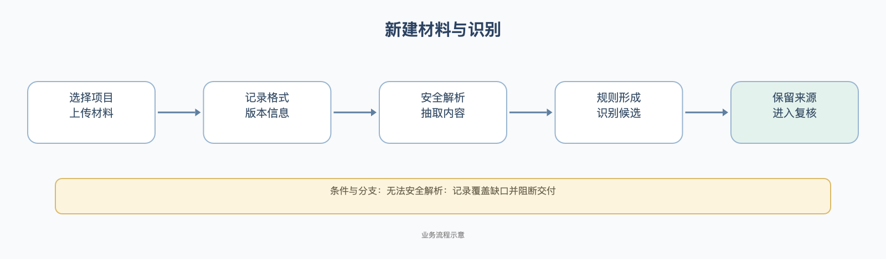

### 2. Word、Markdown 与表格文字

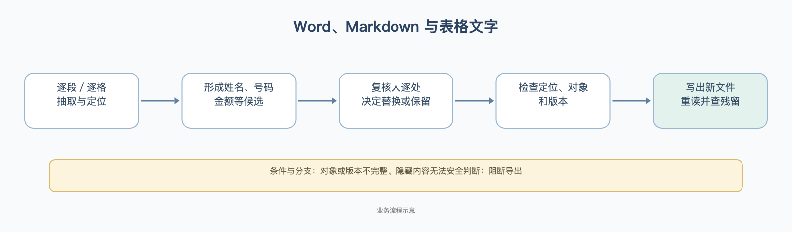

Word 的浏览器审查视图帮助定位段落、表格及图片；它不是 Word 自身的精确分页承诺。XLSX 要查隐藏工作表与公式缓存；无法安全判断时阻断。

### 3. PDF、扫描件与图片中的文字

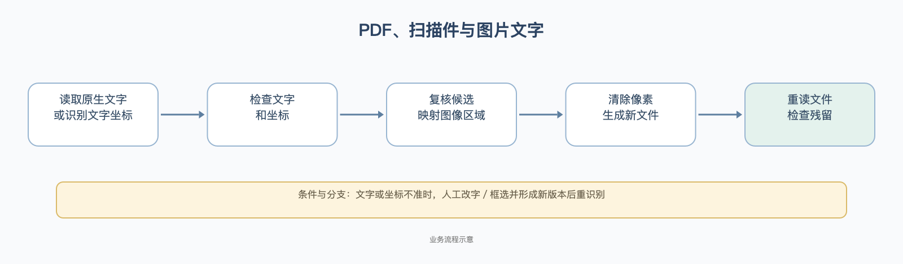

扫描件不能只盖一个可移开的黑框；最终产物必须核查底层文字、图片像素与元数据。OCR 改字只改派生识别文本和坐标，不修改原件像素；因此还需在最终文件上验证。

### 4. 人脸、印章、签名与手工区域

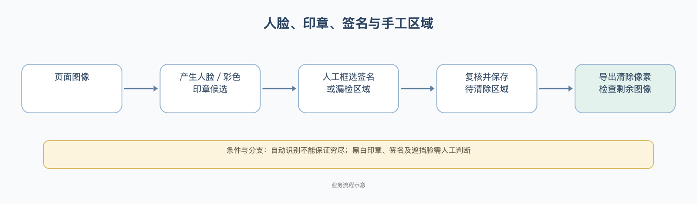

黑白印章、各种签名及侧脸／遮挡脸的自动识别不能保证穷尽；误报也需要人判断。

### 5. 名单、人工决定与策略优先级

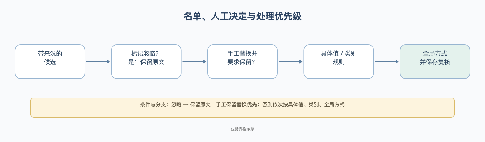

选择性处理中的“按类型批量处理”先确定当前材料里该类别的处理方式，再保存到对应的已识别标记；复核人仍可对单项改动。清除方式只出现在 PDF 和图片材料。整文件全星号模式是另一项整体处理选择。

### 6. 假名和批量一致性

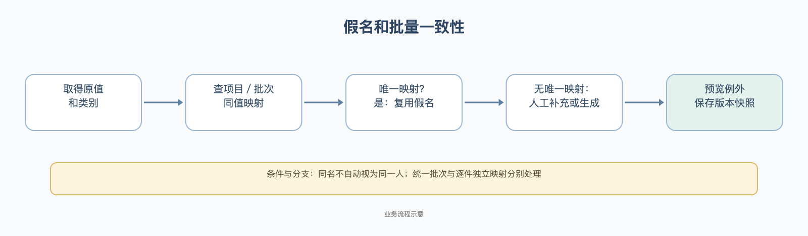

同名不同人、同人不同写法、手工锁定、保留原文都需看当前实际草稿。整批统一假名与每件独立假名不能混为一谈。

### 7. 自动处理入口与人工入口

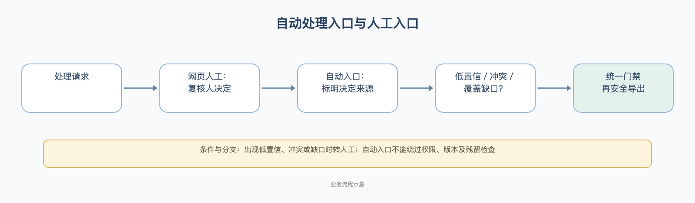

“自动”只说明决定来源，不能绕过项目权限、版本、快照、覆盖和残留检查；在线自动处理全链的真实产物仍应逐项验收。

### 8. 复核保存、导出与交付

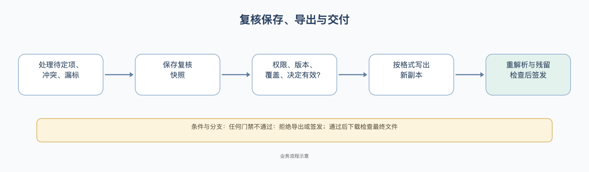

### 9. OCR 纠错、草稿恢复与旧产物

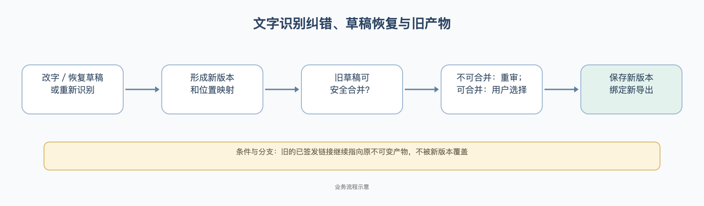

### 10. 项目名单与规则导入

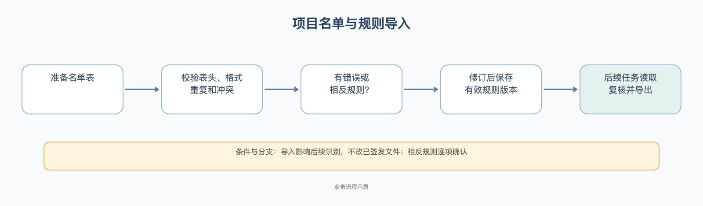

名单导入只影响后续识别候选；已经签发的文件不会被新名单悄悄改写。相反规则或同一内容不同类别，应逐项确认。

### 11. 批量材料处理

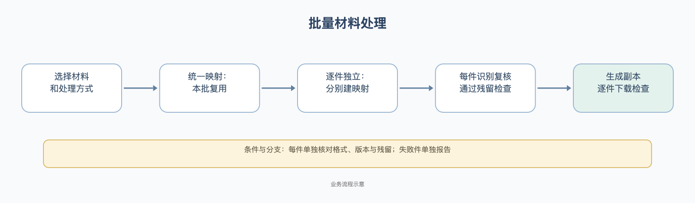

批量选项不取消逐件审查。统一映射也不能把不同人的同名内容自动视为同一人。

## 六、规则资料清单与适用边界

本节以业务名称说明规则资料的范围。前文保留规则名称、触发条件、采用方式和合成前后结果；技术人员用规则配置核验附件另行保存机器配置细目。静态资料的数量与任意真实材料的识别准确率、导出完成状态分别验收。

| 规则资料 | 数量 | 业务范围与适用条件 | 例子位置 |
|---|---:|---|---|
| 基础识别 | 41 项 | 身份证件、电话、账号、邮箱、地址、姓名、机构及常见证照编号等；按对应文书、标签、格式和上下文形成候选 | 第二节逐项列出名称、触发样例、采用方式和前后结果 |
| 金额识别 | 12 组 | 币种金额、合同价款、中文大写金额、表格金额及交易语境；比例、利率、面积、年份、期限等数字按上下文区分 | 第二节逐组列出样例、采用方式和前后结果；另登记17条金额专用条件 |
| 主匹配条件 | 57 条 | 支持基础信息与金额候选的匹配条件；必须结合类别、上下文及规则来源理解 | 第二节及本节逐条列出业务触发和合成示例；机器表达式另有技术附件 |
| 辅助匹配条件 | 527 条 | 支持地址、网址、文本格式、识别纠错及候选边界处理；不是527种独立敏感类别 | 本节按编号逐项说明技术范围；不独立触发脱敏的项目已明确标注 |
| 候选排除资料 | 108 类、3012 项 | 姓名、模型与机构的候选过滤词；只在对应规则链调用时生效 | 第三节逐类列出排除词及适用边界 |
| 文字和字段配置 | 11 组文字配置、8类表单字段、5类文书评分 | 支持网址等文字识别、表单字段标签，以及起诉申请、答辩、判决、合同、函件的文书场景判断 | 原始配置另有技术附件；业务范围和启用限制见第二、三节 |
| 遮盖词配置 | 175 项 | 支持机构后缀、名称组成和地址等类别遮盖；属于遮盖计算资料，与候选是否正确分别判断 | 第一节说明类型遮盖；完整配置另有技术附件 |
| 表格识别资料 | 32 项 | 结合真实单元格、表头和金额语境识别；候选不得跨越单元格边界 | 第三节“表格和字段”；完整配置另有技术附件 |
| 碎片重组资料 | 5组词项、32条补充条件、2组姓氏资料 | 在限定的姓名/机构 OCR 片段和上下文中辅助重组；不构成全场景保证 | 第三节“兼容碎片重组”；完整配置另有技术附件 |
| 别名及定义资料 | 64个通用机构称呼、2类名称边界条件、18个字段标签、1类定义开头 | 支持同一材料中的机构简称、当事人称呼、字段标签和“以下简称”等定义语境 | 第三节“机构名称”和技术附件中的业务说明 |

技术附件供技术人员逐项复核机器匹配细目；业务人员按本文件前五节核对触发场景、候选质量、人工决定和最终材料。所有数量描述静态配置规模；各规则的入口启用范围按对应场景列明。

## 七、验收状态与对外表述

| 结论对象 | 确认状态 |
|---|---|
| 第一节 26 个类型遮盖值 | 已按表内合成输入核算；不是检测或文件导出实测 |
| 第一节 253 条来源样例记录 | 已由冻结样例与同源测试核对，共 75 个来源编号；误报和截取错误在对应规则说明中明示；图像行展示的是遮罩字段计算，不是最终像素 |
| 41 基础识别、12 金额族、17 金额条件、108 类词项 | 静态来源资料与我方接线已逐项登记；对任意真实材料的命中与最终产物须按材料逐项验收 |
| 竞品授权处理流程 | 没有许可证，258 个登记入口的竞品处理链仍为未逐项运行状态；不能声称正版全部规则已穷尽或已等价 |
| 当前线上 | 2026年10月19日现场核查：线上容器镜像为迭代056；当前本地候选尚未完成完整验收，不能视为已上线 |
| 对外文件 | 任何文件必须经过实际识别、复核、导出、下载及残留检查，才可说该文件完成脱敏 |

本文件按证据写明完成状态：规则计算、候选识别、最终产物和竞品实测分别验收。无竞品授权运行证据的项目标为“未逐项运行”。
