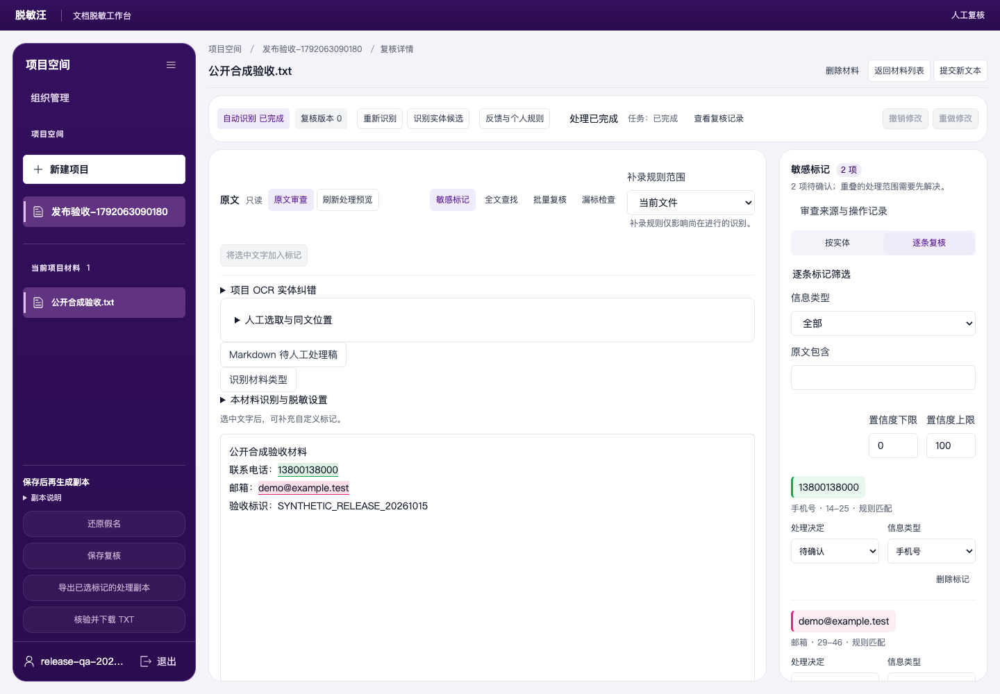
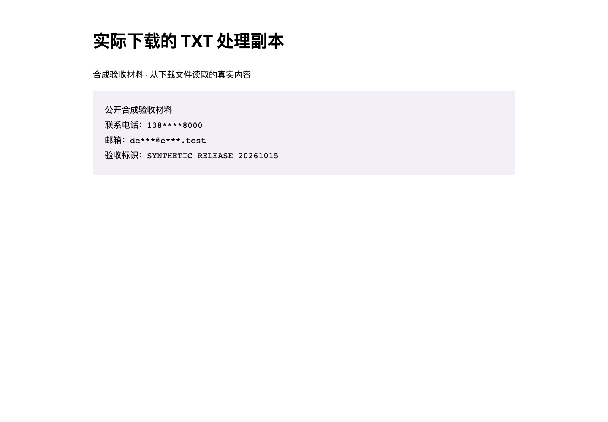
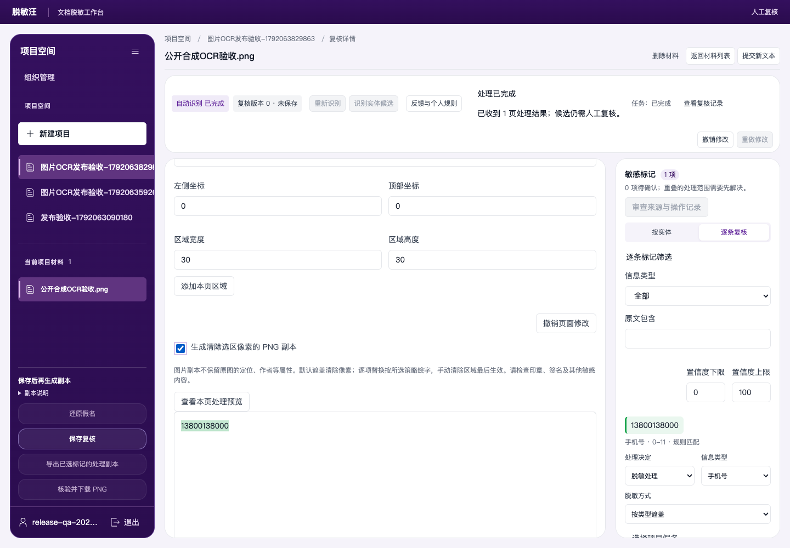

# 迭代036线上验收记录

> 检查时间：2026-10-15 19:38（北京时间）。已完成部署和实际 Edge 流程；这是一时点验证，不代表持续监控或真实业务准确率达标。

## 当前发布

|项目|核验结果|
|---|---|
|产品／入口|脱敏汪 · [公网 HTTPS](https://182.92.172.59/tuomin/)|
|版本／数据库|2026.10.15-036／增量迁移038|
|应用源码提交|`7b5ef7cafc84044f5e7f8940141e09a14ad9495f`；后续提交仅更新交付文档|
|产品固定范围|447文件；合并哈希 `2359bde57b0756a4f356857c9abe069842e60062e03f97fc74d8508ca003bf55`|
|服务器回读|381个运行源码文件、16个网页静态资产核对；指南HTML有单独补丁及固定哈希|
|服务|API、数据库、Word转换和网页健康；worker实际就绪，TXT与PNG任务已完成|
|规则／NER／云模型|rules ready、ner ready；云AI未配置，不把本地识别称为云模型调用通过|
|管理员|admin登录实测通过；当时0个可见项目，未在业务管理员下制造验收材料；密码不写入仓库|
|私有仓库|[baobaobiancheng/tuominwang](https://github.com/baobaobiancheng/tuominwang)，private；代码推送和文档推送分别回读|
|指南|[线上17节11图](https://182.92.172.59/tuomin/guide/index.html)，全部图片加载、无水平溢出；已补输出选项说明|

主程序源码不因指南补丁变化。网页镜像 `tuominwang-web:aliyun-20261015-iteration036-guide`，指南SHA-256为 `a27ab770e251179145ac7d3166b668a22a78ca867dad4d82cb5672b8163652e6`；该补丁只重建／重启网页容器，API与worker容器ID和启动时间保持。部署未改变模型启动读取代码，也未新增容器CPU或内存限制。

## 实际操作与产物

|材料|真实 Edge 操作|实际产物核验|
|---|---|---|
|合成TXT|独立验收租户登录→建项目→上传→手机／邮箱候选逐条脱敏→保存→导出→下载|两项原始敏感值不在下载文本，安全合成标记保留；119字节；SHA `376a2baf708d2f5b00056a211a4bc0ab3141932967c1f6d5b2ceb33895f035a1`|
|合成PNG|独立验收租户→实际服务器OCR识别已知手机号→确认脱敏→勾选PNG副本→保存→导出→下载|600×200；11647／120000像素变化；已查看真实下载图，手机号区域黑色覆盖；SHA `538f0c24ecbebfcfb8646a4b056a3ecc372b762a2e85324d41011c7681d35104`|
|公开操作指南|HTTPS实际Edge打开、检查全部图片与三个格式输出选项|17节11图、HTTP200、无水平溢出，发布字节与补丁哈希一致|

图片像素变化与可见黑框只证明该合成样本流程，不证明所有图片PII已消除。TXT结果图是把实际下载字节排版用于阅读，并非产品原生页面。PDF、Word、旧DOC及其他组合已有本地分层API／Edge证据，本次公网没有把所有格式重跑一遍。

初始两次TXT验收脚本等待条件错误（登录响应前读版本、空项目导航断言）及首次PNG未勾输出选项的失败均保留；修正测试操作后实际完整流程通过。PNG发现的指南缺步已修正文档，没有为通过验收改产品。

## 首次失败、恢复及相邻项目影响

首次部署19:07:08发生宿主全局OOM，内核终止了现有Semantica的uvicorn，容器重启次数0→1，随后恢复healthy。本项目部署脚本检测到相邻服务状态变化并自动回滚旧版本；不能宣称本次从未影响其他项目。数据库038为增量兼容迁移，未做数据库回滚或恢复演练。

当时服务器已有2GiB交换区且大量空闲，宿主 `vm.swappiness=0`。修复为10并保存于 `/etc/sysctl.d/99-zz-tuominwang-swap-buffer.conf`，使用现有交换区，无新增磁盘交换区、无新增容器资源限制、无模型读取修改。这是宿主全局策略修改，尚未重启服务器验证持久化加载。

第二次部署成功；以首次恢复后的状态为基线，5个相邻容器在第二次部署、TXT和PNG实际处理、指南补丁及19:38最终检查后，ID、启动时间、重启次数、运行／健康状态均一致。Semantica当前重启次数仍为1，没有新增重启。最终宿主MemAvailable为482816KiB，SwapFree为1924852／2097148KiB，仅为该时点快照；不宣称容量峰值已穷尽。

自动回滚已实际发生且成功；未执行额外生产SIGKILL或数据库恢复演练。

## 完成范围与下一步

- 指定3名Sol主审、各3名Luna子审已分批分析及交叉审查；公开0.5.9有限应用合同224项S3、34项边界S2；全部258项竞品运行R0，不外推未知版本或私有后端。
- 最终本地447文件：128文件733单元、Bend11／13、类型及生产构建通过。API85文件分层留证；最终V4两文件4测试。Edge完整第二轮60过6失败，修复后完整受影响5文件16项通过；未称最终同源单次API85／Edge67全过。
- 真实业务准确率、人脸／签名／黑白印章可靠性、MS Word原生逐像素排版、合法激活后竞品处理仍有边界，见[当前状态](../../待办与完成状态-20261015.md)。
- 下一步登录admin新建自己的项目，先使用TXT、Word及扫描件各一份，按指南复核并核对实际下载内容；管理员组织角色不会自动取得别人的项目权限。
- 技术负责人可直接取得[完整规则文件](../../脱敏规则完整技术交接-迭代023.md)，保留全部清单、图表、来源及未验证项，再按业务语料评估复用。

机器回读、精确SHA、失败日志与浏览器结果见[同名JSON](aliyun-release036-verification-20261015.json)及统一台账ITER-044。
