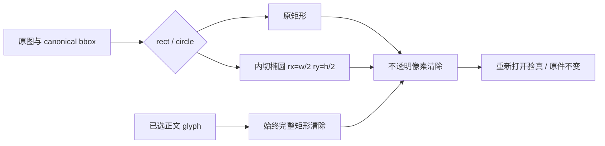

# 椭圆手绘与 Word 属性还原闭环

## 图像区域

已验证非正圆、四种颜色、缩放坐标和文字框保全；真实 PNG、PDF 与 DOCX 接口测试通过（13.4秒），中心变黑、外角保留原像素，原件 bytes 不变。标注保留 ID、原始类型、文字、形状及 opaque JSON metadata；私有字段由统一 AEAD 存储，不能作为权限或读取路径。最终增强 Edge 流程在 bundled Node24.19 下18.4秒干净通过并正常自动清理；实测两类 ellipse 的 ID、文字、237字符原始类型及 userAdjusted/operationSource metadata 下载正确。

## Word 还原

先前仅还原正文 stories，文档属性及作者字段可能遗留假名。现遍历全部 XML/rels 的非 namespace 属性和未被正文消费的 text/CDATA；逐字段一遍替换、序列化再解析验真，保留正文先于属性的 occurrence 队列。创建新邮件超链接不会覆盖已还原关系。正文原值本身含假名时不递归替换。

用户自定义 plain alias 按 literal 匹配，`AB` 与 `A B` 不合并；只有【wrapper】支持空白和 zero-width 兼容，歧义队列明确报错。还原12项与椭圆3项单测通过；真实批量 API 1.64秒通过，正文、标题、批注作者三处经 worker→派生副本→ZIP 下载均还原且无假名残留。Word XML1.0 不支持的字符明确拒绝，不生成损坏副本。独立审查人 full_inventory_eval 的真实 workspace API 两项25秒通过，Word属性、全部原字段与 wrapper/plain 假名还原已关闭原缺陷。

来源行号、hash、日志和准确状态见同名 JSON。不将静态移植或我方测试说成已取得授权的竞品运行等价。

## 大映射还原闭环补验

源/我方项目映射允许100000条，已去除还原器自有5000条限制。实际100000条wrapped和plain末token均经Markdown与跨run Word还原，5001合法、100001拒绝；原巨型Word可选空白正则造成V8fatal已替换为完整wrapper扫描与同义归一化查表，原fatal日志保留。

定向15项PASS1.85s，C独立15项PASS3.50s；实际100000条LPM上传→worker→MD/DOCX派生副本下载通过1.97s。更随机的大型plain压力复审进行中，不提前记为通过。

最终复审更新：随机长plain压力、MD形式碰撞以及共享restoreText同类入口已全部闭环，详见restoration-capacity-final-20261014.json/md；前文“复审进行中”为此前历史阶段。
