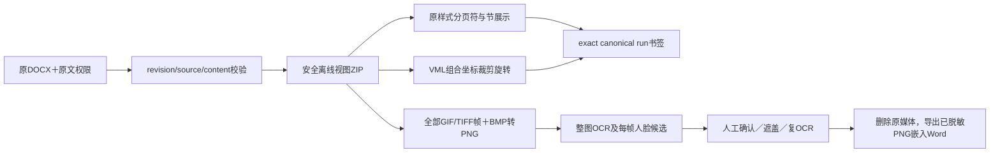

# Word 原版式、完整媒体与 VML 移植核查

> 范围：公开可读前端及本地合法材料的实现与验证。仍不能宣称与授权竞品全部处理链等价。

## 已接入分支

| 编号 | 能力 | 实现与验真 |
|---|---|---|
| DP01 | Word分页链 | 合法Apache-2.0 exact0.3.7 Vite离线bundle；分页符/节/lastRenderedPageBreak、宽高、样式表、页眉页脚、表格、foot/endnotes、comments、tracked changes配置全部接入。 验真：2页实际Edge验证；结构回退全原文保留 |
| DP02 | 授权与版本绑定 | view_original+documentScope，revision CAS/只读FOR SHARE、原件和正文hash、包SHA256、私有map/previewhash、no-store；foreign404/review-only403/stale409/篡改原件409。 验真：真实隔离API |
| DP03 | 无外联素材与字体 | Separate sanitizedZIP，External/URI/HTML/altChunk/OLE宏/SVG阻断、无原XML HTML执行；verified内嵌SFNT/OTTO+GUIDkey解混淆，字体名白名单；sandbox无scripts/CSPconnectnone。 验真：源原件不变；实际external image/link request[] |
| DP04 | 精确原文交互 | 每run原UTF16和原paragraph绑定，文本exact匹配再高亮/点击/选取，同paragraph多run允许，未知生成内容明示回结构化；generation detachedstage防旧render盖新doc。 验真：Edge跨runphone和VMLtextbox精确选区验证 |
| DP05 | 五种Word媒体 | Word/media扩展仅限五种；可靠signature辨识＋解码metadata一致，mime/path误标兼容，原part全覆盖。顶层upload格式保持现有schema。 验真：PNGbytes.jpg、BMP真实OCR与nativeDOCX导出 |
| DP06 | GIF/TIFF全部帧 | 受控逐帧读取，autoOrient/sRGB白底完整纵向atlas，frame原RGB/hash/sourcehash留存；超过既有预算显式失败，不截首帧。 验真：2帧各不同号码真实Tesseract/glyph上下层、去号码nativeDOCX导出、原rawmedia被删除 |
| DP07 | 每帧人脸检测 | 从immutable原媒体重建每帧，对完整previewRGB比对，逐frame模型输入，bbox按frame origin回atlas；旧首帧/篡改preview拒绝。 验真：mock每帧两调用与偏移；真实YuNet对OpenCV公开图与镜像第二帧GIF/TIFF各帧都返回人脸。此为合成多帧smoke，不是独立真实语料准确率 |
| DP08 | BMP分支 | MITbmp-js0.1.0 pureJS无dependency：bounds/palette校验后使用RGB1/4/8/24；独立checkedRGB16/32/bitfields/alpha/RLE4/RLE8编码与绝对/跳过/终止/CORE12/offset/topdown/containedPNGJPEG。 验真：5媒体unit＋负边界和realBMP OCR |
| DP09 | VML组合图与图片 | 组合coordsize/coordorigin，relative/absolute宽高与left/top/margin/zindex；rotate/flip；内嵌PNG图crop percent/fixedf/decimal，group递归与完整隐藏像素OCR/导出。独立受控DOM，不依赖上游0.3.7缺失的grouphook。 验真：真实EdgeCSSleft24px/cropwidth192px/matrix+离线img |
| DP10 | VML文本框/基本形状 | 已规范绑定的paragraph/table DOM移入textboxoverlay，原bold/run及选区保留；私有fork的mso-fit形状随文字伸高、squarewrap/side/horizontal选择、left/right/bottom包围距离与height/overflow所有已知分支；图片assets有界去重引用防JSON重复膨胀；rect/roundrect/oval/line受控SVG几何，不载入输入SVG/XMLHTML。 验真：WordXMLcanonical强绑定、实际table/2phone高亮、UTF16选择 |
| DP11 | VML原生导出覆盖 | 安全local r:id或o:relid一致、合法imagePart+imageTexts覆盖才complete；external/src/缺missing/conflict/unknownOLE仍blocked；exportOffice统一replace原media为已脱敏PNG，crop隐藏原像素不保留。 验真：nativeVML输出ref renamed、原part删除；source保留 |

## 实际证据

- 21 项定向单测、真实离线 OCR（GIF、TIFF 两帧不同号码；PNG 媒体路径误标；BMP）和原生 Word 导出通过。
- Edge 原件分页 17.2s、原文规范选择与导出 20.2s、VML 图形与文本框 18.2s。外链 request 数组为空。
- 真实 API 检验 `view_original`、外租户、无原文权限、旧 revision、原件 hash 损坏。
- 完整代码、日志、截图 SHA256 见同名 JSON；不改原件，不访问外部素材。

## 流程

## 尚不能等价的范围

| 编号 | 范围 | 说明 |
|---|---|---|
| DG01 | Word自动换行/自动分页/字体与Word像素一致性 | docx-preview官方只处理文档已有分页符/节，不保证Word自动分页；未内嵌或不可解混淆字体采用本机回退。无授权竞品Word真材料处理链端到端对比。 |
| DG02 | VML自由曲线/模板/公式/渐变纹理阴影 | 源Nd对无image交给source渲染器的底层形状；本工具基础几何与textbox已补，复杂freeform path/shapeType/equations、渐变阴影明示warning，未虚称精确绘制。 |
| DG03 | 源大文档虚拟分块/取消耗时渲染 | 源12k正文或2MiB文件触发虚拟段落/45–120s预算、自定义yield/cancel；当前源版本0.3.7全DOM分页，generation禁止旧渲染提交但不具备相同细粒度中止/virtualization。已有source版式size预算避免无界输入，仍需等价性能验收。 |
| DG04 | 罕见位图编码/APNG | OS2 Huffman/RLE24、未知BMP子格式及APNG多帧明确拒绝；GIF/TIFF全部帧已实现，未声称全部图像编码规范穷尽。 |
| DG05 | 真实多帧人脸/文字语料准确率 | 完整逐帧工程链通过合成OCR、模拟faceboxes及真实YuNet公开OpenCV图+镜像帧smoke；仍非独立真实各格式准确率/竞品性能等价。 |
| DG06 | 同run混排VML与前后普通文本的flow细节 | 有文字共享VML run时为保证source bookmark exact把VML容器置于该run之前；绝对定位/旋转/组坐标支持，不保证内联picture精确位于文本中间。 |

## 截图

## 依赖

- `docx-preview@0.3.7`：Apache-2.0，客户端构建依赖，与源公开 package 范围对齐。
- `bmp-js@0.1.0`：MIT，无递归依赖，服务端纯 JS；许可与 decoder hash 固定。
