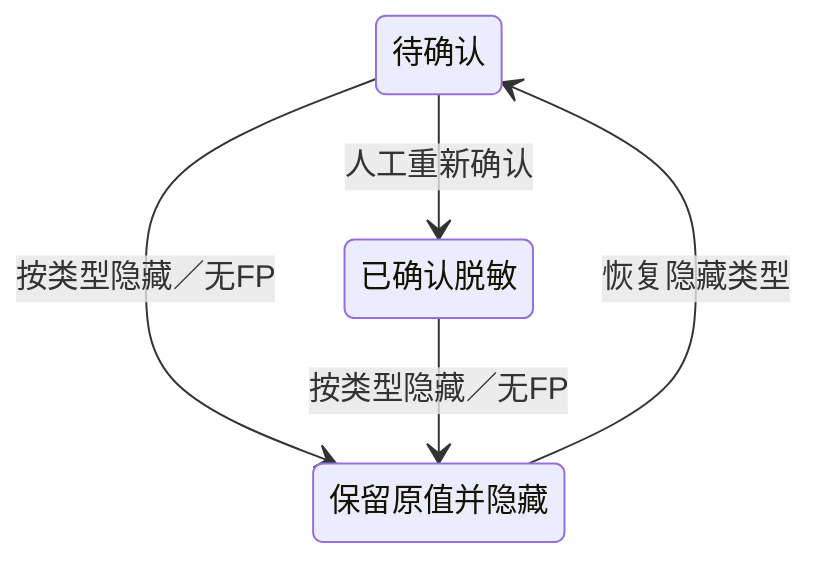

# 最终规则与类型隐藏边界补齐

竞品保持R0。本报告只对应确切已发现分支，静态读完、我方接口通过、浏览器通过分别记录。

## 已补齐

|缺口|实际修复与验真|
|---|---|
|规则32768额外上限|去无源依据上限；32769条完整保存／回读／项目绑定／末条worker实际消费。作者13.508秒，C独立11.286秒。Mark安全预算与模型不改|
|合法命名字段归一|按真实source先清空ruleset描述、all适用范围及exact匹配；保自有条目路线扩展，未知字段拒绝。sourceVM2项、实际API1项3.080秒|
|material类型域混用|root独立桥other→general、complaint→pleading，保显式路线；真实general末条识别证明闭合，不改NER分类|
|类型隐藏只做session视图|已改真正持久ignore+hidden字段，原槽位不删；恢复必须pending。Word真实1API13.366秒验证保存、重载、导出保原值、恢复后门禁与无FP|
|人工出生被操作来源混淆|新增描述属性userAdded，以服务端当前slot／031判定；自动改决定／类型及客户端伪造不能冒人工，人工也不能被伪造为自动|
|导入manual反馈计数遗漏|用可信reviewEntityBirth，实际API1项3.737秒：manual树删除仍存FP记录，但FP增量0/FN减1，客户端标志不能改变|

隐藏的恢复不等于重新批准。原始规范文本、原件、字框和不可变既有产物都不改。来源属性不是操作人、模型准确率或审批。普通ignore不等于source deleted。

## 工程与独立审查

A独立重跑C的DOCX／Markdown × native／V1／V2／V3八次往返，真实1API通过39.643秒；source-only文件去我方扩展仍保隐藏与真实出生，隐藏不进入forceSkip规则提取。作者原始proof与A冻结proof分存，不冒充第二次竞品运行。

root正常保存记录type-hidden／type-restored真实事件，B的新Edge验收由root统一窗口执行，未由上述API推断通过。完整代码与日志hash见同名JSON。

最后逐ID父审另发现单条feedback.type源允许字符串而我方限定3种；该项已交root/C决策处理，没有借相同功能域批量升级。最终60候选与6保守ID仍以父审报告和最后门禁为准。

## 最终补充

规则命名归一C独立1API7.122秒通过；type-hide加入真实actor历史与双向出生伪造后1API19.297秒通过。raw反馈类型由C最小修复，A独立1API3.143秒通过：review:get-statistics独立路由，lower-includes全局与exact-review计数不混，未知原type不丢、batchFP-only不变。60个命名云合同字段／输入父审已完成，6个边界I1保留，产品遵root最终release冻结。最终全量及Edge另由root记录。
