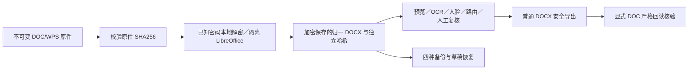

# 旧版 Office 全入口集成验收（2026-10-15）

状态：作者实际 4 API 全通过；A 在最终 amd64 转换服务上独立复跑 4 API 全通过（98.46 秒）。竞品授权运行仍为 **R0**。

## 逐入口证据

|入口|实际行为|证据|
|---|---|---|
|原件上传／自动归一化|upload manifest→immutable source DOC/WPS→detect worker normalizeStoredDocument→locked persistDocumentNormalization|4 actual APIs: tests 1,3|
|已知密码重试|POST /documents/:id/normalize: view_original+review+revision CAS→known-password local decrypt→CFB→UNO; clear request password; new detect job|test3: no password terminal DOCUMENT_ENCRYPTED; wrong password400/no pointer/no revision change; correct password200→review; stale409; cross-tenant404|
|统一双源读取|verifiedDocumentSource first hashes original; validates AEAD normalized metadata/AAD and original binding; hashes normalized DOCX; no unlocked alias|tests1,3: format doc retained; source id/hash untouched; normalized id distinct; normalization metadata and normalized hash corruption rejected|
|原文审查／结构预览|processingDocument projects processing format to DOCX, preserving original_source_format; layout/preview/read/gate use same verified source|tests1,3 actual layout/preview→save review→export|
|材料路由|POST detect-route-only→processing boundary→verified normalized DOCX→source-compatible route extraction|test3 actual route200 success|
|Word图像 OCR／应用|recognize-docx-images candidate binds source/content/revision; apply revalidates verified source before canonical update; keeps original normalized object immutable|test3 actual OCR candidate200/apply200, fresh review required|
|Word嵌图人脸／标记|office-face-candidates/visual pipeline uses projected DOCX and verified source; glyph/annotation validators recognize original DOC/WPS as Word|test3 actual office-face candidate200, no claim of new face accuracy|
|普通脱敏默认导出|DOC and WPS use DOCX by source Mac/LibreOffice ordinary caller (main17795–96,17870–89); no automatic DOC reserialization|tests1,3 actual DOCX MIME/parse; sensitive phone absent|
|显式 DOC 原格式扩展|Only explicit outputFormats doc: convert already verified DOCX→actual DOC→actual reread DOCX→seven-source-dimension compare PLUS verifyOffice full XML/attrs/filenames/image OCR residue; preserve immutable DOC bytes|test3 actual doc primary + word-docx extra role; download DOC→real UNO reread→phone absent|
|临时资源／处理报告|source leases report originalFormat/processingFormat separately; resources and reports authenticate both source objects; DOC bytes treated as binary|test1 actual source lease+report; corrupted normalization metadata rejects report|
|四种备份／重开|native .tmw plus source V1/V2/V3 carry raw original separately from normalized DOCX, truthful legacyOffice metadata, normalized witness; same-server witness rebound to new doc AAD; all previews/maps immutable|tests1,3 all4 formats actual export/import→detect review→portable-draft restore200; no old review autoapproval|
|跨服务器见证边界|No matching HMAC: retain normalized bytes as encrypted opaque asset, report normalizationRequired, rerun conversion from original; never silently trust foreign normalized proof|static guarded branch; current 4API matrix proves same-server path, does not claim independent cross-server runtime execution|
|单／批量旧 Word 另存 DOCX|restorePlan approved mapping→normalize same raw bytes→restoreDocx→immutable derived result, encrypted dual-source proof|test2 actual DOC/WPS explicit DOCX body restored; protected legacy_sources saved; batch ZIP real download|
|单 DOC 原格式还原|Source restore Rp differs from ordinary default: default DOC restored output strict actual DOC and reread; WPS original unsupported, explicit DOCX available|test4 actual CFB DOC→restore→DOC download→real reread correct body/no token/source SHA unchanged; test2 WPS original truthful failure|
|存储归属／原件保护|normalization objects owned by document; restoration original+normalized objects owned by project; never overwrite object; quota includes normalized and retained copies; AEAD private metadata only|actual immutable hash+AEAD tests; existing owned-object deletion lifecycle reused|
|取消与临时目录|root parent records actual converter jobId before ack/RPC; cancel on worker termination; A service cancellation tombstone rejects late convert; own process/profile cleanup|A independent actual3 tests reported PASS: parent abort408ms, PID/profile0; cancel-before-convert; invalidUUID400; separate A report is authoritative|

## 实测

4 tests / 4 passed / 0 failed / 0 skipped，261.56 秒。Node 26.6.0，实际 HTTP → 隔离 UNO，无 mock。精确日志、源码哈希和失败历史见同名 JSON。最终 `pnpm typecheck` 通过。

## 能力边界

- Licensed competitor handler runtime remains R0; source-static and own actual tests are distinct.
- Cloud LibreOffice follows source Mac ordinary DOCX default. Windows native Word/WPS bridge not executed; own strict optional DOC export is explicitly additional.
- Original WPS output remains source-unsupported; UI offers explicit reviewed DOCX alternative.
- Source V2 reader explicitly accepts libreoffice while older Gm schema only word/wps; truthful engine metadata retained, no fabricated Windows engine.
- Raw original bytes in native extension are an additional immutable safety feature; source desktop workspace stores normalized DOCX with legacy filename/metadata.
- Full hidden XML and OCR residual gates remain; manual selection of public XML namespace URI still correctly cannot yield a safe mutated namespace artifact.
- No model startup, memory/resource limit or other project modifications.
- No cloud/server deployment performed by this report.
- Product browser acceptance and root full release gates remain separately documented.

## 034 对抗修复补证

- 未知归一化见证、保留副本再次备份、配额及原件哈希破坏：1 个实际 API 测试通过（4.92 秒）。
- B 发现 reference 草稿分支缺统一派生源验证，已在 API 与 helper 补齐。实际正例 200；原件／归一副本／解密副本字节破坏均返回 409，原复核状态不变。1 个实际 API 测试通过（7.17 秒）。
- 后者用真实上传与合法解锁对象、源 serializer 生成旧稿，再构造私有导入状态；不声称当前普通客户端可自行写该状态。精确日志与原 033 字节归档见 JSON。
