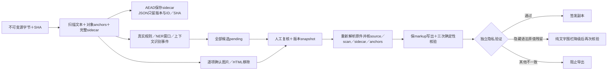

# Markdown 原格式与私有审查链 · 迭代028

源码：脱敏猫0.5.9静态chunk `D9V2C_Ir.js` 的 classHi parser／MarkdownSourceWriter，main17237–17245真实事件、17795–17807 Writer调用，renderer逐项图片／HTML处理。**未运行正版完整处理链，R0**。独立实现使用固定版本公开mdast/GFM/YAML/parse5库，未将竞品整个模块作为发行runtime。

|完整分支|实现与结果|
|---|---|
|UTF8／BOM／CRLF／混合换行／`.md`与`.markdown`|保来源byte hash、source UTF16长度、scan SHA；解析不加载图片、不执行HTML|
|普通正文／heading／emphasis／delete／code／list／quote／task／footnote|sourceMap／syntaxContainers映射精确UTF16；不能安全定位则明确降级|
|GFM表格／HTML表格|实际行列、rowSpan／colSpan、caption、单元格segments；HTML只输出惰性表格结构与数值span属性|
|链接／自动链接／引用链接|扫描可见标签和目标，导出移除目标与危险属性，按canonical独立复核|
|YAML frontmatter|保有效性／错误；产品额外扫描numeric／boolean／null的raw scalar，不用Number舍入长证件号；sourceCompatibility仅研究oracle，产品导出拒绝|
|图片／非表格原始HTML|UI默认可见，GET／PUT按来源hash与scan hash逐项确认，AEAD保存pointer并新snapshot；全部确认后移除|
|零可见文本|非空原件仅含图片／HTML可人工确认后安全导出0字节；旧TXT／旧rawMD与原件空输入限制保持|
|隐私独立核验|另算expected canonical，不复用Writer补丁规划；查原值次数、links／HTML、输出sourceMap外隐藏语法原值；YAML comment／anchor／alias漏项已安全降级，正文明确保留同值仍保留|
|旧项目版本屏障|raw MD1不能套新scan offset，必须重新识别；旧已签发副本保原认证路径|
|事件|source-ready真实完成；matches源首次／25k完成字符／250ms／末尾刷新；真实NER126-token窗口回调，全部标provisional与人工待审|
|私有完整性|recognition.markdown只版本／哈希／sidecar与ACK的ID；所有原文sidecar与事件AEAD，权限／owner／job／generation／revision／source／scan验证|

## 验收证据

|层|结果|
|---|---|
|源码完整字段oracle|27 parser＋103 Writer输出／格式／操作／字节source案例；纯函数零差异|
|定向回归|8文件163 tests通过3.30秒，含表格、事件、报告与视觉绘字安全回归|
|真实隔离API|4通过17.48秒，含BOM／CRLF完整导出、旧坐标拒绝、零scan、未／部分ACK阻断、非法ID、版本错、其他用户404、私有sidecar假hash409|
|实际表格API|另2通过7.76秒，5格式中GFM／HTML实体表与同cell跨emphasis姓名完整，金额／面积排除不回归；只合并同cell相邻scan spans|
|实际NER|默认与窗口progress结果deepEqual；UTF16／多window／单调完成prefix通过2.36秒；模型读取／初始化未改|
|实际Edge|18.3秒完整上传→默认页面确认→敏感组复核→保markup下载→刷新确认仍在，pageerrors为空；终态进度显示“处理已完成”，干净自动退出|
|独立审查|C独立复现并关闭YAML隐藏语法P1；B提出零scan与进度文案，分别完成修正及实际验证|

日志与截图在`.data/research/lawbot-2026-10-14/iteration028/`；准确文件／证据SHA见 [机器可读报告](markdown-source-porting-20261014.json)。初期测试locator错误与工具隐藏P2历史没有计入通过。

## 范围

本阶段支持已取得源码的上述分支与我方真实运行，不声称未知敏感信息自动穷尽、真实业务准确率或正版产品端到端等价。未选中的未知敏感内容仍须人工审查与授权业务gold。最终全仓形式门禁／build／隔离API／全站Edge／部署由root单独记录。

## 迭代029最后反例修正

产品降级不再写固定代码语言text，避免选中原文text进入语法侧残留；纯源Writeroracle不变。定向单测137PASS；真实API5PASS18.77s，包含零scan图片/HTML先拒导出、源hash绑定ACK后0字节副本、保留被忽略的同值正文。见iteration029/markdown-fence-final-api.log及最终交叉审查报告。
