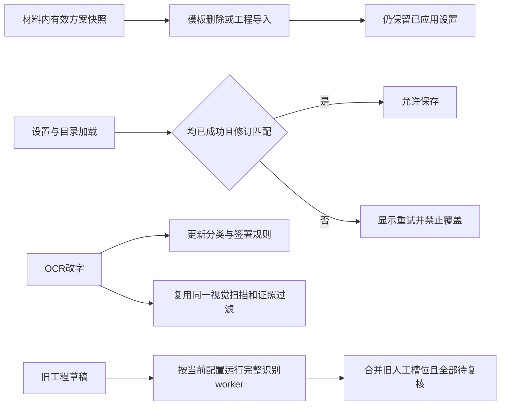

# 054：材料设置、OCR 与工程恢复检查点

日期：2026-10-16。054本地验收形成分层回执后已部署并完成公网只读验收，见[054上线结果](aliyun-release054-verification-20261016.md)。本地通过不能代替全部格式组合、竞品合法激活后的运行验收或线上业务材料处理。以下原始阶段记录按发生时状态保留。

## 本地最终结论与证据范围

| 门禁 | 终态 | 精确边界 |
|---|---|---|
| 接口 | 独立复制树标准runner单次112文件、222通过、0失败/跳过；六格式另1串行专项通过 | 分层113文件，不称单次113；旧865复制输入与额外合成加密DOC夹具前后无漂移，正式合并API/runtime字节不变 |
| 完整check | 135文件798单元、Bend11法律/13变异、类型及构建终态0 | 847个限定范围输入及477份受保护旧产物无漂移；旧865清单原字节保留，旧清单含22条依赖缓存 |
| 完整Edge | 原88项83通过、5失败、0跳过/重试，失败trace保留 | 后续受影响项严格复验；LF、CRLF、Word各有独立成功，不是同源单次89项全绿 |
| CRLF与Word | 最终LF完整例通过；CRLF最终例1/1；Word可见性1/1 | CRLF最终用受控DOM选区及合成mouseup，实际React/API/保存/下载/原件字节；Word经真实rev1布局及导出后的视口目视，仍非MS Word逐像素等价 |

复制树112终态见 `iteration054/arch/copied-api-112-terminal-review.md` 及原始receipt/log；六格式代表模式见 `rules/cross-format-run-v2-attempt04-output-proof.json`；正式check见 `final-check-v4-receipt.json`、`final-check-v4.log` 与独立复核；输入合并见 `final-source-merge.json`、`final-inputs-v4.json`；浏览器原失败见 `full-edge-v2-receipt.json`。上述路径均位于 `.data/research/lawbot-2026-10-16/iteration054/`。模型读取、资源限制、原件和既有签发对象保持；258个入口的R0、S/I及业务金标边界不升级。

本地发布准备另有 `iteration054/web-build-v4-receipt.json`、`final-runtime-stage-precommit.json`、`private-github-visibility.json`：前端构建、398个运行文件的本地预提交路径/哈希与私有仓库可见性已核。这些是服务器变更前的本地打包准备回执，单独不能构成054上线验收；实际部署与公网回执见[发布记录](aliyun-release054-verification-20261016.md)。三文件位于 `.data/deploy/aliyun-20261016/iteration054/`。

| 已确定问题 | 正式修复与当前证据 |
|---|---|
| 个人方案/规则集删除后，材料内快照仍有效，但保存回显旧 ID 会 404 | 只对当前已应用配置的同一 ID、精确 NOT_FOUND 回退到已验证快照；新未知 ID 仍 404，规则集管理权限仍 403。真实上传、备份、删除、导入、保存链 1/1；完整快照只允许新内部 ID 等既有字段变化 |
| 设置或目录加载失败/未完成仍可保存空配置 | 材料 ID/修订匹配且两者均 ready 才启用；错误可重试。真实 Edge 1/1，失败/延迟无 POST 且策略不变，重试后真实保存 200、识别 200、原件不变 |
| OCR 新分类未保存，签署表格复核受阻 | 保存当前 classification；真实 DOCX 图像 OCR 与签署表格同长度/增长度、完整姓名跳过及单字不拆签署组 5/5 |
| OCR 候选只执行普通 ruleset 过滤，遗漏逻辑签署策略 | 与 worker 采用相同逻辑组、启用类型及保留签署组规则顺序，上述 5 例覆盖 |
| OCR 正文依赖的证件过滤未更新，反向改字也无法找回已丢弃候选 | 抽取原 worker 扫描为共享 adapter，在经哈希验证的同一预览上重扫，与正文同事务更新；无请求检测器时保留原 partial。正式新 API 2/2，实际红章检测 raw>=1，分→份为 0，反向恢复>=1；原件、预览和人工页区域不变 |
| 工程恢复 fresh 阶段仅调用核心规则，遗漏当前 ruleset/runtime/contextual/NER/视觉等既有层 | 复用完整隔离 detect worker，清空当前纠错帧和 page_review，传当前字典修订、规则及作用域白名单；真实 TXT 上传、备份、导入、当前 forceDetect/forceSkip、旧人工槽位与 pending、原件字节 1/1 |

## 未闭合范围

- 本节以下为验收中的历史阶段记录；最终check与112文件API终态见上表。原88项Edge终态83过5失败，后续分项复验不能改写原失败或冒称单次全绿。
- CSV contextual、Markdown sidecar、OCR 改字后的非空密封页审查/历史纠错、新 glyph map 的失败清理仍在专项检查。已发现导入后的识别可能清除不匹配内容 hash 的旧纠错帧，尚待真实 PNG 链确认及修复。
- 恢复旧人工草稿保持待复核，未等同普通发布 worker 的替换策略最终化；旧页样式保留，也不能直接声称当前方案页样式完全一致。
- 258 个入口仍全部竞品 R0，224 S3/34 S2；34 个原生/外部/私有实现边界、真实语料金标、视觉质量、原生 Word 和部分外部调用验收继续保留。
- 未更改模型读取、模型阈值、自动批准规则、原件或线上资源限制；本条写于054发布前，实际发布结果见文首链接。

## 证据索引

工作区 `.data/research/lawbot-2026-10-16/iteration054/`：profile-red 保留真实 404；profile-green、profile-v3、ocr-green、configuration-edge-v2、portable-v4、visual-v2 各有原始日志及终态回执。Edge 首次缺少 Origin 导致 403 的测试修正单独保留，未伪装为产品故障。before-merge、before-visual-merge 与 checkpoint-transition 保存旧字节及新旧 hash。研究 candidate-tree、环境变量、模型目录和测试数据库不纳入证据快照。

## 054 最终门禁计划与反驳更新

前述“历史纠错可能丢失”已被真实 PNG 链反驳：worker 保留旧密文 envelope 并标 stale，恢复按旧 content/source hash 解封与槽位重绑，再按新材料 ID/AAD seal，current=false→true；不需产品修复。根组正式 `portable-fresh-completeness` 2/2，覆盖真实 PNG OCR 改字/项目纠错、当前密封页区域受控夹具、忙时 map 清理、CSV 精确 TABLE 来源、当前文件白名单/字典修订和 Markdown sidecar。夹具和 API 边界见 rules 专项报告。

首次完整 check：134 文件中 133 通过，794 单元中 793 通过/1 失败；Bend11/13及类型已过。失败仅因旧空间适配器单元用不存在的随机预览 ID/零 hash。修正为真实 owner-bound PNG；原路由、profile、pending/reference-mask 断言保留，并加篡改 hash 必须 SOURCE_MISMATCH，定向 2/2。原失败 log/receipt 保留，不能藏掉。

最终冻结 864 输入。计划完整 check（含重跑该夹具）、111 API 文件（每文件新隔离库）、53 文件 88 项真实 Edge 清单；这里是计划，终态需后续回执。测试清单包含 9 项 mock/hybrid 回归，不把它们冒称真实后端链。运行前完整保留 4436 份历史 pin 的精确字节，生成证据改写先另存新字节再恢复旧字节。

新增 callback rollback 用例在实际 document/project SQL 写入后的 audit 触发点抛 test-only 异常，精确要求 500/INTERNAL_ERROR。非事务 sequence 见证必须已调用一次，避免任意 4xx 假绿；数据库、owner目录、旧map与原件逐项核验。此加强版本等待全 API 终态，COMMIT 网络回执未知仍仅有源码边界，不计模拟超时为通过。

## 865：fresh 替换政策遗漏已按真实产物修复

先前列为未等价的“普通发布替换政策”被实际证实为 P2：旧备份缺少这些候选，导入后正常识别按当前策略有 full/alias replacement，但恢复 fresh 候选后该属性为 null，人工复核后仍允许导出，产物退化为【手机号】和【内部代号】。同源三模式 RED 保留。

仅 native 恢复中旧 imported 索引的补集走现有 profileReplacementPolicies → applyReplacementPolicies → resolvePolicyMappings → finalizeProfileReplacements，仍在原项目/材料锁与授权事务内按原索引回填。旧人工槽的 custom 和 mapping 身份不被覆盖，所有决定仍待复核；未改旧页样式选择或参考工程分支。

根组真实隔离 API 1/1（内部三模式）：full_star 产物为逐字星号，custom_pseudonym 为两个当前假名 token，selective_pseudonym 为手机号星号+代号假名，三份实际下载字节与正常当前策略逐字相等。fresh phone、fresh forceDetect、旧人工 custom/pending 与原件字节均核验；前端组独立审查无确定新 P1/P2。此为 TXT 三模式，不冒称全部格式已验。

864 的整批 API 在确认上述问题后主动中止：7 个文件完整通过，第8文件已有3例通过后仅终止本人隔离 test 叶进程；标准父 runner finally 结束清库。回执 8 duration/15 pass/1人为终止不能冒称全部111或产品失败。865 重新冻结，完整check重跑中；新计划112文件API和88项Edge仍待终态。

callback 回滚见证首次因 test-only sequence 未授权 tmw_app 而 is_called=false；500不足为通过。仅在隔离库给此见证 sequence USAGE 后，根组实际1/1、准确目标trigger触发、数据库和owner集合/旧map/原件不变；原失败与旧字节完整保留。未改变产品角色或默认权限。

## 完整浏览器终态、六项复验通过与新定位反例

以下为发布前阶段检查点，当时线上仍053；现054已部署。根组已实际观察完整 `pnpm check` 终态0：134文件794单元、Bend11法律/13变异、类型及构建通过；865锁定输入前后相同。其收据父进程曾为避免覆盖浏览器截图而暂停，浏览器终态后精确核PID/cwd恢复；不是凭子日志推断终态。

| 本次门禁 | 实际结果 | 范围与剩余 |
|---|---|---|
| 全88项Edge | 83过、5失败、0跳过、0flaky，25.4分钟；865无漂移 | cancel抢先GET、entity同值限流、project查漏两例尚未等到action终态、NER完成提示只等5秒；保留所有原trace |
| 独立四文件复验 | 实际7项，6过1失败；child exit1 | cancel、entity第二例、project三例、recognition已过；不是整批全绿 |
| 新真实反例 | 同值组第2/60处已显示，textarea选区持续为空 | 请求窗口offset39757/rev0返回200、正文963字节位置上下文；应选中绝对40013处手机号。仍待修复真实浏览器GREEN |
| 112文件API | 独立复制树执行中 | 不以阶段通过数宣称全112通过；额外加密DOC夹具已补当前输入pin |

新前端候选复用提交后的focus effect，等待project/document/revision、精确next.textOffset、busy=false及实际DOM value匹配；旧GET晚响应不能覆盖已切换材料。候选保留第2/60并进一步核绝对start，尚未正式合入。旧RAF在受控文本提交前选区是与源码和DOM一致的机制推断；trace未直接记录RAF执行，不冒称逐帧证明。

### 输入分类与首份复验包装器错误

旧865清单实际包含843项目源码/测试/配置/固定生成产物及22条Vite依赖缓存。正式865前后全部相同；私树843项目输入按候选expected全部相同（839同正式、4份E2E候选有意不同），22缓存中17因私树Vite重生成变化、5未变。全部旧缓存字节已归档。后续新freeze将排除嵌套node_modules，当前运行中的865与API112不改。

首包装器先触发POST_RUN_INPUT_DRIFT（把重生成缓存也当源码）；其次硬编码6而真实选中7。原receipt、log、JSON未改；独立严验从原88计划取id/file/titlePath精确集合7/7，仍得6过1失败、child exit1。不能把元数据问题用于掩盖真实entity失败。

归档的材料查漏请求在5秒断言终止前无响应，状态为-1，并非4xx/5xx或成功证据；重验三例实际通过后才计入我方结果。NER重验强制同doc/job/revision实际succeeded/review/nerEnabled=true，再核原提示。当前不重复整批88来替代尚未修复的定位问题。

S/I/R和未授权竞品运行边界不升级；TXT三模式产物专项与其他格式静态接线仍区分。规则组新增六格式候选正在独立实测，旧夹具队列与缺少锁定OpenCV runtime的失败均保留，不能称六格式完成。模型读取、原件和生产部署配置保持原值。

## 112接口回归、CRLF与正式合并检查点（发布前历史）

独立复制树标准runner单次完成112个API测试文件：222 pass、0 fail、0 skip，进程实际终态0。正式与复制树旧865输入以及额外合成加密DOC夹具前后均无漂移。865包含843个四目录项目输入和22条Vite缓存；不是865个手写源码。原copied manifest误把main.js的SHA配给handoff JSON，原字节保持，另存三份source/copy实际哈希纠正说明，不影响实际执行。

| 验证 | 实际结果 | 边界 |
|---|---|---|
| 112文件API | 复制树单次222/222，0跳过 | 后续只变web和测试；API/runtime输入无变化 |
| 六格式fresh专项 | 单独1串行用例、CSV/MD/DOCX/XLSX/PNG/PDF各一种代表模式全过；TXT另有三模式 | 正式新增test与实跑attempt04逐字相同；不是单次113文件，也不是18种组合 |
| 原88项Edge | 83过5失败，失败原件保留 | 严格等待真实action/NER终态、识别真实429窗口后分项复验；不是同源单次全88绿 |
| 最终LF定位 | 最终main/helper/OCR候选的两例批次中，LF完整例通过；CRLF首例失败 | LF含绝对40013定位、实际导出与切材料；该批次总计1过1失败 |
| CRLF最终例 | 新私树1/1、0retry/skip；DOM270–273对应canonical40036–40039，PUT保存rev+1，同export job，TXT逐字及原件bytes均过 | 受控DOM选区+合成mouseup，真实React处理/按钮/API/下载；未声称物理鼠标拖选 |
| Word可见性 | 独立1/1、真实rev1 layout200、导出下载，复核前/导出后正文完整在视口；根组实际目视 | 旧灰图仅证明当时截图未显示正文，不能推断渲染丢失；仍非MS Word逐像素等价 |

首CRLF只设置DOM选区并派发原生select，未证实React选区状态；第二次用Shift+ArrowRight，本机独立Edge对照显示该动作在readOnly框不扩选、在可编辑框正常。另一个独立setter对照反驳了“raw CRLF重复赋值必然重置range”的猜测。两次失败、未采纳的显示值规范化草案及原始trace保留，没有据猜测改产品。最终仍使用v3坐标桥；原件/canonical保持CRLF及UTF-16，主原文框/OCR双方转换。

根组已归档7份正式旧源码后合入11文件（4新增）。新847清单重扫apps/packages/scripts/tests+7个根Bend/配置文件，排除全部node_modules路径与Python缓存；旧865清单永久保留。旧843到新847仅7处web/测试变化、4新增，API/runtime零变化；vendor/licenses/services由发布manifest、clean HEAD及固定转换器image另验。最终pnpm check已按847终态0：135文件798单元、Bend11/13、类型及构建通过；477份历史/研究产物新字节先归档、旧字节恢复，前后无漂移。

本段形成时054尚未提交/推送/部署；目前运行代码commitA已部署、公网只读054已核，文档提交commitB另行记录。055材料规则权限与有效值候选另记，不夹带本次发布。258R0、224S3/34S2及I等级不升级；真实业务金标、印章/签名质量、复杂Word与私有/许可原生边界保持。模型读取、生产资源配置和旧原件/已签发对象未变。
