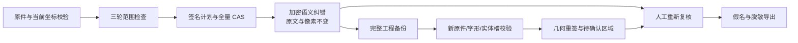

# 项目 OCR 实体纠错与工程几何往返

竞品授权处理运行状态仍为 **R0**；本报告仅记录公开源码有限链路及本工具真实验收，不宣称全产品完全等价或已部署。

|链路|入口|实际检验|
|---|---|---|
|C035-PREVIEW|POST /api/projects/:id/ocr-entity-corrections/preview|actual owned source/derived SHA, canonical SHA, authenticated page maps, indexed slot, scope+view_original+review, complete project fact fingerprint and skipped/conflict summary|
|C035-APPLY|POST /api/projects/:id/ocr-entity-corrections/apply|user/project sealed plan+exact recompute, project/document lock, full-document CAS, atomic multi-document semantic frame and pending marks, immutable source/canonical/pixels, no accepted snapshot|
|C035-CONSUME|recognize/review/alias/export/restore/filter|every semantic value lookup carries mark index; recognized/corrected forms both retained, alias value corrected; re-recognition exact physical span/original-type slots; stale state remains reviewable but export blocked; ordinary save/OCR/rotation trusted links only|
|C035-RECORDS|GET/DELETE /api/documents/:id/entity-corrections|current or explicitly stale inherited history visible only with permission; DELETE revision CAS resets outdated and requires real re-recognition; UI label does not pretend recognition queued|
|C035-PORTABLE|native/V1/V2/V3 export/import/draftrestore|full encrypted correction/native policy/provenance/history retained; source gv recovered against fresh glyphs without own frame or nativeextension; all marks pending; no imported approval|
|C035-GEOMETRY|portable export/import/draftrestore/confirm-region/review/export|old authenticated scope/source/canonical/glyph/slot geometry archive→fresh current031 entityId/newmap/newscope token; candidates still explicitly confirmed; confirm/pagecandidate/resolve revision changes preserve exact031/036 slots; unknown server/tamper retained as unresolved and export blocked|
|C035-LEGACY-GEOMETRY|DOC/WPS normalized source → source-format archive|only existing authenticated normalization attestation can translate old source hash to actual normalized source hash; canonical/glyph/slot checks remain exact; original historical token/actor remain authenticated and marked inherited|
|C035-PDF-ORIGINS|per-page OCR edit→project correction/source serializer|root pdf-text-origin helper binds source/hash/current page text/OCR revision/full UTF16 segments; facts classify each range native/ocr/mixed/unknown; native supplements survive unrelated native edits; no confidence-based origin inference|
|C035-PROFILE|native/source codec profile snapshots|all26 own switches/actions/settings immutable exact native snapshot; source20 family projection explicit, conflicts retained; actual four-codec six-only independent conflicting-action/long name+description roundtrip|

## 验收证据

|运行|通过数|秒|范围|
|---|---:|---:|---|
|author-035-full|3|75.952|actual PNG/scanPDF/embeddedWord; plan/CAS/scope/private raw+semantic; alias/export/restore; quarterturn; native/V1/V2/V3; source-only gv; manual region; six independent type/action long-profile projection|
|author-geometry-full|1|169.811|12 exact material×codec paths freshdetect→draftrestore→newslot/031 token→confirm→preview→save→export→download and immutable original bytes|
|author-legacy-geometry|1|31.088|real VML inline normalization gives distinct original/normalized hashes; signed translation positive plus hash/signature/token tamper unresolved+blocked|
|author-pdf-prior-edit|1|8.916|actual native PDF First→FIRST_EDITED canonical OCR edit; formerly skipped native supplement remains affected1|
|independent-A-035|3|68.42|independent full035 API file|
|independent-B-legacy-geometry|1|27.223|independent signed hash-translation API and three negative cases|
|author-final-units|18|2.56|five actual unit files; indexed duplicates/stale/strict data/source profile/metadata/source restoration|
|author-typecheck|None|None|Node24 tsc --noEmit observed exit0, no diagnostic|

## 保留的边界

- No competitor license-protected processing chain executed; R0 remains.
- Cloud user/project RLS, sealed metadata and immutable objects adapt desktop sender/path/keychain/cache lifecycles; native OS engines/security domains are not claimed executed equivalence.
- Source jf2 explicitly excludes Markdown existing visual correction and does not apply Markdown supplements in its mutation loop; own API returns explicit unsupported scope for that source branch.
- Source profile has only twenty switch IDs. Its original application cannot express six independent own extension choices; exact nativeProfileSnapshot and declared family projection preserve them for our reader without pretending source-native independent expressivity.
- Edited historical PDF pages with no authenticated origin frame remain unknown; mixed-origin replacement ranges are not silently treated as pure OCR. Current newly edited pages preserve exact origins.
- Cross-server geometry tokens without the old server key remain retained unresolved; user must explicitly select current real entity geometry. No old actor is trusted from editable ZIP fields.
- Legacy geometry fixture is source-supported ZIP-labelled-DOC+real VML normalization, not a CFB/UNO model run; actual CFB/UNO evidence is separately in phase033 legacy lifecycle report.
- Parent final full test suite and actual Edge035 interface acceptance remain separate gates; no deployment completion is claimed here.

逐源码范围、实现、固定运行文件及 12 条几何链路的SHA256在同名 JSON。
