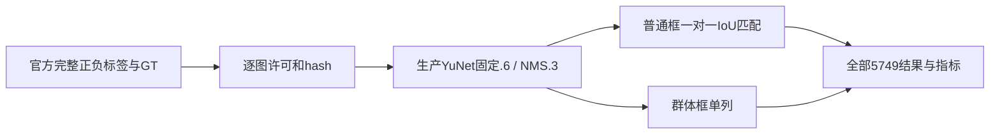

# 人脸真实框评估：完整5749图

**全部5749张均已尝试：5748张推理成功，1张36.15MP原始输入被现有25MP门槛拒绝；未漏列。以下指标不代表全部原尺寸输入均支持，也不代表每张人脸被检出。** 竞品许可处理链仍R0。

| 数据范围 | 完整数量 |
|---|---:|
| 人工确认有人脸 | 3,124图 |
| 人工确认无人脸 | 2,625图 |
| 图像总数 | 5,749图 |
| 普通人脸GT | 5,441框 |
| GroupOf | 153框，单列 |



## 原字节输入下普通人脸框实测

| IoU门槛 | TP | FP | FN | Precision | Recall | F1 |
|---|---:|---:|---:|---:|---:|---:|
| 0.25 | 4337 | 1133 | 1104 | 79.29% | 79.71% | 79.50% |
| 0.5 | 4149 | 1321 | 1292 | 75.85% | 76.25% | 76.05% |
| 0.75 | 2816 | 2649 | 2625 | 51.53% | 51.76% | 51.64% |

## 全类统一1024标准化variant

另对全部5749张使用相同longside≤1024、不得放大规则；5745张输入字节未变化，复用已绑定的同代码／同权重／同输入预测，4张变换输入重新实际调用生产检测器。不是声称再次执行5749次推理，也不把原图1张拒绝改写为原尺寸成功。全部5749张标准化输入均成功。

本次4张变换后的总体TP/FP/FN/P/R/F1与原字节报告相同；完整逐图原图hash、实际输入hash、几何和预测见[标准化5749完整结果](../../评估/OpenImages人脸全量验证20261014/normalized-1024-all-images.jsonl)及[标准化协议记录](../../评估/OpenImages人脸全量验证20261014/normalized-1024-report.json)。

2,625张人工确认负例中2,624张完成原尺寸推理，1张输入拒绝不当作TN。完成推理负例中，482张产生候选，共556个候选；这些计入FP。

## 群体框与独立修正

| IoU门槛 | 群体框覆盖 | 群体内忽略候选数 |
|---|---:|---:|
| 0.25 | 142/153 | 1831 |
| 0.5 | 142/153 | 1831 |
| 0.75 | 142/153 | 1836 |

153个GroupOf不被当作153个人脸计入普通框TP/FN。普通框先按分数降序一对一匹配；未匹配候选与群体相交面积／候选面积≥0.5时单列忽略。群体覆盖按全部合格群体的并集计算，不冒称官方Open Images mAP。

A对抗审查发现原辅助计数仅分配首个重叠群体；已保留原始推理行与代码，独立派生修正群体覆盖，逐行证明TP/FP/FN、候选及GT完全不变。

## 完整文件

- [全部5749逐图GT、候选、指标及hash](../../评估/OpenImages人脸全量验证20261014/all-images.jsonl)
- [全部逐图作者、标题、原页、许可、下载URL及hash](../../评估/OpenImages人脸全量验证20261014/image-attribution.json)
- [原始推理结果](../../评估/OpenImages人脸全量验证20261014/raw-inference.jsonl)与[独立派生修正记录](../../评估/OpenImages人脸全量验证20261014/group-coverage-correction.json)
- [全量hash／源码／模型绑定验证](../../评估/OpenImages人脸全量验证20261014/full-binding-verification.json)

文件不包含原图；原图只保存在被Git忽略的本地评估目录。模型权重、源码、标注来源、当前生产face预处理／decoder／NMS路径以及全部5749图像hash均已核验。

## 来源、许可与边界

[官方数据描述](https://storage.googleapis.com/openimages/web/factsfigures_v7.html)的标注许可为Google LLC CC BY4.0；每张选中图像的[官方署名CSV](https://storage.googleapis.com/openimages/2018_04/validation/validation-images-with-rotation.csv)均记录CC BY2.0与作者／原页，官方保留逐图许可担保免责声明。下载来自官方链接的[CVDF镜像](https://github.com/cvdfoundation/open-images-dataset)。

[官方旋转说明](https://storage.googleapis.com/openimages/web/2018-05-17-rotation-information.html)明确框使用CVDF传感器方向，本评估不额外旋转。全部原图字节、官方GT和人工正负标签不因检测效果筛选，未把未标注图像当负例。

YuNet权重和MIT许可证SHA固定；本轮不训练、不调参。公开摄影与中文合同／证件扫描存在域差异，上游训练数据交集未能独立排除。评估只检验人脸候选定位，不证明OCR、印章、签名或全部脱敏规则准确率，也不保证逐像素隐私覆盖。

## 运行恢复与复现

本地Nodev26.6.0评测曾在3801条后约4分钟无新行；确切decoder／inference／I/O阶段未观测，不断言根因。只重启独立评测进程，原3801行prefix hash保持逐字节相同，续跑后全部5749唯一ID完整，无跳过图片，不修改生产启动或模型内存路径。

当前源码包含已修正的未来群体覆盖算法；本次原始推理使用的精确代码版本单独归档。若复用已存在的旧run checkpoint，脚本会拒绝不同评测代码hash，需在单独评估目录重跑或使用本次保存的原始版本与独立派生脚本。

```sh
python3 scripts/download-openimages-face.py
pnpm exec tsx scripts/evaluate-openimages-face.ts
python3 scripts/correct-openimages-group-coverage.py
python3 scripts/verify-openimages-face.py
pnpm exec tsx scripts/evaluate-openimages-normalized-variant.ts
python3 scripts/package-openimages-face-report.py
```
