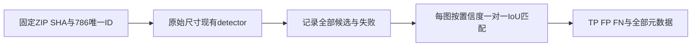

# 混合公开印章 test 全量验证（2026-10-15）

**当前印章候选质量不足以宣称实用自动识别完成。** IoU≥0.5 时，精确率 **17.44%**、召回率 **24.03%**，漏检 999/1315 个标注框、误报 1496 个候选。接口通过、source 合成数值复现通过均不能替代该质量结论。

## 完整范围

[mapo80/stamps](https://huggingface.co/datasets/mapo80/stamps) 固定 revision `998243bde1262ccb57ca28ddd6868b05fd1ddf49`；test **786 张全部执行**，661正图/125负图，1315个 class0 stamp框。786成功、0partial、0错误，共1812候选。没有挑样、训练、test调阈值、缩放原图或重分发原图。

发布者声明CC BY4；逐图上游授权与署名链未核。数据为多来源重新分割，未提供黑白/中文商业章分层，所以这份报告**不能表示独立商业黑白印章准确率**。来源重叠与模型训练集关系未核，不宣称完全独立。

## 框级结果

| IoU阈值 | TP | FP | FN | 精确率 | 召回率 | F1 |
|---|---:|---:|---:|---:|---:|---:|
| 0.25 | 444 | 1368 | 871 | 24.50% | 33.76% | 28.40% |
| 0.5 | 316 | 1496 | 999 | 17.44% | 24.03% | 20.21% |
| 0.75 | 153 | 1659 | 1162 | 8.44% | 11.63% | 9.79% |

按候选置信度降序，每个候选匹配未占用且 IoU 最大的GT，达到阈值才记TP；GT和候选均只使用一次。所有标注同为stamp类。失败图本应保留并将其GT计FN，本轮失败为0。

## 原始来源族（不是黑白分层）

| 文件名来源族 | 图数 | GT | TP@.5 | FP@.5 | FN@.5 |
|---|---:|---:|---:|---:|---:|
| neg_funsd | 20 | 0 | 0 | 10 | 0 |
| neg_rvl_cdip | 105 | 0 | 0 | 28 | 0 |
| stamp_detectation_marcos | 36 | 40 | 13 | 98 | 27 |
| stamp_detection_jsam | 439 | 887 | 225 | 1088 | 662 |
| stamp_detection_stampa | 46 | 72 | 8 | 49 | 64 |
| yolo_stamp_classify | 140 | 316 | 70 | 223 | 246 |

## 复现与边界

- ZIP：95,060,991字节，SHA `c3942fd1dc8037649885c7cec7d5e1c8399b131fe75605083c39d50b674d5f4b`。
- 现有 `detectVisual(['seal'])`，source观察到的红蓝OpenCV链加本工具颜色/底部/黑白候选扩展；原有阈值及NMS0.3均未改。黑白扩展不是竞品已公开的同等算法。
- 本机Node24，最多3个独立评估进程。顺序已完成checkpoint保留后分拆剩余；合并重新核786唯一ID、每张图/标签SHA、1315GT/661正/125负及全部匹配计数，无重复或遗漏。
- [每图完整元数据](../../评估/混合公开印章全量验证20261015/per-image.json)：全部GT/候选/方法/置信度/hash/尺寸/错误/耗时，无原图。
- 同名JSON固定全部代码、官方OpenCV runtime、dataset卡片、分片及合并脚本SHA。脚本 `scripts/evaluate-public-stamps.ts` / `scripts/merge-public-stamp-evaluation.ts`，实际运行日志在 iteration032 的 `public-stamp-*`。
- 主源许可/入口检索另见 `blackwhite-seal-gold-search-20261015.md`。改进模型应另取合法训练/验证集；不得用本test反复拟合后作为独立准确率。

## 独立复算

A 以全部786逐图GT/候选独立重算3个IoU阈值：786唯一ID、661正/125负、1315GT、1812候选及每图/总体TPFPFN全部一致。证据 `iteration032/review-mixed-stamp-independent-A.json`。这是metadata独立复算，不伪作第二轮推理或许可/黑白商业分层核实。
