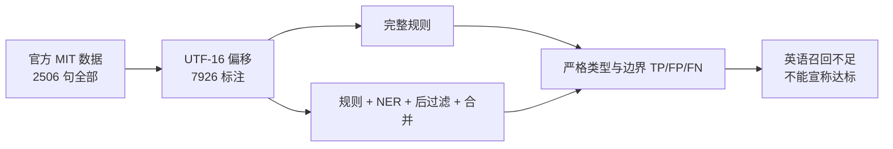

# 真实标注语料全量评测 — 2026-10-14

## 繁体中文官方全量 gold

[UniversalNER 原作者](https://github.com/UniversalNER/UNER_Chinese-GSD/tree/2a0c196d7a54d41119fd069874e976a58f0d7dad)完整 test：**500句，姓名206／机构127／地点434，共767实体**。原作者明确 labels 为 CC BY-SA 4.0；其指定 UD 原文版本也明确许可、包含文本和 Wikipedia 来源。所有500句与该固定版本原文逐句一致，保留繁体与原始空格，以 UTF-16 对齐，没有抽样。

| 默认识别组合 | TP | FP | FN | Precision | Recall | F1 |
|---|---:|---:|---:|---:|---:|---:|
| 完整静态规则 | 0 | 1 | 767 | 0 | 0 | 0 |
| 规则 + 本地 NER + 后过滤 + 合并 | 536 | 211 | 231 | 71.754% | 69.883% | 70.806% |

这是繁体百科的人工 gold 候选识别测量，**不能推导合同／诉讼、公文、号码、金额或视觉准确率**。模型训练重叠未排除，我方没有独立双人复核作者 gold。原文许可、固定版本、模型和结果 SHA 在 `uner-chinese-gsd-corpus-manifest-20261014.json`；全500条结果在 `.data/evals/uner-chinese-gsd-per-org-loc-20261014.json`。11份公开代码冻结副本不含 env 或私有材料。

## 英语跨领域全量结果

官方 CrossNER 的 5 个领域测试集，共 **2506 句、7926 个姓名／机构／地点实体**全部运行；没有抽样。语料是英语 Wikipedia 类文章，由原作者发布、MIT 许可。该集不代表中文合同、诉讼、号码、金额或图像能力。

| 当前默认识别组合 | TP | FP | FN | Precision | Recall | F1 |
|---|---:|---:|---:|---:|---:|---:|
| 完整静态规则 | 0 | 0 | 7926 | 无正预测，未定义 | 0 | 0 |
| 完整静态规则 + 本地 NER 后过滤与合并 | 3 | 6 | 7923 | 33.333% | 0.03785% | 0.07561% |

**英语跨领域识别不达标。** 当前中文字符模型和中文规则不能被表述为准确支持英语姓名、机构和地点。该评测没有给出中文业务准确率，也没有给出全产品准确率。

## 指标与证据边界

- 主指标：严格相同类型和 UTF-16 开始／结束位置。每个预测只能匹配一个 gold。
- 同时保存无类型精确边界、IoU ≥ 0.5 的最大匹配、敏感字符覆盖／遗漏／额外覆盖；重叠指标不替代主指标。
- 语料未标注的实体类型不计入 FP，另行计数；所有无映射标签的句子仍参加评测。
- ONNX 权重与运行锁按 SHA-256 验证；没有发送材料到外部模型。
- 运行使用独立公开源码副本。其后 bridge 新增 source confidence 元数据；当前源码全2506条规则复跑的 start/end/kind 哈希与旧副本一致，NER postfilter/merge函数及7份NER／规则数据 SHA 一致，严格 span 指标可以沿用。这不是重新进行NER推理，也不宣称整产品源码完全一致。
- 完整源码 SHA 并不全部相同：后续仅增加 `replacementFor` 的 clear 分支、replacement union 和 type-only visualCandidates，未进入此次默认候选检测。保存这个差异，不冒称整个产品同一版本。
- 早期并行修改导致的两轮推理被严格版本门拒绝，未生成可用准确率报告。最终副本运行及每 100 条 checkpoint 成功。

## 文件

| 文件 | 内容 |
|---|---|
| `.data/evals/crossner-per-org-loc-20261014.json` | 全部 2506 条结果与全部统计 |
| `crossner-corpus-manifest-20261014.json` | 原作者 URLs、MIT 许可、固定 commit、5 文件 hashes、BIO 映射 |
| `real-porting-evaluation-result-20261014.json` | 可交接的机器可读结果摘要 |
| `.data/evals/snapshots/final-frozen-20261014/snapshot-manifest.json` | 实际运行源码逐文件 SHA，无 env 或 secret |
| `.data/evals/crossner-current-rule-spans-20261014.json` | 全2506条当前规则跨度与冻结版比较；NER依赖指纹等价 |

## 仍须补齐的真实验收

| 范围 | 当前状态 | 必需证据 |
|---|---|---|
| 中文合同／诉讼／公文姓名、机构、地址 | 没有合法且覆盖全类别的真实业务 gold | 取得授权，双人标注并处理分歧，全量偏移评测 |
| 号码／金额等所有规则类 | 无真实 gold 完整覆盖 | 分类型 TP/FP/FN 与边界／有效性错误 |
| 人脸／印章／签名 | 无真实视觉 gold | 框／像素 IoU、漏检与误检，分黑白/彩色/手写来源 |
| Word／PDF／OCR 实际导出残留和版式 | 此候选检测基准未测 | 经用户复核后的副本，文字层、ZIP/XML、像素与版式检验 |
| 竞品逐项运行等价性 | 没有许可，R0 | 正版授权环境真实运行与来源/版本绑定 |

## 原始官方来源

- [CrossNER 原作者仓库](https://github.com/zliucr/CrossNER)
- [固定版本 MIT LICENSE](https://github.com/zliucr/CrossNER/blob/2e7ba2a7798c961e3f29fbc51252c5a8d40224bf/LICENSE)

独立评测数据不会作为产品模型、规则或业务材料上传／发布。
