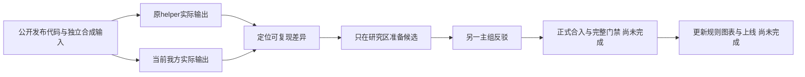

# 051：新增反例与整体可靠性核验

## 当前检查点（2026-10-16）

线上仍050，源码c2cbeb3；当前主树HEAD为c1e7053，792源码/测试/config冻结未改。051正在开展分组三Sol/九Luna审查与修复，当前架构组三子及主审已完成；规则组进行中，前端组尚未完成，不把计划数称已完成。

|项目|实际证据|下一步|
|---|---|---|
|有效映射的可选元数据|公开Python helper保留fallback并忽略非数组details/occurrences/forms；我方实际隔离inspect返回500，正常对照200|数组/record守卫候选4正4负纯函数通过；canonical声明与用户choices/occurrence优先级仍在独立复审，尚未合入|
|Office XML编码|10份独立Python合成DOCX，公开helper与python-docx全部成功；当前我方UTF8有/无BOM两份成功，其余UTF16双端、UTF32双端、GB18030、ISO88591共8份失败|候选10/10读/还原/重读及Python独立读回通过；子审又发现DTD注释误拒和BOM声明冲突，v2修订与应用门禁未完成|
|工程导入回滚|实际隔离API：有效控制200；畸形correction archive导入400，SQL项目/文档数不变，却留下2加密对象与2新owner目录|已确认P2；需覆盖SQL回滚和进程崩溃的可靠清理。设计草案未实现，禁止裸globalDb在FORCE RLS表上判断不存在、禁止全存储按年龄清理|
|任务状态展示|三次detect租约耗尽可能job=failed而规则层仍待处理，retry前置需要保留queued|仅静态P3，最小API/UI投影候选待实际验证；不把修改state当修复|
|隐式MCP接续|较新未交付任务可能遮挡较旧已交付/断连任务；显式job_id和重新人工授权不受影响|仅静态P3；源eligible优先与多候选策略需协调，不能把新409当源同义|
|全91文件API|首段实际19文件：18文件成功，files.integration.ts一测试失败；累计35过1失败、0跳过；后72文件另进程继续|不是全绿；日志/源冻结/首段失败保留，活动日志未固定hash或冒称完成|
|取消后的恢复|原fixture硬编码旧revision0重试失败；独立副本进一步证明当前revision仍不能重试已失效job。按050真实UI的outdated→重新识别动作后，三项原文件API全部通过|正式fixture尚未更新；必须保留旧job拒绝、revision递增、实际重新识别及原件/副本校验，不能撤回取消版本保护|

## 输入输出与验证范围

原始证据在`.data/research/lawbot-2026-10-15/iteration051/`。本轮跨越北京时间午夜，证据目录保留启动日期，正式报告按10月16日记录。

- `mapping-probe-{inputs,ours,source}.json`、`mapping-api-before.json/.log`：独立公开helper与实际隔离接口反例。
- `encoding-source-matrix.json`、`encoding-ours-before.json`、`encoding-candidate-proof.json`、`encoding-candidate-python-readback.json`：输入字节hash、原件未变及完整读回；不是Microsoft Word原生视觉或全部XML编码证明。
- `arch/main-review.md`、`orphan-api-before.json/.log`：架构三子报告经过主动反驳；回滚残留已实测。A初稿无发现及不安全设计草案的否决均保留。
- `full-api-inputs.json`、`full-api-files.json`、`full-api-first-receipt.json`、`full-api.log`：首段正式运行失败，不抹除。
- `files-retry-probe.log`、`files-recognize-probe.log`、`files-generation-recovery-proof.json`：从原失败到正确代次恢复的实测；正式代码没有修改。

编码处理参考[W3C XML 1.0字符编码规则](https://www.w3.org/TR/REC-xml/#charencoding)，该规范不替代输入/输出及应用验收。公开独立helper运行不等于竞品授权应用运行。

258项竞品R0、224S3/34S2及I级保持；这里列出的真实差异继续作为待办，不称全部功能等价。没有修改模型启动/文件读取或生产资源限制，没有为本检查点修改服务器或其他项目。
