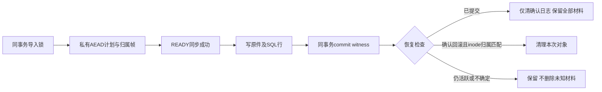

# 051 第一批集成与交叉审查

北京时间 2026-10-16。线上最近一次已验收记录为050/schema039，本轮未部署；本地已集成第一批修复并迁移schema040，服务已恢复。本文件是阶段验收，不代表签名补丁、完整051发布或竞品运行验收完成。

## 实际执行的团队

|主组|调度模型|三名子审|工作|
|---|---|---|---|
|sol051_arch|gpt-6-sol|a_engineering、b_queue、c_permissions，均请求gpt-6-luna|工程、队列、权限及崩溃恢复|
|sol051_rules|gpt-6-sol|mapping、encoding、rules_export，均请求gpt-6-luna|映射、编码、签名与导出|
|sol051_frontend|gpt-6-sol|luna_a、luna_b、luna_c，均请求gpt-6-luna|页面动作、入口、指南及状态|

三组及九名子审均已实际完成首轮报告，由主组反驳后继续跨组审查。环境最多同时运行四个agent，采用分批执行，未声称十三个同时运行。模型列表示实际调度请求；运行时未提供模型内部变体的独立自证。各canonical ID、报告和撤回结论见三份主审报告，不能以计划人数代替实际完成。

## 已集成并验证

|问题|当前修复|实际验证|
|---|---|---|
|有效映射的非数组可选元数据导致500|分别守卫数组与对象；显式token-canonical以fallback键和值为准，保留显式choices/occurrence优先级和无声明歧义|隔离inspect四种有效输入均200、mappingCount=1；22项映射/完整DOCX编码单元通过|
|合法非UTF8 Office XML被拒|按BOM/声明解码并核对一致性，输出声明与UTF8字节一致；真实DTD仍拒绝，注释/CDATA/PI中的字样不误拒|研究矩阵10种DOCX及Python独立回读；正式新增UTF8/16/32整件读回和负例；完整单元门禁通过|
|取消后页面保留旧材料版本|读取并应用完整快照；读回失败进入冲突状态，由用户重载，不重复取消POST|真实Edge正常取消→新版本重新识别通过；实际取消已提交但POST回执丢失且GET失败→手动重载通过，POST仅1次、原件hash不变|
|文件夹结果漏掉刚取消的上一代任务|新版本任务优先；仅outdated且最新任务为紧邻上一版本detect/cancelled时作为最近尝试展示；GET与manifest共用|候选树原失败文件5项API通过；候选树新增2项API覆盖重识别、新任务优先、过旧取消拒绝、预设自动取消和合成竞争；正式files三项通过|
|导入SQL回滚残留加密文件|040同事务commit witness、advisory锁、AEAD归属日志、inode绑定；异常/idle worker精确清理；新旧临时资源双路径释放|有效导入200、畸形纠错归档400且0新对象/owner；真实SIGKILL、active并发、提交后停用用户/RLS、IO重试、碰撞与idle清理通过；正式隔离回归1项含命名检查点通过|
|候选存储硬链接引入释放残留|修复source release、output cleanup及INSERT失败补偿，兼容旧空marker|10项独立文件系统/fake DB反例通过；真实接口回归亦覆盖资源释放|

导入日志v3对10000 owner反复重写约10.94GB，已改为单文件HEADER/CLAIM/READY或ABORT的线性AEAD帧。合成10000 owner的实际日志2,230,096字节；11项帧格式/篡改/截断/碰撞探针通过。READY同步成功前不能写材料。进程若恰在mkdir与归属帧之间中断，可能留下空目录和待人工核对日志；不会据planned ID删除未证明归属的目录，不宣称任意崩溃点零目录残留或硬件掉电耐久性。

## 门禁与剩余工作

- 原050冻结792文件，91个API测试文件全部执行：88文件成功、3文件有失败，177项通过、4项失败、0跳过。四段原始日志保留；不称全绿。失败分别涉及旧代次retry夹具、真实文件夹取消状态缺陷、外部回填保留未知标签后尚未更新的两处旧断言。旧断言已改为核对真实下载字节与unknown统计，严格受管还原默认不变。
- 第一批主树完整`pnpm check`退出0：11条Bend法律、13个错误变异拒绝、类型检查、132个单元文件/772项测试/0跳过和Vite构建通过；真实旧Office控制开关已开启。输入hash逐文件未变。该门禁不覆盖之后仍在研究区的签名与进度补丁。
- 真实Edge截图又暴露取消后的旧events进度重试提示；最小补丁与更强浏览器断言已准备，尚未集成验收。不能把前两条Edge通过当作该后续缺陷已修复。
- 签名跨格整组决定、同名不同位置、Office位置验证仍在研究区。交叉审发现过同part换位漏检、原名明文落库、历史缺组材料以及profile/forceSkip策略不一致，均需以最新候选及真实API/Edge关闭。已否决版本保留，未将最新输出冒充旧版原始证据。
- 隐式MCP接续选择仍有P3待办；新选择策略不能冒充源合同同义。真实语料准确率、原生Word视觉、未取得的私有服务实现和合法激活后的竞品处理运行仍未完成。

所有原始证据位于`.data/research/lawbot-2026-10-15/iteration051/`。主树旧源码的精确字节由集成前已存在的不可变Git提交`7ef93d6`恢复归档，并核对与原pin一致；归档文件在工作树写入后物化，未丢失旧字节。转换清单明确记录时间边界。未固定活动日志的hash。

258项竞品R0、224S3/34S2及I级保持。没有变更模型启动/文件读取方式，没有变更生产资源限制、服务器或其他项目。后续修复、文档和部署仍待完成。
