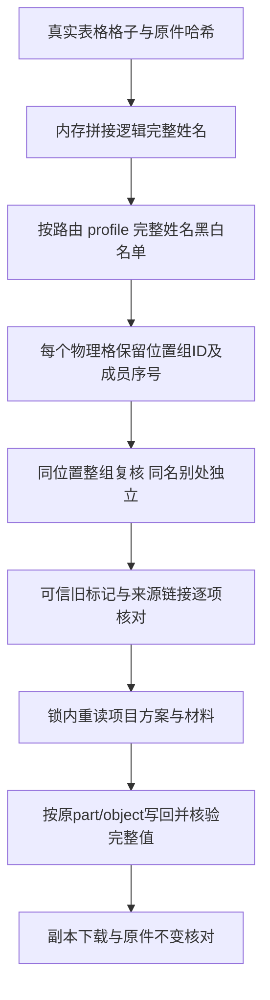

# 051 第二批：签名整组、取消状态与接续选择

2026-10-16。三Sol主组与九Luna子审首轮已完成，当前由三主组跨组反驳。环境四并发槽分批调度，未同时运行十三个agent；模型名指明确调度请求，运行时没有模型内部变体的独立自证。[第一批及实际团队](reliability-051-integration-20261016.md)。

本轮只分析所获0.5.9公开发布代码，未绕过授权。258个稳定ID保持R0，224项S3/34项S2及我方I级不变。当前线上最后验收050/schema039，本文件记录本地051；原件、历史及已签发链接保留。模型启动方式与生产资源限制未改。

## 规则与实现

|事项|本地结果与具体证据|
|---|---|
|拆格姓名|CSV、Markdown、DOCX、XLSX保持独立物理span，并存`signatureGroup={id,memberIndex,memberCount}`；不新增完整姓名明文落库。UI仅临时从授权原文拼接组标签，同名不同位置不同ID|
|复核原子性|单项、批量、实体组都扩展到同位置完整姓名；半删/改型/移动/伪造/重复或分数来源链接均拒绝，正式API核对拒绝前后材料与snapshot不变|
|规则与项目方案|完整姓名forceSkip/forceDetect按路由比较；单字规则不拆半组；profile禁用姓名时强制检测匹配组仍保留；worker发布锁内读取项目方案并解析文档配置|
|历史与备份|旧缺组材料新复核/新导出需重新识别；既有记录和已签链接保留。四codec对应组从原件重建，外来审批不可信；正式API验证native重开回待确认，不沿用外来分组/批准|
|Office位置与图片|不仅计数，逐(part,object)核对整对象预期值，原有包/属性/全文检查保留。同part交换遮盖/保留单元格、隐藏属性残留被拒；含原生拆格表与重命名JPEG的真实ZIP正例通过|
|DOC/WPS|使用已核验原件及规范化DOCX读取；DB保留原source_format，临时处理投影不篡改原件身份；正式签名API覆盖ZIP兼容老扩展。真实CFB与转换器另经全量API验收，不将ZIP兼容夹具冒称CFB|
|取消后的旧进度|outdated/conflict不挂载旧进度；cancelled不请求events；succeeded/failed终态404/409停止重试。两项真实Edge均跨6.2秒观察旧events数量不增，响应丢失后仅一次取消POST|
|隐式MCP接续|无ID时先找源六个稳定阶段的已交付任务，多个按更新时间选首项；找不到时保留既有云端first-open扩展。显式ID、终态、损坏阶段及人工再授权门禁不变；没有引入新的多候选409政策|

当前Office分组来自原生段落/表格；图片OCR不产生此类signatureGroup。未来扩展图片拆格组需要独立的原件/输出图片位置映射，不能沿用原生paragraph/cell假设。

## 实际执行与保留的失败

- 第一轮签名API2过4失败发现发布阶段漏载项目方案，造成合法导出误拒与PROCESSING_FAILED重排；真实DB日志与独立纯函数诊断一致。修复最终锁内项目重读与错误码后，第二轮4过2失败。
- 第二轮余下两失败为测试错误：`parseFile(csv).text`使用换行拼接各格，不能断言有逗号；profile默认星号方式应输出`*`。改为解析实际CSV原始字节、精确比较全表；第三轮6项全过，0跳过，未增加等待或清空任务掩盖失败。
- 首轮Edge走到真实下载时仅期望类型占位符与默认星号不一致；原trace/错误上下文/测试版本归档。修订后完整39.4秒通过；为文档滚动到实际签名卡片后再完整40.4秒通过，原件字节/hash与六格输出均核对。
- 跨组发现签名候选把HEAD第一批稳健取消逻辑替成旧版。已从HEAD重建，仅合入签名与progress六个hunk，其余19生产路径只读审查无同类回退。新版取消Edge21.2秒、响应丢失18.9秒各通过。
- 完整check首轮133文件中130成功，773项过3失败，0跳过。三失败均为新verifier错误地将导出后的图片名称用于读取原件。现按是否存在原生签名组读取源native绑定，输出仍校验实际图片及coverage；定向4文件20项全过。失败日志和修复前源码保留，未改旧测试绕过。
- MCP候选首轮在协议通知回执断言200而实际202处失败，未执行到业务选择；按现有协议改成精确202，并显式请求MD交付。第二轮47.7秒完整通过：两次真实原件/授权/识别/复核/导出/交付，较新未授权A不遮挡已交付B，A SQL字节/版本/时间完全不变；再次人工授权前拒绝bytes，授权后hash与原交付相同。多个已交付选新C，合成running/damaged边界与实际取消/跨租户也通过。
- 独立编码审查对Git旧实现与当前五组Word实际导出逐字节一致，未复现普通已签链接假设；还原DOCX声明有差异，但旧下载读取已存bytes/hash而不重跑还原。没有为未证实的风险修改产物门禁。

## 当前门禁

809个源码/测试/配置输入已冻结。最终完整check退出0：Bend11条/13错误变异拒绝、133文件777单元、类型与构建通过，0跳过，809输入前后hash一致。95文件API隔离回归仍在执行，尚无完整接口全绿结论；每个API文件使用独立新数据库，停止于首个失败。源输出/证据变化单独归档，不覆盖先前pin。终端结果、输入一致性与后续补证见`reliability-051-secondbatch-verification.json`，生成后才纳入台账。

指南已加入拆格姓名与取消恢复，25节24张实际截图，其中051四张图来源和SHA见`iteration051/guide-image-provenance-051.json`。截图和同名CSV实际下载均为合成材料、隔离账号；本地页面不证明已部署。

## 未完成或不能外推的范围

完整95文件API、最终门禁、051服务器发布和线上读回仍在执行/待完成。真实业务金标、印章/签名等自动识别准确率、Microsoft Word原生视觉、平台组件与未取得的私有服务实现，以及合法激活后的竞品处理运行仍没有完备验证依据。当前有界公开静态合同已合图，不宣称完整产品等价或未知规则被穷尽。
