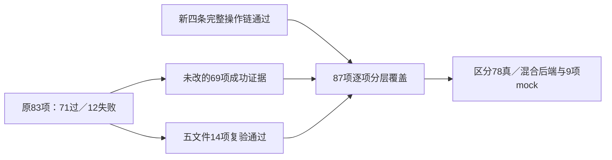

# 052：完整页面排查、规则分支与实际操作验收

日期：2026-10-16。产品运行代码与已部署 **051e／schema044** 相同，本轮改动为测试和文档；未改模型加载、生产资源限制或相邻项目。公网只读健康返回 rules/NER ready，外部 AI 仍未配置；本地 5178/4318 已恢复。产品上线证据仍见 [051e](aliyun-release051-verification-20261016.md)，本轮没有用业务账号创建测试项目。

## 验证结果及计数方法

| 门禁 | 实际结果 | 范围 |
|---|---|---|
| 原完整 Edge | 51 个 spec、83 项：71 过／12 失败／0 跳过 | 原始失败、trace 和 854 输入冻结保留 |
| 五文件复验 | 14 项通过 | 三项几何、词表状态提示及 9 项 mock UI 回归；保留精确尺寸、持久化、像素和防串断言 |
| 新四链最终复验 | 4 项通过 | 真 Edge、隔离数据库、真实文件；未模拟 API |
| 分层覆盖 | **69＋14＋4＝87** 个唯一测试 | 78 项真实或混合后端、9 项全 mock；**不是单次 87 项全绿** |
| 完整 `pnpm check` | **134 文件、793 单元；Bend 11／13、类型与构建通过** | 最终 856 输入前后不变，0 跳过；Bend 只证明已建模纯函数 |
| 105 文件 API | 保留既有 38＋1＋66＝209 成功证据 | 后端运行源码未改，不冒称本轮重跑全部 API |

原 12 项失败的分诊：三项测试在自动保存状态引发重排时按旧屏幕坐标拖拽，现等待真实草稿保存并验证实际 pointerdown 命中 SE 手柄；一项仍等待旧文案；八项 mock 未配置新增的 recovery-prompts 只读请求。产品动态 DOMRect 映射保留，未因测试预设改变滚动／缩放语义。mock 还补齐草稿 writer 的修订、epoch、sequence 及幂等 close；原九条 test body 未弱化。

新增四链的首轮 4 项建项时序失败、第二轮 2 项下拉框定位失败也保留。创建测试现在等待真实 POST 200 与导航选中；下拉框按真实可访问角色定位。一次正则选择尝试被标准 runner 在建库前拒绝，执行 **0 测试**，未计作业务失败或成功。测试过程中覆盖的历史生成图片已按原字节恢复，当轮图片另存。

## 四条可照着操作的流程

以下全部使用合成材料。截图是实际 Edge 页面原图；处理结果由下载字节／数据库及哈希断言验证，截图本身不代替产物核验。

| 功能 | 操作顺序 | 实际核验与截图 |
|---|---|---|
| 文件夹结果 ZIP | 导入材料→选择目录→上传；复核其中一份并生成副本；返回列表→文件夹结果与处理清单→选批次→整理结果→生成 ZIP→下载 | 成功 1、跳过 1；ZIP 保留子目录、HTML 清单，无未生成文件的原文副本，处理 TXT 无原手机号；两份原件实际字节不变。[截图](../../使用指南/截图-20261016/052-目录结果ZIP.png) |
| 已知密码 PDF | 上传加密 PDF→打开材料→输入文件密码→解锁→继续识别 | 错密码 400 且版本不变；正确密码后版本 1、真实处理完成，原加密对象及字节不变。候选仍待人工确认。[截图](../../使用指南/截图-20261016/052-加密PDF解锁.png) |
| 单材料处理方式 | 上传 TXT→本材料识别与脱敏设置→全字符星号→保存并确认重新识别→逐条复核→保存→导出并下载 TXT | 配置生效，实际 TXT 手机号成为 11 个星号；原件真实字节不变。截图显示只读原文和已核验下载状态，原文不会被处理结果覆盖。[截图](../../使用指南/截图-20261016/052-单材料设置.png) |
| 个人规则应用 | 反馈与个人规则→导入 JSON→迁入规则库（保持未启用）→脱敏方案与规则库→选择迁入库→应用到当前项目并确认→提交材料识别 | 迁入回执 activated=false；项目明确应用后才消费，本次新条目的 ruleset-force-detect ID 精确匹配实际候选来源。候选未自动批准。[截图](../../使用指南/截图-20261016/052-个人规则应用.png) |

个人 JSON、参考词典 Excel 和规则库 XLSX 是独立入口，本次 JSON 链没有把另外两种导入伪接成同一流程。四条正式测试见 [critical-user-paths.spec.ts](../../../tests/e2e/critical-user-paths.spec.ts)。

## 金额分支补证

41 个基础组、12 金额族／17 条正则、35 个场景 ID 已逐项核对接线；未发现本轮可具体定位的漏抄公开规则。原单测按 12 族举例，有五条源分支缺少独立有效正例，现补入正式测试。期望写死来源语义，不从当前规则 JSON 动态生成 oracle。

| 源分支 | 独立正例 | 精确结果 | 边界 |
|---|---|---|---|
| L2037 | 合同金额：壹仟万元整 | AMOUNT-label | 该支不足三字的大写金额拒绝 |
| L2049 | RMB 20000 | AMOUNT-currency | RMB 2 拒绝 |
| L2054 | 人民币30000元 | AMOUNT-currency | 人民币3平方米拒绝 |
| L2059 | 合同金额：（壹万元整） | AMOUNT-uppercase | 无金额／币种上下文的括号金额拒绝 |
| L2078 | 20000元人民币 | AMOUNT-currency | 12元人民币仍保留合法 standalone_yuan 的12元 |

五正五负均校验 UTF-16 偏移、完整候选、pending 和无自动遮罩／批准。研究区逐一删除这五条分支，对应固定正例每次均失败，其余四条保持通过；L2054／2078 删除后会降级为较短 standalone_yuan，故只测“存在金额”不足以检出遗漏。五项删除变异不是 Bend 证明，也不是业务准确率评估。完整规则与十个 JSON 原值块仍在 [技术交接](../../脱敏规则完整技术交接-迭代023.md)，本轮未改规则实现或 JSON。

## 仍未完成的范围

| 项目 | 已有证据与剩余边界 |
|---|---|
| 工程恢复文件名路由 | 052末轮对抗复核新发现：工程草稿恢复的 freshPortableMarks 未传入原文件名，自动类型为 auto 时，民事判决书.pdf 可能重新加入本应被法律材料路由抑制的 SCENE-form 候选。worker／OCR 已有文件名上下文；portable fresh 属真实遗漏，053候选修复与隔离回归准备中，尚未合入或上线。 |
| 公开代码边界 | 台账仍为 258 入口、37 链路，224 S3／34 S2；I1 148、I2 12、I3 60、I4 38。没有用新测试批量升级静态／实现状态。 |
| 竞品授权运行／私有服务 | 258 项仍 R0；无许可证处理链及未取得的服务端实现不能宣称已运行或完全等价。 |
| 印章质量 | 同码历史公开混合集 786 图／1315 GT，IoU≥0.5：TP316、FP1496、FN999，F1约20.21%。本轮核对六个代表错例及代码，无确定坐标／通道／源移植 bug；低对比、绿色及黑白形状覆盖和表单误报仍是真差距，不在已接触 test 集上调阈值伪造独立成绩。 |
| 签名与真实业务金标 | 既有35张公开验证 F1约62.22%；样本及训练重叠边界保留。真实合同、扫描件和业务规则金标尚未完整验收，流程通过不证明算法达标。 |
| Word 原生视觉 | 真实 Word 文件格式与浏览器流程有分项证据；Microsoft Word 原生逐页排版／对象兼容仍未全面验收。 |
| 自动交付模式 | 仍按现行人工复核规则，改变该业务约束的方案待明确选择；不能自动把候选变为已批准。 |
| 模型选型 | 按要求暂缓对标未知模型，本轮没有优化启动读取或替换模型。 |

因此本轮可以交付完整的已知规则清单及上述分项验证，**不能宣称全部原产品逆向穷尽或真实业务准确率全面达标**。

## 证据入口

工作区 `.data/research/lawbot-2026-10-16/iteration052/` 保存原始 log／JSON／trace、逐轮输入 SHA、旧字节及互审报告；`arch/layered-edge-87-coverage.json` 列出87个唯一 ID 与来源，`final-check-receipt.json` 对应完整检查。截图来源另有 `delivery-screenshot-provenance.json`。台账更新后运行 maintain.py 生成与校验，保留历史失败及竞品 R0。
