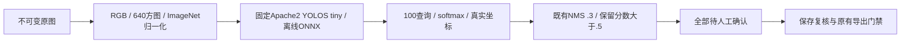

# 签名定位：真实金标评估与合法离线模型

这是我方独立能力补足；官方Windows源只观察到彩色章检测与YuNet人脸，未发现可声称等价的自动签名模型。

## 真实边框评估（IoU ≥ 0.5）

| 数据与方案 | TP | FP | FN | Precision | Recall | F1 |
|---|---:|---:|---:|---:|---:|---:|
| 35张：旧形状启发式 | 0 | 263 | 35 | 0.0% | 0.0% | 0.0% |
| 35张：新模型原始输出 | 30 | 57 | 5 | 34.5% | 85.7% | 49.2% |
| 35张：实际默认模型＋NMS | 28 | 27 | 7 | 50.9% | 80.0% | 62.2% |
| 35张：训练集冻结高分.94，仅比较 | 21 | 6 | 14 | 77.8% | 60.0% | 67.7% |
| 37张RF100原test：实际默认，可能训练重合 | 45 | 28 | 9 | 61.6% | 83.3% | 70.9% |

35张完整官方validation并非test；143张官方train仅用于置信阈值比较，未按validation调参。默认仍保留全部分数大于.5的候选，不为提高precision静默丢低分内容。37张是完整RF100原test，但模型训练已包含同一数据族，不能宣称未见泛化。

真实误报与漏报仍存在，尤其严格IoU.75定位。合成回归与ONNX数值对照不代表真实中文合同准确率，更不代表竞品授权处理等价。

## 模型与许可

模型固定为[mdefrance/yolos-tiny-signature-detection](https://huggingface.co/mdefrance/yolos-tiny-signature-detection/tree/b788cf7376464453c3dea1e5ee8589adcaa0c634)，Apache2，6,471,366参数，ONNX26,102,349字节。公开safetensors官方LFS SHA256核验一致，本机离线转换，ONNX checker通过，PyTorch/ONNX最大绝对差≤1.58e-5。模型、许可、NOTICE和配置全部固定hash；原始公开材料不提交仓库。

## 尚需的真实金标

AOSSig需正式申请并受非商业条件约束；tech4humans419test需同意分享联系信息；DKDS官方OneDrive目前不可达/匿名API401；Tobacco官方许可未取到。未代用户提交个人信息、申请或绕访问门禁。DKDS即使取得也属历史日文印章域，不能替代中文商业黑白章的真实金标。

实现、来源、全部分阈值计数、文件hash与实际错误证据见同名JSON。最终使用与生产对齐的 bundled Node24.19，完整 Edge 流程18.4秒通过并自动退出清理，无手动终止或强制退出。包括签名按钮、区域OCR/真实剪贴板、椭圆与237字符原始类型、完整标注下载。此前系统Node26.6有两轮业务通过后IPC teardown卡住并人工结束，历史记录保留，不把Node内部根因当已证实。
