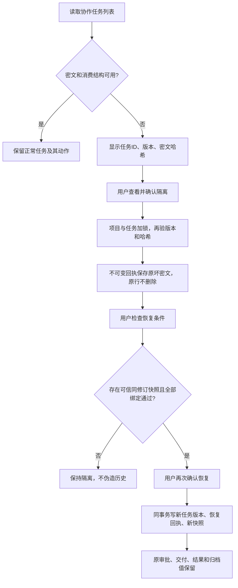

# 051第四批：协作任务存储隔离、备份及同版本恢复

## 当前检查点

SQL044、API、协作页及专项测试已正式合入本地，尚未部署。v26正式隔离库API首轮2/2通过；v27归档链接兼容修复和真实撤权组合专项1/1通过。完整check134文件783单元、Bend11/13、类型及构建通过。真实Edge第二轮1/1通过并正常退出；本机已迁移044、恢复开发服务。线上仍050/schema039。854输入的105文件API完整回归正在执行。

此次补齐针对已取得的0.5.9公开桌面任务修复合同：先明确确认、保留坏索引备份，再进行恢复。Web以逐任务版本和不可变密文回执实现；不声称操作了供应方私有存储，258项竞品运行状态仍R0。

## 操作及事务

|接口／存储|语义与必要检查|
|---|---|
|`GET /api/ai-collab/tasks`|正常记录独立列出；坏行返回issues，已隔离回执独立列出，不能把不完整列表说成完整|
|`GET /api/ai-collab/storage-status`|保留健康数、损坏条目和隔离状态；隐式MCP接续遇不完整存储需明确拒绝，不能悄悄选另一个任务|
|`POST /api/ai-collab/tasks/:job/quarantine`|`confirm:true`、revision、payloadSha256、requestId；项目和任务锁内复核；失败不删改原行|
|`GET /api/ai-collab/quarantine/:receipt`|当前owner和项目权限；仅点击检查后验证快照与真实对象，不在列表逐行重型扫描|
|`POST /api/ai-collab/quarantine/:receipt/recover`|明确确认、同当前版本与快照哈希；事务内生成新版本，重复请求按requestId幂等|
|`ai_collab_task_quarantine`|不可变坏密文、哈希、版本、时间、actor和requestId回执；应用只可SELECT/INSERT|
|`ai_collab_task_snapshot`|创建及每次任务变更同事务保存；旧任务不伪造历史，缺少同版本快照就不能恢复|
|`ai_collab_task_recovery`|不可变恢复回执绑定隔离回执、前后版本和可信快照哈希；应用只可SELECT/INSERT|

三表均FORCE RLS，限制owner、tenant及当前项目`view_original`权限；恢复任务元数据不授予新的review、export、restore或view_mapping权限。后续动作仍逐项检查原权限。备份或快照INSERT失败时任务变更回滚。

## 已签发任务与结果的完整性

恢复读取的是**同当前revision**的快照，不接受任意历史版本。逐项核对源文档ID／内容哈希、识别job及真实retry关系、每份交付artifact行和实字节、组合对象、每轮返回稿对象／哈希／格式、已有归档回执与源和结果绑定，以及已完成还原的derived对象。validated结果要解析；已明确拒绝的坏UTF-8结果只按其保留对象哈希核对，不误称有效文稿。

恢复只写任务、恢复回执和新快照，不重签发、不重新批准、不重复创建归档或还原产物。原文、artifact、结果对象和归档密文保持。旧版无归档回执的validated轮次不得补造归档；没有可信同版本快照的旧坏行则明确不可恢复。

坏密文尚未确认隔离时，已有独立AEAD有效的归档回执也允许只读下载：先通过owner/tenant RLS、项目共享锁和当前`view_original`／`review`权限，仅对`TASK_STORAGE_INVALID`回退；实际对象哈希仍校验。无回执返回404、坏回执409；缺少加密密钥透传为配置错误，不伪报成损坏归档。该读取不修改任务，不创建隔离回执。

## 已有证据及待验

- 研究v26两项隔离API通过，包含完成还原后恢复、真实retry后交付、拒绝结果修正、撤权、并发幂等、备份失败及快照失败回滚。无归档回执兼容测试是管理员只删除合成测试receipt的受控夹具，不能当自然生产故障。
- 架构组按固定SHA做v25及v26增量反驳，未找到仍成立的确定P1/P2；其只读审查与规则组实际DB运行分别标明。
- 根组正式首轮：`task-storage-formal-api-attempt01.log`，2/2通过、0失败、0跳过；五文件输入清单及回执位于同一iteration051研究目录。该结果先于确认隔离前归档读取的后续修复。
- v27研究修前1/2通过，确认隔离前归档返回409；修后独立新库2/2通过。原始失败、v26冻结字节和v27增量复审分开保留。
- 根组坏密文与真实撤权组合：正式专项1/1通过。归档receipt和损坏由隔离库管理员合成，权限撤销通过真实成员API执行；确认前两个下载200且哈希一致，撤销review后列表／归档／结果三路403、任务行不变。
- 完整check在854输入下134文件783单元、Bend11/13、类型和生产构建通过，输入哈希未变。Edge首轮因测试在签发链接前采样artifact行而失败：签发正常更新issued_until，随后整行比较不等。修订仅把基准移到成功签发之后、损坏之前，保留整行及issued_until断言；产品代码、API测试及单元均无变化。最终854清单只更换该Edge测试，类型检查再过，等价回执保留两份清单的逐文件差异。
- 正式真实Edge第二轮1/1通过，45.3秒、进程退出0，854输入未变；真实页面完成两次确认，三张本轮截图包含损坏、隔离与恢复。原文／artifact／归档行、坏密文回执、同版本快照以及签发／归档／结果三个下载的实际哈希均检查。
- 第一次105文件API为换Edge测试冻结点而受控终止自己的隔离测试子进程，runner正常执行数据库清理：6文件、9项通过、0失败、1取消，原因JSON及原日志保留。新854冻结下105文件完整回归仍执行，未称全绿；私有Git最终同步及服务器发布另记。
