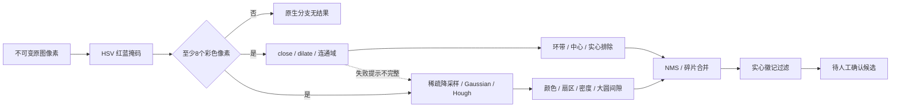

# Windows 官方印章原生分支静态分析与实现

官方 Windows 0.5.9 安装包完整下载并核对官方 SHA512；源码位置、版本、哈希、全部实现和独立对照日志见同名 JSON。未绕过或运行桌面产品授权处理链。

| 分支 | 结论 |
|---|---|
| 官方完整Windows0.5.9静态包 | setup SHA512匹配官方latest.yml，32,879字节seal_detector.py ASAR内与resources外同hash；cv2/version.py为4.10.0.84。 |
| HSV红蓝预筛、稀疏Hough降采样 | OpenCV实际RGB→HSV；red H≤20或H≥170，blue H95–135，S≥60 V≥70；像素<8返回空；nearest、5x5 Gaussian sigma1.2、短边800(下限480)。 |
| 颜色连通路径 | 实际椭圆close/dilate/8连通域；原closedmask紧框，尺寸/面积/aspect/fill、band/center、实心照片/框线/签名排除；全部门保留，seg异常诊断后继续Hough。 |
| Hough圆路径 | 实际HoughGradient dp1 minDist2r param1=50/param2=20 minR=.035short/maxR=.22short；源round-even、反缩放、红蓝密度/8扇区/中心盘/.055red蓝.22或.30、large密度.15与gap50°、pad/confidence。 |
| 去重、碎片合并、实心徽记过滤 | IoU>.3或同色互含中心NMS，大小比≥.5距离≤1.12size聚类，union aspect .55–1.8；原HSV最大连通占框比≥.18过滤。 |
| 所有公开参数支 | minColorRatio/minSectors/minRRatio/HoughVote/maxShortSide/colorSeg/ringDensityRedBlue/largeDensityGap/segMinArea/emblemFill；programmatic opts，生产默认源值。 |
| 黑白章/自动签名证据边界 | 官方完整脚本红蓝预筛即拒绝无彩色页，手写签名仅误报排除；visual-sensitive-v1只有YuNet face模型+metadata。未发现自动黑白/签名模型，不能把我方monochrome/signature候选称竞品算法等价。 |
| 异常与WASM对象生命周期 | 准备阶段、局部morphology/CC逐个构造均受finally；转换失败/第2/第6/第8/第9对象构造注入live=0；seg失败不跳Hough，warnings/complete经过API聚合+UI提示。 |

## 验证范围

同版本 OpenCV 的 26 组独立纯算法输入，全字段输出 26/26 一致。包含红蓝、褪色橙色、灰黑负例、实心/空框/双章/细线/大弧/裁边、降采样及参数支。WASM 转换/连续分配故障注入无剩余 Mat；颜色分割异常后继续 Hough 并显式标识不完整。

这不是竞品桌面完整运行验收或真实业务准确率评测。黑白章和签名仍是我方扩展候选，不能称有官方模型或数值等价。
