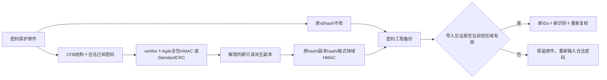

# 已知密码 Word／Excel 解锁与完整工程备份

| 分支 | 实现与验真 |
|---|---|
| UW01 ECMA376Agile password slot | Known nonempty wellformedpassword≤4096; AES128/192/256-CBC key/package separate params, SHA1/224/256/384/512/MD5 metadata guards; spin specmax10million, strict salt/hash/block/keyslot fields; keyverifier+full encryptedpackage HMAC authenticator (upstream decrypt omittedHMAC). Multi-password slots searched for same supplied password, no guessing. |
| UW02 ECMA376Standard AES | SHA1 50000-roundKDF, AES128/192/256-ECB key binding/provider/flags/verifier; header64bit length/completecipherblock and ZIP CRC/structural validation. Standard spec has noMAC; no claim authenticated encryption. |
| UW03 CFB metadata/immutability | sourceBuffer copy, originalHash before/after; FAT/DIFAT/MiniFAT dimensions/chains/cycle; beforeCFB.read raw directory livecount≤10000/rootstreamtype/LRCtarget/uniqueparents/iterative tree/no orphan/depth budget reject malformed tree instead giantstring RangeError. |
| UW04 Portable derived document | Complete encrypted original and separate derivedentry. Current DATA_KEY domain-separated HMAC originalHash/derivedHash/format authenticates samecryptographicserver-domain export; importnew original+derivedIDs/freshdetect/allpending/no oldapprovedsnapshot. Unknown witness/crossserver/tamperedderived rechecksums cannot trustderived; keeporiginal and reportunlockRequired. Original+derivedquota counted. |

## 安全复证

- 6 项定向测试：真实加密DOCX／XLSX、正确／错误Unicode密码、300／4096字符合法密码、4097拒绝、原件不可变、payload/HMAC/header/FAT/XML/目录环篡改。
- `cfb` 第三方目录解析潜在巨大字符串分配在进入解析器前拒绝；未通过限制宿主资源掩盖非法输入。
- 真实工程 API 导出／导入／fresh worker、异服签名与重新计算checksums的篡改副本均通过，原始 encrypted source 与派生副本独立保存。

## 边界

- Legacy DOC/XLS 尚需要合法转换管线；不能把binary输出冒充DOCX。
- Standard加密规范没有消息认证；校验 verifier、ZIP CRC和结构，不能标为authenticated encryption。
- 未有合法竞品处理链的外部互通运行验证，也未穷尽全部Office加密方言。
- 不破解或猜密码，不绕软件激活，不将失败原件当解锁结果。
- 8个纯JS生产依赖 exact运行闭包/许可证/逐文件SHA见 `officecrypto-runtime-lock.json`；不安装新的宿主系统服务。
